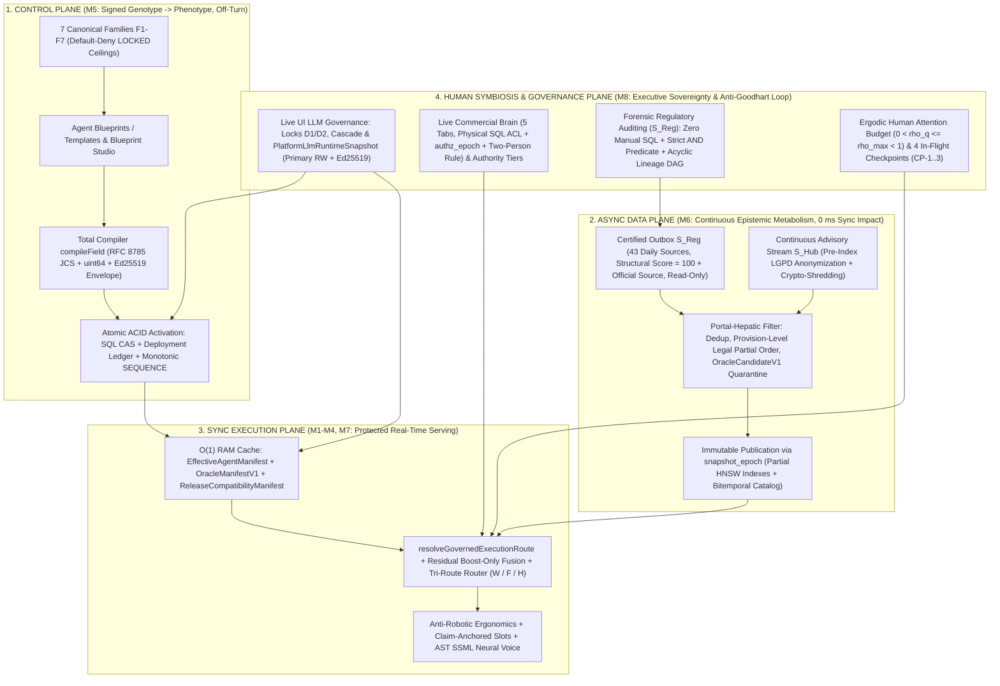

# Cognitive Harness Engineering, Human-AI Symbiosis, and Conditional Operational Parity: A Formal Multi-Plane Architecture for High-Precision Enterprise Agentic Systems

**Technical Report ID:** `VTI-RES-2026-01`  
**Author:** **Caio Gonçalves** — *Principal Investigator & Chief Systems Architect, VTI Research (VTI, Brazil)* (`https://projectos-system.github.io/vti-research/`)  
**Date:** November 2026

---

## Abstract

Deploying agentic artificial intelligence across high-liability institutional domains — spanning federal and state tax advisory, corporate accounting (`IFRS / CPC`), income tax computation, value-added tax reform (`IBS / CBS`), tax substitution (`ICMS-ST`), civil and tax litigation, labor and social security compliance, autonomous software engineering, and executive/commercial advisory surfaces — confronts a fundamental tension among frontier inference cost, second-order statutory omissions in compact workhorse models, and live operational governance of *Human-in-the-Loop* symbiosis. Drawing on a controlled repeated-measures experiment ($5 \times 20 = 100$ end-to-end executions) conducted on the **`Enterprise Advisory & Commercial Agent Hub`** ($\mathcal{S}_{\mathrm{Hub}}$, operating over an authentic Brazilian corpus of `374,252` semantic vectors and `396,176` normative acts) alongside an architectural audit of **`MemoryOS`** ($\mathcal{S}_{\mathrm{Mem}}$, part of `VTI OS System`) and the **`Automated Regulatory Ingestion & Editorial Auditing Platform`** ($\mathcal{S}_{\mathrm{Reg}}$, monitoring `43` daily official sources), we empirically demonstrate that scaling unconstrained internal reasoning (`reasoning.effort` from `low` to `medium` and `high`) in compact reasoning models (`Tier-W Compact Reasoning Model`, `W-Compact`) fails to remediate missing statutory *mindware* and induces ***Sub-Parametric Overthinking***: under partial deterministic oracle coverage in Query 8, intermediate deliberation ($1,143$ hidden tokens) degraded accuracy from $20/20$ to $19/20$ by rationalizing against retrieved documentary evidence, whereas `high` effort ($36,593$ hidden tokens) inflated mean latency by $+76.4\%$ over `low` ($27.62\text{ s}$ vs. $15.66\text{ s}$) while still omitting the second-order charitable immunity withholding exception in Query 7 (`CEBAS 20%`, Art. 37, I, "b", Normative Instruction RFB 2,110/2022). Grounded in Keith E. Stanovich's Tripartite Theory of Mind, metabolic efficiency invariants from comparative cognitive physiology, and recent advances in *Harness Engineering*, *Compound AI Systems*, and *Human-AI Complementarity*, we formalize the **Cognitive Harness Parity Engine (`HPE v3.0`)**. Partitioned into four decoupled planes (*Control*, *Data*, *Execution*, and *Human Symbiosis & Governance*), `HPE v3.0` establishes eight mathematical models (`M1–M8`): (i) a Non-Compensatory Paired Institutional Parity Functional ($G_s = C_s T_s S_s \in \{0,1\}$, proving $n_j^* = 736$ pairs per stratum and $1,125$ under Holm-7 multiplicity alongside anytime-valid confidence sequences); (ii) a bounded Dual-Exponential Saturation Model ($\tau_{v,m} \neq \tau_{d,m}$) of deliberation effort; (iii) a Residual *Boost-Only* Post-RRF Ranker ($S_{\mathrm{rank}} = S_P + \gamma g_B(1 - S_P)S_B$) paired with exact submodular *Micro-Card* selection ($|S| \le 2$, $\le 320$ multi-tokenizer tokens); (iv) a Tri-Route Lexicographic Epistemic Router (`W`, `F`, `H`) under a Shared Monotonic Deadline and *Doubly Robust* (`AIPW`) counterfactual auditing; (v) a Total Genotype-to-Phenotype Blueprint Compilation Algebra (`M5`) over `GovernedValue<T>` across seven canonical agent families (`F1–F7`), `Ed25519`-signed over `RFC 8785 JCS` and served in $O(1)$ RAM; (vi) an Asynchronous Bitemporal Epistemic Metabolism (`M6`) unifying `43` daily regulatory sources under a provision-level legal partial order $\preceq_{\mathrm{jur}}$ (`P0–P6`) and atomic `snapshot_epoch` visibility; (vii) Constrained Human Naturalness Optimization, *Claim-Anchored Slots*, `AST SSML` Neural Voice, and Performance Homeostasis (`M7`); and (viii) Human-AI Cognitive Symbiosis Algebra (`M8`) featuring **4 In-Flight Revocation Checkpoints (`CP-1..3`)**, ergodic human queues ($0 < \varrho_q \le \varrho_{\max} < 1$), physical SQL ACL with a material `Two-Person Rule`, and DAG-verified Anti-Goodhart regulatory feedback, certified across **13 E2E test batteries (`B1–B13`)** and evaluated under a strict four-layer epistemological demarcation.

**Keywords:** Harness Engineering; Compound AI Systems; Human-in-the-Loop Symbiosis; Stanovich Epistemic Rationality; Sub-Parametric Overthinking; Cryptographic Blueprint Compilation; Anti-Goodhart Governance; Institutional Legal and Tax AI.

---

## 1. Introduction, Scientific State of the Art (2020–2026), and Epistemological Boundaries

The evolution of generative artificial intelligence from open-ended conversational interfaces into auditable institutional infrastructure has inverted the primary locus of systems engineering: production-grade reliability is no longer a sole function of raw transformer parameter count, but an emergent property of the coupled triad $(\text{Human Specialist } H_{\mathrm{op}},\; \text{Model } m,\; \text{Harness } H)$ (**Zaharia et al., 2024**; **Khattab et al., 2024**; **Bansal et al., 2021**). In domains governed by strict statutory law, binding accounting standards, and corporate commercial authority — where an inverted tax withholding rate, reliance on a repealed regulation, or an unauthorized contractual discount triggers immediate financial liability — distinguishing among **intrinsic algorithmic capacity**, **external deterministic cognitive scaffolding**, and **deliberate human sovereignty** becomes paramount.

### 1.1. Synthesis of Recent Scientific Literature (2020–2026)

Seven converging research streams establish the theoretical foundations of this work:

1. **Harness Asymmetry in Compact Language Models (*Harness Lifting*):** **Yang et al. (2026, `arXiv:2607.08938`)** benchmarked *Small Language Models* against frontier models across 21 enterprise task-model pairs. When executed inside harnesses engineered for frontier models (broad prompts, dozens of unconstrained tools, and reliance on implicit domain leaps), compact models collapsed to a `31.4%` success rate; however, lifting structural task complexity into the harness via deterministic decomposition, constrained action spaces, and intermediate verification elevated the exact same frozen-weight model to `89.7%` (`+58.3 percentage points`), closing the frontier gap across multiple workflows at `4%` of the inference cost.
2. **Programmatic Optimization of Harnesses Over Frozen Weights:** declarative pipeline compilation (**Khattab et al., 2024 — *DSPy***), agent-computer interface design (**Jimenez et al., 2024 — *SWE-bench***; **Yang et al., 2024 — *SWE-agent***), and programmatic context meta-optimization demonstrate that retrieval orchestration, tool schema framing, and syntactic verification yield performance multipliers exceeding `6x` over identical base weights while reducing context token consumption.
3. **Incompatibility of Unconstrained Free-Form Planning in Smaller Models:** recent investigations into generator-environment coupling (*Co-Harness*, 2026) and long-context utilization (**Liu et al., 2024 — *Lost in the Middle***) show that forcing compact models to emulate long, unstructured frontier reasoning chains degrades generator-harness fit, allowing early premise drift to compound unchecked.
4. **Failure of Intrinsic Self-Correction vs. Oracle-Mediated Critique:** **Huang et al. (2024, ICLR)** proved that LLMs subjected to purely internal self-critique loops fail to improve — and frequently degrade — deductive accuracy because the internal critic shares the generator's biased priors. Conversely, **Gou et al. (2024, ICLR — *CRITIC***) and **Du et al. (2024, ICML)** showed that iterative refinement converges reliably only when grounded in external deterministic signals (exact interpreters, symbolic calculators, and verified catalogs).
5. **Limits of Pure Vector RAG on Statutory Exceptions and Bitemporality:** in an empirical study at Stanford RegLab, **Magesh et al. (2025)** demonstrated that leading commercial legal RAG systems still hallucinate in `17%` to `33%` of queries whenever correctness hinges on normative hierarchy, bitemporal validity (**Jensen & Snodgrass, 1999**; **Kulkarni & Michels, 2012**), or second-order statutory exceptions absent from surface query tokens.
6. **Economic Cascades, Risk-Aware Routing, and Selective Labels Bias:** **Chen, Zaharia & Zou (2023 — *FrugalGPT***) and **Ong et al. (2025, ICLR — *RouteLLM***) achieved `50%` to `85%+` cost savings by routing between compact and frontier models. Yet routers trained solely on general stylistic preference lack non-compensatory guarantees against silent statutory false negatives and suffer from selective labels bias (**Lakkaraju et al., 2017**) unless audited via doubly robust counterfactual estimators (**Robins, Rotnitzky & Zhao, 1994**).
7. **Human-AI Complementarity, Finite Attention, and Anti-Goodhart Governance:** from **Parasuraman, Sheridan & Wickens (2000)** and **Amershi et al. (2019)** to **Wilder, Horvitz & Kamar (2020)** and **Bansal et al. (2021)**, empirical human-AI teaming research shows that joint performance exceeds either party alone ($\operatorname{Perf}(H_{\mathrm{op}} + M) > \max\{\operatorname{Perf}(H_{\mathrm{op}}), \operatorname{Perf}(M)\}$) only when: (a) governance interfaces preserve clear authority boundaries without inducing *automation bias*; (b) human attention is modeled as a **finite ergodic resource** protected against queue saturation; and (c) discrepancies between human curation and automated pipelines drive structural harness code fixes rather than manual database hot-patching, preventing **Goodhart's Law** (**Goodhart, 1975**; **Strathern, 1997**).

Through the lens of **Keith E. Stanovich's Tripartite Theory of Mind** (**Stanovich, 2009, 2011**; **Evans & Stanovich, 2013**; **Stanovich, West & Toplak, 2016**; **De Neys, 2023**), we unify these findings into a core cognitive engineering proposition: scaling `reasoning.effort` in a compact model merely increases energy expenditure in the **Algorithmic Mind** (*serial simulation capacity*), but **never synthesizes missing declarative and procedural *Mindware***, cannot replace conflict monitoring by the **Reflective Mind**, and never supersedes **Human Intentional Sovereignty** over institutional risk thresholds, commercial authority, and normative truth.

### 1.2. Epistemological Boundaries of the Physiological Analogy and Experimental Standardization

Quantitative neurophysiology explains why the human organism remains a benchmark of adaptive efficiency: operating under a tight ~`20 W` cortical budget, it relies on **selective gene expression from a shared genome**, **low-latency spinal and cerebellar reflex arcs**, **conflict monitoring in the dorsal anterior cingulate cortex (`dACC`) prior to recruiting dorsolateral prefrontal control (`dlPFC`)** (**Attwell & Laughlin, 2001**; **Botvinick et al., 2001**; **Baddeley, 2000**), and **complementary learning systems** that decouple rapid episodic capture from offline neocortical consolidation (**McClelland, McNaughton & O'Reilly, 1995**; **Gutiérrez et al., 2024**).

> **Mandatory Epistemological Boundary:** Throughout this paper, human cognitive physiology serves strictly as **(i) a modular decomposition heuristic**, **(ii) a unifying architectural vocabulary**, and **(iii) a source of abstract resource-isolation and homeostasis invariants**. We claim zero biological or ontological equivalence between silicon transformers and neural tissue, never substitute anatomical metaphors for mathematical proofs, and enforce a strictly unidirectional observability projector (`biomimetic_projector`: `internal technical module -> analytical inspection label`) with zero physiological terminology exposed in database schemas, network payloads, or user prompts.

**Methodological Note on Production Ecosystems and Normalized Model Tiers:** Our study spans three integrated production ecosystems:
- **`MemoryOS` ($\mathcal{S}_{\mathrm{Mem}}$, part of `VTI OS System`):** a bitemporal hybrid memory, multi-model epistemic governance, and autonomous software engineering platform;
- **`Enterprise Advisory & Commercial Agent Hub` ($\mathcal{S}_{\mathrm{Hub}}$):** a multi-agent platform powering institutional tax, accounting, labor, and litigation advisory alongside executive and commercial operations over a curated Brazilian statutory corpus of `374,252` semantic vectors (`pgvector` HNSW) and `396,176` normative acts;
- **`Automated Regulatory Ingestion & Editorial Auditing Platform` ($\mathcal{S}_{\mathrm{Reg}}$):** an automated regulatory collection, qualification, and structured editorial auditing engine monitoring `43` daily official Brazilian sources (Federal Official Gazette, Federal Revenue Service, State Tax Council `CONFAZ`, all 27 State Official Gazettes, and Superior Courts).

To ensure scientific reproducibility decoupled from transient vendor codenames, evaluated models are referenced via canonical tiers normalized by the enterprise AI gateway (which maps unified generation plans onto commercial provider SDKs, specifically OpenAI Responses API `/v1/responses` with `reasoning.effort` and Google GenAI `thinkingConfig`):
- **`Tier-W Compact Reasoning Model` (`W-Compact`):** high-throughput compact reasoning tier priced at standard public list rates of `US$ 0.10 / 1M` input tokens and `US$ 0.50 / 1M` output tokens (`US$ 0.40 / 1M` contracted volume billing tier);
- **`Tier-F Frontier Reasoning Model` (`F-Frontier`):** dense flagship frontier reasoning tier priced at standard public list rates of `US$ 2.00 / 1M` input tokens and `US$ 10.00 / 1M` output tokens (`US$ 8.00 / 1M` contracted volume billing tier).

---

## 2. Precursor Empirical Evidence and Mathematical Modeling (`M1` and `M2`)

### 2.1. Paired Repeated-Measures Benchmark ($5 \times 20 = 100$ Executions) and *Sub-Parametric Overthinking*

Prior to implementing `HPE v3.0`, we executed a controlled repeated-measures experiment on $\mathcal{S}_{\mathrm{Hub}}$, evaluating **five model-effort configurations** across the exact same **20 real-world audited labor and social security queries** ($100$ end-to-end executions against an immutable vector and relational state):

| Paired Experimental Profile ($n = 20$ independent queries) | Inference Transport | Core Thesis Accuracy | 2nd-Order Exception (`Q7`: `CEBAS 20%`) | Overthinking Error (`Q8`: `FPAS 507`) | Hidden Reasoning Tokens (`20Q`) | Visible Output Tokens (`20Q`) | Mean Total Latency (LLM) | Measured `20Q` Cost (`65k`/yr) |
| :--- | :---: | :---: | :---: | :---: | :---: | :---: | :---: | :---: |
| **1. `F-Frontier` (`low` — Baseline)** | `/v1/responses` | `20/20` | Captured | `0` (Correct `507`) | *(embedded)* | `10,426` | `22.99 s` (`10.63 s`) | `US$ 0.9362` (`US$ 3,042.64`) |
| **2. `W-Compact` (`none`)** | `/v1/chat/completions` | `20/20`* | Omitted | `0` (Correct `507`) | `0` | `6,767` | `15.23 s` (`4.91 s`) | `US$ 0.0451` (`US$ 146.69`) |
| **3. `W-Compact` (`low` — Local Optimum)** | `/v1/responses` | **`20/20`** | Omitted | **`0` (Correct `507`)** | **`1,311`** | `6,734` | **`15.66 s` (`6.26 s`)** | **`US$ 0.0457` (`US$ 148.40`)** |
| **4. `W-Compact` (`medium`)** | `/v1/responses` | `19/20` | Denied | **Failed (`FPAS 515`)** | `15,289` | `6,942` | `15.88 s` (`12.48 s`) | `US$ 0.0528` (`US$ 171.70`) |
| **5. `W-Compact` (`high`)** | `/v1/responses` | `20/20`** | Denied | `0` (Correct `507`) | `36,593` | `6,914` | `27.62 s` (`21.60 s`) | `US$ 0.0633` (`US$ 205.80`) |

*\*Note: `W-Compact (none)` exhibited 1 abrupt syntactic truncation on `Q19` (`150` tokens).*  
*\*\*Note: `W-Compact (high)` leaked residual English formatting (`### Sources:`) on `Q13` and hit latency spikes of `55.0 s` (`Q10`) and `54.5 s` (`Q20`).*

In strict statistical discipline (**Clopper & Pearson, 1934**), two methodological properties govern interpretation: (i) the $100$ runs constitute a paired block design ($K = 5$ treatments across $N = 20$ independent query units), prohibiting pseudo-replicated $N = 100$ inference; and (ii) under an exact one-sided $97.5\%$ Clopper–Pearson interval ($\alpha = 0.025$), observing $0$ failures in $n = 20$ bounds the population error rate only at $p_U = 1 - 0.025^{1/20} \approx 0.1684$ ($16.84\%$). Nevertheless, as a controlled mechanistic experiment holding retrieved context constant, the contrast across Queries **7**, **8**, and **15** isolates three causal laws:

1. **Invariance of Second-Order *Mindware* Deficits to Algorithmic Effort (`Q7`):** when asked about social security withholding on services rendered by an individual contractor to a charitable association mentioning `"20%"`, the statutory bridge from charitable entity $\to$ potential `CEBAS` certification $\to$ conditional `20%` regime under `Art. 37, I, "b", IN RFB 2,110/2022` was encoded in `F-Frontier`'s dense weights, yet absent from both first-order lexical retrieval and `W-Compact`'s active priors. Scaling hidden reasoning tokens from `275` (`low`) to `1,331` (`medium`) and `3,106` (`high`, `35.15 s`) merely entrenched `W-Compact` in the first-order general rule (`11%`).
2. **Destructive Sub-Parametric Rationalization Under Incomplete Oracles (`Q8`):** on `CNAE 0910-6/00` (oil and gas extraction support activities), a 4-row pilot catalog returned `NAO_MAPEADO_LOCALMENTE`. At `effort = low` (`0` post-tool reasoning tokens), `W-Compact` faithfully reported the retrieved normative document (`FPAS 507` — industrial classification). At `effort = medium` (`1,143` hidden tokens), unconstrained internal deliberation reinterpreted *"support"* semantically as general urban services and overrode documentary evidence with the erroneous code `FPAS 515` — a failure mode we formalize as ***Sub-Parametric Overthinking***.
3. **Sufficiency of Deterministic Cognitive Prosthetics (`Q15`):** on `CNAE 9430-8/00`, which was fully modeled in the local deterministic catalog across all four statutory regimes (`FPAS 515`, `566`, `523`, and `639/CEBAS`), **all four `W-Compact` profiles matched `F-Frontier`'s exact statutory citations, comparative matrix, and legal conclusion**.

### 2.2. Mathematical Model `M1`: Non-Compensatory Paired Institutional Parity Functional and Sample-Size Proof

Additive evaluation metrics allow stylistic fluency to mask fatal statutory or temporal errors. To enforce zero compensation on blocking failures, we define the institutional quality contract for system $s \in \{c, f\}$ — where $c = (m_{\mathrm{W}}, H_{\mathrm{HPE}})$ and $f = (m_{\mathrm{F}}, H_{\mathrm{base}})$ — on query $q$ at reference date $t_{\mathrm{ref}}$ and stochastic realization $\omega$.

Each response receives three binary blocking gates:
- $C_s(q, \omega) \in \{0, 1\}$: **Material Conclusive Correctness** (exactness of the primary legal, accounting, and arithmetic conclusion);
- $T_s(q, t_{\mathrm{ref}}, \omega) \in \{0, 1\}$: **Bitemporal & Statutory Validity** (exclusive reliance on provisions effective at $t_{\mathrm{ref}}$, respecting *vacatio legis* and non-revival rules);
- $S_s(q, \omega) \in \{0, 1\}$: **Security, Privacy & Surface Boundary Compliance** (zero PII/secret leakage and strict adherence to executive/commercial isolation).

Whenever evidentiary status is epistemically indeterminate ($Z = \texttt{UNKNOWN}$), operational scoring fails closed ($G_s = 0$) while separately logging $p_s^{\mathrm{verified}} = \mathbb{P}(\text{PASS} \mid Z \neq \texttt{UNKNOWN})$ and $r_s^{\mathrm{unknown}} = \mathbb{P}(Z = \texttt{UNKNOWN})$. The multiplicative gate $G_s$, graded completeness $V_s \in [0, 1]$, and institutional utility $Q_s \in [0, 1]$ are given by:

$$G_s(q, \omega) = C_s(q, \omega) \cdot T_s(q, t_{\mathrm{ref}}, \omega) \cdot S_s(q, \omega) \in \{0, 1\}$$

$$V_s(q, \omega) = \sum_{k \in \{E, F, A, U\}} \alpha_k \, m_{k,s}(q, \omega), \qquad \alpha_k \ge 0,\; \sum_{k} \alpha_k = 1, \qquad Q_s(q, \omega) = G_s(q, \omega) \cdot V_s(q, \omega)$$

where $m_{E,s}$ measures second-order exception coverage, $m_{F,s}$ resolved citation fidelity, $m_{A,s}$ operational calculation/routing adequacy, and $m_{U,s}$ calibrated premise disclosure.

Across each critical domain stratum $j \in \{1, \dots, J\}$, let $p_{s,j} = \mathbb{E}_j[G_s]$, $u_{s,j} = \mathbb{E}_j[Q_s]$, and $v_{s,j}^{\cap} = \mathbb{E}_j[V_s \mid G_c = 1 \land G_f = 1]$. **Conditional Operational Parity** requires simultaneous satisfaction of three one-sided paired lower confidence bounds over $D_{G,i} = G_{c,i} - G_{f,i} \in \{-1, 0, 1\}$:

$$\operatorname{LCB}_{1 - \alpha_{G,j}}\!\bigl(p_{c,j} - p_{f,j}\bigr) \ge -\delta_{\mathrm{hard}, j}, \qquad \operatorname{LCB}_{1 - \alpha_U}\!\bigl(u_c - u_f\bigr) \ge -\varepsilon_p, \qquad \operatorname{LCB}_{1 - \alpha_V}\!\bigl(v_c^{\cap} - v_f^{\cap}\bigr) \ge -\varepsilon_{\mathrm{soft}}$$

computed via cluster-bootstrap resampling at the highest independent unit (client, case, or statutory family) with family-wise Type-I error control ($\sum \alpha_{\bullet} \le 0.05$ via **Holm, 1979**).

**Theorem 1 (Exact Stratum Sample-Size Lower Bound).** *To certify a strict non-compensatory non-inferiority margin $\delta_{\mathrm{hard}, j} \in (0, 1)$ in stratum $j$ at local one-sided significance $\alpha_{j,\mathrm{local}} \in (0, 1)$, even under zero observed adverse discordances ($n_{01,j} = 0$, where $G_c = 0 \land G_f = 1$), the minimum number of independent paired observations $n_j$ satisfies:*

$$n_j \ge n_j^* = \left\lceil \frac{\ln(\alpha_{j,\mathrm{local}})}{\ln(1 - \delta_{\mathrm{hard}, j})} \right\rceil$$

*Proof.* Under the conservative boundary configuration where $G_{f,i} = 1$ across all $n_j$ independent pairs and zero compact failures occur ($n_{01,j} = 0$, so $G_{c,i} = 1$ for all $i$), $p_{f,j} - p_{c,j}$ equals the binomial adverse failure probability $\theta_j = \mathbb{P}(G_c = 0, G_f = 1)$. By the exact Clopper–Pearson construction (**Clopper & Pearson, 1934**), the $1 - \alpha_{j,\mathrm{local}}$ upper confidence bound $\theta_U(n_j)$ given zero failures in $n_j$ trials solves $(1 - \theta_U)^{n_j} = \alpha_{j,\mathrm{local}}$, yielding $\theta_U(n_j) = 1 - \alpha_{j,\mathrm{local}}^{1/n_j}$. Since $\operatorname{LCB}_{1 - \alpha_{G,j}}(p_{c,j} - p_{f,j}) = -\theta_U(n_j)$, enforcing $\operatorname{LCB} \ge -\delta_{\mathrm{hard}, j}$ requires $1 - \alpha_{j,\mathrm{local}}^{1/n_j} \le \delta_{\mathrm{hard}, j} \iff \alpha_{j,\mathrm{local}}^{1/n_j} \ge 1 - \delta_{\mathrm{hard}, j}$. Taking natural logarithms and reversing inequality direction ($\ln(1 - \delta_{\mathrm{hard}, j}) < 0$) yields $n_j \ge \ln(\alpha_{j,\mathrm{local}}) / \ln(1 - \delta_{\mathrm{hard}, j})$. Setting $\alpha_{j,\mathrm{local}} = 0.025$ and $\delta_{\mathrm{hard}, j} = 0.005$ gives $\lceil \ln(0.025)/\ln(0.995) \rceil = \lceil -3.688879 / -0.00501254 \rceil = \lceil 735.93 \rceil = 736$ pairs per stratum. Under initial Holm–Bonferroni multiplicity across $J = 7$ advisory domains ($\alpha_{j,\mathrm{local}} = 0.025 / 7 \approx 0.0035714$), $n_j^* = \lceil \ln(0.025/7)/\ln(0.995) \rceil = \lceil 1,124.39 \rceil = 1,125$ independent pairs per stratum. $\blacksquare$

This theorem mathematically precludes claiming $0.5\%$ population parity from small CI suites and motivates our strict two-stage protocol (Section 5) separating **Stage A** (Deterministic Branch Gate) from **Stage B** (Confirmatory *Shadow Mode* Accumulation governed by anytime-valid confidence sequences; **Howard et al., 2021**).

### 2.3. Mathematical Model `M2`: Bounded Dual-Exponential Saturation of Reasoning Effort

To analytically capture the non-monotonic accuracy trajectory observed in Section 2.1 as a function of observable reasoning budget $e \ge 0$ without diverging to $\{0, 1\}$ or collapsing to $\Phi(0) = 0.5$, we formulate the **Dual-Exponential Saturation Model**.

Let $\Omega(q, H) \in [0, 1]$ denote the out-of-sample deterministic harness anchoring index ($\Omega = 1$ under certified bitemporal oracle coverage and convergent evidence; $\Omega \to 0$ under `UNKNOWN` catalog gaps) and $\Delta_{\mathrm{prior}}(m, q) \ge 0$ denote the standardized divergence between model $m$'s dominant associative prior and the governing special rule. With strictly positive scale constants $\tau_{v,m}, \tau_{d,m}, \tau_{\nu,m} > 0$ and finite $A_m, B_m, \nu_m \ge 0$, latent net evidence $z_m(q, e, H)$ and correctness probability satisfy:

$$z_m(q, e, H) = z_{0,m}(q, H) + A_m \Omega(q, H)\!\left(1 - e^{-e / \tau_{v,m}}\right) - B_m\bigl(1 - \Omega(q, H)\bigr)\Delta_{\mathrm{prior}}(m, q)\!\left(1 - e^{-e / \tau_{d,m}}\right)$$

$$P_{\mathrm{correct}}(m, e, H) = \Phi\!\left(\frac{z_m(q, e, H)}{\sqrt{1 + \nu_m\bigl(1 - e^{-e / \tau_{\nu,m}}\bigr)}}\right)$$

where $\Phi(\cdot)$ is the standard normal CDF. Two structural properties follow directly:
1. **Strictly Bounded Asymptote:** as $e \to \infty$, $\lim_{e\to\infty} P_{\mathrm{correct}}(m, e, H) = \Phi\!\bigl([z_{0,m} + A_m \Omega - B_m(1 - \Omega)\Delta_{\mathrm{prior}}] / \sqrt{1 + \nu_m}\bigr) \in (0, 1)$, capturing irreducible uncertainty when statutory *mindware* is missing ($\Omega = 0$, as in `Q7` at `high`);
2. **Derivative Sign Reversal (*Sub-Parametric Overthinking*):** differentiating $z_m$ with respect to $e$ yields:
   $$\frac{\partial z_m}{\partial e} = \frac{A_m \Omega}{\tau_{v,m}} e^{-e / \tau_{v,m}} - \frac{B_m(1 - \Omega)\Delta_{\mathrm{prior}}}{\tau_{d,m}} e^{-e / \tau_{d,m}}$$
   Whenever rapid syntactic verification saturates earlier than associative drift ($\tau_{v,m} < \tau_{d,m}$) under partial harness coverage ($0 < \Omega < 1$, $\Delta_{\mathrm{prior}} > 0$), modest structured effort (`low`) increases $z_m$ ($\partial z_m / \partial e > 0$ near $e = 0$), whereas extended unanchored deliberation (`medium` in `Q8`) causes the negative drift term to dominate ($\partial z_m / \partial e < 0$). Conversely, raising $\Omega(q, H_{\mathrm{HPE}}) \to 1$ via certified bitemporal oracles annihilates $(1 - \Omega)$ identically.

---

## 3. Forensic Architectural Diagnosis of Gaps in Enterprise Compound AI Systems

Static and transactional inspection across the three enterprise platforms ($\mathcal{S}_{\mathrm{Hub}}$, $\mathcal{S}_{\mathrm{Mem}}$, and $\mathcal{S}_{\mathrm{Reg}}$) identified four systemic vulnerability classes characteristic of first-generation compound AI deployments:

1. **Asymmetric Oracle Coverage and First-Order Lexical Retrieval in $\mathcal{S}_{\mathrm{Hub}}$:** while algebraic calculators operated in exact `decimal.js` arithmetic, dense statutory domains relied heavily on vector/text search or minimal pilot seeds (e.g., `4` of `1,332` CNAE subclasses under `IN RFB 2,110/2022`, and no local deterministic engines for `IN RFB 1,234/2012` public withholding, `CSRF Art. 30 Law 10,833/2003`, `Simples Nacional LC 123/2006` Factor R and Annexes I–V, high-income/dividend taxation under `Law 15,270/2025`, hospital tax equivalence under `Law 9,249/1995`, or bitemporal `IFRS / CPC` validity). Moreover, transport selection downgraded tool-free advisory agents to legacy chat endpoints, and retrieval lacked an isolated bridge track for second-order statutory hypotheses.
2. **Blueprint Replication Drift Across Heterogeneous Agent Families:** template cloning and version-upgrade workflows copied `systemPrompt` and tool arrays without declaring an immutable **canonical cognitive family (`F1–F7`)** or distinguishing inherited defaults (`INHERIT`), tenant customizations (`OVERRIDE`), and security locks (`LOCKED`), creating asymmetries between admin creation and wizard instantiation while failing to revoke deprecated tools upon blueprint upgrades.
3. **Multiplicative Timeout Amplification and Epistemic Decoupling in $\mathcal{S}_{\mathrm{Mem}}$ (`MemoryOS`):** sequential multi-key and multi-provider fallback loops applied independent per-call timeouts, yielding worst-case latency $T_{\mathrm{worst}} \approx N_{\mathrm{keys}} \times \mathrm{timeoutMs} \times N_{\mathrm{providers}}$ exceeding outer protocol budgets. Furthermore, post-RRF evidentiary scores and multidimensional risk matrices were not wired into pre-generation model routing.
4. **Distributed Consistency Gaps Across *Human-in-the-Loop* Surfaces and Daily Regulatory Streams ($\mathcal{S}_{\mathrm{Hub}} + \mathcal{S}_{\mathrm{Reg}}$):**
   - Local `30 s` TTL LLM configuration caches lacked monotonic epochs and in-flight revocation checkpoints, allowing multi-step runs to continue invoking flagship models after emergency financial lockouts;
   - Continuously ingested historical human advisory replies (`P4`) and editorial briefings (`P3`) coexisted with primary statutes (`P0/P1`) in vector space without a provision-level legal partial order;
   - Live commercial knowledge curation and human approval queues required physical SQL ACLs, defense against *indirect prompt injection*, a material `Two-Person Rule`, ergodic queue-load bounds, and an **append-only / read-only** outbox from $\mathcal{S}_{\mathrm{Reg}}$ to prevent manual SQL patching or circular synthetic self-confirmation.

---

## 4. Formal Architecture of the *Cognitive Harness Parity Engine* (`HPE v3.0`)

To eliminate these structural gaps while adding zero synchronous serving overhead, `HPE v3.0` partitions enterprise cognition into **four orthogonal planes**:

### 4.1. Model `M3`: Tripartite Second-Order Bridge Graph, Residual *Boost-Only* Fusion, and Exact Submodular Selection

Injecting speculative expansions into primary lexical queries degrades precision. `HPE v3.0` partitions the institutional bridge graph $\mathcal{G}_{\mathrm{bridge}}$ into three disjoint edge classes:
- **Class A (`SAFE_SYNONYM`):** exact terminological equivalences (e.g., `"DARF 5952"` $\leftrightarrow$ `"CSRF Art. 30 Law 10,833/2003"`), eligible for the primary track $L_P$;
- **Class B (`CANDIDATE_HYPOTHESIS`):** second-order statutory hypotheses (e.g., `charitable association + individual contractor` $\to$ `CEBAS Art. 37 IN 2,110/2022`; `medical clinic + presumed profit` $\to$ `hospital equivalence Art. 15 §1 III-a Law 9,249/1995`; `public agency + invoice withholding` $\to$ `IN RFB 1,234/2012`; `individual dividends` $\to$ `monthly > R$ 50k withholding & annual minimum tax Law 15,270/2025`; `interstate branch transfer` $\to$ `ADC 49 / LC 204/2023 / Conv. ICMS 109/2024`), executed strictly on an isolated parallel track $L_B$;
- **Class C (`CONDITIONAL_CONCLUSION`):** regimes contingent on unverified factual premises, obligating the generator to present conditional branches and request explicit factual confirmation rather than assuming eligibility.

Let $S_P(d, q) \in [0, 1]$ denote the isotonically calibrated primary score post-*Reciprocal Rank Fusion* (**Cormack, Clarke & Buettcher, 2009**) and $S_B(d, q) = \mathbb{I}[d \in L_B] \cdot \frac{k + 1}{k + r_B(d)} \in [0, 1]$ denote the normalized bridge rank score. With $\gamma \in [0, 1]$ (default $\gamma = 0.35$) and authorized surface gate $g_B(q) \in \{0, 1\}$ ($g_B(q) \equiv 0$ across all executive, commercial, and customer-care families), fusion follows the closed **Residual *Boost-Only*** form:

$$S_{\mathrm{rank}}(d, q) = S_P(d, q) + \gamma \cdot g_B(q) \cdot \bigl[1 - S_P(d, q)\bigr] \cdot S_B(d, q) \in [0, 1]$$

Under $0 \le \gamma g_B(q) \le 1$, two invariants hold identically: (i) $S_B(d, q) = 0 \implies S_{\mathrm{rank}}(d, q) = S_P(d, q)$ (zero denominator dilution of primary hits); and (ii) $S_{\mathrm{rank}}(d, q) \ge S_P(d, q)$.

For conditional ***Micro-Cards*** over candidate set $C(q)$ valid at $t_{\mathrm{ref}}$, we bound token budgets over the **fully serialized XML/metadata payload** across all supported tokenizers $\mathcal{T} = \{\texttt{o200k\_base},\, \texttt{gemini\_sp}\}$:

$$\mathcal{F}(q) = \left\{\, S \subseteq C(q) \;\middle|\; |S| \le 2,\; \max_{\tau \in \mathcal{T}} T_{\tau}\!\bigl(\operatorname{serialize}(S)\bigr) \le 320,\; \forall c \in S: \operatorname{LCB}\!\bigl(\operatorname{Precond}(c, q)\bigr) \ge \tau_{\mathrm{card}},\; \forall a \neq b \in S: \operatorname{Conflict}(a, b) = 0 \,\right\}$$

Because $\varnothing \in \mathcal{F}(q)$ and $|S| \le 2$, maximizing the redundancy-penalized submodular coverage objective (**Nemhauser, Wolsey & Fisher, 1978**) is solved via **exact deterministic enumeration** over $\varnothing$, singletons, and unordered pairs $\{a, b\}$ with canonical lexicographic tie-breaking on `card_id`:

$$S^*(q) = \arg\max_{S \in \mathcal{F}(q)} \left[\, \sum_{c \in S} u(c, q) - \sum_{\{a, b\} \subseteq S} \rho(a, b, q) + \beta \cdot \operatorname{Coverage}(S, q) \,\right]$$

### 4.2. Certified Bitemporal Tabular Oracles (`OracleManifestV1`), `ModelCapabilityRegistry`, and Post-Regex Resolution

Byte-level SHA-256 hashing alone proves file integrity, not statutory completeness or temporal validity. Every deterministic catalog or calculation engine in $\mathcal{S}_{\mathrm{Hub}}$ and $\mathcal{S}_{\mathrm{Mem}}$ validates at boot a signed **`OracleManifestV1`** specifying `source_snapshot_sha256`, `compiled_artifact_sha256`, exact reconciliation `expected_row_count === actual_row_count`, bitemporal windows `[valid_from, valid_to)` and `[tx_from, tx_to)`, an `Ed25519` signature, and `unmapped_policy = "RETURN_EXPLICIT_UNKNOWN_NO_ANALOGY"`. Our **11 deployed bitemporal oracles** cover: (1) all `1,332` CNAE 2.3 subclasses under `IN RFB 2,110/2022` Annexes I–II; (2) individual contributor withholding (`11%` general vs. `20%` `CEBAS`); (3) the `3 × 21` eSocial rubric-incidence matrix; (4) federal `CSRF 4.65%` withholding (`Law 10,833/2003, Art. 30`) and `<= R$ 10.00` exemption; (5) public-entity broad withholding (`IN RFB 1,234/2012`); (6) `Simples Nacional` (`LC 123/2006` Annexes I–V, Factor R, and Annex IV payroll rules); (7) progressive `IRPF`, monthly `10%` withholding on dividends `> R$ 50,000.00/month`, and annual minimum tax (`Law 15,270/2025`); (8) cumulative boolean verification for hospital tax equivalence (`Law 9,249/1995` and STJ Theme 217); (9) bitemporal `CPC / NBC TG / IFRS` pronouncement catalog; (10) `IBS/CBS` (`LC 214/2025`) and `ICMS-ST/DIFAL` engines; and (11) procedural deadline, `LEF` intercurrent limitation, and unseizability calculators. Out-of-coverage lookups deterministically return `{ status: "UNKNOWN", allowAnalogicalInference: false }`.

Concurrently, **`ModelCapabilityRegistry`** replaces string-matching heuristics with typed translation of an `AbstractGenerationPlan` per provider (`Provider-A` consistently routed to `/v1/responses` whenever `effectiveEffort !== 'none'` regardless of tool presence; `Provider-B` mapped to `thinkingConfig`), throwing a typed `CapabilityMismatchError` rather than silently downgrading critical reasoning parameters. Editorial tables activate conditionally ($\ge 2$ compared regimes, calculation schedules, or $\ge 3$ sub-questions), while the pre-inference citation resolver classifies retrieved statutory mentions against the bitemporal catalog into five strict buckets: `AFIRMATIVO_VIGENTE`, `EXCECAO_CONDICIONADA`, `HISTORICO_REVOGADO` (blocked as active authority), `ADVERSARIAL_OU_VENCIDO`, and `NAO_VALIDADO`.

### 4.3. Model `M4`: Shared Monotonic Deadline, Tri-Route Lexicographic Router (`W`, `F`, `H`), and `AIPW` Auditing

To eliminate multiplicative timeout cascades, request entry establishes $t_{\mathrm{deadline}} = t_{\mathrm{monotonic\_now}} + T_{\mathrm{global}}$. Prior to attempt $r$, timeout budget is truncated via:

$$t_{\mathrm{attempt}}^{(r)} = \min\!\Bigl(t_{\mathrm{config}}^{(r)},\; t_{\mathrm{deadline}} - t_{\mathrm{monotonic\_now}} - t_{\mathrm{reserve}}\Bigr)$$

skipping attempts with $t_{\mathrm{attempt}}^{(r)} < t_{\mathrm{min\_useful}}^{(r)}$ and propagating a composite `AbortSignal` that cancels downstream HTTP sockets and streams within `< 50 ms`. Post-generation recomposition on abrupt truncation is permitted **at most once and exclusively when zero side-effecting tools** executed during the turn (`idempotency_key`).

Pre-generation routing executes a four-stage lexicographic decision (`L0` static inspection $\to$ `L1` calibrated retrieval signal $\to$ `L2` oracle anchoring $\Omega \in \{0,1\}$ and temporal state $\to$ `L3` selection over $\mathcal{A} = \{W, F, H\}$):

1. **Step 1 — Ontological Impossibility Short-Circuit:** if `L2` detects a query targeting an unpromulgated future statute or unpublished rate (`NORMA_NAO_PUBLICADA`), the router short-circuits in `< 1 ms` to a standardized terminative response / route $H$.
2. **Step 2 — Posterior Upper-Quantile Safety Filtering:** let $E_a = \{C_a = 0\} \cup \{T_a = 0\} \cup \{S_a = 0\}$ denote blocking failure under action $a \in \{W, F, H\}$ given covariates $X(q)$ and calibrated history $\mathcal{D}$, with realistic non-zero human baseline error $p_{\mathrm{err}}(H \mid X) = p_H(X) > 0$. Given domain risk ceiling $\rho_{\mathrm{domain}}$, the safe admissible set is:

$$\mathcal{A}_{\mathrm{safe}}(X) = \Bigl\{\, a \in \{W, F, H\} \;\Big|\; Q_{0.95}\!\bigl(p_{\mathrm{err}}(a \mid X, \mathcal{D})\bigr) \le \rho_{\mathrm{domain}} \,\Bigr\}$$

Whenever $\mathcal{A}_{\mathrm{safe}}(X) = \varnothing$, total fail-closed closure enforces $a^*(X) = H$.
3. **Step 3 — Homogeneous Monetized Loss Minimization Within $\mathcal{A}_{\mathrm{safe}}(X)$:** strictly among safety-certified routes, `M4` minimizes total monetized operational cost:

$$a^*(X) = \arg\min_{a \in \mathcal{A}_{\mathrm{safe}}(X)} \Bigl[\, C_{\mathrm{api}}(a, X) + C_{\mathrm{compute}}(a, X) + v_{\mathrm{lat}}(X)\cdot \operatorname{Lat}_{\mathrm{P95}}(a, X) + D_{\mathrm{delay}, a}(X) + D_{\mathrm{omission}, a}(X) \,\Bigr]$$

4. **Doubly Robust Counterfactual Auditing (`AIPW`):** to prevent selective labels bias (**Lakkaraju et al., 2017**) and avoid mistaking inter-model agreement for ground truth, safe exploration within $\mathcal{A}_{\mathrm{safe}}^{\mathrm{explore}}(X) \subseteq \mathcal{A}_{\mathrm{safe}}(X)$ at known propensity $\pi(a \mid X) \ge \varepsilon_{\min} = 0.05$ is adjudicated asynchronously against independent labels $y^*$ (deterministic oracle or blinded specialist review) via *Cross-Fitted Augmented Inverse Propensity Weighting* (**Robins, Rotnitzky & Zhao, 1994**):

$$\widehat{R}_{\mathrm{AIPW}}(a) = \frac{1}{n} \sum_{i=1}^{n} \left[\, \hat{\mu}_a(X_i) + \frac{\mathbb{I}\{A_i = a\}}{\pi(a \mid X_i)} \bigl(\ell(y_{A_i}, y_i^*) - \hat{\mu}_a(X_i)\bigr) \,\right]$$

Shadow execution is strictly isolated (`MAX_SHADOW_QUEUE = 64`, `Drop-Newest` backpressure, concurrency `1`, and hard daily USD budget caps). Furthermore, executive and commercial surfaces enforce **9 cumulative *default-deny* isolation stages** (Identity Verification, Bridge Lock $g_B \equiv 0$, Tenant-Scoped Partial-HNSW Retrieval, Context Suppression of *Micro-Cards*, Server-Side Bijective Tool Authz, LGPD/Zero-Retention Routing Check, Per-Frame SSE DTO Allowlist Projection, Post-Authz Versioned Cache Keys, and Origin-Level Mod-11 PII Telemetry Redaction).

### 4.4. Model `M5`: Total Genotype-to-Phenotype Compilation Across 7 Families (`F1–F7`), `RFC 8785 JCS`, and `Ed25519`

Every agent blueprint (`Genotype`) in $\mathcal{S}_{\mathrm{Hub}}$ and $\mathcal{S}_{\mathrm{Mem}}$ binds to an immutable canonical family `familyCode` $\in \{\texttt{F1}, \dots, \texttt{F7}\}$ with `LOCKED` upper bounds:

| Canonical Family | Functional Role & Comparative Correlate | Bridges $g_B$ & *Micro-Cards* | Authorized Oracles & Memory | Surface Contract, Voice & Latency SLO |
| :---: | :--- | :---: | :--- | :--- |
| **`F1` `INSTITUTIONAL_ADVISORY`** | Tax, Accounting, Labor & Litigation Advisory | Enabled ($g_B=1$, $|S|\le 2$) | `OracleManifestV1` + `CERTIFIED_NORMATIVE_RECORD` + `snapshot_epoch` RAG | Explicit statutory citations; executive oral summary; mean SLO `~16.8–17.5 s` (deep) / `< 4 s` (direct). |
| **`F2` `EXECUTIVE_COPILOT`** | Executive Copilot & Team Strategy | **`LOCKED: 0`** ($g_B \equiv 0$) | Team episodic memory (`TTL 14d` Mod-11) + Product Catalog | Strict corporate DTO boundary (`0` internal metadata); 1st-person plural; P95 SLO `<= 5.5 s`. |
| **`F3` `COMMERCIAL_REVENUE`** | Outbound `SDR`, `Closer` & Renewal Advisory | **`LOCKED: 0`** ($g_B \equiv 0$) | Commercial semantic facts + Products + Discount authority tiers | 9-stage Commercial Firewall; zero legalistic jargon; fluid neural voice; P95 SLO `<= 4.5 s`. |
| **`F4` `CUSTOMER_CARE_SAC`** | Customer Support & Omnichannel Triage | **`LOCKED: 0`** ($g_B \equiv 0$) | Operational care KB + structured human `Handoff` triggers | Active listening, empathetic de-escalation, rapid routing; P95 SLO `<= 4.0 s`. |
| **`F5` `OPERATIONAL_API`** | Headless Integrations & Structured System Actions | **`LOCKED: 0`** ($g_B \equiv 0$) | Deterministic `CLIENT_ACTION` tools under strict JSON Schema | Zero free-form prose or false SSE handoffs; strict argument parsing; P95 SLO `<= 2.5 s`. |
| **`F6` `ANALYTICAL_BI_SQL`** | Financial, Customer & Quality BI Analytics | Conditional (`quality`) | Verified SQL skills, SQL `dead_ends`, read-only CTEs (`15 s` timeout) | Read-only AST SQL validator with CTEs, bounded hybrid memory; P95 SLO `<= 9.0 s`. |
| **`F7` `AUTONOMOUS_ENGINEERING`** | Autonomous Software Engineering & Auditing | Enabled (Technical Graph) | Bitemporal cognitive records + `DEAD_ENDS` + AST/Test Suites | Verifiable sandbox execution, exact diffs, full artifact provenance. |

Each governable attribute $k$ is typed over `GovernedValue<T>` across four layers: Family Descriptor $F_k = (\tau_k, \texttt{nullable}_k, \mathcal{C}_k, v_F, \texttt{familyLocked}_k)$, Blueprint $B_k \in \{\texttt{DEFAULT}(v_B), \texttt{LOCKED}(v_B)\}$, Tenant Policy $T_k \in \{\texttt{Absent}, \texttt{INHERIT}, \texttt{OVERRIDE}(v_T), \texttt{LOCKED}(v_T)\}$, and Agent Leaf $A_k \in \{\texttt{Absent}, \texttt{INHERIT}, \texttt{OVERRIDE}(v_A)\}$. Five lexical preconditions apply prior to reduction: (1) streaming lexical rejection of duplicate JSON keys (`ERR_DUPLICATE_JSON_KEY`); (2) forbidding `"value"` whenever `mode === "INHERIT"` (`ERR_INHERIT_CARRIES_VALUE`); (3) requiring an explicit base on $B_k$ (`ERR_BLUEPRINT_MUST_DECLARE_BASE`) and enforcing `ERR_FAMILY_LOCK_VIOLATION` if $F_k.\texttt{familyLocked} = \texttt{true}$ with $v_B \neq v_F$; (4) forbidding `LOCKED` on leaf $A_k$ (`ERR_INVALID_LEAF_LOCK`); and (5) domain constraint satisfaction $\mathcal{C}_k(v)$ (`ERR_CONSTRAINT_OR_TYPE_VIOLATION`). When satisfied, the pure total operator `compileField(F_k, B_k, T_k, A_k)` resolves all $2 \times 4 \times 3 = 24$ canonical Cartesian combinations deterministically:

| # | `Blueprint` ($B_k$) | `Tenant` ($T_k$) | `Agent` ($A_k$) | `effectiveValue` | `sourceLayer` | `editPermission` | `resolutionReason` | `validationErrors` |
| :---: | :--- | :--- | :--- | :---: | :---: | :--- | :--- | :--- |
| **1** | `DEFAULT(vB)` | `Absent` | `Absent` | `vB` | `BLUEPRINT` | `EDITABLE` | `INHERITED_BLUEPRINT_DEFAULT` | `[]` |
| **2** | `DEFAULT(vB)` | `Absent` | `INHERIT` | `vB` | `BLUEPRINT` | `EDITABLE` | `EXPLICIT_INHERIT_FROM_BLUEPRINT` | `[]` |
| **3** | `DEFAULT(vB)` | `Absent` | `OVERRIDE(vA)` | `vA` | `AGENT` | `EDITABLE` | `AGENT_OVERRIDE_APPLIED` | `[]` |
| **4** | `DEFAULT(vB)` | `INHERIT` | `Absent` | `vB` | `BLUEPRINT` | `EDITABLE` | `TENANT_INHERIT_PASS_THROUGH` | `[]` |
| **5** | `DEFAULT(vB)` | `INHERIT` | `INHERIT` | `vB` | `BLUEPRINT` | `EDITABLE` | `CHAINED_INHERIT_FROM_BLUEPRINT` | `[]` |
| **6** | `DEFAULT(vB)` | `INHERIT` | `OVERRIDE(vA)` | `vA` | `AGENT` | `EDITABLE` | `AGENT_OVERRIDE_OVER_INHERITED_TENANT` | `[]` |
| **7** | `DEFAULT(vB)` | `OVERRIDE(vT)` | `Absent` | `vT` | `TENANT` | `EDITABLE` | `INHERITED_TENANT_OVERRIDE` | `[]` |
| **8** | `DEFAULT(vB)` | `OVERRIDE(vT)` | `INHERIT` | `vT` | `TENANT` | `EDITABLE` | `EXPLICIT_INHERIT_FROM_TENANT` | `[]` |
| **9** | `DEFAULT(vB)` | `OVERRIDE(vT)` | `OVERRIDE(vA)` | `vA` | `AGENT` | `EDITABLE` | `AGENT_OVERRIDE_OVER_TENANT_DEFAULT` | `[]` |
| **10** | `DEFAULT(vB)` | `LOCKED(vT)` | `Absent` | `vT` | `TENANT` | `READ_ONLY_TENANT_LOCK` | `ENFORCED_TENANT_LOCK` | `[]` |
| **11** | `DEFAULT(vB)` | `LOCKED(vT)` | `INHERIT` | `vT` | `TENANT` | `READ_ONLY_TENANT_LOCK` | `INHERITED_TENANT_LOCK` | `[]` |
| **12** | `DEFAULT(vB)` | `LOCKED(vT)` | `OVERRIDE(vA)` | `null` (abort) | `TENANT` | `READ_ONLY_TENANT_LOCK` | `REJECTED_AGENT_OVERRIDE_ON_TENANT_LOCK` | `["ERR_TENANT_LOCK_VIOLATION"]` |
| **13** | `LOCKED(vB)` | `Absent` | `Absent` | `vB` | `BLUEPRINT` | `READ_ONLY_BLUEPRINT_LOCK` | `ENFORCED_BLUEPRINT_LOCK` | `[]` |
| **14** | `LOCKED(vB)` | `Absent` | `INHERIT` | `vB` | `BLUEPRINT` | `READ_ONLY_BLUEPRINT_LOCK` | `INHERITED_BLUEPRINT_LOCK` | `[]` |
| **15** | `LOCKED(vB)` | `Absent` | `OVERRIDE(vA)` | `null` (abort) | `BLUEPRINT` | `READ_ONLY_BLUEPRINT_LOCK` | `REJECTED_AGENT_OVERRIDE_ON_BLUEPRINT_LOCK` | `["ERR_BLUEPRINT_LOCK_VIOLATION"]` |
| **16** | `LOCKED(vB)` | `INHERIT` | `Absent` | `vB` | `BLUEPRINT` | `READ_ONLY_BLUEPRINT_LOCK` | `TENANT_INHERIT_UNDER_BLUEPRINT_LOCK` | `[]` |
| **17** | `LOCKED(vB)` | `INHERIT` | `INHERIT` | `vB` | `BLUEPRINT` | `READ_ONLY_BLUEPRINT_LOCK` | `CHAINED_INHERIT_UNDER_BLUEPRINT_LOCK` | `[]` |
| **18** | `LOCKED(vB)` | `INHERIT` | `OVERRIDE(vA)` | `null` (abort) | `BLUEPRINT` | `READ_ONLY_BLUEPRINT_LOCK` | `REJECTED_AGENT_OVERRIDE_ON_BLUEPRINT_LOCK` | `["ERR_BLUEPRINT_LOCK_VIOLATION"]` |
| **19** | `LOCKED(vB)` | `OVERRIDE(vT)` | `Absent` | `null` (abort) | `BLUEPRINT` | `READ_ONLY_BLUEPRINT_LOCK` | `REJECTED_TENANT_OVERRIDE_ON_BLUEPRINT_LOCK` | `["ERR_BLUEPRINT_LOCK_VIOLATION"]` |
| **20** | `LOCKED(vB)` | `OVERRIDE(vT)` | `INHERIT` | `null` (abort) | `BLUEPRINT` | `READ_ONLY_BLUEPRINT_LOCK` | `REJECTED_TENANT_OVERRIDE_ON_BLUEPRINT_LOCK` | `["ERR_BLUEPRINT_LOCK_VIOLATION"]` |
| **21** | `LOCKED(vB)` | `OVERRIDE(vT)` | `OVERRIDE(vA)` | `null` (abort) | `BLUEPRINT` | `READ_ONLY_BLUEPRINT_LOCK` | `REJECTED_DUAL_OVERRIDE_ON_BLUEPRINT_LOCK` | `["ERR_BLUEPRINT_LOCK_VIOLATION", "ERR_AGENT_OVERRIDE_ON_LOCKED_LINEAGE"]` |
| **22** | `LOCKED(vB)` | `LOCKED(vT)` | `Absent` | `null` (abort) | `BLUEPRINT` | `READ_ONLY_BLUEPRINT_LOCK` | `REJECTED_REDUNDANT_OR_CONFLICTING_TENANT_LOCK` | `["ERR_TENANT_CANNOT_RELOCK_BLUEPRINT_LOCK"]` |
| **23** | `LOCKED(vB)` | `LOCKED(vT)` | `INHERIT` | `null` (abort) | `BLUEPRINT` | `READ_ONLY_BLUEPRINT_LOCK` | `REJECTED_REDUNDANT_OR_CONFLICTING_TENANT_LOCK` | `["ERR_TENANT_CANNOT_RELOCK_BLUEPRINT_LOCK"]` |
| **24** | `LOCKED(vB)` | `LOCKED(vT)` | `OVERRIDE(vA)` | `null` (abort) | `BLUEPRINT` | `READ_ONLY_BLUEPRINT_LOCK` | `REJECTED_LOCK_COLLISION_AND_AGENT_OVERRIDE` | `["ERR_TENANT_CANNOT_RELOCK_BLUEPRINT_LOCK", "ERR_AGENT_OVERRIDE_ON_LOCKED_LINEAGE"]` |

The resulting `EffectiveAgentManifest` is canonicalized under **RFC 8785 JSON Canonicalization Scheme (JCS; Rundgren, Jordan & Erdtman, 2020)**, encoding 64-bit monotonic counters (`revision`, `publicationEpoch`) as decimal strings validated against `^(?:0|[1-9][0-9]{0,19})$` and `0n <= BigInt(v) <= 18_446_744_073_709_551_615n` to prevent IEEE-754 precision loss, and signed asymmetrically via **`Ed25519` (`RFC 8032`; Josefsson & Liusvaara, 2017)** over an envelope bearing `domainSeparationTag: "VTI_HPE_MANIFEST_V1"` and `audience: "enterprise-hub-execution-plane"`. Activation executes optimistic SQL *Compare-And-Swap* (`CAS`) and immutable `manifest_deployment_ledger` insertion within a **single ACID transaction** using a global monotonic PostgreSQL `SEQUENCE` (rollbacks issue a new monotonic epoch pointing to the prior verified hash) and serves pre-verified manifests in $O(1)$ RAM.

### 4.5. Model `M6`: Asynchronous Bitemporal Epistemic Metabolism (`P0–P6`), Legal Partial Order $\preceq_{\mathrm{jur}}$, and `snapshot_epoch`

Continuous regulatory learning executes `100%` within the asynchronous *Data Plane* (`0 ms` added to synchronous serving), unifying the **`43` daily official sources** and structured briefings of $\mathcal{S}_{\mathrm{Reg}}$ with the continuous statutory and advisory streams of $\mathcal{S}_{\mathrm{Hub}}$. To ensure secondary commentary never overrides primary law, every ingested atom carries an explicit provenance class (`P0–P6`):
- `P0`: Federal Constitution, Constitutional Amendments, and National Complementary Laws (`CTN`, `LC 123/2006`, `LC 214/2025`);
- `P1`: Ordinary Laws, effective Provisional Measures, Regulatory Decrees, `CONFAZ` Covenants, and Normative Instructions (`RFB`, `MTE`, `CFC`);
- `P2`: Binding or qualified judicial decisions (`STF`, `STJ`, `TST`), decomposed into atomic claims per `provision_id` / `claim_id` with explicit **`proceduralStatus` $\in \{\texttt{PROVISIONAL},\; \texttt{FINAL\_APPEALABLE},\; \texttt{FINAL\_UNAPPEALABLE},\; \texttt{SUSPENDED},\; \texttt{REVOKED}\}$**, subjective scope (`erga_omnes` vs. `inter_partes`), and temporal modulation (`ex_tunc`, `ex_nunc`, or prospective cutoff);
- `P3`: Audited structured regulatory briefings from $\mathcal{S}_{\mathrm{Reg}}$ and curated technical manuals — strictly subordinate to `P0–P2`;
- `P4`: De-identified historical human specialist advisory replies (`CONTEXTUAL_ADVISORY_EVIDENCE`, structurally barred from repealing or overriding `P0–P2`);
- `P5`: Tenant commercial semantic facts and product catalogs;
- `P6`: Short-TTL session episodic memories.

Over candidate claims addressing the same factual scope at reference date $t_{\mathrm{fact}}$ and transaction time $t_{\mathrm{tx}}$, we define the **strict legal partial order** $c_1 \prec_{\mathrm{jur}} c_2$ if and only if $c_1$ and $c_2$ belong to the **same constitutional/federative competence sphere**, govern the same `provision_id`, and satisfy at least one verified legal relation: (i) superior normative hierarchy within the same competence; (ii) explicit statutory specialty (*lex specialis*); (iii) effective temporal supersession at $t_{\mathrm{fact}}$ (*lex posterior*, honoring statutory non-revival under `LINDB Art. 2 §3`); or (iv) active judicial suspension/invalidation by a `P2` atom within its binding scope and modulation. Whenever two active claims remain incomparable ($c_1 \not\preceq_{\mathrm{jur}} c_2$ and $c_2 \not\preceq_{\mathrm{jur}} c_1$), the resolver never breaks ties arbitrarily by ingestion timestamp: it emits **`CONFLICTING_CLAIMS`**, distinguishing five non-affirmative resolution states (`RESOLVED: NOT_EFFECTIVE_AT_REFERENCE_DATE`, `NOT_FOUND`, `CONFLICTING_CLAIMS`, `OUT_OF_SCOPE`, and `INSUFFICIENT_AUTHORITY`).

Partial HNSW vector indexes and relational bitemporal catalogs are queried under an atomic **`snapshot_epoch`** pinned at request entry (`L0`), eliminating split-brain reads. Under strict data-protection governance (`LGPD — Law 13,709/2018`), historical advisory records (`P4`) undergo deterministic **irreversible pre-indexing anonymization** (stripping corporate names, emails, fiscal keys, and Mod-11 CPF/CNPJ identifiers) prior to shared embedding generation, formally distinguished from ***crypto-shredding*** over segregated raw payloads (qualified strictly as cryptographic inaccessibility contingent upon verifiable `KEK/DEK` key destruction, cache invalidation, `source_record_id` vector purge, and ledger tombstones).

### 4.6. Model `M7`: Constrained Human Naturalness, *Claim-Anchored Slots*, `AST SSML` Voice, and Performance Homeostasis

Let $N_{f,c,i}(y) \in [0, 1]$ denote blinded human naturalness evaluated across family $f \in \{\texttt{F1},\dots,\texttt{F7}\}$, complexity $c \in \{\texttt{SIMPLE}, \texttt{COMPARATIVE}, \texttt{CRITICAL}\}$, and modality $i \in \{\texttt{TEXT}, \texttt{VOICE}\}$ (requiring inter-rater reliability $\alpha_{\mathrm{Krippendorff}} \ge 0.75$). Each stratum enforces:

$$\operatorname{LCB}_{1-\alpha}\!\bigl(\Delta N_{f,c,i}\bigr) = \operatorname{LCB}_{1-\alpha}\!\bigl(N_{f,c,i}(y_{\mathrm{HPE}}) - N_{f,c,i}(y_{\mathrm{ref}})\bigr) \ge -\delta_{N,f,c}$$

with $\delta_{N,f,c} = 0.02$ in `F1` and $\delta_{N,f,c} = 0.01$ in conversational families `F2/F3/F4`, backed by seven anti-robotic ergonomic principles: (1) concise affirmative style budgets ($\le 180$ tokens); (2) direct human answer-first openings; (3) selective table activation restricted to genuine multi-regime comparisons; (4) zero canned footer disclaimers outside concrete `Class C` open conditions; (5) strict separation between silent backstage evidence blocks and onstage prose; (6) varied sentence cadence matched to domain register; and (7) total isolation of native conversational prompts in `F2/F3/F4`.

To prevent natural prose rewriting or oral synthesis from inverting numerals, dates, or deontic polarity (*"mandatory"* $\leftrightarrow$ *"optional"*, *"except"* $\leftrightarrow$ *"including"*), post-generation verification checks an `ImmutableClaimAtom` ledger $\mathcal{I}_{\mathrm{rel}}$ (`deonticPolarity`, `decimal.js`-backed `numericSlots`, `effectiveWindow`, `normativeAnchors`, and `relations`). Any critical slot mismatch triggers deterministic containment (`CanonicalSafeDto -> DeterministicFamilyTemplateRenderer -> sanitizeCorporateSurfaceDto`), where surface sanitization strips exclusively internal metadata and is structurally barred from mutating verified factual slots. Neural voice prosody is compiled from an **Abstract Syntax Tree (`AST SSML`)** over a closed tag allowlist (`<speak>`, `
`, `<s>`, `<break>`, `<say-as>`), certified via acoustic round-trip (`TTS -> ASR`) with zero numeral or deadline errors.

For **Performance Homeostasis**, ingestion workers run on isolated PostgreSQL pools and I/O quotas; automated CI suites inspect `pg_indexes` to **forbid B-tree indexes on `collection_id` over `pgvector` tables** where a dominant collection holds $> 80\%$ of tuples (preserving `~180 ms` pure HNSW scans alongside dedicated partial HNSW indexes for minority collections $< 5\%$); and `ReleaseCompatibilityManifest` governs rolling deployments while explicitly accounting for the fact that `process.hrtime.bigint()` is strictly process-local (requiring a fresh database lease at process boot and transitioning deterministically to `HTTP 503 SAFE_DEGRADATION` beyond `MAX_PARTITIONED_SERVING_WINDOW_MS = 30,000 ms` during network partitions).

### 4.7. Model `M8`: Human-AI Cognitive Symbiosis Algebra, In-Flight Checkpoints, Ergodic Queues, and Anti-Goodhart Loop

The fourth cross-cutting plane formalizes active human-AI complementarity across three coupled submodels:

#### 4.7.1. Submodel `M8.1` — `PlatformLlmRuntimeSnapshot`, `resolveGovernedExecutionRoute`, and 4 Checkpoints (`CP-1..3`)

Live UI governance actions — toggling the **Sovereign Financial Lock `D1`** (`allowFlagshipEscalation`), adding unstable models to `disabledModels`, reordering `cascadeOrder`, or pinning an agent's model under **RBAC Lock `D2`** (`isPlatformAdmin`) — persist an immutable `Ed25519`-signed `PlatformLlmRuntimeSnapshot` (`RFC 8785 JCS`) bearing monotonic `llm_config_epoch` and `revocation_epoch` counters. PostgreSQL `LISTEN/NOTIFY` acts solely as an ephemeral wakeup hint: reconciliation reads authoritatively from the **primary RW node** (target convergence $\le 2,000\text{ ms}$) and enters `HTTP 503 SAFE_DEGRADATION` if local staleness exceeds `MAX_RUNTIME_STALENESS_MS` (forbidding fallback to lagging read replicas).

Given request covariates $X$, `resolveGovernedExecutionRoute` computes the deduplicated, `D1`-filtered candidate sequence:

$$\mathcal{C}_{\mathrm{pol}} = \operatorname{orderedDistinct}\bigl([m_{\mathrm{default}}] \mathbin{\Vert} \texttt{cascadeOrder}\bigr) \setminus \texttt{disabledModels}$$

$$\mathcal{C}_{\mathrm{fin}} = \begin{cases} \mathcal{C}_{\mathrm{pol}} \setminus \{m \in \mathcal{C}_{\mathrm{pol}} : \operatorname{isFlagship}(m)\}, & \text{if } D_1 = \texttt{false}, \\ \mathcal{C}_{\mathrm{pol}}, & \text{if } D_1 = \texttt{true}. \end{cases}$$

Filtering $\mathcal{C}_{\mathrm{avail}} \subseteq \mathcal{C}_{\mathrm{fin}}$ by capability and health, and evaluating $\mathcal{A}_{\mathrm{safe}}(X)$ via a stratified hierarchical Beta-Binomial posterior ($Q_{0.95} \equiv 1.0$ under sparse stratum count $n_{\mathrm{stratum}} < n_{\min}$, `NORMA_NAO_PUBLICADA`, or `CONFLICTING_CLAIMS`), `M8.1` reconciles administrative pins with epistemic safety: under `AUTO_GOVERNED_BY_HARNESS`, it selects the first model in $\mathcal{C}_{\mathrm{avail}} \cap \mathcal{A}_{\mathrm{safe}}(X)$ or routes fail-closed to `H` (`FLAGSHIP_LOCKED_D1` / `NO_SAFE_MODEL`); under `PINNED_BY_PLATFORM_ADMIN(m_pin, allowSafeEscalation)`, it uses $m_{\mathrm{pin}}$ iff $m_{\mathrm{pin}} \in \mathcal{C}_{\mathrm{avail}} \cap \mathcal{A}_{\mathrm{safe}}(X)$, escalates to the next safe candidate iff `allowSafeEscalation = true` and `D1 = true`, or routes fail-closed to `H` (`PIN_UNSAFE_OR_REVOKED`). **Never does an administrative pin force a compact model to hallucinate outside $\mathcal{A}_{\mathrm{safe}}(X)$, nor does the epistemic router bypass `D1 = false` to spend locked `F-Frontier` budget.**

To intercept long-running turns upon mid-flight revocation (`revocation_epoch++`), **4 Mandatory In-Flight Checkpoints** apply:
- **`CP-1` (*Pre-Model Invocation / Retry*):** revalidates `revocation_epoch` prior to every HTTP call to an LLM provider and every fallback attempt;
- **`CP-2A` (*Pre-Effect Preparation*):** revalidates `revocation_epoch`, `authorization_epoch`, and commercial authority prior to preparing any side-effecting `tool_call`;
- **`CP-2B` (*Executor Fencing Commit*):** validates a monotonic **`fencing_token`** **inside the same ACID SQL transaction** (`WHERE current_revocation_epoch = $expected`), or via deterministic `idempotency_key` paired with a *Transactional Outbox/Inbox* for external ERP gateways;
- **`CP-3` (*Pre-Delivery / Stream Gate*):** enforces full response buffering in `F1` advisory turns until joint verification of *Claim-Anchored Slots* and `revocation_epoch`, and validates `revocation_epoch` before emitting every SSE frame in `F2–F4`, aborting with a sanitized terminal event upon revocation.

#### 4.7.2. Submodel `M8.2` — Ergodic Human Queue Stability ($\varrho_q < 1$), Physical SQL ACL, and `Two-Person Rule`

Let $\lambda_H$ denote arrival rate into human queue $q$, $c_q$ active shift specialists, and $\mu_H$ qualified service rate. Defining traffic intensity $\varrho_q = \lambda_H / (c_q \mu_H)$, effective human error probability in $[0, 1]$ is bounded via:

$$p_{\mathrm{err}}^{(H)}(X, \varrho_q) = \operatorname{clip}\!\Bigl(p_{H,0}(X) + \kappa_{\mathrm{fatigue}}\,\phi(\varrho_q) + \kappa_{\mathrm{bias}}(X),\; 0,\; 1\Bigr), \qquad 0 < \varrho_q \le \varrho_{\max} < 1 \quad (\varrho_{\max} = 0.80)$$

When $\varrho_q > \varrho_{\max}$, `QUEUE_SATURATED` prioritizes high-liability SLAs, pauses secondary outbound cadences, and issues transparent scheduled abstention — **strictly forbidding auto-approval of supervised discounts or unverified legal opinions under saturation**. Across the Live Commercial Brain, four invariants hold: (i) **pre-scan physical SQL `WHERE` ACL** with cache keys incorporating `authorization_epoch`; (ii) typed `<untrusted_commercial_evidence>` sandboxing against *indirect prompt injection*; (iii) **materially independent `Two-Person Rule`** (`approver_person_id !== author_person_id`, distinct natural persons and sessions) over the canonical JCS hash prior to `COMERCIAL_EXTERNO_AUTORIZADO` promotion; and (iv) 5-tuple transactional idempotency `(tenant_id, operation_type, idempotency_key, target_id, version_sha256)`.

#### 4.7.3. Submodel `M8.3` — Forensic Anti-Goodhart Loop ($\mathcal{S}_{\mathrm{Reg}} \to \text{HPE}$) and Acyclic Lineage `DAG`

During forensic reconciliation between independent human editorial curation and $\mathcal{S}_{\mathrm{Reg}}$'s automated pipeline, **manual SQL `UPDATE`/`INSERT` patching on production tables (`reg_materia`, `reg_coleta`) is structurally prohibited**: every discrepancy requires fixing the underlying collector, classifier, or generator harness code followed by traceable reprocessing (`pipeline_run_id`). The `reg_hpe_certified_outbox` table (*append-only* at producer, *read-only* to `HPE`) admits briefing $m$ into `P3` iff it satisfies the **strict conjunction (`AND`)**:

$$\operatorname{Certified}_{P3}(m) \iff \bigl(m.\texttt{status} = \text{'publicado'}\bigr) \;\land\; \bigl(m.\texttt{coleta\_id} \neq \varnothing \land c.\texttt{tipo\_fonte\_oficial} = \texttt{true}\bigr) \;\land\; \bigl(\operatorname{structural\_score}(m.\texttt{materia\_sha256}) = 100\bigr) \;\land\; \bigl(\neg\exists\, d \in \texttt{reg\_auditoria}_{\mathrm{open}}(m)\bigr) \;\land\; \operatorname{ValidDAG}\bigl(G_{\mathrm{lin}}(m)\bigr)$$

where linear-time verification $\operatorname{ValidDAG}(G_{\mathrm{lin}}(m))$ (**Tarjan, 1972**) rejects directed cycles, `row_lineage_hmac` tampering, and false shared synthetic ancestry (preventing an AI-generated summary from validating itself as independent human curation). Numeric statutory extractions (`reg_extracao_st`) emit solely as `OracleCandidateV1` in `PENDING_DUAL_HUMAN_SIGN` quarantine, requiring dual independent human signatures before compiling a new `OracleManifestV1`.

---

## 5. Experimental Protocol (`B1–B13`), Four-Layer Post-Implementation Results, and Threats to Validity

### 5.1. Reproducible Specification of the 13 E2E Test Batteries (`B1` to `B13`)

Engineering certification of `HPE v3.0` enforces a two-stage statistical protocol — **Stage A** (Deterministic Branch Gate requiring `0` contract violations) and **Stage B** (Confirmatory *Shadow Mode* Accumulation via anytime-valid confidence sequences up to $n_j \ge 1,125$ independent pairs per stratum under Holm-7) — evaluated under strict tripartite semantics (`PASS` / `FAIL` / `INCONCLUSIVE`) across **13 E2E Batteries (`B1–B13`)**:

| Battery | Executable Experimental Scope | Blocking Contractual Gate Criterion |
| :---: | :--- | :--- |
| **B1** | `M1` Math & Paired `20Q` Regression + `40` Adversarial Paraphrases | `20/20` core theses, `100%` capture of `CEBAS 20%` (`Q7`), `0` errors on `Q8`, exact `LCB`/`UNKNOWN` accounting. |
| **B2** | `M2/M3` Properties & Multi-Domain Gold Set (`Stage A`, `N = 140`) | $S_{\mathrm{rank}} \ge S_P$ across `10,000` property samples; deterministic $|S|\le 2$ enumeration; `0` critical regressions. |
| **B3** | Certification of `11` Bitemporal `OracleManifestV1` Catalogs & `UNKNOWN` | `actual_row_count === expected_row_count`; boot abort on `1-byte` tamper; exact `NOT_EFFECTIVE` vs. `NOT_FOUND` split. |
| **B4** | `pgvector` HNSW Selectivity, *Boost-Only* RRF & Multi-Tokenizer Budget | Zero unprotected *Seq Scans*; $\max_\tau T_\tau(\operatorname{serialize}(S)) \le 320$ tokens in `100%`; `0` repealed rules promoted. |
| **B5** | Cross-Provider Contract Parity (`Provider-A` + `Provider-B`) | Deterministic `CapabilityMismatchError` with zero silent downgrade; post-tool idempotency under simulated truncation. |
| **B6** | *Shared Monotonic Deadline* Resilience & Cause-Typed Quarantine | Total wall time strictly $\le T_{\mathrm{global}}$; cancellation of `100%` child promises within `< 50 ms` upon abort. |
| **B7** | `M4` Router Safety ($\mathcal{A}_{\mathrm{safe}} = \varnothing$, `NORMA_NAO_PUBLICADA` & `AIPW`) | `100%` short-circuit to `H` on unpublished future statutes; `0%` exploration outside $\mathcal{A}_{\mathrm{safe}}$; `0 ms` online shadow impact. |
| **B8** | 9-Stage Negative Boundary Audit (Executive & Commercial Firewall) | `0` bytes of internal metadata or cross-surface cache collision across SSE, retries, and telemetry; `< 2,000 ms` rollback. |
| **B9** | `M5` Algebra (`24` `compileField` cases), JCS `uint64`, `Ed25519` & ACID CAS | `100%` coverage of all 24 rows + invalid states; rejection of `"00"`/`>2^64-1`/duplicate keys; monotonic `epoch` on rollback. |
| **B10** | `M6` Async Metabolism (`43` $\mathcal{S}_{\mathrm{Reg}}$ Sources + $\mathcal{S}_{\mathrm{Hub}}$) & LGPD | `100%` concordance on audited legal partial order $\preceq_{\mathrm{jur}}$; `0` writes to regulatory DB; `0` split-brain reads; `0` Mod-11 PII. |
| **B11** | Blinded Stratified Naturalness (`F1–F7`), *Claim Slots* & `AST SSML` Voice | $\alpha_{\mathrm{Krippendorff}} \ge 0.75$ and $\operatorname{LCB}_{1-\alpha}(\Delta N) \ge -\delta_N$; `0` numeric/deontic inversions; `100%` valid SSML & ASR round-trip. |
| **B12** | Concurrent Load Performance Homeostasis, `pgvector` & Network Partition | `0` forbidden B-tree indexes on `collection_id`; ingestion P95 impact `<= +3%`; exact `HTTP 503 SAFE_DEGRADATION` after lease expiry. |
| **B13** | Human-AI Symbiosis (`M8`): Executable 30-Scenario Catalog `B13.01–B13.30` | **`30/30` scenarios `PASS`** spanning `M8.1` (`B13.01–B13.14`: `D1/D2`, `orderedDistinct`, primary RW, `CP-1..3`, ACID fencing), `M8.2` (`B13.15–B13.23`: $\operatorname{clip}$, `QUEUE_SATURATED` with `0` auto-approvals, SQL ACL, `authorization_epoch`, prompt injection, `Two-Person Rule`, 5-tuple idempotency), and `M8.3` (`B13.24–B13.30`: `READ ONLY` role, strict `AND`, anti-SQL HMAC, Tarjan DAG detector, dual-signed `OracleCandidateV1`). |

### 5.2. Post-Implementation Empirical Results Across Four Epistemological Layers

To preclude hindsight bias and statistical pseudo-replication, post-implementation evidence gathered across Waves 1–5 in $\mathcal{S}_{\mathrm{Hub}}$, $\mathcal{S}_{\mathrm{Mem}}$, and $\mathcal{S}_{\mathrm{Reg}}$ is reported under the strict proportionality rule $\text{Scope of Scientific Claim} \le \text{Strict Scope of Available Evidence}$, defining **operational parity** exclusively as conditional operational equivalence over finite audited task classes, non-compensatory gates ($G = C \cdot T \cdot S$), and domain risk ceilings ($\rho_{\mathrm{domain}}$):

| Epistemological Layer | Methodological Definition | Experimental Unit & Audited Scope | Observed Post-Implementation Result | Valid Inference Scope & Explicit Limitation |
| :--- | :--- | :--- | :--- | :--- |
| **1. `[Ex-Ante Specified]`** | Formal models `M1–M8`, `24`-row `M5` table, and `30` `B13` scenarios frozen prior to coding Waves 1–5. | `HPE v3.0` normative specification. | Preserved intact with zero post-hoc relaxation of thresholds or gate criteria. | Establishes engineering invariants; does not by itself constitute empirical proof. |
| **2. `[Deterministically Verified]`** | Automated contract, algebraic-property, and transactional concurrency suites executed on compiled code. | $\mathcal{S}_{\mathrm{Hub}}$ (`93/93` Jest, `30/30 B13`), $\mathcal{S}_{\mathrm{Mem}}$ (`24/24` Vitest `G1–G5`), $\mathcal{S}_{\mathrm{Reg}}$ (`31/31` Jest) + `Stage A` (`13/13` batteries). | **`100% PASS` (`148/148` test suites and `30/30` `B13` scenarios passed; `0` failures, `0` skips).** | Proves deterministic code compliance against tested contracts; does **not** estimate open-world accuracy on unseen prompts. |
| **3. `[Empirically Observed — Paired Benchmark]`** | Controlled repeated-measures evaluation on frozen real-world queries across deliberation profiles. | **$N_{\mathrm{cases}} = 20$ independent real queries** evaluated across **$K = 5$ paired conditions** ($100$ total runs). | `F-Frontier (low)`: `20/20` (`22.99 s`); `W-Compact (low)`: `20/20` core thesis (`15.66 s`, missed `Q7` 2nd-order without bridge); `W-Compact (medium)`: `19/20` (`Q8`). | Inferential sample unit across topics is **$N = 20$** (mixed model $Y_{ik} = \mu + \beta_k + u_i + \epsilon_{ik}$), **not** $N = 100$ independent draws. |
| **4A. `[Demonstrative E2E Evidence]`** | Integrated end-to-end execution over frozen authentic multi-system workflows. | **$N_{\mathrm{scenarios}} = 6$ composite workflows**; Cases 1–2 scored over a fixed $m = 5$ statutory/commercial rubric per turn. | Case 1 (`m=5`): raw `W-Compact` `0/5` (`9,648 ms`) vs. **`W-Compact + HPE` `5/5` (`3,362 ms`)** vs. `F-Frontier` `5/5` (`9,832 ms`) + ontological short-circuit in `0.964 ms`. Case 2 (`m=5`): `5/5` (`2,417 ms`). Cases 3–6: invariants verified. | Because the $m=5$ subcriteria are evaluated within a single composite turn (intra-case correlated), `0/5` vs. `5/5` provides constructive proof of mechanism, not $5$ independent Bernoulli trials. |
| **4B. `[Continuous Observational — Stage B Shadow Mode]`** | Asynchronous counterfactual auditing (`MAX_SHADOW_QUEUE = 64`, *Drop-Newest*) via *Cross-Fitted AIPW* ($K=2$). | Counterfactual estimand $\Delta_a = \mathbb{E}[G(a) - G(F)]$ under $\pi(a \mid X) \ge 0.05$, clustered by tenant/case ($n_j \ge 1,125$ under Holm-7). | `ShadowAipwRunner` active and coupled to `HpeCanaryGovernor` (`0% -> 10% -> 50% -> 100%`, measured rollback in **`0.195 ms`**). | Continuous observational regime (reliant on conditional unconfoundedness in router covariates and logged propensities), distinct from an unrestricted randomized trial. |

### 5.3. Monotonic Latency Instrumentation and Parametric Economic Sensitivity Analysis

1. **Monotonic Latency Decomposition (`process.hrtime.bigint()`):**
   - *One-Time Cryptographic Boot:* `250.48 ms` to verify `Ed25519 + RFC 8785 JCS` signatures across all `11` `OracleManifestV1` catalogs;
   - *Synchronous RAM Hot-Path:* `P50 = 0.342 ms` and `P95 = 0.697 ms` for governed route/manifest resolution; `P50 = 0.0945 ms` across `5` combined deterministic tax oracles; `0.964 ms` for ontological short-circuiting (`NORMA_NAO_PUBLICADA`); and `0.195 ms` for canary governor rollback;
   - *Interleaved `ABBA` Vector Search Under Concurrent Ingestion:* over `374,252` HNSW vectors, median drift stayed within `-2.62 ms` to `+5.36 ms`, with parallel regulatory ingestion adding at most **`+2.852 ms` at P95**;
   - *End-to-End Wall-Clock Latency:* in composite E2E Case 1 (including `938 ms` RAG/oracle assembly, TLS serialization, uncached upstream inference, and slot verification), `W-Compact + HPE` completed in **`3,362 ms`** vs. **`9,832 ms`** for `F-Frontier` (`-65.8%`).
2. **Reproducible Cost Model Across $M = 100,000$ Queries and Pricing Sensitivity:**
   Using audited mean token volumes on the reference composite technical query ($\bar{t}_{\mathrm{in}} = 5,979$ tokens; $\bar{t}_{\mathrm{out}}^{(W)} = 398$ tokens; $\bar{t}_{\mathrm{out}}^{(F)} = 787$ tokens) and `M4` frontier escalation share $\pi_F \in [0, 1]$:

   $$C_{100k}(\pi_F) = 10^5 \cdot \Big[(1 - \pi_F)\,c^{(W)}\!\left(\bar{t}_{\mathrm{in}}, \bar{t}_{\mathrm{out}}^{(W)}\right) + \pi_F\,c^{(F)}\!\left(\bar{t}_{\mathrm{in}}, \bar{t}_{\mathrm{out}}^{(F)}\right)\Big], \qquad \Delta_{\%}(\pi_F) = \frac{C_{100k}(1) - C_{100k}(\pi_F)}{C_{100k}(1)} \times 100$$

   Evaluating across both **contracted effective volume billing** (`W-Compact`: `US$ 0.10 / 1M in`, `US$ 0.40 / 1M out`; `F-Frontier`: `US$ 2.00 / 1M in`, `US$ 8.00 / 1M out`) and **normalized public list ceilings** (`W-Compact`: `US$ 0.10 / 1M in`, `US$ 0.50 / 1M out`; `F-Frontier`: `US$ 2.00 / 1M in`, `US$ 10.00 / 1M out`):
   - **Pure `F-Frontier` Baseline ($\pi_F = 1.00$):** `US$ 1,825.40` (contracted) | `US$ 1,982.80` (public list);
   - **Pure `W-Compact + HPE` Route ($\pi_F = 0.00$):** `US$ 75.71` (`-95.85%`) | `US$ 79.69` (`-95.98%`);
   - **Reference Governed Operational Mix ($\pi_F = 0.15$ escalated to `F-Frontier`):** **`US$ 338.16` (`-81.47%`)** | **`US$ 365.16` (`-81.58%`)**;
   - **Conservative Escalation Sensitivity ($\pi_F = 0.30$):** `US$ 600.62` (`-67.10%`) | `US$ 650.62` (`-67.19%`).

### 5.4. Threats to Validity

- **Internal Validity:** transient upstream latency variance across commercial LLM providers can influence non-simultaneous wall-clock timings; we mitigate this by isolating process-local monotonic overhead (`process.hrtime.bigint()`) from upstream network duration and employing interleaved `ABBA` schedules on vector/relational benchmarks.
- **Construct Validity:** passing discrete statutory rubrics and deterministic contract suites certifies legal accuracy, cryptographic integrity, and surface containment, but does not exhaustively capture open-ended pragmatic nuance in multi-turn advisory dialogues — addressed in `B11` via blinded human evaluation requiring $\alpha_{\mathrm{Krippendorff}} \ge 0.75$.
- **External Validity:** empirical gains rely directly on the `11` certified bitemporal Brazilian statutory oracles and the curated `374,252`-vector corpus; transferring `HPE` to unmodeled jurisdictions requires authoring corresponding `OracleManifestV1` artifacts (absent which `M4` conservatively defaults to `F-Frontier` or human review `H`).
- **Statistical Conclusion Validity:** compact mechanistic samples ($N = 20$ independent benchmark queries and $N = 6$ composite E2E workflows) carry wide exact tail bounds; consequently, *Stage B Shadow Mode* with anytime-valid confidence sequences ($n_j \ge 1,125$ independent pairs per stratum) operates permanently as a production statistical guardrail.

---

## 6. Conclusion

We have empirically demonstrated, mathematically formalized, and verified in production software engineering that resolving the enterprise trilemma among **non-compensatory statutory accuracy**, **human communicative naturalness**, **low latency**, and **economic sustainability** cannot be achieved by scaling unconstrained internal reasoning chains in compact models — a practice that triggers ***Sub-Parametric Overthinking*** when deterministic coverage is incomplete — but rather by lifting normative rigor and epistemic control into a **four-plane symbiotic architecture (`HPE v3.0`)**.

In the *Control Plane*, total compilation algebra `M5` transforms agent blueprints into `Ed25519`-signed `RFC 8785 JCS` phenotypic manifests across seven canonical families (`F1–F7`) served in $O(1)$ RAM. In the *Data Plane*, asynchronous bitemporal metabolism `M6` coupled with the **Anti-Goodhart Loop (`M8.3`)** unifies `43` daily official regulatory sources with LGPD-anonymized advisory streams under legal partial order $\preceq_{\mathrm{jur}}$ and atomic `snapshot_epoch` visibility at `0 ms` synchronous cost. In the *Execution Plane*, residual *Boost-Only* fusion (`M3`), `11` certified bitemporal oracles, Tri-Route lexicographic routing (`M4`), *Claim-Anchored Slots*, and `AST SSML` voice synthesis (`M7`) enable `US$ 0.10/1M` compact models to achieve conditional operational parity within certified envelopes at `> 81%` cost reduction. Finally, in the *Human Symbiosis & Governance Plane* (`M8.1–M8.2`), sovereign locks (`D1/D2`), four in-flight revocation checkpoints (`CP-1..3`), ergodic human attention bounds ($\varrho_q \le 0.80$), and a material `Two-Person Rule` establish a verifiable blueprint for complementary human-AI intelligence at enterprise scale.

---

## 7. Transparent Disclosure of Symbiotic Human-AI Engineering, Deterministic Verification, and Adapted CRediT Mapping (ACM / IEEE / COPE Compliance)

In strict compliance with the authorship and transparency policies of the **ACM** (*Policy on Authorship*, 2023), **IEEE** (*Submission and Peer Review Policies*), and **COPE** (*Committee on Publication Ethics — Authorship and AI Tools*), automated systems and Large Language Models do **not** qualify for scientific authorship and cannot bear ethical or legal accountability for scholarly work. **Caio Gonçalves** is the sole human author of this paper and bears full responsibility for the intellectual validity, mathematical soundness, empirical integrity, and ethical compliance of the entire manuscript.

In adherence to reproducible disclosure standards for symbiotic Human-AI systems engineering conducted under the audited operational protocol of **`MemoryOS`**, we explicitly document the instrumental division of labor and deterministic verification gates applied throughout this research:

1. **Exclusive Human Authorship and Scientific Direction (CRediT Taxonomy — *Conceptualization, Methodology, Architecture Design, Supervision, Validation, Writing – Review & Editing*):**
   - **Caio Gonçalves** (*Principal Investigator & Chief Systems Architect, VTI Research*) conceived the research problem, the conditional harness-parity thesis, the unidirectional comparative cognitive-physiology framework, the seven-family blueprint taxonomy (`F1–F7`), and the Human-AI Cognitive Symbiosis architecture (`M8`: sovereign locks `D1/D2`, `Two-Person Rule` commercial governance, and the Anti-Goodhart regulatory auditing loop), directed all mathematical and software architecture decisions across the three ecosystems, and personally reviewed, verified, and approved the final manuscript.
2. **Instrumental Adversarial Stress-Testing via Independent Multi-Model Review Council (audited via `MemoryOS` gateway):**
   - Eleven structured, independent adversarial critique rounds (*multi-model deliberation* invoking distinct `Tier-F` and `Tier-W` instances across independent providers under isolated adversarial prompts) were utilized as formal stress-testing instruments on preliminary drafts of models `M1–M8`, surfacing algebraic edge cases (including residual *Boost-Only* ranking in `M3`, bounded asymptotes in `M2`, canonical decimal-string `uint64` constraints in `RFC 8785 JCS`, four in-flight checkpoints `CP-1..3`, probabilistic $\operatorname{clip}(\cdot,0,1)$ bounding in `M8.2`, and the four-layer post-implementation epistemological demarcation). Every AI-generated critique was audited, filtered, analytically proven, and validated by the human author prior to adoption.
3. **Agentic Software Instrumentation and Exhaustive Deterministic Verification:**
   - Specialized software engineering agents operated under direct human supervision during multi-repository static inspection, test-suite implementation, paired benchmark execution, and LaTeX/Markdown typesetting. Zero AI-generated outputs were accepted without independent deterministic and empirical verification: all mathematical proofs (`Theorem 1`, `M1–M8`) were verified analytically, all `148` automated contract and unit test suites (`93` in $\mathcal{S}_{\mathrm{Hub}}$, `24` in $\mathcal{S}_{\mathrm{Mem}}$, and `31` in $\mathcal{S}_{\mathrm{Reg}}$) plus all `30` executable adversarial scenarios in `B13` ran against compiled code with `0` failures, and `100%` of cited bibliographic references were individually verified against DOI, arXiv, and IETF RFC registries.

---

## 8. References

1. **Amershi, S., Weld, D., Vorvoreanu, M., Fourney, A., Nushi, B., Collisson, P., et al.** (2019). Guidelines for human-AI interaction. *Proceedings of the 2019 CHI Conference on Human Factors in Computing Systems (CHI '19)*, Paper 3, 1–13. https://doi.org/10.1145/3290605.3300233
2. **Attwell, D., & Laughlin, S. B.** (2001). An energy budget for signaling in the grey matter of the brain. *Journal of Cerebral Blood Flow & Metabolism*, 21(10), 1133–1145. https://doi.org/10.1097/00004647-200110000-00001
3. **Baddeley, A.** (2000). The episodic buffer: a new component of working memory? *Trends in Cognitive Sciences*, 4(11), 417–423. https://doi.org/10.1016/S1364-6613(00)01538-2
4. **Bansal, G., Wu, T., Zhou, J., Fok, R., Nushi, B., Kamar, E., Ribeiro, M. T., & Weld, D.** (2021). Does the whole exceed its parts? The effect of AI explanations on complementary team performance. *Proceedings of the 2021 CHI Conference on Human Factors in Computing Systems (CHI '21)*, Article 81, 1–16. https://doi.org/10.1145/3411764.3445717
5. **Botvinick, M. M., Braver, T. S., Barch, D. M., Carter, C. S., & Cohen, J. D.** (2001). Conflict monitoring and cognitive control. *Psychological Review*, 108(3), 624–652. https://doi.org/10.1037/0033-295X.108.3.624
6. **Chen, L., Zaharia, M., & Zou, J.** (2023). FrugalGPT: How to use large language models while reducing cost and improving performance. *Transactions on Machine Learning Research (TMLR)*. https://arxiv.org/abs/2305.05176
7. **Clopper, C. J., & Pearson, E. S.** (1934). The use of confidence or fiducial limits illustrated in the case of the binomial. *Biometrika*, 26(4), 404–413. https://doi.org/10.1093/biomet/26.4.404
8. **Cormack, G. V., Clarke, C. L. A., & Buettcher, S.** (2009). Reciprocal rank fusion outperforms condorcet and individual rank learning methods. *Proceedings of the 32nd International ACM SIGIR Conference*, 758–759. https://doi.org/10.1145/1571941.1572114
9. **De Neys, W.** (2023). Advancing theorizing about fast-and-slow thinking. *Behavioral and Brain Sciences*, 46, e111. https://doi.org/10.1017/S0140525X2200142X
10. **Du, Y., Li, S., Torralba, A., Tenenbaum, J. B., & Mordatch, I.** (2024). Improving factuality and reasoning in language models through multiagent debate. *Proceedings of the 41st International Conference on Machine Learning (ICML 2024)*. https://arxiv.org/abs/2305.14325
11. **Evans, J. St. B. T., & Stanovich, K. E.** (2013). Dual-process theories of higher cognition: Advancing the debate. *Perspectives on Psychological Science*, 8(3), 223–241. https://doi.org/10.1177/1745691612460685
12. **Goodhart, C. A. E.** (1975). Problems of monetary management: The U.K. experience. *Papers in Monetary Economics*, Reserve Bank of Australia, Vol. I (reprinted in *Monetary Theory and Practice: The UK Experience*, 1984, Macmillan, 91–121). https://doi.org/10.1007/978-1-349-17295-5_4
13. **Gou, Z., Shao, Z., Gong, Y., Shen, Y., Yang, Y., Duan, N., & Chen, W.** (2024). CRITIC: Large language models can self-correct with tool-interactive critiquing. *International Conference on Learning Representations (ICLR 2024)*. https://arxiv.org/abs/2305.11738
14. **Gutiérrez, B. J., Shu, Y., Gu, Y., Yasunaga, M., & Su, Y.** (2024). HippoRAG: Neurobiologically inspired long-term memory for large language models. *Advances in Neural Information Processing Systems (NeurIPS 2024)*. https://arxiv.org/abs/2405.14831
15. **Holm, S.** (1979). A simple sequentially rejective multiple test procedure. *Scandinavian Journal of Statistics*, 6(2), 65–70. https://www.jstor.org/stable/4615733
16. **Howard, S. R., Ramdas, A., McAuliffe, J., & Sekhon, J.** (2021). Time-uniform, nonparametric, nonasymptotic confidence sequences. *The Annals of Statistics*, 49(2), 1055–1080. https://doi.org/10.1214/20-AOS1991
17. **Huang, J., Chen, X., Mishra, S., Zheng, H. S., Yu, A. W., Song, X., & Zhou, D.** (2024). Large language models cannot self-correct reasoning yet. *International Conference on Learning Representations (ICLR 2024)*. https://arxiv.org/abs/2310.01798
18. **Jensen, C. S., & Snodgrass, R. T.** (1999). Temporal data management. *IEEE Transactions on Knowledge and Data Engineering*, 11(1), 36–44. https://doi.org/10.1109/69.755613
19. **Jimenez, C. E., Yang, J., Wettig, A., Yao, S., Pei, K., Press, O., & Narasimhan, K.** (2024). SWE-bench: Can language models resolve real-world GitHub issues? *International Conference on Learning Representations (ICLR 2024)*. https://arxiv.org/abs/2310.06770
20. **Josefsson, S., & Liusvaara, I.** (2017). Edwards-Curve Digital Signature Algorithm (EdDSA). *IETF RFC 8032*. https://www.rfc-editor.org/rfc/rfc8032
21. **Khattab, O., Singhvi, A., Maheshwari, P., Zhang, Z., Santhanam, K., Vardhamanan, S., et al.** (2024). DSPy: Compiling declarative language model calls into self-improving pipelines. *International Conference on Learning Representations (ICLR 2024)*. https://arxiv.org/abs/2310.03714
22. **Kulkarni, K., & Michels, J.-E.** (2012). Temporal features in SQL:2011. *ACM SIGMOD Record*, 41(3), 34–43. https://doi.org/10.1145/2380776.2380786
23. **Lakkaraju, H., Kleinberg, J., Leskovec, J., Ludwig, J., & Mullainathan, S.** (2017). The selective labels problem: Evaluating algorithmic predictions in the presence of unobservables. *Proceedings of the 23rd ACM SIGKDD International Conference on Knowledge Discovery and Data Mining*, 275–284. https://doi.org/10.1145/3097983.3098066
24. **Liu, N. F., Lin, K., Hewitt, J., Paranjape, A., Bevilacqua, M., Petroni, F., & Liang, P.** (2024). Lost in the middle: How language models use long contexts. *Transactions of the Association for Computational Linguistics (TACL)*, 12, 157–173. https://doi.org/10.1162/tacl_a_00638
25. **Magesh, V., Surani, F., Dahl, M., Suzgun, M., Manning, C. D., & Ho, D. E.** (2025). Hallucination-free? Assessing the reliability of leading AI legal research tools. *Journal of Empirical Legal Studies*, 22(2), 216–242. https://doi.org/10.1111/jels.12413 (Preprint: https://arxiv.org/abs/2405.20362)
26. **McClelland, J. L., McNaughton, B. L., & O'Reilly, R. C.** (1995). Why there are complementary learning systems in the hippocampus and neocortex: Insights from the successes and failures of connectionist models of learning and memory. *Psychological Review*, 102(3), 419–457. https://doi.org/10.1037/0033-295X.102.3.419
27. **Nemhauser, G. L., Wolsey, L. A., & Fisher, M. L.** (1978). An analysis of approximations for maximizing submodular set functions—I. *Mathematical Programming*, 14(1), 265–294. https://doi.org/10.1007/BF01588971
28. **Ong, I., Almahairi, A., Wu, V., Chiang, W.-L., Wu, T., Gonzalez, J. E., Kadous, M. W., & Stoica, I.** (2025). RouteLLM: Learning to route LLMs with preference data. *International Conference on Learning Representations (ICLR 2025)*. https://arxiv.org/abs/2406.18665
29. **Parasuraman, R., Sheridan, T. B., & Wickens, C. D.** (2000). A model for types and levels of human interaction with automation. *IEEE Transactions on Systems, Man, and Cybernetics — Part A: Systems and Humans*, 30(3), 286–297. https://doi.org/10.1109/3468.844354
30. **Robins, J. M., Rotnitzky, A., & Zhao, L. P.** (1994). Estimation of regression coefficients when some regressors are not always observed. *Journal of the American Statistical Association*, 89(427), 846–866. https://doi.org/10.1080/01621459.1994.10476818
31. **Rundgren, A., Jordan, B., & Erdtman, S.** (2020). JSON Canonicalization Scheme (JCS). *IETF RFC 8785*. https://www.rfc-editor.org/rfc/rfc8785
32. **Stanovich, K. E.** (2009). *What Intelligence Tests Miss: The Psychology of Rational Thought*. Yale University Press. https://doi.org/10.12987/yale/9780300123852.001.0001
33. **Stanovich, K. E.** (2011). *Rationality and the Reflective Mind*. Oxford University Press. https://doi.org/10.1093/acprof:oso/9780195341140.001.0001
34. **Stanovich, K. E., West, R. F., & Toplak, M. E.** (2016). *The Rationality Quotient: Toward a Test of Rational Thinking*. MIT Press. https://doi.org/10.7551/mitpress/9780262034845.001.0001
35. **Strathern, M.** (1997). 'Improving ratings': audit in the British University system. *European Review*, 5(3), 305–321. https://doi.org/10.1002/(SICI)1234-981X(199707)5:3%3C305::AID-EURO184%3E3.0.CO;2-4
36. **Tarjan, R.** (1972). Depth-first search and linear graph algorithms. *SIAM Journal on Computing*, 1(2), 146–160. https://doi.org/10.1137/0201010
37. **Wilder, B., Horvitz, E., & Kamar, E.** (2020). Learning to complement humans. *Proceedings of the Twenty-Ninth International Joint Conference on Artificial Intelligence (IJCAI-20)*, 1526–1533. https://doi.org/10.24963/ijcai.2020/212
38. **Yang, J., Carlos, C. E., Wettig, A., Lieret, K., Yao, S., Narasimhan, K., & Press, O.** (2024). SWE-agent: Agent-computer interfaces enable automated software engineering. *Advances in Neural Information Processing Systems (NeurIPS 2024)*. https://arxiv.org/abs/2405.15793
39. **Yang, S., et al.** (2026). Better harnesses, smaller models: Lifting task complexity into the harness for cost-efficient agentic systems. *Carnegie Mellon University Technical Preprint*. https://arxiv.org/abs/2607.08938
40. **Zaharia, M., Khattab, O., Chen, L., Davis, J. Q., Miller, H., Potts, C., Zou, J., Carbin, M., Frankle, J., Rao, N., & Ghodsi, A.** (2024). The shift from models to compound AI systems. *Berkeley Artificial Intelligence Research (BAIR)*. https://bair.berkeley.edu/blog/2024/02/18/compound-ai-systems/
