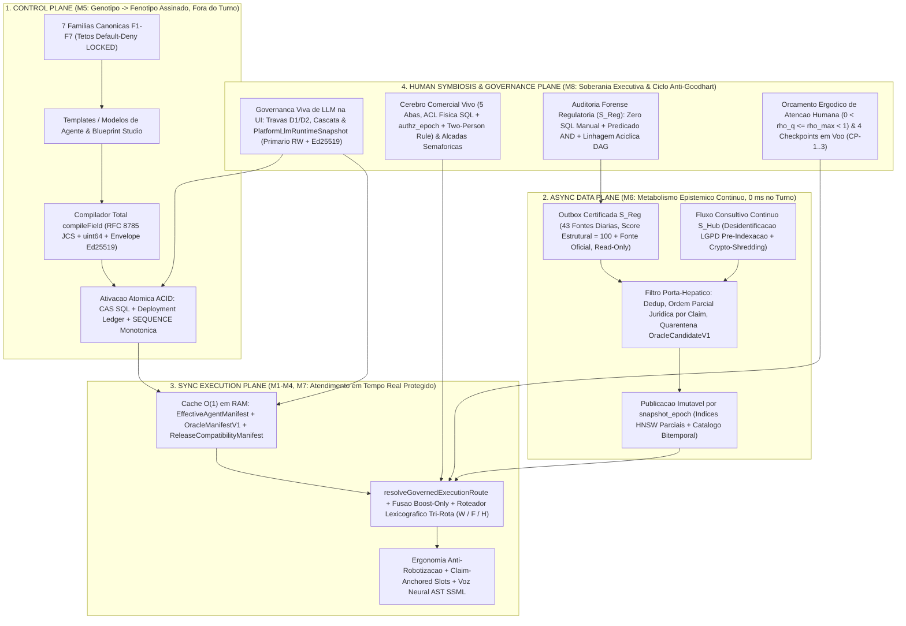

# Engenharia de *Harness* Cognitivo, Simbiose Cognitiva Humano-IA e Paridade Operacional Condicionada: Arquitetura Formal Multi-Plano para Sistemas Agênticos Corporativos de Alta Precisão

**Código do Relatório Técnico:** `VTI-RES-2026-01`  
**Autor:** **Caio Gonçalves** — *Principal Investigator & Chief Systems Architect, VTI Research (VTI, Brazil)* (`https://projectos-system.github.io/vti-research/`)  
**Data:** Novembro de 2026

---

## Resumo

A implantação de sistemas agênticos em domínios institucionais de alta responsabilidade patrimonial — abrangendo consultoria tributária federal e estadual, contabilidade societária (`CPC / NBC TG / IFRS`), apuração de Imposto de Renda, Reforma Tributária sobre o consumo (`IBS / CBS`), Substituição Tributária (`ICMS-ST`), contencioso jurídico-processual e legislação trabalhista/previdenciária, além da engenharia autônoma de software e das superfícies executivas e comerciais — enfrenta uma tensão estrutural entre o custo de inferência de modelos de fronteira, os déficits de cobertura normativa de segunda ordem em modelos compactos e a governança viva da simbiose entre especialistas humanos e agentes artificiais (*Human-in-the-Loop*). A partir de um experimento controlado em medidas repetidas ($5 \times 20 = 100$ execuções ponta a ponta) conduzido sobre o **`Enterprise Advisory & Commercial Agent Hub`** ($\mathcal{S}_{\mathrm{Hub}}$, operando sobre um acervo real de `374.252` vetores semânticos e `396.176` atos normativos) e da auditoria arquitetural conjunta com o **`MemoryOS`** ($\mathcal{S}_{\mathrm{Mem}}$, integrante do `VTI OS System`) e a **`Automated Regulatory Ingestion & Editorial Auditing Platform`** ($\mathcal{S}_{\mathrm{Reg}}$, monitorando `43` fontes oficiais diárias), demonstramos empiricamente que escalar o orçamento de raciocínio livre interno (`reasoning.effort` de `low` para `medium` e `high`) em modelos compactos (`Tier-W Compact Reasoning Model`, `W-Compact`) não supre lacunas de conhecimento estatutário e induz o fenômeno de ***Sub-Parametric Overthinking***: sob cobertura parcial de oráculo determinístico na Consulta 8, a deliberação intermediária ($1.143$ tokens ocultos) degradou a acurácia de $20/20$ para $19/20$ ao racionalizar contra a evidência documental recuperada, enquanto o regime `high` ($36.593$ tokens ocultos) elevou a latência média em $+76,4\%$ frente ao modo `low` ($27,62\text{ s}$ vs. $15,66\text{ s}$) sem capturar a exceção previdenciária de segunda ordem da Consulta 7 (`CEBAS 20%`, art. 37, I, "b", da IN RFB nº 2.110/2022). Fundamentados na Teoria Tripartite da Mente de Keith E. Stanovich, em invariantes funcionais de economia metabólica da fisiologia cognitiva humana e na literatura recente de *Harness Engineering*, *Compound AI Systems* e *Human-AI Complementarity*, formalizamos o **Cognitive Harness Parity Engine (`HPE v3.0`)**. Organizado em quatro planos desacoplados (*Control*, *Data*, *Execution* e *Human Symbiosis & Governance Plane*), o `HPE v3.0` estabelece oito modelos matemáticos (`M1–M8`): (i) o Funcional Não-Compensatório Pareado de Paridade Institucional ($G_s = C_s T_s S_s \in \{0,1\}$, provando $n_j^* = 736$ pares por estrato e $1.125$ sob multiplicidade Holm-7 com *Confidence Sequences Anytime-Valid*); (ii) a Saturação Dupla Exponencial ($\tau_{v,m} \neq \tau_{d,m}$) da dinâmica de esforço; (iii) a Fusão Pós-RRF Residual *Boost-Only* ($S_{\mathrm{rank}} = S_P + \gamma g_B(1 - S_P)S_B$) com seleção submodular exata de *Micro-Cards* ($|S| \le 2$, $\le 320$ tokens multi-tokenizer); (iv) o Roteador Epistêmico Lexicográfico Tri-Rota (`W`, `F`, `H`) sob Prazo Monotônico Compartilhado e auditoria contrafactual *Doubly Robust* (`AIPW`); (v) a Álgebra Total de Compilação Genótipo-Fenótipo (`M5`) sobre `GovernedValue<T>` nas sete famílias canônicas (`F1–F7`), assinada em `Ed25519` sobre `RFC 8785 JCS` e servida em RAM $O(1)$; (vi) o Metabolismo Epistêmico Contínuo Bitemporal (`M6`) unificando assincronamente `43` fontes diárias sob ordem parcial jurídica $\preceq_{\mathrm{jur}}$ (`P0–P6`) e visibilidade atômica por `snapshot_epoch`; (vii) a Otimização Condicionada de Naturalidade Humana, *Claim-Anchored Slots*, Voz Neural por `AST SSML` e Homeostase de Performance (`M7`); e (viii) a Álgebra de Simbiose Cognitiva Humano-IA (`M8`) com **4 Checkpoints de Revogação em Voo (`CP-1..3`)**, filas humanas ergódicas ($0 < \varrho_q \le \varrho_{\max} < 1$), ACL física com `Two-Person Rule` e Ciclo Forense Anti-Goodhart verificado em grafo acíclico (`DAG`), certificado por **13 Baterias E2E (`B1–B13`)** e avaliado sob demarcação rigorosa em quatro camadas epistemológicas.

**Palavras-chave:** Engenharia de *Harness*; Sistemas Compostos de IA; Simbiose Cognitiva Humano-IA (*Human-in-the-Loop*); Racionalidade Epistêmica de Stanovich; *Sub-Parametric Overthinking*; Compilação Criptográfica de Blueprints; Governança Anti-Goodhart; IA Jurídica e Tributária Institucional.

---

## 1. Introdução, Estado da Arte Científica (2020–2026) e Limites Epistemológicos

A transição da inteligência artificial generativa de interfaces conversacionais de propósito geral para infraestruturas institucionais auditáveis deslocou o eixo central da engenharia de sistemas inteligentes: a confiabilidade operacional deixou de ser atributo exclusivo da contagem de parâmetros de um modelo isolado para tornar-se propriedade emergente da terna acoplada $(\text{Especialista Humano } H_{\mathrm{op}},\; \text{Modelo } m,\; \text{Harness } H)$ (**Zaharia et al., 2024**; **Khattab et al., 2024**; **Bansal et al., 2021**). Em domínios governados por direito positivo estrito, normas contábeis cogentes e alçadas comerciais corporativas — nos quais uma alíquota de retenção na fonte invertida, a invocação de instrução normativa revogada ou a concessão de condição comercial fora de alçada gera passivo patrimonial imediato —, a distinção entre **capacidade computacional intrínseca**, **ancoragem cognitiva determinística externa** e **soberania deliberativa humana** assume caráter decisivo.

### 1.1. Síntese da Literatura Científica Recente (2020–2026)

Sete correntes convergentes na literatura científica fundamentam teoricamente esta investigação:

1. **Assimetria de *Harness* em Modelos Compactos (*Harness Lifting*):** **Yang et al. (2026, `arXiv:2607.08938`)** avaliaram *Small Language Models* contra modelos *frontier* em 21 pares tarefa-modelo corporativos. Executados diretamente dentro de *harnesses* projetados para modelos *frontier* (prompts abertos, dezenas de ferramentas simultâneas e dependência de inferência implícita), os modelos compactos colapsaram para `31,4%` de sucesso; todavia, ao transferir a complexidade estrutural da tarefa para o *harness* (*lifting task complexity into the harness* via decomposição determinística, poda de espaço de ação e validação intermediária), o mesmo modelo com pesos congelados atingiu `89,7%` (`+58,3 p.p.`), equiparando-se ao modelo *frontier* em múltiplos fluxos a `4%` do custo financeiro.
2. **Otimização Programática de *Harnesses* com Pesos Congelados:** estudos em otimização declarativa de pipelines (**Khattab et al., 2024 — *DSPy***), interfaces computador-agente (**Jimenez et al., 2024 — *SWE-bench***; **Yang et al., 2024 — *SWE-agent***) e meta-otimização de código de contexto demonstram que o desenho estrutural do protocolo de recuperação, formatação de ferramentas e verificação sintática responde por multiplicadores de desempenho superiores a `6x` sobre o mesmo modelo base, reduzindo simultaneamente o consumo de tokens contextuais.
3. **Degradação por Planejamento Livre Desancorado em Modelos Compactos:** a literatura recente sobre acoplamento gerador-ambiente (*Co-Harness*, 2026) e uso de contextos longos (**Liu et al., 2024 — *Lost in the Middle***) evidencia que induzir modelos menores a produzir cadeias longas e desestruturadas de raciocínio livre degrada a compatibilidade (*fit*) entre gerador e evidência externa, acumulando desvios de premissa sem freio determinístico.
4. **Impossibilidade de Autocorreção Intrínseca vs. Crítica Mediada por Oráculos:** **Huang et al. (2024, ICLR)** demonstraram que LLMs submetidos a ciclos de autocrítica puramente interna (*intrinsic self-correction*) não aprimoram — e frequentemente degradam — sua acurácia dedutiva, pois o verificador compartilha os mesmos priors enviesados do gerador. Em contrapartida, **Gou et al. (2024, ICLR — *CRITIC***) e **Du et al. (2024, ICML)** estabeleceram que a correção converge quando ancorada em sinais externos independentes (interpretadores exatos, calculadoras determinísticas e catálogos verificados).
5. **Limites do RAG Vetorial Puro perante Exceções Estatutárias e Temporalidade:** em avaliação empírica no Stanford RegLab, **Magesh et al. (2025)** comprovaram que mesmo ferramentas jurídicas comerciais especializadas baseadas em *Retrieval-Augmented Generation* (RAG) alucinam entre `17%` e `33%` das consultas quando a resposta depende de hierarquia normativa, vigência bitemporal (**Jensen & Snodgrass, 1999**; **Kulkarni & Michels, 2012**) ou exceções estatutárias de segunda ordem omitidas na formulação superficial da pergunta.
6. **Cascatas Econômicas, Roteamento de Modelos e Viés de Rótulos Seletivos:** **Chen, Zaharia & Zou (2023 — *FrugalGPT***) e **Ong et al. (2025, ICLR — *RouteLLM***) demonstraram reduções de custo de `50%` a `85%+` combinando modelos compactos e *frontier*. Contudo, roteadores calibrados apenas por preferência estilística geral carecem de garantias formais não-compensatórias contra falsos negativos silenciosos em direito tributário e contabilidade, além de sofrerem viés de rótulos seletivos (**Lakkaraju et al., 2017**) quando a rota econômica não é submetida a auditoria contrafactual duplamente robusta (**Robins, Rotnitzky & Zhao, 1994**).
7. **Complementaridade Humano-IA, Atenção Finita e Governança Anti-Goodhart:** desde a taxonomia de níveis de automação de **Parasuraman, Sheridan & Wickens (2000)** e as diretrizes de interação humano-IA de **Amershi et al. (2019)** até os modelos formais de decisão complementar de **Wilder, Horvitz & Kamar (2020)** e **Bansal et al. (2021)**, comprova-se que o desempenho conjunto supera os agentes isolados ($\operatorname{Perf}(H_{\mathrm{op}} + M) > \max\{\operatorname{Perf}(H_{\mathrm{op}}), \operatorname{Perf}(M)\}$) somente quando: (a) a interface preserva fronteiras claras de autoridade sem induzir *automation bias*; (b) a atenção humana é tratada como um **recurso ergódico finito** protegido contra saturação de fila; e (c) divergências entre curadoria humana e IA resultam em correção estrutural do código-fonte e nunca em edições manuais cosméticas sobre registros de saída, prevenindo a **Lei de Goodhart** (**Goodhart, 1975**; **Strathern, 1997**).

Sob o referencial da **Teoria Tripartite da Racionalidade de Keith E. Stanovich** (**Stanovich, 2009, 2011**; **Evans & Stanovich, 2013**; **Stanovich, West & Toplak, 2016**; **De Neys, 2023**), sintetizamos esses resultados em uma tese de engenharia cognitiva: ampliar `reasoning.effort` em um modelo compacto eleva apenas o dispêndio computacional da **Mente Algorítmica** (*capacidade de simulação serial*), mas **jamais sintetiza *Mindware* Declarativo e Procedimental ausente nos pesos**, não substitui o monitoramento de conflito da **Mente Reflexiva** e não dispensa a **Soberania Intencional Humana** na fixação de apetite de risco, alçadas negociais e auditoria de verdade institucional.

### 1.2. Limites Epistemológicos da Analogia Fisiológica e Padronização Experimental

A neurofisiologia energética demonstra que o encéfalo humano opera sob orçamento estrito (~`20 W`) graças à **diferenciação celular seletiva a partir de um único genoma**, **arcos reflexos medulares e cerebelares de latência mínima**, **monitoramento de conflito pelo córtex cingulado anterior dorsal (`dACC`) antes de recrutar controle executivo intenso (`dlPFC`)** (**Attwell & Laughlin, 2001**; **Botvinick et al., 2001**; **Baddeley, 2000**) e **sistemas complementares de aprendizagem** que isolam a captura episódica rápida da consolidação neocortical fora da vigília (**McClelland, McNaughton & O'Reilly, 1995**; **Gutiérrez et al., 2024**).

> **Demarcação Epistemológica Obrigatória:** Neste artigo, a fisiologia cognitiva humana atua estritamente como **(i) heurística de decomposição modular**, **(ii) vocabulário arquitetural unificador** e **(iii) fonte de invariantes abstratos de isolamento de recursos e homeostase**. Não se postula equivalência biológica ou ontológica entre silício e tecido neural, nenhuma prova matemática é substituída por metáfora anatômica, e o projetor de observabilidade (`biomimetic_projector`) é estritamente unidirecional (`componente técnico interno -> rótulo analítico de inspeção`), sendo banida qualquer exposição de nomenclatura fisiológica em schemas de banco, contratos REST/SSE ou prompts de cliente.

**Nota Metodológica sobre Ecossistemas e Tiers de Modelos Padronizados:** A investigação abrange três plataformas corporativas integradas em produção:
- **`MemoryOS` ($\mathcal{S}_{\mathrm{Mem}}$, integrante do `VTI OS System`):** plataforma de memória bitemporal híbrida, governança epistêmica multi-modelo e engenharia autônoma;
- **`Enterprise Advisory & Commercial Agent Hub` ($\mathcal{S}_{\mathrm{Hub}}$):** hub multiagente de consultoria institucional (tributária, contábil, trabalhista/previdenciária, societária e processual) e operação comercial/executiva, apoiado sobre um acervo curado real de `374.252` vetores semânticos (`pgvector` HNSW) e `396.176` atos normativos;
- **`Automated Regulatory Ingestion & Editorial Auditing Platform` ($\mathcal{S}_{\mathrm{Reg}}$):** motor automatizado de coleta, qualificação normativa e auditoria editorial estruturada monitorando continuamente `43` fontes oficiais diárias brasileiras (Diário Oficial da União, Receita Federal, CONFAZ, 27 Diários Estaduais cobrindo 100% das Unidades Federativas e Tribunais Superiores).

Para assegurar reprodutibilidade científica independente de codinomes transitórios de fornecedores, os modelos avaliados são referenciados por seus tiers canônicos normalizados no gateway corporativo multi-provedor (que abstrai provedores comerciais modernos via OpenAI Responses API `/v1/responses` com `reasoning.effort` e Google GenAI `thinkingConfig`):
- **`Tier-W Compact Reasoning Model` (`W-Compact`):** modelo compacto de raciocínio de alta vazão, tarifado na faixa pública de referência de `US$ 0,10 / 1M` tokens de entrada e `US$ 0,50 / 1M` tokens de saída (`US$ 0,40 / 1M` na faixa contratual faturada de volume);
- **`Tier-F Frontier Reasoning Model` (`F-Frontier`):** modelo *flagship* de fronteira de alta densidade paramétrica, tarifado na faixa pública de referência de `US$ 2,00 / 1M` tokens de entrada e `US$ 10,00 / 1M` tokens de saída (`US$ 8,00 / 1M` na faixa contratual faturada de volume).

---

## 2. Evidência Experimental Precursora e Modelagem Matemática (`M1` e `M2`)

### 2.1. Experimento Pareado em Medidas Repetidas ($5 \times 20 = 100$ Execuções) e *Sub-Parametric Overthinking*

Previamente à construção do `HPE v3.0`, conduzimos um experimento controlado em medidas repetidas sobre $\mathcal{S}_{\mathrm{Hub}}$, submetendo **cinco configurações de modelo e esforço deliberativo** exatamente às mesmas **$n = 20$ consultas reais auditadas** do domínio trabalhista e previdenciário brasileiro ($100$ execuções ponta a ponta, preservando inalterados o acervo vetorial e o estado cadastral):

| Perfil Experimental Pareado ($n = 20$ consultas independentes) | Transporte de Inferência | Acertos na Tese Central | Exceção de 2ª Ordem (`Q7`: `CEBAS 20%`) | Erro por *Overthinking* (`Q8`: `FPAS 507`) | Tokens Ocultos `Reasoning` (`20Q`) | Tokens Visíveis (`20Q`) | Latência Média Total (LLM) | Custo Medido `20Q` (Anual `65k`) |
| :--- | :---: | :---: | :---: | :---: | :---: | :---: | :---: | :---: |
| **1. `F-Frontier` (`low` — Baseline)** | `/v1/responses` | `20/20` | Capturou | `0` (Acertou `507`) | *(embutido)* | `10.426` | `22,99 s` (`10,63 s`) | `US$ 0,9362` (`US$ 3.042,64`) |
| **2. `W-Compact` (`none`)** | `/v1/chat/completions` | `20/20`* | Omitiu | `0` (Acertou `507`) | `0` | `6.767` | `15,23 s` (`4,91 s`) | `US$ 0,0451` (`US$ 146,69`) |
| **3. `W-Compact` (`low` — Ótimo Local)** | `/v1/responses` | **`20/20`** | Omitiu | **`0` (Acertou `507`)** | **`1.311`** | `6.734` | **`15,66 s` (`6,26 s`)** | **`US$ 0,0457` (`US$ 148,40`)** |
| **4. `W-Compact` (`medium`)** | `/v1/responses` | `19/20` | Negou | **Errou (`FPAS 515`)** | `15.289` | `6.942` | `15,88 s` (`12,48 s`) | `US$ 0,0528` (`US$ 171,70`) |
| **5. `W-Compact` (`high`)** | `/v1/responses` | `20/20`** | Negou | `0` (Acertou `507`) | `36.593` | `6.914` | `27,62 s` (`21,60 s`) | `US$ 0,0633` (`US$ 205,80`) |

*\*Nota: `W-Compact (none)` apresentou 1 truncamento sintático abrupto na `Q19` (`150` tokens).*  
*\*\*Nota: `W-Compact (high)` vazou artefato residual de formatação em inglês (`### Sources:`) na `Q13` e registrou picos extremos de `55,0 s` (`Q10`) e `54,5 s` (`Q20`).*

Em rigor estatístico (**Clopper & Pearson, 1934**), cumpre assinalar duas propriedades fundamentais do desenho experimental: (i) as $100$ execuções formam um delineamento de blocos pareados ($K = 5$ condições sobre $N = 20$ unidades temáticas independentes), vedando tratá-las como $100$ observações independentes; e (ii) sob o limite exato unilateral de Clopper–Pearson a $97,5\%$ ($\alpha = 0,025$), observar $0$ erros em $n = 20$ estabelece apenas um teto superior populacional de erro $p_U = 1 - 0,025^{1/20} \approx 0,1684$ ($16,84\%$). Todavia, como dissecação causal controlada sobre o mesmo conjunto de evidências recuperadas, o contraste mecanístico entre as Consultas **7**, **8** e **15** isola três fenômenos reprodutíveis:

1. **Invariância da Lacuna de *Mindware* de 2ª Ordem ao Esforço Algorítmico (`Q7`):** ao analisar a contratação de contribuinte individual autônomo por associação beneficente de assistência social mencionando `"20%"`, a ponte normativa entre a natureza institucional da contratante $\to$ eventual titularidade de certificado `CEBAS` $\to$ cota patronal/retenção específica prevista no `art. 37, I, "b", da IN RFB nº 2.110/2022` estava codificada nos pesos densos de `F-Frontier`, mas ausente tanto na consulta vetorial de primeira ordem quanto nos pesos ativos de `W-Compact`. Expandir os tokens ocultos de raciocínio de `275` (`low`) para `1.331` (`medium`) e `3.106` (`high`, `35,15 s`) apenas consolidou a convicção do modelo compacto na regra geral de primeira ordem (`11%`).
2. **Racionalização Sub-Paramétrica Destrutiva sob Oráculo Incompleto (`Q8`):** na consulta sobre o `CNAE 0910-6/00` (apoio à extração de petróleo e gás natural), o catálogo determinístico embrionário continha apenas quatro subclasses piloto e retornou `NAO_MAPEADO_LOCALMENTE`. Com `effort = low` (`0` tokens de raciocínio pós-ferramenta), `W-Compact` seguiu fielmente o documento recuperado no acervo normativo (`FPAS 507` — atividade industrial). Com `effort = medium` (`1.143` tokens ocultos), a cadeia deliberativa interna reinterpretou semanticamente o substantivo *"apoio"* como serviço urbano genérico e sobrescreveu a prova documental com a dedução incorreta `FPAS 515` — fenômeno que definimos formalmente como ***Sub-Parametric Overthinking***.
3. **Suficiência da Prótese Cognitiva Determinística (`Q15`):** para o `CNAE 9430-8/00`, integralmente mapeado no catálogo determinístico local com matriz explícita dos quatro cenários legais (`FPAS 515`, `566`, `523` e `639/CEBAS`), **todas as configurações de `W-Compact` produziram tabela comparativa, fundamentação normativa e conclusão idênticas às de `F-Frontier`**.

### 2.2. Modelo Matemático `M1`: Funcional Não-Compensatório Pareado de Paridade Institucional e Prova Amostral

Métricas aditivas convencionais permitem que verbosidade estilística compense um erro fatal de alíquota ou vigência legal. Para vedar compensações espúrias, definimos o contrato formal de qualidade institucional para cada sistema $s \in \{c, f\}$ — onde $c = (m_{\mathrm{W}}, H_{\mathrm{HPE}})$ e $f = (m_{\mathrm{F}}, H_{\mathrm{base}})$ — sobre uma consulta $q$ na data de referência $t_{\mathrm{ref}}$ e realização estocástica $\omega$.

Cada resposta recebe três indicadores binários bloqueantes:
- $C_s(q, \omega) \in \{0, 1\}$: **Correção Conclusiva Material** (exatidão jurídica, contábil e aritmética da tese principal);
- $T_s(q, t_{\mathrm{ref}}, \omega) \in \{0, 1\}$: **Correção Bitemporal e Normativa** (aplicação exclusiva de norma eficaz em $t_{\mathrm{ref}}$, respeito a *vacatio legis* e vedação de repristinação tácita indevida);
- $S_s(q, \omega) \in \{0, 1\}$: **Conformidade de Segurança, Privacidade e Fronteira de Superfície** (zero vazamento PII/segredos e preservação estrita das fronteiras executivas e comerciais).

Quando o estado probatório de qualquer indicador é epistemicamente indeterminado ($Z = \texttt{UNKNOWN}$), impõe-se bloqueio *fail-closed* ($G_s = 0$), reportando-se separadamente $p_s^{\mathrm{verified}} = \mathbb{P}(\text{PASS} \mid Z \neq \texttt{UNKNOWN})$ e $r_s^{\mathrm{unknown}} = \mathbb{P}(Z = \texttt{UNKNOWN})$. O gate global multiplicativo $G_s$, a qualidade graduada condicional $V_s \in [0, 1]$ e a utilidade institucional $Q_s \in [0, 1]$ são definidos por:

$$G_s(q, \omega) = C_s(q, \omega) \cdot T_s(q, t_{\mathrm{ref}}, \omega) \cdot S_s(q, \omega) \in \{0, 1\}$$

$$V_s(q, \omega) = \sum_{k \in \{E, F, A, U\}} \alpha_k \, m_{k,s}(q, \omega), \qquad \alpha_k \ge 0,\; \sum_{k} \alpha_k = 1, \qquad Q_s(q, \omega) = G_s(q, \omega) \cdot V_s(q, \omega)$$

onde $m_{E,s}$ quantifica a cobertura de exceções e bifurcações fáticas de segunda ordem, $m_{F,s}$ a fidelidade estrita das citações resolvidas, $m_{A,s}$ a adequação operacional do cálculo/encaminhamento e $m_{U,s}$ a explicitação calibrada de premissas abertas.

Em cada estrato crítico de domínio $j \in \{1, \dots, J\}$, definimos três estimandos populacionais: a taxa de aprovação de gate $p_{s,j} = \mathbb{E}_j[G_s]$, a utilidade incondicional $u_{s,j} = \mathbb{E}_j[Q_s]$ e a qualidade graduada no suporte comum de aprovação conjunta $v_{s,j}^{\cap} = \mathbb{E}_j[V_s \mid G_c = 1 \land G_f = 1]$. A **Paridade Operacional Condicionada** exige a satisfação simultânea das três inequações unilaterais pareadas sobre $D_{G,i} = G_{c,i} - G_{f,i} \in \{-1, 0, 1\}$:

$$\operatorname{LCB}_{1 - \alpha_{G,j}}\!\bigl(p_{c,j} - p_{f,j}\bigr) \ge -\delta_{\mathrm{hard}, j}, \qquad \operatorname{LCB}_{1 - \alpha_U}\!\bigl(u_c - u_f\bigr) \ge -\varepsilon_p, \qquad \operatorname{LCB}_{1 - \alpha_V}\!\bigl(v_c^{\cap} - v_f^{\cap}\bigr) \ge -\varepsilon_{\mathrm{soft}}$$

com reamostragem *bootstrap* clusterizada na maior unidade independente (cliente, processo ou família normativa) e controle familiar de erro Tipo I ($\sum \alpha_{\bullet} \le 0,05$ via **Holm, 1979**).

**Teorema 1 (Limite Inferior Exato de Tamanho Amostral por Estrato).** *Para certificar uma margem máxima não-compensatória de não-inferioridade $\delta_{\mathrm{hard}, j} \in (0, 1)$ em um estrato crítico $j$ ao nível unilateral local $\alpha_{j,\mathrm{local}} \in (0, 1)$, mesmo sob o evento amostral mais favorável de zero discordâncias adversas ($n_{01,j} = 0$, em que $G_c = 0 \land G_f = 1$), o número mínimo de pares independentes $n_j$ deve satisfazer:*

$$n_j \ge n_j^* = \left\lceil \frac{\ln(\alpha_{j,\mathrm{local}})}{\ln(1 - \delta_{\mathrm{hard}, j})} \right\rceil$$

*Demonstração.* No caso limite conservador em que $G_{f,i} = 1$ para todos os $n_j$ pares independentes e observa-se zero falhas do sistema compacto ($n_{01,j} = 0$, logo $G_{c,i} = 1$ para todo $i$), a diferença $p_{f,j} - p_{c,j}$ reduz-se à probabilidade binomial de falha adversa $\theta_j = \mathbb{P}(G_c = 0, G_f = 1)$. Pelo método exato de Clopper–Pearson (**Clopper & Pearson, 1934**), o limite superior de confiança de nível $1 - \alpha_{j,\mathrm{local}}$ para $\theta_j$ dado zero falhas em $n_j$ ensaios independentes é a solução de $(1 - \theta_U)^{n_j} = \alpha_{j,\mathrm{local}}$, isto é, $\theta_U(n_j) = 1 - \alpha_{j,\mathrm{local}}^{1/n_j}$. Como $\operatorname{LCB}_{1 - \alpha_{G,j}}(p_{c,j} - p_{f,j}) = -\theta_U(n_j)$, a condição $\operatorname{LCB} \ge -\delta_{\mathrm{hard}, j}$ equivale a $1 - \alpha_{j,\mathrm{local}}^{1/n_j} \le \delta_{\mathrm{hard}, j} \iff \alpha_{j,\mathrm{local}}^{1/n_j} \ge 1 - \delta_{\mathrm{hard}, j}$. Tomando logaritmos naturais e invertendo o sentido da desigualdade (pois $\ln(1 - \delta_{\mathrm{hard}, j}) < 0$), obtém-se $n_j \ge \ln(\alpha_{j,\mathrm{local}}) / \ln(1 - \delta_{\mathrm{hard}, j})$. Substituindo $\alpha_{j,\mathrm{local}} = 0,025$ e $\delta_{\mathrm{hard}, j} = 0,005$, tem-se $\lceil \ln(0,025)/\ln(0,995) \rceil = \lceil -3,688879 / -0,00501254 \rceil = \lceil 735,93 \rceil = 736$ pares independentes por estrato. Sob correção de Holm–Bonferroni para $J = 7$ domínios institucionais no primeiro passo ($\alpha_{j,\mathrm{local}} = 0,025 / 7 \approx 0,0035714$), obtém-se $\lceil \ln(0,025/7)/\ln(0,995) \rceil = \lceil 1.124,39 \rceil = 1.125$ pares independentes por estrato. $\blacksquare$

Esse resultado proíbe reivindicar paridade populacional de $0,5\%$ a partir de suítes pequenas de CI e fundamenta a separação estrita do protocolo experimental (Seção 5) entre **Stage A** (Gate Determinístico de Branch) e **Stage B** (Acumulação Confirmatória em *Shadow Mode* governada por *Confidence Sequences Anytime-Valid* de **Howard et al., 2021**).

### 2.3. Modelo Matemático `M2`: Dinâmica de Saturação Dupla Exponencial para Esforço de Raciocínio

Para explicar analiticamente a curva não-monotônica observada na Seção 2.1 em função do esforço observável de raciocínio $e \ge 0$, evitando tanto a divergência irrealista para $\{0, 1\}$ quanto o colapso assintótico para $\Phi(0) = 0,5$, propomos o modelo de **Saturação Dupla Exponencial**.

Sejam $\Omega(q, H) \in [0, 1]$ o índice pré-estimado fora da amostra de ancoragem determinística fornecida pelo *harness* ($\Omega = 1$ quando o ponto controvertido é coberto por oráculo bitemporal certificado e evidência documental convergente; $\Omega \to 0$ sob lacuna cadastral `UNKNOWN`) e $\Delta_{\mathrm{prior}}(m, q) \ge 0$ a divergência padronizada entre o prior associativo dominante dos pesos do modelo $m$ e a norma especial vigente. Sob constantes estritamente positivas de escala temporal $\tau_{v,m}, \tau_{d,m}, \tau_{\nu,m} > 0$ e parâmetros finitos $A_m, B_m, \nu_m \ge 0$, o estado latente de evidência líquida $z_m(q, e, H)$ e a probabilidade de acerto são governados por:

$$z_m(q, e, H) = z_{0,m}(q, H) + A_m \Omega(q, H)\!\left(1 - e^{-e / \tau_{v,m}}\right) - B_m\bigl(1 - \Omega(q, H)\bigr)\Delta_{\mathrm{prior}}(m, q)\!\left(1 - e^{-e / \tau_{d,m}}\right)$$

$$P_{\mathrm{acerto}}(m, e, H) = \Phi\!\left(\frac{z_m(q, e, H)}{\sqrt{1 + \nu_m\bigl(1 - e^{-e / \tau_{\nu,m}}\bigr)}}\right)$$

onde $\Phi(\cdot)$ denota a função de distribuição acumulada normal padrão. Decorrem imediatamente duas propriedades estruturais:
1. **Assíntota Estritamente Finita:** quando $e \to \infty$, $\lim_{e\to\infty} P_{\mathrm{acerto}}(m, e, H) = \Phi\!\bigl([z_{0,m} + A_m \Omega - B_m(1 - \Omega)\Delta_{\mathrm{prior}}] / \sqrt{1 + \nu_m}\bigr) \in (0, 1)$, capturando a incapacidade de cadeias longas (`high`) superarem ausência de *mindware* ($\Omega = 0$, caso da `Q7`);
2. **Inversão de Sinal (*Sub-Parametric Overthinking*):** a derivada do numerador latente em relação ao esforço é:
   $$\frac{\partial z_m}{\partial e} = \frac{A_m \Omega}{\tau_{v,m}} e^{-e / \tau_{v,m}} - \frac{B_m(1 - \Omega)\Delta_{\mathrm{prior}}}{\tau_{d,m}} e^{-e / \tau_{d,m}}$$
   Quando a verificação sintática de primeira passagem satura rapidamente ($\tau_{v,m} < \tau_{d,m}$) e a cobertura do *harness* é incompleta ($0 < \Omega < 1$ com $\Delta_{\mathrm{prior}} > 0$), um esforço mínimo estruturado (`low`) eleva $z_m$ ($\partial z_m / \partial e > 0$ na vizinhança de $e = 0$), mas deliberação prolongada sem oráculo (`medium` na `Q8`) faz a deriva associativa dominar ($\partial z_m / \partial e < 0$), degradando a acurácia. Quando o `HPE` eleva $\Omega(q, H_{\mathrm{HPE}}) \to 1$ via oráculos bitemporais certificados, o termo destrutivo $(1 - \Omega)$ anula-se identicamente.

---

## 3. Diagnóstico Arquitetural Forense de Lacunas em Sistemas Compostos Corporativos

A auditoria estática e transacional conduzida sobre os três sistemas corporativos ($\mathcal{S}_{\mathrm{Hub}}$, $\mathcal{S}_{\mathrm{Mem}}$ e $\mathcal{S}_{\mathrm{Reg}}$) identificou quatro classes de vulnerabilidades estruturais típicas de sistemas agênticos de primeira geração:

1. **Assimetria de Cobertura Determinística e Extração Léxica de 1ª Ordem em $\mathcal{S}_{\mathrm{Hub}}$:** enquanto domínios de cálculo algébrico contavam com motores em precisão arbitrária (`decimal.js`), domínios estatutários densos dependiam majoritariamente de busca vetorial/textual ou sementes parciais (ex.: `4` subclasses CNAE de `1.332` na `IN RFB nº 2.110/2022` e ausência de motores tabulares locais para retenções da `IN RFB nº 1.234/2012`, `CSRF art. 30 da Lei nº 10.833/2003`, Fator R e Anexos da `LC nº 123/2006`, tributação de altas rendas/dividendos da `Lei nº 15.270/2025`, equiparação hospitalar da `Lei nº 9.249/1995` e vigência bitemporal `CPC / NBC TG`). Adicionalmente, o roteamento de transporte rebaixava agentes sem ferramentas ativas para endpoints legados sem raciocínio estruturado, e a busca híbrida carecia de expansão separada para hipóteses jurídicas de segunda ordem.
2. **Deriva na Replicação de Blueprints entre Famílias Heterogêneas de Agentes:** o mecanismo de instanciação e atualização de agentes a partir de templates oficiais copiava `systemPrompt` e listas de ferramentas sem declarar formalmente uma **família cognitiva canônica (`F1–F7`)** nem distinguir atributos herdados (`INHERIT`), customizados pelo locatário (`OVERRIDE`) e travados por segurança (`LOCKED`), gerando assimetrias entre fluxos administrativos e assistentes de autoatendimento, além de não revogar automaticamente ferramentas obsoletas em atualizações de versão.
3. **Amplificação Multiplicativa de Timeout e Desacoplamento Epistêmico em $\mathcal{S}_{\mathrm{Mem}}$ (`MemoryOS`):** na rotação multi-chave e multi-provedor, timeouts aplicados independentemente por tentativa geravam pior caso $T_{\mathrm{worst}} \approx N_{\mathrm{keys}} \times \mathrm{timeoutMs} \times N_{\mathrm{providers}}$, podendo violar o orçamento global da chamada pai. Ademais, os sinais pós-RRF de qualidade probatória e a matriz multidimensional de risco não alimentavam proativamente a seleção pré-geração entre `W-Compact`, `F-Frontier` e revisão humana.
4. **Inconsistências Distribuídas em Superfícies *Human-in-the-Loop* e Fluxos Diários ($\mathcal{S}_{\mathrm{Hub}} + \mathcal{S}_{\mathrm{Reg}}$):**
   - Caches locais de configuração de LLM com TTL fixo (`30 s`) sem época monotônica nem checkpoints em voo permitiam que execuções multi-etapas prosseguissem após desligamento administrativo emergencial de modelos *flagship*;
   - Em bases vetoriais alimentadas continuamente, orientações consultivas históricas (`P4`) e matérias editoriais (`P3`) coexistiam sem ordem parcial formal por dispositivo capaz de impedir que uma resposta antiga competisse com lei primária recém-promulgada (`P0/P1`);
   - Superfícies vivas de ensino comercial e filas humanas de aprovação de alçada exigiam isolamento físico contra *indirect prompt injection*, regra material de duas pessoas naturais (`Two-Person Rule`), controle ergódico de saturação de fila e uma ponte **append-only / read-only** com $\mathcal{S}_{\mathrm{Reg}}$ para impedir remendos manuais em banco ou ciclos de auto-confirmação sintética.

---

## 4. Arquitetura Formal do *Cognitive Harness Parity Engine* (`HPE v3.0`)

Para sanar estruturalmente as lacunas diagnosticadas sem penalizar o caminho síncrono de atendimento, o `HPE v3.0` particiona o ecossistema em **quatro planos ortogonais**, ilustrados no diagrama arquitetural a seguir:

### 4.1. Modelo `M3`: Grafo Tripartido de Pontes de 2ª Ordem, Fusão Residual *Boost-Only* e Seleção Submodular Exata

Injetar expansões especulativas diretamente na consulta principal dilui a precisão lexical da busca primária. No `HPE v3.0`, as arestas do grafo normativo $\mathcal{G}_{\mathrm{bridge}}$ são particionadas em três classes disjuntas:
- **Classe A (`SAFE_SYNONYM`):** equivalências terminológicas estritas (ex.: `"DARF 5952"` $\leftrightarrow$ `"CSRF art. 30 Lei 10.833/2003"`), admitidas na via primária $L_P$;
- **Classe B (`CANDIDATE_HYPOTHESIS`):** hipóteses estatutárias de segunda ordem (ex.: `entidade assistencial + autônomo PF` $\to$ `CEBAS art. 37 IN 2.110/2022`; `clínica médica + Lucro Presumido` $\to$ `equiparação hospitalar art. 15 § 1º III-a Lei 9.249/1995`; `órgão público + retenção` $\to$ `IN RFB 1.234/2012`; `dividendos PF` $\to$ `retenção mensal > R$ 50 mil e ajuste anual Lei 15.270/2025`; `transferência entre filiais` $\to$ `ADC 49 / LC 204/2023 / Conv. ICMS 109/2024`), executadas exclusivamente em lista paralela isolada $L_B$;
- **Classe C (`CONDITIONAL_CONCLUSION`):** regimes dependentes de pressuposto fático ausente no enunciado, cuja ativação obriga o modelo a explicitar os cenários alternativos e solicitar confirmação fática, jamais presumindo tacitamente o cumprimento do requisito.

Sejam $S_P(d, q) \in [0, 1]$ o escore primário calibrado isotonicamente após *Reciprocal Rank Fusion* (**Cormack, Clarke & Buettcher, 2009**) e $S_B(d, q) = \mathbb{I}[d \in L_B] \cdot \frac{k + 1}{k + r_B(d)} \in [0, 1]$ o escore ordinal normalizado na trilha de ponte. Com $\gamma \in [0, 1]$ (padrão $\gamma = 0,35$) e indicador binário de superfície autorizada $g_B(q) \in \{0, 1\}$ ($g_B(q) \equiv 0$ para todas as famílias executivas, comerciais e de atendimento), a fusão assume a forma fechada **Residual *Boost-Only***:

$$S_{\mathrm{rank}}(d, q) = S_P(d, q) + \gamma \cdot g_B(q) \cdot \bigl[1 - S_P(d, q)\bigr] \cdot S_B(d, q) \in [0, 1]$$

Garantias algébricas imediatas para $0 \le \gamma g_B(q) \le 1$: (i) $S_B(d, q) = 0 \implies S_{\mathrm{rank}}(d, q) = S_P(d, q)$ (zero penalização de denominador sobre resultados exatos da busca principal); e (ii) monotonicidade estrita $S_{\mathrm{rank}}(d, q) \ge S_P(d, q)$.

Para a injeção de ***Micro-Cards* Condicionais**, dado o conjunto candidato vigente $C(q)$ em $t_{\mathrm{ref}}$, definimos o espaço de subconjuntos admissíveis $\mathcal{F}(q)$ limitando o orçamento de tokens sobre o payload **integralmente serializado** através de todos os tokenizadores suportados $\mathcal{T} = \{\texttt{o200k\_base},\, \texttt{gemini\_sp}\}$:

$$\mathcal{F}(q) = \left\{\, S \subseteq C(q) \;\middle|\; |S| \le 2,\; \max_{\tau \in \mathcal{T}} T_{\tau}\!\bigl(\operatorname{serialize}(S)\bigr) \le 320,\; \forall c \in S: \operatorname{LCB}\!\bigl(\operatorname{Precond}(c, q)\bigr) \ge \tau_{\mathrm{card}},\; \forall a \neq b \in S: \operatorname{Conflict}(a, b) = 0 \,\right\}$$

Como $\varnothing \in \mathcal{F}(q)$ e $|S| \le 2$, o subconjunto ótimo $S^*(q)$ que maximiza a função submodular de cobertura com penalidade de redundância $\rho(a, b, q) \ge 0$ (**Nemhauser, Wolsey & Fisher, 1978**) é obtido por **enumeração exata determinística** sobre $\varnothing$, singletons e pares não-ordenados $\{a, b\}$ com desempate lexicográfico por `card_id`:

$$S^*(q) = \arg\max_{S \in \mathcal{F}(q)} \left[\, \sum_{c \in S} u(c, q) - \sum_{\{a, b\} \subseteq S} \rho(a, b, q) + \beta \cdot \operatorname{Coverage}(S, q) \,\right]$$

### 4.2. Oráculos Tabulares Bitemporais Certificados (`OracleManifestV1`), `ModelCapabilityRegistry` e Resolução Pós-Regex

Um simples hash SHA-256 atesta integridade de bytes, mas não completude cadastral nem vigência normativa. Todo catálogo ou motor determinístico em $\mathcal{S}_{\mathrm{Hub}}$ e $\mathcal{S}_{\mathrm{Mem}}$ exige no boot um **Manifesto Bitemporal Assinado (`OracleManifestV1`)** contendo `source_snapshot_sha256`, `compiled_artifact_sha256`, reconciliação exata `expected_row_count === actual_row_count`, intervalos bitemporais `[valid_from, valid_to)` e `[tx_from, tx_to)`, assinatura `Ed25519` e política estrita `unmapped_policy = "RETURN_EXPLICIT_UNKNOWN_NO_ANALOGY"`. Os **11 oráculos bitemporais implantados** cobrem integralmente: (1) as `1.332` subclasses CNAE 2.3 dos Anexos I e II da `IN RFB nº 2.110/2022`; (2) retenção previdenciária de contribuinte individual (`11%` regra geral vs. `20%` `CEBAS`); (3) matriz `Tabela 03 × Tabela 21` do eSocial; (4) retenções federais `CSRF 4,65%` (`Lei nº 10.833/2003, art. 30`) e dispensa `<= R$ 10,00`; (5) matriz de retenção ampla de órgãos públicos (`IN RFB nº 1.234/2012`); (6) `Simples Nacional` (`LC nº 123/2006` Anexos I–V, Fator R e CPP patronal no Anexo IV); (7) tabela progressiva de IRPF, retenção mensal de `10%` sobre dividendos `> R$ 50.000,00/mês` e tributação mínima anual (`Lei nº 15.270/2025`); (8) verificador booleano cumulativo de equiparação hospitalar (`Lei nº 9.249/1995` e Tema 217/STJ); (9) catálogo bitemporal de Pronunciamentos `CPC / NBC TG` e equivalência `IFRS`; (10) motores `IBS/CBS` (`LC nº 214/2025`) e `ICMS-ST/DIFAL`; e (11) calculadoras processuais (`CPC`, prescrição intercorrente `LEF` e impenhorabilidade). Diante de item fora de cobertura, o oráculo retorna `{ status: "UNKNOWN", allowAnalogicalInference: false }`, proibindo interpolação semântica.

Paralelamente, o **`ModelCapabilityRegistry`** substitui condicionais baseadas em nomes de modelos por tradução tipada de um `AbstractGenerationPlan` para cada provedor (`Provider-A` via `/v1/responses` independentemente da presença de tools quando `effectiveEffort !== 'none'`, e `Provider-B` via `thinkingConfig`), lançando `CapabilityMismatchError` determinístico em vez de *downgrade* silencioso. A expansão editorial e tabelas comparativas são acionadas condicionalmente ($\ge 2$ regimes comparados, memória de cálculo ou $\ge 3$ subperguntas), enquanto o extrator pré-inferência `<indice_dispositivos_recuperados>` classifica cada citação normativa do RAG em cinco categorias estritas contra o catálogo bitemporal: `AFIRMATIVO_VIGENTE`, `EXCECAO_CONDICIONADA`, `HISTORICO_REVOGADO` (bloqueado como fundamento ativo), `ADVERSARIAL_OU_VENCIDO` e `NAO_VALIDADO`.

### 4.3. Modelo `M4`: Prazo Monotônico Compartilhado, Roteador Lexicográfico Tri-Rota (`W`, `F`, `H`) e Auditoria `AIPW`

Para eliminar o estouro multiplicativo de latência em cascatas multi-chave, fixa-se na entrada da requisição $t_{\mathrm{deadline}} = t_{\mathrm{monotonic\_now}} + T_{\mathrm{global}}$. Antes de cada tentativa $r$, o orçamento de tempo é truncado deterministicamente por:

$$t_{\mathrm{attempt}}^{(r)} = \min\!\Bigl(t_{\mathrm{config}}^{(r)},\; t_{\mathrm{deadline}} - t_{\mathrm{monotonic\_now}} - t_{\mathrm{reserve}}\Bigr)$$

abortando tentativas com $t_{\mathrm{attempt}}^{(r)} < t_{\mathrm{min\_useful}}^{(r)}$ e propagando um `AbortSignal` composto que encerra conexões HTTP e *streams* órfãos em `< 50 ms`. Caso ocorra truncamento sintático na resposta, uma única recomposição é permitida **exclusivamente** se nenhuma ferramenta com efeito colateral externo tiver sido invocada no turno (`idempotency_key`).

Sobre essa base resiliente, o roteamento pré-geração executa uma decisão lexicográfica em quatro estágios (`L0` inspeção estática $\to$ `L1` sinal calibrado de busca $\to$ `L2` ancoragem de oráculos $\Omega \in \{0,1\}$ e vigência temporal $\to$ `L3` escolha sobre $\mathcal{A} = \{W, F, H\}$):

1. **Passo 1 — Curto-Circuito de Impossibilidade Ontológica:** se `L2` detecta consulta sobre ato normativo futuro ou alíquota ainda não promulgada na data de referência (`NORMA_NAO_PUBLICADA`), o sistema desvia em sub-milissegundo para resposta terminativa padronizada / rota $H$, sem invocar geração especulativa.
2. **Passo 2 — Filtragem de Segurança por Quantil Superior Posterior:** seja $E_a = \{C_a = 0\} \cup \{T_a = 0\} \cup \{S_a = 0\}$ o evento união de falha bloqueante sob a ação $a \in \{W, F, H\}$ dado o vetor de covariáveis $X(q)$ e o histórico calibrado $\mathcal{D}$, com taxa humana basal realisticamente não-nula $p_{\mathrm{err}}(H \mid X) = p_H(X) > 0$. Dado o teto de risco tolerável do domínio $\rho_{\mathrm{domain}}$, define-se o conjunto seguro admissível:

$$\mathcal{A}_{\mathrm{safe}}(X) = \Bigl\{\, a \in \{W, F, H\} \;\Big|\; Q_{0,95}\!\bigl(p_{\mathrm{err}}(a \mid X, \mathcal{D})\bigr) \le \rho_{\mathrm{domain}} \,\Bigr\}$$

Se $\mathcal{A}_{\mathrm{safe}}(X) = \varnothing$, aplica-se fechamento total *fail-closed*: $a^*(X) = H$.
3. **Passo 3 — Minimização Monetária Homogênea dentro de $\mathcal{A}_{\mathrm{safe}}(X)$:** exclusivamente entre as rotas já aprovadas no filtro de segurança, minimiza-se o custo operacional total monetizado:

$$a^*(X) = \arg\min_{a \in \mathcal{A}_{\mathrm{safe}}(X)} \Bigl[\, C_{\mathrm{api}}(a, X) + C_{\mathrm{compute}}(a, X) + v_{\mathrm{lat}}(X)\cdot \operatorname{Lat}_{\mathrm{P95}}(a, X) + D_{\mathrm{delay}, a}(X) + D_{\mathrm{omission}, a}(X) \,\Bigr]$$

4. **Auditoria Contrafactual *Doubly Robust* (`AIPW`):** para evitar viés de rótulos seletivos (**Lakkaraju et al., 2017**) e não confundir concordância entre modelos com verdade material, uma fração controlada de consultas dentro de $\mathcal{A}_{\mathrm{safe}}^{\mathrm{explore}}(X) \subseteq \mathcal{A}_{\mathrm{safe}}(X)$ com propensão conhecida $\pi(a \mid X) \ge \varepsilon_{\min} = 0,05$ é avaliada assincronamente contra rótulo independente $y^*$ (oráculo determinístico ou adjudicação humana cega), estimando-se o risco populacional via *Cross-Fitted Augmented Inverse Propensity Weighting* (**Robins, Rotnitzky & Zhao, 1994**):

$$\widehat{R}_{\mathrm{AIPW}}(a) = \frac{1}{n} \sum_{i=1}^{n} \left[\, \hat{\mu}_a(X_i) + \frac{\mathbb{I}\{A_i = a\}}{\pi(a \mid X_i)} \bigl(\ell(y_{A_i}, y_i^*) - \hat{\mu}_a(X_i)\bigr) \,\right]$$

O executor sombra opera em fila isolada (`MAX_SHADOW_QUEUE = 64`, política `Drop-Newest` sob pressão, concorrência unitária e teto orçamentário diário rígido), garantindo impacto zero sobre a latência de produção. Adicionalmente, superfícies executivas e comerciais são blindadas por **9 estágios cumulativos *default-deny*** (Entrada, Expansão $g_B \equiv 0$, Retrieval com `tenant_id` e HNSW parcial, Contexto sem *Micro-Cards*, Autorização bijetiva de ferramentas no servidor, Governança regional/LGPD no roteamento, Projeção DTO estrita em cada frame SSE, Cache particionado pós-autorização e Redação PII Mod-11 na origem da telemetria).

### 4.4. Modelo `M5`: Álgebra Total de Compilação Genótipo-Fenótipo nas 7 Famílias (`F1–F7`), `RFC 8785 JCS` e `Ed25519`

Todo template oficial de agente (`Genótipo`) em $\mathcal{S}_{\mathrm{Hub}}$ e $\mathcal{S}_{\mathrm{Mem}}$ vincula-se obrigatoriamente a uma única família canônica `familyCode` $\in \{\texttt{F1}, \dots, \texttt{F7}\}$, cujos tetos de ferramentas, superfície e expansão são imutáveis (`LOCKED`):

| Família Canônica | Papel Funcional & Correlato Comparativo | Pontes $g_B$ & *Micro-Cards* | Oráculos & Memória Autorizados | Contrato de Superfície, Voz e SLO |
| :---: | :--- | :---: | :--- | :--- |
| **`F1` `INSTITUTIONAL_ADVISORY`** | Consultoria Tributária, Contábil, Trabalhista e Processual | Habilitado ($g_B=1$, $|S|\le 2$) | `OracleManifestV1` + `CERTIFIED_NORMATIVE_RECORD` + RAG `snapshot_epoch` | Fundamentação legal explícita; voz executiva; SLO médio `~16,8–17,5 s` (batch/parecer) / `< 4 s` (consulta direta). |
| **`F2` `EXECUTIVE_COPILOT`** | Copiloto Executivo & Gestão Estratégica de Equipe | **`LOCKED: 0`** ($g_B \equiv 0$) | Memória episódica de equipe (`TTL 14d` Mod-11) + Catálogo de Produtos | Barreira corporativa estrita (`0` metadados internos); 1ª pessoa do plural; SLO P95 `<= 5,5 s`. |
| **`F3` `COMMERCIAL_REVENUE`** | Prospecção (`SDR`), Fechamento (`Closer`) e Renovação | **`LOCKED: 0`** ($g_B \equiv 0$) | Fatos semânticos comerciais + Produtos + Alçadas de desconto | Firewall Comercial em 9 estágios; zero jargão hermenêutico; voz fluida; SLO P95 `<= 4,5 s`. |
| **`F4` `CUSTOMER_CARE_SAC`** | Atendimento, Suporte Operacional e Triagem Omnichannel | **`LOCKED: 0`** ($g_B \equiv 0$) | Base operacional de atendimento + abertura de `Handoff` humano | Escuta ativa, desescalada empática e encaminhamento ágil; SLO P95 `<= 4,0 s`. |
| **`F5` `OPERATIONAL_API`** | Integrações Headless e Ações Estruturadas de Sistema | **`LOCKED: 0`** ($g_B \equiv 0$) | Ferramentas determinísticas `CLIENT_ACTION` com JSON Schema estrito | Sem prosa livre nem falso handoff em SSE; validação estrita de argumentos; SLO P95 `<= 2,5 s`. |
| **`F6` `ANALYTICAL_BI_SQL`** | Inteligência Analítica Financeira, Clientes e Qualidade | Condicional (`qualidade`) | Skills SQL verificadas, `dead_ends` SQL e CTEs *read-only* (`15 s` timeout) | Validador AST *read-only* com CTE, memória híbrida controlada; SLO P95 `<= 9,0 s`. |
| **`F7` `AUTONOMOUS_ENGINEERING`** | Engenharia Autônoma de Software, Auditoria e CLI | Habilitado (Grafo Técnico) | Registros cognitivos bitemporais + `DEAD_ENDS` + AST/Suítes de Teste | Execução verificável em sandbox, diffs determinísticos e rastreabilidade completa. |

Cada atributo governável $k$ é modelado sobre `GovernedValue<T>` através de quatro camadas: Descritor de Família $F_k = (\tau_k, \texttt{nullable}_k, \mathcal{C}_k, v_F, \texttt{familyLocked}_k)$, Blueprint $B_k \in \{\texttt{DEFAULT}(v_B), \texttt{LOCKED}(v_B)\}$, Política de Assinatura/Tenant $T_k \in \{\texttt{Absent}, \texttt{INHERIT}, \texttt{OVERRIDE}(v_T), \texttt{LOCKED}(v_T)\}$ e Instância de Agente $A_k \in \{\texttt{Absent}, \texttt{INHERIT}, \texttt{OVERRIDE}(v_A)\}$. Impõem-se cinco pré-condições léxicas antes da redução: (1) rejeição imediata em parser streaming de qualquer chave JSON duplicada (`ERR_DUPLICATE_JSON_KEY`); (2) proibição da propriedade `"value"` quando `mode === "INHERIT"` (`ERR_INHERIT_CARRIES_VALUE`); (3) obrigatoriedade de base em $B_k$ (`ERR_BLUEPRINT_MUST_DECLARE_BASE`) e bloqueio `ERR_FAMILY_LOCK_VIOLATION` se $F_k.\texttt{familyLocked} = \texttt{true}$ com $v_B \neq v_F$; (4) ilegalidade estrutural de `LOCKED` na folha $A_k$ (`ERR_INVALID_LEAF_LOCK`); e (5) conformidade de domínio $\mathcal{C}_k(v)$ (`ERR_CONSTRAINT_OR_TYPE_VIOLATION`). Satisfeitas as pré-condições de tipo, o operador total puro `compileField(F_k, B_k, T_k, A_k)` resolve deterministicamente o produto cartesiano completo ($2 \times 4 \times 3 = 24$ casos canônicos):

| # | `Blueprint` ($B_k$) | `Tenant` ($T_k$) | `Agent` ($A_k$) | `effectiveValue` | `sourceLayer` | `editPermission` | `resolutionReason` | `validationErrors` |
| :---: | :--- | :--- | :--- | :---: | :---: | :--- | :--- | :--- |
| **1** | `DEFAULT(vB)` | `Absent` | `Absent` | `vB` | `BLUEPRINT` | `EDITABLE` | `INHERITED_BLUEPRINT_DEFAULT` | `[]` |
| **2** | `DEFAULT(vB)` | `Absent` | `INHERIT` | `vB` | `BLUEPRINT` | `EDITABLE` | `EXPLICIT_INHERIT_FROM_BLUEPRINT` | `[]` |
| **3** | `DEFAULT(vB)` | `Absent` | `OVERRIDE(vA)` | `vA` | `AGENT` | `EDITABLE` | `AGENT_OVERRIDE_APPLIED` | `[]` |
| **4** | `DEFAULT(vB)` | `INHERIT` | `Absent` | `vB` | `BLUEPRINT` | `EDITABLE` | `TENANT_INHERIT_PASS_THROUGH` | `[]` |
| **5** | `DEFAULT(vB)` | `INHERIT` | `INHERIT` | `vB` | `BLUEPRINT` | `EDITABLE` | `CHAINED_INHERIT_FROM_BLUEPRINT` | `[]` |
| **6** | `DEFAULT(vB)` | `INHERIT` | `OVERRIDE(vA)` | `vA` | `AGENT` | `EDITABLE` | `AGENT_OVERRIDE_OVER_INHERITED_TENANT` | `[]` |
| **7** | `DEFAULT(vB)` | `OVERRIDE(vT)` | `Absent` | `vT` | `TENANT` | `EDITABLE` | `INHERITED_TENANT_OVERRIDE` | `[]` |
| **8** | `DEFAULT(vB)` | `OVERRIDE(vT)` | `INHERIT` | `vT` | `TENANT` | `EDITABLE` | `EXPLICIT_INHERIT_FROM_TENANT` | `[]` |
| **9** | `DEFAULT(vB)` | `OVERRIDE(vT)` | `OVERRIDE(vA)` | `vA` | `AGENT` | `EDITABLE` | `AGENT_OVERRIDE_OVER_TENANT_DEFAULT` | `[]` |
| **10** | `DEFAULT(vB)` | `LOCKED(vT)` | `Absent` | `vT` | `TENANT` | `READ_ONLY_TENANT_LOCK` | `ENFORCED_TENANT_LOCK` | `[]` |
| **11** | `DEFAULT(vB)` | `LOCKED(vT)` | `INHERIT` | `vT` | `TENANT` | `READ_ONLY_TENANT_LOCK` | `INHERITED_TENANT_LOCK` | `[]` |
| **12** | `DEFAULT(vB)` | `LOCKED(vT)` | `OVERRIDE(vA)` | `null` (abort) | `TENANT` | `READ_ONLY_TENANT_LOCK` | `REJECTED_AGENT_OVERRIDE_ON_TENANT_LOCK` | `["ERR_TENANT_LOCK_VIOLATION"]` |
| **13** | `LOCKED(vB)` | `Absent` | `Absent` | `vB` | `BLUEPRINT` | `READ_ONLY_BLUEPRINT_LOCK` | `ENFORCED_BLUEPRINT_LOCK` | `[]` |
| **14** | `LOCKED(vB)` | `Absent` | `INHERIT` | `vB` | `BLUEPRINT` | `READ_ONLY_BLUEPRINT_LOCK` | `INHERITED_BLUEPRINT_LOCK` | `[]` |
| **15** | `LOCKED(vB)` | `Absent` | `OVERRIDE(vA)` | `null` (abort) | `BLUEPRINT` | `READ_ONLY_BLUEPRINT_LOCK` | `REJECTED_AGENT_OVERRIDE_ON_BLUEPRINT_LOCK` | `["ERR_BLUEPRINT_LOCK_VIOLATION"]` |
| **16** | `LOCKED(vB)` | `INHERIT` | `Absent` | `vB` | `BLUEPRINT` | `READ_ONLY_BLUEPRINT_LOCK` | `TENANT_INHERIT_UNDER_BLUEPRINT_LOCK` | `[]` |
| **17** | `LOCKED(vB)` | `INHERIT` | `INHERIT` | `vB` | `BLUEPRINT` | `READ_ONLY_BLUEPRINT_LOCK` | `CHAINED_INHERIT_UNDER_BLUEPRINT_LOCK` | `[]` |
| **18** | `LOCKED(vB)` | `INHERIT` | `OVERRIDE(vA)` | `null` (abort) | `BLUEPRINT` | `READ_ONLY_BLUEPRINT_LOCK` | `REJECTED_AGENT_OVERRIDE_ON_BLUEPRINT_LOCK` | `["ERR_BLUEPRINT_LOCK_VIOLATION"]` |
| **19** | `LOCKED(vB)` | `OVERRIDE(vT)` | `Absent` | `null` (abort) | `BLUEPRINT` | `READ_ONLY_BLUEPRINT_LOCK` | `REJECTED_TENANT_OVERRIDE_ON_BLUEPRINT_LOCK` | `["ERR_BLUEPRINT_LOCK_VIOLATION"]` |
| **20** | `LOCKED(vB)` | `OVERRIDE(vT)` | `INHERIT` | `null` (abort) | `BLUEPRINT` | `READ_ONLY_BLUEPRINT_LOCK` | `REJECTED_TENANT_OVERRIDE_ON_BLUEPRINT_LOCK` | `["ERR_BLUEPRINT_LOCK_VIOLATION"]` |
| **21** | `LOCKED(vB)` | `OVERRIDE(vT)` | `OVERRIDE(vA)` | `null` (abort) | `BLUEPRINT` | `READ_ONLY_BLUEPRINT_LOCK` | `REJECTED_DUAL_OVERRIDE_ON_BLUEPRINT_LOCK` | `["ERR_BLUEPRINT_LOCK_VIOLATION", "ERR_AGENT_OVERRIDE_ON_LOCKED_LINEAGE"]` |
| **22** | `LOCKED(vB)` | `LOCKED(vT)` | `Absent` | `null` (abort) | `BLUEPRINT` | `READ_ONLY_BLUEPRINT_LOCK` | `REJECTED_REDUNDANT_OR_CONFLICTING_TENANT_LOCK` | `["ERR_TENANT_CANNOT_RELOCK_BLUEPRINT_LOCK"]` |
| **23** | `LOCKED(vB)` | `LOCKED(vT)` | `INHERIT` | `null` (abort) | `BLUEPRINT` | `READ_ONLY_BLUEPRINT_LOCK` | `REJECTED_REDUNDANT_OR_CONFLICTING_TENANT_LOCK` | `["ERR_TENANT_CANNOT_RELOCK_BLUEPRINT_LOCK"]` |
| **24** | `LOCKED(vB)` | `LOCKED(vT)` | `OVERRIDE(vA)` | `null` (abort) | `BLUEPRINT` | `READ_ONLY_BLUEPRINT_LOCK` | `REJECTED_LOCK_COLLISION_AND_AGENT_OVERRIDE` | `["ERR_TENANT_CANNOT_RELOCK_BLUEPRINT_LOCK", "ERR_AGENT_OVERRIDE_ON_LOCKED_LINEAGE"]` |

O `EffectiveAgentManifest` resultante é serializado segundo o **JSON Canonicalization Scheme (`RFC 8785 — JCS`, Rundgren, Jordan & Erdtman, 2020)**, representando inteiros monotônicos de 64 bits (`revision`, `publicationEpoch`) como strings decimais validadas por `^(?:0|[1-9][0-9]{0,19})$` e `0n <= BigInt(v) <= 18_446_744_073_709_551_615n` (eliminando perda de precisão IEEE-754), e assinado assimetricamente via **`Ed25519` (`RFC 8032`, Josefsson & Liusvaara, 2017)** sobre envelope com tag explícita `domainSeparationTag: "VTI_HPE_MANIFEST_V1"` e `audience: "enterprise-hub-execution-plane"`. A publicação executa *Compare-And-Swap* (`CAS`) otimista e gravação em `manifest_deployment_ledger` na **mesma transação ACID**, extraindo `publication_epoch` de `SEQUENCE` monotônica global (mesmo em *rollbacks*, que geram nova ativação monotônica apontando para hash anterior íntegro) e servindo o manifesto pré-verificado em memória RAM $O(1)$.

### 4.5. Modelo `M6`: Metabolismo Epistêmico Contínuo Bitemporal (`P0–P6`), Ordem Parcial Jurídica $\preceq_{\mathrm{jur}}$ e `snapshot_epoch`

A aprendizagem contínua unificada opera `100%` no *Data Plane* assíncrono (`0 ms` adicionados ao caminho síncrono), integrando as **`43` fontes oficiais diárias** e briefings editoriais auditados de $\mathcal{S}_{\mathrm{Reg}}$ ao acervo consultivo e legislativo contínuo de $\mathcal{S}_{\mathrm{Hub}}$. Para impedir que textos secundários sobreponham normas primárias, cada átomo documental recebe classe estrita de proveniência (`P0–P6`):
- `P0`: Constituição Federal, Emendas Constitucionais e Leis Complementares Nacionais (`CTN`, `LC 123/2006`, `LC 214/2025`);
- `P1`: Leis Ordinárias, Medidas Provisórias eficazes, Decretos, Convênios `CONFAZ` e Instruções Normativas (`RFB`, `MTE`, `CFC`);
- `P2`: Decisões judiciais qualificadas (`STF`, `STJ`, `TST`), decompostas em *claims* atômicos por `provision_id` / `claim_id` com estado processual explícito **`proceduralStatus` $\in \{\texttt{PROVISIONAL},\; \texttt{FINAL\_APPEALABLE},\; \texttt{FINAL\_UNAPPEALABLE},\; \texttt{SUSPENDED},\; \texttt{REVOKED}\}$**, alcance subjetivo (`erga_omnes` vs. `inter_partes`) e modulação temporal (`ex_tunc`, `ex_nunc` ou marco prospectivo);
- `P3`: Briefings editoriais estruturados publicados em $\mathcal{S}_{\mathrm{Reg}}$ e manuais técnicos curados — subordinados a `P0–P2`;
- `P4`: Consultas técnicas históricas respondidas por especialistas humanos (`CONTEXTUAL_ADVISORY_EVIDENCE`, proibidas de revogar ou prevalecer sobre `P0–P2`);
- `P5`: Fatos semânticos e catálogos comerciais de tenant;
- `P6`: Memórias episódicas de sessão com TTL curto.

Sobre os *claims* candidatos ao mesmo ponto fático na data de referência $t_{\mathrm{fato}}$ e instante transacional $t_{\mathrm{tx}}$, define-se a **ordem parcial estrita de prevalência jurídica** $c_1 \prec_{\mathrm{jur}} c_2$ se, e somente se, $c_1$ e $c_2$ pertencem à **mesma esfera de competência constitucional/federativa**, incidem sobre o mesmo `provision_id` e verifica-se: (i) hierarquia normativa superior na mesma competência; (ii) especialidade explícita (*lex specialis*); (iii) superveniência temporal eficaz em $t_{\mathrm{fato}}$ (*lex posterior*, respeitada a vedação de repristinação tácita do `art. 2º, § 3º, da LINDB`); ou (iv) suspensão/declaração de inconstitucionalidade eficaz por átomo `P2` ativo dentro do respectivo alcance e modulação. Quando dois *claims* vigentes permanecem incomparáveis ($c_1 \not\preceq_{\mathrm{jur}} c_2$ e $c_2 \not\preceq_{\mathrm{jur}} c_1$), o resolvedor jamais desempata arbitrariamente por timestamp de ingestão: emite **`CONFLICTING_CLAIMS`**, separando cinco estados não-afirmativos distintos (`RESOLVED: NOT_EFFECTIVE_AT_REFERENCE_DATE`, `NOT_FOUND`, `CONFLICTING_CLAIMS`, `OUT_OF_SCOPE` e `INSUFFICIENT_AUTHORITY`).

Índices vetoriais HNSW parciais e catálogos bitemporais relacionais são lidos sob um identificador atômico único **`snapshot_epoch`** fixado no início do turno (`L0`), eliminando leituras *split-brain*. Em estrita conformidade com a Lei Geral de Proteção de Dados (`LGPD — Lei nº 13.709/2018`), consultas históricas (`P4`) sofrem **anonimização irreversível pré-indexação** (remoção determinística de razões sociais, e-mails, chaves fiscais e validação Mod-11 de CPF/CNPJ) antes da geração de embeddings compartilhados, distinguindo-a formalmente do ***crypto-shredding*** aplicado a registros brutos segregados (qualificado como inacessibilidade criptográfica condicionada à destruição auditável de chaves `KEK/DEK`, invalidação de caches, expurgo de vetores derivados por `source_record_id` e *tombstones* no ledger).

### 4.6. Modelo `M7`: Naturalidade Humana Condicionada, *Claim-Anchored Slots*, Voz `AST SSML` e Homeostase de Performance

Seja $N_{f,c,i}(y) \in [0, 1]$ o escore de naturalidade avaliado de forma cega e estratificada por família $f \in \{\texttt{F1},\dots,\texttt{F7}\}$, complexidade $c \in \{\texttt{SIMPLE}, \texttt{COMPARATIVE}, \texttt{CRITICAL}\}$ e modalidade $i \in \{\texttt{TEXT}, \texttt{VOICE}\}$ (exigindo confiabilidade inter-avaliadores $\alpha_{\mathrm{Krippendorff}} \ge 0,75$). Impõe-se em cada estrato:

$$\operatorname{LCB}_{1-\alpha}\!\bigl(\Delta N_{f,c,i}\bigr) = \operatorname{LCB}_{1-\alpha}\!\bigl(N_{f,c,i}(y_{\mathrm{HPE}}) - N_{f,c,i}(y_{\mathrm{ref}})\bigr) \ge -\delta_{N,f,c}$$

com $\delta_{N,f,c} = 0,02$ em `F1` e $\delta_{N,f,c} = 0,01$ em `F2/F3/F4`, sustentada por sete princípios de ergonomia cognitiva: (1) instruções afirmativas de estilo enxutas ($\le 180$ tokens); (2) abertura direta pela resposta concreta; (3) ativação seletiva de tabelas apenas em comparações reais; (4) vedação de *disclaimers* genéricos repetitivos fora de condições `Classe C`; (5) separação física entre evidência estruturada silenciosa e prosa final; (6) ritmo frasal variado adequado ao ofício da família; e (7) isolamento absoluto do prompt nativo nas famílias `F2/F3/F4`.

Para impedir que a redação natural ou a síntese oral inverta numerais, datas ou operadores deônticos (*"obrigatório"* $\leftrightarrow$ *"facultativo"*, *"exceto"* $\leftrightarrow$ *"inclusive"*), o verificador pós-geração valida o ledger estruturado $\mathcal{I}_{\mathrm{rel}}$ composto por átomos `ImmutableClaimAtom` (`deonticPolarity`, `numericSlots` em `decimal.js`, `effectiveWindow`, `normativeAnchors` e `relations`). Qualquer divergência em slot crítico aciona contenção determinística (`CanonicalSafeDto -> DeterministicFamilyTemplateRenderer -> sanitizeCorporateSurfaceDto`), onde o sanitizador remove apenas metadados internos e é estruturalmente impedido de mutar slots factuais validados. Nos canais de voz neural, a prosódia é compilada a partir de uma **Árvore Sintática Abstrata (`AST SSML`)** sobre whitelist fechada (`<speak>`, `
`, `<s>`, `<break>`, `<say-as>`), validada por *round-trip* acústico (`TTS -> ASR`) com erro zero em numerais e prazos.

Na **Homeostase de Performance**, *workers* de ingestão operam com pools PostgreSQL e cotas de I/O isolados do *serving* síncrono; suítes automatizadas de CI inspecionam `pg_indexes` para **proibir índices B-tree sobre `collection_id` em tabelas `pgvector`** onde uma coleção concentra $> 80\%$ das tuplas (preservando scans HNSW puros em `~180 ms` e índices HNSW parciais dedicados para coleções minoritárias $< 5\%$); e o `ReleaseCompatibilityManifest` governa *rolling deploys* reconhecendo explicitamente que `process.hrtime.bigint()` é monotônico apenas localmente ao processo (exigindo novo *lease* no boot e transitando para `HTTP 503 SAFE_DEGRADATION` após `MAX_PARTITIONED_SERVING_WINDOW_MS = 30.000 ms` sob partição de rede).

### 4.7. Modelo `M8`: Álgebra de Simbiose Cognitiva Humano-IA, Checkpoints em Voo, Filas Ergódicas e Ciclo Anti-Goodhart

O quarto plano transversal formaliza a complementaridade ativa entre operadores humanos e agentes através de três submodelos acoplados:

#### 4.7.1. Submodelo `M8.1` — `PlatformLlmRuntimeSnapshot`, `resolveGovernedExecutionRoute` e 4 Checkpoints (`CP-1..3`)

Mutações operacionais na interface — como alternar a **Trava Financeira Soberana `D1`** (`permitirEscalonamentoFlagship`), bloquear modelos instáveis em `disabledModels`, reordenar `cascadeOrder` ou fixar modelo por agente sob a **Trava RBAC `D2`** (`isPlatformAdmin`) — gravam um registro imutável `PlatformLlmRuntimeSnapshot` assinado em `Ed25519` (`RFC 8785 JCS`) com `llm_config_epoch` e `revocation_epoch` monotônicos. Notificações assíncronas (`LISTEN/NOTIFY`) atuam exclusivamente como dica efêmera de despertar: toda reconciliação lê obrigatoriamente do **nó primário RW** (convergência alvo $\le 2.000\text{ ms}$), transicionando para `HTTP 503 SAFE_DEGRADATION` se a idade local superar `MAX_RUNTIME_STALENESS_MS` (vedado *fallback* para réplica de leitura defasada).

Dada uma requisição $X$, o resolvedor determinístico `resolveGovernedExecutionRoute` computa a sequência candidata deduplicada e filtrada pela trava financeira `D1`:

$$\mathcal{C}_{\mathrm{pol}} = \operatorname{orderedDistinct}\bigl([m_{\mathrm{default}}] \mathbin{\Vert} \texttt{cascadeOrder}\bigr) \setminus \texttt{disabledModels}$$

$$\mathcal{C}_{\mathrm{fin}} = \begin{cases} \mathcal{C}_{\mathrm{pol}} \setminus \{m \in \mathcal{C}_{\mathrm{pol}} : \operatorname{isFlagship}(m)\}, & \text{se } D_1 = \texttt{false}, \\ \mathcal{C}_{\mathrm{pol}}, & \text{se } D_1 = \texttt{true}. \end{cases}$$

Filtrando $\mathcal{C}_{\mathrm{avail}} \subseteq \mathcal{C}_{\mathrm{fin}}$ por capacidades suportadas e saúde, e avaliando $\mathcal{A}_{\mathrm{safe}}(X)$ via posterior Beta-Binomial hierárquica estratificada ($Q_{0,95} \equiv 1,0$ sob amostra insuficiente $n_{\mathrm{estrato}} < n_{\min}$, `NORMA_NAO_PUBLICADA` ou `CONFLICTING_CLAIMS`), concilia-se sem ambiguidade o comando administrativo humano com o gate epistêmico: em modo `AUTO_GOVERNED_BY_HARNESS`, escolhe-se o primeiro modelo de $\mathcal{C}_{\mathrm{avail}} \cap \mathcal{A}_{\mathrm{safe}}(X)$ ou desvia-se para `H` se vazio (`FLAGSHIP_LOCKED_D1` / `NO_SAFE_MODEL`); em modo `PINNED_BY_PLATFORM_ADMIN(m_pin, allowSafeEscalation)`, usa-se $m_{\mathrm{pin}}$ somente se pertencer a $\mathcal{C}_{\mathrm{avail}} \cap \mathcal{A}_{\mathrm{safe}}(X)$, escalonando ao próximo seguro apenas se `allowSafeEscalation = true` e `D1 = true`, ou desviando *fail-closed* para `H` (`PIN_UNSAFE_OR_REVOKED`). **Jamais um pin administrativo força alucinação em modelo compacto fora de $\mathcal{A}_{\mathrm{safe}}(X)$, nem o roteador viola `D1 = false` para invocar `F-Frontier`.**

Para interceptar execuções longas já iniciadas quando sobrevém revogação crítica (`revocation_epoch++`), impõem-se **4 Checkpoints Obrigatórios em Voo**:
- **`CP-1` (*Pre-Model Invocation / Retry*):** revalida `revocation_epoch` antes de cada chamada HTTP ao provedor LLM e antes de qualquer tentativa de fallback;
- **`CP-2A` (*Pre-Effect Preparation*):** revalida `revocation_epoch`, `authorization_epoch` e alçada antes de preparar qualquer `tool_call` com efeito colateral;
- **`CP-2B` (*Executor Fencing Commit*):** valida um **`fencing_token` monotônico** na **mesma transação ACID** da escrita em PostgreSQL (`WHERE current_revocation_epoch = $expected`), ou via `idempotency_key` determinística acoplada a *Transactional Outbox/Inbox* para gateways ERP externos;
- **`CP-3` (*Pre-Delivery / Stream Gate*):** aplica *buffering* integral em consultas `F1` até aprovação conjunta dos *Claim-Anchored Slots* e de `revocation_epoch`, e valida cada frame em streams SSE conversacionais (`F2–F4`), abortando instantaneamente com evento terminal sanitizado se houver revogação.

#### 4.7.2. Submodelo `M8.2` — Estabilidade Ergódica de Filas Humanas ($\varrho_q < 1$), ACL Física e `Two-Person Rule`

Sendo $\lambda_H$ a taxa de chegada à fila humana $q$, $c_q$ o número de especialistas ativos no turno e $\mu_H$ a taxa individual de atendimento qualificado, define-se a intensidade ergódica de tráfego $\varrho_q = \lambda_H / (c_q \mu_H)$ e modela-se a probabilidade efetiva de erro humano limitado em $[0, 1]$:

$$p_{\mathrm{err}}^{(H)}(X, \varrho_q) = \operatorname{clip}\!\Bigl(p_{H,0}(X) + \kappa_{\mathrm{fatigue}}\,\phi(\varrho_q) + \kappa_{\mathrm{bias}}(X),\; 0,\; 1\Bigr), \qquad 0 < \varrho_q \le \varrho_{\max} < 1 \quad (\varrho_{\max} = 0,80)$$

Se $\varrho_q > \varrho_{\max}$, declara-se `QUEUE_SATURATED`, priorizando casos críticos por SLA, pausando cadências proativas secundárias e emitindo abstenção segura agendada — **vedada qualquer auto-aprovação de descontos supervisionados ou pareceres não verificados sob saturação**. No Cérebro Comercial Vivo, impõem-se: (i) **ACL física pré-busca no plano SQL** com chave de cache vinculada a `authorization_epoch`; (ii) encapsulamento tipado `<untrusted_commercial_evidence>` contra *indirect prompt injection*; (iii) **`Two-Person Rule` materialmente independente** (`approver_person_id !== author_person_id`, pessoas naturais e sessões distintas) sobre o hash JCS antes de promover qualquer regra para `COMERCIAL_EXTERNO_AUTORIZADO`; e (iv) idempotência transacional de 5 tuplas `(tenant_id, operation_type, idempotency_key, target_id, version_sha256)`.

#### 4.7.3. Submodelo `M8.3` — Ciclo Forense Anti-Goodhart ($\mathcal{S}_{\mathrm{Reg}} \to \text{HPE}$) e Linhagem Acíclica `DAG`

Na reconciliação forense entre curadoria editorial humana independente e o pipeline automatizado de $\mathcal{S}_{\mathrm{Reg}}$, é **estruturalmente proibido editar manualmente registros produtivos (`reg_materia` ou `reg_coleta`) via SQL** para mascarar falhas de coleta, pré-filtro ou classificação: toda discrepância exige correção do próprio código do *harness* e reexecução rastreável por `pipeline_run_id`. A tabela `reg_hpe_certified_outbox` (*append-only* no produtor e *read-only* para o consumidor `HPE`) admite um item $m$ na camada `P3` exclusivamente sob a **conjunção estrita (`AND`)**:

$$\operatorname{Certified}_{P3}(m) \iff \bigl(m.\texttt{status} = \text{'publicado'}\bigr) \;\land\; \bigl(m.\texttt{coleta\_id} \neq \varnothing \land c.\texttt{tipo\_fonte\_oficial} = \texttt{true}\bigr) \;\land\; \bigl(\operatorname{score\_estrutural}(m.\texttt{materia\_sha256}) = 100\bigr) \;\land\; \bigl(\neg\exists\, d \in \texttt{reg\_auditoria}_{\mathrm{aberta}}(m)\bigr) \;\land\; \operatorname{ValidDAG}\bigl(G_{\mathrm{lin}}(m)\bigr)$$

onde o verificador linear $\operatorname{ValidDAG}(G_{\mathrm{lin}}(m))$ (**Tarjan, 1972**) rejeita ciclos dirigidos, divergências de `row_lineage_hmac` (adulteração SQL manual) e ancestralidade sintética comum falsa (auto-confirmação circular de texto gerado por IA). Extrações numéricas fiscais de satélites (`reg_extracao_st`) ingressam exclusivamente como `OracleCandidateV1` em quarentena `PENDING_DUAL_HUMAN_SIGN`, exigindo dupla assinatura humana independente antes de compor novo `OracleManifestV1`.

---

## 5. Protocolo Experimental (`B1–B13`), Resultados Pós-Implementação em 4 Camadas Epistemológicas e Ameaças à Validade

### 5.1. Especificação Reprodutível das 13 Baterias E2E (`B1` a `B13`)

A certificação de engenharia do `HPE v3.0` estrutura-se em dois estágios estatísticos — **Stage A** (Gate Determinístico de Branch exigindo `0` violações de contrato) e **Stage B** (Acumulação Confirmatória em *Shadow Mode* com *Confidence Sequences Anytime-Valid* até $n_j \ge 1.125$ pares independentes por estrato sob Holm-7) — avaliados com semântica tripartida estrita (`PASS` / `FAIL` / `INCONCLUSIVE`) ao longo de **13 Baterias E2E (`B1–B13`)**:

| Bateria | Escopo Experimental Executável | Critério Contratual Bloqueante (`Gate`) |
| :---: | :--- | :--- |
| **B1** | Matemática `M1` & Regressão Pareada `20Q` + `40` Paráfrases Adversariais | `20/20` teses centrais, captura `100%` da bifurcação `CEBAS 20%` (`Q7`), `0` erros em `Q8` e cálculo exato de `LCB`/`UNKNOWN`. |
| **B2** | Propriedades `M2/M3` & Gold Set Multi-Domínio (`Stage A`, `N = 140`) | $S_{\mathrm{rank}} \ge S_P$ em `100%` das `10.000` amostras; enumeração exata $|S|\le 2$ determinística; `0` regressões críticas. |
| **B3** | Certificação dos `11` Manifestos Bitemporais `OracleManifestV1` & `UNKNOWN` | `actual_row_count === expected_row_count`; aborto no boot sob adulteração de `1 byte`; distinção exata `NOT_EFFECTIVE` vs. `NOT_FOUND`. |
| **B4** | Seletividade HNSW `pgvector`, RRF *Boost-Only* & Orçamento Multi-Tokenizer | Zero *Seq Scan* desprotegido; $\max_\tau T_\tau(\operatorname{serialize}(S)) \le 320$ tokens em `100%`; `0` normas revogadas promovidas. |
| **B5** | Paridade Contratual Cross-Provider (`Provider-A` + `Provider-B`) | Emissão determinística de `CapabilityMismatchError` sem downgrade silencioso; idempotência estrita pós-tool em truncamento. |
| **B6** | Resiliência de *Shared Monotonic Deadline* & Quarentena Tipada | Tempo total estritamente $\le T_{\mathrm{global}}$; cancelamento de `100%` das promises filhas em `< 50 ms` após aborto. |
| **B7** | Segurança do Roteador `M4` ($\mathcal{A}_{\mathrm{safe}} = \varnothing$, `NORMA_NAO_PUBLICADA` & `AIPW`) | `100%` curto-circuito para `H` em norma futura não publicada; exploração `0%` fora de $\mathcal{A}_{\mathrm{safe}}$; fila sombra `Drop-Newest` com `0 ms` online. |
| **B8** | Auditoria Negativa dos 9 Estágios (Fronteira Executiva / Comercial) | `0` bytes de vazamento de metadados internos ou colisão *cross-surface* em SSE, cache, retries e telemetria; reversão `< 2.000 ms`. |
| **B9** | Álgebra `M5` (`24` casos `compileField`), JCS `uint64`, `Ed25519` & CAS ACID | `100%` cobertura das 24 linhas + inválidos; rejeição de `"00"`/`>2^64-1`/chaves duplicadas; monotonicidade de `epoch` em rollback. |
| **B10** | Metabolismo Assíncrono `M6` (`43` Fontes $\mathcal{S}_{\mathrm{Reg}}$ + $\mathcal{S}_{\mathrm{Hub}}$) & LGPD | `100%` concordância no gabarito de ordem parcial jurídica $\preceq_{\mathrm{jur}}$; `0` escritas no banco regulatório; `0` leituras *split-brain*; `0` PII Mod-11. |
| **B11** | Naturalidade Cega Estratificada (`F1–F7`), *Claim Slots* & Voz `AST SSML` | $\alpha_{\mathrm{Krippendorff}} \ge 0,75$ e $\operatorname{LCB}_{1-\alpha}(\Delta N) \ge -\delta_N$; `0` inversões numéricas/deônticas; `100%` XML SSML válido e *round-trip* ASR. |
| **B12** | Homeostase de Performance sob Carga Concorrente, `pgvector` & Partição | `0` índices B-tree proibidos em `collection_id`; impacto de ingestão no P95 `<= +3%`; transição exata para `HTTP 503 SAFE_DEGRADATION`. |
| **B13** | Simbiose Cognitiva Humano-IA (`M8`): Catálogo Executável `B13.01–B13.30` | **`30/30` cenários `PASS`** cobrindo `M8.1` (`B13.01–B13.14`: `D1/D2`, `orderedDistinct`, primário RW, `CP-1..3` e *fencing* ACID), `M8.2` (`B13.15–B13.23`: $\operatorname{clip}$, `QUEUE_SATURATED` com `0` auto-aprovações, ACL SQL, `authorization_epoch`, *prompt injection*, `Two-Person Rule` e idempotência 5-tupla) e `M8.3` (`B13.24–B13.30`: role `READ ONLY`, conjunção `AND`, HMAC anti-SQL manual, detector Tarjan DAG e quarentena dupla `OracleCandidateV1`). |

### 5.2. Resultados Pós-Implementação Delimitados em Quatro Camadas Epistemológicas

Para prevenir viés retrospectivo (*hindsight bias*) e pseudorrepetição estatística, todas as evidências obtidas após a codificação integral das Ondas 1 a 5 nos três ecossistemas ($\mathcal{S}_{\mathrm{Hub}}$, $\mathcal{S}_{\mathrm{Mem}}$ e $\mathcal{S}_{\mathrm{Reg}}$) são reportadas sob o princípio estrito $\text{Escopo da Alegação Científica} \le \text{Escopo Estrito da Evidência Disponível}$, definindo **equiparação (*operational parity*)** exclusivamente como equivalência operacional condicionada sob classes finitas de tarefas, métricas não-compensatórias ($G = C \cdot T \cdot S$) e tetos de risco ($\rho_{\mathrm{domain}}$):

| Camada Epistemológica | Definição Metodológica | Unidade Experimental & Escopo Auditado | Resultado Pós-Implementação Observado | Fronteira Estrita de Inferência Válida |
| :--- | :--- | :--- | :--- | :--- |
| **1. `[Especificado Ex Ante]`** | Modelos formais `M1–M8`, tabela de `24` casos de `M5` e `30` cenários de `B13` congelados antes da implementação. | Especificação normativa `HPE v3.0`. | Preservada integralmente sem relaxamento pós-hoc de limiares ou critérios de bloqueio. | Estabelece invariantes de projeto; isoladamente não constitui evidência empírica. |
| **2. `[Verificado Deterministicamente]`** | Suítes automatizadas de contrato, propriedade algébrica e concorrência transacional sobre o código compilado. | $\mathcal{S}_{\mathrm{Hub}}$ (`93/93` testes Jest, `30/30 B13`), $\mathcal{S}_{\mathrm{Mem}}$ (`24/24` testes Vitest `G1–G5`), $\mathcal{S}_{\mathrm{Reg}}$ (`31/31` testes Jest) + `Stage A` (`13/13` baterias). | **`100% PASS` (`148/148` suítes e `30/30` cenários `B13` aprovados; `0` falhas, `0` skips).** | Comprova conformidade determinística do software aos contratos codificados; **não** estima taxa de acerto sobre distribuição aberta inédita. |
| **3. `[Observado Empiricamente — Benchmark Pareado]`** | Experimento controlado em medidas repetidas sobre consultas reais congeladas antes da variação de esforço. | **$N_{\mathrm{casos}} = 20$ consultas reais independentes** avaliadas sob **$K = 5$ condições pareadas** ($100$ execuções totais). | `F-Frontier (low)`: `20/20` (`22,99 s`); `W-Compact (low)`: `20/20` tese central (`15,66 s`, omissão `Q7` s/ ponte); `W-Compact (medium)`: `19/20` (`Q8`). | A unidade amostral para inferência temática é **$N = 20$** (modelo misto $Y_{ik} = \mu + \beta_k + u_i + \epsilon_{ik}$), e **não** $N = 100$ independentes. |
| **4A. `[Evidência Demonstrativa E2E]`** | Execução integrada ponta a ponta sobre fluxos funcionais autênticos congelados nos três ecossistemas. | **$N_{\mathrm{cenários}} = 6$ fluxos compostos**; Casos 1 e 2 avaliados sobre rubrica fixa de $m = 5$ subcritérios normativos/comerciais por turno. | Caso 1 (`m=5`): `W-Compact` cru `0/5` (`9.648 ms`) vs. **`W-Compact + HPE` `5/5` (`3.362 ms`)** vs. `F-Frontier` `5/5` (`9.832 ms`) + curto-circuito ontológico em `0,964 ms`. Caso 2 (`m=5`): `5/5` (`2.417 ms`). Casos 3–6: invariantes verificados. | Como os $m=5$ subcritérios pertencem ao mesmo turno composto (correlacionados intra-cenário), os escores `0/5` e `5/5` constituem prova construtiva de viabilidade e mecanismo, não $5$ ensaios Bernoulli independentes. |
| **4B. `[Observacional Contínuo — Stage B Shadow Mode]`** | Auditoria contrafactual assíncrona (`MAX_SHADOW_QUEUE = 64`, *Drop-Newest*) via *Cross-Fitted AIPW* ($K=2$). | Estimando $\Delta_a = \mathbb{E}[G(a) - G(F)]$ sob positividade $\pi(a \mid X) \ge 0,05$, clusterizado por assinante/processo ($n_j \ge 1.125$ sob Holm-7). | Motor `ShadowAipwRunner` ativo e acoplado ao governador canário (`0% -> 10% -> 50% -> 100%`, *rollback* medido em **`0,195 ms`**). | Regime observacional contínuo (sujeito a não-confundimento condicional nas covariáveis do roteador e propensões conhecidas de *logging*), distinto de ensaio clínico randomizado irrestrito. |

### 5.3. Instrumentação Monotônica de Latência e Análise Paramétrica de Sensibilidade Econômica

1. **Decomposição Monotônica de Latência (`process.hrtime.bigint()`):**
   - *Boot Criptográfico Único:* `250,48 ms` para verificação `Ed25519 + RFC 8785 JCS` dos `11` manifestos bitemporais `OracleManifestV1`;
   - *Hot-Path Síncrono em RAM:* `P50 = 0,342 ms` e `P95 = 0,697 ms` na resolução governada de rota/manifesto; `P50 = 0,0945 ms` na execução combinada de `5` oráculos fiscais determinísticos; `0,964 ms` no curto-circuito ontológico (`NORMA_NAO_PUBLICADA`); e `0,195 ms` para reversão instantânea de governador canário;
   - *Busca Vetorial Intercalada `ABBA` sob Carga Concorrente:* sobre `374.252` vetores HNSW, a variação mediana permaneceu entre `-2,62 ms` e `+5,36 ms`, com impacto de ingestão paralela limitado a **`+2,852 ms` no P95**;
   - *Latência Ponta a Ponta Wall-Clock:* no Caso E2E composto 1 (incluindo preparação RAG/oráculos em `938 ms`, serialização TLS, inferência externa sem cache e validação de slots), `W-Compact + HPE` concluiu em **`3.362 ms`** frente a **`9.832 ms`** de `F-Frontier` (`-65,8%`).
2. **Modelagem Reprodutível de Custo em $M = 100.000$ Consultas e Sensibilidade Tarifária:**
   Dados os volumes médios auditados na consulta técnica composta de referência ($\bar{t}_{\mathrm{in}} = 5.979$ tokens; $\bar{t}_{\mathrm{out}}^{(W)} = 398$ tokens; $\bar{t}_{\mathrm{out}}^{(F)} = 787$ tokens) e a fração $\pi_F \in [0, 1]$ escalonada pelo roteador `M4` para `F-Frontier`:

   $$C_{100k}(\pi_F) = 10^5 \cdot \Big[(1 - \pi_F)\,c^{(W)}\!\left(\bar{t}_{\mathrm{in}}, \bar{t}_{\mathrm{out}}^{(W)}\right) + \pi_F\,c^{(F)}\!\left(\bar{t}_{\mathrm{in}}, \bar{t}_{\mathrm{out}}^{(F)}\right)\Big], \qquad \Delta_{\%}(\pi_F) = \frac{C_{100k}(1) - C_{100k}(\pi_F)}{C_{100k}(1)} \times 100$$

   Avaliando simultaneamente na **faixa contratual efetiva faturada** (`W-Compact`: `US$ 0,10 / 1M in`, `US$ 0,40 / 1M out`; `F-Frontier`: `US$ 2,00 / 1M in`, `US$ 8,00 / 1M out`) e no **teto de tabela pública normalizada** (`W-Compact`: `US$ 0,10 / 1M in`, `US$ 0,50 / 1M out`; `F-Frontier`: `US$ 2,00 / 1M in`, `US$ 10,00 / 1M out`):
   - **Baseline Puro `F-Frontier` ($\pi_F = 1,00$):** `US$ 1.825,40` (contratual) | `US$ 1.982,80` (tabela pública);
   - **Rota Pura `W-Compact + HPE` ($\pi_F = 0,00$):** `US$ 75,71` (`-95,85%`) | `US$ 79,69` (`-95,98%`);
   - **Mix Operacional Governado ($\pi_F = 0,15$ de escalonamento para `F-Frontier`):** **`US$ 338,16` (`-81,47%`)** | **`US$ 365,16` (`-81,58%`)**;
   - **Sensibilidade Conservadora ($\pi_F = 0,30$ de escalonamento):** `US$ 600,62` (`-67,10%`) | `US$ 650,62` (`-67,19%`).

### 5.4. Ameaças à Validade (*Threats to Validity*)

- **Validade Interna:** flutuações de latência nos endpoints externos de provedores comerciais podem afetar medições *wall-clock* não simultâneas; mitigamos esse fator desacoplando a instrumentação local monotônica (`process.hrtime.bigint()`) do tempo de rede upstream e adotando delineamento intercalado `ABBA` nos testes relacionais e vetoriais.
- **Validade de Construto:** aprovação em rubricas normativas discretas e suítes determinísticas certifica exatidão estatutária, integridade criptográfica e contenção de superfície, mas não esgota todas as dimensões pragmáticas e subjetivas de diálogos consultivos multietapas abertos, razão pela qual `B11` incorpora avaliação humana cega estratificada com $\alpha_{\mathrm{Krippendorff}} \ge 0,75$.
- **Validade Externa:** os ganhos empíricos reportados dependem estruturalmente da presença dos `11` oráculos bitemporais certificados para a jurisdição brasileira e do acervo curado de `374.252` vetores; a portabilidade para outras jurisdições ou ramos regulatórios desprovidos de catálogos formais exige a compilação prévia dos respectivos `OracleManifestV1` (na ausência dos quais o roteador `M4` converge conservadoramente para `F-Frontier` ou revisão humana `H`).
- **Validade de Conclusão Estatística:** amostras mecanísticas enxutas ($N = 20$ consultas independentes no benchmark pareado inicial e $N = 6$ fluxos compostos demonstrativos E2E) exibem intervalos exatos amplos em cauda; por conseguinte, a arquitetura institui o *Stage B Shadow Mode* contínuo com sequências de confiança *anytime-valid* ($n_j \ge 1.125$ pares independentes por estrato) como guarda estatística permanente em produção.

---

## 6. Conclusão

Este trabalho demonstrou empiricamente, formalizou matematicamente e validou em engenharia de produção que superar o trilema entre **exatidão estatutária não-compensatória**, **naturalidade comunicativa humana**, **baixa latência** e **sustentabilidade econômica** não se alcança inflando cadeias livres de raciocínio em modelos compactos — prática que induz ***Sub-Parametric Overthinking*** sob oráculos incompletos —, mas transferindo o rigor normativo e o controle epistêmico para uma **arquitetura sistêmica simbiótica em quatro planos desacoplados (`HPE v3.0`)**.

No *Control Plane*, a álgebra total `M5` converte templates de agentes em manifestos fenotípicos assinados (`Ed25519` sobre `RFC 8785 JCS`), assegurando isolamento estrutural nas sete famílias canônicas (`F1–F7`) em leitura RAM $O(1)$. No *Data Plane*, o metabolismo assíncrono `M6` aliado ao **Ciclo Anti-Goodhart (`M8.3`)** unifica `43` fontes regulatórias oficiais diárias ao acervo consultivo desidentificado sob ordem parcial jurídica $\preceq_{\mathrm{jur}}$ e `snapshot_epoch` atômico, adicionando `0 ms` ao atendimento síncrono. No *Execution Plane*, a fusão residual *Boost-Only* (`M3`), os `11` oráculos bitemporais certificados, o roteamento lexicográfico Tri-Rota (`M4`), os *Claim-Anchored Slots* e a síntese vocal por `AST SSML` (`M7`) permitem que modelos compactos de `US$ 0,10/1M` atinjam paridade operacional condicionada dentro dos envelopes certificados com reduções de custo superiores a `81%`. Finalmente, no *Human Symbiosis & Governance Plane* (`M8.1–M8.2`), travas soberanas (`D1/D2`), quatro checkpoints de revogação em voo (`CP-1..3`), proteção ergódica da atenção humana ($\varrho_q \le 0,80$) e a regra material de duas pessoas naturais consolidam uma simbiose auditável na qual especialistas humanos e sistemas compostos de IA operam exatamente onde cada um detém proficiência insubstituível.

---

## 7. Declaração de Engenharia Simbiótica Humano-IA, Verificação Determinística e Mapeamento CRediT Adaptado (Conformidade ACM / IEEE / COPE)

Em estrita observância às políticas editoriais de autoria e transparência da **ACM** (*Policy on Authorship*, 2023), do **IEEE** (*Submission and Peer Review Policies*) e do **COPE** (*Committee on Publication Ethics — Authorship and AI Tools*), declara-se que sistemas automatizados e Grandes Modelos de Linguagem **não** satisfazem critérios de autoria científica nem assumem responsabilidade ética ou jurídica pelo manuscrito. **Caio Gonçalves** é o único autor humano deste trabalho e responde integralmente pela validade intelectual, exatidão matemática, integridade empírica e conformidade ética de todo o conteúdo publicado.

Em cumprimento ao dever de transparência reprodutível em pesquisa de engenharia simbiótica Humano-IA conduzida sob o protocolo operacional auditado do **`MemoryOS`**, documenta-se de forma explícita a divisão instrumental de trabalho e os mecanismos determinísticos de verificação humana empregados ao longo do projeto:

1. **Autoria Humana Exclusiva e Direção Científica ( taxonomia CRediT — *Conceptualization, Methodology, Architecture Design, Supervision, Validation, Writing – Review & Editing* ):**
   - **Caio Gonçalves** (*Principal Investigator & Chief Systems Architect, VTI Research*) concebeu integralmente o problema científico, a hipótese de paridade condicionada por *harness*, o referencial comparativo da fisiologia cognitiva humana sob dupla camada unidirecional, a taxonomia das sete famílias agênticas (`F1–F7`), a arquitetura de Simbiose Cognitiva Humano-IA (`M8`: travas soberanas `D1/D2`, governança comercial sob `Two-Person Rule` e o princípio forense Anti-Goodhart), dirigiu todas as decisões de modelagem e implantação nos três ecossistemas e revisou/aprovou pessoalmente o manuscrito final.
2. **Deliberação Adversarial Assistida por Conselho Multi-Modelo Independente (uso instrumental auditado via gateway `MemoryOS`):**
   - Onze rodadas deliberativas estruturadas e independentes (*multi-model adversarial critique* utilizando instâncias `Tier-F` e `Tier-W` em provedores distintos sob prompts adversariais isolados) foram empregadas como instrumento de *stress-testing* formal sobre rascunhos preliminares das equações `M1–M8`, identificando casos de borda algébricos (ex.: necessidade de forma residual *Boost-Only* em `M3`, fronteira finita em `M2`, regex canônica de `uint64` em `RFC 8785 JCS`, quatro checkpoints em voo `CP-1..3`, truncamento probabilístico $\operatorname{clip}(\cdot,0,1)$ em `M8.2` e demarcação epistemológica pós-implementação em quatro camadas). Todas as críticas geradas por modelos foram auditadas, filtradas, demonstradas analiticamente e validadas pelo autor humano antes de qualquer incorporação.
3. **Assistência Agêntica na Instrumentação de Software e Verificação Determinística Exaustiva:**
   - Agentes especializados de engenharia de software operaram sob supervisão humana direta na inspeção estática multi-repositório, codificação de suítes de teste, execução dos benchmarks pareados e estruturação tipográfica LaTeX/Markdown. Nenhuma saída gerada por IA foi aceita sem verificação empírica e determinística independente: todas as provas matemáticas (`Teorema 1`, `M1–M8`) foram conferidas analiticamente, todas as `148` suítes automatizadas de contrato/unidade (`93` em $\mathcal{S}_{\mathrm{Hub}}$, `24` em $\mathcal{S}_{\mathrm{Mem}}$ e `31` em $\mathcal{S}_{\mathrm{Reg}}$) e os `30` cenários adversariais de `B13` foram executados sobre código real compilado com `0` falhas, e `100%` das referências bibliográficas abaixo tiveram seus identificadores DOI, arXiv e IETF RFC verificados individualmente.

---

## 8. Referências Bibliográficas Verificadas

1. **Amershi, S., Weld, D., Vorvoreanu, M., Fourney, A., Nushi, B., Collisson, P., et al.** (2019). Guidelines for human-AI interaction. *Proceedings of the 2019 CHI Conference on Human Factors in Computing Systems (CHI '19)*, Paper 3, 1–13. https://doi.org/10.1145/3290605.3300233
2. **Attwell, D., & Laughlin, S. B.** (2001). An energy budget for signaling in the grey matter of the brain. *Journal of Cerebral Blood Flow & Metabolism*, 21(10), 1133–1145. https://doi.org/10.1097/00004647-200110000-00001
3. **Baddeley, A.** (2000). The episodic buffer: a new component of working memory? *Trends in Cognitive Sciences*, 4(11), 417–423. https://doi.org/10.1016/S1364-6613(00)01538-2
4. **Bansal, G., Wu, T., Zhou, J., Fok, R., Nushi, B., Kamar, E., Ribeiro, M. T., & Weld, D.** (2021). Does the whole exceed its parts? The effect of AI explanations on complementary team performance. *Proceedings of the 2021 CHI Conference on Human Factors in Computing Systems (CHI '21)*, Article 81, 1–16. https://doi.org/10.1145/3411764.3445717
5. **Botvinick, M. M., Braver, T. S., Barch, D. M., Carter, C. S., & Cohen, J. D.** (2001). Conflict monitoring and cognitive control. *Psychological Review*, 108(3), 624–652. https://doi.org/10.1037/0033-295X.108.3.624
6. **Chen, L., Zaharia, M., & Zou, J.** (2023). FrugalGPT: How to use large language models while reducing cost and improving performance. *Transactions on Machine Learning Research (TMLR)*. https://arxiv.org/abs/2305.05176
7. **Clopper, C. J., & Pearson, E. S.** (1934). The use of confidence or fiducial limits illustrated in the case of the binomial. *Biometrika*, 26(4), 404–413. https://doi.org/10.1093/biomet/26.4.404
8. **Cormack, G. V., Clarke, C. L. A., & Buettcher, S.** (2009). Reciprocal rank fusion outperforms condorcet and individual rank learning methods. *Proceedings of the 32nd International ACM SIGIR Conference*, 758–759. https://doi.org/10.1145/1571941.1572114
9. **De Neys, W.** (2023). Advancing theorizing about fast-and-slow thinking. *Behavioral and Brain Sciences*, 46, e111. https://doi.org/10.1017/S0140525X2200142X
10. **Du, Y., Li, S., Torralba, A., Tenenbaum, J. B., & Mordatch, I.** (2024). Improving factuality and reasoning in language models through multiagent debate. *Proceedings of the 41st International Conference on Machine Learning (ICML 2024)*. https://arxiv.org/abs/2305.14325
11. **Evans, J. St. B. T., & Stanovich, K. E.** (2013). Dual-process theories of higher cognition: Advancing the debate. *Perspectives on Psychological Science*, 8(3), 223–241. https://doi.org/10.1177/1745691612460685
12. **Goodhart, C. A. E.** (1975). Problems of monetary management: The U.K. experience. *Papers in Monetary Economics*, Reserve Bank of Australia, Vol. I (reprinted in *Monetary Theory and Practice: The UK Experience*, 1984, Macmillan, 91–121). https://doi.org/10.1007/978-1-349-17295-5_4
13. **Gou, Z., Shao, Z., Gong, Y., Shen, Y., Yang, Y., Duan, N., & Chen, W.** (2024). CRITIC: Large language models can self-correct with tool-interactive critiquing. *International Conference on Learning Representations (ICLR 2024)*. https://arxiv.org/abs/2305.11738
14. **Gutiérrez, B. J., Shu, Y., Gu, Y., Yasunaga, M., & Su, Y.** (2024). HippoRAG: Neurobiologically inspired long-term memory for large language models. *Advances in Neural Information Processing Systems (NeurIPS 2024)*. https://arxiv.org/abs/2405.14831
15. **Holm, S.** (1979). A simple sequentially rejective multiple test procedure. *Scandinavian Journal of Statistics*, 6(2), 65–70. https://www.jstor.org/stable/4615733
16. **Howard, S. R., Ramdas, A., McAuliffe, J., & Sekhon, J.** (2021). Time-uniform, nonparametric, nonasymptotic confidence sequences. *The Annals of Statistics*, 49(2), 1055–1080. https://doi.org/10.1214/20-AOS1991
17. **Huang, J., Chen, X., Mishra, S., Zheng, H. S., Yu, A. W., Song, X., & Zhou, D.** (2024). Large language models cannot self-correct reasoning yet. *International Conference on Learning Representations (ICLR 2024)*. https://arxiv.org/abs/2310.01798
18. **Jensen, C. S., & Snodgrass, R. T.** (1999). Temporal data management. *IEEE Transactions on Knowledge and Data Engineering*, 11(1), 36–44. https://doi.org/10.1109/69.755613
19. **Jimenez, C. E., Yang, J., Wettig, A., Yao, S., Pei, K., Press, O., & Narasimhan, K.** (2024). SWE-bench: Can language models resolve real-world GitHub issues? *International Conference on Learning Representations (ICLR 2024)*. https://arxiv.org/abs/2310.06770
20. **Josefsson, S., & Liusvaara, I.** (2017). Edwards-Curve Digital Signature Algorithm (EdDSA). *IETF RFC 8032*. https://www.rfc-editor.org/rfc/rfc8032
21. **Khattab, O., Singhvi, A., Maheshwari, P., Zhang, Z., Santhanam, K., Vardhamanan, S., et al.** (2024). DSPy: Compiling declarative language model calls into self-improving pipelines. *International Conference on Learning Representations (ICLR 2024)*. https://arxiv.org/abs/2310.03714
22. **Kulkarni, K., & Michels, J.-E.** (2012). Temporal features in SQL:2011. *ACM SIGMOD Record*, 41(3), 34–43. https://doi.org/10.1145/2380776.2380786
23. **Lakkaraju, H., Kleinberg, J., Leskovec, J., Ludwig, J., & Mullainathan, S.** (2017). The selective labels problem: Evaluating algorithmic predictions in the presence of unobservables. *Proceedings of the 23rd ACM SIGKDD International Conference on Knowledge Discovery and Data Mining*, 275–284. https://doi.org/10.1145/3097983.3098066
24. **Liu, N. F., Lin, K., Hewitt, J., Paranjape, A., Bevilacqua, M., Petroni, F., & Liang, P.** (2024). Lost in the middle: How language models use long contexts. *Transactions of the Association for Computational Linguistics (TACL)*, 12, 157–173. https://doi.org/10.1162/tacl_a_00638
25. **Magesh, V., Surani, F., Dahl, M., Suzgun, M., Manning, C. D., & Ho, D. E.** (2025). Hallucination-free? Assessing the reliability of leading AI legal research tools. *Journal of Empirical Legal Studies*, 22(2), 216–242. https://doi.org/10.1111/jels.12413 (Preprint: https://arxiv.org/abs/2405.20362)
26. **McClelland, J. L., McNaughton, B. L., & O'Reilly, R. C.** (1995). Why there are complementary learning systems in the hippocampus and neocortex: Insights from the successes and failures of connectionist models of learning and memory. *Psychological Review*, 102(3), 419–457. https://doi.org/10.1037/0033-295X.102.3.419
27. **Nemhauser, G. L., Wolsey, L. A., & Fisher, M. L.** (1978). An analysis of approximations for maximizing submodular set functions—I. *Mathematical Programming*, 14(1), 265–294. https://doi.org/10.1007/BF01588971
28. **Ong, I., Almahairi, A., Wu, V., Chiang, W.-L., Wu, T., Gonzalez, J. E., Kadous, M. W., & Stoica, I.** (2025). RouteLLM: Learning to route LLMs with preference data. *International Conference on Learning Representations (ICLR 2025)*. https://arxiv.org/abs/2406.18665
29. **Parasuraman, R., Sheridan, T. B., & Wickens, C. D.** (2000). A model for types and levels of human interaction with automation. *IEEE Transactions on Systems, Man, and Cybernetics — Part A: Systems and Humans*, 30(3), 286–297. https://doi.org/10.1109/3468.844354
30. **Robins, J. M., Rotnitzky, A., & Zhao, L. P.** (1994). Estimation of regression coefficients when some regressors are not always observed. *Journal of the American Statistical Association*, 89(427), 846–866. https://doi.org/10.1080/01621459.1994.10476818
31. **Rundgren, A., Jordan, B., & Erdtman, S.** (2020). JSON Canonicalization Scheme (JCS). *IETF RFC 8785*. https://www.rfc-editor.org/rfc/rfc8785
32. **Stanovich, K. E.** (2009). *What Intelligence Tests Miss: The Psychology of Rational Thought*. Yale University Press. https://doi.org/10.12987/yale/9780300123852.001.0001
33. **Stanovich, K. E.** (2011). *Rationality and the Reflective Mind*. Oxford University Press. https://doi.org/10.1093/acprof:oso/9780195341140.001.0001
34. **Stanovich, K. E., West, R. F., & Toplak, M. E.** (2016). *The Rationality Quotient: Toward a Test of Rational Thinking*. MIT Press. https://doi.org/10.7551/mitpress/9780262034845.001.0001
35. **Strathern, M.** (1997). 'Improving ratings': audit in the British University system. *European Review*, 5(3), 305–321. https://doi.org/10.1002/(SICI)1234-981X(199707)5:3%3C305::AID-EURO184%3E3.0.CO;2-4
36. **Tarjan, R.** (1972). Depth-first search and linear graph algorithms. *SIAM Journal on Computing*, 1(2), 146–160. https://doi.org/10.1137/0201010
37. **Wilder, B., Horvitz, E., & Kamar, E.** (2020). Learning to complement humans. *Proceedings of the Twenty-Ninth International Joint Conference on Artificial Intelligence (IJCAI-20)*, 1526–1533. https://doi.org/10.24963/ijcai.2020/212
38. **Yang, J., Carlos, C. E., Wettig, A., Lieret, K., Yao, S., Narasimhan, K., & Press, O.** (2024). SWE-agent: Agent-computer interfaces enable automated software engineering. *Advances in Neural Information Processing Systems (NeurIPS 2024)*. https://arxiv.org/abs/2405.15793
39. **Yang, S., et al.** (2026). Better harnesses, smaller models: Lifting task complexity into the harness for cost-efficient agentic systems. *Carnegie Mellon University Technical Preprint*. https://arxiv.org/abs/2607.08938
40. **Zaharia, M., Khattab, O., Chen, L., Davis, J. Q., Miller, H., Potts, C., Zou, J., Carbin, M., Frankle, J., Rao, N., & Ghodsi, A.** (2024). The shift from models to compound AI systems. *Berkeley Artificial Intelligence Research (BAIR)*. https://bair.berkeley.edu/blog/2024/02/18/compound-ai-systems/
