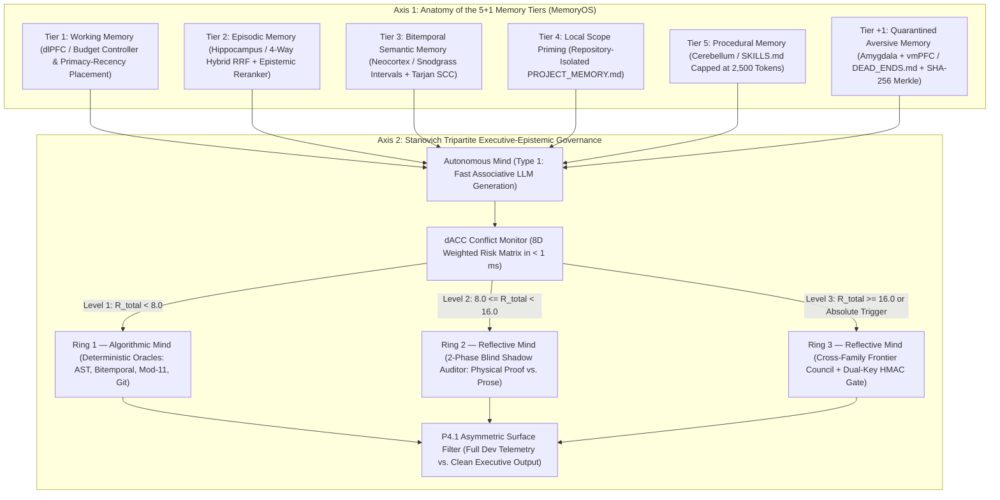

# VTI-RES-2026-02 — Executive Brief: A Dual-Axis Bitemporal Neuro-Cognitive Architecture for Long-Horizon Agents (`MemoryOS`)

**Study ID:** `VTI-RES-2026-02`  
**Division:** VTI Research — *Cognitive Systems & Epistemic Governance*  
**Author:** **Caio Gonçalves** — *Principal Investigator & Chief Systems Architect, VTI Research (VTI, Brazil)* (https://projectos-system.github.io/vti-research/)  
**Target Audience:** C-Level Executives, CTOs, VPs of Engineering, Chief Architects, and AI Governance Leaders  

---

## 1. Executive Summary: Why Autonomous Agents Degrade in Production

Enterprise deployment of Large Language Model (LLM) agents encounters a structural reliability wall once workflows extend beyond single-turn interactions into multi-week software engineering, regulatory analysis, and institutional decision-making. Even modern commercial frontier models degrade predictably across three cognitive failure modes established in scientific literature:

1. **Long-Context Attention Decay (*Lost in the Middle*):** Although contemporary context windows accept hundreds of thousands of tokens, effective attentional recall drops sharply for information positioned in the middle of long prompts. Appending raw conversational history inflates inference costs, dilutes non-negotiable safety invariants, and degrades synthesis accuracy.
2. **Statistical Override of Enacted Rules (*Override Failure*):** Whenever a legal statute, tax rate, or architectural policy is superseded by a newly enacted rule, historical records of the revoked rule still outweigh the new rule by orders of magnitude in pre-training weights and accumulated logs. Conventional vector Retrieval-Augmented Generation (RAG) and ungoverned agents silently enforce the obsolete rule.
3. **Persistent Memory Pollution (*Contaminated Mindware*):** Agents equipped with naive verbal self-reflection routinely store transient runtime errors—momentary network timeouts, truncated stack traces, or unverified debugging hypotheses—as permanent behavioral prohibitions, inducing operational superstitions and decision paralysis across subsequent sessions.

> **Empirical Production Evidence ($\mathcal{S}_{\mathrm{Hub}}$):** Prior to formalizing the architecture presented in this study, a forensic audit across $20$ real-world queries in a production enterprise tax, fiscal, and labor advisory platform ($\mathcal{S}_{\mathrm{Hub}}$) revealed a **20% critical failure rate (`4/20`)** in generative assistants lacking epistemic governance. Across three labor-law queries following Constitutional Amendment No. 141/2026 (which reduced the statutory workweek cap from 44h to 42h), the model enforced the superseded 44h regime due to statistical training inertia (*Override Failure*); in a social-security classification query (`CNAE 9430-8/00`), lacking a deterministic lookup oracle, the model confidently hallucinated non-existent codes and rates (`FPAS 566` and `4.5%` instead of statutory `FPAS 515` / `5.8%` or `FPAS 639` / `0.0%` under active CEBAS certification), exemplifying a structural *Mindware Gap*.

---

## 2. The `MemoryOS` Solution: Dual-Axis Bitemporal Neuro-Cognitive Engineering

To eliminate these failure modes without sacrificing operational responsiveness or adding prohibitive latency to the critical path, **`MemoryOS`** (a core pillar of the **`VTI OS System`** ecosystem) formalizes a **Dual-Axis Bitemporal Neuro-Cognitive Architecture**. Grounded in **32 unique peer-reviewed scientific studies**, the system separates cognitive storage from metacognitive control across two orthogonal axes:

- **Axis 1 — Anatomy of the 5+1 Memory Tiers** (*Where, how, and under which temporal regime knowledge resides*): enforces strict architectural separation across bounded working memory, 4-way hybrid episodic retrieval, append-only bitemporal semantic records, repository-scoped project priming, token-budgeted procedural skills, and a cryptographically quarantined aversive store.
- **Axis 2 — Keith E. Stanovich's Tripartite Executive-Epistemic Governance** (*How the system inhibits associative biases, audits premises, and verifies physical deliverables*): couples fast autoregressive generation (**Autonomous Mind — Type 1**) with a sub-millisecond 8-dimensional conflict monitor (**`dACC` Conflict Monitoring**), deterministic code-level verification oracles (**Algorithmic Mind — Ring 1**), and two independent auditing tiers (**Reflective Mind — Ring 2 Two-Phase Blind `Shadow Auditor`** and **Ring 3 Cross-Family Multi-Model Council**).

### Executive Correspondence Matrix: `Concept ↔ Human Brain ↔ MemoryOS Module`

| Axis | Cognitive Concept | Functional Human Brain Correlate | Engineering Implementation in `MemoryOS` | Direct Executive Value |
| :--- | :--- | :--- | :--- | :--- |
| **Axis 1** | Working Memory & Virtual Paging | Dorsolateral Prefrontal Cortex (`dlPFC`) — strict 5–9 chunk focus | `context_assembler.js` + `Context Budget Controller` + `<retrieved_evidence readonly="true">` isolation | Neutralizes *Lost in the Middle*, caps token spend, and blocks indirect prompt injection. |
| **Axis 1** | Episodic Memory & Multi-Cue Recall | Hippocampus — rapid indexing and multi-cue associative retrieval | `rrf_search_engine.js` (FTS5 BM25 + Vectors + Entities + Graph) + `epistemic_reranker.js` | Preserves active canonical decisions with infinite half-life ($T_{1/2} = \infty$) over noisy recent logs. |
| **Axis 1** | Offline Semantic Consolidation (`CLS`) | Neocortex & Hippocampal-Cortical Replay during REM/SWS Sleep | `MEMORY.md`, `USER.md`, `associative_graph.js`, and `dream_scheduler.js` ($f(f(S)) = f(S)$) | Zero-token *Delta Check* idle consolidation with mathematically idempotent convergence. |
| **Axis 1** | Bitemporal Chronometry & Acyclic Lineage | Ventromedial Prefrontal Cortex (`vmPFC`) — temporal ordering | `fact_history_manager.js`: `cognitive_records` (`[valid_from, valid_to) × [tx_from, tx_to)`) + `Tarjan SCC` $O(\|V\|+\|E\|)$ | Exact *Point-in-Time* regulatory auditing and linear-time prevention of circular supersession. |
| **Axis 1** | Procedural Skills & Regulated Aversion | Cerebellum (routines) + `vmPFC`-regulated Amygdala (false-alarm extinction) | `SKILLS.md`, tri-state quarantine in `reflection_manager.js` (`DEAD_ENDS.md`), `evidence_store.js` (SHA-256 Merkle) | Prevents transient errors from polluting agent prompts while sealing tamper-evident forensic trails. |
| **Axis 2** | Autonomous Mind (Type 1 Processing) | Fast Subcortical and Temporoparietal Associative Pathways | Initial autoregressive generation across LLMs and CLI agents | High drafting throughput strictly subordinated to deterministic inhibitory gates. |
| **Axis 2** | Executive Conflict Monitoring | Dorsal Anterior Cingulate Cortex (`dACC`) — conflict alarm | `council_risk_matrix.js` ($R_{\mathrm{total}} = \sum_{j=1}^8 w_j d_j$) and bitemporal clash detection | Risk-proportional governance: zero external API overhead on routine tasks (Level 1). |
| **Axis 2** | Algorithmic Mind & Blind Physical Audit | Lateral Prefrontal Cortex — cognitive decoupling and verification | Ring 1 (AST `node --check`, Mod-11, Git Shield) + Ring 2 (`reflective_monitor_service.js` 2-phase isolation) | Eliminates "hallucinated completions": verbal claims are rejected unless backed by disk diffs/tests. |
| **Axis 2** | Reflective Mind & Collegiate Debate | Frontopolar Cortex (Brodmann Area 10) — higher-order metacognition | Ring 3 (`ai_consult_council` / `ai_dual_code_review` across independent commercial frontier model families) | Mitigates correlated single-family blind spots on high-impact architectural or legal changes. |
| **Axis 2** | Asymmetric Surface Filter (`Barrier P4.1`) | Thalamocortical Filter — silent internal regulation, concise speech | `biomimetic_projector.js` (`sanitizeCorporateSurfaceDto` strict allowlist) + `secret_sanitizer.js` | Engineers inspect full Merkle/epistemic telemetry; business leaders receive clean executive deliverables. |

---

## 3. Verifiable Empirical Results ($N = 50$) and Operational Efficiency

The architecture was evaluated via the reproducible benchmark suite `run_epistemic_benchmark.js` across a frozen *Golden Benchmark* of $N = 50$ paired queries spanning five cognitive clusters (normative succession, 2-year canonical longevity vs. 30-minute log noise, pre/post-enactment *Point-in-Time* queries, semantic gate vs. off-topic high authority, and empirical root-cause diagnostics):

| Performance & Epistemic Governance Metric | Legacy Hybrid Baseline ($\lambda = 0.05$) | Bitemporal Epistemic Reranker (`MemoryOS`) | Verified Impact |
| :--- | :---: | :---: | :--- |
| **Ranking Quality (`NDCG@5`)** | `0.5764` | **`1.0000`** | **`+73.49%`** (`+0.4236` absolute gain, $p < 0.001$ via paired Bootstrap) |
| **Top-1 Precision (`MRR`)** | `0.4000` | **`1.0000`** | **`+150.00%`** (enacted canonical record ranked #1 across all 50 queries) |
| **Revocation Override Failures (*Override Failure Rate*)** | `40 / 50` (`80.00%`) | **`0 / 50` (`0.00%`)** | Full elimination on the controlled benchmark ($\mathrm{CI}_{95\%}^{\mathrm{Wilson}} \approx [0.9289, \, 1.0000]$) |
| **Active Canonical Regressions** | — | **`0`** | Infinite half-life ($T_{1/2} = \infty$) protects foundational architectural rules |
| **Monotonic Reranker Latency (Isolated `P95`)** | `< 0.20 ms` | **`0.34 ms`** | Sub-millisecond local CPU execution with zero network calls |
| **Complex Enterprise Workload Latency (E2E `P95`)** | — | **`0.44 ms`** | Median paired end-to-end overhead of `+5.43 ms` (`0.068%` of an `8 s` LLM turn) |

> **Disciplined Statistical Interpretation:** Achieving `NDCG@5 = 1.0000` demonstrates deterministic effectiveness within structured bitemporal governance corpora (`[valid_from, valid_to)`). On unstructured open-world documents lacking explicit temporal metadata, the architecture relies on its semantic cutoff gate ($\theta_{\min}$) and escalation to Rings 2 and 3.

---

## 4. Enterprise Governance, Return on Investment (ROI), and Regulatory Compliance

1. **Selective Deliberation Economics (`dACC` Routing):** Instead of invoking expensive multi-agent debate on every turn, the 8-Dimensional Risk Matrix evaluates operational blast radius in under `1 ms`. Routine operations ($R_{\mathrm{total}} < 8.0$) execute entirely within Ring 1 at zero extra API cost, reserving Ring 2 blind physical auditing ($8.0 \le R_{\mathrm{total}} < 16.0$) and Ring 3 cross-family frontier deliberation ($R_{\mathrm{total}} \ge 16.0$ or absolute triggers) strictly for high-consequence actions.
2. **Cryptographic Auditability and Data Protection Compliance (Brazilian LGPD — Law No. 13,709/2018):** All runtime evidence undergoes bidirectional *Zero-Trust* secret scrubbing and Modulo-11 tax-identifier redaction prior to domain-separated SHA-256 Merkle Tree anchoring outside the active prompt. Upon retention expiry, raw JSONL payloads are purged while sealed leaf hashes preserve full Merkle root verifiability.
3. **Non-Bypassable Human Sovereignty:** Even under production emergencies, the *Emergency Bypass* protocol requires dual HMAC-SHA256 signatures from two distinct operator keys, enforces a maximum TTL of 15 minutes (`900 s`), logs an append-only justification, and enforces an absolute hard lock forbidding any bypass on DDL schema migrations or production credentials—transforming probabilistic LLM agents into auditable, production-grade engineering infrastructure.

---
*Published by **VTI Research** — **VTI OS System** / **MemoryOS** Ecosystem. All rights reserved.*
