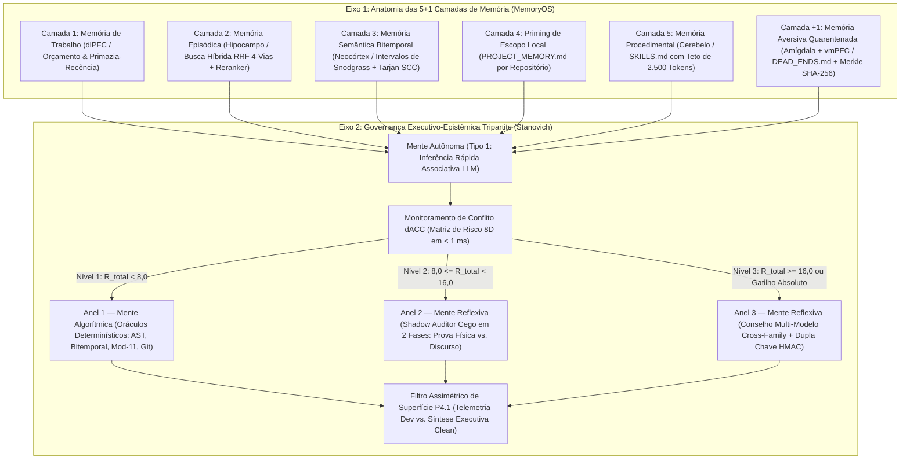

# VTI-RES-2026-02 — Dossiê Executivo: Arquitetura Neuro-Cognitiva Bitemporal de Duplo Eixo para Agentes de Longo Horizonte (`MemoryOS`)

**Código do Estudo:** `VTI-RES-2026-02`  
**Divisão:** VTI Research — *Cognitive Systems & Epistemic Governance*  
**Autor:** **Caio Gonçalves** — *Principal Investigator & Chief Systems Architect, VTI Research (VTI, Brazil)* (https://projectos-system.github.io/vti-research/)  
**Público-Alvo:** C-Level, CTOs, VPs de Engenharia, Arquitetos-Chefes e Lideranças de Governança de IA  

---

## 1. Sumário Executivo: Por Que Agentes Autônomos Degradam em Produção

A adoção corporativa de agentes autônomos baseados em Grandes Modelos de Linguagem (*Large Language Models* — LLMs) enfrenta um gargalo estrutural quando a operação ultrapassa interações curtas e passa a exigir continuidade ao longo de semanas, meses e múltiplas revisões normativas ou arquiteturais. Mesmo os modelos comerciais modernos de fronteira degradam de forma previsível sob três patologias cognitivas documentadas na literatura científica:

1. **Colapso de Atenção em Janelas Longas (*Lost in the Middle*):** Embora janelas de contexto modernas acomodem centenas de milhares de tokens, a capacidade efetiva de discriminação atencional cai acentuadamente no miolo do prompt. Empilhar histórico bruto degrada a precisão, infla custos de inferência e dilui restrições inegociáveis de segurança.
2. **Falha de Sobreposição Estatística (*Override Failure*):** Quando uma norma jurídica, alíquota tributária ou decisão arquitetural é revogada e substituída por uma nova regra vigente, o conhecimento histórico revogado continua possuindo frequência estatística ordens de grandeza superior nos pesos de pré-treinamento e nos logs acumulados. Buscadores vetoriais convencionais (RAG clássico) e modelos sem governança bitemporal aplicam silenciosamente a regra antiga revogada.
3. **Contaminação de Memória Persistente (*Contaminated Mindware*):** Agentes dotados de memória reflexiva ingênua gravam falhas transitórias de tempo de execução — oscilações momentâneas de rede, *stack traces* truncados ou hipóteses diagnósticas não verificadas — como se fossem regras permanentes, induzindo paralisia decisória e superstições operacionais nas sessões seguintes.

> **Evidência Empírica em Produção ($\mathcal{S}_{\mathrm{Hub}}$):** Em um estudo forense precursor conduzido sobre $20$ consultas reais de alta complexidade em uma plataforma corporativa de consultoria fiscal, tributária e trabalhista em produção ($\mathcal{S}_{\mathrm{Hub}}$), assistentes generativos desprovidos de governança epistêmica apresentaram **20% de falhas críticas (`4/20`)**. Em três consultas trabalhistas após a promulgação da Emenda Constitucional nº 141/2026 (novo teto constitucional de 42h semanais), o modelo aplicou a regra superada de 44h semanais por inércia estatística (*Override Failure*); em uma consulta previdenciária (`CNAE 9430-8/00`), na ausência de oráculo determinístico, alucinou códigos e alíquotas inexistentes (`FPAS 566` e `4,5%` em vez de `FPAS 515` / `5,8%` ou `FPAS 639` / `0,0%` sob CEBAS ativo), caracterizando lacuna de conhecimento estruturado (*Mindware Gap*).

---

## 2. A Solução `MemoryOS`: Engenharia Neuro-Cognitiva Bitemporal de Duplo Eixo

Para erradicar essas falhas sem sacrificar a fluidez operacional nem impor latência proibitiva ao caminho crítico, o **`MemoryOS`** (integrado ao ecossistema **`VTI OS System`**) formaliza uma **Arquitetura Neuro-Cognitiva Bitemporal de Duplo Eixo**, fundamentada em **32 estudos científicos revisados por pares** e estruturada em dois eixos ortogonais:

- **Eixo 1 — Anatomia das 5+1 Camadas de Memória** (*Onde, como e sob qual regime temporal o conhecimento reside*): separa rigorosamente o foco imediato de trabalho, o histórico episódico multi-via, o núcleo semântico bitemporal *append-only*, o contexto isolado de cada projeto, a biblioteca de rotinas procedimentais e uma camada aversiva regulada por quarentena criptográfica.
- **Eixo 2 — Governança Executivo-Epistêmica Tripartite de Keith E. Stanovich** (*Como o sistema freia vieses associativos, audita premissas e exige provas materiais*): acopla a geração rápida de LLMs (**Mente Autônoma — Tipo 1**) a um sensor determinístico de risco em 8 dimensões (**Monitoramento de Conflito `dACC`**), a oráculos simbólicos verificáveis em código (**Mente Algorítmica — Anel 1**) e a duas instâncias independentes de auditoria (**Mente Reflexiva — Anel 2 `Shadow Auditor` Cego em 2 Fases** e **Anel 3 Conselho Colegiado *Cross-Family***).

### Matriz Executiva: `Conceito ↔ Cérebro Humano ↔ Módulo MemoryOS`

| Eixo | Conceito Cognitivo | Correlato Funcional no Cérebro Humano | Materialização de Engenharia no `MemoryOS` | Valor Executivo Direto |
| :--- | :--- | :--- | :--- | :--- |
| **Eixo 1** | Memória de Trabalho & Paginação | Córtex Pré-Frontal Dorsolateral (`dlPFC`) — foco estrito de 5 a 9 blocos | `context_assembler.js` + `Context Budget Controller` + isolamento `<retrieved_evidence readonly="true">` | Elimina *Lost in the Middle*, reduz consumo de tokens e bloqueia injeção indireta de prompt. |
| **Eixo 1** | Memória Episódica & Busca Multi-Pista | Hipocampo — indexação rápida e recuperação associativa | `rrf_search_engine.js` (FTS5 BM25 + Vetores + Entidades + Grafo) + `epistemic_reranker.js` | Recupera decisões canônicas com meia-vida infinita ($T_{1/2} = \infty$) sem ser ofuscado por logs recentes. |
| **Eixo 1** | Consolidação Semântica em Ociosidade | Neocórtex & Replay Hipocampo-Cortical no Sono REM/SWS | `MEMORY.md`, `USER.md`, `associative_graph.js` e `dream_scheduler.js` ($f(f(S)) = f(S)$) | Compactação silenciosa em ociosidade com *Delta Check* zero-token e convergência idempotente. |
| **Eixo 1** | Cronometria Bitemporal & Sucessão Acíclica | Córtex Pré-Frontal Ventromedial (`vmPFC`) — ordenação temporal de eventos | `fact_history_manager.js`: `cognitive_records` (`[valid_from, valid_to) × [tx_from, tx_to)`) + `Tarjan SCC` $O(\|V\|+\|E\|)$ | Auditoria *Point-in-Time* exata e proibição matemática de ciclos de revogação normativa. |
| **Eixo 1** | Automatização & Memória Aversiva Regulada | Cerebelo (rotinas) + Amígdala regulada pelo `vmPFC` (extinção de falso alarme) | `SKILLS.md`, quarentena triestatal em `reflection_manager.js` (`DEAD_ENDS.md`) e `evidence_store.js` (Merkle SHA-256) | Impede que erros transitórios contaminem o agente, preservando rastreabilidade forense imutável. |
| **Eixo 2** | Mente Autônoma (Processos Tipo 1) | Vias Associativas Subcorticais e Temporoparietais Rápidas | Inferência autorregressiva inicial de LLMs e agentes de CLI | Alta velocidade de síntese textual, porém subordinada a freios inibitórios determinísticos. |
| **Eixo 2** | Monitoramento Executivo de Conflito | Córtex Cingulado Anterior Dorsal (`dACC`) — alarme de conflito | `council_risk_matrix.js` ($R_{\mathrm{total}} = \sum_{j=1}^8 w_j d_j$) e detecção de choque bitemporal | Governança proporcional ao risco: zero latência de API externa em tarefas rotineiras (Nível 1). |
| **Eixo 2** | Mente Algorítmica & Auditoria Física Cega | Córtex Pré-Frontal Lateral — desacoplamento cognitivo e verificação | Anel 1 (AST `node --check`, Mod-11, Git Shield) + Anel 2 (`reflective_monitor_service.js` em 2 fases) | Bloqueia "alucinações de conclusão": o agente jamais aprova uma entrega sem prova física em disco. |
| **Eixo 2** | Mente Reflexiva & Deliberação Colegiada | Córtex Frontopolar (Área 10 de Brodmann) — metacognição de alto nível | Anel 3 (`ai_consult_council` / `ai_dual_code_review` entre famílias independentes de modelos de fronteira) | Neutraliza pontos cegos correlacionados em decisões irreversíveis (DDL, credenciais, releases críticos). |
| **Eixo 2** | Filtro Assimétrico de Superfície (`P4.1`) | Filtro Tálamo-Cortical — regulação silenciosa interna, fala concisa | `biomimetic_projector.js` (`sanitizeCorporateSurfaceDto` com *allowlist* estrita) + `secret_sanitizer.js` | Engenharia enxerga 100% dos hashes e diagnósticos; executivos recebem entregas limpas e sem jargão. |

---

## 3. Resultados Empíricos Auditáveis ($N = 50$) e Eficiência Operacional

A arquitetura foi submetida ao protocolo reprodutível `run_epistemic_benchmark.js` sobre um *Golden Benchmark* controlado de $N = 50$ consultas distribuídas em cinco clusters cognitivos (sucessão normativa, longevidade canônica de 2 anos contra ruído de log de 30 minutos, consultas *Point-in-Time* pré e pós-vigência, corte semântico contra autoridade fora de tópico e diagnóstico empírico):

| Indicador de Desempenho e Governança | Baseline Híbrido Legado ($\lambda = 0,05$) | Reranker Epistêmico Bitemporal (`MemoryOS`) | Impacto Verificado |
| :--- | :---: | :---: | :--- |
| **Qualidade de Ordenação (`NDCG@5`)** | `0,5764` | **`1,0000`** | **`+73,49%`** (ganho absoluto `+0,4236`, $p < 0,001$ via Bootstrap) |
| **Precisão no Topo (`MRR`)** | `0,4000` | **`1,0000`** | **`+150,00%`** (regra canônica vigente em 1º lugar nas 50 consultas) |
| **Falhas de Sobreposição / Revogação (*Override Failures*)** | `40 / 50` (`80,00%`) | **`0 / 50` (`0,00%`)** | Erradicação no protocolo controlado ($\mathrm{IC}_{95\%}^{\mathrm{Wilson}} \approx [0,9289; \, 1,0000]$) |
| **Regressões sobre Regras Canônicas Ativas** | — | **`0`** | Meia-vida infinita ($T_{1/2} = \infty$) preserva decisões fundacionais |
| **Latência Monotônica do Reranker (`P95` Isolado)** | `< 0,20 ms` | **`0,34 ms`** | Custo computacional sub-milissegundo em CPU local |
| **Latência em Carga Corporativa Complexa (`P95` E2E)** | — | **`0,44 ms`** | Overhead total mediano de `+5,43 ms` (`0,068%` de um turno LLM de `8 s`) |

> **Rigor na Interpretação Executiva:** O escore `NDCG@5 = 1,0000` comprova determinismo e eficácia empírica sobre bases governadas por metadados bitemporais estruturados (`[valid_from, valid_to)`). Para documentos abertos não estruturados, a arquitetura preserva salvaguardas de corte semântico ($\theta_{\min}$) e escalonamento aos Anéis 2 e 3.

---

## 4. Governança Corporativa, Retorno sobre Investimento (ROI) e Conformidade Legal

1. **Economia Inteligente de Inferência (Seletividade `dACC`):** Ao substituir a invocação indiscriminada de comitês multi-agentes por uma Matriz de Risco de 8 Dimensões avaliada em menos de `1 ms`, operações rotineiras ($R_{\mathrm{total}} < 8,0$) permanecem 100% locais no Anel 1 com custo zero de chamadas extras de API. O Conselho Multi-Modelo (Anel 3) é convocado exclusivamente quando $R_{\mathrm{total}} \ge 16,0$ ou diante de gatilhos estruturais absolutos (migrações DDL, credenciais de produção, mutação forense ou releases corporativos).
2. **Auditabilidade Criptográfica e Conformidade com a LGPD (Lei nº 13.709/2018):** Todas as evidências operacionais passam por sanitização preventiva *Zero-Trust* e validação algorítmica Módulo 11 (CPF/CNPJ) antes de serem ancoradas em Árvore de Merkle SHA-256 fora do prompt. Quando o prazo legal de retenção expira, o payload bruto é expurgado sem invalidar as provas criptográficas de integridade histórica.
3. **Soberania Humana Inegociável:** Mesmo em cenários críticos de contingência, o protocolo de *Emergency Bypass* exige dupla assinatura criptográfica HMAC-SHA256 por operadores distintos, validade máxima de 15 minutos (`900 s`) e bloqueio absoluto intransponível para migrações de banco de dados e credenciais de produção — convertendo agentes generativos probabilísticos em infraestrutura de engenharia previsível, auditável e segura para ambientes críticos.

---
*Publicado pela divisão **VTI Research** — Ecossistema **VTI OS System** / **MemoryOS**. Todos os direitos reservados.*
