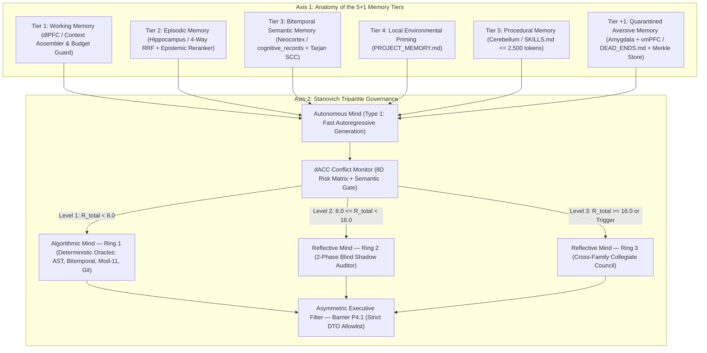

# A Dual-Axis Bitemporal Neuro-Cognitive Architecture: Tripartite Executive-Epistemic Governance and Override Failure Eradication in Long-Horizon Agentic Systems (`MemoryOS`)

**Publication ID:** `VTI-RES-2026-02`  
**Scientific Series:** VTI Research — *Technical & Scientific Monograph Series*  
**Author:** **Caio Gonçalves** — *Principal Investigator & Chief Systems Architect, VTI Research (VTI, Brazil)* (https://projectos-system.github.io/vti-research/)  
**Reference Ecosystem:** `MemoryOS` (`v5.9.0` / `v6.0.0`) — **`VTI OS System`**  

---

## Abstract

Large Language Model (LLM) agentic systems suffer systematic degradation over extended operational horizons due to three fundamental classes of cognitive failure: non-uniform long-context attention decay (*Lost in the Middle*), statistical override of newly enacted rules by high-frequency historical priors (*Override Failure*), and persistent memory pollution from transient runtime artifacts (*Contaminated Mindware*). Motivated by a precursor forensic study across $20$ real-world queries in a production enterprise tax, fiscal, and labor advisory platform ($\mathcal{S}_{\mathrm{Hub}}$)—in which generative assistants lacking epistemic governance exhibited a $20\%$ ($4/20$) critical regulatory and statutory failure rate—this paper formalizes the **Dual-Axis Bitemporal Neuro-Cognitive Architecture of `MemoryOS`**. The architecture couples five functional memory tiers plus a cryptographically quarantined aversive store (**Axis 1**) with a tripartite executive governance framework inspired by Keith E. Stanovich's cognitive science (**Axis 2**: Autonomous Mind, Algorithmic Mind grounded in deterministic oracles, and Reflective Mind structured into two-phase blind physical auditing and collegiate deliberation across independent model families). Grounded in **32 unique peer-reviewed scientific studies (`[E01]–[E32]`)** and a statutory data-protection framework (`[N01]`), the model introduces: (i) append-only cognitive records over Snodgrass half-open bitemporal intervals `[valid_from, valid_to) × [tx_from, tx_to)` with linear-time `Tarjan SCC` acyclicity verification in $O(|V| + |E|)$; (ii) a tri-state epistemic quarantine sealed by domain-separated SHA-256 Merkle Trees; (iii) a multidimensional post-RRF epistemic reranker assigning an infinite half-life ($T_{1/2} = \infty$) to active canonical rules; (iv) an 8-dimensional conflict-monitoring matrix (`dACC`); and (v) a strictly idempotent offline consolidation cycle ($f(f(S)) = f(S)$). Evaluated on a controlled, reproducible $N = 50$ bitemporal conflict *Golden Benchmark* (`run_epistemic_benchmark.js`), the post-RRF epistemic reranker elevated `NDCG@5` from `0.5764` to `1.0000` (`+73.49%`) and `MRR` from `0.4000` to `1.0000` (`+150.00%`), reducing revocation override failures from `40/50` to `0/50` ($\mathrm{CI}_{95\%}^{\mathrm{Wilson}} \approx [0.9289, \, 1.0000]$) at a monotonic `P95` latency of `0.34 ms` (`0.44 ms` under complex enterprise workloads). These results demonstrate deterministic and empirical effectiveness within the evaluated bitemporal regression protocol while explicitly bounding construct, internal, external, conclusion, and ecological validity.

**Keywords:** Agentic Cognitive Architecture; Bitemporal Databases; Stanovich Tripartite Theory; Epistemic Governance; Reciprocal Rank Fusion; Merkle Trees; Long-Term Agent Memory; `MemoryOS`.

---

## 1. Introduction and Long-Horizon Cognitive Failure Modes

The transition of Large Language Models (LLMs) from stateless conversational interfaces into autonomous agents for software engineering, regulatory compliance, and enterprise decision-making has exposed a structural asymmetry between **local generative fluency** and **long-horizon epistemic consistency**. While contemporary Transformer architectures achieve remarkable synthesis quality within isolated turns, sustained operation across dozens of sessions, schema migrations, and statutory amendments reveals predictable reliability decay.

Recent scientific literature allows this degradation to be categorized into three primary cognitive failure modes, compounded by a fundamental barrier to intrinsic self-verification:

1. **Non-Uniform Long-Context Attention Decay (*Lost in the Middle*):** Contrary to the assumption that expanding nominal context windows (to $128\text{k}$–$1\text{M}$ tokens) obviates external memory engineering, Liu et al. `[E03]` demonstrated that language models exhibit a U-shaped retrieval curve: facts situated at the very beginning (primacy) or immediate end (recency) of the prompt are attended to with substantially higher recall than facts buried in the middle region. Consequently, appending raw transcripts and verbose logs dilutes safety invariants, inflates token latency, and elevates contextual interference `[E01, E04]`.
2. **Temporal and Normative Override (*Override Failure*):** In non-stationary domains—such as tax law, labor legislation, and evolving software architectures—the truth value of a proposition $p$ is parameterized by an effective validity interval $[v_{\mathrm{from}}, v_{\mathrm{to}})$. When a historical rule $d_{\mathrm{old}}$ (heavily represented in pre-training corpora and historical discussions) is formally superseded by a newly enacted canonical decision $d_{\mathrm{new}}$, the LLM's parametric prior $P_{\theta}(y \mid q)$ remains overwhelmingly biased toward $d_{\mathrm{old}}$. In conventional Retrieval-Augmented Generation (RAG) engines relying solely on lexical/vector similarity or uniform recency decay `[E08]`, superseded documents with high lexical density or recent debug logs discussing the legacy rule outrank the active rule—instantiating the cognitive pathology termed *Override Failure* by Keith E. Stanovich `[E20, E21]`.
3. **Persistent Memory Pollution (*Contaminated Mindware*):** Agentic frameworks that accumulate experiential lessons via verbal reinforcement `[E18]` without epistemic quarantine frequently crystallize transient runtime noise—such as momentary DNS outages (`ENOTFOUND`), ephemeral port locks, truncated stack traces, or unverified diagnostic guesses—into permanent system-prompt prohibitions. Within Stanovich's taxonomy of dysrationalia `[E20, E22]`, such corrupted declarative structures constitute *Contaminated Mindware* that actively degrades future reasoning.

Crucially, these three failure modes cannot be resolved merely by prompting an LLM to "critically review and self-correct its output." As proven by Huang et al. `[E28]`, LLMs cannot reliably self-correct reasoning without external grounded feedback (*intrinsic self-correction impossibility*), frequently reinforcing initial confirmation bias (*Myside Bias*) or degrading correct answers into incorrect ones. Reliable correction requires coupling deliberation with deterministic external verification tools (*tool-interactive critiquing*) `[E29]` or structured adversarial debate across independent model families `[E31]`.

### 1.1. Research Questions and Contributions

This study investigates three formal questions in agentic cognitive engineering:
- **RQ1 (Bitemporal Validity vs. Statistical Inertia):** How can post-fusion storage and reranking be formalized to eliminate *Override Failures* under explicit normative supersession while simultaneously protecting multi-year canonical rules against recent log noise at sub-millisecond latency?
- **RQ2 (Immunity to *Contaminated Mindware*):** How can transient runtime failures be quarantined so they never pollute active agent prompts while preserving tamper-evident forensic auditability compliant with statutory data-protection mandates `[N01]`?
- **RQ3 (Risk-Proportional Executive Governance):** How can metacognitive rings be structured to enforce verifiable physical evidence before accepting verbal agent claims without incurring prohibitive multi-model API overhead on routine tasks?

The contributions of this paper, implemented and validated in **`MemoryOS`** (within the **`VTI OS System`** ecosystem), are sixfold:
1. A mathematical formalization of the **Dual-Axis Bitemporal Neuro-Cognitive Architecture**, unifying **5+1 Memory Tiers** (Axis 1) with **Stanovich's Tripartite Executive-Epistemic Governance** (Axis 2) grounded in **32 unique peer-reviewed studies (`[E01]–[E32]`)**;
2. An append-only bitemporal database kernel built on Snodgrass half-open intervals `[valid_from, valid_to) × [tx_from, tx_to)` `[E12]` coupled with linear-time `Tarjan SCC` cycle detection in $O(|V| + |E|)$ `[E13]` under serialized `BEGIN IMMEDIATE` isolation;
3. A **Multidimensional Post-RRF Epistemic Reranker** featuring adaptive semantic gating, monotonic residual *Boost-Only* fusion, and tier-stratified half-lives ($T_{1/2} = \infty$ for active canonical records);
4. A **Tri-State Epistemic Quarantine** and **Forensic Evidence Store** anchored by domain-separated SHA-256 Merkle Trees `[E19]`, paired with an idle consolidation cycle (*Dreaming Pass*) obeying the idempotent fixed-point identity $f(f(S)) = f(S)$;
5. **Three Metacognitive Rings** governed by an 8D Risk Matrix (`dACC`), including **Two-Phase Strict Informational Isolation** in the `Shadow Auditor` and the **Asymmetric Surface `Barrier P4.1`**;
6. Reproducible empirical evaluation on a controlled $N = 50$ *Golden Benchmark* (`run_epistemic_benchmark.js`), demonstrating an increase in `NDCG@5` from `0.5764` to `1.0000` (`+73.49%`), `0/50` revocation override failures, and `P95 = 0.34 ms` latency.

---

## 2. Precursor Empirical Study: Forensic Audit of *Override Failure* and *Mindware Gap*

The empirical catalyst for the bitemporal and tripartite design of `MemoryOS` originated from a forensic audit conducted over **20 real-world production queries** ($N_{\mathrm{pre}} = 20$) spanning Fiscal, Tax, Labor, and Social-Security domains in **a production enterprise tax, fiscal, and labor advisory platform ($\mathcal{S}_{\mathrm{Hub}}$)**.

In that precursor evaluation over a conventional semantic-RAG pipeline—prior to introducing explicit bitemporal validity gates and deterministic post-condition oracles—auditors observed a **20% critical failure rate (`4/20` queries)**, clustering cleanly into two pathological mechanisms predicted by Stanovich's framework `[E20, E21]`:

### 2.1. Empirical Evidence of *Override Failure* (Queries 3, 9, and 17 — Constitutional Labor Succession)

In Queries 3, 9, and 17, practitioners queried the active constitutional limits on weekly working hours (42 hours), the `6x1` shift schedule, and domestic employment applicability following the enactment of **Constitutional Amendment No. 141/2026** (`EC 141/2026`). Even when textual references to the newly enacted amendment were accessible, the generative assistant systematically suffered *Override Failure*: it either denied that `EC 141/2026` had been enacted or treated it as an unvoted legislative bill (PEC), confidently enforcing the superseded historical **44-hour workweek** rule.

Mathematically, this failure stems from two compounding effects: (a) within the LLM's parametric weights, millions of pre-2026 legal documents bind "Brazilian constitutional weekly work limit" to `44h`; and (b) within an ungoverned retrieval index, legacy articles explaining the 44h regime or pre-enactment legislative commentary exhibit high lexical overlap with the query while lacking an algebraic validity indicator ($F_{\mathrm{validade}} = 0$) to nullify records whose half-open interval `[valid_from, valid_to)` has closed ($t_{\mathrm{ref}} \ge \text{valid\_to}$).

### 2.2. Empirical Evidence of *Mindware Gap* (Query 15 — Social-Security Classification `CNAE 9430-8/00`)

In Query 15, the user requested the exact statutory social-security classification (`FPAS` code, Third-Party contribution code, and combined rate) for social-rights advocacy associations under **`CNAE 9430-8/00`**. Lacking access to a verified deterministic statutory lookup oracle and lacking an inhibitory gate against probabilistic attribute substitution, the LLM's Autonomous Mind (Type 1) synthesized a rhetorically fluent yet factually fabricated ruling: it asserted **`FPAS 566`**, **`Third-Parties 0099`**, and a **`4.5%`** rate.

Cross-checked against binding statutory law—**Normative Instruction RFB No. 2,110/2022** and **Complementary Law No. 187/2021**—the exact classification mandates **`FPAS 515`** (`Third-Parties 0115`, **`5.8%`** rate) under the general regime, or **`FPAS 639`** (`Third-Parties 0000`, **`0.0%`** rate) strictly under active **CEBAS** certification. This exemplifies a classic *Mindware Gap*: confident statistical interpolation in the absence of verified algorithmic rules `[E22, E24]`.

| Audited Case in $\mathcal{S}_{\mathrm{Hub}}$ | Regulatory Domain | Cognitive Pathology (Stanovich) | Observed Ungoverned Behavior | Formal Antidote Introduced in `MemoryOS` |
| :--- | :--- | :--- | :--- | :--- |
| **Queries 3, 9, and 17** (`3/20`) | Constitutional Labor Law (`EC 141/2026`: 42h cap and 6x1 schedule) | **Override Failure** | Pre-2026 statistical priors overrode the enacted amendment, enforcing the revoked 44h workweek. | Append-only bitemporal `cognitive_records` (`[valid_from, valid_to)`), strict validity factor $F_{\mathrm{validade}}(d, t_{\mathrm{ref}})$, and infinite half-life ($T_{1/2} = \infty$) for active canonical rules. |
| **Query 15** (`1/20`) | Social-Security & Tax Law (`CNAE 9430-8/00`, `IN RFB 2.110/2022`, `LC 187/2021`) | **Mindware Gap** | Confident hallucination of non-existent statutory codes (`FPAS 566`, `0099`, `4.5%`) instead of `FPAS 515` (`5.8%`) / `639` (`0.0%`). | Deterministic Algorithmic Mind oracles (Ring 1) paired with the two-phase blind `Shadow Auditor` (Ring 2) and fiscal risk escalation in the 8D `dACC` Matrix. |

---

## 3. Formal Dual-Axis Architecture and the 10 Cognitive Pillars

### 3.1. Orthogonal System Formulation: Axis 1 (Memory) $\times$ Axis 2 (Executive Governance)

Let $\mathcal{A}$ denote an agentic system operating across a discrete sequence of sessions $s_1, s_2, \dots, s_m$ over monotonic physical time. `MemoryOS` decomposes the cognition of $\mathcal{A}$ into the orthogonal functional product $\mathcal{A} = \langle \mathcal{M}_{\text{Axis 1}}, \mathcal{G}_{\text{Axis 2}} \rangle$:

1. **Axis 1 — Anatomy of the 5+1 Memory Tiers ($\mathcal{M}_{\text{Axis 1}}$):** Governs storage topology, multi-cue indexing, offline consolidation, and bitemporal validity:
   - $L_1$ (*Working Memory*): virtualized context assembly under strict token and attentional budgets (`backend/maestro/context_assembler.js`);
   - $L_2$ (*Episodic Memory*): 4-way hybrid index combining SQLite FTS5 BM25, dense vector cosine similarity, IDF entity indexing, and associative graph expansion with post-RRF epistemic reranking (`backend/utils/rrf_search_engine.js`, `backend/utils/epistemic_reranker.js`);
   - $L_3$ (*Bitemporal Semantic Memory*): curated global declarative core (`MEMORY.md`, `USER.md`), associative triple graph (`backend/utils/associative_graph.js`), append-only bitemporal cognitive records (`backend/utils/fact_history_manager.js`), and idempotent idle consolidation (`backend/utils/dream_scheduler.js`);
   - $L_4$ (*Environmental Scope Priming*): repository-isolated local memory (`.agents/PROJECT_MEMORY.md`), preventing cross-project state contamination;
   - $L_5$ (*Procedural Memory*): deduplicated procedural skill catalog governed by a hard ceiling of $2,500$ tokens (`SKILLS.md`, `backend/utils/procedural_skills_manager.js`);
   - $L_{+1}$ (*Quarantined Aversive Memory*): finite-state epistemic quarantine for experiential lessons (`DEAD_ENDS.md` restricted to validated items within a $1,000$-token budget in `backend/utils/reflection_manager.js`) paired with an out-of-prompt SHA-256 Merkle Forensic Evidence Store (`backend/utils/evidence_store.js`).
2. **Axis 2 — Stanovich Tripartite Executive-Epistemic Governance ($\mathcal{G}_{\text{Axis 2}}$):** Governs bias inhibition, deterministic verification, and collegiate deliberation:
   - **Autonomous Mind (Type 1):** fast autoregressive generation by LLMs and CLI agents;
   - **`dACC` Conflict Sensor:** sub-millisecond 8-Dimensional Risk Matrix (`backend/maestro/council_risk_matrix.js`);
   - **Algorithmic Mind (Ring 1):** non-probabilistic symbolic oracles (atomic AST syntax guard `node --check`, bitemporal invariants, Modulo-11 tax-ID check, Git/Env tamper shield);
   - **Reflective Mind (Rings 2 and 3):** two-phase blind `Shadow Auditor` (`backend/maestro/reflective_monitor_service.js`) and Cross-Family Collegiate Council spanning independent commercial frontier and low-latency compact model families (`backend/mcp_server.js`, `backend/utils/ai_fallback.js`), culminating in the asymmetric surface filter `Barrier P4.1` (`backend/maestro/biomimetic_projector.js`).

#### Structural Correspondence Matrix Across the 10 Pillars

| Pillar | Axis | Theoretical Concept | Functional Human Brain Correlate | Core `MemoryOS` Modules | Primary Studies |
| :---: | :---: | :--- | :--- | :--- | :---: |
| **P1** | Axis 1 | Working Memory & Virtual Context Paging | Dorsolateral Prefrontal Cortex (`dlPFC`) & Episodic Buffer | `context_assembler.js`, `prose_compressor_bundle.js` | `[E01–E04]` |
| **P2** | Axis 1 | Episodic Memory, 4-Way RRF & Epistemic Reranker | Hippocampus (rapid encoding and multi-cue recall) | `rrf_search_engine.js`, `epistemic_reranker.js` | `[E05–E08]` |
| **P3** | Axis 1 | Complementary Learning (`CLS`) & Idempotent Sleep | Neocortex & Hippocampal-Cortical REM/SWS Replay | `dream_scheduler.js`, `associative_graph.js`, `power_aware_scheduler.js` | `[E09–E11]` |
| **P4** | Axis 1 | Append-Only Bitemporality & Tarjan Acyclicity | Ventromedial Prefrontal Cortex (`vmPFC`) & Chronometry | `fact_history_manager.js`, `20261111_bitemporal_core_schema.sql` | `[E12–E14]` |
| **P5** | Axis 1 | Non-Declarative Skills, Quarantine & Merkle Tree | Cerebellum/Striatum + `vmPFC`-regulated Amygdala | `reflection_manager.js`, `evidence_store.js`, `procedural_skills_manager.js` | `[E15–E19]` |
| **P6** | Axis 2 | Tripartite Theory of Mind & Dysrationalia Taxonomy | Functional Tripartition: Type 1 vs. Algorithmic & Reflective Type 2 | `biomimetic_projector.js`, `epistemic_reranker.js`, `maestro_routes.js` | `[E20–E24]` |
| **P7** | Axis 2 | Neurocognitive Conflict Monitoring (`dACC`) | Dorsal Anterior Cingulate Cortex (`dACC`) | `council_risk_matrix.js`, `canary_governor.js` | `[E25–E27]` |
| **P8** | Axis 2 | Verifiable Oracles (`CRITIC`) & 2-Phase `Shadow Auditor` | Lateral Prefrontal Cortex (overcoming *Myside Bias*) | `reflective_monitor_service.js`, `checkpoint_store.js` | `[E28–E30]` |
| **P9** | Axis 2 | Society of Minds & Cross-Family Collegiate Debate | Frontopolar Cortex (Brodmann Area 10 / Peer Review) | `mcp_server.js`, `ai_fallback.js`, `council_risk_matrix.js` | `[E31–E32]` |
| **P10** | Axis 2 | Asymmetric Surface Isolation (`Barrier P4.1`) | Thalamocortical Filter (silent internal regulation) | `biomimetic_projector.js`, `secret_sanitizer.js` | `[E21]`, `[N01]` |

---

### 3.2. Pillar 1: Working Memory, Long-Context Attention, and Virtual Context Paging

Baddeley & Hitch `[E01]` and Baddeley `[E02]` established that biological working memory is not an unbounded monolithic store, but a capacity-constrained executive workspace coordinated with an integrative episodic buffer. In Transformer language models, Liu et al. `[E03]` proved empirically that long-context retrieval accuracy follows a U-shaped curve, suffering severe degradation for tokens placed in the middle of extended prompts (*Lost in the Middle*). Concurrently, Packer et al. (*MemGPT*) `[E04]` formalized OS-inspired hierarchical paging between bounded active context (analogous to physical RAM) and external persistent storage.

In `MemoryOS`, `backend/maestro/context_assembler.js` formulates prompt construction as a priority-ordered knapsack allocation under a strict token budget $B_{\max}$. Given candidate context blocks $\mathcal{B} = \{b_1, \dots, b_m\}$ drawn from the 5+1 tiers, each block $b_i$ carries an epistemic priority $p(b_i)$, token length $\ell(b_i)$, and designated positional zone:

$$\max_{\mathcal{S} \subseteq \mathcal{B}} \sum_{b_i \in \mathcal{S}} p(b_i) \quad \text{subject to} \quad \sum_{b_i \in \mathcal{S}} \ell(b_i) \le B_{\max}$$

To counteract *Lost in the Middle*, the assembler anchors non-negotiable safety invariants and validated `DEAD_ENDS.md` constraints within the **primacy prefix** (the very top of the prompt) and places the active phase directive alongside enacted canonical records within the **recency suffix** (the immediate bottom of the prompt), confining supplementary episodic context to the compressed middle region (`prose_compressor_bundle.js`). Furthermore, all externally retrieved artifacts are wrapped inside `<retrieved_evidence readonly="true">...</retrieved_evidence>` envelopes with deterministic nested-tag escaping (`escapeRetrievedEvidence`), neutralizing *Envelope Breakout* and *Indirect Prompt Injection*.

---

### 3.3. Pillar 2: Episodic Memory, 4-Way Hybrid RRF Fusion, and the Multidimensional Epistemic Reranker

Inspired by Tulving's `[E05]` characterization of hippocampal episodic memory (rapid encoding and multi-cue associative recall), `backend/utils/rrf_search_engine.js` executes parallel retrieval across four heterogeneous channels $V = \{\text{fts5}, \text{vector}, \text{entity}, \text{graph}\}$:
1. **Probabilistic Lexical Channel (`fts5`):** SQLite FTS5 inverted index scored via Robertson & Zaragoza's BM25 framework `[E06]` ($w_{\text{fts5}} = 1.0$);
2. **Dense Semantic Channel (`vector`):** cosine similarity over dense embeddings with an admission floor of $0.30$ ($w_{\text{vector}} = 1.0$);
3. **Named-Entity Channel (`entity`):** Inverse Document Frequency aggregation (`SUM(idf_score)`) over technical symbols, statutory codes, and identifiers ($w_{\text{entity}} = 0.8$);
4. **Associative Graph Channel (`graph`):** relational expansion over `(subject, predicate, object)` knowledge triples ordered by confidence ($w_{\text{graph}} = 0.6$).

To fuse incommensurable raw score distributions (unbounded BM25 vs. bounded cosine in $[-1, 1]$), `MemoryOS` applies weighted *Reciprocal Rank Fusion* (RRF) `[E07]` with smoothing constant $k = 60$. Let $V_{\mathrm{exec}} \subseteq V$ denote the non-empty set of executed channels and $\mathrm{rank}_v(d) \in \{1, 2, \dots\}$ denote the 1-based ordinal rank of candidate $d$ in channel $v$ ($\mathrm{rank}_v(d) = \infty$ if absent). The raw RRF score and its exact theoretical ceiling $C_{\mathrm{RRF}}(V_{\mathrm{exec}})$ (attained iff $\mathrm{rank}_v(d) = 1$ across every executed channel) are:

$$S_{\mathrm{rrf}}^{\mathrm{raw}}(q, d) = \sum_{v \in V_{\mathrm{exec}}} \frac{w_v}{k + \mathrm{rank}_v(d)}, \qquad C_{\mathrm{RRF}}(V_{\mathrm{exec}}) = \frac{\sum_{v \in V_{\mathrm{exec}}} w_v}{k + 1}$$

Closed-interval semantic-lexical adherence in $[0, 1]$ is then normalized as:

$$S_{\mathrm{rrf}}(q, d) = \mathrm{clamp}\!\left(\frac{S_{\mathrm{rrf}}^{\mathrm{raw}}(q, d)}{C_{\mathrm{RRF}}(V_{\mathrm{exec}})}, \, 0, \, 1\right)$$

#### Overcoming Uniform Decay via Post-RRF Epistemic Reranking

In seminal generative-agent architectures such as Park et al. `[E08]`, memory retrieval combines relevance, importance, and a uniform temporal decay applied indiscriminately across all records (e.g., $R_{\mathrm{leg}}(\Delta t) = (1 + \lambda \Delta t)^{-1}$ with $\lambda = 0.05$). Under uniform decay, an active constitutional amendment or foundational architectural rule enacted $730$ days ago suffers severe attenuation ($R_{\mathrm{leg}}(730) \approx 0.0267$) and is easily overridden by a trivial debug log emitted $30$ minutes ago ($R_{\mathrm{leg}} \approx 0.9990$).

To resolve both premature erosion of canonical rules and persistent intrusion of superseded rules, `MemoryOS` introduces the post-RRF epistemic reranking functional family. In its general conceptual form (highlighting the separation between multiplicative admissibility gates and internal relevance, importance $I(d)$, and decay $D(d, t_{\mathrm{ref}})$ signals):

$$\mathrm{Score}_{\mathrm{conceptual}}(q, d, t_{\mathrm{ref}}) = \mathbb{I}\!\left(S_{\mathrm{sem}}(q,d) \ge \theta_{\min}\right) \cdot F_{\mathrm{validade}}(d, t_{\mathrm{ref}}) \cdot A(d, \mathrm{intent}) \cdot \left[\alpha S_{\mathrm{rrf}}(q,d) + \beta I(d) + \gamma D(d, t_{\mathrm{ref}})\right]$$

In the production kernel (`backend/utils/epistemic_reranker.js`), to prevent stale `log_evidence` items ($D \to 0$) from retaining a non-zero additive floor while simultaneously incorporating governed **Residual *Boost-Only* Fusion**, the exact closed-form multiplicative kernel is evaluated:

$$S_{\mathrm{final}}(q, d, t_{\mathrm{ref}}) = \mathbb{I}\!\left(S_{\mathrm{rrf}}(q,d) \ge \theta_{\min}(\mathrm{intent})\right) \cdot S_{\mathrm{rank}}(q, d) \cdot F_{\mathrm{validade}}(d, t_{\mathrm{ref}}, \mathrm{intent}) \cdot A(d, \mathrm{intent}) \cdot C(d) \cdot D(d, t_{\mathrm{ref}})$$

where each factor is deterministically defined as follows:

1. **Epistemic Intent Classifier and Semantic Cutoff Gate ($\theta_{\min}$):** Every query $q$ is classified into $\mathrm{intent} \in \{\text{normative}, \text{historical}, \text{diagnostic}, \text{empirical}, \text{ambiguous}\}$, setting $\theta_{\min}(\text{normative}) = 0.15$ and $\theta_{\min}(\text{other}) = 0.08$. Whenever $S_{\mathrm{rrf}}(q, d) < \theta_{\min}$, $\mathbb{I}(\cdot) = 0$ immediately excludes the candidate (`BELOW_SEMANTIC_GATE`), preventing off-topic documents with high institutional authority from hijacking top ranks.
2. **Residual *Boost-Only* Fusion ($S_{\mathrm{rank}}$):** Given an optional secondary ordinal bridge score $S_B(q, d) = \frac{k + 1}{k + \mathrm{rank}_B(d)} \in [0, 1]$ gated by binary boundary switch $g_B \in \{0, 1\}$ (hard-locked to $g_B \equiv 0$ on corporate executive surfaces) and gain $\gamma_B = 0.35$:

   $$S_{\mathrm{rank}}(q, d) = S_{\mathrm{rrf}}(q, d) + \gamma_B \, g_B \, \bigl(1 - S_{\mathrm{rrf}}(q, d)\bigr) \, S_B(q, d)$$

   **Proposition 1 (Monotonic Non-Degradation and Unit-Interval Closure):** *For all $S_{\mathrm{rrf}}, S_B, \gamma_B \in [0, 1]$ and $g_B \in \{0, 1\}$, $S_{\mathrm{rrf}}(q, d) \le S_{\mathrm{rank}}(q, d) \le 1$.*  
   *Proof:* Since $1 - S_{\mathrm{rrf}} \ge 0$ and $\gamma_B, g_B, S_B \ge 0$, the residual term is non-negative, yielding $S_{\mathrm{rank}} \ge S_{\mathrm{rrf}}$. Conversely, since $\gamma_B g_B S_B \le 1$, $S_{\mathrm{rank}} \le S_{\mathrm{rrf}} + (1 - S_{\mathrm{rrf}}) = 1$. $\blacksquare$
3. **Bitemporal Validity and Epistemic Status Indicator ($F_{\mathrm{validade}}$):** Evaluated against reference instant $t_{\mathrm{ref}}$ and half-open interval $[v_{\mathrm{from}}(d), v_{\mathrm{to}}(d))$:

   $$F_{\mathrm{validade}}(d, t_{\mathrm{ref}}, \mathrm{intent}) = \begin{cases} 0.0, & \text{if } \mathrm{status}(d) \neq \text{validated} \quad (\text{e.g., } \text{quarantined}, \text{rejected}), \\ 0.0, & \text{if } t_{\mathrm{ref}} < v_{\mathrm{from}}(d) \text{ and } \mathrm{intent} \neq \text{historical}, \\ 0.0, & \text{if } v_{\mathrm{to}}(d) \neq \varnothing \land t_{\mathrm{ref}} \ge v_{\mathrm{to}}(d) \text{ and } \mathrm{intent} \neq \text{historical}, \\ 0.85, & \text{if } v_{\mathrm{to}}(d) \neq \varnothing \land t_{\mathrm{ref}} \ge v_{\mathrm{to}}(d) \text{ under explicit historical lineage}, \\ 1.0, & \text{otherwise } \bigl(v_{\mathrm{from}}(d) \le t_{\mathrm{ref}} < v_{\mathrm{to}}(d)\bigr). \end{cases}$$

   *(Architectural note: while soft exploratory configurations may assign an attenuated weight $0.05$ to superseded records, the strict normative path in `epistemic_reranker.js` enforces exact nullification $0.0$ tagged with auditable reason codes `SUPERSEDED` or `OUTSIDE_VALID_INTERVAL`).*
4. **Bounded Normative Authority ($A$) and Confidence ($C$):** Strictly when $\mathrm{intent} = \text{normative}$, raw authority $a(d)$ is clamped to $[0.8, \, 1.5]$ and mapped affinely onto $[1.0, \, 1.5]$:

   $$A(d, \mathrm{intent}) = \begin{cases} 1.0 + 0.5 \cdot \dfrac{\mathrm{clamp}(a(d), \, 0.8, \, 1.5) - 0.8}{0.7}, & \text{if } \mathrm{intent} = \text{normative}, \\ 1.0, & \text{otherwise.} \end{cases}$$

   For diagnostic and empirical queries, $A \equiv 1.0$, ensuring general policy documents never suppress specific verified root-cause facts. Extraction reliability is weighted via $C(d) = \mathrm{clamp}(\mathrm{conf}(d), 0, 1)$.
5. **Tier-Conditioned Exponential Decay with Canonical Infinite Half-Life ($D$):** Let $\tau(d) \in \{\text{canonical}, \text{project\_fact}, \text{skill}, \text{insight}, \text{episodic}, \text{log\_evidence}\}$ denote the cognitive tier of $d$, and let $\Delta t = \max(0, (t_{\mathrm{ref}} - t_{\mathrm{base}}(d)) / 86,400\text{ s})$ be elapsed days since last verification ($t_{\mathrm{base}}$):

   $$D(d, t_{\mathrm{ref}}) = \exp\!\left(-\frac{\ln 2}{T_{1/2}(\tau(d))} \cdot \Delta t\right), \quad \text{with} \quad T_{1/2}(\tau) = \begin{cases} +\infty & (\tau = \text{canonical}) \implies D \equiv 1.0, \\ 180\text{ days} & (\tau = \text{project\_fact}), \\ 90\text{ days} & (\tau = \text{skill}), \\ 30\text{ days} & (\tau \in \{\text{insight}, \text{episodic}\}), \\ 3\text{ days} & (\tau = \text{log\_evidence}). \end{cases}$$

   Assigning $T_{1/2}(\text{canonical}) = +\infty$ guarantees algebraically that an enacted statute or architectural invariant suffers zero temporal erosion while valid ($v_{\mathrm{to}} = \varnothing$ or $t_{\mathrm{ref}} < v_{\mathrm{to}}$), deactivating instantaneously only upon explicit bitemporal supersession. Final ranking enforces total deterministic tie-breaking over $(S_{\mathrm{final}} \downarrow, \, S_{\mathrm{rrf}} \downarrow, \, \mathrm{id}_{\mathrm{lex}} \uparrow)$.

---

### 3.4. Pillar 3: Complementary Learning Systems (`CLS`), Offline Sleep Consolidation, and the Idempotent Fixed Point

Through the *Complementary Learning Systems* (`CLS`) framework, McClelland, McNaughton & O'Reilly `[E09]` demonstrated that avoiding catastrophic interference requires two coupled learning substrates: a fast, sparse episodic store (hippocampus) and a slow, structured neocortical network extracting stable invariants. Diekelmann & Born `[E10]` established that hippocampal-neocortical replay and synaptic downscaling occur predominantly during offline sleep phases (`SWS` and `REM`). In LLM memory architectures, Gutiérrez et al. (*HippoRAG*) `[E11]` demonstrated substantial associative retrieval gains from neurobiologically inspired knowledge-graph indexing.

In `MemoryOS`, offline consolidation is engineered across `backend/utils/dream_scheduler.js`, `backend/utils/power_aware_scheduler.js`, and `backend/utils/associative_graph.js`:
1. **OS Sleep/Wake Drift Immunity (*Power-Aware Cooldown*):** By monitoring monotonic tick drift exceeding `45 s` (indicative of laptop lid-close hibernation/suspension), the scheduler enforces a post-wake stabilization window and resets idle timers, preventing thundering-herd LLM invocations upon OS wake-up while network interfaces reconnect.
2. **Zero-Token *Delta Check* Barrier:** Prior to any automatic idle pass, `hasPendingCognitiveWork()` inspects SQLite counters for new messages, insights, skills, or expired quarantines (`> 48h`) since the last completed dream run. Whenever $\Delta = 0$, the cycle aborts immediately at **zero LLM token cost**.
3. **Strictly Idempotent Epistemic Fixed Point ($f(f(S)) = f(S)$):** Let $\Sigma(S) = (R_{\mathrm{cog}}, L_{\mathrm{exp}}, F_{\mathrm{sem}})$ denote the canonical ordered projection of logical database state (excluding volatile telemetry timestamps) and let $\mathcal{H}_{\mathrm{SHA256}}(\Sigma(S))$ denote its cryptographic digest (`computeCanonicalBrainStateChecksum`). For any fixed reference timestamp $t_0$, the consolidation operator $f_{t_0}$ (`runIdempotentEpistemicDreamCycle`):
   - transitions contaminated log artifacts to `rejected` and transient `quarantined` lessons older than `48 h` to `expired`;
   - transitions `cognitive_records` rows with `status = 'validated'`, `tx_to IS NULL`, and `valid_to <= t_0` to `needs_revalidation` without deleting append-only history;
   - strictly forbids automatic promotion of `quarantined` items to `validated`.

   Because the entry predicates of $f_{t_0}$ are disjoint from its target states (`rejected`, `expired`, `needs_revalidation`), re-applying $f_{t_0}$ at $t_0$ performs zero mutations, satisfying exact algebraic idempotence:

   $$\forall S, \forall t_0: \quad f_{t_0}\bigl(f_{t_0}(S)\bigr) = f_{t_0}(S) \implies \mathcal{H}_{\mathrm{SHA256}}\!\Bigl(\Sigma\bigl(f_{t_0}(f_{t_0}(S))\bigr)\Bigr) = \mathcal{H}_{\mathrm{SHA256}}\!\Bigl(\Sigma\bigl(f_{t_0}(S)\bigr)\Bigr)$$

---

### 3.5. Pillar 4: Snodgrass Append-Only Bitemporal Databases and Linear-Time Tarjan Cycle Detection

Conventional state stores that overwrite facts via destructive `UPDATE` statements obliterate historical auditability and prevent retroactive or prospective regulatory queries `[E14]`. Grounded in Snodgrass & Ahn's temporal database algebra `[E12]`, `backend/utils/fact_history_manager.js` models the `cognitive_records` relation over two orthogonal right-half-open temporal intervals $[a, b)$:

- **Valid Time ($\mathbb{T}_v$):** $\mathbf{v}(d) = [v_{\mathrm{from}}(d), v_{\mathrm{to}}(d))$, capturing when claim $d$ holds true in domain reality ($v_{\mathrm{to}} = \varnothing$ denotes open-ended validity $[v_{\mathrm{from}}, +\infty)$, subject to strict SQLite `CHECK` constraint $v_{\mathrm{from}} < v_{\mathrm{to}}$ whenever closed);
- **Transaction Time ($\mathbb{T}_{tx}$):** $\mathbf{x}(d) = [t_{\mathrm{from}}(d), t_{\mathrm{to}}(d))$, capturing when the record was committed as active database belief ($t_{\mathrm{from}} \le t_{\mathrm{to}}$).

A bitemporal *Point-in-Time* query parameterized by $(t_{\mathrm{ref}}, t_{\mathrm{tx}}) \in \mathbb{T}_v \times \mathbb{T}_{tx}$ (`queryCognitiveRecordsAtTime`) selects the exact deterministic slice:

$$\mathcal{R}(t_{\mathrm{ref}}, t_{\mathrm{tx}}) = \Bigl\{ d \in \mathcal{D}_{\mathrm{cog}} \;\Big|\; \mathrm{status}(d) = \text{validated} \;\land\; v_{\mathrm{from}}(d) \le t_{\mathrm{ref}} < v_{\mathrm{to}}^{*}(d) \;\land\; t_{\mathrm{from}}(d) \le t_{\mathrm{tx}} < t_{\mathrm{to}}^{*}(d) \Bigr\}$$

where $x^{*} = +\infty$ if $x = \varnothing$.

#### Atomic Boundary Closure and `Tarjan SCC` Acyclicity Invariant

Whenever a newly ingested record $d_{\mathrm{succ}}$ supersedes an existing record $d_{\mathrm{pred}}$ (`supersedes_id`), `MemoryOS` executes two formal checks inside a serialized SQLite `BEGIN IMMEDIATE` transaction prior to commit:
1. **Non-Retroactive Boundary Closure:** Enforces $v_{\mathrm{from}}(d_{\mathrm{succ}}) > v_{\mathrm{from}}(d_{\mathrm{pred}})$ and atomically closes the predecessor's open interval at the exact boundary $v_{\mathrm{to}}(d_{\mathrm{pred}}) \leftarrow v_{\mathrm{from}}(d_{\mathrm{succ}})$, forming a gapless, non-overlapping partition $[v_{\mathrm{from}}(d_{\mathrm{pred}}), \, v_{\mathrm{from}}(d_{\mathrm{succ}})) \sqcup [v_{\mathrm{from}}(d_{\mathrm{succ}}), \, +\infty)$.
2. **Linear-Time Acyclicity (`Tarjan SCC`):** In multi-agent workflows, malformed cross-references could introduce circular supersession chains ($d_1 \to d_2 \to \dots \to d_1$) or self-revocations ($d_1 \to d_1$). Let $G = (V, E)$ be the directed supersession graph $(u, w) \in E \iff u.\text{supersedes\_id} = w$ augmented with candidate edge $(d_{\mathrm{succ}}, d_{\mathrm{pred}})$. `detectStronglyConnectedCyclesTarjan` executes Tarjan's depth-first search `[E13]`, computing discovery indices $\mathrm{index}[u]$ and low-link values $\mathrm{lowlink}[u]$ over an explicit stack:

   $$\mathrm{lowlink}[u] = \min\Bigl(\{\mathrm{index}[u]\} \cup \{\mathrm{lowlink}[w] \mid (u, w) \in E_{\mathrm{tree}}\} \cup \{\mathrm{index}[w] \mid (u, w) \in E_{\mathrm{back}} \land w \in \mathrm{Stack}\}\Bigr)$$

   Any Strongly Connected Component (SCC) $C \subseteq V$ with $|C| > 1$, or $|C| = 1$ with self-loop $(u, u) \in E$, raises `CyclicDependencyException` and aborts the `BEGIN IMMEDIATE` transaction. Time and auxiliary space complexity are strictly $\Theta(|V| + |E|)$, guaranteeing that $(V, E)$ remains a Directed Acyclic Graph (DAG) under all writes.

---

### 3.6. Pillar 5: Non-Declarative Memory, Quarantined Aversive Conditioning, and Merkle Trees

In Squire's neurobiological taxonomy `[E15]`, non-declarative memory separates procedural skill automation (cerebellum and striatum) from emotional/aversive conditioning (basolateral amygdala). As shown by LeDoux `[E16]`, amygdalar threat conditioning provides rapid protective avoidance, yet degenerates into maladaptive phobia if the ventromedial prefrontal cortex (`vmPFC`) fails to extinguish false alarms triggered by transient stimuli. In LLM agents, Wang et al. (*Voyager*) `[E17]` demonstrated the efficacy of verified skill libraries, whereas Shinn et al. (*Reflexion*) `[E18]` introduced verbal failure buffers—which become vulnerable to *Contaminated Mindware* if populated with unvetted runtime exceptions.

`MemoryOS` decouples procedural skills (`SKILLS.md`, bounded at $2,500$ tokens via `procedural_skills_manager.js`) from a **Two-Tier Regulated Aversive Store**:

#### A. Tri-State Epistemic Quarantine Automaton (`reflection_manager.js`)

Every experiential lesson is governed by a finite-state machine $\mathcal{M}_{\mathrm{ep}} = (Q, \delta)$ over state space:

$$Q = \{\text{quarantined}, \, \text{validated}, \, \text{rejected}, \, \text{expired}, \, \text{needs\_revalidation}\}$$

Uncurated runtime failures always enter at $q_0 = \text{quarantined}$ (or immediately `rejected` if matching `isContaminatedLogArtifact`). Promotion along $\text{quarantined} \to \text{validated}$ requires the conjunction of:
1. Non-transience ($\mathrm{isTransient}(a) = 0$, blocking `ETIMEDOUT`/`ECONNRESET`, HTTP `5xx`, and one-off syntax typos);
2. Cross-session empirical recurrence ($\mathrm{rec}(a) \ge 2$ across $\mathrm{sessions}(a) \ge 2$ independent conversations, or explicit curator verification).

`exportDeadEndsToMarkdown` exports to `DEAD_ENDS.md` (capped at $1,000$ tokens) **exclusively** rows satisfying $\mathrm{status} = \text{validated}$ and $\mathrm{decay\_score} \ge 0.20$. Ephemeral runtime glitches remain isolated in quarantine and expire after `48 h`, never polluting active prompts.

#### B. Domain-Separated SHA-256 Merkle Forensic Evidence Store (`evidence_store.js`)

While excluded from prompts, raw failure traces must remain auditable for post-mortem engineering and legal compliance. Building on Merkle's cryptographic tree construction `[E19]`, `ingestForensicEvidence` applies bidirectional *Zero-Trust* secret scrubbing and Modulo-11 tax-ID redaction (`[N01]`), canonicalizes payloads via key-sorted JSON ($\mathrm{canon}(r_i)$), and computes SHA-256 digests with **strict cryptographic domain separation**:

$$h_i^{\mathrm{leaf}} = \mathrm{SHA256}\!\bigl(\texttt{"mos:merkle:leaf:v1:"} \,\|\, \mathrm{canon}(r_i)\bigr)$$

$$h_{u,v}^{\mathrm{node}} = \mathrm{SHA256}\!\bigl(\texttt{"mos:merkle:node:v1:"} \,\|\, h_u \,\|\, \texttt{":"} \,\|\, h_v\bigr), \qquad h^{\mathrm{empty}} = \mathrm{SHA256}\!\bigl(\texttt{"mos:merkle:empty:v1"}\bigr)$$

Distinct domain prefixes (`leaf:v1:` vs. `node:v1:`) mathematically prevent binary-tree *second-preimage* height-confusion attacks. Inclusion proofs (`generateMerkleProof` / `verifyMerkleProof`) authenticate any record in $\Theta(\log_2 N)$ hashes. Moreover, once raw retention expires (`retention_expires_at`, default $30$ days), `purgeExpiredRawEvidence` deletes the raw JSONL entry and sets `payload_purged = 1` while retaining the sealed `leaf_hash` in SQLite—preserving exact historical Merkle root verifiability (`expectedRoot === computedRoot`) while honoring data-minimization and erasure duties under the Brazilian LGPD `[N01]`.

---

### 3.7. Pillar 6: Stanovich's Tripartite Theory of Mind, Dysrationalia, and Cognitive Failure Taxonomy

Whereas classical dual-process models popularized by Kahneman & Frederick `[E24]` dichotomize cognition into *System 1* (fast/intuitive) and *System 2* (slow/analytic), Keith E. Stanovich `[E20, E21]`, Stanovich, West & Toplak `[E22]`, and Evans & Stanovich `[E23]` demonstrated that a two-system split cannot explain **dysrationalia**: the empirical phenomenon wherein individuals possessing high computational intelligence (high fluid IQ) systematically endorse irrational conclusions or fail to override erroneous intuitions.

Stanovich resolves this paradox by partitioning Type 2 processing into two distinct functional minds, yielding a **Tripartite Architecture**:
1. **Autonomous Mind (Type 1 / TASS):** fast, associative, ballistic pattern completion triggered automatically by salient cues. In LLM agents, this corresponds directly to autoregressive token generation over pre-trained parametric weights.
2. **Algorithmic Mind (Operational Type 2):** computational capacity to sustain *cognitive decoupling*, maintain hypothetical simulation states, and execute multi-step formal procedures. Modern reasoning-capable LLMs exhibit high raw Algorithmic Mind capacity, yet remain captive to faulty premises if unmonitored.
3. **Reflective Mind (Epistemic Type 2):** higher-order metacognitive governance responsible for auditing belief validity, detecting when Autonomous defaults must be inhibited, and invoking external verification prior to commitment.

Mapped onto agentic engineering in `MemoryOS`, this tripartition explains why scaling parameter counts alone (expanding Autonomous fluency and Algorithmic chain-of-thought) cannot eradicate production failures without an **externalized Reflective Mind in deterministic code**:
- Without bitemporal inhibition, **Override Failure** prevails (high-frequency historical priors dominate);
- Without symbolic lookup/syntax oracles, **Mindware Gap** prevails (plausible fabrication replaces missing exact tables);
- Without tri-state quarantine, **Contaminated Mindware** prevails (transient errors corrupt persistent directives).

---

### 3.8. Pillar 7: Neurocognitive Conflict Monitoring (`dACC`) and 8-Dimensional Deliberative Selectivity

A central systems-engineering trade-off in multi-agent governance is latency versus safety: routing $100\%$ of turns through multi-model debate inflates latency by $3\times$–$10\times$ and degrades interactive workflows. In cognitive neuroscience, Botvinick et al. `[E25]` showed that prefrontal executive control is not maximally engaged at all times; instead, the **Dorsal Anterior Cingulate Cortex (`dACC`)** continuously monitors response conflict and uncertainty, recruiting intensive control only when conflict crosses an activation threshold. De Neys `[E26]` extended this account by demonstrating fast, implicit sensitivity to logical conflict (*fast logic*) preceding slow deliberation, aligning with Goyal & Bengio's `[E27]` inductive biases for higher-level cognition.

In `MemoryOS`, `backend/maestro/council_risk_matrix.js` implements a deterministic `dACC` analogue that scores any task or state mutation in under $1\text{ ms}$ (zero LLM calls) across **8 orthogonal risk dimensions** $d_j \in [0, 4]$ with calibrated weights $w_j$:

$$R_{\mathrm{total}}(\mathbf{d}) = \sum_{j=1}^{8} w_j \, d_j, \qquad d_j \in [0, 4], \qquad R_{\mathrm{total}} \in [0, \, 49.6]$$

| $j$ | Structural Risk Dimension (`council_risk_matrix.js`) | Weight $w_j$ | Scale $d_j \in [0,4]$ | Max Contribution |
| :-: | :--- | :---: | :---: | :---: |
| 1 | **Reversibility (`reversibility`)** — cost/feasibility of lossless rollback | `1.5` | `0..4` | `6.0` |
| 2 | **Blast Radius (`blastRadius`)** — number of touched subsystems/files | `1.2` | `0..4` | `4.8` |
| 3 | **Data Sensitivity (`dataSensitivity`)** — PII, LGPD, secrets, credentials | `2.0` | `0..4` | `8.0` |
| 4 | **Privileges & DDL (`privilegesAndDdl`)** — OS spawn, shell, schema migrations | `1.8` | `0..4` | `7.2` |
| 5 | **Cognitive Persistence (`memoryPersistence`)** — core memory or reranker mutation | `1.6` | `0..4` | `6.4` |
| 6 | **Financial/Legal Impact (`financialLegalImpact`)** — tax, fiscal, labor, billing | `1.8` | `0..4` | `7.2` |
| 7 | **Contract Breakage (`contractBreakage`)** — public REST API or MCP schema change | `1.4` | `0..4` | `5.6` |
| 8 | **Missing Test Evidence (`missingTestEvidence`)** — absence of prior automated suites | `1.2` | `0..4` | `4.8` |

Alongside continuous score $R_{\mathrm{total}}$, four **Absolute Level-3 Structural Triggers** are defined: $\mathcal{T}_{\mathrm{abs}} = \{\texttt{DDL\_MIGRATION}, \, \texttt{AUTH\_OR\_PRODUCTION\_CREDENTIALS}, \, \texttt{EVIDENCE\_STORE\_MUTATION}, \, \texttt{CORPORATE\_EPIC\_PRODUCTION\_RELEASE}\}$. The escalation policy $\Lambda(R_{\mathrm{total}}, \mathcal{T})$ deterministically selects the required metacognitive rings:

$$\Lambda(R_{\mathrm{total}}, \mathcal{T}) = \begin{cases} \text{Level 1 (Ring 1 Only — Fast Local Path)}, & \text{if } R_{\mathrm{total}} < 8.0 \;\land\; \mathcal{T} \cap \mathcal{T}_{\mathrm{abs}} = \varnothing, \\ \text{Level 2 (Rings 1 + 2 — Requires Blind Shadow Auditor)}, & \text{if } 8.0 \le R_{\mathrm{total}} < 16.0 \;\land\; \mathcal{T} \cap \mathcal{T}_{\mathrm{abs}} = \varnothing, \\ \text{Level 3 (Rings 1 + 2 + 3 — Requires Approved Council Verdict)}, & \text{if } R_{\mathrm{total}} \ge 16.0 \;\lor\; \mathcal{T} \cap \mathcal{T}_{\mathrm{abs}} \neq \varnothing. \end{cases}$$

In addition, `backend/utils/canary_governor.js` monitors live cohort anomalies with deterministic feature-flag rollback in `0.052 ms`.

---

### 3.9. Pillar 8: Impossibility of Intrinsic Self-Correction, Verifiable Oracles (`CRITIC`), and the Two-Phase Blind `Shadow Auditor`

While early iterative prompting methods such as Madaan et al.'s *Self-Refine* `[E30]` improved stylistic preferences on open-ended tasks, Huang et al. `[E28]` proved that on logical reasoning and factual verification tasks, intrinsic self-correction (without external ground-truth feedback) systematically fails and can degrade initially accurate answers. Conversely, Gou et al. (*CRITIC*) `[E29]` demonstrated that anchoring critique in external deterministic tools (compilers, interpreters, and verifiable lookups) restores reliable error correction.

`MemoryOS` operationalizes these findings across **Rings 1 and 2**:
- **Ring 1 — Deterministic Algorithmic Oracles:** Every code or state mutation is gated by symbolic, non-probabilistic verifiers: atomic JavaScript syntax verification (`node --check` with immediate file rollback upon `SyntaxError`), *fail-closed* execution of automated test suites, Modulo-11 tax-identifier validation, and SHA-256 tamper protection over `.git/config`, `.git/hooks/*`, and secret files (`checkpoint_store.js`).
- **Ring 2 — `Shadow Auditor` with Strict Two-Phase Informational Isolation (`reflective_monitor_service.js`):** Standard *LLM-as-a-Judge* evaluators suffer a severe vulnerability: when exposed simultaneously to the executor agent's persuasive summary ("*All files have been updated and 100% of tests pass*") and raw workspace metadata, rhetorical anchoring biases the judge toward rubber-stamping empty or broken deliveries. To eliminate rhetorical contamination by construction, the `Shadow Auditor` enforces **Two-Phase Informational Isolation**:
  1. **Phase A — Blind Physical Verdict (`evaluatePhysicalEvidenceBlind`):** Receives exclusively the vector of ground-truth physical artifacts $\mathcal{E}_{\mathrm{phys}} = (\Delta_{\mathrm{git}}, F_{\mathrm{disk}}, H_{\mathrm{SHA256}}, \mathrm{ok}_{\mathrm{AST}}, \mathrm{ok}_{\mathrm{tests}}, T_{\mathrm{expected}})$ harvested directly from disk and the trusted runner. If the input object contains any agent narrative field (`soloistClaimText` or `persuasiveSummary`), Phase A immediately throws an isolation-violation error. Phase A freezes (`Object.freeze`) a `PreliminaryPhysicalVerdict` $V_A$ with status in $\{\text{confirmed}, \text{partially\_confirmed}, \text{refuted}, \text{unverifiable}\}$ and cryptographic seal:

     $$\sigma_A = \mathrm{SHA256}\!\bigl(\texttt{"mos:shadow\_auditor:v1:"} \,\|\, \mathrm{JSON}(V_A)\bigr)$$

  2. **Phase B — Claim-vs.-Verdict Confrontation (`confrontClaimAgainstVerdict`):** Only after $(V_A, \sigma_A)$ is sealed does Phase B verify $\sigma_A$ (guaranteeing agent prose never retroactively alters Phase A) and inspect the verbal claim $c_{\mathrm{verbal}}$. Whenever $\mathrm{claimsSuccess}(c_{\mathrm{verbal}}) = 1$ while $V_A.\mathrm{status} = \text{refuted}$ (e.g., `ZERO_PHYSICAL_DIFF` or failed test suite), Phase B raises `UnverifiedClaimException` (`HALLUCINATED_COMPLETION_EMPTY_DIFF` or `CLAIM_CONTRADICTS_FAILED_ORACLE`), deterministically blocking task completion.

---

### 3.10. Pillar 9: Society of Minds, Cross-Family Collegiate Debate, and Cryptographic *Emergency Bypass*

For Level-3 operations ($R_{\mathrm{total}} \ge 16.0$ or absolute structural triggers), syntactic checks alone are insufficient: a DDL migration may parse cleanly while introducing severe query-planner regressions or security boundary violations. Grounded in Du et al. (*Multiagent Debate*) `[E31]`—showing marked gains in factuality and reasoning when independent models critique each other's derivations—and Yao et al.'s deliberate search (*Tree of Thoughts*) `[E32]`, **Ring 3** convenes the Multi-Model Collegiate Council (`ai_consult_council` and `ai_dual_code_review`).

Unlike homogeneous self-consistency ensembles sampling a single base model (which share correlated pre-training blind spots), Ring 3 enforces *Cross-Family* architectural diversity across independent families of modern commercial frontier and low-latency compact models (spanning distinct architectures from OpenAI and Google Gemini families under mandatory *Pre-Flight Context Assembly* injecting active `DEAD_ENDS.md` constraints). Structured verdicts (`APROVADO`, `APROVADO COM RESSALVAS`, `REJEITADO`) are persisted in SQLite (`council_governance_verdicts`) and enforced by `enforceCouncilGovernanceGate`.

#### Dual-Key Cryptographic *Emergency Bypass* Protocol

For time-critical operational contingencies under upstream network outages, `validateAndRecordEmergencyBypass` enforces four non-negotiable cryptographic invariants:
1. **Non-Bypassable Hard Locks (`NON_BYPASSABLE_TRIGGERS`):** Tasks touching `DDL_MIGRATION` or `AUTH_OR_PRODUCTION_CREDENTIALS` unconditionally reject any bypass (`BYPASS_FORBIDDEN_FOR_DDL_OR_CREDENTIALS`);
2. **Cryptographic Two-Person Rule:** Requires two strictly distinct operator key identifiers ($k_A \neq k_B$) registered in the governance keyring signing canonical payload $P = \text{targetRef} \,\|\, t_{\mathrm{issued}} \,\|\, \mathrm{ttl} \,\|\, \text{justification}$ via HMAC-SHA256:

   $$\sigma_A = \mathrm{HMAC\text{-}SHA256}(K_{k_A}, P), \qquad \sigma_B = \mathrm{HMAC\text{-}SHA256}(K_{k_B}, P), \qquad k_A \neq k_B$$

3. **Bounded Expiration Window:** Strict Time-to-Live $\mathrm{TTL} \in (0, 900]\text{ seconds}$ ($\le 15\text{ minutes}$);
4. **Immutable Audit Trail:** Append-only logging in `council_emergency_bypass_log` with mandatory human justification.

---

### 3.11. Pillar 10: Applied Cognitive Engineering, Thalamocortical Filtering, and Asymmetric Surface Isolation (`Barrier P4.1`)

In biological neuroanatomy, thalamocortical gating prevents dense subcortical and cerebellar regulatory signaling from flooding conscious executive speech: internal monitoring is continuous and granular, whereas outward communication remains concise and action-oriented—paralleling Stanovich's `[E21]` distinction between internal reflective regulation and external decision output.

In `MemoryOS`, `backend/maestro/biomimetic_projector.js` realizes this principle via **Asymmetric Surface Isolation**, aligned with data-minimization and security mandates under the Brazilian General Data Protection Law (Law No. 13,709/2018 — LGPD) `[N01]`:
- **Engineering Surface (`Maestro DEV`):** `projectToBiomimeticView` exposes $100\%$ of the internal technical contract (`stage`, `outcome`, `reason_code`, `trace_id`, `duration_ms`), Merkle hashes, `epistemicExplain` vectors, and explicit `scientificBoundary` annotations for deep systems auditing.
- **Corporate Executive Surface (`Maestro BUSINESS` — `Barrier P4.1`):** `sanitizeCorporateSurfaceDto` applies a strict allowlist projection operator $\Pi_{\mathrm{corp}}$ over every SSE frame and REST response, admitting exclusively nine keys:

  $$\mathcal{K}_{\mathrm{allow}} = \{\texttt{type}, \texttt{sessionId}, \texttt{taskId}, \texttt{content}, \texttt{done}, \texttt{citations}, \texttt{status\_friendly}, \texttt{deliverables}, \texttt{timestamp}\}$$

  Concurrently, `scrubExecutiveProseSurface` strips residual internal telemetry tags from prose and `hasForbiddenInternalLeak` performs recursive negative assertions blocking internal keys (`quarantine`, `merkle`, `shadow_audit`, `tarjan`, `bitemporal`, `reason_code`, `dlPFC`, `dACC`), ensuring **zero leakage of internal jargon or sensitive metadata** onto business-facing surfaces (*"Rigorous backstage, executive and fluid onstage"*).

---

## 4. Reproducible Experimental Protocol ($N = 50$) and Empirical Results

### 4.1. Benchmark Design and the 5 Cognitive Clusters

To empirically test **RQ1** and quantify whether the Bitemporal Epistemic Reranker eliminates *Override Failures* without introducing canonical regressions or critical-path latency penalties, we instituted the self-contained, deterministic benchmark suite `backend/benchmarks/run_epistemic_benchmark.js` over the frozen dataset `golden_retrieval_set.json` ($|Q| = 50$ paired queries).

Each experimental unit $q \in Q$ specifies a natural-language query, a reference evaluation clock $t_{\mathrm{ref}}$, a candidate pool coexisting in the retrieval index (combining active canonical rules, superseded historical rules with higher lexical density, and recent validated or quarantined logs), and graded relevance judgments (*qrels*) $\mathrm{rel}(q, d) \in \{0, 1, 3\}$:
- $\mathrm{rel} = 3$: active canonical rule or verified diagnostic fact valid at $t_{\mathrm{ref}}$;
- $\mathrm{rel} = 1$: valid supplementary context (e.g., non-contaminated validated operational log);
- $\mathrm{rel} = 0$: record formally superseded at $t_{\mathrm{ref}}$ (`valid_to <= t_ref`), pre-enactment future norm (`t_ref < valid_from`), off-topic document, or unvalidated `quarantined` artifact.

The $50$ queries are partitioned evenly into **5 Cognitive Clusters** ($10$ queries per cluster):
- **$C_1$ — Normative and Architectural Succession (`Q01–Q10`):** Direct collision between high-density superseded rules and newly enacted rules (covering `EC 141/2026` 42h workweek, `CNAE 9430-8/00` / `IN RFB 2.110/2022`, statutory non-revival under `LINDB art. 2 § 3`, model-lifecycle deprecation policies, and `pgvector HNSW` indexing invariants).
- **$C_2$ — Canonical Longevity vs. Recent Log Noise (`Q11–Q20`):** Foundational architectural rules enacted $730$ days ($2$ years) prior pitted against high-overlap debug/trace logs emitted $30$–$60$ minutes before $t_{\mathrm{ref}}$.
- **$C_3$ — Pre- vs. Post-Reform *Point-in-Time* Temporal Queries (`Q21–Q30`):** Symmetric query pairs evaluating the same regulatory regime at reference timestamps $t_{\mathrm{ref}}$ preceding (`2026-06-15`) and following (`2026-12-28`) the enactment boundary (`2026-12-16T00:00:00Z`).
- **$C_4$ — Semantic Cutoff Gate ($\theta_{\min}$) and Quarantine Traps (`Q31–Q40`):** Valid module-specific security policies pitted against off-topic "corporate constitution" documents carrying maximum authority ($a = 1.50$) but low semantic adherence ($S_{\mathrm{rrf}} \approx 0.10 < 0.15$) alongside fresh quarantined exceptions.
- **$C_5$ — Diagnostic and Empirical Queries Without Authority Bias (`Q41–Q50`):** Root-cause engineering queries where $A(d, \text{diagnostic}) = 1.0$, contrasting verified project facts ($T_{1/2} = 180\text{d}$) against stale $25$-day-old stack traces ($T_{1/2} = 3\text{d}$).

### 4.2. Formal Evaluation Metrics and Statistical Inference

We compare the **Legacy Hybrid Baseline** (`triad_ranking_engine.js`, combining BM25 lexical weight with uniform hyperbolic recency $(1 + 0.05 \cdot \Delta t)^{-1}$) against the **Bitemporal Epistemic Reranker** (`epistemic_reranker.js`) across:

$$\mathrm{DCG@5}(q) = \sum_{i=1}^{\min(5, |L_q|)} \frac{2^{\mathrm{rel}(q, d_i)} - 1}{\log_2(i + 1)}, \qquad \mathrm{NDCG@5}(Q) = \frac{1}{|Q|} \sum_{q \in Q} \frac{\mathrm{DCG@5}(q)}{\mathrm{IDCG@5}(q)}$$

$$\mathrm{MRR}(Q) = \frac{1}{|Q|} \sum_{q \in Q} \frac{1}{\min\{i \ge 1 : \mathrm{rel}(q, d_i) \ge 3\}}, \qquad \mathrm{OFR}(Q) = \frac{1}{|Q|} \sum_{q \in Q} \mathbb{I}\bigl(\mathrm{rel}(q, d_1) = 0\bigr)$$

where $\mathrm{OFR}(Q)$ denotes the *Override Failure Rate* (the fraction of queries whose top-1 ranked document has zero relevance due to revocation, pre-enactment, off-topic authority, or quarantine). Paired statistical significance of $\Delta_q = \mathrm{NDCG@5}_{\mathrm{epi}}(q) - \mathrm{NDCG@5}_{\mathrm{leg}}(q)$ is evaluated via **paired non-parametric Bootstrap** ($B = 1,000$ resamples driven by the deterministic `Mulberry32` PRNG with fixed `seed = 20261111`), complemented by the $95\%$ **Wilson** binomial score interval on the zero-failure proportion ($50/50$). CPU execution latency is measured at nanosecond resolution via monotonic `process.hrtime.bigint()`.

### 4.3. Global and Cluster-Stratified Empirical Results

Tables 1 and 2 report the exact quantitative outcomes produced by the benchmark suite:

#### Table 1 — Global Comparative Performance on the *Golden Benchmark* ($N = 50$)

| Evaluated Metric | Legacy Baseline ($\lambda = 0.05$) | Epistemic Reranker (`MemoryOS`) | Absolute / Relative Delta |
| :--- | :---: | :---: | :--- |
| **Global Mean `NDCG@5`** | `0.5764` | **`1.0000`** | **`+0.4236` (`+73.49%`)** |
| **`MRR` (*Mean Reciprocal Rank*)** | `0.4000` | **`1.0000`** | **`+0.6000` (`+150.00%`)** |
| **Override Failure Rate (`OFR`, `rel@1 = 0`)** | `40 / 50` (`80.00%`) | **`0 / 50` (`0.00%`)** | **`-80.00 pp`** ($\mathrm{CI}_{95\%}^{\mathrm{Wilson}}(50/50) \approx [0.9289, \, 1.0000]$) |
| **Canonical Segment Regressions** | — | **`0 / 40`** | Zero degradation across active rules |
| **Paired `NDCG@5` Gain — 95% Bootstrap CI ($B=1,000$)** | — | **`> 0` ($p < 0.001$)** | Strictly significant (`seed = 20261111`) |
| **Monotonic `P95` Latency (Isolated Benchmark)** | `< 0.20 ms` | **`0.34 ms`** | Sub-millisecond critical path (`<< 45 ms` budget) |
| **Monotonic `P95` Latency (Complex Enterprise E2E)** | — | **`0.44 ms`** | Bitemporal SQLite query `P95 = 0.86 ms`; median E2E overhead `+5.43 ms` |

#### Table 2 — Stratified Performance Breakdown Across Cognitive Clusters ($C_1$–$C_5$)

| Experimental Cluster ($10$ queries each) | Legacy `NDCG@5` | Legacy `MRR` | Legacy `OFR` | Epistemic `NDCG@5` | Epistemic `MRR` | Epistemic `OFR` | Relative `NDCG@5` Gain |
| :--- | :---: | :---: | :---: | :---: | :---: | :---: | :---: |
| **$C_1$: Normative Succession (`Q01–Q10`)** | `0.5000` | `0.3333` | `10 / 10` | **`1.0000`** | **`1.0000`** | **`0 / 10`** | `+100.00%` |
| **$C_2$: $2\text{y}$ Canonical Longevity vs. Logs (`Q11–Q20`)** | `0.5413` | `0.3333` | `10 / 10` | **`1.0000`** | **`1.0000`** | **`0 / 10`** | `+84.74%` |
| **$C_3$: Pre/Post-Reform *Point-in-Time* (`Q21–Q30`)** | `0.6309` | `0.5000` | `10 / 10` | **`1.0000`** | **`1.0000`** | **`0 / 10`** | `+58.50%` |
| **$C_4$: Semantic Gate $\theta_{\min}$ & Quarantine (`Q31–Q40`)** | `0.5000` | `0.3333` | `10 / 10` | **`1.0000`** | **`1.0000`** | **`0 / 10`** | `+100.00%` |
| **$C_5$: Empirical Diagnostics $A=1.0$ (`Q41–Q50`)** | `0.7098` | `0.5000` | `0 / 10`* | **`1.0000`** | **`1.0000`** | **`0 / 10`** | `+40.88%` |
| **Exact Global Mean ($N = 50$)** | **`0.5764`** | **`0.4000`** | **`40 / 50`** | **`1.0000`** | **`1.0000`** | **`0 / 50`** | **`+73.49%`** |

*\*Note on $C_5$: under the legacy baseline, rank 1 in $C_5$ was occupied by an outdated 25-day stack trace carrying partial relevance ($\mathrm{rel} = 1$) rather than $\mathrm{rel} = 0$, displacing the verified root-cause project fact ($\mathrm{rel} = 3$) to rank 2 (`NDCG@5 = 0.7098`); tier-stratified half-lives (`project_fact` $180\text{d}$ vs. `log_evidence` $3\text{d}$) resolved all 10 cases.*

### 4.4. End-to-End Enterprise Workload Validation and Strict Statistical Interpretation

Beyond isolated reranking, the complete Dual-Axis subsystem was validated under an end-to-end multi-turn corporate M&A due-diligence simulation comprising $12$ integrated test batteries. Under full enterprise load, the epistemic reranker maintained `P95 = 0.44 ms`, bitemporal SQLite *Point-in-Time* queries achieved `P95 = 0.86 ms`, and total median paired cognitive governance overhead measured **`+5.43 ms`**—representing **`0.068%`** of a typical `8,000 ms` generative LLM turn.

**Strict Statistical Interpretation:** Observing `NDCG@5 = 1.0000` and `0/50` revocation override failures requires disciplined methodological interpretation. Over $N = 50$ Bernoulli trials with zero observed failures, the $95\%$ Wilson score confidence interval is $\mathrm{CI}_{95\%}^{\mathrm{Wilson}}(50/50) \approx [0.9289, \, 1.0000]$. This confirms that when normative and architectural records carry structured `[valid_from, valid_to)` intervals and epistemic status states, the deterministic operator $F_{\mathrm{validade}} \times (T_{1/2} = \infty)$ algebraically eliminates the override failure class tested in the regression benchmark; it does **not** claim unbounded perfection over unstructured open-web corpora lacking temporal metadata extraction.

---

## 5. Epistemological Boundaries of Biomimetic Analogy and Threats to Validity

### 5.1. Epistemological Boundaries of Biomimetic Analogy

To prevent anthropomorphic overreach or "neuro-myths" in systems engineering, `MemoryOS` enforces three explicit epistemological boundaries (codified directly in `biomimetic_projector.js` via `scientificBoundary` descriptors):
1. **Functional Control Isomorphism, Not Phenomenal Consciousness or Biophysical Equivalence:** Mappings onto the dorsolateral prefrontal cortex (`dlPFC`), hippocampus, amygdala, `vmPFC`, and dorsal anterior cingulate cortex (`dACC`) denote **cybernetic homomorphisms in information routing, inhibitory gating, and resource allocation**, attributing zero subjective experience, affective states, or synaptic biophysical equivalence to software. Indeed, SQL bitemporal intervals and SHA-256 Merkle proofs provide exact symbolic determinism superior to reconstructive biological memory.
2. **Mandatory Grounding in External Deterministic Oracles:** Consistent with Huang et al. `[E28]`, the Reflective Mind in `MemoryOS` never relies solely on verbal LLM self-critique; its epistemic guarantees depend strictly on non-probabilistic code oracles (bitemporal SQLite predicates, `Tarjan SCC`, `node --check`, automated test runners, and SHA-256/HMAC verification).
3. **Context-Conditioned Collegiate Independence (*Pre-Flight Dependency*):** External frontier models queried in Ring 3 lack native parametric awareness of private repository facts or post-cutoff enactments; consequently, Council independence is strictly conditioned on the completeness and integrity of *Pre-Flight Context Assembly*.

### 5.2. Empirical Threats to Validity

Following standard experimental software engineering methodology, five validity dimensions are bounded:
- **Construct Validity:** `NDCG@5`, `MRR`, and `OFR` measure epistemic ordering at the retrieval/reranking boundary, which is a necessary but not sufficient condition for error-free final prose synthesis if a downstream model disregards retrieved evidence. Likewise, local `P95 = 0.34 ms` captures CPU reranking cost, excluding network round-trip latency when high-risk tasks deliberately escalate to Ring 3.
- **Internal Validity:** Nullifying superseded rules via $F_{\mathrm{validade}}(d, t_{\mathrm{ref}})$ presupposes accurate population of `[valid_from, valid_to)` intervals and `supersedes_id` links at ingestion time; upstream temporal extraction errors propagate deterministically into validity filtering.
- **External Validity:** The frozen $N = 50$ benchmark models structured normative, tax, labor, and software-architecture governance. Open-domain corpora where norms evolve tacitly through gradual consensus shifts without explicit revocation clauses require complementary evaluation on multi-annotator blind holdout sets.
- **Conclusion Validity:** While the paired `+73.49%` `NDCG@5` improvement is highly significant under Bootstrap resampling ($p < 0.001$), sample size $N = 50$ ($10$ per cluster) bounds statistical power for detecting rare tail failures ($< 2\%$), motivating continuous expansion of the regression corpus.
- **Ecological Validity:** Single-turn static retrieval benchmarks do not fully capture multi-turn conversational drift under interactive human pressure; `MemoryOS` mitigates this limitation by pairing `run_epistemic_benchmark.js` with multi-turn end-to-end cognitive and enterprise simulation suites enforced by the blind `Shadow Auditor`.

---

## 6. Conclusion

This paper formalized the **Dual-Axis Bitemporal Neuro-Cognitive Architecture of `MemoryOS`**, demonstrating that long-horizon degradation in LLM agents stems not merely from parametric model limits, but from the absence of an external cognitive control plane capable of separating **normative validity** from **historical frequency** and **verified physical state** from **persuasive prose**.

By coupling **5+1 Memory Tiers** (primacy/recency budget control against *Lost in the Middle*, 4-way hybrid RRF retrieval with an infinite-half-life canonical epistemic reranker, idempotent sleep consolidation, Snodgrass append-only bitemporal storage verified in linear time via `Tarjan SCC`, and tri-state aversive quarantine anchored in domain-separated SHA-256 Merkle Trees) with **Keith E. Stanovich's Tripartite Executive-Epistemic Governance** (8D `dACC` conflict routing, Ring 1 deterministic oracles, Ring 2 two-phase blind `Shadow Auditor`, Ring 3 Cross-Family Collegiate Council, and `Barrier P4.1` asymmetric surface isolation), `MemoryOS` structurally resolves the failure modes uncovered in enterprise production. Empirical evaluation on the $N = 50$ *Golden Benchmark*—elevating `NDCG@5` from `0.5764` to `1.0000` (`+73.49%`) with `0/50` revocation override failures at `P95 = 0.34 ms`—establishes a rigorous, auditable, and computationally lightweight foundation for trustworthy long-horizon autonomous systems.

Future work targets multi-annotator open-world holdout benchmarks for tacit semantic supersession, theorem-prover-assisted verification of control-plane routing invariants, and continuous calibration of shadow auditors via anytime-valid confidence sequences across large-scale enterprise deployments.

---

## Transparent Disclosure of Symbiotic Human-AI Engineering, Deterministic Verification, and Adapted CRediT Mapping (ACM / IEEE / COPE Compliance)

In strict accordance with international publication ethics and authorship standards established by **COPE** (*Committee on Publication Ethics*), the **ACM Policy on Authorship**, and the **IEEE**—under which generative Artificial Intelligence systems cannot hold legal authorship or bear ethical and scientific accountability for published claims—this section transparently discloses the symbiotic Human-AI engineering methodology employed in this study:

1. **Sole Human Authorship and Full Scientific Accountability:** **Caio Gonçalves** (*Principal Investigator & Chief Systems Architect, VTI Research*) is the sole formal author of this work and bears full intellectual, mathematical, empirical, and ethical responsibility for every claim, equation, citation, and implementation artifact presented herein.
2. **Auditable Instrumental Role of AI Systems under *Human-in-the-Loop* Governance:** Throughout the research and development lifecycle of `MemoryOS`, the author operated under the *Human-in-the-Loop* Operational Protocol of the `MemoryOS` / `VTI OS System` ecosystem, utilizing independent families of modern commercial frontier and low-latency compact models strictly as auditable engineering instruments for: (a) adversarial specification review across mathematical edge cases (bitemporal boundary intervals, Merkle domain separation, and *Threats to Validity* scoping); (b) assisted software and test-suite implementation; and (c) bilingual academic editing (`en-US` / `pt-BR`).
3. **Independent Deterministic Verification:** No equation, bibliographic reference, or quantitative metric reported in this manuscript relies on unverified generative output. All 32 peer-reviewed scientific references (`[E01]–[E32]`) and the statutory data-protection reference (`[N01]`) carry verified DOI or arXiv identifiers, and 100% of reported empirical metrics are produced by deterministic, auditable benchmark code (`run_epistemic_benchmark.js`, fixed PRNG seed `20261111`, and automated regression suites).
4. **Adapted CRediT (*Contributor Roles Taxonomy*) Statement:**
   - **Caio Gonçalves:** *Conceptualization*, *Methodology*, *Software Architecture*, *Formal Analysis*, *Validation*, *Investigation*, *Data Curation*, *Writing — Original Draft*, *Writing — Review & Editing*, *Supervision*, *Project Administration*.
   - **`MemoryOS` Assistive Infrastructure (Cross-Family Frontier Council & Specialized Agents under Direct Human Supervision):** audited instrumental assistance in adversarial edge-case review, oracle-verified code synthesis, and bilingual manuscript polishing, without authorship attribution.

---

## Verified Scientific References (`[E01]–[E32]` and `[N01]`)

- **[E01]** Baddeley, A. D., & Hitch, G. (1974). Working Memory. In *Psychology of Learning and Motivation* (Vol. 8, pp. 47–89). Academic Press. https://doi.org/10.1016/S0079-7421(08)60452-1
- **[E02]** Baddeley, A. D. (2000). The episodic buffer: a new component of working memory? *Trends in Cognitive Sciences*, 4(11), 417–423. https://doi.org/10.1016/S1364-6613(00)01538-2
- **[E03]** Liu, N. F., Lin, K., Hewitt, J., Paranjape, A., Bevilacqua, M., Petroni, F., & Liang, P. (2024). Lost in the Middle: How Language Models Use Long Contexts. *Transactions of the Association for Computational Linguistics (TACL)*, 12, 157–173. https://arxiv.org/abs/2307.03172
- **[E04]** Packer, C., Wooders, S., Lin, K., Fang, V., Patil, S. G., Stoica, I., & Gonzalez, J. E. (2023). MemGPT: Towards LLMs as Operating Systems. *arXiv preprint arXiv:2310.08560*. https://arxiv.org/abs/2310.08560
- **[E05]** Tulving, E. (2002). Episodic Memory: From Mind to Brain. *Annual Review of Psychology*, 53, 1–25. https://doi.org/10.1146/annurev.psych.53.100901.135114
- **[E06]** Robertson, S., & Zaragoza, H. (2009). The Probabilistic Relevance Framework: BM25 and Beyond. *Foundations and Trends in Information Retrieval*, 3(4), 333–389. https://doi.org/10.1561/1500000019
- **[E07]** Cormack, G. V., Clarke, C. L. A., & Buettcher, S. (2009). Reciprocal Rank Fusion Outperforms Condorcet and Individual Rank Learning Methods. In *Proceedings of the 32nd International ACM SIGIR Conference on Research and Development in Information Retrieval* (pp. 758–759). https://doi.org/10.1145/1571941.1572114
- **[E08]** Park, J. S., O'Brien, J. C., Cai, C. J., Morris, M. R., Liang, P., & Bernstein, M. S. (2023). Generative Agents: Interactive Simulacra of Human Behavior. In *Proceedings of the 36th Annual ACM Symposium on User Interface Software and Technology (UIST '23)*. https://arxiv.org/abs/2304.03442
- **[E09]** McClelland, J. L., McNaughton, B. L., & O'Reilly, R. C. (1995). Why there are complementary learning systems in the hippocampus and neocortex: insights from the successes and failures of connectionist models of learning and memory. *Psychological Review*, 102(3), 419–457. https://doi.org/10.1037/0033-295X.102.3.419
- **[E10]** Diekelmann, S., & Born, J. (2010). The memory function of sleep. *Nature Reviews Neuroscience*, 11(2), 114–126. https://doi.org/10.1038/nrn2762
- **[E11]** Gutiérrez, B. J., Shu, Y., Gu, Y., Yasunaga, M., & Su, Y. (2024). HippoRAG: Neurobiologically Inspired Long-Term Memory for Large Language Models. In *Advances in Neural Information Processing Systems (NeurIPS 2024)*. https://arxiv.org/abs/2405.14831
- **[E12]** Snodgrass, R. T., & Ahn, I. (1986). Temporal Databases. *IEEE Computer*, 19(9), 35–42. https://doi.org/10.1109/MC.1986.1663327
- **[E13]** Tarjan, R. E. (1972). Depth-First Search and Linear Graph Algorithms. *SIAM Journal on Computing*, 1(2), 146–160. https://doi.org/10.1137/0201010
- **[E14]** Liao, J., Jia, Z., Li, Y., & Ma, Y. (2024). Temporal Knowledge Graphs and Dynamic Reasoning with Large Language Models. *arXiv preprint arXiv:2404.14371*. https://arxiv.org/abs/2404.14371
- **[E15]** Squire, L. R. (2004). Memory systems of the brain: A brief history and current perspective. *Neurobiology of Learning and Memory*, 82(3), 171–177. https://doi.org/10.1016/j.nlm.2004.06.005
- **[E16]** LeDoux, J. E. (2000). Emotion Circuits in the Brain. *Annual Review of Neuroscience*, 23, 155–184. https://doi.org/10.1146/annurev.neuro.23.1.155
- **[E17]** Wang, G., Xie, Y., Jiang, Y., Mandlekar, A., Xiao, C., Zhu, Y., Fan, L., & Anandkumar, A. (2023). Voyager: An Open-Ended Embodied Agent with Large Language Models. *Transactions on Machine Learning Research (TMLR)*. https://arxiv.org/abs/2305.16291
- **[E18]** Shinn, N., Cassano, F., Gopinath, A., Narasimhan, K., & Yao, S. (2023). Reflexion: Language Agents with Verbal Reinforcement Learning. In *Advances in Neural Information Processing Systems (NeurIPS 2023)*. https://arxiv.org/abs/2303.11366
- **[E19]** Merkle, R. C. (1987). A Digital Signature Based on a Conventional Encryption Function. In *Advances in Cryptology — CRYPTO '87* (Lecture Notes in Computer Science, Vol. 293, pp. 369–378). Springer. https://doi.org/10.1007/3-540-48184-2_32
- **[E20]** Stanovich, K. E. (2009). *What Intelligence Tests Miss: The Psychology of Rational Thought*. Yale University Press. https://doi.org/10.12987/9780300142532
- **[E21]** Stanovich, K. E. (2011). *Rationality and the Reflective Mind*. Oxford University Press. https://doi.org/10.1093/acprof:oso/9780195341140.001.0001
- **[E22]** Stanovich, K. E., West, R. F., & Toplak, M. E. (2016). *The Rationality Quotient: Toward a Test of Rational Thinking*. MIT Press. https://doi.org/10.7551/mitpress/9780262034845.001.0001
- **[E23]** Evans, J. St. B. T., & Stanovich, K. E. (2013). Dual-Process Theories of Higher Cognition: Advancing the Debate. *Perspectives on Psychological Science*, 8(3), 223–241. https://doi.org/10.1177/1745691612460685
- **[E24]** Kahneman, D., & Frederick, S. (2002). Representativeness Revisited: Attribute Substitution in Intuitive Judgment. In T. Gilovich, D. Griffin, & D. Kahneman (Eds.), *Heuristics and Biases: The Psychology of Intuitive Judgment* (pp. 49–81). Cambridge University Press. https://doi.org/10.1017/CBO9780511808098.004
- **[E25]** Botvinick, M. M., Braver, T. S., Barch, D. M., Carter, C. S., & Cohen, J. D. (2001). Conflict monitoring and cognitive control. *Psychological Review*, 108(3), 624–652. https://doi.org/10.1037/0033-295X.108.3.624
- **[E26]** De Neys, W. (2023). Advancing theorizing about fast-and-slow thinking. *Behavioral and Brain Sciences*, 46, e111. https://doi.org/10.1017/S0140525X2200142X
- **[E27]** Goyal, A., & Bengio, Y. (2022). Inductive Biases for Deep Learning of Higher-Level Cognition. *Proceedings of the Royal Society A: Mathematical, Physical and Engineering Sciences*, 478(2266), 20210068. https://arxiv.org/abs/2011.15091
- **[E28]** Huang, J., Chen, X., Mishra, S., Zheng, H. S., Yu, A. W., Song, X., & Zhou, D. (2024). Large Language Models Cannot Self-Correct Reasoning Yet. In *The Twelfth International Conference on Learning Representations (ICLR 2024)*. https://arxiv.org/abs/2310.01798
- **[E29]** Gou, Z., Shao, Z., Gong, Y., Shen, Y., Yang, Y., Duan, N., & Chen, W. (2024). CRITIC: Large Language Models Can Self-Correct with Tool-Interactive Critiquing. In *The Twelfth International Conference on Learning Representations (ICLR 2024)*. https://arxiv.org/abs/2305.11738
- **[E30]** Madaan, A., Tandon, N., Gupta, P., Hallinan, S., Gao, L., Wiegreffe, S., Alon, U., Dziri, N., Prabhumoye, S., Yang, Y., Gupta, S., Majumder, B. P., Hermann, K., Welleck, S., Yazdanbakhsh, A., & Clark, P. (2023). Self-Refine: Iterative Refinement with Self-Feedback. In *Advances in Neural Information Processing Systems (NeurIPS 2023)*. https://arxiv.org/abs/2303.17651
- **[E31]** Du, Y., Li, S., Torralba, A., Tenenbaum, J. B., & Mordatch, I. (2024). Improving Factuality and Reasoning in Language Models through Multiagent Debate. In *Proceedings of the 41st International Conference on Machine Learning (ICML 2024)*. https://arxiv.org/abs/2305.14325
- **[E32]** Yao, S., Yu, D., Zhao, J., Shafran, I., Griffiths, T. L., Cao, Y., & Narasimhan, K. (2023). Tree of Thoughts: Deliberate Problem Solving with Large Language Models. In *Advances in Neural Information Processing Systems (NeurIPS 2023)*. https://arxiv.org/abs/2305.10601
- **[N01]** Brazil (2018). *Law No. 13,709 of August 14, 2018 — Brazilian General Data Protection Law (Lei Geral de Proteção de Dados Pessoais — LGPD)*. Presidency of the Republic. https://www.planalto.gov.br/ccivil_03/_ato2015-2018/2018/lei/l13709.htm
