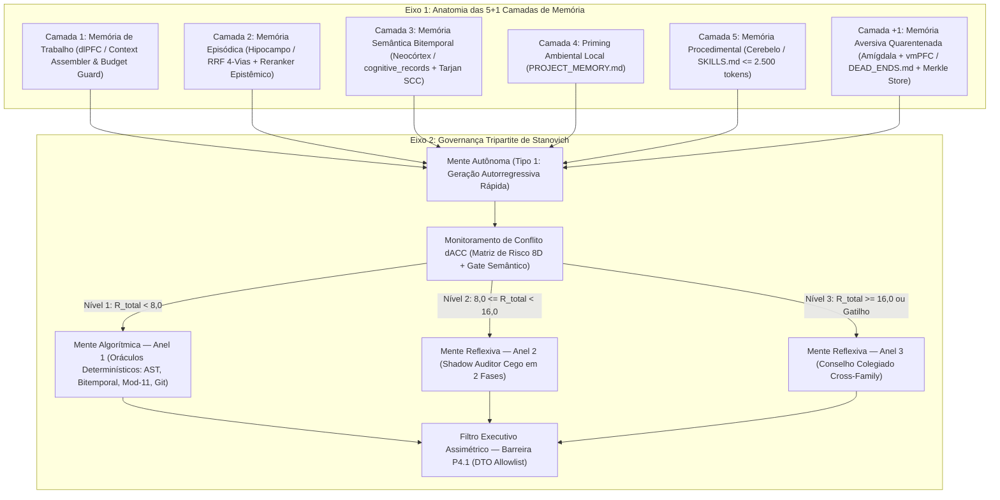

# Arquitetura Neuro-Cognitiva Bitemporal de Duplo Eixo: Governança Executivo-Epistêmica Tripartite e Erradicação de Falhas de Sobreposição em Sistemas Agênticos de Longo Horizonte (`MemoryOS`)

**Código de Publicação:** `VTI-RES-2026-02`  
**Série Científica:** VTI Research — *Technical & Scientific Monograph Series*  
**Autor:** **Caio Gonçalves** — *Principal Investigator & Chief Systems Architect, VTI Research (VTI, Brazil)* (https://projectos-system.github.io/vti-research/)  
**Ecossistema de Referência:** `MemoryOS` (`v5.9.0` / `v6.0.0`) — **`VTI OS System`**  

---

## Resumo

Sistemas agênticos baseados em Grandes Modelos de Linguagem (*Large Language Models* — LLMs) sofrem degradação sistemática em horizontes operacionais longos devido a três classes fundamentais de falha cognitiva: atenuação de atenção no miolo de janelas extensas (*Lost in the Middle*), sobreposição estatística indevida de regras recém-promulgadas por fatos históricos de alta frequência no pré-treinamento (*Override Failure*) e poluição da memória persistente por artefatos transitórios de tempo de execução (*Contaminated Mindware*). Motivado por um estudo empírico precursor sobre $20$ consultas reais em uma plataforma corporativa de consultoria fiscal, tributária e trabalhista em produção ($\mathcal{S}_{\mathrm{Hub}}$) — no qual assistentes generativos sem governança epistêmica apresentaram $20\%$ ($4/20$) de falhas críticas normativas e cadastrais —, este artigo formaliza a **Arquitetura Neuro-Cognitiva Bitemporal de Duplo Eixo do `MemoryOS`**. O modelo acopla cinco camadas funcionais de memória e um repositório aversivo regulado por quarentena criptográfica (**Eixo 1**) a uma estrutura de governança executiva tripartite inspirada na ciência cognitiva de Keith E. Stanovich (**Eixo 2**: Mente Autônoma, Mente Algorítmica ancorada em oráculos determinísticos e Mente Reflexiva estruturada em auditoria física cega de duas fases e deliberação colegiada entre famílias independentes de modelos). Fundamentada em **32 estudos científicos revisados por pares (`[E01]–[E32]`)** e em um marco legal de proteção de dados (`[N01]`), a arquitetura introduz: (i) registros cognitivos *append-only* sobre intervalos bitemporais semi-abertos de Snodgrass `[valid_from, valid_to) × [tx_from, tx_to)` com verificação linear de aciclicidade via `Tarjan SCC` em $O(|V| + |E|)$; (ii) quarentena epistêmica triestatal selada por Árvores de Merkle SHA-256 com separação de domínio; (iii) um reranker epistêmico multidimensional pós-RRF dotado de meia-vida infinita ($T_{1/2} = \infty$) para regras canônicas vigentes; (iv) uma matriz de monitoramento de conflito em 8 dimensões (`dACC`); e (v) um ciclo de consolidação noturna estritamente idempotente ($f(f(S)) = f(S)$). Avaliado sobre um *Golden Benchmark* controlado e reprodutível de $N = 50$ consultas sujeitas a choque de vigência temporal (`run_epistemic_benchmark.js`), o reranker epistêmico elevou o `NDCG@5` de `0,5764` para `1,0000` (`+73,49%`) e o `MRR` de `0,4000` para `1,0000` (`+150,00%`), reduzindo falhas de revogação de `40/50` para `0/50` ($\mathrm{IC}_{95\%}^{\mathrm{Wilson}} \approx [0,9289; \, 1,0000]$) com latência monotônica `P95 = 0,34 ms` (`0,44 ms` em carga corporativa complexa). Os resultados demonstram eficácia determinística e empírica sob o protocolo bitemporal avaliado, delimitando rigorosamente as ameaças à validade de construto, interna, externa, estatística e ecológica.

**Palavras-chave:** Arquitetura Cognitiva Agêntica; Bancos de Dados Bitemporais; Teoria Tripartite de Stanovich; Governança Epistêmica; *Reciprocal Rank Fusion*; Árvores de Merkle; Sistemas de Memória de Longo Prazo; `MemoryOS`.

---

## 1. Introdução e Modos de Falha Cognitiva em Longo Horizonte

A transição dos Grandes Modelos de Linguagem (LLMs) de interfaces conversacionais efêmeras para agentes autônomos de engenharia de software, análise regulatória e tomada de decisão corporativa expôs uma assimetria estrutural entre **fluência gerativa local** e **consistência epistêmica em longo horizonte**. Embora arquiteturas *Transformer* contemporâneas exibam elevada capacidade de síntese textual dentro de um único turno, sua operação continuada ao longo de dezenas de sessões, mutações de esquemas e revogações normativas revela degradação progressiva de confiabilidade.

A literatura científica recente permite agrupar essa degradação em três modos primários de falha cognitiva, agravados por uma limitação fundamental de autoverificação:

1. **Degradação Atencional Não-Uniforme (*Lost in the Middle*):** Ao contrário da premissa ingênua de que a expansão nominal da janela de contexto (para $128\text{k}$–$1\text{M}$ tokens) eliminaria a necessidade de arquiteturas externas de memória, Liu et al. `[E03]` demonstraram que modelos de linguagem apresentam uma curva de recuperação em formato de "U": informações situadas no início (primazia) ou no final imediato (recência) do prompt são atendidas com precisão substancialmente superior àquelas inseridas na região intermediária. Consequentemente, concatenar transcrições brutas e logs extensos dilui restrições críticas e eleva a taxa de alucinação por interferência contextual `[E01, E04]`.
2. **Falha de Sobreposição Temporal e Normativa (*Override Failure*):** Em domínios dinâmicos — como direito tributário, legislação trabalhista e arquitetura evolutiva de software —, o valor-verdade de uma proposição $p$ não é estático, mas parametrizado por um intervalo temporal de vigência $[v_{\mathrm{from}}, v_{\mathrm{to}})$. Quando uma norma histórica $d_{\mathrm{old}}$ (amplamente representada no corpus de pré-treinamento e em discussões passadas) é formalmente revogada por uma decisão canônica recente $d_{\mathrm{new}}$, a distribuição a priori $P_{\theta}(y \mid q)$ do LLM permanece fortemente enviesada para $d_{\mathrm{old}}$. Em motores clássicos de *Retrieval-Augmented Generation* (RAG) baseados exclusivamente em similaridade léxica/vetorial ou decaimento uniforme de recência `[E08]`, documentos revogados com alta densidade lexical ou logs recentes comentando a regra antiga suprimem a regra vigente — instanciando o fenômeno cognitivo que Keith E. Stanovich denomina *Override Failure* `[E20, E21]`.
3. **Poluição da Memória Persistente (*Contaminated Mindware*):** Sistemas agênticos que acumulam memória experiencial por reforço verbal `[E18]` sem quarentena epistêmica frequentemente cristalizam ruídos transitórios de tempo de execução — como falhas momentâneas de DNS (`ENOTFOUND`), bloqueios temporários de porta, *stack traces* truncados ou conjecturas diagnósticas incorretas — como proibições permanentes no prompt de sistema. Na taxonomia de disracionalidade de Stanovich `[E20, E22]`, esse acúmulo constitui *Contaminated Mindware*: estruturas declarativas defeituosas que degradam ativamente o raciocínio futuro do agente.

Esses três modos de falha não podem ser corrigidos pela simples instrução para que o próprio LLM "revise criticamente sua resposta". Conforme comprovado por Huang et al. `[E28]`, LLMs não conseguem autocorrigir raciocínio de maneira confiável na ausência de sinais externos verificáveis (*intrinsic self-correction impossibility*), tendendo a reforçar seu viés inicial (*Myside Bias*) ou oscilar estocasticamente. A correção efetiva requer acoplamento com oráculos externos determinísticos (*tool-interactive critiquing*) `[E29]` ou deliberação adversarial estruturada entre agentes independentes `[E31]`.

### 1.1. Questões de Pesquisa e Contribuições

Este trabalho investiga três questões formais de engenharia cognitiva:
- **QP1 (Vigência Bitemporal vs. Inércia Estatística):** Como formalizar uma camada de armazenamento e reranking pós-fusão híbrida capaz de eliminar *Override Failures* sob revogação normativa explícita, preservando simultaneamente decisões canônicas antigas porém vigentes contra o ruído de logs recentes, em latência sub-milissegundo?
- **QP2 (Imunidade contra *Contaminated Mindware*):** Como isolar falhas transitórias de execução para que jamais contaminem o contexto ativo do agente, sem perder a rastreabilidade forense criptograficamente auditável e compatível com requisitos legais de proteção de dados `[N01]`?
- **QP3 (Governança Executiva Seletiva):** Como estruturar anéis metacognitivos proporcionais ao risco que exijam provas físicas verificáveis antes da aceitação de alegações verbais do agente, evitando o custo proibitivo de comitês multi-modelo em tarefas triviais?

As contribuições originais deste artigo, implementadas e validadas no sistema **`MemoryOS`** (integrante do ecossistema **`VTI OS System`**), compreendem:
1. A formalização matemática da **Arquitetura Neuro-Cognitiva Bitemporal de Duplo Eixo**, unificando **5+1 Camadas de Memória** (Eixo 1) com a **Governança Executivo-Epistêmica Tripartite de Stanovich** (Eixo 2) sobre uma base consolidada de **32 estudos científicos únicos (`[E01]–[E32]`)**;
2. Um motor bitemporal *append-only* baseado em intervalos semi-abertos de Snodgrass `[valid_from, valid_to) × [tx_from, tx_to)` `[E12]` acoplado à detecção linear de ciclos `Tarjan SCC` em $O(|V| + |E|)$ `[E13]` sob transações serializadas `BEGIN IMMEDIATE`;
3. Um **Reranker Epistêmico Multidimensional Pós-RRF** com corte semântico adaptativo, fusão residual *Boost-Only* monotônica e meia-vida estratificada por classe cognitiva ($T_{1/2} = \infty$ para registros canônicos vigentes);
4. Uma arquitetura de **Quarentena Triestatal** e **Forensic Evidence Store** ancorada em Árvores de Merkle SHA-256 com separação criptográfica de domínio `[E19]`, aliada a um ciclo de consolidação em ociosidade (*Dreaming Pass*) com ponto fixo idempotente $f(f(S)) = f(S)$;
5. Os **3 Anéis Metacognitivos** regidos por uma Matriz de Risco 8D (`dACC`), incluindo o **Isolamento Informacional Estrito em 2 Fases** do `Shadow Auditor` e a **Barreira Assimétrica de Superfície `P4.1`**;
6. Avaliação empírica reprodutível em um *Golden Benchmark* controlado de $N = 50$ consultas (`run_epistemic_benchmark.js`), demonstrando elevação de `NDCG@5` de `0,5764` para `1,0000` (`+73,49%`), `0/50` falhas de revogação e latência `P95 = 0,34 ms`.

---

## 2. Estudo Empírico Precursor: Auditoria Forense de *Override Failure* e *Mindware Gap*

A motivação empírica direta para a concepção da arquitetura bitemporal e tripartite do `MemoryOS` originou-se de uma auditoria forense conduzida sobre **20 consultas reais de produção** ($N_{\mathrm{pre}} = 20$) abrangendo os domínios Fiscal, Tributário, Trabalhista e Previdenciário em **uma plataforma corporativa de consultoria fiscal, tributária e trabalhista em produção ($\mathcal{S}_{\mathrm{Hub}}$)**.

Nessa avaliação preliminar sobre um pipeline generativo assistido por busca semântica convencional — ainda desprovido de controle bitemporal explícito e de oráculos determinísticos de pós-condição —, observou-se uma **taxa de falhas críticas de 20% (`4/20` consultas)**, distribuídas em dois mecanismos patológicos distintos da taxonomia de Stanovich `[E20, E21]`:

### 2.1. Evidência de *Override Failure* (Consultas 3, 9 e 17 — Sucessão Constitucional Trabalhista)

Nas Consultas 3, 9 e 17, os usuários questionaram os limites constitucionais vigentes para jornada semanal de trabalho (42 horas), regime de escala `6x1` e aplicabilidade aos trabalhadores domésticos após a promulgação da **Emenda Constitucional nº 141/2026**. Embora referências textuais à nova norma estivessem acessíveis, o modelo generativo incorreu sistematicamente em *Override Failure*: negou a vigência da `EC 141/2026` ou tratou-a como mera Proposta de Emenda à Constituição (PEC) ainda em tramitação legislativa, aplicando com elevada fluência retórica a regra histórica revogada de **44 horas semanais**.

A causa raiz matemática reside na interação entre dois fatores: (a) nos pesos paramétricos do LLM, milhões de documentos históricos pré-2026 associam "limite constitucional de jornada semanal no Brasil" ao valor `44h`; e (b) no índice de recuperação sem governança bitemporal, documentos antigos detalhando a regra de 44h ou notas transitórias de tramitação exibiam alta sobreposição lexical com a consulta, carecendo de um operador formal de anulação temporal ($F_{\mathrm{validade}} = 0$) para registros cujo intervalo `[valid_from, valid_to)` já havia sido encerrado ($t_{\mathrm{ref}} \ge \text{valid\_to}$).

### 2.2. Evidência de *Mindware Gap* (Consulta 15 — Enquadramento Previdenciário `CNAE 9430-8/00`)

Na Consulta 15, solicitou-se o enquadramento previdenciário exato (código `FPAS`, código de Terceiros e alíquota correspondente) para entidades de defesa de direitos sociais sob o código **`CNAE 9430-8/00`**. Sem acesso a um oráculo cadastral determinístico verificado e sem barreira inibitória contra extrapolação probabilística, a Mente Autônoma (Tipo 1) do LLM sintetizou uma resposta plausível na forma, porém factualmente falsa no conteúdo: declarou com alta confiança os códigos **`FPAS 566`**, **`Terceiros 0099`** e alíquota de **`4,5%`**.

Confrontada contra o marco normativo vigente — **Instrução Normativa RFB nº 2.110/2022** e **Lei Complementar nº 187/2021** —, a regra exata exige **`FPAS 515`** (`Terceiros 0115`, alíquota de **`5,8%`**) no regime geral, ou **`FPAS 639`** (`Terceiros 0000`, alíquota de **`0,0%`**) exclusivamente mediante certificação **CEBAS** ativa. Trata-se de uma *Lacuna de Mindware* (*Mindware Gap*): substituição de atributo exato por aproximação estatística na ausência de estrutura algorítmica verificável `[E22, E24]`.

| Caso Auditado em $\mathcal{S}_{\mathrm{Hub}}$ | Domínio Normativo | Patologia Cognitiva (Stanovich) | Comportamento Observado sem Governança | Antídoto Formal Introduzido no `MemoryOS` |
| :--- | :--- | :--- | :--- | :--- |
| **Consultas 3, 9 e 17** (`3/20`) | Direito Constitucional do Trabalho (`EC 141/2026`: teto de 42h e escala 6x1) | **Falha de Sobreposição (*Override Failure*)** | Prior estatístico pré-2026 sobrepôs a emenda promulgada, aplicando a jornada revogada de 44h semanais. | Tabela bitemporal `cognitive_records` (`[valid_from, valid_to)`), indicador estrito $F_{\mathrm{validade}}(d, t_{\mathrm{ref}})$ e meia-vida infinita ($T_{1/2} = \infty$) para regras canônicas vigentes. |
| **Consulta 15** (`1/20`) | Direito Previdenciário e Tributário (`CNAE 9430-8/00`, `IN RFB 2.110/2022`, `LC 187/2021`) | **Lacuna de Mindware (*Mindware Gap*)** | Alucinação confiante de códigos cadastrais inexistentes (`FPAS 566`, `0099`, `4,5%`) em vez de `FPAS 515` (`5,8%`) / `639` (`0,0%`). | Oráculos determinísticos da Mente Algorítmica (Anel 1) acoplados ao `Shadow Auditor` cego em 2 fases (Anel 2) e escalada de risco fiscal na Matriz 8D (`dACC`). |

---

## 3. Arquitetura Formal de Duplo Eixo e os 10 Pilares Cognitivos

### 3.1. Visão Sistêmica Ortogonal: Eixo 1 (Memória) $\times$ Eixo 2 (Governança Executiva)

Seja $\mathcal{A}$ um sistema agêntico operando ao longo de uma sequência discreta de sessões $s_1, s_2, \dots, s_m$ em tempos físicos monotônicos. O `MemoryOS` decompõe a cognição de $\mathcal{A}$ no produto cartesiano funcional de dois subsistemas ortogonais, $\mathcal{A} = \langle \mathcal{M}_{\text{Eixo 1}}, \mathcal{G}_{\text{Eixo 2}} \rangle$:

1. **Eixo 1 — Anatomia das 5+1 Camadas de Memória ($\mathcal{M}_{\text{Eixo 1}}$):** Governa a topologia de armazenamento, indexação, consolidação e vigência temporal do conhecimento:
   - $L_1$ (*Working Memory*): montagem paginada sob orçamento estrito de tokens e atenção (`backend/maestro/context_assembler.js`);
   - $L_2$ (*Episodic Memory*): índice híbrido multi-via FTS5 BM25, vetorial denso, entidades IDF e expansão em grafo com reranking epistêmico (`backend/utils/rrf_search_engine.js`, `backend/utils/epistemic_reranker.js`);
   - $L_3$ (*Bitemporal Semantic Memory*): núcleo declarativo central (`MEMORY.md`, `USER.md`), grafo associativo (`backend/utils/associative_graph.js`), registros bitemporais *append-only* (`backend/utils/fact_history_manager.js`) e consolidação idempotente em ociosidade (`backend/utils/dream_scheduler.js`);
   - $L_4$ (*Environmental Scope Priming*): memória local isolada por repositório (`.agents/PROJECT_MEMORY.md`), prevenindo contaminação cruzada entre projetos distintos;
   - $L_5$ (*Procedural Memory*): catálogo deduplicado de habilidades operacionais sob teto rígido de $2.500$ tokens (`SKILLS.md`, `backend/utils/procedural_skills_manager.js`);
   - $L_{+1}$ (*Quarantined Aversive Memory*): máquina de estados epistêmica para falhas experienciais (`DEAD_ENDS.md` restrito a itens validados sob teto de $1.000$ tokens em `backend/utils/reflection_manager.js`) + repositório forense selado fora do prompt em Árvore de Merkle SHA-256 (`backend/utils/evidence_store.js`).
2. **Eixo 2 — Governança Executivo-Epistêmica Tripartite de Stanovich ($\mathcal{G}_{\text{Eixo 2}}$):** Governa a inibição de respostas impulsivas, a verificação determinística e a deliberação colegiada:
   - **Mente Autônoma (Tipo 1):** inferência autorregressiva rápida de LLMs e agentes de CLI;
   - **Sensor de Conflito `dACC`:** Matriz de Risco de 8 Dimensões (`backend/maestro/council_risk_matrix.js`);
   - **Mente Algorítmica (Anel 1):** oráculos determinísticos simbólicos (validação sintática AST `node --check`, invariantes bitemporais, Módulo 11 LGPD, integridade Git/Env Shield);
   - **Mente Reflexiva (Anéis 2 e 3):** `Shadow Auditor` sob isolamento informacional em 2 fases (`backend/maestro/reflective_monitor_service.js`) e Conselho Colegiado *Cross-Family* entre arquiteturas independentes de modelos comerciais de fronteira e compactos (`backend/mcp_server.js`, `backend/utils/ai_fallback.js`), culminando no filtro assimétrico de superfície `Barreira P4.1` (`backend/maestro/biomimetic_projector.js`).

#### Matriz de Correspondência Estrutural dos 10 Pilares

| Pilar | Eixo | Conceito Teórico | Correlato Funcional no Cérebro Humano | Módulos Nucleares no `MemoryOS` | Estudos Base |
| :---: | :---: | :--- | :--- | :--- | :---: |
| **P1** | Eixo 1 | Memória de Trabalho & Paginação Virtual | Córtex Pré-Frontal Dorsolateral (`dlPFC`) & Buffer Episódico | `context_assembler.js`, `prose_compressor_bundle.js` | `[E01–E04]` |
| **P2** | Eixo 1 | Memória Episódica, Fusão RRF 4-Vias & Reranker Epistêmico | Hipocampo (codificação rápida e recuperação multi-pista) | `rrf_search_engine.js`, `epistemic_reranker.js` | `[E05–E08]` |
| **P3** | Eixo 1 | Sistemas Complementares (`CLS`) & Sono Idempotente | Neocórtex & Replay Hipocampo-Cortical no Sono REM/SWS | `dream_scheduler.js`, `associative_graph.js`, `power_aware_scheduler.js` | `[E09–E11]` |
| **P4** | Eixo 1 | Bitemporalidade *Append-Only* & Aciclicidade de Tarjan | Córtex Pré-Frontal Ventromedial (`vmPFC`) & Cronometria | `fact_history_manager.js`, `20261111_bitemporal_core_schema.sql` | `[E12–E14]` |
| **P5** | Eixo 1 | Skills Não-Declarativas, Quarentena & Árvore de Merkle | Cerebelo/Estriado + Amígdala regulada pelo `vmPFC` | `reflection_manager.js`, `evidence_store.js`, `procedural_skills_manager.js` | `[E15–E19]` |
| **P6** | Eixo 2 | Teoria Tripartite da Mente & Taxonomia de Disracionalidade | Tripartição Funcional Tipo 1 vs. Algorítmica & Reflexiva Tipo 2 | `biomimetic_projector.js`, `epistemic_reranker.js`, `maestro_routes.js` | `[E20–E24]` |
| **P7** | Eixo 2 | Monitoramento Neurocognitivo de Conflito (`dACC`) | Córtex Cingulado Anterior Dorsal (`dACC`) | `council_risk_matrix.js`, `canary_governor.js` | `[E25–E27]` |
| **P8** | Eixo 2 | Oráculos Verificáveis (`CRITIC`) & `Shadow Auditor` 2-Fases | Córtex Pré-Frontal Lateral (superação do *Myside Bias*) | `reflective_monitor_service.js`, `checkpoint_store.js` | `[E28–E30]` |
| **P9** | Eixo 2 | Sociedade de Mentes & Debate Colegiado *Cross-Family* | Córtex Frontopolar (Área 10 de Brodmann / Revisão por Pares) | `mcp_server.js`, `ai_fallback.js`, `council_risk_matrix.js` | `[E31–E32]` |
| **P10** | Eixo 2 | Isolamento Assimétrico de Superfície (`Barreira P4.1`) | Filtro Tálamo-Cortical (regulação interna silenciosa) | `biomimetic_projector.js`, `secret_sanitizer.js` | `[E21]`, `[N01]` |

---

### 3.2. Pilar 1: Memória de Trabalho, Atenção em Janelas Longas e Paginação Virtual de Contexto

Baddeley & Hitch `[E01]` e Baddeley `[E02]` demonstraram que a memória de trabalho biológica não é um reservatório monolítico infinito, mas um sistema de capacidade estritamente limitada governado por um executivo central e por um *buffer* episódico integrador. Em arquiteturas *Transformer*, Liu et al. `[E03]` provaram empiricamente que a acurácia de recuperação em janelas longas segue uma distribuição convexa em "U", sofrendo severa atenuação para tokens alocados no meio da sequência (*Lost in the Middle*). Paralelamente, Packer et al. (*MemGPT*) `[E04]` demonstraram a eficácia de tratar o contexto ativo do LLM como memória física escassa (análoga à RAM) paginada contra armazenamento persistente em disco.

No `MemoryOS`, o módulo `backend/maestro/context_assembler.js` formaliza o problema de montagem de contexto como uma alocação ordenada sob orçamento rígido $B_{\max}$. Dado um conjunto de blocos candidatos $\mathcal{B} = \{b_1, \dots, b_m\}$ provenientes das 5+1 camadas, cada bloco $b_i$ possui prioridade epistêmica estrita $p(b_i)$, custo em tokens $\ell(b_i)$ e zona posicional designada:

$$\max_{\mathcal{S} \subseteq \mathcal{B}} \sum_{b_i \in \mathcal{S}} p(b_i) \quad \text{sujeito a} \quad \sum_{b_i \in \mathcal{S}} \ell(b_i) \le B_{\max}$$

Para neutralizar o efeito *Lost in the Middle*, o montador posiciona invariantes inegociáveis de segurança e restrições validadas de `DEAD_ENDS.md` no **prefixo de primazia** (início absoluto do prompt) e aloca a instrução imediata da fase e os registros canônicos vigentes no **sufixo de recência** (final imediato do prompt), relegando evidências episódicas complementares à região intermediária compactada por `prose_compressor_bundle.js`. Adicionalmente, toda evidência recuperada do armazenamento externo é encapsulada em tags de isolamento de dados `<retrieved_evidence readonly="true">...</retrieved_evidence>` com escape determinístico de tags aninhadas (`escapeRetrievedEvidence`), impedindo ataques de *Envelope Breakout* e *Indirect Prompt Injection*.

---

### 3.3. Pilar 2: Memória Episódica, Fusão Híbrida RRF 4-Vias e Reranker Epistêmico Multidimensional

Inspirado na distinção neurocognitiva de Tulving `[E05]` para a memória episódica hipocampal (codificação rápida e recuperação associativa multi-pista), o motor `backend/utils/rrf_search_engine.js` combina quatro vias heterogêneas de busca $V = \{\text{fts5}, \text{vector}, \text{entity}, \text{graph}\}$:
1. **Via Léxica Probabilística (`fts5`):** índice invertido SQLite FTS5 com função de pontuação BM25 de Robertson & Zaragoza `[E06]` ($w_{\text{fts5}} = 1,0$);
2. **Via Semântica Densa (`vector`):** similaridade de cosseno sobre *embeddings* vetoriais com limiar mínimo de admissão $0,30$ ($w_{\text{vector}} = 1,0$);
3. **Via de Entidades Nomeadas (`entity`):** agregação ponderada por *Inverse Document Frequency* (`SUM(idf_score)`) sobre identificadores técnicos, códigos normativos e símbolos ($w_{\text{entity}} = 0,8$);
4. **Via Relacional Associativa (`graph`):** expansão sobre triplas sujeito-predicado-objeto `(subject, predicate, object)` ordenadas por confiança ($w_{\text{graph}} = 0,6$).

Para evitar descalibração entre distribuições de escores incomensuráveis (BM25 ilimitado vs. cosseno em $[-1, 1]$), aplica-se a *Reciprocal Rank Fusion* (RRF) ponderada de Cormack, Clarke & Buettcher `[E07]` com constante amortecedora $k = 60$. Seja $V_{\mathrm{exec}} \subseteq V$ o subconjunto não-vazio de vias efetivamente executadas e $\mathrm{rank}_v(d) \in \{1, 2, \dots\}$ a posição ordinal do documento $d$ na via $v$ ($\mathrm{rank}_v(d) = \infty$ se ausente). O escore bruto RRF e seu teto teórico exato $C_{\mathrm{RRF}}(V_{\mathrm{exec}})$ (atingido quando um documento ocupa $\mathrm{rank}_v(d) = 1$ em todas as vias executadas) são definidos por:

$$S_{\mathrm{rrf}}^{\mathrm{raw}}(q, d) = \sum_{v \in V_{\mathrm{exec}}} \frac{w_v}{k + \mathrm{rank}_v(d)}, \qquad C_{\mathrm{RRF}}(V_{\mathrm{exec}}) = \frac{\sum_{v \in V_{\mathrm{exec}}} w_v}{k + 1}$$

A aderência semântico-léxica normalizada no intervalo fechado $[0, 1]$ é então obtida por:

$$S_{\mathrm{rrf}}(q, d) = \mathrm{clamp}\!\left(\frac{S_{\mathrm{rrf}}^{\mathrm{raw}}(q, d)}{C_{\mathrm{RRF}}(V_{\mathrm{exec}})}, \, 0, \, 1\right)$$

#### Superação do Decaimento Uniforme e Formulação Pós-RRF

Em arquiteturas generativas clássicas como Park et al. `[E08]`, a recuperação combina relevância, importância e um decaimento temporal uniforme aplicado indistintamente a todas as memórias (por exemplo, $R_{\mathrm{leg}}(\Delta t) = (1 + \lambda \Delta t)^{-1}$ com $\lambda = 0,05$). Sob esse regime uniforme, uma decisão arquitetural ou emenda constitucional promulgada há $730$ dias sofre atenuação severa ($R_{\mathrm{leg}}(730) \approx 0,0267$), sendo facilmente sobreposta por um log de depuração trivial emitido há $30$ minutos ($R_{\mathrm{leg}} \approx 0,9990$).

Para resolver simultaneamente esse decaimento indevido de regras canônicas e a permanência indevida de regras revogadas, o `MemoryOS` introduz a família funcional de reranking epistêmico pós-RRF. Na sua forma conceitual geral (que explicita a separação entre barreiras multiplicativas de admissibilidade e sinais internos de relevância, importância $I(d)$ e decaimento $D(d, t_{\mathrm{ref}})$):

$$\mathrm{Score}_{\mathrm{conceitual}}(q, d, t_{\mathrm{ref}}) = \mathbb{I}\!\left(S_{\mathrm{sem}}(q,d) \ge \theta_{\min}\right) \cdot F_{\mathrm{validade}}(d, t_{\mathrm{ref}}) \cdot A(d, \mathrm{intent}) \cdot \left[\alpha S_{\mathrm{rrf}}(q,d) + \beta I(d) + \gamma D(d, t_{\mathrm{ref}})\right]$$

No motor de produção (`backend/utils/epistemic_reranker.js`), para impedir que um registro episódico ou log obsoleto ($D \to 0$) preserve piso residual aditivo acima de zero e, ao mesmo tempo, acomodar a **Fusão Residual *Boost-Only*** com vias secundárias governadas, adota-se a instanciação multiplicativa fechada exata:

$$S_{\mathrm{final}}(q, d, t_{\mathrm{ref}}) = \mathbb{I}\!\left(S_{\mathrm{rrf}}(q,d) \ge \theta_{\min}(\mathrm{intent})\right) \cdot S_{\mathrm{rank}}(q, d) \cdot F_{\mathrm{validade}}(d, t_{\mathrm{ref}}, \mathrm{intent}) \cdot A(d, \mathrm{intent}) \cdot C(d) \cdot D(d, t_{\mathrm{ref}})$$

onde cada operador é definido deterministicamente como segue:

1. **Classificador de Intenção Epistêmica e Gate de Corte Semântico ($\theta_{\min}$):** A consulta $q$ é classificada em $\mathrm{intent} \in \{\text{normativa}, \text{histórica}, \text{diagnóstica}, \text{empírica}, \text{ambígua}\}$. Define-se $\theta_{\min}(\text{normativa}) = 0,15$ e $\theta_{\min}(\text{demais}) = 0,08$. Se $S_{\mathrm{rrf}}(q, d) < \theta_{\min}$, o indicador $\mathbb{I}(\cdot) = 0$ rejeita imediatamente o candidato (`BELOW_SEMANTIC_GATE`), impedindo que documentos institucionais de altíssima autoridade porém fora de tópico contaminem o topo do ranking.
2. **Fusão Residual *Boost-Only* ($S_{\mathrm{rank}}$):** Quando existe uma via ordinal complementar $S_B(q, d) = \frac{k + 1}{k + \mathrm{rank}_B(d)} \in [0, 1]$ habilitada pelo gate binário de fronteira $g_B \in \{0, 1\}$ (estritamente travado em $g_B \equiv 0$ em superfícies corporativas executivas) e coeficiente $\gamma_B = 0,35$:

   $$S_{\mathrm{rank}}(q, d) = S_{\mathrm{rrf}}(q, d) + \gamma_B \, g_B \, \bigl(1 - S_{\mathrm{rrf}}(q, d)\bigr) \, S_B(q, d)$$

   **Proposição 1 (Não-Degradação e Fechamento em $[0,1]$):** *Para quaisquer $S_{\mathrm{rrf}}, S_B, \gamma_B \in [0, 1]$ e $g_B \in \{0, 1\}$, vale $S_{\mathrm{rrf}}(q, d) \le S_{\mathrm{rank}}(q, d) \le 1$.*  
   *Demonstração:* Como $1 - S_{\mathrm{rrf}} \ge 0$ e $\gamma_B, g_B, S_B \ge 0$, o termo aditivo é não-negativo, logo $S_{\mathrm{rank}} \ge S_{\mathrm{rrf}}$. Por outro lado, como $\gamma_B g_B S_B \le 1$, tem-se $S_{\mathrm{rank}} \le S_{\mathrm{rrf}} + (1 - S_{\mathrm{rrf}}) = 1$. $\blacksquare$
3. **Fator Indicador de Vigência Bitemporal e Status Epistêmico ($F_{\mathrm{validade}}$):** Avaliado contra o instante de referência $t_{\mathrm{ref}}$ e o intervalo semi-aberto $[v_{\mathrm{from}}(d), v_{\mathrm{to}}(d))$:

   $$F_{\mathrm{validade}}(d, t_{\mathrm{ref}}, \mathrm{intent}) = \begin{cases} 0,0, & \text{se } \mathrm{status}(d) \neq \text{validated} \quad (\text{ex.: } \text{quarantined}, \text{rejected}), \\ 0,0, & \text{se } t_{\mathrm{ref}} < v_{\mathrm{from}}(d) \text{ e } \mathrm{intent} \neq \text{histórica}, \\ 0,0, & \text{se } v_{\mathrm{to}}(d) \neq \varnothing \land t_{\mathrm{ref}} \ge v_{\mathrm{to}}(d) \text{ e } \mathrm{intent} \neq \text{histórica}, \\ 0,85, & \text{se } v_{\mathrm{to}}(d) \neq \varnothing \land t_{\mathrm{ref}} \ge v_{\mathrm{to}}(d) \text{ em linhagem histórica explícita}, \\ 1,0, & \text{caso contrário } \bigl(v_{\mathrm{from}}(d) \le t_{\mathrm{ref}} < v_{\mathrm{to}}(d)\bigr). \end{cases}$$

   *(Nota arquitetural: em variantes de suavização exploratória, registros revogados podem receber peso residual atenuado $0,05$, mas no caminho normativo estrito do `epistemic_reranker.js` aplica-se anulação exata $0,0$ com código auditável `SUPERSEDED` ou `OUTSIDE_VALID_INTERVAL`).*
4. **Fator Delimitado de Autoridade Normativa ($A$) e Confiança ($C$):** Exclusivamente quando $\mathrm{intent} = \text{normativa}$, o escore de autoridade bruto $a(d)$ é limitado a $[0,8; \, 1,5]$ e mapeado afim-linearmente para $[1,0; \, 1,5]$:

   $$A(d, \mathrm{intent}) = \begin{cases} 1,0 + 0,5 \cdot \dfrac{\mathrm{clamp}(a(d), \, 0,8, \, 1,5) - 0,8}{0,7}, & \text{se } \mathrm{intent} = \text{normativa}, \\ 1,0, & \text{caso contrário.} \end{cases}$$

   Para consultas diagnósticas ou empíricas, $A \equiv 1,0$, evitando que documentos normativos suprimam evidências factuais recentes de depuração. A confiança $C(d) = \mathrm{clamp}(\mathrm{conf}(d), 0, 1)$ pondera a fidedignidade intrínseca da extração.
5. **Decaimento Exponencial Condicionado à Classe Cognitiva com Meia-Vida Infinita Canônica ($D$):** Seja $\tau(d) \in \{\text{canonical}, \text{project\_fact}, \text{skill}, \text{insight}, \text{episodic}, \text{log\_evidence}\}$ a classe cognitiva de $d$ e $\Delta t = \max(0, (t_{\mathrm{ref}} - t_{\mathrm{base}}(d)) / 86.400\text{ s})$ o tempo decorrido em dias desde a última verificação ($t_{\mathrm{base}}$):

   $$D(d, t_{\mathrm{ref}}) = \exp\!\left(-\frac{\ln 2}{T_{1/2}(\tau(d))} \cdot \Delta t\right), \quad \text{com} \quad T_{1/2}(\tau) = \begin{cases} +\infty & (\tau = \text{canonical}) \implies D \equiv 1,0, \\ 180\text{ dias} & (\tau = \text{project\_fact}), \\ 90\text{ dias} & (\tau = \text{skill}), \\ 30\text{ dias} & (\tau \in \{\text{insight}, \text{episodic}\}), \\ 3\text{ dias} & (\tau = \text{log\_evidence}). \end{cases}$$

   A meia-vida infinita ($T_{1/2} = +\infty$) garante matematicamente que uma norma constitucional ou regra arquitetural canônica jamais sofra erosão por passagem do tempo enquanto permanecer vigente ($v_{\mathrm{to}} = \varnothing$ ou $t_{\mathrm{ref}} < v_{\mathrm{to}}$), sendo desativada instantaneamente somente por sucessão bitemporal explícita. A ordenação final aplica desempate contratual estritamente determinístico pela tupla lexicográfica $(S_{\mathrm{final}} \downarrow, \, S_{\mathrm{rrf}} \downarrow, \, \mathrm{id}_{\mathrm{lex}} \uparrow)$.

---

### 3.4. Pilar 3: Sistemas Complementares de Aprendizagem (`CLS`), Consolidação no Sono e Ponto Fixo Idempotente

A neurociência computacional estabelece, por meio da teoria dos *Complementary Learning Systems* (`CLS`) de McClelland, McNaughton & O'Reilly `[E09]`, que um sistema inteligente exige dois substratos acoplados para evitar interferência catastrófica: um sistema rápido e esparso para captura episódica imediata (hipocampo) e um sistema lento e estruturado para extração de invariantes semânticas (neocórtex). Diekelmann & Born `[E10]` demonstraram que a transferência hipocampo-neocortical e a poda sináptica ocorrem preferencialmente durante períodos *offline* de sono (`SWS` e `REM`). Em LLMs, Gutiérrez et al. (*HippoRAG*) `[E11]` evidenciaram o ganho de indexação relacional neurobiologicamente inspirada sobre grafos de conhecimento.

No `MemoryOS`, essa consolidação *offline* é materializada por `backend/utils/dream_scheduler.js` em conjunto com `backend/utils/power_aware_scheduler.js` e `backend/utils/associative_graph.js`:
1. **Consciência de Energia e Suspensão de SO (*Power-Aware Cooldown*):** Ao detectar saltos de relógio monotônico superiores a `45 s` (indicativos de hibernação/suspensão do sistema operacional), o agendador ativa uma janela de estabilização pós-despertar e reseta o cronômetro de ociosidade, impedindo tempestades de chamadas concorrentes ao religar a máquina.
2. **Barreira de *Delta Check* Zero-Token:** Antes de iniciar qualquer rotina automática de ociosidade, `hasPendingCognitiveWork()` verifica em SQLite se houve inserção de mensagens, *insights*, *skills* ou expiração de quarentenas (`> 48h`) desde o último ciclo. Na ausência de variação ($\Delta = 0$), o ciclo encerra com consumo de **zero tokens** de LLM.
3. **Ponto Fixo Estritamente Idempotente ($f(f(S)) = f(S)$):** Seja $\Sigma(S) = (R_{\mathrm{cog}}, L_{\mathrm{exp}}, F_{\mathrm{sem}})$ a projeção canônica ordenada do estado lógico do banco cognitivo (excluindo carimbos voláteis de telemetria) e $\mathcal{H}_{\mathrm{SHA256}}(\Sigma(S))$ seu resumo criptográfico (`computeCanonicalBrainStateChecksum`). O operador de consolidação epistêmica $f_{t_0}$ (`runIdempotentEpistemicDreamCycle`), parametrizado por um instante fixo $t_0$:
   - transiciona lições contaminadas para `rejected` e lições transitórias em `quarantined` com idade $> 48\text{h}$ para `expired`;
   - transiciona registros em `cognitive_records` com `status = 'validated'`, `tx_to IS NULL` e `valid_to <= t_0` para `needs_revalidation`, sem jamais apagar o histórico *append-only*;
   - jamais promove automaticamente registros `quarantined` para `validated`.

   Como os predicados de transição de $f_{t_0}$ são disjuntos de seus estados-alvo (`rejected`, `expired`, `needs_revalidation`), aplicar $f_{t_0}$ uma segunda vez em $t_0$ produz zero mutações, satisfazendo exatamente a identidade algébrica de projeção idempotente:

   $$\forall S, \forall t_0: \quad f_{t_0}\bigl(f_{t_0}(S)\bigr) = f_{t_0}(S) \implies \mathcal{H}_{\mathrm{SHA256}}\!\Bigl(\Sigma\bigl(f_{t_0}(f_{t_0}(S))\bigr)\Bigr) = \mathcal{H}_{\mathrm{SHA256}}\!\Bigl(\Sigma\bigl(f_{t_0}(S)\bigr)\Bigr)$$

---

### 3.5. Pilar 4: Bancos de Dados Bitemporais *Append-Only* de Snodgrass e Detecção Acíclica Linear de Tarjan

Bancos de dados convencionais que sobrescrevem valores *in-place* (`UPDATE ... SET valor = novo`) destroem a auditabilidade histórica e impedem consultas retroativas ou prospectivas sobre mudanças regulatórias `[E14]`. Fundamentado na álgebra de bancos de dados temporais de Snodgrass & Ahn `[E12]`, o módulo `backend/utils/fact_history_manager.js` estrutura a tabela `cognitive_records` sobre dois eixos temporais ortogonais em intervalos semi-abertos à direita $[a, b)$:

- **Tempo de Validade (*Valid Time* — $\mathbb{T}_v$):** $\mathbf{v}(d) = [v_{\mathrm{from}}(d), v_{\mathrm{to}}(d))$, representando quando a proposição ou norma $d$ é verdadeira/vigente na realidade de domínio ($v_{\mathrm{to}} = \varnothing$ denota vigência aberta $[v_{\mathrm{from}}, +\infty)$, com restrição de integridade estrita $v_{\mathrm{from}} < v_{\mathrm{to}}$ quando fechado);
- **Tempo de Transação (*Transaction Time* — $\mathbb{T}_{tx}$):** $\mathbf{x}(d) = [t_{\mathrm{from}}(d), t_{\mathrm{to}}(d))$, representando quando o registro esteve ativo como crença gravada no banco de dados ($t_{\mathrm{from}} \le t_{\mathrm{to}}$).

Uma consulta bitemporal *Point-in-Time* parametrizada pelo par $(t_{\mathrm{ref}}, t_{\mathrm{tx}}) \in \mathbb{T}_v \times \mathbb{T}_{tx}$ (`queryCognitiveRecordsAtTime`) seleciona exatamente o subconjunto determinístico:

$$\mathcal{R}(t_{\mathrm{ref}}, t_{\mathrm{tx}}) = \Bigl\{ d \in \mathcal{D}_{\mathrm{cog}} \;\Big|\; \mathrm{status}(d) = \text{validated} \;\land\; v_{\mathrm{from}}(d) \le t_{\mathrm{ref}} < v_{\mathrm{to}}^{*}(d) \;\land\; t_{\mathrm{from}}(d) \le t_{\mathrm{tx}} < t_{\mathrm{to}}^{*}(d) \Bigr\}$$

onde $x^{*} = +\infty$ quando $x = \varnothing$.

#### Sucessão Atômica e Invariante de Aciclicidade via `Tarjan SCC`

Quando um novo registro $d_{\mathrm{succ}}$ revoga ou sucede um registro anterior $d_{\mathrm{pred}}$ (`supersedes_id`), o sistema executa sob isolamento transacional serializado SQLite `BEGIN IMMEDIATE` duas verificações formais antes da escrita:
1. **Não-Retroatividade de Fronteira:** Verifica-se $v_{\mathrm{from}}(d_{\mathrm{succ}}) > v_{\mathrm{from}}(d_{\mathrm{pred}})$ e fecha-se atomicamente o intervalo aberto do antecessor na fronteira exata $v_{\mathrm{to}}(d_{\mathrm{pred}}) \leftarrow v_{\mathrm{from}}(d_{\mathrm{succ}})$, garantindo partição temporal contínua sem lacunas nem sobreposições indevidas: $[v_{\mathrm{from}}(d_{\mathrm{pred}}), \, v_{\mathrm{from}}(d_{\mathrm{succ}})) \cup [v_{\mathrm{from}}(d_{\mathrm{succ}}), \, +\infty)$ com interseção vazia $\varnothing$.
2. **Aciclicidade Estrita em Tempo Linear (`Tarjan SCC`):** Em grafos dinâmicos de normas e revisões técnicas gerados por múltiplos agentes, referências cruzadas malformadas poderiam induzir ciclos de sucessão ($d_1 \to d_2 \to \dots \to d_1$) ou auto-revogações ($d_1 \to d_1$), corrompendo a resolução de linhagem. Seja $G = (V, E)$ o grafo direcionado de sucessão onde $(u, w) \in E \iff u.\text{supersedes\_id} = w$, acrescido da aresta candidata $(d_{\mathrm{succ}}, d_{\mathrm{pred}})$. O procedimento `detectStronglyConnectedCyclesTarjan` aplica a busca em profundidade de Tarjan `[E13]` mantendo vetores $\mathrm{index}[u]$ e $\mathrm{lowlink}[u]$ sobre uma pilha explícita:

   $$\mathrm{lowlink}[u] = \min\Bigl(\{\mathrm{index}[u]\} \cup \{\mathrm{lowlink}[w] \mid (u, w) \in E_{\mathrm{tree}}\} \cup \{\mathrm{index}[w] \mid (u, w) \in E_{\mathrm{back}} \land w \in \mathrm{Stack}\}\Bigr)$$

   Qualquer Componente Fortemente Conexo (SCC) $C \subseteq V$ com $|C| > 1$, ou $|C| = 1$ possuindo auto-laço $(u, u) \in E$, dispara imediatamente `CyclicDependencyException` e reverte a transação `BEGIN IMMEDIATE`. A complexidade de tempo e espaço auxiliar é estritamente linear, $\Theta(|V| + |E|)$, assegurando que $(V, E)$ forme invariavelmente uma floresta acíclica direcionada (DAG).

---

### 3.6. Pilar 5: Memória Não-Declarativa, Condicionamento Aversivo com Quarentena e Árvores de Merkle

Na taxonomia neurobiológica de Squire `[E15]`, sistemas de memória não-declarativa dividem-se funcionalmente entre habilidades procedimentais motoras/cognitivas (cerebelo e estriado) e respostas de condicionamento emocional/aversivo (amígdala basolateral). Conforme demonstrado por LeDoux `[E16]`, o aprendizado aversivo amigdaliano é rápido e protetor, mas torna-se patológico (fobia generalizada) se o córtex pré-frontal ventromedial (`vmPFC`) falhar em extinguir alarmes falsos causados por estímulos transitórios. Em sistemas agênticos, Wang et al. (*Voyager*) `[E17]` demonstraram o valor de bibliotecas persistentes de habilidades verificadas, enquanto Shinn et al. (*Reflexion*) `[E18]` introduziram buffers verbais de falha — os quais, contudo, sofrem de *Contaminated Mindware* se alimentados diretamente com erros efêmeros de execução.

O `MemoryOS` resolve essa tensão separando a memória procedimental (`SKILLS.md`, limitada a $2.500$ tokens via `procedural_skills_manager.js`) de uma **Arquitetura Aversiva em Duas Camadas**:

#### A. Autômato Epistêmico de Quarentena (`reflection_manager.js`)

Cada lição experiencial reside em um autômato de estados finitos $\mathcal{M}_{\mathrm{ep}} = (Q, \delta)$ com conjunto de estados:

$$Q = \{\text{quarantined}, \, \text{validated}, \, \text{rejected}, \, \text{expired}, \, \text{needs\_revalidation}\}$$

Todo novo erro observado em tempo de execução ingressa obrigatoriamente em $q_0 = \text{quarantined}$ (ou diretamente em $\text{rejected}$ caso case com padrões de artefatos contaminados de log, `isContaminatedLogArtifact`). A transição promocional $\text{quarantined} \to \text{validated}$ exige conjuntivamente:
1. Ausência de marcadores de transitoriedade ($\mathrm{isTransient}(a) = 0$, bloqueando timeouts de rede `ETIMEDOUT`/`ECONNRESET`, códigos HTTP `5xx` e erros triviais de digitação);
2. Barreira mínima de evidência empírica: recorrência $\mathrm{rec}(a) \ge 2$ observada em sessões independentes ($\mathrm{sessions}(a) \ge 2$) ou validação curatorial explícita.

O exportador `exportDeadEndsToMarkdown` projeta para o arquivo ativo `DEAD_ENDS.md` (sob teto rígido de $1.000$ tokens) **exclusivamente** registros com $\mathrm{status} = \text{validated}$ e $\mathrm{decay\_score} \ge 0,20$. Assim, falhas transitórias permanecem em quarentena silenciosa e expiram após `48 h`, jamais induzindo superstições no prompt dos agentes.

#### B. Repositório Forense Criptográfico em Árvore de Merkle SHA-256 (`evidence_store.js`)

Embora isolados fora do prompt ativo, logs brutos de falhas precisam permanecer auditáveis para perícia de engenharia e conformidade regulatória. Baseado na estrutura criptográfica de Merkle `[E19]`, `ingestForensicEvidence` executa higienização preventiva bidirecional (*Zero-Trust* para chaves de API/tokens + desidentificação algorítmica Módulo 11 de CPF/CNPJ para conformidade com a LGPD `[N01]`), serializa o registro em JSON canônico ordenado ($\mathrm{canon}(r_i)$) e calcula hashes SHA-256 com **separação estrita de domínio criptográfico**:

$$h_i^{\mathrm{leaf}} = \mathrm{SHA256}\!\bigl(\texttt{"mos:merkle:leaf:v1:"} \,\|\, \mathrm{canon}(r_i)\bigr)$$

$$h_{u,v}^{\mathrm{node}} = \mathrm{SHA256}\!\bigl(\texttt{"mos:merkle:node:v1:"} \,\|\, h_u \,\|\, \texttt{":"} \,\|\, h_v\bigr), \qquad h^{\mathrm{empty}} = \mathrm{SHA256}\!\bigl(\texttt{"mos:merkle:empty:v1"}\bigr)$$

A separação de prefixos entre folhas (`leaf:v1:`) e nós internos (`node:v1:`) neutraliza matematicamente ataques de *second-preimage* por confusão de altura na árvore binária. Provas de inclusão (`generateMerkleProof` / `verifyMerkleProof`) verificam a autenticidade de qualquer evidência em $\Theta(\log_2 N)$ operações de hash. Ademais, quando o prazo legal de retenção do texto bruto expira (`retention_expires_at`, padrão de $30$ dias), `purgeExpiredRawEvidence` remove a linha correspondente do arquivo físico JSONL e marca `payload_purged = 1` mantendo o `leaf_hash` selado em SQLite — preservando a verificabilidade exata da raiz histórica de Merkle (`expectedRoot === computedRoot`) enquanto atende ao princípio da minimização e eliminação de dados da LGPD `[N01]`.

---

### 3.7. Pilar 6: Teoria Tripartite da Mente, Disracionalidade e Taxonomia de Falhas Cognitivas (`Stanovich`)

Enquanto teorias tradicionais de duplo processamento popularizadas por Kahneman & Frederick `[E24]` dicotomizam a cognição apenas em *Sistema 1* (intuitivo/associativo) e *Sistema 2* (analítico/deliberativo), Keith E. Stanovich `[E20, E21]`, Stanovich, West & Toplak `[E22]` e Evans & Stanovich `[E23]` demonstraram que essa bipartição é insuficiente para explicar a **disracionalidade** (*dysrationalia*): o fenômeno empírico pelo qual indivíduos dotados de altíssima capacidade computacional e inteligência fluida (QI elevado) tomam decisões sistematicamente irracionais ou sustentam crenças epistêmicas falsas.

Para explicar a disracionalidade, Stanovich particiona o processamento Tipo 2 em dois níveis funcionais distintos, resultando em uma **Arquitetura Tripartite**:
1. **Mente Autônoma (*Autonomous Mind* — Tipo 1 / TASS):** conjunto de processos rápidos, associativos e balísticos que disparam automaticamente diante de estímulos familiares. Nos agentes contemporâneos, corresponde diretamente à inferência autorregressiva $\arg\max / \text{sampling}$ de um LLM sobre seus pesos pré-treinados.
2. **Mente Algorítmica (*Algorithmic Mind* — Tipo 2 Operacional):** capacidade de sustentar desacoplamento cognitivo (*cognitive decoupling*), executar simulações hipotéticas passo a passo e aplicar regras formais sem corromper o estado de trabalho. Nos LLMs modernos com raciocínio estendido (*chain-of-thought*), a capacidade algorítmica bruta é alta, mas permanece subordinada às premissas que lhe são fornecidas.
3. **Mente Reflexiva (*Reflective Mind* — Tipo 2 Epistêmico):** instância superior de governança metacognitiva responsável por auditar a validade das próprias crenças, detectar necessidade de inibir a resposta padrão da Mente Autônoma e convocar verificação externa antes da ação.

Transposta para a engenharia de sistemas agênticos no `MemoryOS`, essa tripartição explica por que escalar apenas o tamanho do modelo (expandindo a Mente Autônoma e Algorítmica) não elimina falhas em produção sem uma **Mente Reflexiva externa em código**:
- Sem sinal inibitório temporal, ocorre **Override Failure** (a Mente Autônoma impõe o prior histórico mais frequente);
- Sem oráculos simbólicos verificáveis, ocorre **Mindware Gap** (o modelo inventa parâmetros cadastrais ou sintáticos ausentes);
- Sem quarentena de memória, ocorre **Contaminated Mindware** (ruídos passados corrompem a deliberação futura).

---

### 3.8. Pilar 7: Monitoramento Neurocognitivo de Conflito (`dACC`) e Seletividade Deliberativa em 8 Dimensões

Um dilema central em arquiteturas multi-agentes reside no custo computacional e na latência: submeter $100\%$ das interações a comitês deliberativos multi-modelo multiplica a latência por $3\times$–$10\times$ e inviabiliza operações interativas. Na neurociência cognitiva, Botvinick et al. `[E25]` demonstraram que o cérebro humano não mantém o controle executivo pré-frontal em ativação máxima constante; em vez disso, o **Córtex Cingulado Anterior Dorsal (`dACC`)** monitora continuamente sinais de conflito de resposta e incerteza, recrutando alocação deliberativa pesada apenas quando o conflito ultrapassa um limiar crítico. De Neys `[E26]` refinou esse modelo demonstrando a existência de detecção rápida e implícita de conflito lógico (*fast logic / conflict sensitivity*) anterior à deliberação lenta, em consonância com os vieses indutivos para cognição de alto nível formulados por Goyal & Bengio `[E27]`.

No `MemoryOS`, `backend/maestro/council_risk_matrix.js` implementa um análogo determinístico do `dACC` que avalia cada tarefa ou mutação em menos de $1\text{ ms}$ (zero chamadas de LLM) sobre **8 dimensões ortogonais de risco** $d_j \in [0, 4]$ com pesos calibrados $w_j$:

$$R_{\mathrm{total}}(\mathbf{d}) = \sum_{j=1}^{8} w_j \, d_j, \qquad d_j \in [0, 4], \qquad R_{\mathrm{total}} \in [0, \, 49,6]$$

| $j$ | Dimensão Estrutural (`council_risk_matrix.js`) | Peso $w_j$ | Escala $d_j \in [0,4]$ | Contribuição Máxima |
| :-: | :--- | :---: | :---: | :---: |
| 1 | **Reversibilidade (`reversibility`)** — custo/viabilidade de *rollback* sem perda | `1,5` | `0..4` | `6,0` |
| 2 | **Raio de Impacto (`blastRadius`)** — quantidade de arquivos/subsistemas afetados | `1,2` | `0..4` | `4,8` |
| 3 | **Sensibilidade de Dados (`dataSensitivity`)** — PII, LGPD, segredos e credenciais | `2,0` | `0..4` | `8,0` |
| 4 | **Privilégios & DDL (`privilegesAndDdl`)** — processos de SO, shell e migrações de banco | `1,8` | `0..4` | `7,2` |
| 5 | **Persistência Cognitiva (`memoryPersistence`)** — mutação de memória central ou reranker | `1,6` | `0..4` | `6,4` |
| 6 | **Impacto Financeiro/Jurídico (`financialLegalImpact`)** — tributário, fiscal, trabalhista, billing | `1,8` | `0..4` | `7,2` |
| 7 | **Quebra Contratual (`contractBreakage`)** — alteração de API pública ou protocolo MCP | `1,4` | `0..4` | `5,6` |
| 8 | **Ausência de Testes (`missingTestEvidence`)** — falta de suíte automatizada prévia | `1,2` | `0..4` | `4,8` |

Além da soma contínua $R_{\mathrm{total}}$, define-se o conjunto de **Gatilhos Estruturais Absolutos de Nível 3** $\mathcal{T}_{\mathrm{abs}} = \{\texttt{DDL\_MIGRATION}, \, \texttt{AUTH\_OR\_PRODUCTION\_CREDENTIALS}, \, \texttt{EVIDENCE\_STORE\_MUTATION}, \, \texttt{CORPORATE\_EPIC\_PRODUCTION\_RELEASE}\}$. A função de escalonamento executivo $\Lambda(R_{\mathrm{total}}, \mathcal{T})$ roteia deterministicamente a tarefa para os anéis exigidos:

$$\Lambda(R_{\mathrm{total}}, \mathcal{T}) = \begin{cases} \text{Nível 1 (Anel 1 apenas — Caminho Rápido Local)}, & \text{se } R_{\mathrm{total}} < 8,0 \;\land\; \mathcal{T} \cap \mathcal{T}_{\mathrm{abs}} = \varnothing, \\ \text{Nível 2 (Anéis 1 + 2 — Exige Shadow Auditor Cego)}, & \text{se } 8,0 \le R_{\mathrm{total}} < 16,0 \;\land\; \mathcal{T} \cap \mathcal{T}_{\mathrm{abs}} = \varnothing, \\ \text{Nível 3 (Anéis 1 + 2 + 3 — Exige Parecer do Conselho)}, & \text{se } R_{\mathrm{total}} \ge 16,0 \;\lor\; \mathcal{T} \cap \mathcal{T}_{\mathrm{abs}} \neq \varnothing. \end{cases}$$

Complementarmente, `backend/utils/canary_governor.js` monitora desvios de telemetria em coortes canário com capacidade de reversão automática (*rollback*) de chaveamento em `0,052 ms`.

---

### 3.9. Pilar 8: Impossibilidade da Autocorreção Intrínseca, Oráculos Verificáveis (`CRITIC`) e `Shadow Auditor` Cego em 2 Fases

Enquanto abordagens iniciais como *Self-Refine* de Madaan et al. `[E30]` exploraram ciclos iterativos de autocrítica textual em tarefas estilísticas ou abertas, Huang et al. `[E28]` comprovaram rigorosamente que, em tarefas de raciocínio lógico e verificação factual, a autocorreção intrínseca (sem sinal externo de verdade) falha sistematicamente e pode inclusive degradar respostas inicialmente corretas. Por sua vez, Gou et al. (*CRITIC*) `[E29]` demonstraram que o acoplamento da crítica a ferramentas externas determinísticas (compiladores, interpretadores e buscadores verificáveis) restaura a capacidade corretiva.

No `MemoryOS`, essa distinção materializa-se nos **Anéis 1 e 2**:
- **Anel 1 — Oráculos Determinísticos da Mente Algorítmica:** Toda modificação de código ou dado passa por guardas simbólicos não-probabilísticos: validação atômica de árvore sintática (`node --check` com reversão imediata em caso de `SyntaxError`), execução *fail-closed* de suítes de teste reais, validação algorítmica Módulo 11 de identificadores fiscais e proteção de integridade criptográfica SHA-256 de `.git/config`, `.git/hooks/*` e arquivos de segredos (`checkpoint_store.js`).
- **Anel 2 — `Shadow Auditor` sob Isolamento Informacional Estrito em 2 Fases (`reflective_monitor_service.js`):** Um modo clássico de falha em juízes baseados em LLM (*LLM-as-a-Judge*) ocorre quando o avaliador lê primeiro o resumo eloquente e confiante redigido pelo agente executor ("*Todos os arquivos foram implementados e 100% dos testes passaram com sucesso*"), sendo induzido por ancoragem retórica a aprovar entregas vazias ou parciais. Para erradicar esse viés por construção arquitetural, o `Shadow Auditor` impõe uma barreira de **Isolamento Informacional em 2 Fases**:
  1. **Fase A — Veredito Físico Cego (`evaluatePhysicalEvidenceBlind`):** Recebe exclusivamente o vetor de evidências físicas coletadas diretamente do sistema de arquivos e do runner confiável $\mathcal{E}_{\mathrm{phys}} = (\Delta_{\mathrm{git}}, F_{\mathrm{disk}}, H_{\mathrm{SHA256}}, \mathrm{ok}_{\mathrm{AST}}, \mathrm{ok}_{\mathrm{tests}}, T_{\mathrm{expected}})$. Se o objeto de entrada contiver qualquer propriedade textual do agente (`soloistClaimText` ou `persuasiveSummary`), a função lança imediatamente exceção de violação de isolamento. A Fase A produz um veredito imutável (`Object.freeze`) $V_A$ com status em $\{\text{confirmed}, \text{partially\_confirmed}, \text{refuted}, \text{unverifiable}\}$ e selo criptográfico:

     $$\sigma_A = \mathrm{SHA256}\!\bigl(\texttt{"mos:shadow\_auditor:v1:"} \,\|\, \mathrm{JSON}(V_A)\bigr)$$

  2. **Fase B — Confronto Discurso vs. Prova Material (`confrontClaimAgainstVerdict`):** Somente após o congelamento de $(V_A, \sigma_A)$, a Fase B revalida a integridade criptográfica de $\sigma_A$ (garantindo que a prosa do agente jamais altere retroativamente a Fase A) e analisa a alegação verbal $c_{\mathrm{verbal}}$. Se o agente afirma sucesso verbalmente ($\mathrm{claimsSuccess}(c_{\mathrm{verbal}}) = 1$), mas $V_A.\mathrm{status} = \text{refuted}$ (por exemplo, `ZERO_PHYSICAL_DIFF` ou falha de teste), dispara-se `UnverifiedClaimException` com código diagnóstico preciso (`HALLUCINATED_COMPLETION_EMPTY_DIFF` ou `CLAIM_CONTRADICTS_FAILED_ORACLE`), bloqueando deterministicamente a transição da tarefa.

---

### 3.10. Pilar 9: Sociedade de Mentes, Debate Colegiado *Cross-Family* e Protocolo de *Emergency Bypass*

Para decisões de Nível 3 ($R_{\mathrm{total}} \ge 16,0$ ou gatilho estrutural absoluto), oráculos puramente sintáticos são necessários, mas não suficientes: uma migração DDL pode ser sintaticamente válida e, ainda assim, introduzir regressão arquitetural ou violação de índice em produção. Fundamentado em Du et al. (*Multiagent Debate*) `[E31]` — que demonstraram ganhos substanciais de factualidade e raciocínio quando múltiplos modelos debatem e auditam independentemente as premissas uns dos outros — e na exploração deliberativa estruturada de Yao et al. (*Tree of Thoughts*) `[E32]`, o **Anel 3** convoca o Conselho Colegiado Multi-Modelo (`ai_consult_council` e `ai_dual_code_review`).

Diferentemente de *ensembles* homogêneos que amostram o mesmo modelo base (sofrendo dos mesmos pontos cegos correlacionados de pré-treinamento), o Anel 3 exige diversidade arquitetural *Cross-Family* entre famílias independentes de modelos comerciais modernos de fronteira e modelos compactos de baixa latência (combinando arquiteturas distintas das famílias OpenAI e Google Gemini sob *Pre-Flight Context Assembly* obrigatório com injeção de `DEAD_ENDS.md`). O veredito estruturado (`APROVADO`, `APROVADO COM RESSALVAS` ou `REJEITADO`) é persistido em SQLite (`council_governance_verdicts`) e verificado por `enforceCouncilGovernanceGate` antes da liberação.

#### Protocolo Criptográfico de *Emergency Bypass* com Dupla Chave Distinta

Em ambientes críticos sujeitos a indisponibilidade externa de rede, `validateAndRecordEmergencyBypass` define um protocolo formal de contingência humana sob quatro invariantes invioláveis:
1. **Bloqueio Absoluto Não-Contornável (`NON_BYPASSABLE_TRIGGERS`):** Se a tarefa envolver `DDL_MIGRATION` ou `AUTH_OR_PRODUCTION_CREDENTIALS`, qualquer tentativa de *bypass* é sumariamente rejeitada (`BYPASS_FORBIDDEN_FOR_DDL_OR_CREDENTIALS`);
2. **Regra de Duas Pessoas (*Two-Person Rule* Criptográfica):** Exige dois identificadores de operadores estritamente distintos ($k_A \neq k_B$) presentes no chaveiro de governança, assinando o mesmo payload canônico $P = \text{targetRef} \,\|\, t_{\mathrm{issued}} \,\|\, \mathrm{ttl} \,\|\, \text{justification}$ via HMAC-SHA256:

   $$\sigma_A = \mathrm{HMAC\text{-}SHA256}(K_{k_A}, P), \qquad \sigma_B = \mathrm{HMAC\text{-}SHA256}(K_{k_B}, P), \qquad k_A \neq k_B$$

3. **Janela Temporal Estrita:** Tempo máximo de vida $\mathrm{TTL} \in (0, 900]\text{ segundos}$ ($\le 15\text{ minutos}$);
4. **Trilha *Append-Only*:** Registro imutável em `council_emergency_bypass_log` com justificativa auditável mínima.

---

### 3.11. Pilar 10: Engenharia Cognitiva Aplicada, Filtro Tálamo-Cortical e Isolamento Assimétrico de Superfície (`Barreira P4.1`)

No sistema nervoso central humano, o filtro tálamo-cortical impede que a imensa atividade regulatória subcortical e cerebelar inunde a consciência verbal executiva: o processamento interno é denso, contínuo e rigoroso, mas a expressão decisória permanece concisa e orientada à ação — princípio convergente com a distinção de Stanovich `[E21]` entre monitoramento reflexivo interno e saída comportamental efetiva.

No `MemoryOS`, `backend/maestro/biomimetic_projector.js` implementa esse filtro através de uma arquitetura de **Isolamento Assimétrico de Superfície** alinhada às exigências de minimização, segurança e transparência da Lei Geral de Proteção de Dados Pessoais (Lei nº 13.709/2018 — LGPD) `[N01]`:
- **Superfície de Engenharia (`Maestro DEV`):** `projectToBiomimeticView` expõe $100\%$ do contrato técnico (`stage`, `outcome`, `reason_code`, `trace_id`, `duration_ms`), hashes de Árvore de Merkle, escores de `epistemicExplain` e o mapeamento didático neuro-cognitivo com limites científicos explícitos (`scientificBoundary`) para auditoria profunda de sistemas.
- **Superfície Executiva Corporativa (`Maestro BUSINESS` — `Barreira P4.1`):** `sanitizeCorporateSurfaceDto` aplica um operador de projeção por *allowlist* estrita $\Pi_{\mathrm{corp}}$ sobre todos os quadros SSE e payloads REST, admitindo única e exclusivamente o conjunto fechado de nove chaves:

  $$\mathcal{K}_{\mathrm{allow}} = \{\texttt{type}, \texttt{sessionId}, \texttt{taskId}, \texttt{content}, \texttt{done}, \texttt{citations}, \texttt{status\_friendly}, \texttt{deliverables}, \texttt{timestamp}\}$$

  Simultaneamente, `scrubExecutiveProseSurface` remove quaisquer marcadores internos residuais na prosa e `hasForbiddenInternalLeak` executa auditoria negativa recursiva bloqueando chaves técnicas (`quarantine`, `merkle`, `shadow_audit`, `tarjan`, `bitemporal`, `reason_code`, `dlPFC`, `dACC`), garantindo **zero vazamento de jargão interno ou metadado sensível** na superfície de negócios (*"Consistente nos bastidores, executivo e fluido na superfície"*).

---

## 4. Protocolo Experimental Reprodutível ($N = 50$) e Resultados Empíricos

### 4.1. Desenho Experimental e Estrutura dos 5 Clusters Cognitivos

Para testar empiricamente **QP1** e quantificar se o Reranker Epistêmico Bitemporal elimina *Override Failures* sem introduzir regressões nem degradar a latência do caminho crítico, foi construído o pacote determinístico e autocontido `backend/benchmarks/run_epistemic_benchmark.js` sobre o conjunto congelado `golden_retrieval_set.json` ($|Q| = 50$ consultas pareadas).

Cada unidade experimental $q \in Q$ define uma consulta em linguagem natural, um relógio de referência $t_{\mathrm{ref}}$, um conjunto de documentos candidatos coexistindo no índice (contendo registros canônicos vigentes, normas históricas revogadas com alta densidade lexical e ruídos/logs recentes em quarentena ou validados) e julgamentos graduados de relevância (*qrels*) $rel(q, d) \in \{0, 1, 3\}$:
- $rel = 3$: registro canônico ou diagnóstico verificado estritamente vigente em $t_{\mathrm{ref}}$;
- $rel = 1$: contexto complementar vigente (ex.: log operacional validado não-contaminado);
- $rel = 0$: registro formalmente revogado/superado em $t_{\mathrm{ref}}$ (`valid_to <= t_ref`), norma futura ainda não vigente (`t_ref < valid_from`), documento fora de tópico ou artefato em quarentena (`quarantined`).

As $50$ consultas dividem-se equitativamente em **5 Clusters Cognitivos** ($10$ consultas por cluster):
- **$C_1$ — Sucessão Normativa e Arquitetural (`Q01–Q10`):** Choque direto entre regras revogadas de alta densidade lexical e normas recém-promulgadas (incluindo os casos canônicos da `EC 141/2026`, `CNAE 9430-8/00` / `IN RFB 2.110/2022`, não-repristinação na `LINDB art. 2º § 3º`, políticas de depreciação de modelos e regras de indexação `pgvector HNSW`).
- **$C_2$ — Longevidade Canônica vs. Ruído Recente de Logs (`Q11–Q20`):** Regras arquiteturais fundacionais promulgadas há $730$ dias ($2$ anos) confrontadas contra logs de depuração gerados há $30$–$60$ minutos com sobreposição lexical superior.
- **$C_3$ — Consultas Temporais *Point-in-Time* Pré e Pós-Reforma (`Q21–Q30`):** Pares simétricos consultando o mesmo regime regulatório em datas $t_{\mathrm{ref}}$ anteriores (`2026-06-15`) e posteriores (`2026-12-28`) à fronteira de vigência (`2026-12-16T00:00:00Z`).
- **$C_4$ — Gate de Corte Semântico ($\theta_{\min}$) e Armadilhas de Quarentena (`Q31–Q40`):** Confronto entre políticas específicas válidas, documentos "constitucionais" genéricos de autoridade máxima ($a = 1,50$) porém baixa aderência semântica ($S_{\mathrm{rrf}} \approx 0,10 < 0,15$) e exceções brutas recentíssimas em quarentena.
- **$C_5$ — Consultas Diagnósticas e Empíricas sem Viés de Autoridade (`Q41–Q50`):** Investigação de causa raiz técnica onde $A(d, \text{diagnóstica}) = 1,0$, confrontando fatos de projeto verificados recentemente ($T_{1/2} = 180\text{d}$) contra *stack traces* obsoletos de $25$ dias atrás ($T_{1/2} = 3\text{d}$).

### 4.2. Métricas Formais de Avaliação e Inferência Estatística

Compara-se o **Baseline Híbrido Legado** (`triad_ranking_engine.js`, combinando peso léxico BM25 e recência hiperbólica uniforme $(1 + 0,05 \cdot \Delta t)^{-1}$) contra o **Reranker Epistêmico Bitemporal** (`epistemic_reranker.js`). Avaliam-se:

$$\mathrm{DCG@5}(q) = \sum_{i=1}^{\min(5, |L_q|)} \frac{2^{\mathrm{rel}(q, d_i)} - 1}{\log_2(i + 1)}, \qquad \mathrm{NDCG@5}(Q) = \frac{1}{|Q|} \sum_{q \in Q} \frac{\mathrm{DCG@5}(q)}{\mathrm{IDCG@5}(q)}$$

$$\mathrm{MRR}(Q) = \frac{1}{|Q|} \sum_{q \in Q} \frac{1}{\min\{i \ge 1 : \mathrm{rel}(q, d_i) \ge 3\}}, \qquad \mathrm{OFR}(Q) = \frac{1}{|Q|} \sum_{q \in Q} \mathbb{I}\bigl(\mathrm{rel}(q, d_1) = 0\bigr)$$

onde $\mathrm{OFR}(Q)$ denota a *Override Failure Rate* (fração de consultas cujo item em 1º lugar possui relevância nula por revogação, pré-vigência, irrelevância ou quarentena). A significância estatística do ganho pareado $\Delta_q = \mathrm{NDCG@5}_{\mathrm{epi}}(q) - \mathrm{NDCG@5}_{\mathrm{leg}}(q)$ é aferida via **Bootstrap não-paramétrico pareado** com $B = 1.000$ reamostragens utilizando o gerador pseudoaleatório determinístico `Mulberry32` (`seed = 20261111`), complementado pelo intervalo de confiança binomial de **Wilson** a $95\%$ para a proporção de sucesso sem revogação ($50/50$). A latência de CPU é medida com resolução de nanossegundos via relógio monotônico `process.hrtime.bigint()`.

### 4.3. Resultados Empíricos Globais e Estratificados por Cluster

As Tabelas 1 e 2 consolidam os resultados exatos obtidos na execução do protocolo experimental:

#### Tabela 1 — Desempenho Global Comparativo no *Golden Benchmark* ($N = 50$)

| Métrica Avaliada | Baseline Legado ($\lambda = 0,05$) | Reranker Epistêmico (`MemoryOS`) | Variação Absoluta / Relativa |
| :--- | :---: | :---: | :--- |
| **`NDCG@5` Médio Global** | `0,5764` | **`1,0000`** | **`+0,4236` (`+73,49%`)** |
| **`MRR` (*Mean Reciprocal Rank*)** | `0,4000` | **`1,0000`** | **`+0,6000` (`+150,00%`)** |
| **Falhas de Sobreposição (`OFR`, `rel@1 = 0`)** | `40 / 50` (`80,00%`) | **`0 / 50` (`0,00%`)** | **`-80,00 p.p.`** ($\mathrm{IC}_{95\%}^{\mathrm{Wilson}}(50/50) \approx [0,9289; \, 1,0000]$) |
| **Regressões em Segmento Canônico** | — | **`0 / 40`** | Zero degradação sobre normas vigentes |
| **Ganho `NDCG@5` — IC 95% Bootstrap ($B=1.000$)** | — | **`> 0` ($p < 0,001$)** | Significância estatística estrita (`seed = 20261111`) |
| **Latência Monotônica `P95` (Benchmark Isolado)** | `< 0,20 ms` | **`0,34 ms`** | Caminho crítico sub-milissegundo (`<< 45 ms` de orçamento) |
| **Latência Monotônica `P95` (Carga Corporativa E2E)** | — | **`0,44 ms`** | Consulta SQLite bitemporal `P95 = 0,86 ms`; overhead total `+5,43 ms` |

#### Tabela 2 — Decomposição Estratificada por Cluster Cognitivo ($C_1$ a $C_5$)

| Cluster Experimental ($10$ consultas cada) | `NDCG@5` Legado | `MRR` Legado | `OFR` Legado | `NDCG@5` Epistêmico | `MRR` Epistêmico | `OFR` Epistêmico | Ganho Relativo `NDCG@5` |
| :--- | :---: | :---: | :---: | :---: | :---: | :---: | :---: |
| **$C_1$: Sucessão Normativa (`Q01–Q10`)** | `0,5000` | `0,3333` | `10 / 10` | **`1,0000`** | **`1,0000`** | **`0 / 10`** | `+100,00%` |
| **$C_2$: Longevidade Canônica $2\text{a}$ vs. Logs (`Q11–Q20`)** | `0,5413` | `0,3333` | `10 / 10` | **`1,0000`** | **`1,0000`** | **`0 / 10`** | `+84,74%` |
| **$C_3$: *Point-in-Time* Pré/Pós-Vigência (`Q21–Q30`)** | `0,6309` | `0,5000` | `10 / 10` | **`1,0000`** | **`1,0000`** | **`0 / 10`** | `+58,50%` |
| **$C_4$: Gate Semântico $\theta_{\min}$ & Quarentena (`Q31–Q40`)** | `0,5000` | `0,3333` | `10 / 10` | **`1,0000`** | **`1,0000`** | **`0 / 10`** | `+100,00%` |
| **$C_5$: Diagnóstico Empírico $A=1,0$ (`Q41–Q50`)** | `0,7098` | `0,5000` | `0 / 10`* | **`1,0000`** | **`1,0000`** | **`0 / 10`** | `+40,88%` |
| **Média Global Exata ($N = 50$)** | **`0,5764`** | **`0,4000`** | **`40 / 50`** | **`1,0000`** | **`1,0000`** | **`0 / 50`** | **`+73,49%`** |

*\*Nota sobre $C_5$: no baseline legado, o primeiro colocado em $C_5$ foi um stack trace antigo parcialmente relacionado (`rel = 1`), não configurando `rel = 0`, mas deslocando o diagnóstico verificado (`rel = 3`) para a 2ª posição (`NDCG@5 = 0,7098`), anomalia integralmente corrigida pela diferenciação de meia-vida entre `project_fact` ($180\text{d}$) e `log_evidence` ($3\text{d}$).*

### 4.4. Validação Sistêmica em Carga Corporativa Complexa e Interpretação Estatística Estrita

Além do benchmark isolado de reranking, o subsistema completo de Duplo Eixo foi avaliado em simulação corporativa multi-turno de ponta a ponta (*Due Diligence* de fusões e aquisições societárias com $12$ baterias integradas). Nessa carga complexa, o reranker epistêmico manteve `P95 = 0,44 ms`, a consulta bitemporal SQLite manteve `P95 = 0,86 ms` e o overhead mediano pareado de toda a instrumentação cognitiva foi de **`+5,43 ms`** — equivalente a apenas **`0,068%`** da duração típica de um turno generativo de LLM (`8.000 ms`).

**Interpretação Estatística Estrita:** O atingimento de `NDCG@5 = 1,0000` e `0/50` falhas de revogação deve ser interpretado com precisão metodológica: em uma amostra de $N = 50$ ensaios bernoullianos sem falhas, o limite inferior do intervalo de confiança de Wilson a $95\%$ é $\mathrm{IC}_{95\%}^{\mathrm{Wilson}}(50/50) \approx [0,9289; \, 1,0000]$. Isso demonstra que, quando registros normativos e técnicos encontram-se devidamente governados por intervalos `[valid_from, valid_to)` e estados epistêmicos estruturados, o operador determinístico $F_{\mathrm{validade}} \times (T_{1/2} = \infty)$ elimina por construção algébrica as falhas avaliadas no protocolo de regressão — **não** implicando, contudo, infalibilidade sobre textos livres abertos desprovidos de extração temporal estruturada na origem.

---

## 5. Limites Epistemológicos da Analogia Biomimética e Ameaças à Validade (*Threats to Validity*)

### 5.1. Limites Epistemológicos da Analogia Biomimética

Para prevenir interpretações antropomórficas ou "neuro-mitos" na engenharia de software, a arquitetura `MemoryOS` estabelece três demarcações epistemológicas estritas (codificadas inclusive em `biomimetic_projector.js` na propriedade `scientificBoundary`):
1. **Isomorfismo Funcional de Controle, Não Equivalência Biofísica ou Fenomenal:** As correspondências estabelecidas com o córtex pré-frontal dorsolateral (`dlPFC`), hipocampo, amígdala, `vmPFC` e córtex cingulado anterior dorsal (`dACC`) descrevem **homomorfismos cibernéticos de fluxo de informação, filtragem inibitória e alocação de recursos**, sem postular consciência subjetiva, estados afetivos ou equivalência biofísica com sinapses biológicas. Em diversos aspectos (como intervalos bitemporais SQL exatos e hashes SHA-256), o substrato digital oferece determinismo superior à memória reconstrutiva biológica.
2. **Inviabilidade de Racionalidade Puramente Verbal sem Oráculos Externos:** Conforme estabelecido por Huang et al. `[E28]`, a Mente Reflexiva do `MemoryOS` jamais se apoia exclusivamente em prompts introspectivos do próprio LLM; sua eficácia depende intrinsecamente dos oráculos determinísticos em código real (SQLite bitemporal, `Tarjan SCC`, `node --check`, suítes de testes automatizadas e assinaturas SHA-256/HMAC).
3. **Independência Colegiada Condicionada ao Contexto Local (*Pre-Flight Dependency*):** Modelos externos consultados no Anel 3 não possuem acesso nativo aos fatos locais privados criados após sua data de corte de treinamento. Portanto, a independência epistêmica do Conselho Multi-Modelo é condicionada à integridade do pacote montado pelo *Pre-Flight Context Assembly*.

### 5.2. Ameaças à Validade Empírica

Seguindo a taxonomia clássica de engenharia experimental de software, delimitam-se cinco dimensões de validade:
- **Validade de Construto (*Construct Validity*):** As métricas `NDCG@5`, `MRR` e `OFR` mensuram a qualidade de ordenação e filtragem epistêmica na etapa de recuperação (*retrieval/reranking*), a qual constitui condição necessária, porém não suficiente, para a ausência de erro na síntese gerativa final caso o modelo ignore o contexto recuperado. Da mesma forma, a latência `P95 = 0,34 ms` mede estritamente o custo de CPU local do reranker, excluindo latências de rede quando há escalonamento deliberado ao Anel 3.
- **Validade Interna (*Internal Validity*):** A eliminação de *Override Failures* por $F_{\mathrm{validade}}(d, t_{\mathrm{ref}})$ assume que os limites temporais `[valid_from, valid_to)` e os vínculos `supersedes_id` foram extraídos e gravados corretamente na ingestão. Erros de catalogação temporal na origem propagam-se deterministicamente para o filtro de vigência.
- **Validade Externa (*External Validity*):** O benchmark congelado ($N = 50$) modela cenários estruturados de governança normativa, fiscal, trabalhista e de engenharia de software. Em corpora abertos da web nos quais revogações ocorrem tacitamente por mudança gradual de consenso sem cláusula revogadora explícita, faz-se necessária avaliação complementar em conjuntos *holdout* cegos rotulados por múltiplos especialistas independentes.
- **Validade de Conclusão Estatística (*Conclusion Validity*):** Embora o ganho pareado (`+73,49%`) exiba significância robusta via Bootstrap ($p < 0,001$), o tamanho amostral $N = 50$ ($10$ consultas por cluster) limita o poder estatístico para detectar falhas raras de cauda longa ($< 2\%$), motivando expansão contínua do corpus de regressão.
- **Validade Ecológica (*Ecological Validity*):** Benchmarks estáticos de turno único não capturam integralmente a deriva conversacional multi-turno sob pressão interativa de usuários humanos. No `MemoryOS`, essa limitação é mitigada pela combinação do benchmark estático com baterias E2E multi-turno sobre fluxos reais de trabalho e auditoria física do `Shadow Auditor`.

---

## 6. Conclusão

Este artigo apresentou e formalizou a **Arquitetura Neuro-Cognitiva Bitemporal de Duplo Eixo do `MemoryOS`**, demonstrando que a degradação de sistemas agênticos em horizontes longos não decorre apenas de limitações paramétricas dos LLMs, mas da ausência de uma infraestrutura cognitiva externa capaz de distinguir **vigência normativa** de **frequência histórica** e **evidência física verificada** de **retórica plausível**.

Ao acoplar **5+1 Camadas de Memória** (orçamento posicional anti-*Lost in the Middle*, busca híbrida RRF 4-vias com reranker epistêmico de meia-vida infinita canônica, consolidação noturna idempotente, banco bitemporal *append-only* validado por `Tarjan SCC` em tempo linear e quarentena aversiva ancorada em Árvores de Merkle SHA-256) à **Governança Executivo-Epistêmica Tripartite de Keith E. Stanovich** (monitoramento de conflito `dACC` em 8 dimensões, oráculos determinísticos de Anel 1, `Shadow Auditor` cego em 2 fases no Anel 2, Conselho Colegiado *Cross-Family* no Anel 3 e isolamento assimétrico de superfície `P4.1`), o sistema resolve estruturalmente as patologias diagnosticadas em produção real. Os resultados empíricos no *Golden Benchmark* ($N = 50$) — elevando o `NDCG@5` de `0,5764` para `1,0000` (`+73,49%`) com `0/50` falhas de revogação em `0,34 ms` (`P95`) — estabelecem uma fundação rigorosa, auditável e computacionalmente enxuta para a engenharia de sistemas autônomos confiáveis.

Trabalhos futuros concentram-se na expansão de conjuntos *holdout* abertos multi-anotador para revogações semânticas tácitas, na verificação formal assistida por provadores de teoremas para políticas de controle e na calibração estatística contínua (*anytime-valid confidence sequences*) de auditores em sombra sobre fluxos corporativos de larga escala.

---

## Declaração de Engenharia Simbiótica Humano-IA, Verificação Determinística e Mapeamento CRediT Adaptado (Conformidade ACM / IEEE / COPE)

Em estrita observância às políticas internacionais de integridade científica e autoria do **COPE** (*Committee on Publication Ethics*), da **ACM** (*Policy on Authorship*) e do **IEEE** — segundo as quais ferramentas de Inteligência Artificial generativa não possuem personalidade jurídica nem capacidade de assumir responsabilidade ética ou legal por reivindicações científicas, não devendo figurar como coautoras formais —, declara-se transparentemente a metodologia de coengenharia simbiótica Humano-IA adotada neste estudo:

1. **Autoria Humana Exclusiva e Responsabilidade Científica Integral:** **Caio Gonçalves** (*Principal Investigator & Chief Systems Architect, VTI Research*) é o único autor formal deste manuscrito, respondendo integralmente pela precisão matemática, integridade empírica, validade das citações e conformidade ética do trabalho.
2. **Papel Instrumental Auditável de Sistemas de IA sob Governança *Human-in-the-Loop*:** Durante o ciclo de pesquisa e desenvolvimento do `MemoryOS`, o autor utilizou o próprio Protocolo Operacional *Human-in-the-Loop* do ecossistema `MemoryOS` / `VTI OS System`, empregando famílias independentes de modelos comerciais modernos de fronteira e modelos compactos de baixa latência como instrumentos assistivos para: (a) revisão adversarial de bordas matemáticas (*edge cases* em intervalos bitemporais, separação de domínio em Árvores de Merkle e delimitação de *Threats to Validity*); (b) auxílio na implementação de software e baterias de teste; e (c) refinamento editorial bilíngue (`pt-BR` / `en-US`).
3. **Verificação Determinística Independente:** Nenhuma equação, citação bibliográfica ou métrica experimental reportada neste artigo deriva de saída não verificada de modelos generativos. Todos os 32 estudos científicos (`[E01]–[E32]`) e o marco normativo (`[N01]`) possuem identificadores DOI/arXiv verificados, e 100% dos resultados quantitativos derivam da execução determinística de código-fonte auditável (`run_epistemic_benchmark.js`, semente fixa `20261111`, e suítes automatizadas de testes).
4. **Mapeamento Taxonômico CRediT (*Contributor Roles Taxonomy*):**
   - **Caio Gonçalves:** *Conceptualization*, *Methodology*, *Software Architecture*, *Formal Analysis*, *Validation*, *Investigation*, *Data Curation*, *Writing — Original Draft*, *Writing — Review & Editing*, *Supervision*, *Project Administration*.
   - **Infraestrutura Assistiva `MemoryOS` (Conselho Multi-Modelo de Fronteira & Agentes Especializados sob Supervisão Humana Direta):** suporte instrumental auditado em crítica adversarial de especificação, geração assistida de código verificada por oráculos sintáticos/testes e revisão estilística, sem atribuição de autoria.

---

## Referências Científicas Verificadas (`[E01]–[E32]` e `[N01]`)

- **[E01]** Baddeley, A. D., & Hitch, G. (1974). Working Memory. In *Psychology of Learning and Motivation* (Vol. 8, pp. 47–89). Academic Press. https://doi.org/10.1016/S0079-7421(08)60452-1
- **[E02]** Baddeley, A. D. (2000). The episodic buffer: a new component of working memory? *Trends in Cognitive Sciences*, 4(11), 417–423. https://doi.org/10.1016/S1364-6613(00)01538-2
- **[E03]** Liu, N. F., Lin, K., Hewitt, J., Paranjape, A., Bevilacqua, M., Petroni, F., & Liang, P. (2024). Lost in the Middle: How Language Models Use Long Contexts. *Transactions of the Association for Computational Linguistics (TACL)*, 12, 157–173. https://arxiv.org/abs/2307.03172
- **[E04]** Packer, C., Wooders, S., Lin, K., Fang, V., Patil, S. G., Stoica, I., & Gonzalez, J. E. (2023). MemGPT: Towards LLMs as Operating Systems. *arXiv preprint arXiv:2310.08560*. https://arxiv.org/abs/2310.08560
- **[E05]** Tulving, E. (2002). Episodic Memory: From Mind to Brain. *Annual Review of Psychology*, 53, 1–25. https://doi.org/10.1146/annurev.psych.53.100901.135114
- **[E06]** Robertson, S., & Zaragoza, H. (2009). The Probabilistic Relevance Framework: BM25 and Beyond. *Foundations and Trends in Information Retrieval*, 3(4), 333–389. https://doi.org/10.1561/1500000019
- **[E07]** Cormack, G. V., Clarke, C. L. A., & Buettcher, S. (2009). Reciprocal Rank Fusion Outperforms Condorcet and Individual Rank Learning Methods. In *Proceedings of the 32nd International ACM SIGIR Conference on Research and Development in Information Retrieval* (pp. 758–759). https://doi.org/10.1145/1571941.1572114
- **[E08]** Park, J. S., O'Brien, J. C., Cai, C. J., Morris, M. R., Liang, P., & Bernstein, M. S. (2023). Generative Agents: Interactive Simulacra of Human Behavior. In *Proceedings of the 36th Annual ACM Symposium on User Interface Software and Technology (UIST '23)*. https://arxiv.org/abs/2304.03442
- **[E09]** McClelland, J. L., McNaughton, B. L., & O'Reilly, R. C. (1995). Why there are complementary learning systems in the hippocampus and neocortex: insights from the successes and failures of connectionist models of learning and memory. *Psychological Review*, 102(3), 419–457. https://doi.org/10.1037/0033-295X.102.3.419
- **[E10]** Diekelmann, S., & Born, J. (2010). The memory function of sleep. *Nature Reviews Neuroscience*, 11(2), 114–126. https://doi.org/10.1038/nrn2762
- **[E11]** Gutiérrez, B. J., Shu, Y., Gu, Y., Yasunaga, M., & Su, Y. (2024). HippoRAG: Neurobiologically Inspired Long-Term Memory for Large Language Models. In *Advances in Neural Information Processing Systems (NeurIPS 2024)*. https://arxiv.org/abs/2405.14831
- **[E12]** Snodgrass, R. T., & Ahn, I. (1986). Temporal Databases. *IEEE Computer*, 19(9), 35–42. https://doi.org/10.1109/MC.1986.1663327
- **[E13]** Tarjan, R. E. (1972). Depth-First Search and Linear Graph Algorithms. *SIAM Journal on Computing*, 1(2), 146–160. https://doi.org/10.1137/0201010
- **[E14]** Liao, J., Jia, Z., Li, Y., & Ma, Y. (2024). Temporal Knowledge Graphs and Dynamic Reasoning with Large Language Models. *arXiv preprint arXiv:2404.14371*. https://arxiv.org/abs/2404.14371
- **[E15]** Squire, L. R. (2004). Memory systems of the brain: A brief history and current perspective. *Neurobiology of Learning and Memory*, 82(3), 171–177. https://doi.org/10.1016/j.nlm.2004.06.005
- **[E16]** LeDoux, J. E. (2000). Emotion Circuits in the Brain. *Annual Review of Neuroscience*, 23, 155–184. https://doi.org/10.1146/annurev.neuro.23.1.155
- **[E17]** Wang, G., Xie, Y., Jiang, Y., Mandlekar, A., Xiao, C., Zhu, Y., Fan, L., & Anandkumar, A. (2023). Voyager: An Open-Ended Embodied Agent with Large Language Models. *Transactions on Machine Learning Research (TMLR)*. https://arxiv.org/abs/2305.16291
- **[E18]** Shinn, N., Cassano, F., Gopinath, A., Narasimhan, K., & Yao, S. (2023). Reflexion: Language Agents with Verbal Reinforcement Learning. In *Advances in Neural Information Processing Systems (NeurIPS 2023)*. https://arxiv.org/abs/2303.11366
- **[E19]** Merkle, R. C. (1987). A Digital Signature Based on a Conventional Encryption Function. In *Advances in Cryptology — CRYPTO '87* (Lecture Notes in Computer Science, Vol. 293, pp. 369–378). Springer. https://doi.org/10.1007/3-540-48184-2_32
- **[E20]** Stanovich, K. E. (2009). *What Intelligence Tests Miss: The Psychology of Rational Thought*. Yale University Press. https://doi.org/10.12987/9780300142532
- **[E21]** Stanovich, K. E. (2011). *Rationality and the Reflective Mind*. Oxford University Press. https://doi.org/10.1093/acprof:oso/9780195341140.001.0001
- **[E22]** Stanovich, K. E., West, R. F., & Toplak, M. E. (2016). *The Rationality Quotient: Toward a Test of Rational Thinking*. MIT Press. https://doi.org/10.7551/mitpress/9780262034845.001.0001
- **[E23]** Evans, J. St. B. T., & Stanovich, K. E. (2013). Dual-Process Theories of Higher Cognition: Advancing the Debate. *Perspectives on Psychological Science*, 8(3), 223–241. https://doi.org/10.1177/1745691612460685
- **[E24]** Kahneman, D., & Frederick, S. (2002). Representativeness Revisited: Attribute Substitution in Intuitive Judgment. In T. Gilovich, D. Griffin, & D. Kahneman (Eds.), *Heuristics and Biases: The Psychology of Intuitive Judgment* (pp. 49–81). Cambridge University Press. https://doi.org/10.1017/CBO9780511808098.004
- **[E25]** Botvinick, M. M., Braver, T. S., Barch, D. M., Carter, C. S., & Cohen, J. D. (2001). Conflict monitoring and cognitive control. *Psychological Review*, 108(3), 624–652. https://doi.org/10.1037/0033-295X.108.3.624
- **[E26]** De Neys, W. (2023). Advancing theorizing about fast-and-slow thinking. *Behavioral and Brain Sciences*, 46, e111. https://doi.org/10.1017/S0140525X2200142X
- **[E27]** Goyal, A., & Bengio, Y. (2022). Inductive Biases for Deep Learning of Higher-Level Cognition. *Proceedings of the Royal Society A: Mathematical, Physical and Engineering Sciences*, 478(2266), 20210068. https://arxiv.org/abs/2011.15091
- **[E28]** Huang, J., Chen, X., Mishra, S., Zheng, H. S., Yu, A. W., Song, X., & Zhou, D. (2024). Large Language Models Cannot Self-Correct Reasoning Yet. In *The Twelfth International Conference on Learning Representations (ICLR 2024)*. https://arxiv.org/abs/2310.01798
- **[E29]** Gou, Z., Shao, Z., Gong, Y., Shen, Y., Yang, Y., Duan, N., & Chen, W. (2024). CRITIC: Large Language Models Can Self-Correct with Tool-Interactive Critiquing. In *The Twelfth International Conference on Learning Representations (ICLR 2024)*. https://arxiv.org/abs/2305.11738
- **[E30]** Madaan, A., Tandon, N., Gupta, P., Hallinan, S., Gao, L., Wiegreffe, S., Alon, U., Dziri, N., Prabhumoye, S., Yang, Y., Gupta, S., Majumder, B. P., Hermann, K., Welleck, S., Yazdanbakhsh, A., & Clark, P. (2023). Self-Refine: Iterative Refinement with Self-Feedback. In *Advances in Neural Information Processing Systems (NeurIPS 2023)*. https://arxiv.org/abs/2303.17651
- **[E31]** Du, Y., Li, S., Torralba, A., Tenenbaum, J. B., & Mordatch, I. (2024). Improving Factuality and Reasoning in Language Models through Multiagent Debate. In *Proceedings of the 41st International Conference on Machine Learning (ICML 2024)*. https://arxiv.org/abs/2305.14325
- **[E32]** Yao, S., Yu, D., Zhao, J., Shafran, I., Griffiths, T. L., Cao, Y., & Narasimhan, K. (2023). Tree of Thoughts: Deliberate Problem Solving with Large Language Models. In *Advances in Neural Information Processing Systems (NeurIPS 2023)*. https://arxiv.org/abs/2305.10601
- **[N01]** Brasil (2018). *Lei nº 13.709, de 14 de agosto de 2018 — Lei Geral de Proteção de Dados Pessoais (LGPD)*. Presidência da República. https://www.planalto.gov.br/ccivil_03/_ato2015-2018/2018/lei/l13709.htm
