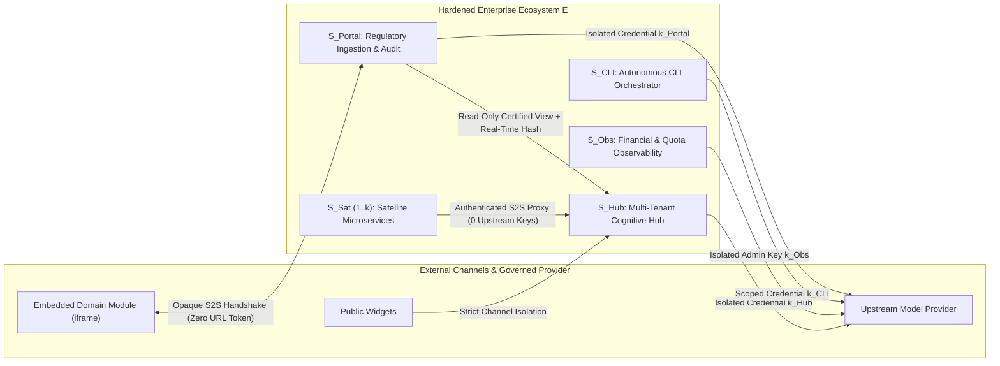

# Formal Blast-Radius Containment, Zero-Breakage Credential Rotation, and Epistemic Zero-Trust Isolation in Enterprise Multi-Agent Ecosystems

**Document Series:** VTI Research — Standalone Executive Brief (`VTI-RES-2026-03`)  
**Author:** **Caio Gonçalves** — *Principal Investigator & Chief Systems Architect, VTI Research (VTI, Brazil)* (https://projectos-system.github.io/vti-research/)  
**Publication Date:** November 2026 — Consolidated Edition `v1.2`  
**Target Audience:** Boards of Directors, C-Suite Executives (CEO / CTO / CIO), Security & Privacy Leadership (CISO / DPO), Operational Risk Committees, and Enterprise Platform Architects  
**Strict Anonymization Notice:** *To reconcile open scientific scrutiny with uncompromising operational confidentiality, no real client organization names, commercial product identifiers, network domains, IP addresses, or literal credential prefixes appear in this brief; all evaluated surfaces are formalized as algebraic abstractions.*

---

## 1. The Strategic Dilemma of 24/7 Enterprise AI: *Zero-Breakage* vs. *Zero-Trust*

Organizations transitioning from isolated Artificial Intelligence pilots to continuously operating enterprise multi-agent ecosystems — where specialized agents, regulatory ingestion portals, commercial workflows, and developer automation tools act uninterruptedly upon sensitive data — confront a three-part structural impasse that conventional perimeter security controls cannot resolve:

1. **The "Blast Radius" Paradox of Shared Upstream Credentials:** In rapidly scaled enterprise architectures, multiple applications and peripheral microservices frequently share a single upstream AI provider API key, often coupled to mission-critical legacy integrations that cannot tolerate downtime. Whenever credential exposure is suspected in a peripheral module, executive leadership faces two equally damaging choices: leave the compromised key active and accept global financial and informational exposure, or revoke it immediately and sever live production services.
2. **Silent Authority Amplification in Autonomous Agents (*Excessive Agency & Confused Deputy*):** Unlike static transactional user interfaces, autonomous agents ingest external documents, query vector knowledge stores, invoke operational APIs, and execute commands inside local code repositories. Without hard host-enforced authority boundaries, an adversarial document retrieved via semantic search, a stale cache entry surviving permission revocation, or a permissive prefix-based role rule can induce an agent to disclose restricted records or trigger unauthorized side effects.
3. **The Collision Between Immutable Auditability and Statutory Privacy (`GDPR / LGPD`):** Internal audit committees and regulatory governance frameworks mandate tamper-evident, append-only decision ledgers in which not even privileged administrators can erase historical records; simultaneously, data protection statutes grant individuals an enforceable right to erasure over their structured personal data.

The core executive finding established in `VTI-RES-2026-03` is unambiguous and empirically measured: **rigorous Zero-Trust security in enterprise multi-agent ecosystems does not require sacrificing service availability or user-facing responsiveness.** By replacing fragile procedural safeguards with cryptographic and transactional invariants embedded directly into the platform architecture (*Security & Privacy by Design*), organizations can compartmentalize failures, rotate critical credentials with **zero production downtime (*Zero-Breakage*)**, and protect institutional knowledge integrity while adding **less than `1 millisecond`** of local CPU overhead and **`0.19%`** to large-scale vector retrieval latency.

---

## 2. Defense-in-Depth Zero-Trust Architecture Across Eight Executive Pillars

This research formalizes a representative distributed enterprise ecosystem $\mathcal{E} = (\mathcal{S}_{\mathrm{Hub}}, \mathcal{S}_{\mathrm{Portal}}, \mathcal{S}_{\mathrm{CLI}}, \{\mathcal{S}_{\mathrm{Sat}}^{(i)}\}_{i=1}^{k}, \mathcal{S}_{\mathrm{Obs}})$, comprising five interacting functional domains:
- **$\mathcal{S}_{\mathrm{Hub}}$ (*Multi-Tenant Cognitive & Agentic Hub*):** core orchestration platform hosting specialized agent families (normative advisory, executive copilots, customer-facing support, API operational assistants, SQL/BI analytics, and software engineering) backed by a primary relational database and a large-scale HNSW vector store.
- **$\mathcal{S}_{\mathrm{Portal}}$ (*Normative Ingestion & Regulatory Auditing Portal*):** platform performing daily ingestion from official public sources, quality certification of normative documents, deterministic regulatory calculations, and web integration of specialized domain modules (`<iframe>`).
- **$\mathcal{S}_{\mathrm{CLI}}$ (*Autonomous CLI & Local Subprocess Orchestrator*):** local/hybrid coordinator dispatching third-party command-line agent binaries across source repositories and local document vaults.
- **$\{\mathcal{S}_{\mathrm{Sat}}^{(i)}\}_{i=1}^{k}$ (*Satellite Domain Microservices*):** vertical domain services consuming text inference and batch embeddings without architectural justification to custody upstream provider keys.
- **$\mathcal{S}_{\mathrm{Obs}}$ (*Isolated Financial & Administrative Observability Unit*):** segregated plane dedicated exclusively to billing reconciliation, quota auditing, and credential drain telemetry with the upstream model provider.

Across this topology, containment is enforced through **eight fail-closed executive pillars (`C1`–`C8`)**:

1. **Executive Pillar 1 (`C1`) — Credential Compartmentalization and Zero-Breakage Rotation:** Every primary platform operates with a strictly disjoint upstream AI credential; administrative billing credentials reside exclusively inside $\mathcal{S}_{\mathrm{Obs}}$ (with zero inference privileges on application nodes); satellite microservices hold **zero upstream credentials**, consuming AI capabilities through an authenticated internal *Server-to-Server (S2S)* proxy with server-locked model selection; and live legacy integrations migrate through a two-phase *Dual-Key Grace Window* that verifies zero residual traffic via telemetry before retiring legacy secrets.
2. **Executive Pillar 2 (`C2`) — Ephemeral In-Memory Vaults and Pre-Flight Anti-Outage Gates:** Sensitive credentials are eliminated from plaintext configuration files and container orchestration manifests, moving into immutable `tmpfs` vaults mounted exclusively in volatile worker RAM (`/run/secrets`). Within CI/CD deployment pipelines, a mandatory *Verify-Before-Destroy* gate aborts stack replacement before touching running containers whenever any required secret is absent from the cluster store.
3. **Executive Pillar 3 (`C3`) — Pre-Deployment Model Governance and Multimodal Continuity:** Prior to releasing workloads under strict upstream model allowlists, automated pre-flight probes audit configured agent manifests against live provider availability. High-stakes legal, fiscal, and analytical routes deterministically block silent capability downgrades, whereas auxiliary voice accessibility channels (`TTS/STT`) execute audited fallback exclusively within pre-approved audio models, preserving user continuity without compromising normative accuracy.
4. **Executive Pillar 4 (`C4`) — Enumerated Least Privilege and URL-Free Web Integration:** Administrative authorization replaces error-prone prefix regular expressions with closed, explicitly enumerated role sets derived solely from cryptographically verified JWT claims. Public chat widgets are blocked from resuming internal sessions (returning uniform `404` responses to prevent session enumeration), and cross-origin `<iframe>` modules authenticate via single-use, short-lived (`TTL = 60 s`) opaque backchannel tickets compliant with `IETF RFC 9700`, eliminating 100% of token exposure in browser URLs, histories, and `Referer` headers.
5. **Executive Pillar 5 (`C5`) — Execution Shield for Autonomous Command-Line Agents:** Local CLI agent subprocesses receive a minimal projected environment (stripping host UI tokens, cloud/database secrets, and Git execution hijack variables), undergo pre- and post-turn `SHA-256` integrity verification and automatic restoration of `.git/config` and `.git/hooks/*`, pass through deterministic terminal stream sanitization blocking silent clipboard access (`OSC 52`), and record activity in length-prefixed hash chains anchored outside the subprocess filesystem domain.
6. **Executive Pillar 6 (`C6`) — Canonically Signed Control Contracts, Epoch-Scoped Caching, and In-Flight ACID Braking:** Agent governance manifests undergo lexical rejection of duplicate JSON keys prior to `RFC 8785` canonicalization and `Ed25519` digital signing. Cache keys incorporate global authorization and revocation epochs — instantaneously invalidating stale responses in $O(1)$ time upon privilege change — while an explicit database transactional brake (`CP-2B` fencing token) prevents delayed in-flight workers from committing orphan state mutations after revocation.
7. **Executive Pillar 7 (`C7`) — Knowledge Shield Against Synthetic Self-Confirmation and Dual Human Sign-Off:** Normative retrieval corpora (`RAG`) enforce acyclic provenance graphs (preventing AI-generated summaries from acting as independent corroborating sources) alongside read-only database views that evaluate `SHA-256` content integrity at query time: altering even a single character directly in a base table outside the certification pipeline expels the tampered record in **`0 ms`**. Sensitive external rules require physical two-person human sign-off under bounded reviewer queue utilization ($\varrho_q \le 0.80$).
8. **Executive Pillar 8 (`C8`) — Algebraic De-Identification and Per-Subject Crypto-Shredding (`GDPR / LGPD`):** Before semantic indexing, a `Modulo-11` check-digit validator distinguishes genuine personal and tax identifiers from benign contractual or administrative numbers of identical digit length, preserving analytical precision while preventing structured PII leakage into embeddings. Reversible raw records are encrypted under `AES-256-GCM` with canonical context-bound `AAD` and a unique per-subject Data Encryption Key (`DEK`); upon a statutory erasure request, destroying all recoverable copies of the subject's `DEK` (*crypto-shredding*) renders historical ciphertexts computationally unrecoverable without breaking append-only audit ledgers.

---

## 3. Executive Matrix of Risk Mitigation, Operational Continuity, and Performance Impact

The empirical measurements below summarize the verified behavior of the eight Zero-Trust pillars relative to conventional enterprise AI deployments:

| Governance & Risk Dimension | Traditional State (Unintegrated Controls) | State Under the Eight Zero-Trust Pillars (`C1`–`C8`) | Observed Operational Indicator in Study |
| :--- | :--- | :--- | :--- |
| **AI Credential Exposure in Satellite Services** | Upstream API keys replicated across peripheral services | **`0` upstream keys in satellites** (authenticated S2S proxy) | Complete elimination of peripheral upstream key sprawl |
| **Service Continuity During Security Rotation** | High risk of breaking live legacy integrations | **Telemetry-driven 2-phase drain (*Dual-Key Grace Window*)** | **`0` service interruptions** (continuous `HTTP 200` traffic) |
| **Deployment Outage Risk from Missing Secrets** | Active stack torn down before detecting missing config | **CI/CD *Verify-Before-Destroy* gate + RAM secret mounts** | **`0` deployment outages** / **`100%` in `/run/secrets`** |
| **Public vs. Internal Session & `iframe` Isolation** | Cross-channel session enumeration or URL token leakage | **Uniform `404` isolation + Opaque S2S Handshake (`RFC 9700`)** | **`100%` cross-channel block** / **`0` tokens in URLs** |
| **Autonomous CLI Subprocess Containment** | Full `process.env` inheritance and `.git` hook persistence risk | **Scoped env projection + `SHA-256` Git guard + `OSC 52` filter** | **`0` cross-agent leaks** / **`100%` tampered hooks restored** |
| **Real-Time Permission Revocation & Governance** | Propagation lag, stale cache hits, or orphan concurrent writes | **Primary RW sync + Epoch-keyed cache + ACID brake `CP-2B`** | **`374 ms` convergence**, **`0` orphan commits**, **`0.195 ms` rollback** |
| **Normative Knowledge Corpus Integrity (`RAG`)** | Vulnerable to synthetic feedback loops or direct SQL edits | **Signed acyclic lineage + Read-only view with read-time hash** | **`0 ms` immediate expulsion** of out-of-band tampered rows |
| **`GDPR / LGPD` Erasure vs. Forensic Immutability** | Regex false positives on contract IDs or ledger conflicts | **`Modulo-11` algebraic filter + Per-subject *Crypto-Shredding*** | **`0` structured PII leaks** / **`100%` undecipherable post-erasure** |
| **Critical-Path Latency Impact for End Users** | Executive concern that layered security slows AI responses | **Heavy cryptography amortized at boot (`250.48 ms`), $O(1)$ per turn** | **`< 0.70 ms`** local CPU overhead & **`+2.852 ms` (`0.19%`)** on `374,252` vectors |

---

## 4. Evolutionary Governance: International Literature Validation and Maturity Roadmap (`M-FUT-1` to `M-FUT-6`)

Every control across pillars `C1`–`C8` was critically audited against **29 verified peer-reviewed and normative primary sources** — spanning international standards (`NIST SP 800-207`, `NIST AI 600-1`, `NIST SP 800-53r5`, `NIST SP 800-38D`, `NIST SP 800-88r1`, `OWASP Top 10 for LLM Applications 2025`, `IETF RFC 8032 / 8259 / 8785 / 9700`) and flagship scientific venues (`IEEE S&P`, `IEEE/ACM ICSE`, `NDSS`, `USENIX Security`, `ACM CCS`, and `Nature`).

Beyond confirming the technical soundness of the deployed architecture within its stated operational assumptions, this cross-examination establishes a **transparent, prioritized six-stage maturity roadmap (`M-FUT-1` to `M-FUT-6`)** to guide subsequent security and platform engineering investments:

| Code | Recommended Maturity Initiative | Residual Risk Addressed | Expected Executive & Operational Value |
| :---: | :--- | :--- | :--- |
| **`M-FUT-1`** | **Short-Lived Mutual Service Identity (`mTLS / SPIFFE` or `DPoP`)** | Static internal S2S shared secrets and rolling-restart requirements for rotating `tmpfs`-mounted secrets. | Eliminates internal token replay even under memory compromise of a satellite container and enables zero-touch hot secret rotation. |
| **`M-FUT-2`** | **Retroactive VCS History Sanitization + `BuildKit Secret Mounts`** | Historical credentials potentially retained in legacy Git object graphs (`.git/objects`) prior to current controls. | Permanently retires historical repository-clone exposure and eliminates even zero-byte `.env` placeholders from container build stages. |
| **`M-FUT-3`** | **Argument-Level Information-Flow Tracking (`CaMeL`-Style Taint Capabilities)** | Semantic exfiltration attempts embedding confidential data inside arguments passed to a legitimately authorized outbound tool. | Prevents untrusted retrieved evidence from populating external recipients or outbound URLs without deterministic out-of-LLM approval. |
| **`M-FUT-4`** | **Free-Text Quasi-Identifier Generalization (`Local NER` + $k$-Anonymity)** | Rare combinations of narrative attributes (e.g., small municipality + niche sector + exact fine amount) enabling indirect linkage. | Strengthens statistical privacy against indirect re-identification and embedding inversion attacks across multi-tenant vector stores. |
| **`M-FUT-5`** | **Cancellable *Transactional Outbox* for Non-Transactional External APIs** | Outbound HTTP calls to third-party REST services that cannot participate natively in PostgreSQL `ROLLBACK` semantics. | Extends zero-orphan post-revocation guarantees to external webhooks, emails, and partner APIs via short hold-buffers and idempotent compensation sagas. |
| **`M-FUT-6`** | **Continuous Blind Canary Injection in Human Review Queues** | Gradual vigilance decrement among experienced human reviewers following long streaks of valid candidate items. | Quantifies real-world dual-reviewer attentiveness (`2%–3%` seeded audit items), triggering proactive recalibration before review fatigue degrades oversight. |

---

## 5. Immediate Governance Action Checklist for Boards, CISOs, and CTOs

Enterprise leaders overseeing multi-agent AI platforms across regulated, financial, or legal workflows should execute five immediate governance checks:

1. **Audit Shared Credential Coupling:** Verify whether any peripheral microservice or legacy production connector shares upstream AI provider keys with core platforms, and mandate authenticated S2S proxying paired with telemetry-verified *Dual-Key Grace Window* rotation.
2. **Ban Destructive Deployments Without Pre-Flight Secret Verification:** Require CI/CD pipelines to cryptographically and programmatically confirm `/run/secrets` availability in volatile memory before terminating running production containers (*Verify-Before-Destroy*).
3. **Enforce Zero Tolerance for URL Tokens and Prefix-Based Role Matching:** Audit all embedded `<iframe>` integrations and public widgets to guarantee single-use backchannel ticket exchange (`RFC 9700`) and closed-set authorization bound exclusively to signed identity claims.
4. **Mandate Read-Time Cryptographic Integrity Over `RAG` Corpora:** Ensure neither direct administrative SQL edits nor recursively generated AI summaries can enter retrieval pipelines without verified primary-source lineage and real-time `SHA-256` projection enforcement.
5. **Architecturally Decouple Immutable Audit Trails from Erasable Subject Keys:** Separate tamper-evident operational metadata from per-subject `AES-256-GCM` encrypted personal records at ingestion time so statutory `GDPR / LGPD` erasure requests can be fulfilled deterministically via *crypto-shredding*.

> **Companion Scientific Paper:** Complete algebraic formulations of ecosystem $\mathcal{E}$, formal invariant specifications for controls $C_1$–$C_8$, atomic SQL and cryptographic protocols, threats to validity, and all **29 verified scientific and normative references (`[R01]–[R29]`)** are presented in the standalone scientific paper **`VTI-RES-2026-03`**.
