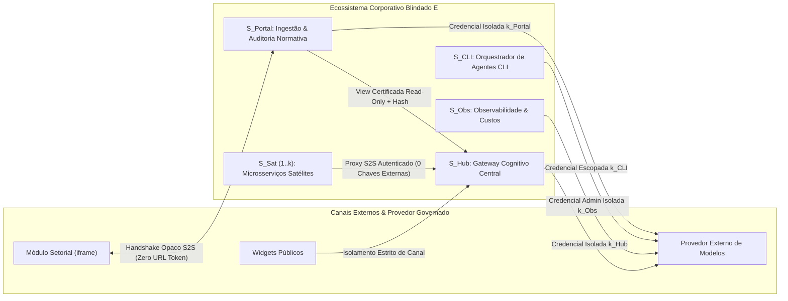

# Contenção Formal de Raio de Explosão, Rotação de Credenciais Sem Interrupção e Isolamento Epistêmico *Zero-Trust* em Ecossistemas Corporativos Multi-Agente

**Série Documental:** VTI Research — Dossiê Executivo Autônomo (`VTI-RES-2026-03`)  
**Autor:** **Caio Gonçalves** — *Principal Investigator & Chief Systems Architect, VTI Research (VTI, Brazil)* (https://projectos-system.github.io/vti-research/)  
**Data de Publicação:** Novembro de 2026 — Edição Consolidada `v1.2`  
**Público-Alvo:** Conselhos de Administração, Diretorias Executivas (CEO / CTO / CIO), Lideranças de Segurança da Informação e Privacidade (CISO / DPO), Comitês de Risco e Arquitetura de Plataforma  
**Nota de Anonimização Estrita:** *Para conciliar escrutínio científico aberto com sigilo operacional irrestrito, nenhum nome real de organização cliente, produto comercial, domínio de rede, endereço IP ou prefixo de credencial é exposto neste documento; todas as superfícies avaliadas são representadas como abstrações algébricas formais.*

---

## 1. O Dilema Estratégico da IA Corporativa 24/7: *Zero-Breakage* vs. *Zero-Trust*

Organizações que evoluem de provas de conceito isoladas de Inteligência Artificial para ecossistemas corporativos em produção contínua — nos quais múltiplos agentes especialistas, portais regulatórios, fluxos comerciais e ferramentas de automação operam de forma ininterrupta sobre dados críticos — enfrentam um triplo impasse estrutural que os controles tradicionais de segurança perimetral não conseguem resolver:

1. **O Paradoxo do "Raio de Explosão" (*Blast Radius*) em Credenciais Compartilhadas:** Em arquiteturas corporativas que cresceram sob pressão de entrega, é frequente que múltiplos sistemas e microsserviços compartilhem uma mesma chave de acesso ao provedor externo de IA, inclusive alimentando integrações produtivas legadas que não admitem parada. Diante de qualquer suspeita de exposição em um serviço periférico, a alta gestão vê-se diante de duas alternativas igualmente severas: manter a credencial ativa assumindo risco financeiro e informacional sistêmico, ou revogá-la de imediato interrompendo operações essenciais aos clientes.
2. **A Ampliação Silenciosa de Autoridade nos Agentes (*Excessive Agency & Confused Deputy*):** Diferentemente de interfaces transacionais estáticas, agentes autônomos ingerem documentos externos, consultam bases vetoriais de conhecimento, invocam ferramentas operacionais e executam rotinas sobre repositórios locais. Sem fronteiras rígidas de autoridade impostas pelo sistema hospedeiro, um documento malicioso recuperado em busca semântica, uma entrada de cache sobrevivente após revogação de acesso ou uma regra permissiva de controle de papéis pode induzir o agente a revelar informações restritas ou executar efeitos colaterais fora de sua competência.
3. **O Choque entre Auditoria Imutável e Privacidade Regulatória (`LGPD / GDPR`):** Órgãos de conformidade, auditoria interna e governança corporativa exigem livros de registro à prova de adulteração (*append-only*), nos quais nem mesmo administradores privilegiados possam suprimir trilhas de decisão; em contrapartida, marcos legais de proteção de dados pessoais asseguram ao titular o direito estatutário de eliminação de seus registros identificáveis.

A tese executiva demonstrada no estudo `VTI-RES-2026-03` é direta e mensurável: **segurança rigorosa em ecossistemas multi-agente não exige sacrificar disponibilidade operacional nem velocidade de resposta ao usuário.** Ao substituir salvaguardas operacionais manuais por invariantes criptográficas e transacionais embutidas na arquitetura (*Security & Privacy by Design*), torna-se viável confinar falhas por compartimento estanque, rotacionar credenciais críticas com **zero interrupção produtiva (*Zero-Breakage*)** e proteger a integridade do conhecimento institucional adicionando **menos de `1 milissegundo`** ao processamento local em CPU e apenas **`0,19%`** à busca vetorial em larga escala.

---

## 2. Arquitetura de Contenção *Zero-Trust* em Oito Pilares Executivos

O estudo modela formalmente um ecossistema corporativo representativo $\mathcal{E} = (\mathcal{S}_{\mathrm{Hub}}, \mathcal{S}_{\mathrm{Portal}}, \mathcal{S}_{\mathrm{CLI}}, \{\mathcal{S}_{\mathrm{Sat}}^{(i)}\}_{i=1}^{k}, \mathcal{S}_{\mathrm{Obs}})$, composto por cinco domínios funcionais interdependentes:
- **$\mathcal{S}_{\mathrm{Hub}}$ (*Gateway Cognitivo Central Multi-Tenant*):** núcleo que orquestra famílias distintas de agentes corporativos (consultoria normativa, copilotos executivos, atendimento, automação de API, inteligência analítica e engenharia) sobre banco relacional primário e motor vetorial HNSW.
- **$\mathcal{S}_{\mathrm{Portal}}$ (*Portal de Ingestão e Auditoria Normativa*):** plataforma dedicada à coleta diária de fontes oficiais, certificação de qualidade documental, cálculos regulatórios determinísticos e incorporação de módulos especializados via quadros web (`<iframe>`).
- **$\mathcal{S}_{\mathrm{CLI}}$ (*Orquestrador Local de Agentes Executáveis*):** coordenador de subprocessos autônomos de linha de comando sobre repositórios técnicos e acervos locais.
- **$\{\mathcal{S}_{\mathrm{Sat}}^{(i)}\}_{i=1}^{k}$ (*Microsserviços Satélites Verticais*):** aplicações de domínio específico que consomem inferência textual e vetorização sem justificativa arquitetural para custodiar credenciais externas.
- **$\mathcal{S}_{\mathrm{Obs}}$ (*Unidade Isolada de Observabilidade Financeira e Administrativa*):** plano segregado exclusivo para reconciliação de custos, auditoria de consumo e monitoramento de drenagem junto ao provedor de modelos.

Sobre essa topologia, a defesa em profundidade estrutura-se em **oito pilares executivos (`C1`–`C8`)** com semântica universal de falha segura (*fail-closed*):

1. **Pilar Executivo 1 (`C1`) — Compartimentação de Chaves e Rotação Sem Queda (*Zero-Breakage*):** Cada subsistema principal passa a operar com credencial exclusiva e isolada junto ao provedor de IA; a chave administrativa de faturamento e telemetria fica restrita unicamente à unidade $\mathcal{S}_{\mathrm{Obs}}$ (sem poder de inferência nos sistemas de aplicação); os microsserviços satélites deixam de armazenar credenciais externas (**`0` chaves periféricas**), consumindo IA por canal interno *Server-to-Server (S2S)* com seleção de modelo travada no servidor; e integrações legadas críticas migram sob protocolo em duas fases (*Dual-Key Grace Window*), drenando o tráfego com visibilidade em tempo real antes do desligamento definitivo da chave antiga.
2. **Pilar Executivo 2 (`C2`) — Cofres Efêmeros em Memória Volátil e Trava Pré-Vôo Anti-Apagão:** Credenciais sensíveis são erradicadas de arquivos de configuração abertos e manifestos de orquestração, migrando para cofres montados exclusivamente em memória RAM (`/run/secrets`). No pipeline de entrega contínua (CI/CD), uma trava automática (*Verify-Before-Destroy*) bloqueia qualquer atualização ou remoção da pilha ativa caso algum segredo obrigatório não esteja previamente validado no cluster, eliminando quedas de produção por configuração incompleta.
3. **Pilar Executivo 3 (`C3`) — Governança Prévia de Modelos e Continuidade Multimodal:** Antes de promover novas versões sob listas estritas de modelos homologados (*allowlists*), o pipeline audita programaticamente a disponibilidade de cada modelo referenciado. Rotas jurídicas, fiscais e analíticas bloqueiam deterministicamente rebaixamentos silenciosos de capacidade deliberativa, ao passo que canais auxiliares de acessibilidade e voz (`TTS/STT`) aplicam contingência restrita a modelos vocais homologados, preservando a experiência do usuário sem comprometer o rigor normativo.
4. **Pilar Executivo 4 (`C4`) — Privilégio Mínimo Enumerado e Integração Web Sem Credenciais em URLs:** Permissões administrativas abandonam casamentos por prefixo textual (que poderiam promover perfis setoriais por acidente) em favor de conjuntos fechados explícitos baseados unicamente em identidades assinadas. Widgets públicos ficam impedidos de acessar sessões internas (recebendo resposta `404` indistinguível), e ferramentas integradas via `<iframe>` autenticam-se por códigos opacos de uso único nos bastidores (`TTL = 60 s`, conforme `IETF RFC 9700`), eliminando 100% da exposição de tokens na barra de endereços, logs de proxy ou histórico do navegador.
5. **Pilar Executivo 5 (`C5`) — Escudo de Execução para Agentes Autônomos de Linha de Comando:** Subprocessos locais de agentes operam sob projeção mínima de variáveis de ambiente (sem acesso a credenciais de banco, nuvem ou outros agentes), têm configurações e ganchos executáveis de repositórios (`.git/config` e `.git/hooks/*`) verificados e restaurados automaticamente por assinatura `SHA-256` a cada turno, passam por filtro de terminal que bloqueia captura silenciosa da área de transferência (`OSC 52`) e registram ações em livro de auditoria encadeado cuja raiz fica fora do alcance do subprocesso.
6. **Pilar Executivo 6 (`C6`) — Contratos Digitais Assinados, Cache por Época e Freio Transacional em Voo:** Manifestos de governança dos agentes passam por validação léxica que rejeita chaves JSON duplicadas antes de receber assinatura digital `Ed25519` sobre forma canônica (`RFC 8785`). As chaves de cache incorporam a época global de permissões e revogações — invalidando instantaneamente respostas antigas em tempo constante $O(1)$ —, enquanto um freio transacional ACID no banco primário (`CP-2B`) impede gravações atrasadas caso uma permissão seja revogada durante a execução da tarefa.
7. **Pilar Executivo 7 (`C7`) — Blindagem do Acervo contra "Telefone Sem Fio" Sintético e Dupla Aprovação Humana:** O conhecimento normativo que abastece a geração aumentada por recuperação (`RAG`) exige vínculo comprovado com fonte oficial primária, grafo de linhagem livre de ciclos (impedindo que resumos gerados por IA validem a si mesmos) e verificação criptográfica `SHA-256` em tempo real na própria leitura do banco: qualquer edição manual direta fora do fluxo oficial expulsa o registro adulterado em **`0 ms`**. Diretrizes sensíveis externas exigem assinatura convergente de **duas pessoas naturais distintas** sob limite controlado de carga de trabalho ($\varrho_q \le 0,80$).
8. **Pilar Executivo 8 (`C8`) — Desidentificação Algébrica Precisa e Apagamento Criptográfico (`LGPD / GDPR`):** Antes da indexação semântica, um validador aritmético (`Módulo 11`) distingue documentos pessoais e fiscais reais de códigos contratuais ou protocolos técnicos de mesma extensão numérica, preservando a utilidade analítica sem reter dados sensíveis em vetores. Para registros brutos reversíveis, cada titular recebe uma chave exclusiva de cifragem autenticada (`AES-256-GCM` com contexto `AAD` vinculado); diante de requisição legal de eliminação, a destruição efetiva dessa chave individual (*crypto-shredding*) torna os criptogramas irrecuperáveis sem corromper a cadeia histórica dos livros de auditoria.

---

## 3. Matriz Executiva de Risco, Continuidade Operacional e Impacto de Latência

As medições consolidadas abaixo sintetizam o comportamento verificado sobre a arquitetura implementada em comparação direta com o modelo operacional tradicional:

| Dimensão de Governança & Risco | Estado Tradicional (Sem Blindagem Integrada) | Estado sob os Oito Pilares *Zero-Trust* (`C1`–`C8`) | Indicador Operacional Medido no Estudo |
| :--- | :--- | :--- | :--- |
| **Exposição de Credenciais nos Serviços Satélites** | Chaves externas replicadas em múltiplos microsserviços periféricos | **`0` chaves externas nos satélites** (consumo via proxy S2S autenticado) | Eliminação integral da superfície periférica |
| **Continuidade na Rotação de Chaves Críticas** | Risco de interrupção severa em consumidores legados ativos | **Drenagem telemetrada em 2 fases (*Dual-Key Grace Window*)** | **`0` interrupções** (`HTTP 200` contínuo em produção) |
| **Risco de Apagão em Deploy por Segredo Ausente** | Remoção da pilha ativa antes da detecção de falha de ambiente | **Trava *Verify-Before-Destroy* no CI/CD + Cofre em RAM** | **`0` quedas** por segredo ausente / **`100%` em `/run/secrets`** |
| **Isolamento entre Canais Públicos, Internos e `iframe`** | Risco de enumeração cruzada de sessões ou token exposto em URL | **Bloqueio `404` uniforme + Handshake S2S Opaco (`RFC 9700`)** | **`100%` bloqueado** entre canais / **`0` tokens em URL** |
| **Confinamento de Agentes Locais de CLI** | Herança ampla de variáveis do host e risco de persistência em `.git` | **Ambiente escopado + Restauração `SHA-256` + Filtro `OSC 52`** | **`0` vazamentos cruzados** / **`100%` de hooks restaurados** |
| **Revogação de Permissões e Governança em Tempo Real** | Atraso de propagação, cache obsoleto ou gravações órfãs em corrida | **Propagação primária RW + Cache por Época + Freio ACID `CP-2B`** | Convergência em **`374 ms`**, **`0` commits órfãos** e rollback em **`0,195 ms`** |
| **Integridade do Conhecimento Normativo (`RAG`)** | Exposto a retroalimentação sintética ou edição direta no banco | **Linhagem acíclica assinada + View *Read-Only* com hash em leitura** | Expulsão em **`0 ms`** de qualquer registro adulterado fora do fluxo |
| **Conformidade `LGPD / GDPR` vs. Imutabilidade Forense** | Falso-positivo em códigos técnicos ou conflito com ledger imutável | **Validação aritmética `Módulo 11` + *Crypto-Shredding* por titular** | **`0` resíduos estruturados** / **`100%` indecifrável pós-destruição da chave** |
| **Custo de Performance no Caminho Crítico** | Receio executivo de que múltiplas defesas degradem a experiência | **Criptografia pesada concentrada no boot (`250,48 ms`) e $O(1)$ por turno** | **`< 0,70 ms`** em CPU local e **`+2,852 ms` (`0,19%`)** em `374.252` vetores |

---

## 4. Governança Evolutiva: Validação Normativa Internacional e Roteiro de Maturidade (`M-FUT-1` a `M-FUT-6`)

Cada decisão arquitetural dos oito pilares foi auditada contra **29 referências científicas e normativas primárias** — abrangendo padrões internacionais (`NIST SP 800-207`, `NIST AI 600-1`, `NIST SP 800-53r5`, `NIST SP 800-38D`, `NIST SP 800-88r1`, `OWASP Top 10 for LLM Applications 2025`, `IETF RFC 8032 / 8259 / 8785 / 9700`) e publicações revisadas por pares (`IEEE S&P`, `IEEE/ACM ICSE`, `NDSS`, `USENIX Security`, `ACM CCS` e `Nature`).

Além de confirmar o fechamento técnico das vulnerabilidades tratadas dentro do modelo operacional avaliado, essa análise comparativa estabelece um **roteiro transparente e priorizado de seis evoluções estruturais (`M-FUT-1` a `M-FUT-6`)** para orientar os próximos ciclos de investimento da liderança de segurança e engenharia:

| Código | Frente de Maturidade Recomendada | Risco Residual Endereçado | Benefício Executivo & Operacional Esperado |
| :---: | :--- | :--- | :--- |
| **`M-FUT-1`** | **Identidade Mútua Efêmera entre Serviços (`mTLS / SPIFFE` ou `DPoP`)** | Chaves internas estáticas S2S e necessidade de *rolling update* para rotacionar segredos em `tmpfs`. | Elimina risco de *replay* interno mesmo sob comprometimento de memória de um contêiner satélite e automatiza rotação a quente sem intervenção humana. |
| **`M-FUT-2`** | **Saneamento Retroativo de Histórico VCS + `BuildKit Secret Mounts`** | Eventuais credenciais antigas retidas em commits históricos (`.git/objects`) anteriores à blindagem atual. | Extingue em definitivo o passivo histórico de clonagem de repositórios e elimina arquivos `.env` transitórios nos estágios de compilação. |
| **`M-FUT-3`** | **Rastreamento de Fluxo de Informação nos Argumentos (`Taint Tracking` estilo `CaMeL`)** | Tentativa de exfiltração semântica embutindo dados sensíveis nos parâmetros de uma ferramenta legitimamente autorizada ao agente. | Impede que evidências externas não-confiáveis preencham destinatários ou URLs de saída sem validação determinística fora do modelo de linguagem. |
| **`M-FUT-4`** | **Generalização de Quase-Identificadores Narrativos (`NER` + $k$-Anonimato)** | Combinações raras de atributos em texto livre (ex.: porte municipal + atividade específica + valor exato) que permitam inferência indireta. | Eleva a proteção estatística contra reidentificação indireta e ataques de inversão semântica em coleções vetoriais multi-tenant. |
| **`M-FUT-5`** | **Filas Canceláveis (*Transactional Outbox*) para APIs Externas Não-Transacionais** | Chamadas HTTP para serviços externos de terceiros que não participam nativamente do `ROLLBACK` transacional do banco de dados. | Estende a garantia de *zero efeitos órfãos* pós-revogação também para disparos externos (webhooks, notificações e integrações parceiras) via janela curta de retenção e compensação idempotente. |
| **`M-FUT-6`** | **Auditoria Contínua por Itens-Canário Cegos nas Filas Humanas** | Queda gradual de vigilância atencional em revisores humanos experientes após longas sequências de aprovações legítimas. | Mensura objetivamente a acuidade real da dupla assinatura humana (`2%–3%` de itens semeados), calibrando treinamentos e alertas antes que ocorra fadiga de revisão. |

---

## 5. Diretrizes Práticas de Governança para Conselhos, CISOs e CTOs

Para organizações que operam ou planejam escalar plataformas multi-agente sobre bases regulatórias, financeiras ou jurídicas, recomendam-se cinco verificações executivas imediatas:

1. **Auditoria de Acoplamento de Credenciais:** Mapear se algum microsserviço periférico ou integração legada compartilha chaves de provedores de IA com o núcleo produtivo e instituir imediatamente proxy S2S centralizado com drenagem monitorada (*Dual-Key Grace Window*).
2. **Proibição de Deploy Destrutivo Sem Pré-Vôo:** Exigir que todo pipeline de orquestração valide a existência e integridade dos cofres em memória (`/run/secrets`) antes de interromper contêineres ativos (*Verify-Before-Destroy*).
3. **Tolerância Zero a Credenciais em URLs e Casamento Léxico de Papéis:** Auditar todas as integrações web embarcadas (`<iframe>`) e widgets públicos para assegurar troca *backchannel* de uso único (`RFC 9700`) e autorização baseada exclusivamente em listas fechadas assinadas.
4. **Certificação Criptográfica em Leitura sobre Bases `RAG`:** Impedir que edições diretas em banco de dados ou resumos sintéticos retroalimentados contaminem respostas de agentes sem fonte primária auditada e verificação `SHA-256` na projeção de consulta.
5. **Conciliação Arquitetural entre Auditoria e Privacidade:** Segregar desde a origem metadados operacionais imutáveis de dados pessoais reversíveis cifrados por titular (`DEK` individual), viabilizando atendimento imediato a requisições `LGPD / GDPR` por apagamento criptográfico documentado.

> **Documento Científico Companheiro:** As formulações algébricas completas do ecossistema $\mathcal{E}$, as provas de invariantes dos controles $C_1$–$C_8$, os predicados transacionais SQL, a análise de ameaças à validade e as **29 referências científicas e normativas verificadas (`[R01]–[R29]`)** encontram-se integralmente especificados no Artigo Científico autônomo **`VTI-RES-2026-03`**.
