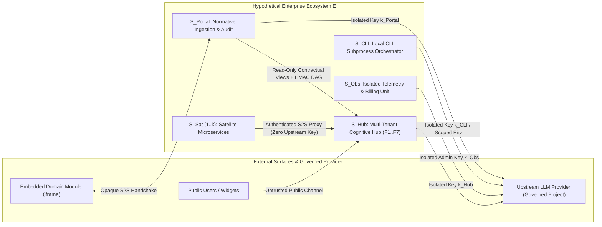

# Formal Blast-Radius Containment, Zero-Breakage Credential Rotation, and Epistemic Zero-Trust Isolation in Enterprise Multi-Agent Ecosystems: Hypothetical Formulation, Invariant Proofs, and Technical Validation Against Peer-Reviewed Literature

**Technical Identifier:** `VTI-RES-2026-03` — Consolidated Edition `v1.2` (November 2026)  
**Author:** **Caio Gonçalves** — *Principal Investigator & Chief Systems Architect, VTI Research (VTI, Brazil)* (https://projectos-system.github.io/vti-research/)  
**Methodological Design:** Retrospective Anonymized Single-Case Architectural Study with Generalized Hypothetical Formulation — Abstract Ecosystem $\mathcal{E} = (\mathcal{S}_{\mathrm{Hub}}, \mathcal{S}_{\mathrm{Portal}}, \mathcal{S}_{\mathrm{CLI}}, \{\mathcal{S}_{\mathrm{Sat}}^{(i)}\}_{i=1}^{k}, \mathcal{S}_{\mathrm{Obs}})$  
**Strict Anonymization Clause:** *To reconcile open scientific scrutiny by the international security engineering community with uncompromising operational confidentiality, no real client organization names, commercial product identifiers, DNS domains, IP subnets, private directory paths, or literal cryptographic key prefixes appear in this article; all evaluated surfaces are formalized as verifiable algebraic abstractions.*

---

## Abstract

Transitioning from isolated Large Language Model (LLM) prototypes to continuously operating enterprise multi-agent ecosystems introduces a compound attack surface that extends far beyond prompt-level jailbreaks. When a multi-tenant cognitive hub ($\mathcal{S}_{\mathrm{Hub}}$), a daily regulatory ingestion and document-auditing portal ($\mathcal{S}_{\mathrm{Portal}}$), a local autonomous CLI orchestrator ($\mathcal{S}_{\mathrm{CLI}}$), specialized satellite microservices ($\{\mathcal{S}_{\mathrm{Sat}}^{(i)}\}_{i=1}^{k}$), and a segregated financial telemetry unit ($\mathcal{S}_{\mathrm{Obs}}$) coexist under strict zero-downtime (*zero-breakage*) constraints, eight coupled vulnerability classes emerge: *(i)* blast-radius amplification caused by shared upstream AI provider credentials tied to live legacy consumers; *(ii)* secret persistence in version-control indices, plaintext container orchestration specifications, and destructive *destroy-before-verify* deployment pipelines; *(iii)* silent multimodal capability breakage (speech synthesis and transcription) following project-level model allowlisting; *(iv)* prefix-regex RBAC privilege escalation, cross-channel insecure direct object references (*cross-channel IDOR*), and URL-borne session token leakage in embedded iframes; *(v)* confused-deputy execution, environment variable sprawl, `.git/hooks` persistence, and terminal escape injection (`OSC 52`) in autonomous CLI subprocesses; *(vi)* unsigned control-plane drift, duplicate-key JSON parser differentials, post-revocation cache staleness, and orphan in-flight side effects under *TOCTOU* race conditions; *(vii)* recursive synthetic self-confirmation (Goodhart collapse) and retrieval-augmented generation corruption (*RAG poisoning*); and *(viii)* structural tension between append-only forensic audit ledgers and statutory right-to-erasure mandates over structured personal data. Employing an anonymized architectural case study design with generalized hypothetical formulation, we formalize eight falsifiable threat hypotheses ($H_1$–$H_8$), derive eight fail-closed defense-in-depth controls ($C_1$–$C_8$) with explicit formal invariants, report bounded empirical concurrency, cryptographic, and latency observations over the evaluated artifact, and critically audit both the technical validity and residual limits of each control against **29 verified peer-reviewed and normative primary references** (`[R01]–[R29]`: `IEEE`, `ACM`, `NDSS`, `USENIX Security`, `Nature`, `NIST`, `OWASP LLM 2025`, and `IETF RFC`), alongside formal threats to validity and six prospective structural enhancements (`M-FUT-1` to `M-FUT-6`).

**Keywords:** Zero-Trust Security; Multi-Agent LLM Systems; Blast-Radius Containment; Zero-Breakage Credential Rotation; JSON Parser Differentials (`RFC 8785`); ACID Fencing Tokens; RAG Poisoning; Cryptographic Erasure (*Crypto-Shredding*).

---

## 1. Introduction and Scientific Motivation

Recent foundational-model systems security research reveals a decisive paradigm shift: adversarial manipulation does not need to defeat internal model weight alignment when it can exploit **poorly mediated authority boundaries in the surrounding host architecture** `[R22, R25, R27]`. In the 2025 official release of the *OWASP Top 10 for Large Language Model Applications* `[R29]`, systemic architectural weaknesses — including *Excessive Agency* (`LLM06:2025`), *Sensitive Information Disclosure* (`LLM02:2025`), *Data and Model Poisoning* (`LLM04:2025`), *Vector and Embedding Weaknesses* (`LLM08:2025`), and *Unbounded Consumption* (`LLM10:2025`) — stand alongside *Prompt Injection* (`LLM01:2025`) as first-order enterprise threats.

However, existing academic literature predominantly examines each threat vector in isolation — investigating version-control secret leakage alone `[R15, R20]`, agent plugin execution isolation alone `[R25]`, or retrieval corpus poisoning alone `[R26]`. Within continuously operating (24/7) enterprise environments handling statutory, legal, accounting, and financial obligations, **these attack surfaces interact non-linearly**:

1. Hasty revocation of a shared upstream API credential to halt quota or data exfiltration (`LLM02`) instantaneously severs live legacy production integrations unless preceded by architectural decoupling and a telemetry-verified drain protocol (*Zero-Breakage Constraint*) `[R20]`.
2. Enforcing strict upstream model allowlists to bound cost and third-party model risk (`LLM10`, `[R24]`) silently breaks secondary voice and accessibility pipelines whenever execution planners lack pre-flight capability verification.
3. Prompt-level defenses (`LLM01`) become vacuous if underlying vector knowledge bases can be mutated out-of-band bypassing certification pipelines (`LLM08`, `[R26]`), if authorization caches serve stale post-revocation responses, or if concurrent in-flight workers commit orphan database mutations after privilege revocation `[R03, R13]`.

Adopting a hypothetico-deductive methodology, this paper makes three contributions: **(a)** we formalize an algebraic system model $\mathcal{E}$ and an explicit adversary model capturing real-world enterprise multi-agent ecosystems operating under strict zero-downtime constraints; **(b)** we specify eight fail-closed defense-in-depth controls ($C_1$–$C_8$) backed by verifiable cryptographic, protocol, and ACID transactional invariants; and **(c)** we subject both bounded empirical measurements and residual architectural boundaries to adversarial cross-examination against 29 primary normative and scientific sources, deriving a six-part evolutionary roadmap (`M-FUT-1` to `M-FUT-6`).

---

## 2. Hypothetical System Model $\mathcal{E} = (\mathcal{S}_{\mathrm{Hub}}, \mathcal{S}_{\mathrm{Portal}}, \mathcal{S}_{\mathrm{CLI}}, \{\mathcal{S}_{\mathrm{Sat}}^{(i)}\}_{i=1}^{k}, \mathcal{S}_{\mathrm{Obs}})$ and Adversary Model

### 2.1. Study Design, Strict Anonymization, and Epistemological Demarcation

To reconcile reproducible formal security specifications with strict industrial confidentiality, we employ a **retrospective anonymized single-case architectural study with generalized hypothetical formulation**:

1. **Redacted Identifiers vs. Preserved Invariants:** All corporate identities, commercial product names, DNS domains, IP subnets, real tenant identifiers, private filesystem paths, and literal cryptographic key prefixes were purged. Conversely, we preserved with exact fidelity all **topological trust boundaries**, **SQL and cryptographic predicates**, **protocol state machines**, and **instrumented latency and concurrency measurements** obtained on the evaluated production/staging artifact.
2. **Principle of Epistemic Proportionality ($\text{Claim Scope} \le \text{Evidence Scope}$):** Table 1 establishes the strict epistemological boundary separating architectural abstraction, threat hypotheses, verified controls, and prospective designs.

| Formal Element | Epistemological Nature | Evidentiary Basis in This Study | Strict Inference Boundary |
| :--- | :--- | :--- | :--- |
| **Topology $\mathcal{E}$** | Anonymized architectural abstraction | Structural mapping of a live enterprise production/staging ecosystem | Represents a salient class of multi-agent enterprise topologies, not a market-wide statistical prevalence survey. |
| **Hypotheses $H_1$–$H_8$** | Falsifiable threat hypotheses (*Threat Model*) | Attack-surface modeling + primary literature (`[R01]–[R29]`) | Characterize structural vulnerabilities exploitable when controls are absent; do not claim external adversarial compromise occurred. |
| **Controls $C_1$–$C_8$** | Implemented and verified fail-closed mechanisms | Deterministic contract suites, live SQL concurrency races, and monotonic timing | Effectiveness is demonstrated under stated operational assumptions and software versions; does not imply unconditional immunity outside the declared adversary model. |
| **Roadmap `M-FUT-1..6`** | Prospective engineering enhancements | Theoretical gap analysis against frontier literature | Engineering specifications for subsequent maturity cycles; not yet benchmarked empirically within this study. |

3. **Universal *Fail-Closed* Semantics and Telemetry Minimization:** Every control across $C_1$–$C_8$ enforces strict fail-closed semantics: primary RW database unavailability, `Ed25519` signature mismatch, missing pre-flight cluster secrets, or expired epochs/tickets trigger deterministic rejection (`HTTP 403 / 404 / 422 / 503`), never permissive bypass `[R01]`. Furthermore, observability pipelines apply pre-persistence sanitization so forensic audit logs never become secondary repositories for secrets or raw PII.

### 2.2. Formal Topology of the Abstracted Ecosystem

Let $\mathcal{E}$ denote a distributed enterprise ecosystem serving a finite set of tenants $\mathcal{T}$ across regulated normative domains $\mathcal{D}$, defined as the five-tuple:

$$\mathcal{E} = \left(\mathcal{S}_{\mathrm{Hub}}, \; \mathcal{S}_{\mathrm{Portal}}, \; \mathcal{S}_{\mathrm{CLI}}, \; \{\mathcal{S}_{\mathrm{Sat}}^{(i)}\}_{i=1}^{k}, \; \mathcal{S}_{\mathrm{Obs}}\right)$$

whose constituent subsystems hold strictly partitioned architectural responsibilities:
- **$\mathcal{S}_{\mathrm{Hub}}$ (*Core Cognitive & Agentic Hub*):** multi-tenant platform hosting seven specialized agent families $\mathcal{F} = \{F_1, \dots, F_7\}$ (strict normative advisory, executive copilots, internal/external commercial agents, omnichannel support, API operational assistants, SQL/BI analysts, and software engineering), backed by a primary transactional relational store $DB_{\mathrm{Hub}}$ and an HNSW vector engine $DB_{\mathrm{Vec}}$ indexing hundreds of thousands of normative embeddings.
- **$\mathcal{S}_{\mathrm{Portal}}$ (*Normative Ingestion & Regulatory Portal*):** platform ingesting dozens of official public regulatory feeds daily, auditing texts against deterministic quality rules, executing statutory calculation engines, and embedding specialized domain modules via cross-origin web frames (`<iframe>`).
- **$\mathcal{S}_{\mathrm{CLI}}$ (*Autonomous CLI & Subprocess Orchestrator*):** local/hybrid orchestrator dispatching tasks across multiple third-party command-line agent binaries ($a \in \{\text{\texttt{cli}}_1, \dots, \text{\texttt{cli}}_5\}$) operating over Git repositories and local document vaults.
- **$\{\mathcal{S}_{\mathrm{Sat}}^{(i)}\}_{i=1}^{k}$ (*Satellite Domain Microservices*):** vertical microservices (foreign-trade workflows, operational task managers, sector-specific calculators) requiring text inference and batch embeddings without architectural justification to custody upstream provider master keys from $\mathcal{P}_{\mathrm{LLM}}$.
- **$\mathcal{S}_{\mathrm{Obs}}$ (*Financial & Administrative Observability Unit*):** isolated unit dedicated solely to billing reconciliation, quota governance, and key-drain telemetry against $\mathcal{P}_{\mathrm{LLM}}$.



### 2.3. Adversary Model and Weighted Blast Radius

**Adversary Capabilities ($\mathcal{A}$):** We consider a realistic composite adversary operating across four threat vectors: *(a)* **External Web/Network Attacker**, capable of interacting arbitrarily with public widgets, inspecting browser history and `Referer` headers, spoofing unverified HTTP headers (`Origin`, `x-user-login`), probing session UUIDs, and launching sub-millisecond concurrent HTTP races; *(b)* **Indirect Epistemic Adversary**, capable of planting adversarial instructions or crafted payloads inside external regulatory documents, web pages, or repository files ingested by $\mathcal{S}_{\mathrm{Hub}}$ agents or $\mathcal{S}_{\mathrm{CLI}}$ subprocesses (targeting indirect prompt injection, `.git/hooks` persistence, `OSC 52` terminal hijacking, or *PoisonedRAG* corruption) `[R22, R26]`; *(c)* **Localized Peripheral Compromise**, wherein an individual build artifact, legacy `.env` file, or satellite container $\mathcal{S}_{\mathrm{Sat}}^{(i)}$ suffers configuration disclosure; and *(d)* **Out-of-Band Administrative Mutation or Concurrency Race**, encompassing permission revocations racing against in-flight agent executions or direct manual SQL edits bypassing application certification flows. Our Trusted Computing Base (TCB) assumes the cryptographic soundness of standard primitives (`SHA-256`, `Ed25519`, `AES-256-GCM`, OS CSPRNG), the integrity of the primary PostgreSQL engine, and the uncompromised kernel/supervisor process hosting $\mathcal{S}_{\mathrm{CLI}}$.

**Formal Weighted Blast-Radius Metric:** Let $\mathcal{K}$ denote the set of active credentials across $\mathcal{E}$, and let $\mathcal{W} = \{w_1, \dots, w_m\}$ be the set of production workloads, where each workload $w_r$ carries operational criticality $\omega_r > 0$ and maximum bounded financial exposure $C_{\max}(w_r)$ weighted by risk conversion scalar $\lambda > 0$. Defining the dependency indicator $\mathrm{Uses}(w_r, \kappa) \in \{0, 1\}$ to equal $1$ iff compromise or emergency revocation of credential $\kappa \in \mathcal{K}$ directly impacts $w_r$, the **Operational-Financial Blast Radius** of $\kappa$ is:

$$\mathrm{BR}(\kappa) = \sum_{r=1}^{m} \mathrm{Uses}(w_r, \kappa) \cdot \left(\omega_r + \lambda C_{\max}(w_r)\right)$$

Under the **Monolithic Credential Null Hypothesis** — where a single shared secret $\kappa_{\mathrm{shared}}$ simultaneously serves $\mathcal{S}_{\mathrm{Hub}}$, $\mathcal{S}_{\mathrm{Portal}}$, $\mathcal{S}_{\mathrm{CLI}}$, $\{\mathcal{S}_{\mathrm{Sat}}^{(i)}\}$, and an uninterrupted legacy production workload $w_{\mathrm{crit}}$ — we obtain the worst-case upper bound $\mathrm{BR}(\kappa_{\mathrm{shared}}) = \sum_{r=1}^{m} (\omega_r + \lambda C_{\max}(w_r))$: any localized peripheral leak forces an untenable choice between accepting global financial/data exposure or revoking $\kappa_{\mathrm{shared}}$ and causing immediate production downtime in $w_{\mathrm{crit}}$.

### 2.4. Summary of the Eight Falsifiable Threat Hypotheses ($H_1$–$H_8$)

| Hypothesis | Vulnerability Class (`CWE` / `OWASP LLM 2025`) | Formal Risk Statement Over Ecosystem $\mathcal{E}$ |
| :---: | :--- | :--- |
| **$H_1$** | Shared Upstream Credential & Rotation Deadlock (`CWE-798`, `LLM02`, `LLM10`) | Sharing $\kappa_{\mathrm{shared}}$ couples the blast radius of all subsystems and blocks emergency revocation whenever a live critical consumer $w_{\mathrm{crit}}$ depends on the same key. |
| **$H_2$** | VCS Secret Persistence, Plaintext Orchestrator Specs & *Destroy-Before-Verify* (`CWE-312`, `CWE-522`) | Tracked `.env` files in Git indices, plaintext container environment specs, and pipelines destroying active stacks prior to secret verification cause persistent leakage or deployment outages. |
| **$H_3$** | Post-Allowlist Silent Breakage in Multimodal Pipelines (`LLM10`, Model Governance) | Restricting the upstream project to a closed allowlist $\mathcal{M}_{\mathrm{allowed}}$ silently breaks default speech synthesis/transcription (`TTS/STT`) calls absent pre-flight probing and governed fallback. |
| **$H_4$** | Prefix-Regex RBAC Escalation, *Cross-Channel IDOR* & URL Token Leakage (`CWE-285`, `CWE-639`, `CWE-598`) | Prefix-based RBAC regexes (`/^prefix_/i`), unmediated public session resumption, and query-string tickets enable vertical privilege escalation, cross-channel reads, and `Referer` leakage. |
| **$H_5$** | *Confused Deputy* & Subprocess Persistence in Autonomous CLIs (`CWE-441`, `CWE-88`, `LLM06`) | Passing full `process.env` to autonomous CLI binaries leaks cross-service secrets and enables silent persistence via `.git/config`, `.git/hooks/*`, or ANSI `OSC 52` clipboard hijacking. |
| **$H_6$** | *JSON Parser Differentials*, Stale Post-Revocation Cache & In-Flight *TOCTOU* (`CWE-436`, `CWE-367`) | Duplicate JSON keys induce verifier-executor divergence; epoch-unaware caches serve revoked data; and concurrent revocations yield orphan database writes without an ACID fencing token. |
| **$H_7$** | Recursive Goodhart Collapse & *PoisonedRAG* (`LLM04`, `LLM08`) | Re-ingesting unverified synthetic outputs as independent corroboration or permitting direct SQL base-table edits corrupts the normative corpus retrieved by agents. |
| **$H_8$** | Structured PII Leakage vs. Append-Only Audit Immutability (`LLM02`, `GDPR / LGPD`) | Naive digit regexes corrupt valid contract identifiers or leak PII into embeddings, while append-only audit ledgers conflict with statutory right-to-erasure mandates. |

---

## 3. Formulation of the Eight Threat Hypotheses ($H_1$–$H_8$) and Fail-Closed Controls ($C_1$–$C_8$) with Formal Invariants

### 3.1. Control $C_1$ (for $H_1$): Trust-Boundary Credential Partitioning, Zero-Key S2S Proxying, and *Dual-Key Grace Window* Rotation

1. **Strict Per-Domain Credential Partitioning:** Retaining a unified upstream project in $\mathcal{P}_{\mathrm{LLM}}$ (for consolidated model allowlisting and budget governance), credentials are partitioned into strictly disjoint secrets:
   $$\mathcal{K}_{\mathrm{inference}} = \{\kappa_{\mathrm{Hub}}, \; \kappa_{\mathrm{Portal}}, \; \kappa_{\mathrm{CLI}}\}, \qquad \mathcal{K}_{\mathrm{admin}} = \{\kappa_{\mathrm{Obs}}\}, \qquad \kappa_a \neq \kappa_b \;\; (\forall a \neq b)$$
   where $\kappa_{\mathrm{Obs}}$ resides exclusively in $\mathcal{S}_{\mathrm{Obs}}$ (holding zero inference privileges on application nodes) and no administrative key is accessible to $\mathcal{S}_{\mathrm{Hub}}$, $\mathcal{S}_{\mathrm{Portal}}$, or $\mathcal{S}_{\mathrm{CLI}}$.
2. **Complete Upstream Key Elimination in Satellites ($\mathrm{BR}_{\mathrm{upstream}}(\mathcal{S}_{\mathrm{Sat}}^{(i)}) = 0$):** Microservices $\{\mathcal{S}_{\mathrm{Sat}}^{(i)}\}_{i=1}^{k}$ hold zero $\mathcal{P}_{\mathrm{LLM}}$ keys. All conversational inference and batch embedding requests (bounded to $B \le 64$ texts per request) traverse an authenticated *Server-to-Server (S2S)* channel into $\mathcal{S}_{\mathrm{Hub}}$. Crucially, **model selection sovereignty remains server-`LOCKED`** (`ON CONFLICT DO NOTHING` over centrally governed manifest parameters, discarding any client-supplied model override).
3. **Monotonic Zero-Breakage Rotation (*Dual-Key Grace Window*):** Whenever a live legacy consumer $w_{\mathrm{crit}}$ remains coupled to $\kappa_{\mathrm{legacy}}$:
   - *Phase 1 (Immediate Core Decoupling):* $\mathcal{S}_{\mathrm{Hub}}$, $\mathcal{S}_{\mathrm{Portal}}$, and $\mathcal{S}_{\mathrm{CLI}}$ atomically cut over to $\kappa_{\mathrm{Hub}}, \kappa_{\mathrm{Portal}}, \kappa_{\mathrm{CLI}}$, instantaneously shrinking residual blast radius to $\mathrm{BR}(\kappa_{\mathrm{legacy}}) = \omega_{\mathrm{crit}} + \lambda C_{\max}(w_{\mathrm{crit}})$.
   - *Phase 2 (Telemetry-Verified Pre-Revocation Drain):* $\kappa_{\mathrm{legacy}}$ enters state `RETIRING` under continuous $\mathcal{S}_{\mathrm{Obs}}$ telemetry until observed legitimate request rate satisfies $\lambda_{\mathrm{req}}(\kappa_{\mathrm{legacy}}, \Delta t) = 0$ across a safe drain window $\Delta t \ge \Delta_{\mathrm{drain}}$ following $w_{\mathrm{crit}}$ connector migration, guaranteeing zero operational disruption upon final revocation.

> **Literature Grounding:** Basak et al. (2023a) `[R20]` empirically establish that fear of breaking unmapped live dependencies is the primary industry barrier preventing secret revocation. Pairing centralized S2S mediation (*Policy Enforcement Point* in **NIST SP 800-207** `[R16]` and least privilege in Saltzer & Schroeder `[R01]`) with telemetered draining resolves both horizontal sprawl and cutover outage risk.

### 3.2. Control $C_2$ (for $H_2$): Ephemeral `tmpfs` Secrets, *Verify-Before-Destroy* CI Gate, and Safe Entrypoint Hydration

1. **Volatile In-Memory Secret Mounts (`/run/secrets/*`):** Sensitive credentials are purged from plaintext container orchestration environment blocks and injected exclusively as immutable secret objects mounted on RAM-backed `tmpfs` inside worker nodes `[R18]`.
2. **Blocking *Verify-Before-Destroy* CI/CD Invariant:** In orchestrators requiring stack removal and recreation to bind updated secret references, pipelines enforce the blocking pre-flight predicate over required secret set $S_{\mathrm{req}}$:
   $$\mathrm{PreFlightOK}(S_{\mathrm{req}}) \iff \forall s \in S_{\mathrm{req}}, \;\; s \in \mathrm{ClusterSecretStore}()$$
   Whenever $\neg \mathrm{PreFlightOK}(S_{\mathrm{req}})$, the deployment job aborts with a non-zero exit code **prior to** issuing any destructive command against running services, preserving continuous availability.
3. **Safe Entrypoint Hydration and Builder Hygiene:** At container startup, mounted secret files undergo CRLF/whitespace stripping (`\r\n`) and conditional assignment ($\mathrm{len}(\mathrm{trim}(\mathrm{val})) > 0$), preventing empty mounts from clobbering valid defaults. In legacy build stages syntactically requiring a `.env` file in the build context, the file is truncated to zero bytes (`: > .env`) inside the builder stage prior to image packaging, paired with VCS index tracking blocks.

> **Literature Grounding:** Meli et al. (2019) `[R15]` demonstrated pervasive secret leakage via committed configuration files, while Basak et al. (2023b) `[R21]` showed static scanners fail when build workflows force developers to keep populated `.env` files on disk.

### 3.3. Control $C_3$ (for $H_3$): Pre-Deployment *Model Allowlist* Probing and Deterministic `ModelCapabilityRegistry`

When an upstream governed project restricts enabled models to a closed set $\mathcal{M}_{\mathrm{allowed}}$ (e.g., $|\mathcal{M}_{\mathrm{allowed}}| = 49$ in our evaluated environment), invoking any $m \notin \mathcal{M}_{\mathrm{allowed}}$ fails at runtime. Control $C_3$ enforces:

1. **Pre-Flight Allowlist Audit (`GET /v1/models`):** Before release promotion, all model identifiers referenced across agent manifests $\mathcal{M}_{\mathrm{configured}}$ are verified against $\mathcal{M}_{\mathrm{allowed}}$.
2. **Criticality-Bifurcated Capability Policy (`ModelCapabilityRegistry`):**
   - *High-Stakes Normative & Analytical Domains ($F_1, F_6, F_7$):* if reasoning-effort or structured-output parameters conflict with provider/model capabilities, the request compiler rejects deterministically (`HTTP 422 CapabilityMismatch`), **forbidding silent capability downgrade**, and natively selects structured transport (`/v1/responses` with `store: false`) whenever `effort != 'none'`, even when external tools are absent.
   - *Auxiliary Voice Accessibility Channels (`TTS/STT`):* if a preferred speech model encounters allowlist restrictions, the audio adapter executes an explicit, audited fallback strictly within approved audio models ($\mathcal{M}_{\mathrm{audio}} \cap \mathcal{M}_{\mathrm{allowed}}$), preserving accessibility continuity without altering verified normative text outputs.

> **Literature Grounding:** Directly implements third-party model lifecycle governance prescribed by **NIST AI 600-1** (2024) `[R24]` and prevents availability failures categorized under **OWASP `LLM10:2025`** `[R29]`.

### 3.4. Control $C_4$ (for $H_4$): Default-Deny Enumerated RBAC, Cross-Channel Indistinguishability, and Reverse Opaque Handshake (`RFC 9700`)

1. **Eradication of Prefix-Regex RBAC and Unverified Identity Headers:** Replacing permissive prefix matching ($\mathrm{match}(r, \text{\texttt{/\^{}prefix\_/i}})$, which inadvertently elevates newly created tenant roles `prefix_MODULE` to administrator), administrative privilege is evaluated strictly over finite enumerated sets:
   $$\mathrm{isAdmin}(r) \iff \mathrm{lower}(r) \in \mathcal{R}_{\mathrm{admin\_allow}} \setminus \mathcal{R}_{\mathrm{client\_explicit\_deny}}$$
   Concurrently, operator identities on authenticated routes are extracted **exclusively** from cryptographically verified JWT claims, eliminating all fallbacks to client-supplied HTTP headers or body fields (`x-user-login`).
2. **Anti-IDOR Cross-Channel Session Indistinguishability:** Let $\mathrm{origin}(c) \in \{\text{\texttt{PUBLIC\_WIDGET}}, \text{\texttt{INTERNAL\_PLATFORM}}, \text{\texttt{S2S\_API}}, \text{\texttt{INTERNAL\_COPILOT}}\}$ denote the immutable creation channel of conversation $c$. The public widget resumption endpoint enforces:
   $$\mathrm{CanResumePublic}(c, \mathrm{hdr}_{\mathrm{origin}}) \iff \mathrm{origin}(c) = \text{\texttt{PUBLIC\_WIDGET}} \;\land\; \mathrm{agentType}(c) \neq \text{\texttt{API\_ASSISTANT}} \;\land\; \mathrm{hdr}_{\mathrm{origin}} \in \mathrm{AllowedOrigins}(c)$$
   Any violation returns a uniform `HTTP 404 Not Found` response invariant in shape and timing, preventing internal session UUID enumeration oracles.
3. **Reverse Opaque PostMessage Handshake (Zero Credentials in URLs):** To integrate cross-origin domain modules inside `<iframe>` containers without ever placing JWTs or tickets in URL query parameters (`?token=...`):
   - *Step 1:* The embedded frame loads a neutral static route `/embed/bootstrap`, generates a local cryptographic `handshakeNonce` via CSPRNG, and notifies the host window via `postMessage` scoped to the exact `targetOrigin`.
   - *Step 2:* Under its authenticated session, the host window requests from $\mathcal{S}_{\mathrm{Portal}}$ a single-use CSPRNG opaque ticket $t_{\mathrm{opaque}}$ bound to `(userId, toolScope, handshakeNonce, embedOrigin)` with `TTL = 60 s`, delivering it strictly in memory via `postMessage` to the child frame.
   - *Step 3:* The embedded module's backend redeems $t_{\mathrm{opaque}}$ directly with $\mathcal{S}_{\mathrm{Portal}}$ over a private S2S backchannel authenticated via constant-time secret comparison ($\mathrm{timingSafeEqual}$). To defeat sub-millisecond parallel redemption races and avoid `transaction_timestamp()` skew in long transactions, the backing table enforces `UNIQUE (token_hash)` and executes consumption as a **single atomic conditional statement**:

```sql
UPDATE embedded_opaque_tickets
   SET consumed_at = statement_timestamp()
 WHERE token_hash = $1
   AND consumed_at IS NULL
   AND expires_at > statement_timestamp()
   AND handshake_nonce = $2
   AND embed_origin = $3
RETURNING ticket_id, user_id, tool_scope;
```

   where `statement_timestamp()` evaluates expiration at the exact start of the SQL statement. The application verifies **prior to transaction confirmation** that `rowCount === 1` (executing an immediate `ROLLBACK` otherwise) and **only after durable `COMMIT` completion** issues the narrow-scoped ephemeral token (`scope = 'embedded_module'`, enforcing $\text{Authentication} \neq \text{Authorization} \neq \text{Unbounded Delegation}$).

> **Literature Grounding:** Simultaneously satisfies Saltzer & Schroeder's (1975) *Fail-Safe Defaults* and *Complete Mediation* `[R01]`, neutralizes Hardy's (1988) cross-channel *Confused Deputy* `[R05]`, and implements **IETF RFC 9700 / BCP 240** (Lodderstedt et al., 2025) `[R28]`, which prohibits URL-borne tokens and mandates single-use, nonce- and origin-bound backchannel code redemption.

### 3.5. Control $C_5$ (for $H_5$): Execution Shield for Autonomous CLI Agents

When $\mathcal{S}_{\mathrm{CLI}}$ dispatches tasks to external coding-agent binaries ($a \in \{\text{\texttt{cli}}_1, \dots, \text{\texttt{cli}}_5\}$), each subprocess is confined as a **partially untrusted execution domain** exposed to indirect prompt injection when reading external files `[R22]`:

1. **Scoped Environment Projection:** Unrestricted `env = process.env` inheritance is replaced by the minimal projection operator:
   $$\mathrm{Env}(a) = \left(\mathrm{Env}_{\mathrm{host}} \upharpoonright \mathcal{A}_{\mathrm{sys\_safe}}\right) \cup \mathrm{Creds}_{\mathrm{authorized}}(a) \setminus \mathcal{B}_{\mathrm{hard\_blocked}}$$
   where $\mathcal{B}_{\mathrm{hard\_blocked}}$ unconditionally strips host GUI session tokens, database/cloud secrets, and execution-hijack vectors (`NODE_OPTIONS`, `GIT_SSH_COMMAND`, `GIT_ASKPASS`, `GIT_CONFIG_*`), while $\mathrm{Creds}_{\mathrm{authorized}}(a)$ supplies solely agent $a$'s own provider credential (or a `PHANTOM-*` placeholder swapped exclusively inside the outbound HTTP proxy for the authorized upstream domain).
2. **Cryptographic `SHA-256` Integrity Guard Over VCS and Local Secrets:** Prior to launching the subprocess turn, $\mathcal{S}_{\mathrm{CLI}}$ records `SHA-256` digests of `.git/config`, `.git/hooks/*`, and local secret files (blocked from context assembly). Immediately upon turn completion — and **before** the orchestrator runs any `git status` or `git diff` — unauthorized mutations to hooks or executable Git directives (`core.fsmonitor`, `core.hooksPath`, `core.sshCommand`, `filter.*.clean`) are atomically reverted from the trusted snapshot, and all internal Git invocations enforce explicit neutralization flags (`-c core.hooksPath= -c core.fsmonitor=false -c protocol.file.allow=never`).
3. **`VT/OSC-52` Terminal Sanitization and Injective Binary-Framed Hash Ledger:** Subprocess `stdout`/`stderr` streams pass through a deterministic filter preserving visual ANSI SGR color sequences while stripping operating-system `OSC 52` sequences (capable of silently reading or overwriting the workstation clipboard) and `DCS/APC/PM` controls. Because naive concatenation of variable-length fields is non-injective, each audit record $R_n$ is chained under **explicit domain separation, fixed 32-byte prior digest, and 64-bit big-endian byte-length prefixing (`uint64_be`)** `[R04]`:
   $$H_n = \mathrm{SHA256}\!\left(\text{\texttt{"audit:ledger:v1\textbackslash 0"}} \parallel H_{n-1}^{[32\text{B}]} \parallel \mathrm{uint64\_be}\!\left(\lvert \mathrm{JCS}(R_n) \rvert_{\mathrm{bytes}}\right) \parallel \mathrm{JCS}(R_n)\right)$$
   Recognizing that an unanchored local hash chain cannot prevent full recomputation by an agent holding file write access, the root tuple $(n, H_n)$ is persisted in a supervisor-managed database **outside the filesystem and credential domain accessible to the CLI subprocess** (defeating tampering by the confined agent; against privileged compromise of the host OS itself, signed remote replication is required).

> **Literature Grounding:** Converges directly with **IsolateGPT** by Wu et al. (2025, *NDSS*) `[R25]`, extending browser-inspired execution isolation to local developer CLI subprocesses, Git hook persistence, and injective cryptographic framing `[R04]`.

### 3.6. Control $C_6$ (for $H_6$): Anti-*Parser-Differential* Canonical Signing, Epoch-Scoped Caching, and Four-Checkpoint ACID Fencing

1. **Lexical Duplicate-Key Rejection and `Ed25519` Signing Over `RFC 8785`:** Because `RFC 8259` `[R12]` leaves parser behavior undefined when JSON objects contain duplicate keys (`{"role":"viewer","role":"admin"}`), heterogeneous parsers exhibit *parser differentials* where a signature verifier inspects the first key while the runtime executor applies the last `[R19]`. Our lexical scanner inspects raw JSON text **prior to** AST materialization, immediately aborting (`ERR_DUPLICATE_JSON_KEY`) on any duplicate key within the same lexical object scope and enforcing strict 64-bit canonical decimal integers `^(?:0|[1-9][0-9]{0,19})$` ($\le 2^{64}-1$) prior to **RFC 8785 (JCS)** canonicalization `[R17]` and **Ed25519** (`RFC 8032` `[R11]`) signing over the context-bound envelope $m = (\mathrm{issuer}, \mathrm{audience}, \mathrm{schema\_version}, \mathrm{epoch}, \mathrm{iat}, \mathrm{exp}, \mathrm{key\_id}, \mathrm{payload\_hash})$.
2. **$O(1)$ Cryptographic Cache Isolation by Epoch (`Stage 8`):** No cached response may survive a permission change, revocation, or manifest update. Cache keys mandatorily incorporate global monotonic epochs:
   $$K_{\mathrm{cache}} = \mathrm{SHA256}\!\left(\mathrm{JCS}\!\left(\mathrm{tenant}, \mathrm{callerRole}, \mathrm{scope}, \mathrm{epoch}_{\mathrm{manifest}}, \mathrm{epoch}_{\mathrm{authz}}, \mathrm{epoch}_{\mathrm{revoc}}, \mathrm{queryNorm}\right)\right)$$
   Consequently, incrementing $\mathrm{epoch}_{\mathrm{authz}}$ or $\mathrm{epoch}_{\mathrm{revoc}}$ logically and instantaneously ($O(1)$) invalidates all prior entries without asynchronous key-sweeping delays.
3. **Four-Checkpoint In-Flight Revocation (`CP-1`, `CP-2A`, `CP-2B`, `CP-3`) and Explicit ACID Serialization:** As established by Lamport (1978) `[R03]` and Kleppmann (2017) `[R13]`, checking a permission flag before invoking a tool (`CP-2A`) cannot prevent orphan mutations under scheduling pauses or network delays. Moreover, under PostgreSQL `READ COMMITTED` isolation, embedding epoch checks inside an implicit scalar subquery obscures `EvalPlanQual` re-evaluation semantics and fails to prevent out-of-order writes between concurrent workers. Our canonical `CP-2B` protocol enforces a **strict global lock-acquisition order** (`control_plane_state` $\to$ `resource_target`, preventing deadlocks), holds `FOR SHARE` on the control-plane singleton until `COMMIT`, and enforces strict monotonicity over the worker's requested epoch $e_{\mathrm{req}}$ (bound to positional parameter 2 in the SQL transaction below):

```sql
BEGIN;
SELECT current_revocation_epoch INTO STRICT v_curr_epoch
  FROM control_plane_state
 WHERE singleton_id = 1
   FOR SHARE;

UPDATE resource_target
   SET state = $1,
       applied_epoch = $2
 WHERE id = $3
   AND $2 = v_curr_epoch
   AND applied_epoch < $2
RETURNING id, applied_epoch;
COMMIT;
```

   Under the system-wide invariant that **every mutating path** touching `control_plane_state` and `resource_target` obeys this exact lock order in `READ COMMITTED`, an administrative `UPDATE` incrementing `current_revocation_epoch` contends directly on row `singleton_id = 1`: if the worker acquires `FOR SHARE` first, its mutation legitimately serializes prior to revocation; if the administrator updates first, the worker blocks until administrative commit and observes $v_{\mathrm{curr\_epoch}} > e_{\mathrm{req}}$ (or fails monotonicity $\mathrm{applied\_epoch} < e_{\mathrm{req}}$ if superseded by a newer worker), receiving `rowCount = 0`, executing an explicit `ROLLBACK`, and producing **zero local orphan side effects**. Complementarily, `CP-3` buffers full responses in strict normative families ($F_1, F_6$) until final verification and halts subsequent SSE frames in conversational streams.

### 3.7. Control $C_7$ (for $H_7$): Anti-Goodhart Acyclic Lineage, Read-Time `SHA-256` Contractual Views, and Two-Person Integrity

To defeat both recursive synthetic model collapse (Shumailov et al., 2024 `[R23]`) and targeted `RAG` corpus corruption (*PoisonedRAG*, Zou et al., 2025 `[R26]`):

1. **Tarjan Topological Invariant and Primary-Source Independence ($G_{\mathrm{lin}} = (V, E)$):** Every candidate knowledge artifact carries an HMAC-over-JCS signed provenance subgraph. The validator executes Tarjan's (1972) strongly connected components algorithm `[R02]` in linear $O(|V| + |E|)$ time, rejecting any cycle, and enforces **primary official source independence** (`coleta_oficial_id IS NOT NULL`): AI-generated summaries or derivatives can never serve as independent corroborating sources for themselves or promote drafts lacking primary regulatory provenance.
2. **Read-Only Contractual View with Query-Time Integrity Verification:** Subsystem $\mathcal{S}_{\mathrm{Hub}}$ reads $\mathcal{S}_{\mathrm{Portal}}$ exclusively through a strictly read-only database role (`default_transaction_read_only = on`, zero privileges on base tables) restricted to contractual views evaluating the conjunction:
   $$\mathrm{Eligible}(d) \iff (\mathrm{score}_{\mathrm{audit}}(d) = 100) \;\land\; \mathrm{hasOfficialSource}(d) \;\land\; \neg\mathrm{hasOpenDiscrepancy}(d) \;\land\; \left(\mathrm{SHA256}(\mathrm{canonical}(d)) = d.\mathrm{certified\_hash}\right)$$
   Consequently, if an out-of-band administrative SQL statement alters **even a single character** in the underlying base table outside the certification pipeline, cryptographic equality fails instantaneously during view projection, expelling the tampered row in **`0 ms`** without awaiting periodic background scans.
3. **Physical Two-Person Integrity Under Ergodic Queue Budgeting:** Candidate deterministic oracle rules or sensitive external directives remain quarantined in `PENDING_DUAL_HUMAN_SIGN`, enforcing a physical relational constraint `CHECK (reviewer_a_id <> reviewer_b_id)` bound to the exact `version_sha256` digest (any 1-byte edit invalidates the first signature) alongside reviewer queue utilization bounds $\varrho_q \le \varrho_{\max} = 0.80$ (with zero auto-approval fallback under saturation), mitigating automation complacency characterized by Parasuraman & Manzey (2010) `[R08]`.

### 3.8. Control $C_8$ (for $H_8$): Algebraic `Modulo-11` De-Identification and Formal `AEAD` *Crypto-Erasure* Model

1. **Algebraic Check-Digit Discrimination (`Modulo-11`):** Purely syntactic 11- or 14-digit regular expressions inflict severe false positives on contract identifiers, administrative protocol numbers, and tax classification codes, degrading analytical utility. Our pre-indexing sanitizer algebraically validates check digits in `Modulo-11` arithmetic (rejecting trivial repdigits $\text{\texttt{d}}^{11}$ while preserving benign technical codes that do not constitute valid personal/tax identifiers), alongside 44-digit electronic fiscal keys, email addresses, and phone numbers **prior to** embedding generation.
2. **Per-Subject `AEAD` (`AES-256-GCM`) Model and Explicit *Crypto-Erasure* Conditions:** Reversible raw records linked to data subject $u$ are encrypted under `AES-256-GCM` with a full `128-bit` authentication tag and a unique high-entropy per-subject *Data Encryption Key* $\mathrm{DEK}_u \in \{0,1\}^{256}$ (envelope-encrypted under a segregated master $\mathrm{KEK}$), satisfying three operational invariants `[R06, R09]`:
   - *(a) 96-Bit Nonce Probabilistic Bound and Rotation Ceiling:* distinguishing deterministic monotonic counters from random CSPRNG nonces, whenever 96-bit nonces are drawn via CSPRNG, $\mathrm{DEK}_u$ enforces mandatory rotation at $q_{\max} \le 2^{32}$ encryptions per key (in practice $q \ll 2^{20}$ per individual subject), upper-bounding per-key collision probability to $q(q-1)/2^{97} \le 2^{-33}$ in compliance with **NIST SP 800-38D** `[R09]`;
   - *(b) Contextual Binding via Canonical `AAD`:* authenticated associated data $\mathrm{AAD} = \mathrm{JCS}(\mathrm{schema\_v}, \mathrm{purpose}, \mathrm{key\_id}, \mathrm{tenant\_id}, \mathrm{subject\_id}, \mathrm{record\_id})$ is reconstructed from trusted session/schema context at decryption time (never accepted unverified from the ciphertext record itself), defeating cross-tenant or cross-subject *ciphertext transplanting* `[R06]`;
   - *(c) Formal Pre- and Post-Erasure Security Distinction:* while $\mathrm{DEK}_u$ remains secret within $q \le q_{\max}$, the construction provides standard `AEAD` security (`IND-CPA` + `INT-CTXT`). Upon a statutory erasure request (`GDPR / LGPD`), the platform destroys $\mathrm{DEK}_u$, purges derived vector embeddings, and records an immutable receipt inside an append-only tombstone ledger enforced by relational triggers (`SQLSTATE 55000`). **Under the explicit operational assumption that all recoverable copies of $\mathrm{DEK}_u$ are effectively destroyed** (spanning primary key vaults, replicas, volatile memory caches, swap, crash dumps, and key backups, with no prior plaintext copies retained), remaining historical ciphertexts become computationally unrecoverable (**NIST SP 800-88 Rev. 1** `[R10]`; Politou et al., 2018 `[R14]`).

---

## 4. Bounded Empirical Observations on Concurrency, Cryptography, and Latency

To evaluate the deterministic correctness and critical-path overhead of controls $C_1$–$C_8$ within the evaluated system boundary, we executed automated verification suites encompassing: *(i)* static and dynamic inspection of credential surfaces and `/run/secrets` mounts; *(ii)* cross-channel session intrusion probes and parallel sub-millisecond S2S opaque-ticket redemption races; *(iii)* unauthorized `.git/hooks` mutation and `OSC 52` escape-sequence injection inside autonomous CLI subprocesses; *(iv)* concurrent bursts of `20` simultaneous Compare-And-Swap (CAS) manifest updates, `5` parallel duplicate human approval submissions, and live administrative revocations racing against `CP-2B`; *(v)* direct 1-character out-of-band SQL mutation on base normative tables; and *(vi)* P95 semantic search latency measurements over a live HNSW index holding `374,252` vectors under concurrent ingestion load. Table 3 summarizes the empirical observations.

| Evaluated Control | Instrumented Experimental Metric | Observed Result | Verified Operational Invariant |
| :--- | :--- | :---: | :--- |
| **$C_1$ — Satellite Blast Radius** | Upstream provider keys present across $\{\mathcal{S}_{\mathrm{Sat}}^{(i)}\}$ | **`0` keys** (`100%` via S2S proxy) | $\mathrm{BR}_{\mathrm{upstream}}(\mathcal{S}_{\mathrm{Sat}}^{(i)}) = 0$ |
| **$C_1$ — *Zero-Breakage* Rotation** | Errors or drops in live critical consumers during key split | **`0` interruptions** (continuous `HTTP 200`) | `100%` production cutover continuity |
| **$C_2$ — *Pre-Flight CI Gate* & `tmpfs`** | Plaintext secret env vars in orchestrator spec post-migration | **`0` exposed vars** (`100%` in `/run/secrets`) | Volatile RAM isolation + pre-destroy gate |
| **$C_4$ — *Cross-Channel* & `iframe` Isolation** | Public resumptions of internal sessions / tokens in URLs | **`100%` blocked (`404`) / `0` URL tokens** | Channel indistinguishability & `RFC 9700` |
| **$C_5$ — CLI *Execution Shield*** | Cross-agent secret leaks / surviving tampered `.git` hooks | **`0` leaks / `100%` restored** | Deterministic per-turn subprocess confinement |
| **$C_6$ — Boot `Ed25519 + JCS` (11 manifests)** | One-time lexical, JCS, and signature verification at startup | **`250.48 ms`** (`0 ms` extra per turn) | Full boot-time cryptographic amortization |
| **$C_6$ — Live Governance Convergence** | Propagation latency of model/block updates on primary RW | **`374 ms`** (target budget $\le 2,000\text{ ms}$) | Sub-second convergence without `NOTIFY` |
| **$C_6$ — CAS Concurrency & Idempotency** | `20` simultaneous manifest writes / `5` parallel clicks | **`20/20` serialized / `5 -> 1` effective write** | Zero lost updates & strict idempotency |
| **$C_6$ — `CP-2B` *Fencing Token* & Rollback** | Orphan commits under concurrent revocation / canary rollback | **`0` orphan commits / `0.195 ms`** | Strict ACID serialization & instant kill-switch |
| **$C_7$ — Direct SQL Tampering Defense** | Out-of-band 1-character edit on base table outside pipeline | **Immediate expulsion (`0 ms`) from view** | Query-time `SHA-256` projection integrity |
| **$C_7$ — Vector Ingestion Latency Isolation** | P95 search overhead on HNSW (`374,252` vectors) under ingest | **`+2.852 ms` (`0.19%` of latency budget)** | Serving vs. ingestion isolation ($\le 3\%$) |
| **$C_8$ — `Modulo-11` + *Crypto-Shredding*** | Structured PII residue in sample / post-erasure `DEK` reads | **`0` residues / `100%` undecipherable** | Algebraic precision & conditional erasure |

**Critical-Path Cost Analysis:** End-to-end turn overhead attributable to local security controls remains below `0.70 ms` of CPU time. This efficiency stems from an intentional architectural trade-off: amortizing asymmetric `Ed25519` verification and full lexical duplicate-key scanning at service startup (`250.48 ms` across 11 signed manifests) and rare administrative writes, reducing per-request enforcement to constant-time symmetric checks, $O(1)$ epoch-bound `SHA-256` cache addressing ($K_{\mathrm{cache}}$), and primary-key indexed singleton reads (`singleton_id = 1`) resident in PostgreSQL shared buffers.

---

## 5. Critical Validation Against Primary Literature and Structural Roadmap (`M-FUT-1` to `M-FUT-6`)

To uphold strict scientific discipline — distinguishing verified effectiveness within a bounded operational model from claims of unconditional completeness — we cross-examine controls $C_1$–$C_8$ against primary peer-reviewed and normative sources, separating formally closed properties from six residual frontiers.

### 5.1. Properties Formally Closed by Current Controls

1. **Closure Against *JSON Parser Differentials* and Manifest Tampering ($C_6$):** Rejecting duplicate keys lexically prior to syntax-tree construction and signing the `RFC 8785` canonical form `[R17]` with `Ed25519` `[R11]` under explicit domain separation eliminates the entire class of validate-versus-execute interoperability attacks cataloged by Miller (2021) `[R19]` over `RFC 8259` `[R12]`.
2. **Elimination of Browser URL Token Leakage ($C_4$):** The reverse opaque handshake using a single-use CSPRNG `handshakeNonce` and atomic `statement_timestamp()` S2S redemption eliminates credential leakage across browser history, corporate proxy logs, and `Referer` headers prohibited by `IETF RFC 9700` `[R28]`.
3. **Prevention of Local Split-Brain Mutations in the Primary Relational Store ($C_6$ / `CP-2B`):** For state mutations scoped to the primary PostgreSQL database, holding `FOR SHARE` under a universal lock order paired with monotonic `applied_epoch` guards constitutes an exact transactional realization of Kleppmann's (2017) fencing tokens `[R13]`.

### 5.2. Six Residual Frontiers and Recommended Structural Enhancements (`M-FUT-1` to `M-FUT-6`)

| Code | Residual Limitation Identified in Primary Literature | Primary Scientific Grounding | Specified Architectural Enhancement (Next Cycle) |
| :---: | :--- | :--- | :--- |
| **`M-FUT-1`** | **Static `tmpfs` Secret Mounts and Internal S2S Secret Replay:** Secrets mounted under `/run/secrets/*` require rolling service updates to rotate, and static shared internal S2S secrets remain susceptible to replay if a satellite container suffers memory compromise. | **NIST SP 800-207** `[R16]` & **IETF RFC 9700** `[R28]` | Adopt **internal mTLS** using short-lived X.509 SPIFFE/SPIRE workload identities or sender-constrained **DPoP** tokens across S2S routes, paired with automated dual-window (`active`/`retiring`) hot secret rotation. |
| **`M-FUT-2`** | **Historical Remanence in VCS Objects (`.git/objects`) and Build Contexts:** Untracking `.env` at `HEAD` and truncating it to `0 bytes` in the builder stage protects future images, but any secret committed in legacy Git history remains extractable via full repository clones. | **Meli et al. (2019)** `[R15]` & **Basak et al. (2023a)** `[R20]` | Execute audited retroactive Git graph rewriting (`git filter-repo`) paired with `100%` rotation confirmation of historical secrets, migrating legacy Dockerfiles to **BuildKit Secret Mounts (`RUN --mount=type=secret`)** to eliminate `COPY .env`. |
| **`M-FUT-3`** | **Semantic Exfiltration via Authorized Outbound Tools (*Authorized-Tool Exfiltration*):** Restricting which tools an agent may call prevents unauthorized tool invocation, but an indirect prompt injection inside retrieved text can still attempt to smuggle confidential data inside the **arguments** of a legitimately permitted outbound tool. | **Debenedetti et al. (*CaMeL*, 2025)** `[R27]` & **Greshake et al. (2023)** `[R22]` | Introduce **argument-level data provenance and taint capabilities**: arguments tainted by untrusted retrieved evidence cannot populate external recipients or outbound URLs without deterministic out-of-LLM confirmation. |
| **`M-FUT-4`** | **Free-Text Narrative Quasi-Identifiers and Embedding Inversion:** Algebraic `Modulo-11` validation accurately strips structured identifiers, but rare combinations of narrative attributes (e.g., small municipality + unique industry code + exact fine amount) can violate $k$-anonymity, and dense vectors risk semantic inversion. | **Sweeney (2002)** `[R07]` & **OWASP `LLM08:2025`** `[R29]` | Add a lightweight **local Named Entity Recognition (NER) + rare monetary/geographic generalization** stage prior to historical query indexing, maintaining strict physical/logical per-tenant vector partitioning. |
| **`M-FUT-5`** | **Side Effects on Non-Transactional External HTTP APIs:** The `CP-2B` fencing token guarantees atomicity for PostgreSQL mutations, but third-party REST APIs (e.g., outbound email or external webhooks) cannot participate in SQL `ROLLBACK` once TCP packets leave the host. | **Kleppmann (2017)** `[R13]` & **Lamport (1978)** `[R03]` | Standardize mutable external integrations behind a **Transactional Outbox with Short Cancellable Hold-Buffers (`2–5 s` for critical actions) + Idempotent Compensation Sagas**. |
| **`M-FUT-6`** | **Longitudinal Vigilance Decrement in Human Reviewers:** Bounding queue utilization to $\varrho_q \le 0.80$ prevents overload-induced collapse, yet experienced reviewers may still develop rapid habitual approval biases after hundreds of consecutive valid batches. | **Parasuraman & Manzey (2010)** `[R08]` | Implement **Continuous Blind Seeded Canary Injection (`2%–3%` of review volume)** inside dual-human sign-off queues, dynamically recalibrating alerts and training whenever seeded-discrepancy catch rates dip below control thresholds. |

### 5.3. Scientific Traceability Matrix (`Claim / Control` $\leftrightarrow$ `Sources [R01]–[R29]`)

| Hypothesis & Control | Linked Peer-Reviewed and Normative Sources | Exact Scope Substantiated by Primary Literature |
| :--- | :--- | :--- |
| **$H_1, C_1$ — Key partitioning, S2S Proxy & *Zero-Breakage* Rotation** | `[R01]` Saltzer & Schroeder (1975); `[R16]` NIST SP 800-207; `[R20]` Basak et al. (2023a) | Least privilege, centralized *Policy Enforcement Point* mediation, and overcoming live-dependency secret rotation paralysis. |
| **$H_2, C_2$ — `tmpfs` Secrets, *Verify-Before-Destroy* & VCS Hygiene** | `[R15]` Meli et al. (2019); `[R18]` NIST SP 800-53r5; `[R21]` Basak et al. (2023b); `M-FUT-2` | Longitudinal secret persistence in Git repositories, limits of standalone static scanners, and retroactive history sanitization requirements. |
| **$H_3, C_3$ — Allowlist Probing & `ModelCapabilityRegistry`** | `[R24]` NIST AI 600-1 (2024); `[R29]` OWASP `LLM10:2025` | Pre-deployment third-party foundation model governance and prevention of silent capability degradation or unbounded consumption. |
| **$H_4, C_4$ — Enumerated RBAC, Anti-IDOR & URL-Free Opaque Handshake** | `[R01]` Saltzer & Schroeder (1975); `[R05]` Hardy (1988); `[R28]` IETF RFC 9700 (2025) | Complete session mediation, cross-channel *Confused Deputy* elimination, and normative ban on URL tokens via single-use S2S exchange. |
| **$H_5, C_5$ — CLI *Execution Shield*, `.git` Guard, `OSC 52` & Hash Framing** | `[R04]` Merkle (1987); `[R22]` Greshake et al. (2023); `[R25]` Wu et al. (*IsolateGPT*, 2025); `[R27]` Debenedetti et al. (*CaMeL*, 2025) | Agent execution isolation against indirect prompt injection, length-prefixed injective hash chaining, and semantic boundary `M-FUT-3`. |
| **$H_6, C_6$ — Anti-*Parser-Differential*, `JCS + Ed25519`, Epoch Cache & `CP-2B`** | `[R03]` Lamport (1978); `[R11]` RFC 8032; `[R12]` RFC 8259; `[R13]` Kleppmann (2017); `[R17]` RFC 8785; `[R19]` Miller (2021) | Duplicate-key JSON ambiguity, deterministic JCS canonicalization, EdDSA signing, and monotonic ACID fencing serialization (`M-FUT-5`). |
| **$H_7, C_7$ — Tarjan Anti-Goodhart Lineage, `SHA-256` View & Dual Sign-Off** | `[R02]` Tarjan (1972); `[R08]` Parasuraman & Manzey (2010); `[R23]` Shumailov et al. (*Nature*, 2024); `[R26]` Zou et al. (*PoisonedRAG*, 2025) | Linear-time cycle detection, prevention of recursive synthetic collapse, defense against `RAG` knowledge corruption, and human factors (`M-FUT-6`). |
| **$H_8, C_8$ — `Modulo-11`, `AES-256-GCM` (`AAD`) & *Crypto-Erasure*** | `[R06]` Rogaway (2002); `[R07]` Sweeney (2002); `[R09]` NIST SP 800-38D; `[R10]` NIST SP 800-88r1; `[R14]` Politou et al. (2018); `[R29]` OWASP `LLM02/LLM08:2025` | `AEAD` security under bounded nonces and canonical `AAD`, cryptographic erasure conditioned on `DEK` destruction, and quasi-identifier risk (`M-FUT-4`). |

---

## 6. Threats to Validity

1. **Construct Validity:** Compliance with controls $C_1$–$C_8$ must not be conflated with "unconditional security." Zero-Trust architectures constitute continuous regimes of contextual mediation and blast-radius minimization `[R16]`. Likewise, injective hash chains ($C_5$) guarantee post-emission tamper-evidence relative to the confined subprocess, relying on supervisor anchor isolation and strict read access controls over telemetry stores; similarly, cryptographic erasure ($C_8$) holds strictly under the operational condition that all recoverable copies of $\mathrm{DEK}_u$ across backups and volatile memory are effectively destroyed.
2. **Internal Validity:** In defense-in-depth systems, multiple controls overlap along the same execution path (e.g., scoped environment projection + `SHA-256` `.git` snapshot restoration + `OSC 52` terminal filtering in $C_5$). Consequently, the zero-violation rates observed in testing reflect the joint efficacy of the integrated control suite assuming uncompromised underlying host kernels and software supply chains.
3. **External Validity:** Because empirical measurements derive from a single generalized enterprise architectural case study operating over regulatory domains (backed by primary PostgreSQL ACID storage, a `374,252`-vector HNSW index, and a governed external model provider), organizations utilizing eventually consistent non-transactional datastores, self-hosted open-weight models lacking structured transport endpoints, or distinct statutory regimes must recalibrate operational thresholds prior to direct adoption.
4. **Conclusion Validity and Reproducibility:** While original production repositories remain protected under industrial confidentiality and strict anonymization, independent scientific reproducibility is preserved through closed-form algebraic predicates, explicit atomic SQL statements (`statement_timestamp()`, ordered `FOR SHARE` singleton locking with monotonic epoch guards), standard cryptographic specifications (`RFC 8032`, `RFC 8785`, `NIST SP 800-38D`), and exhaustive traceability across all 29 public references `[R01]–[R29]`.

---

## 7. Conclusion

Our formal and empirical investigation over the generalized multi-agent ecosystem $\mathcal{E}$ demonstrates that securing continuously operating enterprise AI platforms requires unifying distributed systems isolation, canonical cryptography, and epistemic governance. By integrating **trust-boundary credential partitioning with zero-breakage draining and pre-verified volatile vaults ($C_1, C_2$)**, **pre-flight multimodal capability governance ($C_3$)**, **enumerated authorization with indistinguishable channel isolation and URL-free opaque session handshakes ($C_4$)**, **local CLI subprocess confinement ($C_5$)**, **lexically unambiguous signed control contracts paired with epoch-scoped caching and explicit ACID fencing tokens ($C_6$)**, **acyclic provenance resistant to synthetic self-confirmation and out-of-band SQL tampering ($C_7$)**, and **algebraic `Modulo-11` de-identification reconciled with per-subject cryptographic erasure ($C_8$)**, enterprises achieve an auditable Zero-Trust architecture whose critical-path overhead remains below `1 millisecond` in local CPU execution and `0.2%` in vector retrieval latency. Simultaneously, rigorous cross-examination against 29 primary normative and scientific sources transparently bounds each control's operational assumptions and establishes six concrete engineering milestones (`M-FUT-1` to `M-FUT-6`) for advancing high-assurance multi-agent ecosystems.

---

## Transparent Disclosure of Symbiotic Human-AI Engineering, Deterministic Verification, and Adapted CRediT Mapping (ACM / IEEE / COPE Compliance)

In strict accordance with the authorship and publication ethics policies of **COPE** (*Committee on Publication Ethics*), the **ACM** (*Policy on Authorship*, 2023), and the **IEEE** (*Publication Services and Products Board Operations Manual*), automated computational systems and generative language models do not satisfy authorship criteria and cannot bear ethical, legal, or scientific accountability. Accordingly, **Caio Gonçalves** stands as the **sole formal author** of this manuscript and assumes full, undivided responsibility for all mathematical formulations, architectural designs, empirical claims, and conclusions presented herein.

To uphold exemplary methodological transparency in Symbiotic Human-AI Systems Engineering conducted under strict *Human-in-the-Loop* governance, we disclose the structured co-engineering and deterministic verification workflow employed during this research:

1. **Human Principal Investigation and Sole Authorship — Caio Gonçalves** (*Principal Investigator & Chief Systems Architect, VTI Research*): **Conceptualization**, **Methodology**, **Security Architecture & Scientific Supervision**, **Validation**, **Project Administration**, and **Writing — Review & Editing** — encompassing the core *Zero-Breakage vs. Zero-Trust* research thesis, the anonymized case-study formulation over $\mathcal{E}$, sovereign architectural specification and approval of controls $C_1$–$C_8$, execution of empirical verification suites, and final line-by-line ratification of the manuscript.
2. **Adversarial Scrutiny via Independent Cross-Family Reasoning Models (Non-Authorial Computational Assistance):** During formal specification refinement, intermediate drafts underwent two structured rounds of adversarial critique using *independent cross-family frontier and compact reasoning models*. This non-authorial computational review functioned strictly as an auxiliary stress-testing instrument to probe formal edge cases — including `statement_timestamp()` evaluation and pre-`COMMIT` verification in $C_4$, `uint64_be` injective binary length framing and supervisor anchor trust boundaries in $C_5$, explicit global lock ordering with `FOR SHARE` under `READ COMMITTED` in `CP-2B` ($C_6$), and probabilistic 96-bit CSPRNG nonce collision bounds in `AES-256-GCM` ($C_8$) — with every resulting refinement audited, reformulated, and deterministically verified by the human author.
3. **Deterministic Verification Tooling and Supervised Bibliographic Curation:** Specialized research-support workflows assisted with algebraic typesetting, topological diagramming, and automated strict-anonymization linting. Every single one of the **29 scientific and normative references (`[R01]–[R29]`)**, all SQL transactional predicates, and all reported empirical measurements were deterministically verified against official primary publications and live test suites prior to finalizing edition `v1.2`.

---

## Verified Scientific and Normative References (`[R01]–[R29]`)

1. **[R01] Saltzer, J. H., & Schroeder, M. D. (1975).** *The Protection of Information in Computer Systems*. Proceedings of the IEEE, 63(9), 1278–1308. https://doi.org/10.1109/PROC.1975.9939
2. **[R02] Tarjan, R. E. (1972).** *Depth-First Search and Linear Graph Algorithms*. SIAM Journal on Computing, 1(2), 146–160. https://doi.org/10.1137/0201010
3. **[R03] Lamport, L. (1978).** *Time, Clocks, and the Ordering of Events in a Distributed System*. Communications of the ACM, 21(7), 558–565. https://doi.org/10.1145/359545.359563
4. **[R04] Merkle, R. C. (1987).** *A Digital Signature Based on a Conventional Encryption Function*. Advances in Cryptology — CRYPTO '87, Lecture Notes in Computer Science, 293, 369–378. https://doi.org/10.1007/3-540-48184-2_32
5. **[R05] Hardy, N. (1988).** *The Confused Deputy: (or why capabilities might have been invented)*. ACM SIGOPS Operating Systems Review, 22(4), 36–38. https://doi.org/10.1145/54289.871709
6. **[R06] Rogaway, P. (2002).** *Authenticated-Encryption with Associated-Data*. Proceedings of the 9th ACM Conference on Computer and Communications Security (CCS '02), 98–107. https://doi.org/10.1145/586110.586125
7. **[R07] Sweeney, L. (2002).** *k-Anonymity: A Model for Protecting Privacy*. International Journal of Uncertainty, Fuzziness and Knowledge-Based Systems, 10(5), 557–570. https://doi.org/10.1142/S0218488502001648
8. **[R08] Parasuraman, R., & Manzey, D. H. (2010).** *Complacency and Bias in Human Use of Automation: An Attentional Integration*. Human Factors, 52(3), 381–410. https://doi.org/10.1177/0018720810376055
9. **[R09] Dworkin, M. (2007).** *NIST Special Publication 800-38D: Recommendation for Block Cipher Modes of Operation: Galois/Counter Mode (GCM) and GMAC*. National Institute of Standards and Technology. https://doi.org/10.6028/NIST.SP.800-38D
10. **[R10] Kissel, R., Regenscheid, A., Scholl, M., & Stine, K. (2014).** *NIST Special Publication 800-88 Revision 1: Guidelines for Media Sanitization* (Cryptographic Erasure). National Institute of Standards and Technology. https://doi.org/10.6028/NIST.SP.800-88r1
11. **[R11] Josefsson, S., & Liusvaara, I. (2017).** *RFC 8032: Edwards-Curve Digital Signature Algorithm (EdDSA)*. Internet Engineering Task Force (IETF). https://www.rfc-editor.org/rfc/rfc8032
12. **[R12] Bray, T. (2017).** *RFC 8259: The JavaScript Object Notation (JSON) Data Interchange Format*. Internet Engineering Task Force (IETF). https://www.rfc-editor.org/rfc/rfc8259
13. **[R13] Kleppmann, M. (2017).** *Designing Data-Intensive Applications: The Big Ideas Behind Reliable, Scalable, and Maintainable Systems* (Chapter 8: *Distributed Locks and Fencing Tokens*). O'Reilly Media. ISBN 978-1449373320.
14. **[R14] Politou, E. A., Alepis, E., & Patsakis, C. (2018).** *Forgetting Personal Data and Revoking Consent Under the GDPR: Challenges and Proposed Solutions*. Journal of Cybersecurity, 4(1), tyy001. https://doi.org/10.1093/cybsec/tyy001
15. **[R15] Meli, M., McNiece, M. R., & Reaves, B. (2019).** *How Bad Can It Git? Characterizing Secret Leakage in Public GitHub Repositories*. Proceedings of the 2019 Network and Distributed System Security Symposium (NDSS). https://doi.org/10.14722/ndss.2019.23418
16. **[R16] Rose, S., Borchert, O., Mitchell, S., & Connelly, S. (2020).** *NIST Special Publication 800-207: Zero Trust Architecture*. National Institute of Standards and Technology. https://doi.org/10.6028/NIST.SP.800-207
17. **[R17] Rundgren, A., Jordan, B., & Erdtman, S. (2020).** *RFC 8785: JSON Canonicalization Scheme (JCS)*. Internet Engineering Task Force (IETF). https://www.rfc-editor.org/rfc/rfc8785
18. **[R18] NIST (2020).** *NIST Special Publication 800-53 Revision 5: Security and Privacy Controls for Information Systems and Organizations*. National Institute of Standards and Technology. https://doi.org/10.6028/NIST.SP.800-53r5
19. **[R19] Miller, J. (2021).** *An Exploration of JSON Interoperability Vulnerabilities* (Parser Differentials Across Microservice Architectures). Bishop Fox Research Labs Technical Advisory.
20. **[R20] Basak, S. K., Neil, L., Reaves, B., & Williams, L. (2023a).** *What Challenges Do Developers Face About Checked-in Secrets in Software Artifacts?* 2023 IEEE/ACM 45th International Conference on Software Engineering (ICSE), 1635–1647. https://doi.org/10.1109/ICSE48619.2023.00141
21. **[R21] Basak, S. K., Cox, J., Reaves, B., & Williams, L. (2023b).** *A Comparative Study of Software Secrets Reporting by Secret Detection Tools*. 2023 ACM/IEEE International Symposium on Empirical Software Engineering and Measurement (ESEM). https://doi.org/10.1109/ESEM56168.2023.10304853
22. **[R22] Greshake, K., Abdelnabi, S., Mishra, S., Endres, C., Holz, T., & Fritz, M. (2023).** *Not What You've Signed Up For: Compromising Real-World LLM-Integrated Applications with Indirect Prompt Injection*. Proceedings of the 16th ACM Workshop on Artificial Intelligence and Security (AISec '23), 79–90. https://doi.org/10.1145/3605764.3623985 (https://arxiv.org/abs/2302.12173)
23. **[R23] Shumailov, I., Shumaylov, Z., Zhao, Y., Papernot, N., Anderson, R., & Gal, Y. (2024).** *AI Models Collapse When Trained on Recursively Generated Data*. Nature, 631, 755–759. https://doi.org/10.1038/s41586-024-07566-y
24. **[R24] NIST (2024).** *NIST AI 600-1: Artificial Intelligence Risk Management Framework: Generative Artificial Intelligence Profile*. National Institute of Standards and Technology. https://doi.org/10.6028/NIST.AI.600-1
25. **[R25] Wu, Y., Roesner, F., Kohno, T., Zhang, N., & Iqbal, U. (2025).** *IsolateGPT: An Execution Isolation Architecture for LLM-Based Agentic Systems*. Network and Distributed System Security (NDSS) Symposium 2025. https://arxiv.org/abs/2403.04960
26. **[R26] Zou, W., Geng, R., Wang, B., & Jia, J. (2025).** *PoisonedRAG: Knowledge Corruption Attacks to Retrieval-Augmented Generation of Large Language Models*. 34th USENIX Security Symposium (USENIX Security 2025). https://arxiv.org/abs/2402.07867
27. **[R27] Debenedetti, E., Shumailov, I., Fan, T., Hayes, J., Carlini, N., Fabian, D., Kern, C., Shi, C., Terzis, A., & Tramèr, F. (2025).** *Defeating Prompt Injections by Design (CaMeL)*. https://arxiv.org/abs/2503.18813
28. **[R28] Lodderstedt, T., Bradley, J., Labunets, A., & Fett, D. (2025).** *RFC 9700 (BCP 240): Best Current Practice for OAuth 2.0 Security*. Internet Engineering Task Force (IETF). https://www.rfc-editor.org/rfc/rfc9700
29. **[R29] OWASP Foundation (2025).** *OWASP Top 10 for Large Language Model Applications (2025 Official Release: LLM01–LLM10)*. https://genai.owasp.org/
