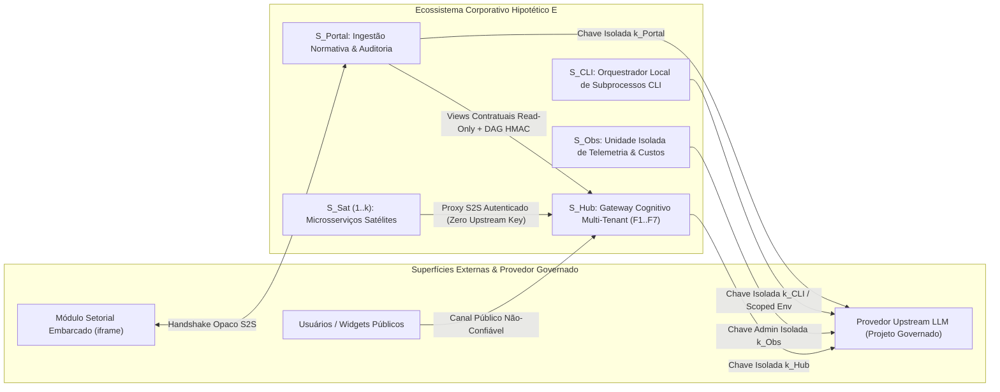

# Contenção Formal de Raio de Explosão, Rotação de Credenciais Sem Interrupção e Isolamento Epistêmico *Zero-Trust* em Ecossistemas Corporativos Multi-Agente: Formulação Hipotética, Prova de Invariantes e Validação Técnica Frente à Literatura Científica

**Identificador Técnico:** `VTI-RES-2026-03` — Edição Consolidada `v1.2` (Novembro de 2026)  
**Autor:** **Caio Gonçalves** — *Principal Investigator & Chief Systems Architect, VTI Research (VTI, Brazil)* (https://projectos-system.github.io/vti-research/)  
**Desenho Metodológico:** Estudo de Caso Arquitetural Único Retrospectivo Anonimizado com Formulação Hipotética Generalizada — Ecossistema Abstrato $\mathcal{E} = (\mathcal{S}_{\mathrm{Hub}}, \mathcal{S}_{\mathrm{Portal}}, \mathcal{S}_{\mathrm{CLI}}, \{\mathcal{S}_{\mathrm{Sat}}^{(i)}\}_{i=1}^{k}, \mathcal{S}_{\mathrm{Obs}})$  
**Cláusula Estrita de Anonimização:** *Para conciliar escrutínio científico aberto pela comunidade internacional de engenharia de segurança com confidencialidade operacional irrestrita, nenhum nome real de organização cliente, produto comercial, domínio DNS, endereço IP, caminho de diretório privado ou prefixo literal de chave criptográfica é mencionado neste artigo; todas as superfícies avaliadas são formalizadas como abstrações algébricas verificáveis.*

---

## Resumo

A transição de protótipos isolados baseados em Grandes Modelos de Linguagem (LLMs) para ecossistemas corporativos multi-agente em produção contínua introduz uma superfície de ataque composta que transcende falhas puramente conversacionais. Quando um gateway cognitivo multi-tenant ($\mathcal{S}_{\mathrm{Hub}}$), um portal diário de ingestão normativa e auditoria documental ($\mathcal{S}_{\mathrm{Portal}}$), um orquestrador local de agentes autônomos de linha de comando ($\mathcal{S}_{\mathrm{CLI}}$), microsserviços satélites especializados ($\{\mathcal{S}_{\mathrm{Sat}}^{(i)}\}_{i=1}^{k}$) e uma unidade segregada de telemetria financeira ($\mathcal{S}_{\mathrm{Obs}}$) coexistem sob restrições severas de disponibilidade contínua (*zero-breakage*), emergem oito classes acopladas de vulnerabilidade: *(i)* amplificação de raio de explosão (*blast radius*) por compartilhamento de credenciais upstream de provedores de IA com consumidores legados ativos; *(ii)* persistência de segredos em índices de controle de versão, manifestos de contêineres em texto claro e falhas destrutivas de reimplantação (*destroy-before-verify*); *(iii)* quebra silenciosa de capacidades multimodais (síntese e transcrição de voz) após aplicação de listas restritivas de modelos (*allowlists*); *(iv)* escalonamento vertical de privilégio por casamento léxico de prefixos, referências diretas inseguras entre canais (*cross-channel IDOR*) e exposição de credenciais de sessão em URLs de módulos embarcados; *(v)* *Confused Deputy*, vazamento de variáveis de ambiente, persistência em ganchos de repositórios (`.git/hooks`) e injeção de sequências de escape de terminal (`OSC 52`) em subprocessos CLI; *(vi)* deriva não assinada do plano de controle, diferenciais de analisadores JSON (*parser differentials*), respostas obsoletas em cache pós-revogação e efeitos colaterais órfãos sob condições de corrida (*TOCTOU*); *(vii)* auto-confirmação circular sintética (colapso de Goodhart) e envenenamento de bases vetoriais (*RAG poisoning*); e *(viii)* tensão estrutural entre imutabilidade forense (*append-only*) e direito regulatório de eliminação de dados pessoais estruturados. Adotando um desenho de estudo de caso arquitetural anonimizado com formulação hipotética generalizada, este artigo formaliza oito hipóteses falsificáveis de ameaça ($H_1$–$H_8$), especifica oito mecanismos de defesa em profundidade ($C_1$–$C_8$) com semântica explícita de falha segura (*fail-closed*), reporta observações empíricas delimitadas de concorrência, criptografia e latência sobre o artefato avaliado e confronta criticamente a validade e os limites residuais de cada controle contra **29 referências científicas e normativas primárias verificadas** (`[R01]–[R29]`: `IEEE`, `ACM`, `NDSS`, `USENIX Security`, `Nature`, `NIST`, `OWASP LLM 2025` e `IETF RFC`), consolidando ameaças à validade e seis evoluções estruturais futuras (`M-FUT-1` a `M-FUT-6`).

**Palavras-chave:** Segurança *Zero-Trust*; Sistemas Multi-Agente LLM; Contenção de Raio de Explosão; Rotação de Credenciais Sem Interrupção; Diferenciais de Parser JSON (`RFC 8785`); *Fencing Tokens* ACID; Envenenamento de RAG; Apagamento Criptográfico (*Crypto-Shredding*).

---

## 1. Introdução e Motivação Científica

A literatura recente sobre segurança em sistemas integrados a modelos fundacionais evidencia uma mudança estrutural de paradigma: ataques adversariais não precisam superar o alinhamento estatístico interno dos pesos de um modelo quando podem explorar **fronteiras de autoridade insuficientemente mediadas na arquitetura hospedeira** `[R22, R25, R27]`. Na edição oficial de 2025 do *OWASP Top 10 for Large Language Model Applications* `[R29]`, vulnerabilidades sistêmicas de arquitetura — como *Excessive Agency* (`LLM06:2025`), *Sensitive Information Disclosure* (`LLM02:2025`), *Data and Model Poisoning* (`LLM04:2025`), *Vector and Embedding Weaknesses* (`LLM08:2025`) e *Unbounded Consumption* (`LLM10:2025`) — figuram no mesmo patamar crítico que *Prompt Injection* (`LLM01:2025`).

Não obstante, investigações acadêmicas examinam frequentemente cada vetor de modo compartimentado — analisando isoladamente o vazamento de segredos em repositórios Git `[R15, R20]`, o isolamento de execução de plugins agênticos `[R25]` ou a corrupção direcionada de corpora em sistemas de geração aumentada por recuperação (`RAG`) `[R26]`. Em ecossistemas corporativos reais que sustentam fluxos regulatórios, jurídicos, contábeis e financeiros em regime ininterrupto (24/7), **essas superfícies acoplam-se de forma não-linear**:

1. Uma revogação emergencial de credencial upstream compartilhada para estancar exfiltração de quota ou dados (`LLM02`) interrompe instantaneamente integrações produtivas legadas caso não exista desacoplamento prévio e um protocolo formal de drenagem observável (*Zero-Breakage Constraint*) `[R20]`.
2. A imposição de listas fechadas de modelos autorizados (*allowlists*) no provedor externo para governar custos e conformidade (`LLM10`, `[R24]`) degrada silenciosamente canais secundários de voz e acessibilidade quando o plano de execução carece de sondagem pré-voo de capacidades.
3. Defesas conversacionais contra injeção de prompt (`LLM01`) tornam-se inócuas se a base vetorial normativa puder sofrer mutação direta fora do pipeline certificador (`LLM08`, `[R26]`), se respostas pré-revogação permanecerem ativas em cache ou se transações concorrentes em voo gravarem mutações órfãs após perda de privilégio `[R03, R13]`.

Adotando o método hipotético-dedutivo, este trabalho oferece três contribuições centrais: **(a)** formaliza um modelo algébrico representativo $\mathcal{E}$ e um modelo explícito de adversário para ecossistemas multi-agente corporativos sob restrição de disponibilidade contínua; **(b)** deriva oito controles *fail-closed* ($C_1$–$C_8$) acompanhados de invariantes criptográficas, protocolares e transacionais verificáveis; e **(c)** submete tanto os resultados empíricos medidos quanto as limitações residuais ao escrutínio de 29 fontes primárias da literatura internacional, derivando o roteiro evolutivo `M-FUT-1` a `M-FUT-6`.

---

## 2. Modelo de Sistema Hipotético $\mathcal{E} = (\mathcal{S}_{\mathrm{Hub}}, \mathcal{S}_{\mathrm{Portal}}, \mathcal{S}_{\mathrm{CLI}}, \{\mathcal{S}_{\mathrm{Sat}}^{(i)}\}_{i=1}^{k}, \mathcal{S}_{\mathrm{Obs}})$ e Modelo de Adversário

### 2.1. Desenho do Estudo, Anonimização Estrita e Demarcação Epistemológica

Para conciliar reprodutibilidade formal das especificações de segurança com sigilo industrial absoluto, adota-se um **desenho de estudo de caso único retrospectivo anonimizado com formulação hipotética generalizada**:

1. **Atributos Expurgados vs. Invariantes Preservadas:** Foram integralmente removidos nomes institucionais, marcas comerciais, domínios de rede, sub-redes IP, identificadores reais de locatários, caminhos privados de infraestrutura e prefixos literais de chaves. Foram preservadas com fidelidade estrita as **fronteiras topológicas de confiança**, os **predicados SQL e criptográficos**, as **máquinas de estado de protocolo** e as **medições instrumentadas de latência e concorrência** coletadas sobre o artefato real avaliado.
2. **Princípio de Proporcionalidade Epistêmica ($\text{Escopo da Alegação} \le \text{Escopo da Evidência}$):** A Tabela 1 estabelece a demarcação rigorosa entre abstração de sistema, hipóteses de ameaça, controles verificados e propostas prospectivas.

| Elemento Formal | Natureza Epistemológica | Base de Evidência neste Estudo | Limite Estrito de Inferência |
| :--- | :--- | :--- | :--- |
| **Topologia $\mathcal{E}$** | Abstração arquitetural anonimizada | Mapeamento estrutural de ecossistema corporativo real em produção/homologação | Representa uma classe relevante de arquiteturas multi-agente, não censo estatístico de mercado. |
| **Hipóteses $H_1$–$H_8$** | Hipóteses falsificáveis de ameaça (*Threat Hypotheses*) | Análise de superfície de ataque + literatura primária (`[R01]–[R29]`) | Formalizam vulnerabilidades exploráveis na ausência dos controles; não constituem relato de intrusão externa consumada. |
| **Controles $C_1$–$C_8$** | Mecanismos *fail-closed* implementados e testados | Testes determinísticos de contrato, concorrência SQL real e cronometragem monotônica | Eficácia demonstrada sob as premissas operacionais e versões avaliadas; não implica imunidade fora do modelo adversarial declarado. |
| **Roteiro `M-FUT-1..6`** | Evoluções estruturais prospectivas | Confronto analítico com lacunas residuais da literatura de fronteira | Especificações de engenharia para ciclos subsequentes; ainda não submetidas a benchmark próprio neste artigo. |

3. **Semântica Universal *Fail-Closed* e Minimização na Telemetria:** Todos os controles $C_1$–$C_8$ obedecem a política estrita de falha fechada: indisponibilidade do banco relacional primário de leitura/escrita, falha de verificação `Ed25519`, ausência de segredo obrigatório no pré-voo ou expiração de época/ticket resultam em recusa determinística (`HTTP 403 / 404 / 422 / 503`), jamais em *bypass* permissivo `[R01]`. Adicionalmente, os próprios pipelines de observabilidade aplicam sanitização pré-persistência para impedir que trilhas forenses atuem como vetor secundário de vazamento de segredos ou dados pessoais.

### 2.2. Topologia Formal do Ecossistema Abstraído

Seja $\mathcal{E}$ um ecossistema corporativo distribuído operando sobre um conjunto finito de locatários (*tenants*) $\mathcal{T}$ e domínios normativos regulados $\mathcal{D}$, definido pela quíntupla:

$$\mathcal{E} = \left(\mathcal{S}_{\mathrm{Hub}}, \; \mathcal{S}_{\mathrm{Portal}}, \; \mathcal{S}_{\mathrm{CLI}}, \; \{\mathcal{S}_{\mathrm{Sat}}^{(i)}\}_{i=1}^{k}, \; \mathcal{S}_{\mathrm{Obs}}\right)$$

cujos componentes assumem papéis arquiteturais estritamente delimitados:
- **$\mathcal{S}_{\mathrm{Hub}}$ (*Core Cognitive & Agentic Hub*):** gateway multi-tenant que hospeda sete famílias especializadas de agentes $\mathcal{F} = \{F_1, \dots, F_7\}$ (consultoria normativa estrita, copilotos executivos, agentes comerciais internos/externos, atendimento multicanal, assistentes operacionais de API, analistas SQL/BI e engenharia de software), acoplado a um banco transacional primário $DB_{\mathrm{Hub}}$ e a um índice vetorial HNSW $DB_{\mathrm{Vec}}$ contendo centenas de milhares de embeddings normativos.
- **$\mathcal{S}_{\mathrm{Portal}}$ (*Normative Ingestion & Regulatory Portal*):** plataforma que coleta diariamente dezenas de fontes públicas oficiais, audita textos segundo regras determinísticas de qualidade documental, executa motores de cálculo regulatório e integra módulos setoriais externos via quadros web embarcados (`<iframe>`).
- **$\mathcal{S}_{\mathrm{CLI}}$ (*Autonomous CLI & Subprocess Orchestrator*):** orquestrador local/híbrido que despacha tarefas para múltiplos binários executáveis de agentes de linha de comando ($a \in \{\text{\texttt{cli}}_1, \dots, \text{\texttt{cli}}_5\}$) sobre repositórios Git e cofres documentais locais.
- **$\{\mathcal{S}_{\mathrm{Sat}}^{(i)}\}_{i=1}^{k}$ (*Satellite Domain Microservices*):** microsserviços verticais especializados (fluxos operacionais, comércio exterior, calculadoras setoriais) que demandam inferência textual e vetorização em lote, mas não possuem justificativa de negócio para deter chaves diretas do provedor externo $\mathcal{P}_{\mathrm{LLM}}$.
- **$\mathcal{S}_{\mathrm{Obs}}$ (*Financial & Administrative Observability Unit*):** unidade segregada dedicada exclusivamente à reconciliação financeira, governança de cotas e telemetria de drenagem de chaves junto a $\mathcal{P}_{\mathrm{LLM}}$.



### 2.3. Modelo de Adversário e Raio de Explosão Ponderado (*Weighted Blast Radius*)

**Capacidades do Adversário ($\mathcal{A}$):** Consideramos um adversário realista composto por quatro vetores operacionais: *(a)* **Atacante Externo de Rede/Web**, capaz de interagir livremente com widgets públicos, inspecionar histórico/cabeçalhos `Referer` do navegador, forjar cabeçalhos HTTP arbitrários (`Origin`, `x-user-login`), enumerar identificadores de sessão e disparar requisições paralelas em janelas sub-milissegundo; *(b)* **Adversário Epistêmico Indireto**, capaz de publicar ou injetar conteúdo textual adversarial em documentos externos, páginas ou artefatos de repositório lidos por agentes $\mathcal{S}_{\mathrm{Hub}}$ ou subprocessos $\mathcal{S}_{\mathrm{CLI}}$ (visando *Indirect Prompt Injection*, persistência em `.git/hooks`, escape `OSC 52` ou corrupção *PoisonedRAG*) `[R22, R26]`; *(c)* **Subsistema Periférico ou Credencial Parcialmente Exposta**, no qual um artefato de build, arquivo `.env` legado ou contêiner satélite $\mathcal{S}_{\mathrm{Sat}}^{(i)}$ sofre exposição localizada de configuração; e *(d)* **Mutação Administrativa Fora de Banda ou Condição de Corrida**, compreendendo revogações de privilégio concorrentes a execuções agênticas em voo ou alterações manuais diretas em tabelas de banco fora do fluxo de aplicação. Assume-se como base confiável (*Trusted Computing Base*) a integridade criptográfica das primitivas padrão (`SHA-256`, `Ed25519`, `AES-256-GCM`, CSPRNG do sistema operacional), do motor transacional PostgreSQL primário e do processo supervisor host de $\mathcal{S}_{\mathrm{CLI}}$.

**Métrica Formal de Raio de Explosão:** Seja $\mathcal{K}$ o conjunto de credenciais ativas no ecossistema e $\mathcal{W} = \{w_1, \dots, w_m\}$ o conjunto de *workloads* produtivos, onde cada workload $w_r$ apresenta peso de criticidade operacional $\omega_r > 0$ e exposição financeira máxima por janela de detecção $C_{\max}(w_r)$, ponderada pelo fator de conversão de risco $\lambda > 0$. Definindo o indicador de acoplamento $\mathrm{Uses}(w_r, \kappa) \in \{0, 1\}$ como $1$ se o comprometimento ou a revogação imediata de $\kappa \in \mathcal{K}$ impacta diretamente $w_r$, o **Raio de Explosão Operacional-Financeiro** de $\kappa$ é:

$$\mathrm{BR}(\kappa) = \sum_{r=1}^{m} \mathrm{Uses}(w_r, \kappa) \cdot \left(\omega_r + \lambda C_{\max}(w_r)\right)$$

Sob a **Hipótese Nula de Credencial Monolítica** ($\kappa_{\mathrm{shared}}$ compartilhada entre $\mathcal{S}_{\mathrm{Hub}}$, $\mathcal{S}_{\mathrm{Portal}}$, $\mathcal{S}_{\mathrm{CLI}}$, $\{\mathcal{S}_{\mathrm{Sat}}^{(i)}\}$ e uma integração produtiva legada ininterrupta $w_{\mathrm{crit}}$), obtém-se o limite superior degenerado $\mathrm{BR}(\kappa_{\mathrm{shared}}) = \sum_{r=1}^{m} (\omega_r + \lambda C_{\max}(w_r))$: qualquer suspeita de vazamento periférico impõe um dilema insolúvel entre tolerar exfiltração financeira/informacional global ou revogar $\kappa_{\mathrm{shared}}$ provocando queda imediata em $w_{\mathrm{crit}}$.

### 2.4. Síntese das Oito Hipóteses de Ameaça ($H_1$–$H_8$)

| Hipótese | Classe de Vulnerabilidade (`CWE` / `OWASP LLM 2025`) | Formulação Falsificável do Risco sobre $\mathcal{E}$ |
| :---: | :--- | :--- |
| **$H_1$** | Credencial Upstream Compartilhada & Bloqueio de Rotação (`CWE-798`, `LLM02`, `LLM10`) | O compartilhamento de $\kappa_{\mathrm{shared}}$ maximiza $\mathrm{BR}(\kappa_{\mathrm{shared}})$ e inviabiliza revogação emergencial quando um consumidor produtivo legado $w_{\mathrm{crit}}$ depende do mesmo segredo. |
| **$H_2$** | Persistência em VCS, Texto Claro em Orquestrador & *Destroy-Before-Verify* (`CWE-312`, `CWE-522`) | Arquivos `.env` rastreados em Git, variáveis abertas em especificações de contêineres e pipelines que destroem a pilha ativa antes de verificar segredos geram vazamento persistente ou indisponibilidade em deploy. |
| **$H_3$** | Quebra Silenciosa Pós-*Allowlist* em Pipelines Multimodais (`LLM10`, Governança de Modelos) | Restringir o projeto upstream a um subconjunto fechado $\mathcal{M}_{\mathrm{allowed}}$ invalida chamadas padrão de síntese/transcrição vocal (`TTS/STT`) na ausência de sondagem pré-voo e contingência governada. |
| **$H_4$** | Escalada Léxica RBAC, *Cross-Channel IDOR* & Token em URL (`CWE-285`, `CWE-639`, `CWE-598`) | Regras RBAC por prefixo (`/^prefix_/i`), retomada pública de conversas sem vínculo de canal/origem e tokens em *query string* permitem escalonamento vertical, leitura cruzada e exfiltração via `Referer`. |
| **$H_5$** | *Confused Deputy* e Persistência em Subprocessos CLI (`CWE-441`, `CWE-88`, `LLM06`) | Herança integral de `process.env` por agentes CLI expõe segredos cruzados e habilita persistência silenciosa em `.git/config`, `.git/hooks/*` ou sequestro de área de transferência via sequências ANSI `OSC 52`. |
| **$H_6$** | *Parser Differential*, Cache Pós-Revogação & *TOCTOU* em Voo (`CWE-436`, `CWE-367`) | Chaves JSON duplicadas induzem divergência entre verificador e executor; caches sem época servem respostas pós-revogação; e corridas concorrentes produzem mutações órfãs sem *fencing token* ACID. |
| **$H_7$** | Colapso Recursivo de Goodhart & *PoisonedRAG* (`LLM04`, `LLM08`) | Reingerir textos sintéticos como corroboração independente ou permitir mutações SQL diretas na base normativa corrompe silenciosamente o corpus recuperado pelos agentes. |
| **$H_8$** | Vazamento de PII Estruturado vs. Imutabilidade Forense (`LLM02`, `GDPR / LGPD`) | Expressões regulares ingênuas mutilam códigos contratuais legítimos ou deixam vazar PII em vetores, enquanto ledgers *append-only* conflitam com requisições legais de eliminação de dados pessoais. |

---

## 3. Formulação das Oito Hipóteses de Ameaça ($H_1$–$H_8$) e Controles *Fail-Closed* ($C_1$–$C_8$) com Invariantes Formais

### 3.1. Controle $C_1$ (para $H_1$): Particionamento por Fronteira de Confiança, Proxy S2S *Zero-Key* e Rotação *Dual-Key Grace Window*

1. **Particionamento Estrito de Credenciais:** Mantendo um único projeto governado em $\mathcal{P}_{\mathrm{LLM}}$ (para aplicação centralizada de *allowlists* e tetos orçamentários), o espaço de credenciais é particionado em segredos mutuamente disjuntos:
   $$\mathcal{K}_{\mathrm{inference}} = \{\kappa_{\mathrm{Hub}}, \; \kappa_{\mathrm{Portal}}, \; \kappa_{\mathrm{CLI}}\}, \qquad \mathcal{K}_{\mathrm{admin}} = \{\kappa_{\mathrm{Obs}}\}, \qquad \kappa_a \neq \kappa_b \;\; (\forall a \neq b)$$
   onde $\kappa_{\mathrm{Obs}}$ reside unicamente em $\mathcal{S}_{\mathrm{Obs}}$ (desprovida de escopo de inferência nos nós de aplicação) e nenhuma credencial administrativa é montada em $\mathcal{S}_{\mathrm{Hub}}$, $\mathcal{S}_{\mathrm{Portal}}$ ou $\mathcal{S}_{\mathrm{CLI}}$.
2. **Erradicação de Chaves Upstream nos Satélites ($\mathrm{BR}_{\mathrm{upstream}}(\mathcal{S}_{\mathrm{Sat}}^{(i)}) = 0$):** Os microsserviços $\{\mathcal{S}_{\mathrm{Sat}}^{(i)}\}_{i=1}^{k}$ operam com zero credenciais de $\mathcal{P}_{\mathrm{LLM}}$. Toda inferência ou geração de embeddings em lote (limitada a $B \le 64$ entradas por requisição) transita por canal *Server-to-Server (S2S)* autenticado perante $\mathcal{S}_{\mathrm{Hub}}$. A soberania de seleção de modelo permanece **`LOCKED` no servidor** (`ON CONFLICT DO NOTHING` sobre parâmetros protegidos pela governança central, descartando qualquer tentativa de *model override* oriunda do cliente S2S).
3. **Máquina Monotônica de Rotação Sem Queda (*Dual-Key Grace Window*):** Existindo um consumidor crítico legado $w_{\mathrm{crit}}$ acoplado a $\kappa_{\mathrm{legacy}}$:
   - *Fase 1 (Desacoplamento Imediato do Ecossistema Principal):* $\mathcal{S}_{\mathrm{Hub}}$, $\mathcal{S}_{\mathrm{Portal}}$ e $\mathcal{S}_{\mathrm{CLI}}$ comutam atomicamente para $\kappa_{\mathrm{Hub}}, \kappa_{\mathrm{Portal}}, \kappa_{\mathrm{CLI}}$, contraindo instantaneamente o raio de explosão residual para $\mathrm{BR}(\kappa_{\mathrm{legacy}}) = \omega_{\mathrm{crit}} + \lambda C_{\max}(w_{\mathrm{crit}})$.
   - *Fase 2 (Drenagem Observável Pré-Revogação):* $\kappa_{\mathrm{legacy}}$ transita para estado `RETIRING` sob monitoramento contínuo de $\mathcal{S}_{\mathrm{Obs}}$ até que a taxa de requisições observada satisfaça $\lambda_{\mathrm{req}}(\kappa_{\mathrm{legacy}}, \Delta t) = 0$ ao longo de uma janela segura $\Delta t \ge \Delta_{\mathrm{drain}}$ após migração do conector de $w_{\mathrm{crit}}$, tornando a revogação final matematicamente livre de interrupção.

> **Fundamentação na Literatura:** Basak et al. (2023a) `[R20]` demonstram que o receio de interromper integrações acopladas não mapeadas é o principal fator que paralisa a rotação de segredos na indústria. A combinação de mediação central via proxy S2S (*Policy Enforcement Point* do **NIST SP 800-207** `[R16]` e mínimo privilégio de Saltzer & Schroeder `[R01]`) com drenagem telemetrada elimina simultaneamente a proliferação horizontal e o risco de queda.

### 3.2. Controle $C_2$ (para $H_2$): Segredos Efêmeros em `tmpfs`, Invariante *Verify-Before-Destroy* e Hidratação Segura

1. **Cofres Efêmeros em Memória (`/run/secrets/*`):** Todas as credenciais sensíveis são removidas de variáveis de ambiente em texto claro nas especificações de contêineres e injetadas exclusivamente como objetos imutáveis montados em `tmpfs` na memória volátil do nó trabalhador `[R18]`.
2. **Predicado Bloqueante *Verify-Before-Destroy* no CI/CD:** Em orquestradores nos quais a atualização de referências de segredos requer remoção e recriação da pilha de serviços, impõe-se a verificação pré-voo estrita sobre o conjunto de segredos obrigatórios $S_{\mathrm{req}}$:
   $$\mathrm{PreFlightOK}(S_{\mathrm{req}}) \iff \forall s \in S_{\mathrm{req}}, \;\; s \in \mathrm{ClusterSecretStore}()$$
   Caso $\neg \mathrm{PreFlightOK}(S_{\mathrm{req}})$, o pipeline aborta com código de erro não-nulo **antes** de emitir qualquer instrução destrutiva contra os contêineres ativos, preservando 100% de disponibilidade.
3. **Hidratação Condicional e Higiene de Build:** No entrypoint de inicialização, cada segredo montado passa por limpeza de terminadores de linha invisíveis (`\r\n`) e atribuição condicional estrita ($\mathrm{len}(\mathrm{trim}(\mathrm{val})) > 0$), impedindo que montagens vazias sobrescrevam variáveis válidas. Em estágios de compilação legados que exigem presença sintática de arquivo `.env` no contexto de build, o artefato é truncado para zero bytes (`: > .env`) no *builder* antes do empacotamento final, combinado a bloqueio de rastreamento no índice de controle de versão.

> **Fundamentação na Literatura:** Meli et al. (2019) `[R15]` comprovaram em larga escala a persistência de segredos em arquivos de configuração versionados, enquanto Basak et al. (2023b) `[R21]` evidenciaram a insuficiência de detectores estáticos isolados quando o processo de build exige segredos populados em disco.

### 3.3. Controle $C_3$ (para $H_3$): Sondagem Pré-Deploy de *Model Allowlist* e `ModelCapabilityRegistry`

Quando o projeto governado em $\mathcal{P}_{\mathrm{LLM}}$ restringe o catálogo ativo a um subconjunto homologado $\mathcal{M}_{\mathrm{allowed}}$ (no artefato avaliado, $|\mathcal{M}_{\mathrm{allowed}}| = 49$), invocações a qualquer modelo $m \notin \mathcal{M}_{\mathrm{allowed}}$ falham em produção. O controle $C_3$ estabelece:

1. **Auditoria Programática Pré-Vôo (`GET /v1/models`):** Antes da promoção de release, todos os identificadores declarados nos manifestos $\mathcal{M}_{\mathrm{configured}}$ são validados contra $\mathcal{M}_{\mathrm{allowed}}$.
2. **Bifurcação Semântica de Política (`ModelCapabilityRegistry`):**
   - *Famílias Normativas e Analíticas Críticas ($F_1, F_6, F_7$):* diante de incompatibilidade entre parâmetros de esforço deliberativo ou esquema estruturado e as capacidades reais do modelo, o compilador recusa a execução em modo *fail-closed* (`HTTP 422 CapabilityMismatch`), **vedando rebaixamento silencioso** (*silent downgrade*), e seleciona deterministicamente o transporte estruturado (`/v1/responses` com `store: false`) sempre que `effort != 'none'`, inclusive em chamadas sem ferramentas externas.
   - *Canais Auxiliares de Acessibilidade Vocal (`TTS/STT`):* caso o modelo vocal primário sofra restrição de *allowlist*, o adaptador aciona contingência auditada estritamente restrita à interseção homologada $\mathcal{M}_{\mathrm{audio}} \cap \mathcal{M}_{\mathrm{allowed}}$, assegurando continuidade multimodal sem alterar o parecer textual já validado.

> **Fundamentação na Literatura:** Implementa os controles de gestão de risco de modelos de terceiros do **NIST AI 600-1** (2024) `[R24]` e previne negação de serviço ou degradação não rastreada previstas em **OWASP `LLM10:2025`** `[R29]`.

### 3.4. Controle $C_4$ (para $H_4$): RBAC Enumerado *Default-Deny*, Indistinguibilidade Cross-Channel e Handshake Opaco (`RFC 9700`)

1. **Conjuntos Fechados em RBAC e Identidade Exclusivamente Assinada:** Substituem-se expressões regulares baseadas em prefixo ($\mathrm{match}(r, \text{\texttt{/\^{}prefix\_/i}})$, vulneráveis à promoção acidental de papéis setoriais `prefix_MODULE`) pela avaliação sobre conjuntos finitos enumerados estritos:
   $$\mathrm{isAdmin}(r) \iff \mathrm{lower}(r) \in \mathcal{R}_{\mathrm{admin\_allow}} \setminus \mathcal{R}_{\mathrm{client\_explicit\_deny}}$$
   Simultaneamente, a identidade do operador em rotas autenticadas é derivada **unicamente** das declarações criptograficamente verificadas do JWT, extinguindo qualquer fallback para cabeçalhos HTTP ou campos de requisição controlados pelo cliente (`x-user-login`).
2. **Isolamento Anti-IDOR com Indistinguibilidade entre Canais:** Seja $\mathrm{origin}(c) \in \{\text{\texttt{PUBLIC\_WIDGET}}, \text{\texttt{INTERNAL\_PLATFORM}}, \text{\texttt{S2S\_API}}, \text{\texttt{INTERNAL\_COPILOT}}\}$ a origem imutável gravada na criação da sessão $c$. O endpoint público de retomada impõe o invariante:
   $$\mathrm{CanResumePublic}(c, \mathrm{hdr}_{\mathrm{origin}}) \iff \mathrm{origin}(c) = \text{\texttt{PUBLIC\_WIDGET}} \;\land\; \mathrm{agentType}(c) \neq \text{\texttt{API\_ASSISTANT}} \;\land\; \mathrm{hdr}_{\mathrm{origin}} \in \mathrm{AllowedOrigins}(c)$$
   Qualquer violação retorna `HTTP 404 Not Found` uniforme em estrutura e tempo, eliminando oráculos de existência sobre UUIDs de sessões internas.
3. **Protocolo *Reverse Opaque PostMessage Handshake* (Zero Credencial em URL):** Para autenticar módulos especializados em `<iframe>` entre origens corporativas sem jamais transitar JWTs ou tickets em parâmetros de URL:
   - *Passo 1:* O módulo filho carrega uma rota neutra `/embed/bootstrap`, gera localmente um `handshakeNonce` via CSPRNG e sinaliza prontidão à janela hospedeira via `postMessage` restrito à `targetOrigin` exata.
   - *Passo 2:* A janela hospedeira requisita ao backend de $\mathcal{S}_{\mathrm{Portal}}$ um ticket opaco de uso único $t_{\mathrm{opaque}}$ vinculado à tupla `(userId, toolScope, handshakeNonce, embedOrigin)` com `TTL = 60 s`, entregando-o exclusivamente em memória via `postMessage`.
   - *Passo 3:* O backend do módulo embarcado resgata $t_{\mathrm{opaque}}$ diretamente perante $\mathcal{S}_{\mathrm{Portal}}$ via canal privado S2S autenticado em tempo constante ($\mathrm{timingSafeEqual}$). Para neutralizar condições de corrida sub-milissegundo entre resgates paralelos e evitar distorções de `transaction_timestamp()` em transações longas, a tabela impõe `UNIQUE (token_hash)` e executa o consumo como **instrução condicional atômica única**:

```sql
UPDATE embedded_opaque_tickets
   SET consumed_at = statement_timestamp()
 WHERE token_hash = $1
   AND consumed_at IS NULL
   AND expires_at > statement_timestamp()
   AND handshake_nonce = $2
   AND embed_origin = $3
RETURNING ticket_id, user_id, tool_scope;
```

   onde `statement_timestamp()` avalia a validade temporal no instante exato de execução da instrução. O backend verifica **antes da confirmação transacional** que `rowCount === 1` (executando `ROLLBACK` imediato caso contrário) e **somente após a confirmação durável do `COMMIT`** emite o token efêmero restrito (`scope = 'embedded_module'`, preservando a separação estrita $\text{Autenticação} \neq \text{Autorização} \neq \text{Delegação Irrestrita}$).

> **Fundamentação na Literatura:** Concretiza *Fail-Safe Defaults* e *Complete Mediation* de Saltzer & Schroeder (1975) `[R01]`, bloqueia o *Confused Deputy* entre canais de Hardy (1988) `[R05]` e satisfaz integralmente a norma **IETF RFC 9700 / BCP 240** (Lodderstedt et al., 2025) `[R28]`, que veda credenciais em URLs e exige troca *backchannel* atômica de uso único vinculada a *nonce* e origem.

### 3.5. Controle $C_5$ (para $H_5$): *Execution Shield* para Agentes Autônomos de CLI

Quando $\mathcal{S}_{\mathrm{CLI}}$ invoca binários locais de agentes autônomos ($a \in \{\text{\texttt{cli}}_1, \dots, \text{\texttt{cli}}_5\}$), o subprocesso é confinado como **domínio parcialmente não-confiável** exposto a injeção indireta de prompt durante leitura de código ou artefatos externos `[R22]`:

1. **Projeção Mínima de Ambiente (`Scoped Environment Policy`):** Elimina-se a herança irrestrita `env = process.env` em favor do operador de projeção:
   $$\mathrm{Env}(a) = \left(\mathrm{Env}_{\mathrm{host}} \upharpoonright \mathcal{A}_{\mathrm{sys\_safe}}\right) \cup \mathrm{Creds}_{\mathrm{authorized}}(a) \setminus \mathcal{B}_{\mathrm{hard\_blocked}}$$
   onde $\mathcal{B}_{\mathrm{hard\_blocked}}$ expurga incondicionalmente tokens da interface gráfica, segredos de banco/nuvem e variáveis de sequestro de execução (`NODE_OPTIONS`, `GIT_SSH_COMMAND`, `GIT_ASKPASS`, `GIT_CONFIG_*`), enquanto $\mathrm{Creds}_{\mathrm{authorized}}(a)$ injeta unicamente a credencial do provedor específico de $a$ (ou um marcador `PHANTOM-*` substituído exclusivamente no proxy de saída para o domínio autorizado).
2. **Guarda Criptográfica `SHA-256` sobre `.git` e Segredos Locais:** Antes da execução do subprocesso, $\mathcal{S}_{\mathrm{CLI}}$ registra o snapshot `SHA-256` de `.git/config`, `.git/hooks/*` e arquivos sensíveis (bloqueados contra leitura/escrita no montador de contexto). Imediatamente após o término do turno — e **antes** que o orquestrador execute qualquer `git status` ou `git diff` —, mutações não autorizadas em hooks ou diretivas executáveis (`core.fsmonitor`, `core.hooksPath`, `core.sshCommand`, `filter.*.clean`) são revertidas atomicamente a partir do snapshot confiável, invocando-se o binário Git sempre com chaves explícitas de neutralização (`-c core.hooksPath= -c core.fsmonitor=false -c protocol.file.allow=never`).
3. **Sanitização `VT/OSC-52` e Ledger Encadeado com Enquadramento Binário Injetivo:** Fluxos `stdout`/`stderr` atravessam um autômato determinístico que preserva atributos visuais SGR mas remove sequências `OSC 52` (capazes de ler ou sobrescrever silenciosamente a área de transferência do operador) e controles `DCS/APC/PM`. Para eliminar colisões de fronteira inerentes à concatenação ingênua de strings, cada evento de auditoria $R_n$ é encadeado mediante **separação explícita de domínio, hash anterior de 32 bytes fixos e prefixo binário de comprimento em big-endian de 64 bits (`uint64_be` )** `[R04]`:
   $$H_n = \mathrm{SHA256}\!\left(\text{\texttt{"audit:ledger:v1\textbackslash 0"}} \parallel H_{n-1}^{[32\text{B}]} \parallel \mathrm{uint64\_be}\!\left(\lvert \mathrm{JCS}(R_n) \rvert_{\mathrm{bytes}}\right) \parallel \mathrm{JCS}(R_n)\right)$$
   Como uma cadeia local isolada não impediria recomputação integral por um processo com permissão de escrita no arquivo, o par de ancoragem $(n, H_n)$ é persistido em banco controlado pelo processo supervisor **fora do espaço de arquivos e credenciais acessível ao subprocesso CLI** (neutralizando adulteração pelo agente confinado; contra comprometimento privilegiado do próprio host, aplica-se replicação remota assinada).

> **Fundamentação na Literatura:** Estende o paradigma de isolamento de execução agêntica **IsolateGPT** de Wu et al. (2025, *NDSS*) `[R25]` ao plano de subprocessos locais de engenharia de software, combinando-o ao enquadramento criptográfico injetivo de Merkle (1987) `[R04]`.

### 3.6. Controle $C_6$ (para $H_6$): Assinatura Canônica Anti-*Parser-Differential*, Cache por Época e *Fencing Token* ACID em 4 Checkpoints

1. **Rejeição Léxica de Chaves JSON Duplicadas e Assinatura `Ed25519` sobre `RFC 8785`:** Como a especificação `RFC 8259` `[R12]` deixa indefinida a semântica de objetos JSON contendo chaves repetidas (`{"role":"viewer","role":"admin"}`), analisadores heterogêneos sofrem vulnerabilidades de *parser differential* entre validação e execução `[R19]`. Nosso verificador inspeciona o fluxo léxico bruto **antes** da instanciação em memória, abortando imediatamente (`ERR_DUPLICATE_JSON_KEY`) qualquer colisão de chave no mesmo escopo e exigindo inteiros de 64 bits em notação decimal canônica estrita `^(?:0|[1-9][0-9]{0,19})$` ($\le 2^{64}-1$), seguido de canonicalização **RFC 8785 (JCS)** `[R17]` e assinatura **Ed25519** (`RFC 8032` `[R11]`) sobre o envelope contextual completo $m = (\mathrm{issuer}, \mathrm{audience}, \mathrm{schema\_version}, \mathrm{epoch}, \mathrm{iat}, \mathrm{exp}, \mathrm{key\_id}, \mathrm{payload\_hash})$.
2. **Invalidação Criptográfica $O(1)$ de Cache por Época (`Stage 8`):** Para impedir que entradas em cache sobrevivam a revogações de privilégio ou atualizações normativas de manifesto, a chave de endereçamento incorpora obrigatoriamente o vetor monotônico global de épocas:
   $$K_{\mathrm{cache}} = \mathrm{SHA256}\!\left(\mathrm{JCS}\!\left(\mathrm{tenant}, \mathrm{callerRole}, \mathrm{scope}, \mathrm{epoch}_{\mathrm{manifest}}, \mathrm{epoch}_{\mathrm{authz}}, \mathrm{epoch}_{\mathrm{revoc}}, \mathrm{queryNorm}\right)\right)$$
   Qualquer incremento em $\mathrm{epoch}_{\mathrm{authz}}$ ou $\mathrm{epoch}_{\mathrm{revoc}}$ torna inalcançáveis instantaneamente ($O(1)$) todas as entradas prévias sem necessidade de expurgo assíncrono varrendo chaves.
3. **Revogação em Voo em Quatro Checkpoints (`CP-1`, `CP-2A`, `CP-2B`, `CP-3`) e Serialização ACID Explícita:** Conforme demonstrado por Lamport (1978) `[R03]` e Kleppmann (2017) `[R13]`, validar uma permissão antes de despachar uma ferramenta (`CP-2A`) não impede mutações órfãs caso o trabalhador sofra pausa de escalonamento ou atraso de rede enquanto um administrador revoga o acesso. Ademais, sob nível `READ COMMITTED` no PostgreSQL, embutir a leitura da época apenas em uma subquery escalar implícita obscurece a semântica de reavaliação `EvalPlanQual` e não previne escrita fora de ordem (*out-of-order write*) entre trabalhadores concorrentes. O protocolo canônico em `CP-2B` impõe portanto uma **ordem global estrita de aquisição de bloqueios** (`control_plane_state` $\to$ `resource_target`, eliminando *deadlocks*), retém bloqueio compartilhado `FOR SHARE` sobre o singleton do plano de controle até o `COMMIT` e exige monotonicidade estrita sobre a época requisitada $e_{\mathrm{req}}$ (vinculada ao parâmetro posicional 2 na instrução SQL abaixo):

```sql
BEGIN;
SELECT current_revocation_epoch INTO STRICT v_curr_epoch
  FROM control_plane_state
 WHERE singleton_id = 1
   FOR SHARE;

UPDATE resource_target
   SET state = $1,
       applied_epoch = $2
 WHERE id = $3
   AND $2 = v_curr_epoch
   AND applied_epoch < $2
RETURNING id, applied_epoch;
COMMIT;
```

   Sob a invariante arquitetural de que **todas as transações mutáveis** sobre `control_plane_state` e `resource_target` respeitam essa mesma ordem de bloqueios, um `UPDATE` administrativo que incremente `current_revocation_epoch` serializa-se diretamente na linha `singleton_id = 1`: se o trabalhador obtiver `FOR SHARE` primeiro, sua escrita efetiva-se legitimamente antes da revogação; se a revogação administrativa ocorrer antes, o trabalhador aguarda o término da transação administrativa e observa $v_{\mathrm{curr\_epoch}} > e_{\mathrm{req}}$ (ou falha na guarda monotônica $\mathrm{applied\_epoch} < e_{\mathrm{req}}$ caso outro trabalhador mais recente já tenha persistido estado), recebendo `rowCount = 0`, executando `ROLLBACK` determinístico e produzindo **zero mutações órfãs no banco relacional**. Complementarmente, `CP-3` retém o buffer integral de saída em famílias normativas estritas ($F_1, F_6$) até a checagem final e interrompe o próximo quadro SSE em fluxos conversacionais.

### 3.7. Controle $C_7$ (para $H_7$): Grafo Acíclico Anti-Goodhart, View Contratual com Hash em Leitura e Dupla Assinatura Humana

Para neutralizar simultaneamente a degradação autofágica por retroalimentação sintética (Shumailov et al., 2024 `[R23]`) e ataques de envenenamento de bases `RAG` (*PoisonedRAG*, Zou et al., 2025 `[R26]`):

1. **Invariante Topológica de Tarjan e Ancestralidade Oficial Primária ($G_{\mathrm{lin}} = (V, E)$):** Todo artefato candidato ao acervo normativo porta um subgrafo de linhagem assinado via HMAC sobre JCS. O verificador executa o algoritmo de Componentes Fortemente Conexos de Tarjan (1972) `[R02]` em tempo linear $O(|V| + |E|)$, rejeitando qualquer ciclo direto ou transitivo, e exige **independência de fonte oficial primária** (`coleta_oficial_id IS NOT NULL`), impedindo que sínteses geradas por IA atuem como fonte corroboradora de si mesmas.
2. **View Contratual *Read-Only* com Verificação `SHA-256` em Tempo de Consulta:** O subsistema $\mathcal{S}_{\mathrm{Hub}}$ acessa $\mathcal{S}_{\mathrm{Portal}}$ exclusivamente por meio de uma *role* relacional estritamente somente-leitura (`default_transaction_read_only = on`, zero privilégio sobre tabelas base) restrita a views contratuais que impõem a conjunção:
   $$\mathrm{Eligible}(d) \iff (\mathrm{score}_{\mathrm{audit}}(d) = 100) \;\land\; \mathrm{hasOfficialSource}(d) \;\land\; \neg\mathrm{hasOpenDiscrepancy}(d) \;\land\; \left(\mathrm{SHA256}(\mathrm{canonical}(d)) = d.\mathrm{certified\_hash}\right)$$
   Dessa forma, se uma instrução SQL direta alterar **um único byte** na tabela subjacente fora do pipeline certificador, o predicado criptográfico falha instantaneamente durante a varredura de leitura, expulsando o registro adulterado em **`0 ms`** sem depender de rotinas assíncronas de reconciliação.
3. **Integridade Física de Duas Pessoas (*Two-Person Integrity*) sob Orçamento Ergódico:** Regras candidatas a oráculos determinísticos ou diretrizes críticas externas permanecem retidas em estado `PENDING_DUAL_HUMAN_SIGN`, exigindo restrição relacional física `CHECK (reviewer_a_id <> reviewer_b_id)` vinculada ao mesmo `version_sha256` (qualquer modificação textual invalida a primeira assinatura) combinada ao limite ergódico de utilização das filas de revisão $\varrho_q \le \varrho_{\max} = 0,80$ (sem fallback para aprovação automática sob pico), mitigando o viés de complacência atencional caracterizado por Parasuraman & Manzey (2010) `[R08]`.

### 3.8. Controle $C_8$ (para $H_8$): Desidentificação Aritmética `Módulo 11` e Modelo Formal `AEAD` de *Crypto-Erasure*

1. **Discriminação Algébrica por Dígito Verificador (`Módulo 11`):** Sanitizadores baseados apenas em expressões regulares numéricas de 11 ou 14 dígitos geram falsos positivos destrutivos sobre números de contratos, protocolos administrativos e códigos classificatórios fiscais. O estágio pré-indexação avalia algebricamente os dígitos verificadores em aritmética `Módulo 11` (descartando repetições triviais $\text{\texttt{d}}^{11}$ e preservando identificadores técnicos legítimos que não constituem documentos pessoais válidos), além de chaves fiscais eletrônicas de 44 dígitos, endereços de e-mail e telefones **antes** do cálculo de embeddings vetoriais.
2. **Construção `AEAD` (`AES-256-GCM`) por Titular e Condições Formais de *Crypto-Erasure*:** Registros brutos reversíveis associados a um titular $u$ são cifrados sob `AES-256-GCM` com tag de autenticação integral de `128 bits` e uma *Data Encryption Key* individual $\mathrm{DEK}_u \in \{0,1\}^{256}$ gerada via CSPRNG (envelopada por uma $\mathrm{KEK}$ mestra segregada), satisfazendo três invariantes formais `[R06, R09]`:
   - *(a) Envelope Probabilístico de Nonce de 96 bits:* quando nonces de 96 bits são amostrados via CSPRNG, impõe-se rotação compulsória de $\mathrm{DEK}_u$ em no máximo $q_{\max} \le 2^{32}$ cifragens por chave (sendo $q \ll 2^{20}$ para um titular individual típico), limitando a probabilidade de colisão por chave a $q(q-1)/2^{97} \le 2^{-33}$ em estrita conformidade com o **NIST SP 800-38D** `[R09]`;
   - *(b) Vinculação Contextual Injetiva via `AAD` Canônico:* os dados associados autenticados $\mathrm{AAD} = \mathrm{JCS}(\mathrm{schema\_v}, \mathrm{purpose}, \mathrm{key\_id}, \mathrm{tenant\_id}, \mathrm{subject\_id}, \mathrm{record\_id})$ são reconstruídos a partir de metadados confiáveis de sessão/esquema no momento da decifragem (jamais confiando cegamente em campos não autenticados do próprio payload), bloqueando transplante de criptogramas (*ciphertext transplanting*) entre locatários ou titulares `[R06]`;
   - *(c) Semântica Formal Pré e Pós-Eliminação:* enquanto $\mathrm{DEK}_u$ permanece secreta sob $q \le q_{\max}$, o esquema assegura confidencialidade e integridade autenticada (`IND-CPA` + `INT-CTXT`). Diante de requisição estatutária de exclusão (`LGPD / GDPR`), o sistema destrói $\mathrm{DEK}_u$, remove embeddings derivados e grava recibo imutável no ledger *append-only* de *tombstones* protegido por trigger relacional (`SQLSTATE 55000`). **Sob a premissa operacional explícita de destruição efetiva de todas as cópias recuperáveis de $\mathrm{DEK}_u$** (incluindo cofre primário, réplicas, caches em memória, área de swap, dumps e backups de chaves, sem retenção prévia de texto claro), os criptogramas históricos em repositórios imutáveis tornam-se computacionalmente indecifráveis (**NIST SP 800-88 Rev. 1** `[R10]`; Politou et al., 2018 `[R14]`).

---

## 4. Observações Empíricas Delimitadas de Concorrência, Criptografia e Latência

Para avaliar empiricamente a eficácia determinística e o custo computacional dos controles $C_1$–$C_8$ dentro das fronteiras do artefato estudado, executaram-se baterias automatizadas compreendendo: *(i)* inspeção estática e dinâmica de superfícies de credenciais e montagens `/run/secrets`; *(ii)* testes de intrusão controlada *cross-channel* e corridas paralelas de resgate de tickets opacos S2S; *(iii)* injeção de mutações não autorizadas em `.git/hooks` e sequências `OSC 52` sobre subprocessos CLI; *(iv)* carga concorrente de `20` atualizações simultâneas de manifesto sob *Compare-And-Swap* (CAS), `5` submissões humanas paralelas idempotentes e revogações administrativas concorrentes ao checkpoint `CP-2B`; *(v)* adulteração SQL direta de 1 caractere na tabela normativa base; e *(vi)* medição de latência P95 em consultas semânticas sobre um índice HNSW real contendo `374.252` vetores durante ingestão concorrente. A Tabela 3 consolida as medições obtidas.

| Controle Avaliado | Métrica Experimental Instrumentada | Resultado Observado | Invariante Operacional Verificada |
| :--- | :--- | :---: | :--- |
| **$C_1$ — Exposição Periférica em Satélites** | Chaves upstream presentes nos microsserviços $\{\mathcal{S}_{\mathrm{Sat}}^{(i)}\}$ | **`0` chaves** (`100%` via proxy S2S) | $\mathrm{BR}_{\mathrm{upstream}}(\mathcal{S}_{\mathrm{Sat}}^{(i)}) = 0$ |
| **$C_1$ — Rotação *Zero-Breakage*** | Erros ou quedas em consumidores ativos durante segregação | **`0` interrupções** (`HTTP 200` contínuo) | Continuidade produtiva `100%` na drenagem |
| **$C_2$ — *Pre-Flight CI Gate* & `tmpfs`** | Variáveis sensíveis em texto claro na spec pós-migração | **`0` variáveis abertas** (`100%` em `/run/secrets`) | Isolamento volátil + trava pré-destruição |
| **$C_4$ — Isolamento *Cross-Channel* & `iframe`** | Retomadas públicas de sessões internas / tokens em URL | **`100%` recusadas (`404`) / `0` tokens em URL** | Indistinguibilidade e aderência à `RFC 9700` |
| **$C_5$ — *Execution Shield* CLI** | Vazamento cruzado de variáveis / hooks adulterados sobreviventes | **`0` vazamentos / `100%` restaurados** | Confinamento determinístico por turno |
| **$C_6$ — Boot `Ed25519 + JCS` (11 manifestos)** | Tempo total de validação léxica, JCS e assinatura na partida | **`250,48 ms`** (`0 ms` extras por turno) | Amortização integral no boot (*fail-closed*) |
| **$C_6$ — Convergência de Governança Viva** | Latência de propagação de bloqueio/modelo via primário RW | **`374 ms`** (meta arquitetural $\le 2.000\text{ ms}$) | Convergência sub-segundo sem `LISTEN/NOTIFY` |
| **$C_6$ — Concorrência CAS & Idempotência** | `20` escritas simultâneas de manifesto / `5` cliques paralelos | **`20/20` serializadas / `5 -> 1` escrita efetiva** | Ausência de *lost update* e duplicação |
| **$C_6$ — *Fencing Token* `CP-2B` & Rollback** | Commits órfãos pós-revogação / latência de *kill-switch* canário | **`0` commits órfãos / `0,195 ms`** | Serialização ACID estrita e reversão imediata |
| **$C_7$ — Defesa contra Mutação SQL Direta** | Edição manual de `1` caractere na tabela base fora do fluxo | **Expulsão imediata (`0 ms`) na view** | Integridade `SHA-256` em tempo de leitura |
| **$C_7$ — Isolamento de Latência Vetorial** | Sobrecarga P95 em busca HNSW (`374.252` vetores) sob ingestão | **`+2,852 ms` (`0,19%` do orçamento)** | Isolamento *serving* vs. ingestão ($\le 3\%$) |
| **$C_8$ — `Módulo 11` & *Crypto-Shredding*** | Resíduos de PII estruturado em amostra / leitura pós-shredding | **`0` resíduos / `100%` indecifrável** | Desidentificação precisa e apagamento condicional |

**Análise de Custo no Caminho Crítico:** Os dados demonstram que a sobrecarga percebida pelo usuário final permanece abaixo de `0,70 ms` em processamento local de CPU por turno conversacional. Esse resultado decorre de uma decisão deliberada de engenharia: concentrar verificações assimétricas `Ed25519` e rejeição léxica completa na inicialização dos processos (`250,48 ms` para 11 manifestos assinados) e em transições administrativas raras, reduzindo a verificação por requisição a operações simétricas de tempo constante, projeções `SHA-256` ($O(1)$ sobre épocas em $K_{\mathrm{cache}}$) e leitura indexada por chave primária (`singleton_id = 1`) em memória compartilhada do banco relacional.

---

## 5. Validação Crítica Frente à Literatura Primária e Roteiro Estrutural (`M-FUT-1` a `M-FUT-6`)

Para assegurar rigor científico estrito — evitando confundir eficácia verificada dentro de um modelo operacional delimitado com completude irrestrita —, confrontamos cada controle $C_1$–$C_8$ com a literatura primária, distinguindo propriedades formalmente fechadas de seis fronteiras residuais.

### 5.1. Propriedades Formalmente Fechadas pelos Controles Implementados

1. **Fechamento contra *JSON Parser Differentials* e Deriva de Manifesto ($C_6$):** A rejeição léxica pré-árvore sintática de chaves duplicadas combinada à forma canônica `RFC 8785` `[R17]` e assinatura `Ed25519` `[R11]` com envelope contextual explícito erradica a classe de ambiguidades de interoperabilidade documentada por Miller (2021) `[R19]` sobre `RFC 8259` `[R12]`.
2. **Eliminação de Exposição de Credenciais em URLs Web ($C_4$):** O protocolo reverso com `handshakeNonce` CSPRNG e consumo condicional único em `statement_timestamp()` via canal S2S elimina integralmente o vazamento via histórico de navegador, logs de proxies corporativos e cabeçalhos `Referer` condenado pela `IETF RFC 9700` `[R28]`.
3. **Exclusão Mútua contra Efeitos Órfãos no Banco Relacional Primário ($C_6$ / `CP-2B`):** Para mutações contidas no escopo transacional do PostgreSQL primário, a retenção `FOR SHARE` sob ordem global estrita de bloqueios aliada à guarda monotônica sobre `applied_epoch` materializa com exatidão a semântica de *fencing tokens* de Kleppmann (2017) `[R13]`.

### 5.2. Seis Fronteiras Residuais e Evoluções Estruturais (`M-FUT-1` a `M-FUT-6`)

| Código | Fronteira Residual Identificada pela Literatura | Fundamentação Científica Primária | Evolução Arquitetural Especificada |
| :---: | :--- | :--- | :--- |
| **`M-FUT-1`** | **Estática de Segredos em `tmpfs` e Replay Interno S2S:** Segredos montados em `/run/secrets/*` exigem *rolling update* para rotação, e chaves simétricas S2S estáticas poderiam sofrer *replay* caso a memória de um satélite fosse comprometida. | **NIST SP 800-207** `[R16]` & **IETF RFC 9700** `[R28]` | Implantar **mTLS interno com certificados X.509 SPIFFE/SPIRE de curta duração** ou tokens **DPoP (*Sender-Constrained*)** nas chamadas S2S, aliado a rotação automática a quente em janela dupla (`active`/`retiring`). |
| **`M-FUT-2`** | **Remanescência em Objetos VCS Antigos (`.git/objects`) e Contexto de Build:** Desindexar `.env` no `HEAD` atual e truncá-lo para `0 bytes` no *builder* protege novas imagens, mas commits passados anteriores ao controle retêm histórico extraível por clones completos. | **Meli et al. (2019)** `[R15]` & **Basak et al. (2023a)** `[R20]` | Executar saneamento retroativo auditado do grafo Git (`git filter-repo`) acoplado à revogação de `100%` dos segredos históricos e migrar builds legados para **BuildKit Secret Mounts (`RUN --mount=type=secret`)**, eliminando `COPY .env`. |
| **`M-FUT-3`** | **Exfiltração Semântica por Ferramenta Autorizada (*Authorized-Tool Exfiltration*):** Restringir quais ferramentas um agente invoca não impede que uma injeção indireta em documento lido preencha maliciosamente os **argumentos** de uma ferramenta externa legitimamente permitida. | **Debenedetti et al. (*CaMeL*, 2025)** `[R27]` & **Greshake et al. (2023)** `[R22]` | Introduzir **rastreamento de proveniência e *taint capabilities*** argumento a argumento: valores derivados de evidências externas não-confiáveis não podem definir destinatários ou URLs de saída sem aprovação determinística fora do LLM. |
| **`M-FUT-4`** | **Quase-Identificadores em Texto Livre e Inversão de Embeddings:** O filtro algébrico `Módulo 11` captura identificadores estruturados exatos, mas combinações raras de atributos narrativos (município pequeno + CNAE específico + valor exato de autuação) podem violar $k$-anonimato. | **Sweeney (2002)** `[R07]` & **OWASP `LLM08:2025`** `[R29]` | Incorporar estágio local de **Reconhecimento de Entidades Nomeadas (NER) e generalização estatística de valores/localidades raras** antes da vetorização de consultas históricas, mantendo isolamento estrito de índices por locatário. |
| **`M-FUT-5`** | **Efeitos Colaterais em APIs HTTP Externas Não-Transacionais:** O freio `CP-2B` reverte mutações SQL locais, mas chamadas REST já transmitidas via TCP a provedores externos (ex.: disparo de webhook ou e-mail) não participam do `ROLLBACK` relacional. | **Kleppmann (2017)** `[R13]` & **Lamport (1978)** `[R03]` | Encapsular integrações externas mutáveis sob padrão **Transactional Outbox com Janela Curta de Retenção Cancelável (*Hold-Buffer* de `2–5 s`) + Saga de Compensação Idempotente**. |
| **`M-FUT-6`** | **Decremento Longitudinal de Vigilância em Revisores Humanos:** Limitar a ocupação em $\varrho_q \le 0,80$ evita sobrecarga aguda, porém revisores experientes podem desenvolver aprovação habitual rápida após longas sequências de itens legítimos. | **Parasuraman & Manzey (2010)** `[R08]` | Instituir **Injeção Cega Contínua de Casos-Canário (*Seeded Canary Audit Items*, `2%–3%` do volume)** nas filas de dupla assinatura humana, recalibrando alertas e treinamento caso a detecção recue abaixo do limiar estatístico. |

### 5.3. Matriz de Rastreabilidade Científica (`Alegação / Controle` $\leftrightarrow$ `Fontes [R01]–[R29]`)

| Hipótese & Controle | Fontes Primárias e Normativas Vinculadas | Escopo Exato Sustentado pela Literatura |
| :--- | :--- | :--- |
| **$H_1, C_1$ — Segregação de chaves, Proxy S2S e Rotação *Zero-Breakage*** | `[R01]` Saltzer & Schroeder (1975); `[R16]` NIST SP 800-207; `[R20]` Basak et al. (2023a) | Privilégio mínimo, mediação centralizada por *Policy Enforcement Point* e superação da barreira operacional de rotação contínua. |
| **$H_2, C_2$ — Segredos em `tmpfs`, *Verify-Before-Destroy* e Higiene VCS** | `[R15]` Meli et al. (2019); `[R18]` NIST SP 800-53r5; `[R21]` Basak et al. (2023b); `M-FUT-2` | Persistência longitudinal de segredos em Git, limitações de scanners estáticos isolados e necessidade de expurgo histórico retroativo. |
| **$H_3, C_3$ — Sondagem de *Allowlist* e `ModelCapabilityRegistry`** | `[R24]` NIST AI 600-1 (2024); `[R29]` OWASP `LLM10:2025` | Governança pré-implantação de modelos fundacionais de terceiros e prevenção de degradação silenciosa ou consumo descontrolado. |
| **$H_4, C_4$ — RBAC enumerado, Anti-IDOR e Handshake Opaco sem URL** | `[R01]` Saltzer & Schroeder (1975); `[R05]` Hardy (1988); `[R28]` IETF RFC 9700 (2025) | Mediação completa de sessão, erradicação de *Confused Deputy* entre canais e proibição normativa de tokens em URLs via troca S2S única. |
| **$H_5, C_5$ — *Execution Shield* CLI, Guarda `.git`, `OSC 52` e Framing Hash** | `[R04]` Merkle (1987); `[R22]` Greshake et al. (2023); `[R25]` Wu et al. (*IsolateGPT*, 2025); `[R27]` Debenedetti et al. (*CaMeL*, 2025) | Confinamento de execução de agentes sob injeção indireta, encadeamento criptográfico injetivo com prefixo de comprimento e fronteira `M-FUT-3`. |
| **$H_6, C_6$ — Anti-*Parser-Differential*, `JCS + Ed25519`, Cache por Época e `CP-2B`** | `[R03]` Lamport (1978); `[R11]` RFC 8032; `[R12]` RFC 8259; `[R13]` Kleppmann (2017); `[R17]` RFC 8785; `[R19]` Miller (2021) | Ambiguidade léxica de chaves JSON repetidas, canonicalização determinística JCS, assinatura EdDSA e serialização por *fencing tokens* ACID (`M-FUT-5`). |
| **$H_7, C_7$ — Linhagem Tarjan Anti-Goodhart, View `SHA-256` e Dupla Assinatura** | `[R02]` Tarjan (1972); `[R08]` Parasuraman & Manzey (2010); `[R23]` Shumailov et al. (*Nature*, 2024); `[R26]` Zou et al. (*PoisonedRAG*, 2025) | Detecção linear de ciclos em grafos, prevenção de colapso recursivo sintético, defesa contra corrupção de corpus `RAG` e fatores humanos (`M-FUT-6`). |
| **$H_8, C_8$ — `Módulo 11`, `AES-256-GCM` (`AAD`) e *Crypto-Erasure*** | `[R06]` Rogaway (2002); `[R07]` Sweeney (2002); `[R09]` NIST SP 800-38D; `[R10]` NIST SP 800-88r1; `[R14]` Politou et al. (2018); `[R29]` OWASP `LLM02/LLM08:2025` | Segurança `AEAD` sob nonce limitado e `AAD` canônico, apagamento criptográfico condicionado à destruição da `DEK` e risco de quase-identificadores (`M-FUT-4`). |

---

## 6. Ameaças à Validade (*Threats to Validity*)

1. **Validade de Construto (*Construct Validity*):** A verificação bem-sucedida dos controles $C_1$–$C_8$ não deve ser interpretada como "imunidade absoluta". Arquiteturas *Zero-Trust* constituem regimes contínuos de mediação contextual e minimização de raio de explosão `[R16]`. Analogamente, cadeias de hash injetivas ($C_5$) provam integridade pós-emissão (*tamper-evidence*) perante o subprocesso confinado, dependendo da proteção da âncora externa no supervisor e de controle rigoroso de leitura sobre os próprios registros de auditoria; e o apagamento criptográfico ($C_8$) depende estritamente da destruição operacional efetiva de todas as cópias recuperáveis de $\mathrm{DEK}_u$ em backups e memória volátil.
2. **Validade Interna (*Internal Validity*):** Em arquiteturas de defesa em profundidade, múltiplos mecanismos sobrepõem-se sobre o mesmo caminho de execução (por exemplo, projeção de variáveis de ambiente + snapshot `SHA-256` de `.git` + sanitização `OSC 52` em $C_5$). Assim, a taxa zero de violações observada reflete a eficácia composta do conjunto sob configuração íntegra da infraestrutura base e da cadeia de suprimentos de software (*supply chain*).
3. **Validade Externa (*External Validity*):** Como as medições derivam de um estudo de caso arquitetural único generalizado sobre domínios corporativos regulatórios (com PostgreSQL primário, índice vetorial HNSW de `374.252` embeddings e provedor externo governado), plataformas que empreguem bancos eventualmente consistentes sem transações ACID, modelos auto-hospedados sem suporte a transporte estruturado ou jurisdições regulatórias distintas deverão recalibrar os limiares numéricos antes da transposição direta.
4. **Validade de Conclusão e Reprodutibilidade (*Conclusion Validity & Reproducibility*):** Embora os repositórios produtivos originais permaneçam protegidos por sigilo industrial e cláusula estrita de anonimização, a reprodutibilidade independente por terceiros é integralmente preservada pela publicação aberta dos predicados lógicos fechados, das instruções SQL atômicas (`statement_timestamp()`, `FOR SHARE` sobre singleton com guarda monotônica), das construções criptográficas canônicas (`RFC 8032`, `RFC 8785`, `NIST SP 800-38D`) e do mapeamento rastreável às 29 fontes públicas `[R01]–[R29]`.

---

## 7. Conclusão

A investigação formal e empírica conduzida sobre o ecossistema generalizado $\mathcal{E}$ demonstra que proteger plataformas corporativas multi-agente em operação contínua requer unificar engenharia de sistemas distribuídos, criptografia canônica e governança epistêmica. Ao articular **particionamento estrito de credenciais com drenagem *Zero-Breakage* e cofres voláteis pré-verificados ($C_1, C_2$)**, **governança pré-voo de capacidades multimodais ($C_3$)**, **autorização enumerada com isolamento indistinguível de canais e troca opaca sem segredos em URL ($C_4$)**, **confinamento de subprocessos locais de CLI ($C_5$)**, **contratos de controle assinados sem ambiguidade léxica aliados a cache por época e *fencing tokens* ACID ($C_6$)**, **proveniência acíclica resistente ao colapso sintético e à adulteração direta de banco ($C_7$)** e **desidentificação algébrica `Módulo 11` conciliada com apagamento criptográfico por titular ($C_8$)**, obtém-se uma arquitetura *Zero-Trust* verificável cujo custo incremental medido no caminho crítico permanece inferior a `1 milissegundo` em CPU local e a `0,2%` em buscas vetoriais. Por fim, o confronto sistemático com as 29 referências primárias demarca com transparência científica os pressupostos operacionais de cada defesa e estabelece seis diretrizes de engenharia (`M-FUT-1` a `M-FUT-6`) para os próximos ciclos evolutivos de sistemas multi-agente de missão crítica.

---

## Declaração de Engenharia Simbiótica Humano-IA, Verificação Determinística e Mapeamento CRediT Adaptado (Conformidade ACM / IEEE / COPE)

Em estrita observância às políticas internacionais de integridade editorial do **COPE** (*Committee on Publication Ethics*), da **ACM** (*Policy on Authorship*, 2023) e do **IEEE** (*Publication Services and Products Board Operations Manual*), ferramentas computacionais assistivas e modelos generativos de linguagem não satisfazem requisitos de autoria científica nem assumem responsabilidade ética, jurídica ou epistêmica pelo conteúdo publicado. Consequentemente, **Caio Gonçalves** figura como **único autor formal** deste manuscrito, assumindo responsabilidade integral e irrestrita por todas as formulações matemáticas, decisões arquiteturais, verificações empíricas e conclusões apresentadas.

Em prol da transparência metodológica máxima na pesquisa em Engenharia de Sistemas Simbiótica Humano-IA, declara-se o protocolo estruturado de coengenharia e verificação determinística adotado sob supervisão humana contínua (*Human-in-the-Loop*):

1. **Direção Científica e Autoria Humana Exclusiva — Caio Gonçalves** (*Principal Investigator & Chief Systems Architect, VTI Research*): **Conceituação (*Conceptualization*)**, **Metodologia (*Methodology*)**, **Arquitetura de Segurança e Supervisão Científica (*Supervision*)**, **Validação (*Validation*)**, **Administração do Projeto (*Project Administration*)** e **Redação e Revisão Final (*Writing — Review & Editing*)** — compreendendo a formulação original da tese *Zero-Breakage vs. Zero-Trust*, o desenho metodológico anonimizado sobre $\mathcal{E}$, a concepção e aprovação soberana dos controles $C_1$–$C_8$, a condução das baterias experimentais e a homologação integral do texto final.
2. **Escrutínio Adversarial Assistido por Modelos Independentes Cross-Family (Suporte Computacional Não-Autoral):** Durante a fase de refinamento formal, rascunhos técnicos das invariantes foram submetidos a duas rodadas estruturadas de crítica adversarial utilizando *modelos independentes de raciocínio de fronteira e compactos de múltiplas famílias* (*independent cross-family frontier and compact reasoning models*). Esse escrutínio computacional atuou exclusivamente como instrumento auxiliar de auditoria para tensionar casos de borda — tais como o uso de `statement_timestamp()` e checagem pré-`COMMIT` em $C_4$, o prefixo binário de comprimento `uint64_be` e a explicitação da fronteira de confiança da âncora em $C_5$, a ordem global explícita de bloqueios `FOR SHARE` sob `READ COMMITTED` em `CP-2B` ($C_6$) e o limite probabilístico de colisão de nonce em `AES-256-GCM` ($C_8$) — sendo todas as recomendações auditadas, reescritas e validadas deterministicamente pelo autor humano.
3. **Instrumentação Determinística e Curadoria Bibliográfica Supervisionada:** Agentes especializados de suporte à pesquisa auxiliaram na estruturação algébrica preliminar, diagramação topológica e triagem automatizada de anonimização estrita. Cada uma das **29 referências normativas e científicas (`[R01]–[R29]`)**, todos os predicados SQL e todas as métricas empíricas reportadas foram verificados de forma determinística contra suas fontes oficiais e suítes de teste reais antes da consolidação desta edição `v1.2`.

---

## Referências Científicas e Normativas Verificadas (`[R01]–[R29]`)

1. **[R01] Saltzer, J. H., & Schroeder, M. D. (1975).** *The Protection of Information in Computer Systems*. Proceedings of the IEEE, 63(9), 1278–1308. https://doi.org/10.1109/PROC.1975.9939
2. **[R02] Tarjan, R. E. (1972).** *Depth-First Search and Linear Graph Algorithms*. SIAM Journal on Computing, 1(2), 146–160. https://doi.org/10.1137/0201010
3. **[R03] Lamport, L. (1978).** *Time, Clocks, and the Ordering of Events in a Distributed System*. Communications of the ACM, 21(7), 558–565. https://doi.org/10.1145/359545.359563
4. **[R04] Merkle, R. C. (1987).** *A Digital Signature Based on a Conventional Encryption Function*. Advances in Cryptology — CRYPTO '87, Lecture Notes in Computer Science, 293, 369–378. https://doi.org/10.1007/3-540-48184-2_32
5. **[R05] Hardy, N. (1988).** *The Confused Deputy: (or why capabilities might have been invented)*. ACM SIGOPS Operating Systems Review, 22(4), 36–38. https://doi.org/10.1145/54289.871709
6. **[R06] Rogaway, P. (2002).** *Authenticated-Encryption with Associated-Data*. Proceedings of the 9th ACM Conference on Computer and Communications Security (CCS '02), 98–107. https://doi.org/10.1145/586110.586125
7. **[R07] Sweeney, L. (2002).** *k-Anonymity: A Model for Protecting Privacy*. International Journal of Uncertainty, Fuzziness and Knowledge-Based Systems, 10(5), 557–570. https://doi.org/10.1142/S0218488502001648
8. **[R08] Parasuraman, R., & Manzey, D. H. (2010).** *Complacency and Bias in Human Use of Automation: An Attentional Integration*. Human Factors, 52(3), 381–410. https://doi.org/10.1177/0018720810376055
9. **[R09] Dworkin, M. (2007).** *NIST Special Publication 800-38D: Recommendation for Block Cipher Modes of Operation: Galois/Counter Mode (GCM) and GMAC*. National Institute of Standards and Technology. https://doi.org/10.6028/NIST.SP.800-38D
10. **[R10] Kissel, R., Regenscheid, A., Scholl, M., & Stine, K. (2014).** *NIST Special Publication 800-88 Revision 1: Guidelines for Media Sanitization* (Cryptographic Erasure). National Institute of Standards and Technology. https://doi.org/10.6028/NIST.SP.800-88r1
11. **[R11] Josefsson, S., & Liusvaara, I. (2017).** *RFC 8032: Edwards-Curve Digital Signature Algorithm (EdDSA)*. Internet Engineering Task Force (IETF). https://www.rfc-editor.org/rfc/rfc8032
12. **[R12] Bray, T. (2017).** *RFC 8259: The JavaScript Object Notation (JSON) Data Interchange Format*. Internet Engineering Task Force (IETF). https://www.rfc-editor.org/rfc/rfc8259
13. **[R13] Kleppmann, M. (2017).** *Designing Data-Intensive Applications: The Big Ideas Behind Reliable, Scalable, and Maintainable Systems* (Cap. 8: *Distributed Locks and Fencing Tokens*). O'Reilly Media. ISBN 978-1449373320.
14. **[R14] Politou, E. A., Alepis, E., & Patsakis, C. (2018).** *Forgetting Personal Data and Revoking Consent Under the GDPR: Challenges and Proposed Solutions*. Journal of Cybersecurity, 4(1), tyy001. https://doi.org/10.1093/cybsec/tyy001
15. **[R15] Meli, M., McNiece, M. R., & Reaves, B. (2019).** *How Bad Can It Git? Characterizing Secret Leakage in Public GitHub Repositories*. Proceedings of the 2019 Network and Distributed System Security Symposium (NDSS). https://doi.org/10.14722/ndss.2019.23418
16. **[R16] Rose, S., Borchert, O., Mitchell, S., & Connelly, S. (2020).** *NIST Special Publication 800-207: Zero Trust Architecture*. National Institute of Standards and Technology. https://doi.org/10.6028/NIST.SP.800-207
17. **[R17] Rundgren, A., Jordan, B., & Erdtman, S. (2020).** *RFC 8785: JSON Canonicalization Scheme (JCS)*. Internet Engineering Task Force (IETF). https://www.rfc-editor.org/rfc/rfc8785
18. **[R18] NIST (2020).** *NIST Special Publication 800-53 Revision 5: Security and Privacy Controls for Information Systems and Organizations*. National Institute of Standards and Technology. https://doi.org/10.6028/NIST.SP.800-53r5
19. **[R19] Miller, J. (2021).** *An Exploration of JSON Interoperability Vulnerabilities* (Parser Differentials Across Microservice Architectures). Bishop Fox Research Labs Technical Advisory.
20. **[R20] Basak, S. K., Neil, L., Reaves, B., & Williams, L. (2023a).** *What Challenges Do Developers Face About Checked-in Secrets in Software Artifacts?* 2023 IEEE/ACM 45th International Conference on Software Engineering (ICSE), 1635–1647. https://doi.org/10.1109/ICSE48619.2023.00141
21. **[R21] Basak, S. K., Cox, J., Reaves, B., & Williams, L. (2023b).** *A Comparative Study of Software Secrets Reporting by Secret Detection Tools*. 2023 ACM/IEEE International Symposium on Empirical Software Engineering and Measurement (ESEM). https://doi.org/10.1109/ESEM56168.2023.10304853
22. **[R22] Greshake, K., Abdelnabi, S., Mishra, S., Endres, C., Holz, T., & Fritz, M. (2023).** *Not What You've Signed Up For: Compromising Real-World LLM-Integrated Applications with Indirect Prompt Injection*. Proceedings of the 16th ACM Workshop on Artificial Intelligence and Security (AISec '23), 79–90. https://doi.org/10.1145/3605764.3623985 (https://arxiv.org/abs/2302.12173)
23. **[R23] Shumailov, I., Shumaylov, Z., Zhao, Y., Papernot, N., Anderson, R., & Gal, Y. (2024).** *AI Models Collapse When Trained on Recursively Generated Data*. Nature, 631, 755–759. https://doi.org/10.1038/s41586-024-07566-y
24. **[R24] NIST (2024).** *NIST AI 600-1: Artificial Intelligence Risk Management Framework: Generative Artificial Intelligence Profile*. National Institute of Standards and Technology. https://doi.org/10.6028/NIST.AI.600-1
25. **[R25] Wu, Y., Roesner, F., Kohno, T., Zhang, N., & Iqbal, U. (2025).** *IsolateGPT: An Execution Isolation Architecture for LLM-Based Agentic Systems*. Network and Distributed System Security (NDSS) Symposium 2025. https://arxiv.org/abs/2403.04960
26. **[R26] Zou, W., Geng, R., Wang, B., & Jia, J. (2025).** *PoisonedRAG: Knowledge Corruption Attacks to Retrieval-Augmented Generation of Large Language Models*. 34th USENIX Security Symposium (USENIX Security 2025). https://arxiv.org/abs/2402.07867
27. **[R27] Debenedetti, E., Shumailov, I., Fan, T., Hayes, J., Carlini, N., Fabian, D., Kern, C., Shi, C., Terzis, A., & Tramèr, F. (2025).** *Defeating Prompt Injections by Design (CaMeL)*. https://arxiv.org/abs/2503.18813
28. **[R28] Lodderstedt, T., Bradley, J., Labunets, A., & Fett, D. (2025).** *RFC 9700 (BCP 240): Best Current Practice for OAuth 2.0 Security*. Internet Engineering Task Force (IETF). https://www.rfc-editor.org/rfc/rfc9700
29. **[R29] OWASP Foundation (2025).** *OWASP Top 10 for Large Language Model Applications (2025 Official Release: LLM01–LLM10)*. https://genai.owasp.org/
