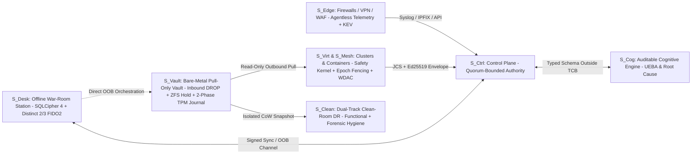

# Asymmetrically Bounded Cyber-Resilience, Pull-Only Data Vaults, and Automated Recovery Verification in Critical Hybrid Infrastructures

**Document Series:** VTI Research — Standalone Executive Brief (`VTI-RES-2026-04`) | **Official DOI:** `10.5281/zenodo.24406146`  
**Author:** **Caio Gonçalves** — *Principal Investigator & Chief Systems Architect, VTI Research (VTI, Brazil)* (https://projectos-system.github.io/vti-research/)  
**Publication Date:** November 2026 — Consolidated Edition `v1.2 — Methodologically Audited`  
**Target Audience:** Boards of Directors, Executive Leadership (CEO / CTO / CIO), Information Security and Business Continuity Leaders (CISO / BCM), Risk Committees, and Infrastructure Architects  
**Formal Ecosystem Scope:** Typed Graph over Algebraic 8-Tuple $\mathcal{E} = (\mathcal{S}_{\mathrm{Edge}}, \mathcal{S}_{\mathrm{Virt}}, \mathcal{S}_{\mathrm{Mesh}}, \mathcal{S}_{\mathrm{Ctrl}}, \mathcal{S}_{\mathrm{Desk}}, \mathcal{S}_{\mathrm{Vault}}, \mathcal{S}_{\mathrm{Clean}}, \mathcal{S}_{\mathrm{Cog}}; \mathcal{L}, \mathcal{T})$  
**Confidentiality Notice on $\mathcal{I}_0$ and Epistemic Stratification (`E1`–`E4`):** *To reconcile open scientific scrutiny with strict operational confidentiality regarding the motivating incident $\mathcal{I}_0$, all private identifiers of the evaluated organization (legal name, internal domains, subnets/IPs, proprietary paths, and credential prefixes) have been suppressed and abstracted into $\mathcal{E}$, referencing nominally only primary public sources and statically audited open-source code (`E1`). This brief strictly separates retrospective empirical motivation (`E2`), specified conditional algebraic properties (`E3`), and operational targets conditioned upon pre-registered empirical trials (`E4`, `B1`–`B13`).*

---

## 1. The Strategic Dilemma of Operational Continuity Under Active Cyber-Sabotage

Organizations operating mission-critical hybrid infrastructures—combining shared-storage virtualization clusters, container meshes with networked volumes, and relational database engines—face a structural breakdown in classical perimeter security and Disaster Recovery (DR) models, summarized in three executive paradoxes:

1. **The Paradox of the Agentless Edge, Valid Credentials, and Audit Blindness:** Contemporary multi-phase extortion campaigns combine *zero-day* exploitation of perimeter appliances incapable of hosting endpoint agents (firewalls, VPN concentrators, and WAF gateways) with *malware-free* intrusions leveraging credentials harvested by *infostealers*. Operating during low-supervision windows (late nights and holidays), adversaries abuse legitimate Remote Monitoring and Management tools (*Living-off-RMM*), load vulnerable signed kernel drivers (*BYOVD*) to neutralize local sensors, silently exfiltrate terabytes (*double extortion*), and suppress native event-logging (`EventLog`) and hypervisor management (`vmms`) services before executing intermittent (*header-only*) encryption across shared storage volumes within minutes.
2. **The Paradox of "Schrödinger's Backup," Coupled Directories, and Command Blackout:** Traditional push-based backup servers or repositories joined to the same directory service and virtualization fabric as production collapse simultaneously during an incident—whether via client-induced self-purge from compromised hosts, network clock tampering (*NTP Time-Jump*) against naive retention locks, directory credential harvesting (`DCSync`), failure of the central security console itself, or silent corruption of virtual disks and B-Tree indexes discovered only during crisis recovery.
3. **The Paradox of Self-Destructive Defense (*Self-DoS*):** Excessively aggressive autonomous response systems (unconstrained *fail-closed* isolation or *ring-0* updates lacking canary stages) introduce the catastrophic risk of turning a false positive, a delayed post-partition command, or compromise of the central controller into the single largest source of systemic downtime—destroying entire cluster quorums.

The executive thesis established in **`VTI-RES-2026-04`** formulates the axiom of **Asymmetrically Bounded Security (*Fail-Closed for Authority and Integrity; Fail-Bounded for Availability*)**: every privileged mutation, sensor deactivation, or backup purge requires canonical cryptographic proof (`RFC 8785 JCS + Ed25519`) and a `2-of-3` FIDO2 hardware quorum from **three distinct human custodians**, whereas all automated containment operates under a **local Safety Kernel** with **end-to-end monotonic resource fencing (`epoch`)**, quorum preservation over versioned membership, an offline administrative **War-Room station** ($\mathcal{S}_{\mathrm{Desk}}$), and conservative transition into restricted recovery states (`RESTRICTED_RECOVERY`).

### 1.1. Empirical Motivation and Design Rationale: 10 Global Macro-Incidents (`2023–2026`)

Serving as empirical problem motivation and hypothetico-deductive engineering rationale (*Design Rationale*), the thirteen controls ($C_1$–$C_{13}$) and eight invariants—partitioned between host-local properties ($I_1^{\mathrm{loc}}, I_2, I_5, I_6, I_7$) and distributed coordination/survival properties ($I_1^{\mathrm{dist}}, I_3, I_4, I_8$)—address ten structural failure classes documented in public macro-incidents between 2023 and 2026:

- **MFA Social Engineering & Hypervisor Sabotage (`Sep/2023`):** Helpdesk MFA resets followed by batch hypervisor encryption demonstrated the necessity of hardware-bound FIDO2 Passkeys, *Break-Glass* temporal governance ($C_2$), and virtual disk header protection ($C_3$).
- **Non-Phishing-Resistant Access & Mass Double Extortion (`Feb/2024`):** Terabyte-scale pre-detonation exfiltration followed by systemic paralysis highlighted the urgency of egress circuit breakers (*Egress Allowlisting*, $C_9$) paired with Clean-Room certification ($C_6$).
- **Zero-Day Perimeter Appliance Campaigns (`2024–2025`) & Malware-Free Infostealers (`May–Jun/2024`):** Intrusions across VPN/Firewall gateways lacking in-guest EDR and silent credential replay proved the mandatory need for agentless edge telemetry with rapid `KEV` correlation and canary *Honey-Tokens* ($C_7, C_{12}$).
- **Re-Infection During Recovery (`Jun/2024`) & Directory Compromise (`Apr–May/2025`):** Latent persistence inside backups and `DCSync` directory attacks reinforced physical isolation of the *Pull-Only* vault outside the domain ($C_4$), dual-track functional + forensic *Clean-Room* certification ($C_6$), and an offline *War-Room* station independent of the central controller ($C_{13}, I_8$).
- **Global Ring-0 Update Outage (`Jul/2024`) & Total Preventive Shutdown (`Sep/2025`):** Simultaneous failure of millions of hosts from a defective kernel logic update and full industrial plant halts due to coarse containment motivated the *User-Mode First* strategy with ringed `WDAC` ($C_{11}$), the blocking `OBSERVE → SHADOW → CANARY → BOUNDED_ENFORCE` rollout pipeline, surgical authenticated-peer amputation ($I_4$), and autonomous local rollback ($I_7$).
- **B2B Privileged Credential Abuse (`Jul/2025`) & `BYOVD + RMM` Operations (`2024–2026`):** Concentrated single-principal destructive authority and combined abuse of vulnerable signed drivers with legitimate remote support software drove the strict requirement for `2-of-3` distinct human FIDO2 custody ($C_5, I_1$), a Zero-Trust signed RMM/tunnel manifest ($C_{10}$), and preventive vulnerable-driver blocking ($C_{11}$).

---

## 2. Cyber-Resilience Architecture Across Thirteen Executive Pillars ($C_1$–$C_{13}$) and Eight Invariants ($I_1$–$I_8$)

We model the protected ecosystem and its survival plane via the algebraic 8-tuple $\mathcal{E} = (\mathcal{S}_{\mathrm{Edge}}, \mathcal{S}_{\mathrm{Virt}}, \mathcal{S}_{\mathrm{Mesh}}, \mathcal{S}_{\mathrm{Ctrl}}, \mathcal{S}_{\mathrm{Desk}}, \mathcal{S}_{\mathrm{Vault}}, \mathcal{S}_{\mathrm{Clean}}, \mathcal{S}_{\mathrm{Cog}})$, orchestrating agentless perimeter telemetry ($\mathcal{S}_{\mathrm{Edge}}$), virtualization clusters ($\mathcal{S}_{\mathrm{Virt}}$), container/NFS meshes ($\mathcal{S}_{\mathrm{Mesh}}$), a central plane treated as potentially compromisable ($\mathcal{S}_{\mathrm{Ctrl}}$), offline *War-Room* administrative stations ($\mathcal{S}_{\mathrm{Desk}}$), a *Bare-Metal Pull-Only* immutable vault ($\mathcal{S}_{\mathrm{Vault}}$), an automated clean room ($\mathcal{S}_{\mathrm{Clean}}$), and an analytical cognitive engine positioned strictly outside the blocking Trusted Computing Base ($\mathcal{S}_{\mathrm{Cog}}$):

1. **Executive Pillar 1 ($C_1$) — Single-Use Cryptographic Capability, Service Protection, and Graduated Heartbeat:** Replaces conventional administrative uninstalls with boot-bound single-use `Ed25519` tokens, monitors critical keys (`EventLog`, `vmms`, `SafeBoot`) via symlink/reparse-point-immune handles, and emits structured `5 s` heartbeats whose absence triggers a graduated verification ladder (preventing blind isolation during legitimate reboots, $I_5$).
2. **Executive Pillar 2 ($C_2$) — *Break-Glass* Temporal Governance, Linearizable Lease Consensus, and End-to-End *Epoch Fencing* ($I_1^{\mathrm{loc}}, I_1^{\mathrm{dist}}, I_2, I_4$):** Subjects out-of-window privileged logons to FIDO2 out-of-band confirmation (`90 s` TTL). Upon confirmed violation without human quorum, requests a linearizable (`Raft`) lease restricting automatic isolation to at most `1` node per failure domain while preserving $Q_{\min}(D, v_{\mathrm{cfg}})$ over versioned membership (discounting `joining`, `leaving`, and `draining` nodes and capping minority partitions at `SUSPECT`), persists `lastAcceptedEpoch_r` to a local WAL before mutating filters, and requires **conjunction** of clean attestation (`CleanAttest`) plus distinct `2-of-3` FIDO2 approval to return from `RESTRICTED_RECOVERY` to `NORMAL`.
3. **Executive Pillar 3 ($C_3$) — Polymorphic Deception, Remote SMB/NFS Attribution, and `[MS-VHDX]` Header Guardian:** Deploys polymorphic canary files tracked by `FileID`/`inode`, resolves the true remote client behind kernel threads (`GUID_ECP_SRV_OPEN` for SMB and `rqstp->rq_addr` via `eBPF` for NFS), and guards the first `1 MiB` of `[MS-VHDX]` containers by requiring authentic hypervisor process lineage and `CRC-32C` structural compliance (supplemented by canaries and $C_4$ if an attacker avoids `offset < 1 MiB`).
4. **Executive Pillar 4 ($C_4$) — *Pull-Only* Physical Vault with Segregated Interfaces (`nic_prod` / `nic_oob`), Unprivileged Staging, and Churn Circuit Breaker:** Isolates the backup repository on *Bare-Metal* hardware outside the corporate directory, dropping `100%` of new inbound `TCP SYN`/`UDP` packets on `nic_prod` (permitting only `ESTABLISHED` traffic from read-only outbound pulls, while emergency commands traverse exclusively the physically segregated `nic_oob` VLAN), ingesting incrementals into quota-bounded staging with `zfs hold` under a delegated account lacking `destroy`/`release` privileges, and automatically freezing historical expiration upon anomalous churn/entropy.
5. **Executive Pillar 5 ($C_5$) — Two-Phase Idempotent `TPM 2.0` Journal, Distinct Triple Custody, and Independent S3 Domain ($I_1^{\mathrm{dist}}, I_3, I_7$):** Ensures cross-reboot temporal monotonicity via a **two-phase journal (`INTENT` $\rightarrow$ `TPM2_NV_Increment` $\rightarrow$ `COMMITTED`) with idempotent *roll-forward*** after abrupt power loss, `NTS (RFC 8915)` diversity, and `RFC 3161` timestamps—distinguishing power interruption (`CLOCK_DEGRADED`) from tampering (`TIME_TAMPER_FREEZE`, which blocks deletions and automatic `PROMOTE_TO_PROD` while preserving isolated `STAGING_RESTORE` in $\mathcal{S}_{\mathrm{Clean}}$). Extraordinary purges require `RFC 8785 JCS` FIDO2 signatures from **3 distinct human custodians** (`2-of-3`, `UP=1`, `UV=1`, valid `CRL_epoch`, fresh `vault_nonce`) plus a `72-hour` cooling delay, complemented by an encrypted off-site S3 Object Lock `COMPLIANCE` replica under an administratively and legally independent account.
6. **Executive Pillar 6 ($C_6$) — Daily Scoped Automated Certification in a Dual-Track Clean Room (*Dual-Track Clean-Room DR*):** Spins up ephemeral microVMs daily inside a null network namespace executing: **(Track A — Functional)** chunk verification, `[MS-VHDX]` `CRC-32C`, `NTFS`/`ext4` mounts, database B-Tree integrity (`pg_amcheck --all --heapallindexed`, `PRAGMA integrity_check`), and synthetic UEFI boot; and **(Track B — Scoped Forensic Hygiene)** static `YARA` scanning and persistence-diff against a golden baseline, issuing signed `Ed25519` attestations (`GOLD_VERIFIED` or `RECOVERABLE_NEEDS_SANITIZATION`) with measured test-environment RTO/RPO.
7. **Executive Pillar 7 ($C_7$) — Deterministic Ordinal Prioritization Index ($R_{\mathrm{VTI}} \in [0,100]$) and *Hostile-Safe* Intelligence Ingestion:** Ranks remediation queues combining active exploitation (`KEV`), `EPSS`, `CVSS` (with fail-safe imputation for freshly disclosed zero-days), and topological exposure over `CycloneDX` SBOMs, ingesting external detection feeds under strict compute budgets, contextual weighting, and mandatory TTLs.
8. **Executive Pillar 8 ($C_8$) — Non-TCB Cognitive Architecture ($I_6$), Zero-Cost/Offline 4-Tier Routing (`S/A/B/C`), and Deterministic Dual-Stage Compressor:** Keeps native medullary reaction (target $p_{99} < 50\text{ ms}$) inside an isolated process with a closed schema parser (`deny_unknown_fields`) and cryptographic exclusion of $\mathcal{S}_{\mathrm{Cog}}$ ($\mathcal{K}_{\mathrm{TCB}} \cap \mathcal{K}(\mathcal{S}_{\mathrm{Cog}}) = \emptyset$). Analytical layers enforce **Quality-Gated 4-Tier Multi-Provider Routing (`S/A/B/C`, zero-downgrade on `Tier S`)** with an optional server-side zero-marginal-cost lock (`free_only = true`), local DLP pseudonymization, two-phase batch classification (`dry_run -> bulk_apply` immutably preserving human `OPERATOR` classifications), and **deterministic fallback to a `100%` offline on-device runtime** on $\mathcal{S}_{\mathrm{Desk}}$. Prior to inference, a **Deterministic Dual-Stage Telemetry & Prose Compressor** deduplicates repetitive `ETW`/`Syslog`/`eBPF` logs (projected target `60%–90%`) and prunes technical prose (`pt-BR/EN`, projected target `35%–65%`) while safeguarding `IPs`, `SHA-256` hashes, `CVEs`, timestamps, tables, and code blocks via **reversible *prefix-free* null-byte escaping (`\x00`) and `128-bit` nonce-sanitized sentinels** validated by a `SHA-256` manifest.
9. **Executive Pillar 9 ($C_9$) — Anti-Exfiltration Circuit Breaker and Double-Extortion Containment:** Enforces egress allowlisting on database and hypervisor hosts, blocking unauthorized bulk transfer utilities (`rclone`, `s5cmd`, `megacmd`) and severing outbound streams whose `Bytes-Out / Bytes-In` ratio breaches `SHADOW`-calibrated profiles.
10. **Executive Pillar 10 ($C_{10}$) — Zero-Trust Signed RMM and Reverse-Tunnel Manifest:** Permits only remote support binaries and reverse tunnels listed in the signed corporate manifest (verified via code signature/hash and passive `TLS SNI/JA4` metadata, avoiding destructive TLS MITM on critical flows), blocking unauthorized commercial RMMs and shadow tunnels.
11. **Executive Pillar 11 ($C_{11}$) — 4-Ring Preventive Anti-`BYOVD` Hardening via `WDAC`:** Neutralizes known vulnerable signed `.sys` drivers using native code-integrity policies (`WDAC / CIPolicy`) promoted across four rings (`Inventory → Audit → Canary → Enforce`) with mandatory pre-validation of critical boot and storage drivers.
12. **Executive Pillar 12 ($C_{12}$) — Agentless Perimeter Telemetry ($\mathcal{S}_{\mathrm{Edge}}$) and Canary *Honey-Token* Mesh:** Continuously ingests `Syslog`/`IPFIX`/API telemetry from firewalls and VPN concentrators correlating exposed services against actively exploited vulnerabilities within minutes, combined with privilege-free canary credentials (*Honey-Tokens*) filtered deterministically against authenticated internal scanners.
13. **Executive Pillar 13 ($C_{13}$ & $I_8$) — *ITDR* with `LOG_GAP_ALERT` and Offline *War-Room* Administrative Station ($\mathcal{S}_{\mathrm{Desk}}$):** Monitors illicit directory replication (`DCSync`) and external control planes, raising a promotion-blocking `LOG_GAP_ALERT` upon audit suppression. Simultaneously ensures command survival via $\mathcal{S}_{\mathrm{Desk}}$ stations backed by **`SQLCipher 4` (`AES-256-CBC + HMAC-SHA512`, `256,000` PBKDF2 iterations)** + `DPAPI` envelope + FIDO2 binding (`temp_store=MEMORY` and RAM `zeroize`), enabling local `2-of-3` signing and direct `nic_oob` orchestration of `STAGING_RESTORE` on $\mathcal{S}_{\mathrm{Vault}}$ even under total loss of $\mathcal{S}_{\mathrm{Ctrl}}$.

---

## 3. Executive Risk, Operational Continuity, and Promotion Governance Matrix

| Governance & Risk Dimension | Traditional Posture (Perimeter Defense + Push Backup) | Posture Under Integrated Pillars ($C_1$–$C_{13}$ & $I_1$–$I_8$) | Verifiable Operational Property |
| :--- | :--- | :--- | :--- |
| **Edge Intrusion, Infostealers, `BYOVD`, and RMM** | Agentless gateways, leaked credentials, vulnerable drivers, and signed RMMs bypass standard AV. | Agentless KEV telemetry ($C_{12}$), Honey-Tokens, 4-ring `WDAC` ($C_{11}$), and RMM manifest ($C_{10}$). | Early malware-free detection and preventive blocking of cataloged vulnerable drivers. |
| **Off-Hours Sabotage & Double Extortion** | Stolen credentials exfiltrate terabytes and disable `EventLog`/`vmms`/sensors in minutes. | FIDO2 Break-Glass ($C_2$), single-use capability ($C_1$), and Egress circuit breaker ($C_9$). | Containment of anomalous egress and structural guard against telemetry silencing. |
| **Intermittent (*Header-Only*) Encryption on Virtual Disks** | Encrypts headers of terabyte `.vhdx` files locally or over SMB/NFS without raising global entropy. | `[MS-VHDX]` header guardian (`< 1 MiB`), SMB/NFS remote attribution, and polymorphic canaries ($C_3$). | Surgical amputation of only the offending peer while preserving healthy quorum ($I_4$). |
| **Backup Survival Under Domain Fall or NTP Tampering** | Compromised client zeroes retention, jumps NTP clock, or wipes co-located hypervisor volumes. | *Bare-Metal Pull-Only* ($C_4$), 2-phase `TPM 2.0` journal + 3-person `2-of-3` FIDO2 quorum (72h, $C_5$). | Zero production deletion surface; `STAGING_RESTORE` preserved under `TIME_TAMPER_FREEZE` ($I_3$). |
| **Self-DoS Risk & Central Control Plane Outage** | Compromised controller, stale post-partition commands, or central outage paralyze operations. | Local Safety Kernel with resource `epoch fencing` ($I_1$), `RESTRICTED_RECOVERY` ($I_2$), and `SQLCipher 4` $\mathcal{S}_{\mathrm{Desk}}$ ($I_8$). | Immunity to delayed orders, fail-bounded offline autonomy ($I_5$), and offline War-Room command. |
| **Reliability of Contractual RTO / RPO** | Based on declarative *"Job OK"* status, failing via silent B-Tree corruption or dormant persistence. | Daily dual-track *Clean-Room* certification ($C_6$: functional + forensic hygiene) signed via `Ed25519`. | Empirically measured 24h RTO/RPO without re-introducing known persistence artifacts. |

### 3.1. Graduated Rollout Pipeline and the Six Blocking Engineering Gates

No blocking policy enters production abruptly. Transition strictly follows four stages—**`OBSERVE` $\rightarrow$ `SHADOW` $\rightarrow$ `CANARY` $\rightarrow$ `BOUNDED_ENFORCE`**—governed by the pre-registered falsifiable experimental protocol (`B1`–`B13`, including adversarial testing of `\x00` sentinel collision resistance, exact preservation of `CVE/IP/SHA-256`, `OPERATOR` precedence, and offline operation in `B8`) and six blocking gates: **(1)** linearizable (`Raft`) lease granting + persisted per-resource *epoch fencing* over versioned membership; **(2)** two-phase idempotent `TPM 2.0` journal separating `STAGING_RESTORE` (null network) from `PROMOTE_TO_PROD`; **(3)** `2-of-3` FIDO2 quorum of 3 distinct human custodians over `RFC 8785 JCS` + independent off-site S3 `COMPLIANCE` account; **(4)** verified `SQLCipher 4` persistence on $\mathcal{S}_{\mathrm{Desk}}$ over segregated `nic_oob` plus quarterly passwordless re-enrollment drills; **(5)** fail-bounded offline autonomy without fail-open (`offline_max_ttl` preserving local guards), `deny_unknown_fields` parser, and `TELEMETRY_DROPPED` signaling; and **(6)** zero open `LOG_GAP_ALERT` combined with `0` observed false positives across independent blocks during live `SHADOW` validation (`95% CI` $p_{\mathrm{FP}} \le 3 / N_{\mathrm{eff}}$).

---

## 4. Evolutionary Governance: International Standards Alignment and Maturity Roadmap (`M-FUT-1` to `M-FUT-6`)

The architecture aligns thoroughly with **NIST CSF 2.0**, **NIST SP 800-209** (storage infrastructure security), **NIST SP 800-184** (cybersecurity event recovery), **ISO/IEC 22301**, **ISO/IEC 27031:2025** (*ICT Readiness for Business Continuity*), and **Sheltered Harbor**. For pragmatic adoption without operational disruption, the study defines six prospective maturity tracks:

| Code | Recommended Maturity Track | Residual Risk Addressed | Expected Executive & Operational Benefit |
| :---: | :--- | :--- | :--- |
| **`M-FUT-1`** | **Formal `TLA+` / `PlusCal` Model Checking of Leases, `Epoch Fencing`, and TPM Journal** | Subtle distributed race conditions under multiple asymmetric partitions and rare failure interleavings. | Automated mathematical proof of deadlock freedom and preservation of invariants $I_1$–$I_8$. |
| **`M-FUT-2`** | **Minimalist HVCI-Compatible Kernel Minifilter with ELAM Registration** | Novel *zero-day* kernel exploits executing in *ring-0* (not yet covered by $C_{11}$ `WDAC` blocklists). | Synchronous prevention on the I/O path and early-launch anti-malware boot protection. |
| **`M-FUT-3`** | **Continuous Hardware Remote Attestation via `TPM 2.0` / `vTPM` PCRs** | Health-state spoofing by a host whose OS kernel was subverted prior to agent startup. | Silicon-rooted cryptographic binding of boot integrity and active host policy. |
| **`M-FUT-4`** | **Byzantine Fault-Tolerant Geo-Redundant Vault (*Cloud-of-Clouds*)** | Simultaneous physical destruction of the primary site and compromise/outage of a single S3 provider. | Erasure coding + secret sharing tolerating loss or corruption of individual cloud providers. |
| **`M-FUT-5`** | **Automated On-Demand *Clean-Room Failover* Orchestration** | High manual rebuild latency for networks, DNS, and clean identity while primary hardware undergoes forensics. | Assisted hydration of vital services on clean secondary infrastructure within target MBCO. |
| **`M-FUT-6`** | **Continuous *Chaos Security Engineering* & Quarterly FIDO2 Re-Enrollment** | Silent configuration drift and obsolescence of out-of-band runbooks and FIDO2 custody procedures. | Auditable quarterly verification of human and technical rescue readiness (`War-Room Offline`) without AD/DNS. |

---

## 5. Practical Governance Directives for Boards, CISOs, and CTOs

1. **Decouple Backup and Crisis-Station Failure Domains Immediately:** No critical recovery repository ($\mathcal{S}_{\mathrm{Vault}}$) may reside as a VM inside the protected cluster or authenticate against the corporate directory, and technical leadership must maintain hardened offline *War-Room* stations ($\mathcal{S}_{\mathrm{Desk}}$ with `SQLCipher 4`) independent of the central controller.
2. **Replace Backup Job Status with Daily Dual-Track Certificates:** Require auditable monthly KPIs distinguishing *backup written* from *backup restored inside a Clean Room with verified database B-Tree integrity (Track A) and forensic persistence scanning (Track B)*.
3. **Gate Automated Blocking Behind `OBSERVE → SHADOW → CANARY → BOUNDED_ENFORCE`:** Every behavioral, entropy, egress, or `WDAC` rule must demonstrate `FP = 0%` across real maintenance, live migration, and replication windows prior to active enforcement, remaining blocked whenever any `LOG_GAP_ALERT` is open.
4. **Mandate Distinct Triple Human Custody (`2-of-3`) with Zero Single-Authority Bottlenecks:** No individual account—nor two hardware keys held by one person, nor the central management server itself—may possess unilateral technical capability to purge immutable retention or isolate multiple nodes beyond local blast-radius budgets.
5. **Defend Agentless Perimeter, Egress, and Out-of-Band Rescue Simultaneously:** Combine continuous perimeter appliance monitoring (`KEV`), canary *Honey-Tokens*, and egress circuit breakers against double extortion with quarterly `STAGING_RESTORE` and FIDO2 re-enrollment drills executed without DNS, Active Directory, or WAN connectivity.

> **Companion Scientific Manuscript:** For the complete algebraic specification of the 8-tuple $\mathcal{E}$, falsifiable formulation of the thirteen threat hypotheses $H_1$–$H_{13}$, equations of the eight formal invariants $I_1$–$I_8$, pre-registered experimental protocol (`B1`–`B13`), threats to validity, Adapted CRediT disclosure, and traceability matrix across all **32 verified primary scientific and normative sources (`[R01]`–`[R32]`)**, consult the full technical paper **`VTI-RES-2026-04`** (`DOI: 10.5281/zenodo.24406146`).
