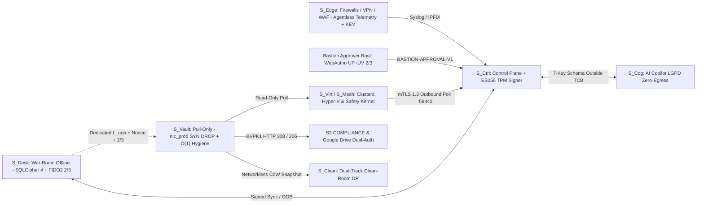

# Asymmetrically Bounded Cyber Resilience, Zero-Inbound Remote Containment, Non-TCB Cognitive Triage, and Multi-Cloud Immutable Vaults in Critical Hybrid Infrastructures

**Document Series:** VTI Research — Standalone Executive Brief (`VTI-RES-2026-04`)  
**Author:** **Caio Gonçalves** — *Principal Investigator & Chief Systems Architect, VTI Research (VTI, Brazil)* (https://projectos-system.github.io/vti-research/)  
**Official Study DOI (`v3.0` / Concept DOI):** [`10.5281/zenodo.24452820`](https://doi.org/10.5281/zenodo.24452820) *(Concept DOI: [`10.5281/zenodo.24406145`](https://doi.org/10.5281/zenodo.24406145) · Supersedes `v1.0`: `10.5281/zenodo.24406146`)*  
**Publication Date:** November 2026 — Consolidated Edition `v3.0 — Executable Evidence Bastion OS v1.3.0`  
**Target Audience:** Boards of Directors, Executive Leadership (CEO / CTO / CIO), Information Security & Business Continuity Leaders (CISO / BCM), Risk & Infrastructure Architecture Committees  
**Formal Ecosystem Scope:** Typed Graph over Algebraic 8-Tuple $\mathcal{E} = (\mathcal{S}_{\mathrm{Edge}}, \mathcal{S}_{\mathrm{Virt}}, \mathcal{S}_{\mathrm{Mesh}}, \mathcal{S}_{\mathrm{Ctrl}}, \mathcal{S}_{\mathrm{Desk}}, \mathcal{S}_{\mathrm{Vault}}, \mathcal{S}_{\mathrm{Clean}}, \mathcal{S}_{\mathrm{Cog}}; \mathcal{L}, \mathcal{T})$  
**Note on Confidentiality of $\mathcal{I}_0$, Re-Identification Prevention, and Epistemic Stratification (`E1`–`E4`):** *To reconcile open scientific scrutiny with strict operational confidentiality over the motivating incident $\mathcal{I}_0$, all private identifiers, server names, and rare quasi-identifiers of the evaluated organization were suppressed or generalized over $\mathcal{E}$, referencing by name only primary public sources and verified open code (`E1`). This brief strictly preserves the epistemic boundaries of its companion scientific paper: it separates executable evidence in isolated laboratory suites (`E1`: `Bastion OS v1.3.0`, `301` backend tests / `61` suites, `254` E2E tests / `28` suites, batteries `B1`–`B20` in `:memory:`/`os.tmpdir()` with local mocks for TPM/WFP/Google Drive/LLM), existential retrospective motivation (`E2`, $N=1$), conditional formal properties (`E3`), and longitudinal production field validation (`E4`: `G-PERF` `60 min` and `SHADOW` mode $N_{\mathrm{blk}} \ge 300$).*

---

## 1. The Strategic Dilemma of Operational Continuity Under Active Cyber Sabotage

Organizations operating mission-critical hybrid infrastructures face a structural breakdown in classical perimeter defense, remote response, and Disaster Recovery (DR) models, captured by four executive paradoxes:

1. **The Agentless Edge, Valid Credential, and Audit Blindness Paradox:** Contemporary extortion campaigns combine zero-day exploitation on agentless perimeter appliances with malware-free intrusions using infostealer-harvested credentials. Operating off-hours, adversaries abuse legitimate remote support tools (*Living-off-RMM*), load vulnerable signed drivers (*BYOVD*), exfiltrate terabytes (*double extortion*), suppress `EventLog`/`vmms`, and execute intermittent (*header-only*) encryption across `[MS-VHDX]` virtual disks within minutes.
2. **The "Schrödinger's Backup," Coupled Domain, and Command Blackout Paradox:** Traditional push-based backup servers or appliances joined to the same directory and virtualization fabric collapse alongside production — whether via client-driven self-purge, NTP clock jumps, `DCSync` extraction, poisoned bidirectional cloud sync (`DriveFS`/`OneDrive`), disk exhaustion (`ENOSPC`), central console outage, or silent corruption discovered only during crisis recovery.
3. **The Remote Containment and Self-Inflicted Denial-of-Service (*Self-DoS*) Paradox:** Remote isolation actions lacking phishing-resistant approval, monotonic epoch sequencing, or quorum reservation allow a compromised control plane — or a delayed post-partition packet — to isolate too many nodes and collapse shared-storage hypervisor clusters.
4. **The AI Triage Paradox (*Prompt Injection* & LGPD/Privacy Leakage):** Coupling generative models directly to blocking engines exposes containment to manipulation via malicious logs (*Indirect Prompt Injection*), whereas shipping raw corporate telemetry to external cloud LLMs violates data governance and statutory privacy mandates.

The thesis demonstrated in **`VTI-RES-2026-04 v3.0`** establishes the axiom of **Asymmetrically Bounded Security (*Fail-Closed for Authority and Integrity; Fail-Bounded for Availability*)**: every governed remote containment or purge requires hardware-bound `2-of-3` physical approval (`Bastion Approver`, `UP=1+UV=1`), `ES256` keys inside `TPM 2.0` hardware (forbidding `SOFTWARE_KEY` in production), and monotonic epoch fencing; all artificial intelligence remains **100% outside the TCB** ($I_6$) operating under **LGPD Zero-Egress** by default (local `Ollama`); and *Pull-Only* vaults unify `S3 Object Lock COMPLIANCE`, `Google Drive Dual-Auth` (`BVPK1` `HTTP 308`/`206`), **`O(1)` Anti-`ENOSPC` Disk Hygiene**, and **DR Zero-Touch**.

### 1.1. Empirical Motivation and Design Rationale: 10 Global Macro-Incidents (`2023–2026`)

The thirteen controls ($C_1$–$C_{13}$) and eight invariants ($I_1^{\mathrm{loc}}/I_1^{\mathrm{dist}}$–$I_8$) address ten structural failure classes documented in public macro-incidents between 2023 and 2026:
- **MFA Social Engineering & Hypervisor Sabotage (`Sep/2023`):** motivated hardware-bound FIDO2 Passkeys, Break-Glass ($C_2$), `Bastion Approver` (`F3`/`F7`), and the `[MS-VHDX]` guardian ($C_3$).
- **Non-Phishing-Resistant Remote Access & Double Extortion (`Feb/2024`):** motivated egress exfiltration circuit breakers ($C_9$) and dual-track Clean-Room DR ($C_6$).
- **Agentless Edge Gateways (`2024–2025`) & Malware-Free Infostealers (`May–Jun/2024`):** motivated agentless edge collection (`KEV`, $C_{12}$), daily $R_{\mathrm{VTI}}$ prioritization ($C_7$), and Honey-Tokens.
- **Reinfection During Restore (`Jun/2024`) & Directory Collapse (`Apr–May/2025`):** motivated out-of-AD Pull-Only vaults ($C_4$), Clean-Room validation ($C_6$), and the War-Room Offline workstation ($C_{13}, I_8$).
- **Global Ring-0 Outage (`Jul/2024`) & Preventive Shutdown (`Sep/2025`):** motivated 4-ring `WDAC` promotion ($C_{11}$), `OBSERVE -> SHADOW -> CANARY -> BOUNDED_ENFORCE` rollout, domain budget $B_{\mathrm{dom}}$ ($Q_{\min}+1$, $I_4$), and local rollback ($I_7$).
- **B2B Credential Abuse (`Jul/2025`) & `BYOVD + RMM` (`2024–2026`):** motivated distinct `2-of-3` human custody ($C_5, I_1$), Zero-Trust RMM manifests ($C_{10}$), and vulnerable driver blocklists ($C_{11}$).

---

## 2. Executable `v1.3.0` Architecture Across Thirteen Pillars ($C_1$–$C_{13}$) and Eight Invariants ($I_1$–$I_8$)

1. **Pillar 1 ($C_1$) — Single-Use Capability, `EvtSubscribe` + `14` `Sigma` Rules & Safe Anti-`ENOSPC` Disk Hygiene (`Wave 9`):** Enforces single-use `Ed25519` capabilities, monitors critical services, runs `BastionSentinelProbe.exe` (`T1`–`T3`, 14 `Ed25519`-signed `Sigma` rules), and deploys `DiskHygieneEngine`: read-only `Tier 0` telemetry (`statfs` + `DELETED_OPEN_FD >= 10 MiB`), **6 inviolable locks** (anti-symlink, OneDrive placeholder `0x00400000`, `PendingReboot`/active backup, `Btrfs/ZFS >= 90%`, Server 2012 `NT 6.2` compatibility, `< 48h` retention), dynamic `Tier 3` protection (`.bvlt`, `.bvpk`, `bastion.db*`, decoys, `.git`), signed `Tier 1` cleanup, and `O(1)` atomic `Tier 2` quarantine with `SHA-256` rollback.
2. **Pillar 2 ($C_2$) — Break-Glass, OS Off-Hours (`W3`) & Zero-Inbound Governed Remote Containment `BASTION-FLEET-CMD-V3` (`F3`–`F7`):** Audits off-hours sessions in Zero-Block mode (`W3`), provides literal-IP shortcuts (`F1`) and read-only Hyper-V inventory (`F2`), and implements **`BASTION-FLEET-CMD-V3`**: 5 purpose-segregated `ES256` keys in `TPM 2.0`/CNG (`SOFTWARE_KEY` forbidden in prod), linearizable `BASTION-SECSTATE-V1` sequencer, isolated Rust `Bastion Approver` (`https://approver.bastion`, `UP=1+UV=1`, hardware-bound, `issuer != approvers`, `2-of-3`), `START_EXECUTION` barrier + `PRAGMA synchronous = FULL` journals, full IPv4/IPv6/UDP/QUIC/ICMP isolation preserving `CONTROL` (`:59440`) and `OOB_RESCUE` with `<= 90 s` fallback to `RESTRICTED_RECOVERY` ($I_2$), `B_dom` (`>= Q_min + 1`) + anti-ABA `fencingToken` (`F5`), non-destructive Hyper-V executor (`F6`, hard veto `DESTRUCTIVE_HYPERV_ACTION_FORBIDDEN`), and `GENESIS`/`72 h`/`DR_RESEED` custody lifecycle (`F7`).
3. **Pillar 3 ($C_3$) — Anti-`TOCTOU` Living Decoy Mesh, `[MS-VHDX]` Guardian & Systemic Interface `O1`–`O4`:** Provisions polyglot decoys (`0 ms` alert + `RETENTION_FROZEN` on $\ge 2$ mutations), attributes remote SMB/NFS offenders (`GUID_ECP_SRV_OPEN`/`eBPF`), and guards `[MS-VHDX]` `< 1 MiB`. Interface `O1`–`O4` links to the `v3.0.6` forensic engine (whose complete `GF(2)` algebra, 4-way accounting, `MCMF` $\Delta$ margin, and `regf` surgery are published autonomously in **`VTI-RES-2026-05`**).
4. **Pillar 4 ($C_4$) — Pull-Only Vault, `BVLT1`/`BVPK1`, `DR Zero-Touch` & `Google Drive Dual-Auth` (`Wave 11`):** Drops `100%` of inbound `SYN` on `nic_prod`, encrypts via `scrypt` + `HKDF-SHA256` + `AES-256-GCM` (`FASTCDC_NC2` opt-in under `G-CDC`), seals schedules in `backup_plan_schedule_keys` for post-reboot **`DR Zero-Touch`**, supports `S3 Object Lock COMPLIANCE` + Local-Cache Assist, and adds native **`Google Drive Dual-Auth`**: **Mode A (`WORKSPACE_SERVICE_ACCOUNT`)** via `JWT RS256` in Shared Drive enforcing `canDelete === false` (`APPEND_ONLY_CONTRIBUTOR_VERIFIED`) and **Mode B (`PERSONAL_OAUTH_PKCE`)** via `OAuth 2.0 PKCE S256` + 2FA (`drive.file`, `contentRestrictions.readOnly`, 30d Trash), resumable `BVPK1` `HTTP 308` uploads, `700 GiB/24h` sliding quota guard, strict `HTTP 206` selective restore, Anti-Sync Poisoning (`DriveFS`), and `pull-gdrive` Python CLI (explicitly noting that Personal Drive 30d Trash does not equal legal `S3 Object Lock COMPLIANCE`).
5. **Pillar 5 ($C_5$) — Idempotent `TPM 2.0` Journal, Triple Custody & Anti-Rollback Witness:** Separates integrity, authenticity, immutability, and anti-rollback freshness (`INTENT` $\rightarrow$ `TPM2_NV_Increment` $\rightarrow$ `COMMITTED` + `NTS` + `RFC 3161`) plus External Freshness Witness (`STATE_ROLLBACK_DETECTED` vs `WITNESS_UNREACHABLE_DEGRADED`).
6. **Pillar 6 ($C_6$) — Daily Dual-Track Clean-Room Certification:** Runs Track A (5 functional tiers through `pg_amcheck`/UEFI boot) and Track B (`YARA-Forge` + persistence diff) in a zero-network namespace, issuing scoped `Ed25519` attestations (`GOLD_VERIFIED` / `RECOVERABLE_NEEDS_SANITIZATION`).
7. **Pillar 7 ($C_7$) — $R_{\mathrm{VTI}} \in [0,100]$ Prioritization & 3-Degree Threat Intel:** Combines `KEV/EPSS/CVSS` and exposure with *MISP Warninglists* as an auditable confidence modifier (never silent suppression) under strict anti-SSRF/anti-redirect guards.
8. **Pillar 8 ($C_8$) — Continuous AI Triage Copilot (`Wave 7-b` `T4`–`T11`) Outside TCB ($I_6$) & LGPD Zero-Egress:** Enforces $\mathrm{Exec}=0$ outside the TCB, 4-Tier routing (`free_only` = `$0.00`), dual-stage Ponytail compressor, `ai_triage_queue` (`64`, `12/h/host`, `60/h/global`), anti-poisoning Context Builder (`OBSERVED_SENSOR_FACT` vs `[BEGIN_UNTRUSTED_DATA]`), closed 7-key schema, **5 read-only tools** isolated per tenant/host, fail-safe dual consensus (`AI_CONSENSUS_UNAVAILABLE`), non-authoritative `BENIGN_LIKELY` (never auto-closes incidents), `T9` corpus (`20` cases, 3 canaries), and **LGPD Zero-Egress** by default (local `Ollama`; cloud blocked until Step-Up MFA + DPA + `HKDF+HMAC` pseudonymization across 6 fields).
9. **Pillars 9–13 ($C_9$–$C_{13}$ & $I_8$):** Egress exfiltration breaker ($C_9$), Zero-Trust RMM/tunnel manifest ($C_{10}$), 4-ring `WDAC` anti-`BYOVD` ($C_{11}$), agentless edge telemetry + Honey-Tokens ($C_{12}$), and ITDR + `LOG_GAP_ALERT` anti-`ENOSPC` (`sentinel_gap_slot.bin`) + `ZERO_INSTANCE_DATA_BEFORE_AUTH` + `Windows Hello` posture + forensic `STARTTLS` e-mails + War-Room Offline $\mathcal{S}_{\mathrm{Desk}}$ (`SQLCipher 4` + `DPAPI` + `FIDO2` `2-of-3`).

---

## 3. Executive Risk Matrix, `v1.3.0` Executable Evidence (`B1`–`B20`) & Promotion Gates

| Governance & Risk Dimension | Traditional State | State Under `Bastion OS v1.3.0` | Verified Evidence (`E1`) & Boundary (`E4`) |
| :--- | :--- | :--- | :--- |
| **Remote Containment & *Self-DoS* Risk** | Unilateral console commands collapse quorums or replay stale orders post-partition. | `BASTION-FLEET-CMD-V3` (`F3`–`F7`): `Bastion Approver` `2-of-3`, `ES256` TPM, `START_EXECUTION`, `B_dom >= Q_min+1`, `<= 90 s` fallback, non-destructive Hyper-V. | `G-CMD` (`13/13` + `2/2` E2E `PASS` with TPM/WFP mocks); live physical TPM/WFP field validation in `E4`. |
| **AI Triage, *Prompt Injection* & LGPD** | Blocking-coupled agents suffer log injection and leak PII to external clouds. | `Wave 7-b` (`T4`–`T11`): outside TCB ($I_6$), anti-injection fences, 5 RO tools, dual consensus, neutral `BENIGN_LIKELY`, **LGPD Zero-Egress**. | `G-AI-TRIAGE` (`19/19` + `1/1` E2E `PASS`, `T9` `20` cases); live production inference in `E4`. |
| **Multi-Cloud Backup, Google Drive & `ENOSPC`** | `DriveFS` syncs ransomware, `HTTP 403` stalls replication, full disks break alerts. | `BVLT1`/`BVPK1` `HTTP 206`, `DR Zero-Touch`, `Google Drive Dual-Auth` (`HTTP 308`/`206` + `700 GiB/24h` + `pull-gdrive`) & `DiskHygieneEngine` `O(1)`. | `G-GDRIVE-VAULT` (`6/6` `TC-B20`), `G-DISK-HYGIENE` (`7/7`), `B15`/`B16`/`B19` `PASS` in `os.tmpdir()`. |
| **Intermittent `[MS-VHDX]` Encryption** | *First-N* attacks shatter `.vhdx` BATs within minutes. | `< 1 MiB` guardian, anti-`TOCTOU` decoy mesh, and `O1`–`O4` interface to `v3.0.6` engine. | `B14`/`B17` `PASS`; formal `GF(2)`/`MCMF`/Multi-FS proofs & `B1`–`B6` in **`VTI-RES-2026-05`**. |

### 3.1. Graduated Rollout Pipeline, `v1.3.0` Suites (`E1`), and Longitudinal Gate (`E4`)
No disruptive policy enters production abruptly. At `Level E1`, **`Bastion OS v1.3.0`** passes **`58` files / `61` suites / `301/301` backend tests**, **`14` files / `28` suites / `254/254` E2E tests**, **`20/20` executable batteries (`B1`–`B20`)**, `vite build` (`0` warnings, `0` CDNs), and `cargo check --offline` (exit `0`, incl. `bastion-approver`). At `Level E4`, automatic containment promotion strictly requires **`OBSERVE` $\rightarrow$ `SHADOW` $\rightarrow$ `CANARY` $\rightarrow$ `BOUNDED_ENFORCE`** conditioned on `LOG_GAP_ALERT = 0`, continuous `60 min` `G-PERF`, and `FP_obs = 0` over $N_{\mathrm{blk}} \ge 300$ independent `SHADOW` blocks ($p_{\mathrm{FP}} \le 3/N_{\mathrm{eff}}$ via block bootstrap with Holm-Bonferroni).

---

## 4. Evolutionary Maturity Roadmap (`M-FUT-1` to `M-FUT-6`)

| Code | Recommended Maturity Milestone | Residual Risk Addressed | Expected Executive & Operational Benefit |
| :---: | :--- | :--- | :--- |
| **`M-FUT-1`** | **Formal `TLA+` / `PlusCal` Verification of `BASTION-FLEET-CMD-V3`, `B_dom` & TPM Journal** | Subtle distributed race conditions under asymmetric multi-partitions. | Automated mathematical proof of deadlock freedom and $I_1$–$I_8$ preservation. |
| **`M-FUT-2`** | **HVCI-Compatible Minimal Filesystem Filter Driver & ELAM Registration** | Uncataloged ring-0 zero-day exploits outside `WDAC` blocklists. | Synchronous I/O-path prevention and early-launch anti-malware protection. |
| **`M-FUT-3`** | **Continuous Hardware `TPM 2.0` / `vTPM` Remote Attestation** | Health spoofing by hosts compromised before agent launch. | Silicon-rooted cryptographic binding of boot integrity and active policy. |
| **`M-FUT-4`** | **Byzantine Fault-Tolerant Geo-Redundant Vault (*Cloud-of-Clouds*)** | Simultaneous primary site loss and single-cloud compromise/outage. | Multi-provider erasure coding + secret sharing. |
| **`M-FUT-5`** | **Automated On-Demand Clean-Room Failover Orchestration** | High human latency rebuilding clean network, DNS, and identity infrastructure. | Assisted hydration of Tier-0 services within agreed MBCO. |
| **`M-FUT-6`** | **Chaos Security Engineering & Live Physical TPM / Cloud Drills** | Configuration drift, stale OOB runbooks, and CI mock reliance. | Continuous end-to-end validation over physical `TPM 2.0`, `WFP`/`nftables`, and live clouds. |

---

## 5. Actionable Governance Directives for Boards, CISOs, and CTOs

1. **Enforce Hardware-Bound Quorum Remote Containment with Zero `SOFTWARE_KEY` in Production:** Mandate `Bastion Approver` (`UP=1+UV=1`, non-syncable `2-of-3` keys across distinct custodians), physical `TPM 2.0` `ES256` sequencing, and absolute prohibition of `Remove-VM` / `Remove-VMSnapshot`.
2. **Keep All AI Strictly Outside the TCB Under LGPD Zero-Egress by Default:** Standardize on local `Ollama`, forbid optimistic AI labels (`BENIGN_LIKELY`) from closing incidents, and require Step-Up MFA + DPA + 6-field `HKDF+HMAC` pseudonymization for any opt-in cloud triage.
3. **Separate Pull-Only Vaults, Legal `S3 COMPLIANCE` vs. Google Drive, and Anti-`ENOSPC` Hygiene:** Use `Google Drive Dual-Auth` (`Workspace Contributor` / `PKCE drive.file`) + `pull-gdrive` CLI as an accessible redundant tier while keeping independent-account `S3 Object Lock COMPLIANCE` for statutory immutability and blocking bidirectional sync folders (`DriveFS`/`OneDrive`).
4. **Enable `DR Zero-Touch` and Daily Dual-Track Clean-Room Certification:** Eliminate manual password re-entry after reboots via `backup_plan_schedule_keys` (`AES-256-GCM` / `DPAPI`) and verify backups daily (Track A functional + Track B `YARA`).
5. **Preserve Epistemic Boundaries and Drill Offline Recovery Quarterly:** Require `SHADOW` ($N_{\mathrm{blk}} \ge 300$) before `BOUNDED_ENFORCE`, enforce `ZERO_INSTANCE_DATA_BEFORE_AUTH` on public routes, and run quarterly War-Room drills with `Bastion Desktop` (`SQLCipher 4`) and `BastionRescuePortable v3.0`.

> **Companion Scientific Manuscripts:** For the full formal 8-tuple $\mathcal{E}$, specifications $C_1$–$C_{13}$ and $I_1$–$I_8$, `B1`–`B20` matrix, *Threats to Validity*, and **63 verified primary references (`[R01]`–`[R63]`)**, see **`VTI-RES-2026-04` (`v3.0`, DOI `10.5281/zenodo.24452820` / Concept DOI `10.5281/zenodo.24406145`)**. For the standalone single-pass `[MS-VHDX]` forensic reconstruction theory (`GF(2)` `CRC-32C`, 4-way accounting, residual `MCMF` $\Delta$, Multi-FS, and `regf` surgery), see **`VTI-RES-2026-05` (`v1.0`, DOI `10.5281/zenodo.24452824`)**.
