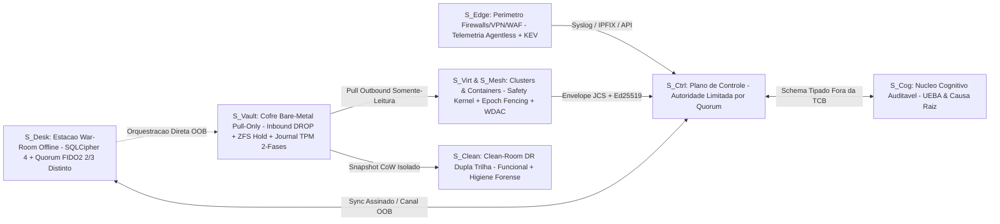

# Resiliência Cibernética Assimetricamente Limitada, Cofres de Dados Pull-Only e Verificação Automatizada de Recuperação em Infraestruturas Híbridas Críticas

**Série Documental:** VTI Research — Dossiê Executivo Autônomo (`VTI-RES-2026-04`) | **DOI Oficial:** `10.5281/zenodo.24406146`  
**Autor:** **Caio Gonçalves** — *Principal Investigator & Chief Systems Architect, VTI Research (VTI, Brazil)* (https://projectos-system.github.io/vti-research/)  
**Data de Publicação:** Novembro de 2026 — Edição Consolidada `v1.2 — Auditada Metodologicamente`  
**Público-Alvo:** Conselhos de Administração, Diretorias Executivas (CEO / CTO / CIO), Lideranças de Segurança da Informação e Continuidade de Negócios (CISO / BCM), Comitês de Risco e Arquitetura de Infraestrutura  
**Escopo Formal do Ecossistema:** Grafo Tipado sobre 8-Tupla Algébrica $\mathcal{E} = (\mathcal{S}_{\mathrm{Edge}}, \mathcal{S}_{\mathrm{Virt}}, \mathcal{S}_{\mathrm{Mesh}}, \mathcal{S}_{\mathrm{Ctrl}}, \mathcal{S}_{\mathrm{Desk}}, \mathcal{S}_{\mathrm{Vault}}, \mathcal{S}_{\mathrm{Clean}}, \mathcal{S}_{\mathrm{Cog}}; \mathcal{L}, \mathcal{T})$  
**Nota de Confidencialidade de $\mathcal{I}_0$ e Estratificação Epistêmica (`E1`–`E4`):** *Para conciliar escrutínio científico aberto com sigilo operacional irrestrito sobre o incidente motivador $\mathcal{I}_0$, todos os identificadores privados da organização avaliada (razão social, domínios internos, sub-redes/IPs, caminhos proprietários e prefixos de credenciais) foram suprimidos e representados em $\mathcal{E}$, referenciando-se nominalmente apenas fontes públicas primárias e código aberto auditado (`E1`). O dossiê separa estritamente a motivação empírica retrospectiva (`E2`), as propriedades algébricas condicionais especificadas (`E3`) e as metas operacionais condicionadas aos ensaios pré-registrados (`E4`, `B1`–`B13`).*

---

## 1. O Dilema Estratégico da Continuidade Operacional sob Sabotagem Cibernética Ativa

Organizações que operam infraestruturas híbridas de missão crítica — combinando clusters de virtualização de armazenamento compartilhado, malhas de contêineres com volumes de rede e bancos de dados relacionais — enfrentam hoje uma ruptura estrutural nos modelos clássicos de segurança perimetral e recuperação de desastres (*Disaster Recovery* — DR), sintetizada em três paradoxos executivos:

1. **O Paradoxo da Borda *Agentless*, da Credencial Válida e da Cegueira de Auditoria:** Campanhas contemporâneas de extorsão multifásica combinam a exploração *zero-day* de appliances de perímetro incapazes de hospedar agentes (firewalls, concentradores VPN e gateways WAF) com intrusões *malware-free* baseadas em credenciais colhidas por *infostealers*. Operando em janelas de baixa supervisão humana (madrugadas e feriados), adversários abusam de ferramentas legítimas de suporte remoto (*Living-off-RMM*), carregam drivers assinados vulneráveis (*BYOVD*) para neutralizar sensores locais, exfiltram silenciosamente múltiplos terabytes (*dupla extorsão*) e suprimem serviços nativos de registro de eventos (`EventLog`) e gerência de hipervisores (`vmms`) antes de executar a criptografia intermitente (*header-only*) de volumes compartilhados em minutos.
2. **O Paradoxo do "Backup de Schrödinger", do Domínio Acoplado e do Apagão de Comando:** Servidores tradicionais de backup baseados em modelo *push* ou integrados ao mesmo serviço de diretório e malha virtualizada da produção colapsam simultaneamente durante o incidente — seja por auto-expurgo induzido a partir de clientes comprometidos, adulteração de relógio de rede (*NTP Time-Jump*) contra travas ingênuas de retenção, extração de credenciais de domínio (`DCSync`), queda do próprio painel central de segurança ou corrupção silenciosa de discos virtuais e índices B-Tree só descoberta na hora da crise.
3. **O Paradoxo da Defesa Autodestrutiva (*Self-DoS*):** Sistemas de resposta autônoma excessivamente agressivos (*fail-closed* irrestrito ou atualizações em *ring-0* sem estágio canário) introduzem o risco catastrófico de transformar um falso positivo, uma ordem atrasada pós-partição de rede ou o comprometimento do servidor central na maior causa de indisponibilidade sistêmica da organização, destruindo o quórum de clusters inteiros.

A tese executiva demonstrada no estudo **`VTI-RES-2026-04`** estabelece o axioma da **Segurança Assimetricamente Limitada (*Fail-Closed for Authority and Integrity; Fail-Bounded for Availability*)**: toda mutação privilegiada, desativação de sensor ou expurgo de backup exige prova criptográfica canônica (`RFC 8785 JCS + Ed25519`) e quórum físico FIDO2 `2-de-3` de **três custodiantes humanos distintos**, enquanto toda contenção automática opera sob um **Safety Kernel local** com **fencing monotônico fim a fim no recurso (`epoch`)**, preservação de quórum sobre *membership* versionado, estação administrativa **War-Room Offline** ($\mathcal{S}_{\mathrm{Desk}}$) e transição conservadora para estados restritos de recuperação (`RESTRICTED_RECOVERY`).

### 1.1. Motivação Empírica e Racional de Design: 10 Macro-Incidentes Globais (`2023–2026`)

Como motivação empírica do problema e racional hipotético-dedutivo de engenharia (*Design Rationale*), os treze controles ($C_1$–$C_{13}$) e os oito invariantes — particionados entre propriedades locais de host ($I_1^{\mathrm{loc}}, I_2, I_5, I_6, I_7$) e propriedades distribuídas de coordenação e sobrevivência ($I_1^{\mathrm{dist}}, I_3, I_4, I_8$) — endereçam dez classes de falhas estruturais documentadas em macro-incidentes públicos entre 2023 e 2026:

- **Engenharia Social de MFA e Sabotagem de Hipervisores (`Set/2023`):** Redefinições humanas de MFA no suporte seguidas da criptografia de centenas de hipervisores demonstraram a necessidade de *Passkeys* FIDO2 vinculadas a hardware, governança temporal *Break-Glass* ($C_2$) e guarda estrutural de cabeçalhos virtuais ($C_3$).
- **Acesso Sem MFA Resistente a Phishing e Dupla Extorsão Massiva (`Fev/2024`):** Exfiltração prévia na escala de terabytes seguida de paralisia operacional evidenciou a urgência de disjuntores de saída (*Egress Allowlisting*, $C_9$) aliados à certificação em câmara limpa ($C_6$).
- **Campanhas Zero-Day em Appliances de Perímetro (`2024–2025`) e *Infostealers Malware-Free* (`Mai–Jun/2024`):** Intrusões em gateways VPN/Firewall sem suporte a EDR *in-guest* e roubo silencioso de credenciais comprovaram a obrigatoriedade de coleta *agentless* de borda com correlação `KEV` imediata e malha de *Honey-Tokens* canário ($C_7, C_{12}$).
- **Reinfecção Durante Restauração (`Jun/2024`) e Comprometimento de Diretório (`Abr–Mai/2025`):** Tentativas de persistência latente em backups e ataques `DCSync` contra o serviço de diretório reforçaram o isolamento físico do cofre *Pull-Only* fora do domínio ($C_4$), a dupla trilha funcional + forense na *Clean-Room* ($C_6$) e a estação *War-Room Offline* independente do servidor central ($C_{13}, I_8$).
- **Colapso Global por Atualização em *Ring 0* (`Jul/2024`) e Paralisação Preventiva Total (`Set/2025`):** A queda simultânea de milhões de máquinas por regra defeituosa em kernel e o desligamento integral de plantas industriais por falta de contenção seletiva fundamentaram a estratégia *User-Mode First* com `WDAC` em anéis ($C_{11}$), esteira bloqueante `OBSERVE → SHADOW → CANARY → BOUNDED_ENFORCE`, amputação cirúrgica por par autenticado ($I_4$) e rollback local autônomo ($I_7$).
- **Abuso de Credenciais Privilegiadas B2B (`Jul/2025`) e Operações `BYOVD + RMM` (`2024–2026`):** A concentração de autoridade crítica em principal único e o uso combinado de drivers vulneráveis assinados com ferramentas legítimas de acesso remoto motivaram a exigência estrita de tripla custódia humana distinta FIDO2 `2-de-3` ($C_5, I_1$), manifesto assinado Zero-Trust de RMM/túneis ($C_{10}$) e bloqueio preventivo de drivers vulneráveis ($C_{11}$).

---

## 2. Arquitetura de Ciber-Resiliência em Treze Pilares Executivos ($C_1$–$C_{13}$) e Oito Invariantes ($I_1$–$I_8$)

Modelamos o ecossistema protegido e seu plano de sobrevivência pela 8-tupla algébrica $\mathcal{E} = (\mathcal{S}_{\mathrm{Edge}}, \mathcal{S}_{\mathrm{Virt}}, \mathcal{S}_{\mathrm{Mesh}}, \mathcal{S}_{\mathrm{Ctrl}}, \mathcal{S}_{\mathrm{Desk}}, \mathcal{S}_{\mathrm{Vault}}, \mathcal{S}_{\mathrm{Clean}}, \mathcal{S}_{\mathrm{Cog}})$, articulando perímetro monitorado sem agente ($\mathcal{S}_{\mathrm{Edge}}$), clusters de virtualização ($\mathcal{S}_{\mathrm{Virt}}$), malha de contêineres/NFS ($\mathcal{S}_{\mathrm{Mesh}}$), plano central tratado como potencialmente comprometível ($\mathcal{S}_{\mathrm{Ctrl}}$), estações administrativas *War-Room Offline* ($\mathcal{S}_{\mathrm{Desk}}$), cofre físico *Bare-Metal Pull-Only* ($\mathcal{S}_{\mathrm{Vault}}$), câmara limpa automatizada ($\mathcal{S}_{\mathrm{Clean}}$) e núcleo analítico posicionado fora da base confiável de bloqueio ($\mathcal{S}_{\mathrm{Cog}}$):

1. **Pilar Executivo 1 ($C_1$) — Capability Criptográfica de Uso Único, Proteção de Serviços e Escada Graduada de Heartbeat:** Substitui desinstalações administrativas convencionais por tokens assinados `Ed25519` de uso único vinculados ao boot do host, vigia chaves críticas (`EventLog`, `vmms`, `SafeBoot`) com handles imunes a *symlinks/reparse-points* e emite batimentos estruturados a cada `5 s` cuja ausência aciona escada graduada de verificação (evitando isolamento cego em reinicializações legítimas, $I_5$).
2. **Pilar Executivo 2 ($C_2$) — Governança Temporal *Break-Glass*, Consenso de Lease e *Epoch Fencing* Fim a Fim ($I_1^{\mathrm{loc}}, I_1^{\mathrm{dist}}, I_2, I_4$):** Submete acessos privilegiados fora de janelas assinadas de mudança a confirmação FIDO2 (TTL `90 s`). Se confirmada violação sem quórum humano, obtém concessão linearizável (`Raft`) garantindo no máximo `1` isolamento por domínio de falha preservando $Q_{\min}(D, v_{\mathrm{cfg}})$ sobre *membership* versionado (descontando nós `joining`, `leaving` e `draining` e restringindo partições minoritárias a `SUSPECT`), persiste `lastAcceptedEpoch_r` em *write-ahead log* local antes de aplicar filtros e exige **conjunção** de atestação limpa (`CleanAttest`) com quórum `2-de-3` para retornar de `RESTRICTED_RECOVERY` a `NORMAL`.
3. **Pilar Executivo 3 ($C_3$) — Decepção Polimórfica, Atribuição Remota SMB/NFS e Guardião `[MS-VHDX]`:** Distribui canários polimórficos monitorados por `FileID`/`inode`, resolve o cliente real em escritas remotas (`GUID_ECP_SRV_OPEN` em SMB e `rqstp->rq_addr` via `eBPF` em NFS) e protege o primeiro `1 MiB` dos contêineres `[MS-VHDX]` exigindo processo hipervisor autêntico e conformidade `CRC-32C` (com cobertura complementar por canários e $C_4$ caso o atacante evite `offset < 1 MiB`).
4. **Pilar Executivo 4 ($C_4$) — Cofre Físico *Pull-Only* com Interfaces Segregadas (`nic_prod` / `nic_oob`), Staging Não-Privilegiado e Disjuntor de Churn:** Isola o repositório em hardware *Bare-Metal* fora do diretório corporativo descartando `100%` de pacotes `TCP SYN`/`UDP` novos de entrada em `nic_prod` (admitindo apenas tráfego `ESTABLISHED` de coletas *outbound* somente-leitura, enquanto comandos emergenciais usam exclusivamente a VLAN física dedicada `nic_oob`), ingerindo incrementais em *staging* com quotas independentes, `zfs hold` sem privilégio `destroy`/`release` e congelamento automático de expiração diante de anomalia de churn/entropia.
5. **Pilar Executivo 5 ($C_5$) — Journal Idempotente em `TPM 2.0`, Tripla Custódia Distinta e Domínio S3 Independente ($I_1^{\mathrm{dist}}, I_3, I_7$):** Garante continuidade temporal entre reinicializações por **journal em duas fases (`INTENT` $\rightarrow$ `TPM2_NV_Increment` $\rightarrow$ `COMMITTED`) com *roll-forward* idempotente** pós-queda de energia, diversidade `NTS (RFC 8915)` e carimbos `RFC 3161` — distinguindo falha elétrica (`CLOCK_DEGRADED`) de adulteração (`TIME_TAMPER_FREEZE`, que nega deleções e `PROMOTE_TO_PROD` automático mas preserva `STAGING_RESTORE` isolado em $\mathcal{S}_{\mathrm{Clean}}$). Purgas extraordinárias exigem assinaturas FIDO2 sobre `RFC 8785 JCS` de **3 custodiantes humanos distintos** (`2-de-3`, `UP=1`, `UV=1`, `CRL_epoch` válido, `vault_nonce`) + retardo de `72 horas`, complementadas por réplica externa S3 Object Lock `COMPLIANCE` sob conta administrativa e jurídica independente.
6. **Pilar Executivo 6 ($C_6$) — Certificação Automatizada Diária Escopada em Câmara Limpa de Dupla Trilha (*Dual-Track Clean-Room DR*):** Instancia diariamente microVMs em namespace de rede nulo executando: **(Trilha A — Funcional)** integridade de chunks, `CRC-32C` `[MS-VHDX]`, montagem `NTFS`/`ext4`, consistência de índices B-Tree (`pg_amcheck --all --heapallindexed`, `PRAGMA integrity_check`) e *boot* UEFI sintético; e **(Trilha B — Higiene Forense Escopada)** varredura estática `YARA` e diff de persistência contra baseline homologado, emitindo atestados escopados `GOLD_VERIFIED` ou `RECOVERABLE_NEEDS_SANITIZATION` com RTO/RPO medidos no ambiente de teste.
7. **Pilar Executivo 7 ($C_7$) — Índice Ordinal Determinístico ($R_{\mathrm{VTI}} \in [0,100]$) e Ingestão *Hostile-Safe*:** Ordena filas de correção combinando exploração ativa (`KEV`), probabilidade `EPSS`, severidade `CVSS` (com imputação conservadora para *zero-days* sem escore publicado) e exposição topológica sobre inventários `CycloneDX`, aplicando regras externas sob orçamento computacional, ponderação contextual e TTL obrigatório.
8. **Pilar Executivo 8 ($C_8$) — Arquitetura Cognitiva Fora da TCB ($I_6$), Roteamento 4-Tiers (`S/A/B/C`) de Custo Zero/Offline e Compressor Determinístico em Duplo Estágio:** Mantém a reação medular nativa (meta $p_{99} < 50\text{ ms}$) em processo isolado com parser fechado (`deny_unknown_fields`) e exclusão criptográfica de $\mathcal{S}_{\mathrm{Cog}}$ ($\mathcal{K}_{\mathrm{TCB}} \cap \mathcal{K}(\mathcal{S}_{\mathrm{Cog}}) = \emptyset$). Nas camadas analíticas, aplica **Roteamento Multi-Provedor Controlado por Qualidade em 4 Tiers (`S/A/B/C`, sem *downgrade* em `Tier S`)** com trava *server-side* verificável de custo marginal nulo (`free_only = true`), pseudonimização DLP local, classificação em lote em duas etapas (`dry_run -> bulk_apply` preservando imutavelmente decisões humanas com `classification_source = OPERATOR`) e **fallback determinístico para runtime local `100%` offline** em $\mathcal{S}_{\mathrm{Desk}}$. Antes da inferência, um **Compressor Determinístico em Duplo Estágio de Telemetria e Prosa** deduplica logs repetitivos `ETW`/`Syslog`/`eBPF` (meta projetada `60%–90%`) e enxuga prosa técnica `pt-BR/EN` (meta projetada `35%–65%`) protegendo `IPs`, hashes `SHA-256`, `CVEs`, horários, tabelas e blocos de código mediante **codificação *prefix-free* reversível de bytes nulos (`\x00`) e sentinelas sanitizadas com *nonce* de `128 bits`** validadas por manifesto `SHA-256`.
9. **Pilar Executivo 9 ($C_9$) — Disjuntor Anti-Exfiltração e Contenção de Dupla Extorsão:** Aplica *Egress Allowlisting* em servidores de bancos de dados e hipervisores, bloqueando utilitários não homologados de transferência massiva (`rclone`, `s5cmd`, `megacmd`) e interrompendo fluxos externos cuja razão volumétrica `Bytes-Out / Bytes-In` viole o perfil calibrado em modo `SHADOW`.
10. **Pilar Executivo 10 ($C_{10}$) — Manifesto Assinado Zero-Trust de Ferramentas RMM e Túneis:** Autoriza exclusivamente softwares de suporte remoto e túneis reversos constantes no manifesto criptográfico corporativo (validado por assinatura binária/hash e metadados passivos `TLS SNI/JA4`, sem interceptação TLS destrutiva em fluxos críticos), bloqueando ferramentas comerciais não homologadas ou túneis sombra.
11. **Pilar Executivo 11 ($C_{11}$) — Blindagem Preventiva Anti-`BYOVD` em 4 Anéis via `WDAC`:** Neutraliza o carregamento de drivers `.sys` assinados porém vulneráveis conhecidos aplicando políticas nativas de integridade de código (`WDAC / CIPolicy`) promovidas em quatro anéis (`Inventário → Audit → Canary → Enforce`) com pré-validação obrigatória de drivers críticos de boot e armazenamento.
12. **Pilar Executivo 12 ($C_{12}$) — Coleta *Agentless* de Borda ($\mathcal{S}_{\mathrm{Edge}}$) e Malha de *Honey-Tokens*:** Ingere continuamente `Syslog`/`IPFIX`/API de firewalls e concentradores VPN cruzando portas expostas contra vulnerabilidades ativamente exploradas em minutos, combinada à distribuição de credenciais canário sem privilégio real (*Honey-Tokens*) com filtro determinístico para scanners internos autorizados.
13. **Pilar Executivo 13 ($C_{13}$ e $I_8$) — *ITDR* com `LOG_GAP_ALERT` e Estação Administrativa *War-Room Offline* ($\mathcal{S}_{\mathrm{Desk}}$):** Monitora replicação ilícita de diretório (`DCSync`) e planos de controle externos emitindo `LOG_GAP_ALERT` bloqueante diante de supressão de auditoria. Simultaneamente, garante sobrevivência de comando via estações $\mathcal{S}_{\mathrm{Desk}}$ com persistência local cifrada em **`SQLCipher 4` (`AES-256-CBC + HMAC-SHA512`, `256.000` iterações PBKDF2)** + envelope `DPAPI` + chave FIDO2 (`temp_store=MEMORY` e `zeroize` em RAM), permitindo assinatura local `2-de-3` e acionamento direto de `STAGING_RESTORE` em $\mathcal{S}_{\mathrm{Vault}}$ mesmo sob queda total de $\mathcal{S}_{\mathrm{Ctrl}}$.

---

## 3. Matriz Executiva de Risco, Continuidade Operacional e Governança de Promoção

| Dimensão de Governança & Risco | Estado Tradicional (Defesa Perimetral + Backup Push) | Estado sob os Pilares Integrados ($C_1$–$C_{13}$ e $I_1$–$I_8$) | Propriedade Operacional Verificável |
| :--- | :--- | :--- | :--- |
| **Intrusão pela Borda, *Infostealers*, `BYOVD` e RMM** | Gateways sem agente, credenciais vazadas, drivers vulneráveis e RMMs legítimos evadem antivírus padrão. | Coleta *agentless* KEV ($C_{12}$), *Honey-Tokens*, `WDAC` em 4 anéis ($C_{11}$) e manifesto RMM ($C_{10}$). | Detecção precoce *malware-free* e bloqueio preventivo de drivers vulneráveis catalogados. |
| **Sabotagem em Madrugada e Dupla Extorsão** | Credencial roubada exfiltra terabytes e remove `EventLog`/`vmms`/sensores em minutos. | *Break-Glass* FIDO2 ($C_2$), capability única ($C_1$) e disjuntor de saída *Egress* ($C_9$). | Contenção de exfiltração anômala e proteção estrutural contra silenciamento de telemetria. |
| **Criptografia Parcial (*Header-Only*) em Discos Virtuais** | Cifra o início de terabytes de imagens `.vhdx` locais ou via SMB/NFS sem elevar entropia global. | Guardião `[MS-VHDX]` (`< 1 MiB`), atribuição remota SMB/NFS e canários polimórficos ($C_3$). | Amputação cirúrgica apenas do par infrator preservando o quórum saudável ($I_4$). |
| **Sobrevivência de Backups ante Queda do Domínio ou NTP** | Cliente infectado zera retenção, salta NTP ou destrói volumes co-localizados no hipervisor. | *Bare-Metal Pull-Only* ($C_4$), journal `TPM 2.0` 2-fases + Quórum FIDO2 `2-de-3` de 3 pessoas (72h, $C_5$). | Zero superfície de deleção pela produção; `STAGING_RESTORE` preservado sob `TIME_TAMPER_FREEZE` ($I_3$). |
| **Risco de Auto-Negação de Serviço (*Self-DoS*) e Queda Central** | Servidor central comprometido, comando obsoleto pós-partição ou apagão paralisam a operação. | *Safety Kernel* com `epoch fencing` no recurso ($I_1$), `RESTRICTED_RECOVERY` ($I_2$) e $\mathcal{S}_{\mathrm{Desk}}$ `SQLCipher 4` ($I_8$). | Imunidade a ordens atrasadas, autonomia offline limitada ($I_5$) e comando *War-Room Offline*. |
| **Confiabilidade de RTO / RPO Contratuais** | Baseada em status declarativo *"Job OK"*, falhando por corrupção B-Tree ou persistência dormente. | Dupla trilha diária em *Clean-Room* ($C_6$: funcional + higiene forense) com certificado `Ed25519`. | RTO e RPO aferidos empiricamente a cada 24h sem reintrodução de persistências conhecidas. |

### 3.1. Esteira Gradual de Implantação e os Seis Gates Bloqueantes de Engenharia

Nenhuma política de bloqueio entra em produção de forma abrupta. A transição obedece obrigatoriamente aos quatro estágios **`OBSERVE` $\rightarrow$ `SHADOW` $\rightarrow$ `CANARY` $\rightarrow$ `BOUNDED_ENFORCE`**, governada pelo protocolo experimental falsificável pré-registrado (`B1`–`B13`, incluindo validação adversarial de anti-colisão de sentinelas `\x00`, preservação exata de `CVE/IP/SHA-256`, precedência `OPERATOR` e operação offline em `B8`) e por seis travas bloqueantes: **(1)** concessão linearizável (`Raft`) de lease + *epoch fencing* persistido no recurso sobre *membership* versionado; **(2)** journal idempotente `TPM 2.0` em duas fases separando `STAGING_RESTORE` (em rede nula) de `PROMOTE_TO_PROD`; **(3)** quórum FIDO2 `2-de-3` de 3 custodiantes humanos distintos sobre `RFC 8785 JCS` + conta externa S3 `COMPLIANCE` independente; **(4)** persistência `SQLCipher 4` verificada em $\mathcal{S}_{\mathrm{Desk}}$ sobre interface segregada `nic_oob` e ritual trimestral de re-enrollment sem senha estática; **(5)** autonomia offline *fail-bounded* sem *fail-open* (`offline_max_ttl` preservando defesas locais), parser `deny_unknown_fields` e sinalização `TELEMETRY_DROPPED`; e **(6)** zero `LOG_GAP_ALERT` aberto aliado a `0` falsos positivos observados sobre blocos independentes em janela real `SHADOW` (`IC 95%` $p_{\mathrm{FP}} \le 3 / N_{\mathrm{eff}}$).

---

## 4. Governança Evolutiva: Validação Normativa Internacional e Roteiro de Maturidade (`M-FUT-1` a `M-FUT-6`)

A arquitetura alinha-se integralmente às exigências do **NIST CSF 2.0**, **NIST SP 800-209** (segurança de storage), **NIST SP 800-184** (recuperação de eventos cibernéticos), **ISO/IEC 22301**, **ISO/IEC 27031:2025** (*ICT Readiness for Business Continuity*) e **Sheltered Harbor**. Para adoção pragmática sem risco operacional, o estudo define seis frentes evolutivas de maturidade:

| Código | Frente de Maturidade Recomendada | Risco Residual Endereçado | Benefício Executivo & Operacional Esperado |
| :---: | :--- | :--- | :--- |
| **`M-FUT-1`** | **Verificação Formal em `TLA+` / `PlusCal` de Leases, `Epoch Fencing` e Journal TPM** | Condições de corrida distribuídas sutis sob partições assimétricas múltiplas e intercalações raras de falha. | Prova matemática automatizada de ausência de *deadlock* e preservação dos invariantes $I_1$–$I_8$. |
| **`M-FUT-2`** | **Driver de Kernel Minimalista Compatível com HVCI e Assinatura ELAM** | Exploração *zero-day* inédita diretamente em *ring-0* (ainda não listada nas políticas preventivas `WDAC` de $C_{11}$). | Prevenção síncrona no caminho de I/O e proteção de inicialização precoce do sistema operacional. |
| **`M-FUT-3`** | **Atestação Remota Contínua via Hardware `TPM 2.0` / `vTPM`** | Falsificação de estado de saúde em hosts cujo núcleo operacional tenha sido subvertido antes da carga do agente. | Vinculação criptográfica em silício da integridade de boot e da política ativa de cada servidor. |
| **`M-FUT-4`** | **Cofre Georredundante Tolerante a Faltas Bizantinas (*Cloud-of-Clouds*)** | Destruição física simultânea do site primário e indisponibilidade ou comprometimento de um provedor S3 externo. | Codificação de apagamento + compartilhamento secreto tolerando perda/corrupção de provedores isolados. |
| **`M-FUT-5`** | **Orquestração Automatizada de *Clean-Room Failover* sob Demanda** | Tempo humano elevado para reconstruir redes, DNS e identidade limpa quando o hardware primário permanece sob perícia. | Hidratação assistida de serviços vitais em infraestrutura limpa secundária dentro do MBCO pactuado. |
| **`M-FUT-6`** | **Exercícios Contínuos de *Chaos Security Engineering* e Re-Enrollment FIDO2** | Deriva silenciosa de configuração e obsolescência de runbooks *out-of-band* e de custódia FIDO2 ao longo dos meses. | Comprovação trimestral auditável da prontidão humana e técnica de resgate (`War-Room Offline`) sem AD/DNS. |

---

## 5. Diretrizes Práticas de Governança para Conselhos, CISOs e CTOs

1. **Separe Imediatamente o Domínio de Falha do Backup e da Estação de Crise:** Nenhum repositório de recuperação crítica ($\mathcal{S}_{\mathrm{Vault}}$) pode residir como máquina virtual dentro do mesmo cluster protegido nem autenticar no mesmo diretório corporativo, e a liderança técnica deve dispor de estações administrativas higienizadas *War-Room Offline* ($\mathcal{S}_{\mathrm{Desk}}$ com `SQLCipher 4`) independentes do servidor central.
2. **Substitua Status de Backup por Certificados Diários de Dupla Trilha:** Exija indicadores mensais auditáveis que separem *backup gravado* de *backup restaurado em câmara limpa com validação estrutural de banco de dados (Trilha A) e varredura de higiene forense contra persistência latente (Trilha B)*.
3. **Condicione o Bloqueio Automático aos Gates `OBSERVE → SHADOW → CANARY → BOUNDED_ENFORCE`:** Toda política comportamental, de entropia, *egress* ou `WDAC` deve comprovar `FP = 0%` sobre rotinas reais de manutenção, migração ao vivo e replicação antes de receber permissão de contenção ativa, sendo bloqueada caso exista qualquer `LOG_GAP_ALERT` aberto.
4. **Exija Tripla Custódia Humana Distinta (`2-de-3`) sem Pontos Únicos de Autoridade:** Nenhuma conta individual — nem duas chaves físicas em posse da mesma pessoa, nem o próprio servidor central de gerência — deve possuir capacidade técnica unilateral de expurgar retenções imutáveis ou isolar múltiplos nós além do orçamento local de raio de explosão.
5. **Proteja Simultaneamente Perímetro *Agentless*, Exfiltração e Resgate *Out-of-Band*:** Combine monitoramento contínuo de appliances de borda (`KEV`), *Honey-Tokens* canário e disjuntores de saída contra dupla extorsão com exercícios trimestrais de restauração `STAGING_RESTORE` e re-enrollment FIDO2 sem dependência de DNS, Active Directory ou WAN.

> **Documento Científico Companheiro:** Para as definições algébricas completas da 8-tupla $\mathcal{E}$, formulação falsificável das treze hipóteses $H_1$–$H_{13}$, equações dos oito invariantes formais $I_1$–$I_8$ do *Safety Kernel*, protocolo experimental pré-registrado (`B1`–`B13`), análise de ameaças à validade e matriz de rastreabilidade para as **32 fontes científicas e normativas primárias (`[R01]`–`[R32]`)**, consulte o artigo técnico completo **`VTI-RES-2026-04`**.
