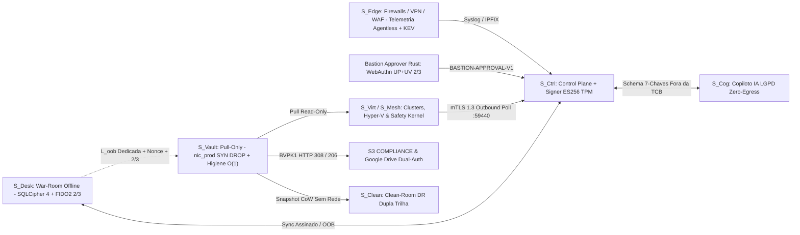

# Resiliência Cibernética Assimetricamente Limitada, Contenção Remota Zero-Inbound, Triagem Cognitiva Fora da TCB e Cofres Imutáveis Multi-Nuvem em Infraestruturas Híbridas Críticas

**Série Documental:** VTI Research — Dossiê Executivo Autônomo (`VTI-RES-2026-04`)  
**Autor:** **Caio Gonçalves** — *Principal Investigator & Chief Systems Architect, VTI Research (VTI, Brazil)* (https://projectos-system.github.io/vti-research/)  
**DOI Oficial do Estudo (`v3.0`):** [`10.5281/zenodo.24452820`](https://doi.org/10.5281/zenodo.24452820) *(Concept DOI: [`10.5281/zenodo.24406145`](https://doi.org/10.5281/zenodo.24406145) · Sucede `v1.0`: `10.5281/zenodo.24406146`)*  
**Data de Publicação:** Novembro de 2026 — Edição Consolidada `v3.0 — Evidência Executável Bastion OS v1.3.0`  
**Público-Alvo:** Conselhos de Administração, Diretorias Executivas (CEO / CTO / CIO), Lideranças de Segurança da Informação e Continuidade de Negócios (CISO / BCM), Comitês de Risco e Arquitetura de Infraestrutura  
**Escopo Formal do Ecossistema:** Grafo Tipado sobre 8-Tupla Algébrica $\mathcal{E} = (\mathcal{S}_{\mathrm{Edge}}, \mathcal{S}_{\mathrm{Virt}}, \mathcal{S}_{\mathrm{Mesh}}, \mathcal{S}_{\mathrm{Ctrl}}, \mathcal{S}_{\mathrm{Desk}}, \mathcal{S}_{\mathrm{Vault}}, \mathcal{S}_{\mathrm{Clean}}, \mathcal{S}_{\mathrm{Cog}}; \mathcal{L}, \mathcal{T})$  
**Nota de Confidencialidade de $\mathcal{I}_0$, Prevenção de Reidentificação e Estratificação Epistêmica (`E1`–`E4`):** *Para conciliar escrutínio científico aberto com sigilo operacional irrestrito sobre o incidente motivador $\mathcal{I}_0$, todos os identificadores privados, nomes de servidores e quase-identificadores raros da organização avaliada foram suprimidos ou generalizados sobre $\mathcal{E}$, referenciando-se nominalmente apenas fontes públicas primárias e código aberto verificado (`E1`). Este dossiê preserva estritamente os mesmos limites epistêmicos do artigo científico companheiro: separa as evidências executáveis em ambiente isolado (`E1`: `Bastion OS v1.3.0`, `301` testes backend / `61` suítes, `254` testes E2E / `28` suítes, baterias `B1`–`B20` em `:memory:`/`os.tmpdir()` com mocks locais para TPM/WFP/Google Drive/LLM), a motivação existencial retrospectiva (`E2`, $N=1$), as propriedades condicionais (`E3`) e a homologação longitudinal contínua em produção (`E4`: `G-PERF` `60 min` e modo `SHADOW` $N_{\mathrm{blk}} \ge 300$).*

---

## 1. O Dilema Estratégico da Continuidade Operacional sob Sabotagem Cibernética Ativa

Organizações que operam infraestruturas híbridas de missão crítica enfrentam hoje uma ruptura estrutural nos modelos clássicos de defesa perimetral, resposta remota e recuperação de desastres (*Disaster Recovery* — DR), sintetizada em quatro paradoxos executivos:

1. **O Paradoxo da Borda *Agentless*, da Credencial Válida e da Cegueira de Auditoria:** Campanhas contemporâneas de extorsão combinam exploração *zero-day* em appliances de perímetro sem agentes com intrusões *malware-free* via credenciais colhidas por *infostealers*. Operando fora do expediente, adversários abusam de ferramentas legítimas de suporte remoto (*Living-off-RMM*), carregam drivers assinados vulneráveis (*BYOVD*), exfiltram múltiplos terabytes (*dupla extorsão*), suprimem `EventLog`/`vmms` e executam criptografia intermitente (*header-only*) em discos virtuais `[MS-VHDX]` em minutos.
2. **O Paradoxo do "Backup de Schrödinger", do Domínio Acoplado e do Apagão de Comando:** Servidores tradicionais *push* ou integrados ao mesmo diretório e malha virtualizada colapsam com o ambiente primário — seja por auto-expurgo *client-driven*, salto de relógio NTP, extração `DCSync`, sincronização bidirecional envenenada em nuvem (`DriveFS`/`OneDrive`), esgotamento de disco (`ENOSPC`), queda do painel central ou corrupção silenciosa descoberta apenas no sinistro.
3. **O Paradoxo da Contenção Remota e da Defesa Autodestrutiva (*Self-DoS*):** Ações remotas de isolamento sem aprovação resistente a *phishing*, sem sequenciador monotônico de época ou sem reserva de quórum podem permitir que um servidor central comprometido — ou um pacote atrasado pós-partição — isole nós demais e derrube clusters inteiros de armazenamento compartilhado.
4. **O Paradoxo da Triagem por IA (*Prompt Injection* e Vazamento LGPD):** Conectar modelos generativos diretamente ao motor de bloqueio expõe a contenção a manipulação via logs maliciosos (*Indirect Prompt Injection*), enquanto o envio de logs corporativos brutos a nuvens externas viola governança e privacidade de dados.

A tese demonstrada no estudo **`VTI-RES-2026-04 v3.0`** estabelece o axioma da **Segurança Assimetricamente Limitada (*Fail-Closed for Authority and Integrity; Fail-Bounded for Availability*)**: toda contenção remota governada ou expurgo exige aprovação física *hardware-bound* `2-de-3` (`Bastion Approver`, `UP=1+UV=1`), chaves `ES256` em hardware `TPM 2.0` (proibindo `SOFTWARE_KEY` em produção) e *epoch fencing* monotônico; toda inteligência artificial permanece **100% fora da TCB** ($I_6$) operando em **LGPD Zero-Egress** por padrão (`Ollama` local); e os cofres *Pull-Only* unem `S3 Object Lock COMPLIANCE`, `Google Drive Dual-Auth` (`BVPK1` `HTTP 308`/`206`), **Higiene Anti-`ENOSPC` `O(1)`** e **DR Zero-Touch**.

### 1.1. Motivação Empírica e Racional de Design: 10 Macro-Incidentes Globais (`2023–2026`)

Os treze controles ($C_1$–$C_{13}$) e oito invariantes ($I_1^{\mathrm{loc}}/I_1^{\mathrm{dist}}$–$I_8$) endereçam dez classes de falhas documentadas em macro-incidentes públicos entre 2023 e 2026:
- **Engenharia Social de MFA e Sabotagem de Hipervisores (`Set/2023`):** motivou *Passkeys* FIDO2 *hardware-bound*, *Break-Glass* ($C_2$), `Bastion Approver` (`F3`/`F7`) e guardião `[MS-VHDX]` ($C_3$).
- **Acesso Sem MFA Resistente a Phishing e Dupla Extorsão (`Fev/2024`):** motivou disjuntores de exfiltração ($C_9$) e *Clean-Room DR* de dupla trilha ($C_6$).
- **Gateways *Agentless* (`2024–2025`) e *Infostealers Malware-Free* (`Mai–Jun/2024`):** motivou coleta *agentless* de borda (`KEV`, $C_{12}$), ciclo diário $R_{\mathrm{VTI}}$ ($C_7$) e *Honey-Tokens*.
- **Reinfecção no Restore (`Jun/2024`) e Queda de Diretório (`Abr–Mai/2025`):** motivou cofre *Pull-Only* fora do AD ($C_4$), *Clean-Room* ($C_6$) e estação *War-Room Offline* ($C_{13}, I_8$).
- **Colapso Global em *Ring 0* (`Jul/2024`) e Paralisação Preventiva (`Set/2025`):** motivou `WDAC` em 4 anéis ($C_{11}$), esteira `OBSERVE -> SHADOW -> CANARY -> BOUNDED_ENFORCE`, reserva `B_dom` ($Q_{\min} + 1$, $I_4$) e rollback local ($I_7$).
- **Abuso de Credenciais B2B (`Jul/2025`) e `BYOVD + RMM` (`2024–2026`):** motivou custódia `2-de-3` distinta ($C_5, I_1$), manifesto Zero-Trust de RMM ($C_{10}$) e bloqueio de drivers vulneráveis ($C_{11}$).

---

## 2. Arquitetura Executável `v1.3.0` em Treze Pilares ($C_1$–$C_{13}$) e Oito Invariantes ($I_1$–$I_8$)

1. **Pilar 1 ($C_1$) — Capability Única, Sonda `EvtSubscribe` + `14` Regras `Sigma` e Higiene Segura Anti-`ENOSPC` (`Onda 9`):** Exige capability `Ed25519` de uso único, vigia serviços críticos e aplica na `v1.3.0` a sonda `BastionSentinelProbe.exe` (`T1`–`T3`, 14 regras `Sigma` assinadas) aliada ao `DiskHygieneEngine`: telemetria *read-only* `Tier 0` (`statfs` + `DELETED_OPEN_FD >= 10 MiB`), **6 travas invioláveis** (anti-symlink, anti-placeholder OneDrive `0x00400000`, `PendingReboot`/backup ativo, `Btrfs/ZFS >= 90%`, compatibilidade Server 2012 `NT 6.2` e retenção `< 48h`), proteção dinâmica `Tier 3` (`.bvlt`, `.bvpk`, `bastion.db*`, iscas, `.git`), limpeza `Tier 1` assinada `Ed25519` e quarentena atômica `O(1)` `Tier 2` com rollback `SHA-256`.
2. **Pilar 2 ($C_2$) — *Break-Glass*, Horários SO (`W3`) e Contenção Remota Governada `BASTION-FLEET-CMD-V3` (`F3`–`F7`):** Monitora sessões fora do horário em modo *Zero-Block* (`W3`), fornece atalhos `F1` por IP literal e inventário Hyper-V RO (`F2`), e implementa o barramento Zero-Inbound **`BASTION-FLEET-CMD-V3`**: segregação de 5 chaves `ES256` em `TPM 2.0`/CNG (zero `SOFTWARE_KEY` em produção), sequenciador linearizável `BASTION-SECSTATE-V1`, aprovador Rust isolado `Bastion Approver` (`https://approver.bastion`, `UP=1+UV=1`, *hardware-bound*, `issuer != approvers`, `2-de-3`), barreira `START_EXECUTION` + journals `PRAGMA synchronous = FULL`, matriz de isolamento `F4` (IPv4/IPv6/UDP/QUIC/ICMP preservando `CONTROL` `:59440` e `OOB_RESCUE` com fallback `RESTRICTED_RECOVERY <= 90 s` $I_2$), reserva `B_dom` (`>= Q_min + 1`, `fencingToken` anti-ABA, `F5`), executor Hyper-V não-destrutivo (`F6`, veto `DESTRUCTIVE_HYPERV_ACTION_FORBIDDEN`) e ciclo de custódia `GENESIS`/`72 h`/`DR_RESEED` (`F7`).
3. **Pilar 3 ($C_3$) — Malha Viva Anti-`TOCTOU`, Guardião `[MS-VHDX]` & Interface Sistêmica `O1`–`O4`:** Provisiona iscas poliglotas sem bloquear fluxos legítimos (reação `0 ms` + `RETENTION_FROZEN` em $\ge 2$ mutações), atribui infratores SMB/NFS (`GUID_ECP_SRV_OPEN`/`eBPF`) e protege `< 1 MiB` de `.vhdx`. A interface lógica `O1`–`O4` aciona o módulo de resgate `v3.0.6` (orçamento de projeto *Single-Pass* `<= 480 MiB` RAM — reconciliado na bateria `B2` de `VTI-RES-2026-05` —, Multi-FS), cuja formulação matemática completa (`GF(2)`, contabilidade 4-vias, `MCMF` $\Delta$ e cirurgia `regf`) é desenvolvida autonomamente em **`VTI-RES-2026-05`**.
4. **Pilar 4 ($C_4$) — Cofre *Pull-Only*, `BVLT1`/`BVPK1`, `DR Zero-Touch` e `Google Drive Dual-Auth` (`Onda 11`):** Descarta `100%` de `SYN` em `nic_prod`, cifra via `scrypt` + `HKDF-SHA256` + `AES-256-GCM` (`FASTCDC_NC2` opt-in sob `G-CDC`), sela agendamentos em `backup_plan_schedule_keys` para **`DR Zero-Touch`** pós-reboot, suporta `S3 Object Lock COMPLIANCE` + *Local-Cache Assist* e adiciona conector nativo **`Google Drive Dual-Auth`**: **Modo A (`WORKSPACE_SERVICE_ACCOUNT`)** via `JWT RS256` em Shared Drive exigindo `canDelete === false` (`APPEND_ONLY_CONTRIBUTOR_VERIFIED`) e **Modo B (`PERSONAL_OAUTH_PKCE`)** via `OAuth 2.0 PKCE S256` + 2FA (`drive.file`, `contentRestrictions.readOnly`, Lixeira 30d), upload resumível `BVPK1` `HTTP 308`, guarda deslizante `700 GiB/24h`, restore seletivo estrito `HTTP 206`, trava *Anti-Sync Poisoning* (`DriveFS`) e resgate Python CLI `pull-gdrive` (ressalvando que, no Drive Pessoal, a lixeira de 30d não iguala a imutabilidade jurídica de `S3 Object Lock COMPLIANCE`).
5. **Pilar 5 ($C_5$) — Journal Idempotente `TPM 2.0`, Tripla Custódia e Testemunha Anti-Rollback:** Separa integridade, autenticidade, imutabilidade e frescor (`INTENT` $\rightarrow$ `TPM2_NV_Increment` $\rightarrow$ `COMMITTED` + `NTS` + `RFC 3161`), protegendo VMs contra reversão conjunta de disco + `vTPM` via Testemunha Externa (`STATE_ROLLBACK_DETECTED` vs `WITNESS_UNREACHABLE_DEGRADED`).
6. **Pilar 6 ($C_6$) — Certificação Diária em *Clean-Room* de Dupla Trilha:** Executa em namespace nulo a Trilha A (5 níveis até `pg_amcheck`/boot UEFI) e Trilha B (`YARA-Forge` + diff de persistência), emitindo atestado `Ed25519` escopado (`GOLD_VERIFIED` / `RECOVERABLE_NEEDS_SANITIZATION`).
7. **Pilar 7 ($C_7$) — Priorização $R_{\mathrm{VTI}} \in [0,100]$ & Threat Intel em 3 Graus:** Combina `KEV/EPSS/CVSS` e exposição com *MISP Warninglists* como modificador auditável de confiança (nunca supressão silenciosa) e guarda anti-SSRF/anti-redirect.
8. **Pilar 8 ($C_8$) — Copiloto de Triagem IA Contínua (`Onda 7-b` `T4`–`T11`) Fora da TCB ($I_6$) & LGPD Zero-Egress:** Mantém IA 100% fora da TCB ($\mathrm{Exec}=0$), com roteamento 4-Tiers (`free_only` = `R$ 0,00`), compressor Ponytail em duplo estágio, fila `ai_triage_queue` (`64`, `12/h/host`, `60/h/global`), Context Builder anti-envenenamento (`OBSERVED_SENSOR_FACT` vs `[BEGIN_UNTRUSTED_DATA]`), schema fechado de 7 chaves, **5 ferramentas *read-only*** isoladas por tenant/host, consenso dual com abstenção fail-safe (`AI_CONSENSUS_UNAVAILABLE`), regra `BENIGN_LIKELY` não-autoritativa (nunca fecha incidentes), corpus `T9` (`20` casos, 3 canários) e **LGPD Zero-Egress** por padrão (`Ollama` local; nuvem bloqueada até Step-Up MFA + DPA + pseudonimização `HKDF+HMAC` em 6 campos).
9. **Pilar 9 ($C_9$) — Disjuntor Anti-Exfiltração:** Bloqueia sincronizadores não homologados (`rclone`, `s5cmd`, `megacmd`) e fluxos com razão anômala `Bytes-Out / Bytes-In`.
10. **Pilar 10 ($C_{10}$) — Manifesto Zero-Trust de RMM e Túneis:** Bloqueia RMMs comerciais (`AnyDesk`, `ScreenConnect`, `RustDesk`) e túneis (`ngrok`, `cloudflared`) fora do manifesto assinado via hash e `TLS SNI/JA4`.
11. **Pilar 11 ($C_{11}$) — Blindagem Anti-`BYOVD` em 4 Anéis `WDAC`:** Promove bloqueio de drivers vulneráveis (`Inventário -> Audit -> Canary -> Enforce`) preservando boot e storage.
12. **Pilar 12 ($C_{12}$) — Coleta *Agentless* de Borda & *Honey-Tokens*:** Cruza `Syslog`/`IPFIX`/API com `KEV` e semeia credenciais canário com filtro para scanners autorizados.
13. **Pilar 13 ($C_{13}$ & $I_8$) — *ITDR*, `LOG_GAP_ALERT` Anti-`ENOSPC`, Cockpit `Onda 6`, E-mails Forenses & *War-Room Offline*:** Garante persistência `LOG_GAP_ALERT = 1` em `sentinel_gap_slot.bin`, isolamento `ZERO_INSTANCE_DATA_BEFORE_AUTH`, auditoria de postura `Windows Hello` (`D6886603-...`), UI Bento/Sparklines/`GroupedTabs`/`PlanContingencyMapModal` (`0` `#hex`), e-mails forenses `multipart/alternative` com `STARTTLS` e operação *War-Room Offline* em $\mathcal{S}_{\mathrm{Desk}}$ (`SQLCipher 4` + `DPAPI` + `FIDO2` `2-de-3`).

---

## 3. Matriz Executiva de Risco, Evidência `v1.3.0` (`B1`–`B20`) e Esteira de Gates

| Dimensão de Governança & Risco | Estado Tradicional | Estado sob `Bastion OS v1.3.0` | Evidência Verificada (`E1`) & Fronteira (`E4`) |
| :--- | :--- | :--- | :--- |
| **Contenção Remota & Risco de *Self-DoS*** | Comandos unilaterais de console derrubam quóruns ou re-executam ordens obsoletas pós-partição. | `BASTION-FLEET-CMD-V3` (`F3`–`F7`): `Bastion Approver` `2-de-3`, `ES256` TPM, `START_EXECUTION`, `B_dom >= Q_min+1`, fallback `<= 90 s` e Hyper-V sem `Remove-VM`. | `G-CMD` (`13/13` + `2/2` E2E `PASS` com mocks TPM/WFP); homologação com TPM/WFP físico em `E4`. |
| **Triagem IA, *Prompt Injection* & LGPD** | Agentes acoplados ao bloqueio sofrem manipulação via logs e enviam PII a nuvens externas. | `Onda 7-b` (`T4`–`T11`): fora da TCB ($I_6$), cercas anti-injection, 5 ferramentas RO, consenso dual, `BENIGN_LIKELY` neutro e **LGPD Zero-Egress**. | `G-AI-TRIAGE` (`19/19` + `1/1` E2E `PASS`, `T9` `20` casos); inferência real em produção em `E4`. |
| **Backup Multi-Nuvem, `Google Drive` & `ENOSPC`** | Pastas `DriveFS` sincronizam ransomware, `HTTP 403` trava replicações e disco cheio trava alertas. | `BVLT1`/`BVPK1` `HTTP 206`, `DR Zero-Touch`, `Google Drive Dual-Auth` (`HTTP 308`/`206` + `700 GiB/24h` + `pull-gdrive`) e `DiskHygieneEngine` `O(1)`. | `G-GDRIVE-VAULT` (`6/6` `TC-B20`), `G-DISK-HYGIENE` (`7/7`), `B15`/`B16`/`B19` `PASS` em `os.tmpdir()`. |
| **Criptografia Intermitente `[MS-VHDX]`** | Ataques *First-N* destroem a `BAT` de contêineres `.vhdx` em minutos. | Guardião `< 1 MiB`, malha viva anti-`TOCTOU` e interface `O1`–`O4` acoplada ao motor `v3.0.6`. | `B14`/`B17` `PASS`; teoria formal `GF(2)`/`MCMF`/Multi-FS e baterias `B1`–`B6` em **`VTI-RES-2026-05`**. |

### 3.1. Esteira Gradual de Implantação, Suítes `v1.3.0` (`E1`) e Gate Longitudinal (`E4`)
Nenhuma política disruptiva entra em produção de forma abrupta. Na camada de engenharia (`Nível E1`), a release **`Bastion OS v1.3.0`** encontra-se integralmente validada com **`58` arquivos / `61` suítes / `301/301` testes backend**, **`14` arquivos / `28` suítes / `254/254` testes E2E**, **`20/20` baterias executáveis (`B1`–`B20`)**, `vite build` (`0` warnings, `0` CDNs) e `cargo check --offline` (exit `0`, incl. `bastion-approver`). Na camada operacional de campo (`Nível E4`), toda ativação de contenção automática segue obrigatoriamente **`OBSERVE` $\rightarrow$ `SHADOW` $\rightarrow$ `CANARY` $\rightarrow$ `BOUNDED_ENFORCE`**, condicionada a `LOG_GAP_ALERT = 0`, medição contínua `60 min` de `G-PERF` e `FP_obs = 0` sobre $N_{\mathrm{blk}} \ge 300$ blocos independentes em `SHADOW` ($p_{\mathrm{FP}} \le 3 / N_{\mathrm{eff}}$ via *block bootstrap* com Holm-Bonferroni).

---

## 4. Governança Evolutiva: Validação Normativa e Roteiro de Maturidade (`M-FUT-1` a `M-FUT-6`)

| Código | Frente de Maturidade Recomendada | Risco Residual Endereçado | Benefício Executivo & Operacional Esperado |
| :---: | :--- | :--- | :--- |
| **`M-FUT-1`** | **Verificação Formal em `TLA+` / `PlusCal` de `BASTION-FLEET-CMD-V3`, `B_dom` e Journal TPM** | Condições de corrida distribuídas sutis sob partições assimétricas múltiplas. | Prova matemática automatizada de ausência de *deadlock* e preservação de $I_1$–$I_8$. |
| **`M-FUT-2`** | **Driver de Kernel Minimalista Compatível com HVCI e Assinatura ELAM** | Exploração *zero-day* inédita diretamente em *ring-0* (fora das listas `WDAC`). | Prevenção síncrona no caminho de I/O e proteção de inicialização precoce do SO. |
| **`M-FUT-3`** | **Atestação Remota Contínua via Hardware `TPM 2.0` / `vTPM`** | Falsificação de estado de saúde por host subvertido antes da carga do agente. | Vinculação criptográfica em silício da integridade de boot e política ativa. |
| **`M-FUT-4`** | **Cofre Georredundante Tolerante a Faltas Bizantinas (*Cloud-of-Clouds*)** | Destruição física simultânea do site primário e falha/comprometimento de um provedor cloud. | Codificação de apagamento + compartilhamento secreto multi-provedor. |
| **`M-FUT-5`** | **Orquestração Automatizada de *Clean-Room Failover* sob Demanda** | Tempo humano elevado para reconstruir redes, DNS e identidade em hardware secundário. | Hidratação assistida de serviços vitais dentro do MBCO pactuado. |
| **`M-FUT-6`** | **Plataforma de *Chaos Security Engineering* e Ensaios com TPM / Nuvem Real** | Deriva de configuração, obsolescência de runbooks OOB e dependência de mocks em CI. | Validação contínua fim-a-fim sobre hardware físico `TPM 2.0`, `WFP`/`nftables` e nuvens reais. |

---

## 5. Diretrizes Práticas de Governança para Conselhos, CISOs e CTOs

1. **Imponha Contenção Remota com Quórum *Hardware-Bound* e Zero `SOFTWARE_KEY` em Produção:** Exija que ações destrutivas ou de isolamento acima do orçamento de domínio passem pelo `Bastion Approver` (`UP=1+UV=1`, chaves físicas não sincronizáveis `2-de-3` de pessoas distintas), sequenciador `ES256` em `TPM 2.0` físico e proibição absoluta de comandos `Remove-VM` / `Remove-VMSnapshot` em hipervisores.
2. **Mantenha Toda IA Estritamente Fora da TCB e em LGPD Zero-Egress por Padrão:** Utilize modelos locais (`Ollama`) como padrão corporativo, proíba que classificações otimistas (`BENIGN_LIKELY`) fechem incidentes sem validação humana e exija Step-Up MFA + DPA + pseudonimização `HKDF+HMAC` caso qualquer fluxo opte por nuvem externa.
3. **Separe Cofres *Pull-Only*, Imutabilidade `S3 COMPLIANCE` vs. Google Drive e Higiene Anti-`ENOSPC`:** Use `Google Drive Dual-Auth` (`Workspace Contributor` / `PKCE drive.file`) como camada redundante acessível inclusive via CLI `pull-gdrive`, mantendo `S3 Object Lock COMPLIANCE` em conta independente para retenção jurídica máxima e bloqueando sempre pastas de sincronização (`DriveFS`/`OneDrive`).
4. **Habilite `DR Zero-Touch` e Certificação Diária em *Clean-Room* de Dupla Trilha:** Elimine a dependência de redigitação manual de senhas após reboots com `backup_plan_schedule_keys` (`AES-256-GCM` / `DPAPI`) e valide backups diariamente em câmara limpa (`Trilha A` funcional + `Trilha B` `YARA`).
5. **Preserve Fronteiras Epistêmicas e Exercite Resgate Offline Trimestral:** Exija passagem pelo estágio `SHADOW` ($N_{\mathrm{blk}} \ge 300$) em produção antes de `BOUNDED_ENFORCE`, imponha `ZERO_INSTANCE_DATA_BEFORE_AUTH` em todas as rotas públicas e realize simulados trimestrais com `Bastion Desktop` (`SQLCipher 4`) e `BastionRescuePortable v3.0`.

> **Documentos Científicos Companheiros:** Para a formalização algébrica completa da 8-tupla $\mathcal{E}$, especificações $C_1$–$C_{13}$ e $I_1$–$I_8$, matriz de resultados `B1`–`B20`, *Threats to Validity* e **63 referências primárias verificadas (`[R01]`–`[R63]`)**, consulte **`VTI-RES-2026-04` (`v3.0`, DOI `10.5281/zenodo.24452820` / Concept DOI `10.5281/zenodo.24406145`)**. Para a teoria matemática e benchmarks empíricos dedicados à reconstrução forense `[MS-VHDX]` *Single-Pass* (`GF(2)` `CRC-32C`, contabilidade 4-vias, `MCMF` residual com guarda $\Delta$, multi-FS e cirurgia `regf`), consulte a monografia autônoma **`VTI-RES-2026-05` (`v1.0`)**.
