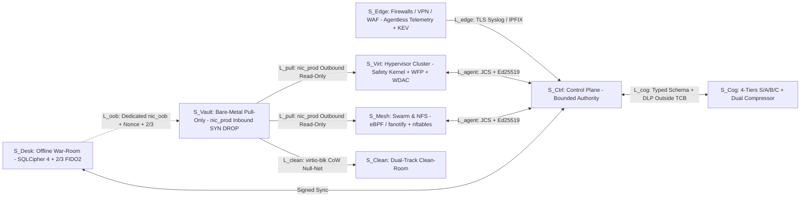

# Asymmetrically Bounded Cyber-Resilience, Pull-Only Immutable Vaults, and Automated Recovery Verification: Formal Containment of Hypervisor Sabotage and Intermittent Encryption in Critical Infrastructures

**Technical Identifier:** `VTI-RES-2026-04` — `v1.2 — Methodologically Audited Edition` (November 2026)  
**Author:** **Caio Gonçalves** — *Principal Investigator & Chief Systems Architect, VTI Research (VTI, Brazil)* (https://projectos-system.github.io/vti-research/)  
**Scientific Classification:** `cs.CR` (Cryptography and Security) • `cs.DC` (Distributed, Parallel, and Cluster Computing) • `cs.SE` (Software Engineering) | **Official DOI (CERN / Zenodo):** `10.5281/zenodo.24406146` (https://doi.org/10.5281/zenodo.24406146)  
**Methodological Design:** Design Science Research in Security Engineering stratified across four epistemic levels (`E1` Reproducible Static Audit of C++ Source Code; `E2` Anonymized Retrospective Forensic Study $\mathcal{I}_0$ with $N=1$ and Public Taxonomy `2023–2026`; `E3` Conditional Algebraic Specification of Local and Distributed Invariants; `E4` Pre-Registered Falsifiable Experimental Protocol `B1`–`B13`) — Typed Graph $\mathcal{E} = (\mathcal{S}_{\mathrm{Edge}}, \mathcal{S}_{\mathrm{Virt}}, \mathcal{S}_{\mathrm{Mesh}}, \mathcal{S}_{\mathrm{Ctrl}}, \mathcal{S}_{\mathrm{Desk}}, \mathcal{S}_{\mathrm{Vault}}, \mathcal{S}_{\mathrm{Clean}}, \mathcal{S}_{\mathrm{Cog}}; \mathcal{L}, \mathcal{T})$  
**Operational Confidentiality and Anonymization Clause on $\mathcal{I}_0$:** *This manuscript constitutes an open scientific publication with identified institutional authorship. To reconcile scientific reproducibility with strict operational confidentiality concerning the motivating incident $\mathcal{I}_0$, all private identifiers of the evaluated corporate infrastructure (legal entity name, internal subnets/IPs, private DNS domains, proprietary directory paths, and credential prefixes) have been suppressed and abstracted into $\mathcal{E}$. Conversely, publicly hosted open-source repositories inspected statically (`uroni/urbackup_backend`), normative standards, utilities cataloged in public government advisories (`CISA`/`ENISA`), and publicly disclosed historical macro-incidents (`2023–2026`) are referenced nominally from open primary sources.*

---

## Abstract

Modern *Ransomware-as-a-Service* (RaaS) and multi-phase extortion operations have evolved beyond naive endpoint encryption toward mass exploitation of agentless edge appliances, *malware-free* intrusions using credentials harvested by *infostealers*, sensor neutralization via vulnerable signed drivers (*BYOVD*), abuse of legitimate commercial remote-access tools (*Living-off-RMM*), pre-detonation data exfiltration (*double extortion*), coordinated sabotage of virtualization control planes, intermittent encryption (*header-only* and *skip-step*) over shared storage volumes, and coupled destruction of conventional backup servers. Simultaneously, purely *fail-closed* defensive architectures introduce the severe risk of self-inflicted denial of service (*Self-DoS*), wherein false positives in intra-cluster flows, defective *ring-0* updates, or compromise of the central management controller itself can collapse production quorums. This paper models thirteen coupled vulnerability classes ($H_1$–$H_{13}$) spanning the intrusion, exfiltration, sabotage, and recovery lifecycle. Applying *Design Science Research*—strictly demarcating evidence already verified via static C++ source-code inspection (`uroni/urbackup_backend`) and anonymized retrospective forensic reconstruction ($\mathcal{I}_0, N=1$) from specified conditional properties and prospective empirical hypotheses—we propose the axiom of **Asymmetrically Bounded Security** (*fail-closed* for authority and integrity; *fail-bounded* for availability). We formally specify thirteen architectural controls ($C_1$–$C_{13}$) and eight invariants partitioned into host-local properties ($I_1^{\mathrm{loc}}, I_2, I_5, I_6, I_7$) and distributed coordination and survival properties ($I_1^{\mathrm{dist}}, I_3, I_4, I_8$), articulating end-to-end monotonic resource *fencing* (`epoch`), isolation leases governed by linearizable consensus, an offline *War-Room* administrative station ($\mathcal{S}_{\mathrm{Desk}}$ backed by `SQLCipher 4`), a *Pull-Only* physical immutable vault governed by a two-phase idempotent `TPM 2.0` journal and a `2-of-3` FIDO2 quorum of three distinct human custodians, daily scoped dual-track clean-room certification, and a non-TCB analytical core equipped with deterministic dual-stage compression using reversible sentinels and quality-gated 4-tier routing (`S/A/B/C`), accompanied by a pre-registered falsifiable experimental protocol (`B1`–`B13`) grounded in 32 primary references (`[R01]`–`[R32]`).

**Keywords:** Hypervisor Cyber-Resilience; Intermittent Encryption; *Fail-Bounded Safety Kernel*; *Epoch Fencing*; *Pull-Only* Immutable Backup; *Clean-Room Disaster Recovery*; `BYOVD`; `NIST SP 800-209`; `ISO/IEC 27031:2025`.

---

## 1. Introduction and Scientific Motivation

Recent literature in distributed systems and storage security (`[R01, R02, R12, R14, R15]`) documents a fundamental shift in the anatomy of destructive incidents targeting hybrid infrastructures. Rather than launching noisy binaries on user workstations, adversarial operators exploit three recurring architectural asymmetries across enterprise datacenters:

1. **Temporal and Privilege Asymmetry in Virtualization Control Planes:** Once a valid administrative credential is acquired (`MITRE T1078`), the adversary operates during off-hours windows (`00:00–06:00`), leverages native operating-system utilities (`msiexec`, `sc`, direct registry edits to `ControlSet\Services`) to silence event collection (`EventLog`) and virtual machine management (`vmms`) without immediately killing in-memory worker processes, eliminating operations-center visibility at the decisive moment (`[R01, R18]`).
2. **Computational Asymmetry of Intermittent Encryption on Block/File Volumes:** As formalized by Davies et al. (`[R13]`) and Ineza et al. (`[R14]`), encrypting solely the initial megabytes (*First-N* / *Header-Only*) of multi-hundred-gigabyte virtual disk images instantaneously destroys allocation metadata (`Header`, `Region Table`, `BAT`) while leaving global Shannon entropy virtually unchanged, enabling corruption of tens of terabytes in slightly over an hour.
3. **Blast-Radius Coupling Among Production, Directory, and Backup:** As emphasized by `NIST SP 800-209` (`[R02]`) and the second edition of `ISO/IEC 27031:2025` (`[R05]`), conventional push-based backup architectures authenticated against the same directory service and hosted upon the same virtualized mesh collapse concurrently with the primary environment. Conversely, poorly bounded automated responses can induce *split-brain* across shared-storage clusters if they blindly sever intra-cluster ports.

### 1.1. Empirical Motivation and Hypothetico-Deductive Design Rationale from Public Macro-Incidents (2023–2026)

**Table 0** synthesizes ten structural failure classes documented across public incident-response advisories (`[R29, R30, R31, R32]`) between 2023 and 2026. Methodologically, this matrix serves strictly as **empirical problem motivation and hypothetico-deductive engineering rationale (*Design Rationale*)**: each entry grounds the practical relevance of threat hypotheses $H_1$–$H_{13}$ and motivates the architectural derivation of controls $C_1$–$C_{13}$ and invariants $I_1$–$I_8$, without claiming retrospective counterfactual validation over the listed third-party environments:

| Documented Public Macro-Incident | Primary Class of Structural Collapse | Exposed Limitation of Conventional Architecture | Formal Mapping in `VTI-RES-2026-04` |
| :--- | :--- | :--- | :---: |
| **MGM Resorts (`Sep/2023`)** | Social engineering (*vishing*) MFA reset + batch hypervisor encryption. | MFA susceptible to helpdesk human override and absence of hypervisor structural guard. | $H_2, H_3 \rightarrow C_2, C_3$ |
| **Change Healthcare (`Feb/2024`)** | Remote surface lacking phishing-resistant MFA + double extortion (`6 TB` exfiltrated) + systemic paralysis. | Absence of an egress exfiltration circuit breaker and coupled availability without a Clean Room. | $H_2, H_6, H_9 \rightarrow C_2, C_6, C_9$ |
| **Ivanti / PAN-OS / FortiOS Gateway Campaigns (`2024–2025`)** | Zero-day exploitation of perimeter appliances incapable of hosting internal endpoint agents. | Exclusive reliance on in-guest EDR without agentless edge telemetry or KEV virtual patching. | $H_7, H_{12} \rightarrow C_7, C_{12}$ |
| **Snowflake Multi-Tenant Campaign (`May–Jun/2024`)** | *Malware-free* intrusion via credentials harvested by *infostealers* on external hosts. | Absence of canary *honey-tokens*, cryptographic device binding, and volumetric throttling. | $H_2, H_9, H_{12} \rightarrow C_2, C_9, C_{12}$ |
| **CDK Global & Synnovis (`Jun/2024`)** | Encryption of critical provider followed by re-infection attempts during the recovery cycle. | Direct restoration without a dual-track clean room (functional + forensic persistence scan). | $H_4, H_6 \rightarrow C_4, C_6$ |
| **Global CrowdStrike Outage (`Jul/2024`)** | Defective logic update processed in *Ring 0*, collapsing `~8.5M` hosts simultaneously. | Kernel agent without `SHADOW → CANARY` gating, blast-radius budgets, or local rollback. | $I_1, I_2, I_4, I_7$ |
| **Marks & Spencer / UK Retail (`Apr–May/2025`)** | Directory service compromise (`NTDS.dit` / `DCSync`) propagating to virtualization planes. | Missing domain isolation separating corporate directory, hypervisors, backup, and crisis stations. | $H_4, H_5, H_{13} \rightarrow C_4, C_5, C_{13}$ ($I_8$) |
| **B2B Financial Infrastructure Providers (`Jul/2025`)** | Abuse of internal privileged credentials and critical integration keys lacking multiparty custody. | Destructive or transactional authority concentrated in a single principal without distinct human quorum. | $H_5, H_8 \rightarrow C_5, C_8$ ($I_1$) |
| **Jaguar Land Rover (`Sep/2025`)** | Prolonged preventive shutdown of entire industrial plants to halt lateral movement. | Lack of selective authenticated-peer amputation preserving healthy segments online. | $H_2 \rightarrow C_2$ ($I_4$) |
| **`BYOVD + RMM` RaaS Campaigns (`2024–2026`)** | Vulnerable signed `.sys` drivers terminating sensors + command via commercial RMM (`AnyDesk`/`ScreenConnect`). | Implicit trust in signed binaries/drivers without ringed `WDAC` policy or RMM manifest. | $H_1, H_{10}, H_{11} \rightarrow C_1, C_{10}, C_{11}$ |

The four core contributions of this study are: **(a)** reproducible static verification (`Level E1`) of seven vulnerability classes in open-source C++ backup engines (`uroni/urbackup_backend`) under client privilege escalation and clock tampering, paired with the anonymized retrospective forensic analysis of $\mathcal{I}_0$ (`Level E2`, $N=1$); **(b)** conditional algebraic specification (`Level E3`) of a defense and recovery architecture governed by eight invariants partitioned into host-local ($I_1^{\mathrm{loc}}, I_2, I_5, I_6, I_7$) and distributed ($I_1^{\mathrm{dist}}, I_3, I_4, I_8$) properties, integrating a local *Safety Kernel* with resource *epoch fencing*, linearizable lease consensus, an offline *War-Room* station ($\mathcal{S}_{\mathrm{Desk}}$), a *Pull-Only* physical vault with segregated interfaces (`nic_prod` / `nic_oob`), and daily dual-track scoped certification; **(c)** formal specification of preventive controls covering pre-detonation exfiltration, RMM manifests, *BYOVD* via `WDAC`, agentless perimeter monitoring, and a non-TCB cognitive pipeline featuring deterministic dual-stage prefix-free sentinel compression and quality-gated routing (`S/A/B/C`); and **(d)** a pre-registered falsifiable experimental protocol (`Level E4`, `B1`–`B13`) with explicit statistical denominators and refutation criteria.

---

## 2. Hypothetical System Model $\mathcal{E}$ and Adversary Model

### 2.1. Study Design, Evidentiary Stratification (`E1`–`E4`), and Epistemological Demarcation

We adopt the **Principle of Epistemic Proportionality** ($\text{Claim Scope} \le \text{Evidence Scope}$). To eliminate ambiguity between architectural specification and runtime empirical validation, all claims in this edition (`v1.2`) are stratified across four levels:
- **`Level E1` (Verified Static Evidence):** Structural defects proven via direct file-and-line inspection of the public repository `uroni/urbackup_backend` (Sections 3.4 and 3.5), fully reproducible by independent third parties;
- **`Level E2` (Motivating Retrospective Evidence, $N=1$):** Anatomical sequence observed in the anonymized forensic investigation $\mathcal{I}_0$ and the ten public macro-incidents in Table 0, employed strictly for hypothesis generation (subject to the generalization limits in Section 6.3);
- **`Level E3` (Conditional Formal Specification):** Security and blast-radius containment properties derived from invariants $I_1$–$I_8$ **explicitly conditioned** upon the TCB, physical topology, cryptographic, and non-collusion assumptions stated in **Table 1** (whose exhaustive symbolic model checking in `TLA+` forms `M-FUT-1`);
- **`Level E4` (Pre-Registered Prospective Protocol):** Runtime performance, latency percentiles ($p_{99}$), false-positive/false-negative rates, and compression ratios, treated strictly as **testable hypotheses and exit-gate targets** in `B1`–`B13` (Section 4), without claiming unexecuted operational measurements.

| Epistemological Layer | Conditional Scope Specified in `VTI-RES-2026-04` (`Level E3`) | Explicit Model Limit, Boundary Condition & Unclaimed Scope |
| :--- | :--- | :--- |
| **Local ($I_1^{\mathrm{loc}}, I_2, I_5, I_6, I_7$) & Distributed ($I_1^{\mathrm{dist}}, I_3, I_4, I_8$) Invariants** | Rejection of new inbound connections on `nic_prod` of the *Pull-Vault*, `Ed25519` signatures over `RFC 8785 JCS` chained via `SHA-256`, linearizable consensus leases, distinct `2-of-3` custodian quorum, and persisted per-resource monotonic fencing. | Conditioned on standard `SHA-256`/`Ed25519` assumptions, physical integrity of *Bare-Metal* hardware, local monotonic clocks, and absence of simultaneous collusion by $\ge 2$ of 3 local custodians (with local collusion mitigated solely by independent external S3 `COMPLIANCE` retention). |
| **User-Mode Sensors + Code Integrity (`WDAC` — Phases 1–4)** | `ETW`/`eBPF` telemetry, transactional `WFP`/`nftables` filters, `FileID`/`inode` canaries, RMM manifest, and `CI`-enforced blocking of cataloged vulnerable drivers via `WDAC`. | **Prevention is conditioned on OS kernel/`CI` integrity and currency of the vulnerable-driver blocklist**; against a novel *zero-day* *ring-0* exploit (pre-Phase 5 HVCI/ELAM) or extreme saturation with telemetry loss (`TELEMETRY_DROPPED`), **the primary host is assumed compromised**, and residual survival rests solely upon prior historical snapshots in $\mathcal{S}_{\mathrm{Vault}}$. |
| **Offline *War-Room* Administrative Station ($\mathcal{S}_{\mathrm{Desk}}$)** | Local encrypted persistence using `SQLCipher 4` (`AES-256-CBC + HMAC-SHA512`, `256,000` PBKDF2 iterations) + `DPAPI` envelope + FIDO2 binding, `temp_store=MEMORY`, and explicit RAM buffer zeroization (`zeroize`). | Protects confidentiality and integrity of inventories/certificates at rest against offline extraction; **does not protect open in-session secrets nor prevent malicious commands if the kernel/firmware of $\mathcal{S}_{\mathrm{Desk}}$ itself is compromised** or if the dedicated `nic_oob` link is simultaneously lost. |
| **Scoped Certification in Clean Room (*Clean-Room DR*)** | Functional ladder `[MS-VHDX]` $\rightarrow$ FS $\rightarrow$ B-Tree indexes $\rightarrow$ synthetic boot + static `YARA` scanning and persistence-diff against a versioned golden baseline. | Issues an **attestation strictly scoped to the executed verification suite** (structural consistency and absence of artifacts in the current `YARA`/baseline catalog); does not constitute an undecidable proof of absence of novel *implants* or silent business-logic semantic corruption. |

### 2.2. Formal Topology of the Abstracted Ecosystem, Trust Zones, and Channel Matrix

We define the protected infrastructure and its resilience plane as the typed algebraic structure:

$$\mathcal{E} = \big(\mathcal{S}_{\mathrm{Edge}},\, \mathcal{S}_{\mathrm{Virt}},\, \mathcal{S}_{\mathrm{Mesh}},\, \mathcal{S}_{\mathrm{Ctrl}},\, \mathcal{S}_{\mathrm{Desk}},\, \mathcal{S}_{\mathrm{Vault}},\, \mathcal{S}_{\mathrm{Clean}},\, \mathcal{S}_{\mathrm{Cog}};\; \mathcal{L},\, \mathcal{T}\big)$$

where $\mathcal{T}$ partitions subsystems across six disjoint trust zones:
- $\mathcal{S}_{\mathrm{Edge}} = \{g_1, \dots, g_r\}$ ($\mathcal{T} = \texttt{UNTRUSTED\_EDGE}$): perimeter appliances (firewalls, VPN concentrators, and proxies/WAFs) lacking in-guest agent support;
- $\mathcal{S}_{\mathrm{Virt}} = \{h_1, \dots, h_m\}$ and $\mathcal{S}_{\mathrm{Mesh}} = \{u_1, \dots, u_k\}$ ($\mathcal{T} = \texttt{MONITORED\_PROD}$): hypervisor nodes sharing virtual disk volumes $\mathcal{V}$ and container/NFS DBMS nodes, each running an isolated local *Safety Kernel* process;
- $\mathcal{S}_{\mathrm{Ctrl}}$ ($\mathcal{T} = \texttt{BOUNDED\_CTRL}$): Central Control Plane and mTLS Gateway, treated under the threat model as **potentially compromisable or unavailable** (authority strictly bounded by $I_1, I_4, I_6$);
- $\mathcal{S}_{\mathrm{Desk}} = \{d_1, \dots, d_p\}$ ($\mathcal{T} = \texttt{OFFLINE\_CUSTODY}$): hardened administrative stations (*War-Room Offline*) equipped with `SQLCipher 4` and hardware FIDO2 authenticators;
- $\mathcal{S}_{\mathrm{Vault}}$ ($\mathcal{T} = \texttt{ISOLATED\_VAULT}$): physical *Bare-Metal* immutable vault outside the corporate directory, equipped with two physically segregated network interfaces (`nic_prod` for read-only *pull* ingestion and `nic_oob` on a dedicated point-to-point physical VLAN exclusively for $\mathcal{S}_{\mathrm{Desk}}$);
- $\mathcal{S}_{\mathrm{Clean}}$ ($\mathcal{T} = \texttt{EPHEMERAL\_CLEAN}$): ephemeral validation microVMs running inside a null network namespace (`veth` with zero external bridge, DNS, or production credentials);
- $\mathcal{S}_{\mathrm{Cog}}$ ($\mathcal{T} = \texttt{NON\_TCB\_COG}$): statistical correlation engines and generative models positioned **strictly outside the Trusted Computing Base (TCB)** ($\mathcal{K}_{\mathrm{TCB}} \cap \mathcal{K}(\mathcal{S}_{\mathrm{Cog}}) = \emptyset$).

The directed channel relation $\mathcal{L}$ (**Table 1B**) formally reconciles total rejection of inbound production connections on the vault with emergency out-of-band orchestration:

| Channel in $\mathcal{L}$ | Initiator (`SYN`) $\rightarrow$ Receiver | Interface / Transport | Authentication & Permitted Authority Scope |
| :--- | :--- | :--- | :--- |
| **`L_edge`** | $\mathcal{S}_{\mathrm{Edge}} \rightarrow \mathcal{S}_{\mathrm{Ctrl}}$ | WAN/DMZ • `TLS Syslog / IPFIX` | Per-appliance certificates; ingestion in restricted parser with zero command privilege. |
| **`L_agent`** | $\mathcal{S}_{\mathrm{Virt}} \cup \mathcal{S}_{\mathrm{Mesh}} \leftrightarrow \mathcal{S}_{\mathrm{Ctrl}}$ | Management LAN • `mTLS 1.3` | `RFC 8785 JCS + Ed25519` envelopes; commands constrained by $I_1^{\mathrm{loc}}, I_1^{\mathrm{dist}}, I_2, I_4, I_5, I_6$. |
| **`L_pull`** | $\mathcal{S}_{\mathrm{Vault}} \rightarrow \mathcal{S}_{\mathrm{Virt}} \cup \mathcal{S}_{\mathrm{Mesh}}$ | `nic_prod` • `mTLS 1.3 Outbound` | **`nic_prod` enforces `DROP` on `100%` of new inbound `TCP SYN`/`UDP` packets**, accepting only stateful `ESTABLISHED` replies to read-only pull sessions initiated by the unprivileged vault collector. |
| **`L_oob`** | $\mathcal{S}_{\mathrm{Desk}} \rightarrow \mathcal{S}_{\mathrm{Vault}}$ | `nic_oob` (Dedicated Physical OOB VLAN) | Physically disjoint from `nic_prod`; requires registered-station `mTLS 1.3` + fresh `challenge-response` (`vault_nonce`) + `JCS` envelope signed by `2-of-3` FIDO2 quorum restricted to `STAGING_RESTORE` and audit. |
| **`L_clean`** | $\mathcal{S}_{\mathrm{Vault}} \rightarrow \mathcal{S}_{\mathrm{Clean}}$ | Local Virtual Bus (`virtio-blk` CoW) | Local block export over disposable `zfs clone` without exposing the host ZFS socket or any routable network interface. |
| **`L_cog`** | $\mathcal{S}_{\mathrm{Ctrl}} / \mathcal{S}_{\mathrm{Desk}} \rightarrow \mathcal{S}_{\mathrm{Cog}}$ | Typed API / Offline Local Runtime | Pre-compressed, DLP-pseudonymized payload; output treated strictly as non-executable text/JSON ($\mathrm{Exec}=0$). |

### 2.3. Adversary Model, *Self-DoS* Risk, and Formal Partition of the Eight Invariants ($I_1$–$I_8$)

We consider an adaptive adversary $\mathcal{A}$ capable of: *(1)* exploiting appliances in $\mathcal{S}_{\mathrm{Edge}}$ or acquiring valid administrative credentials (`SYSTEM`/`root`/`Domain Admin`) across $\mathcal{S}_{\mathrm{Virt}} \cup \mathcal{S}_{\mathrm{Mesh}}$ via *infostealers* or directory replication (`DCSync`); *(2)* operating outside business hours using native binaries (*LotL*), signed commercial RMMs, and cataloged vulnerable drivers (*BYOVD*) while attempting pre-detonation exfiltration; *(3)* tampering with internal NTP servers and injecting null bytes (`\x00`), pseudo-sentinels, or adversarial directives into logs to corrupt compressors or induce *Prompt Injection* in $\mathcal{S}_{\mathrm{Cog}}$; and *(4)* compromising or shutting down $\mathcal{S}_{\mathrm{Ctrl}}$ to issue mass isolation orders (*Self-DoS*) or replay stale post-partition commands. **Outside the containment TCB** lie $\mathcal{S}_{\mathrm{Ctrl}}$ (for unilateral destructive actions) and all of $\mathcal{S}_{\mathrm{Cog}}$; **inside the local TCB** of each protected node lie the OS kernel/`CI` subsystem (pre-condition stated in Table 1) and the isolated *Safety Kernel* binary.

To rigorously distinguish properties enforced autonomously by a single node from properties requiring distributed coordination or physical isolation, we partition the eight invariants into two formal groups:

#### Group A — Host-Local Invariants (Enforced Autonomously by the *Safety Kernel* of Node $h$)

Let $\mathcal{C}_{\mathrm{mut}}$ be the set of mutable commands received by node $h$, $\mathcal{R}_h$ the local containment resources (`WFP`/`nftables` sublayers, session table, and agent state), and $\Sigma_{\mathrm{FSM}} = \{\texttt{NORMAL}, \texttt{SUSPECT}, \texttt{QUARANTINED}, \texttt{RESTRICTED\_RECOVERY}\}$ the local state space with transition function $\delta$:

$$
\begin{aligned}
I_1^{\mathrm{loc}} &\text{ (Universal Per-Resource Monotonic Fencing): } \forall\, c \in \mathcal{C}_{\mathrm{mut}},\, \forall\, r \in \mathrm{Targets}(c) \cap \mathcal{R}_h:\; (c.\mathrm{scope} = r.\mathrm{domain}) \;\land\; (c.\mathrm{epoch} > \mathrm{lastAcceptedEpoch}_r) \\
I_2 &\text{ (Conservative Transition and Conjunctive Release): } \forall\, \mathrm{ev} \in \{\texttt{LeaseExpire}, \texttt{HostReboot}, \texttt{JournalCorrupt}, \texttt{PartialFilterFail}\}, \\
&\qquad \delta(\texttt{QUARANTINED}, \mathrm{ev}) = \texttt{RESTRICTED\_RECOVERY} \;\land\; \Big(\delta(\texttt{RESTRICTED\_RECOVERY}, \mathrm{ev}_{\mathrm{rel}}) = \texttt{NORMAL} \iff \mathrm{CleanAttest}(h) \land \mathrm{DistinctFIDO2}_{2/3}(c_{\mathrm{rel}}) = 1\Big) \\
I_5 &\text{ (Fail-Bounded Offline Autonomy Without Fail-Open): } \mathrm{Unreachable}(\mathcal{S}_{\mathrm{Ctrl}}) \implies \mathrm{KeepLocalDefensesActive}(h) \\
&\qquad \land\; \Big(\big(\Delta t_{\mathrm{off}} > \tau_{\mathrm{off\_max}} \lor \mathrm{Expired}(v_{\mathrm{pol}}, \mathrm{CRL\_epoch})\big) \implies \neg\mathrm{AcceptRemoteQuarantine}(h) \land \mathrm{EnforceLocalGuard}(h, \texttt{RESTRICTED\_RECOVERY})\Big) \\
I_6 &\text{ (Cryptographic Exclusion of } \mathcal{S}_{\mathrm{Cog}} \text{ & Closed Parser): } \forall\, c,\; \mathrm{RejectUnknownFields}(c) = 1 \;\land\; \big(\mathrm{VerifySig}(c, \mathcal{K}_{\mathrm{TCB}}) = 0 \implies \mathrm{Exec}(c) = 0\big),\; \mathcal{K}_{\mathrm{TCB}} \cap \mathcal{K}(\mathcal{S}_{\mathrm{Cog}}) = \emptyset \\
I_7 &\text{ (Local Watchdog and Transactional Rollback): } \forall\, m \in \mathrm{FilterMutations}_h,\; \neg\mathrm{ProbeQuorumAndOOB}(h, \tau_{\mathrm{wd}}) \implies \mathrm{LocalRevert}(h, m_{\mathrm{prev}}) = 1
\end{aligned}
$$

where $\mathrm{lastAcceptedEpoch}_r \in \mathbb{N}$ is persisted atomically to a local write-ahead log (`fsync` + `HMAC-SHA256` anchored to a host-protected secret) under a per-resource mutex **prior** to filter mutation, rejecting replays, reorderings, and regressions across reboots; $\Delta t_{\mathrm{off}} = t_{\mathrm{mono}} - t_{\mathrm{last\_sync}}$ is measured exclusively via monotonic clocks (`CLOCK_BOOTTIME` / `QueryUnbiasedInterruptTime`), ensuring under $I_5$ that offline epoch expiry blocks only stale remote commands **without ever disarming local protections** (canaries, `WDAC`, anti-sabotage, and lateral retention in `RESTRICTED_RECOVERY`); and under $I_2$, definitive return to `NORMAL` requires **conjunction** of clean sensor/persistence attestation ($\mathrm{CleanAttest}(h)=1$) and distinct human quorum.

#### Group B — Distributed Invariants of Cluster Coordination, Vault, and Offline Command

Let $D$ denote a failure domain with signed membership $M(D, v_{\mathrm{cfg}})$ at configuration epoch $v_{\mathrm{cfg}}$, minimum quorum $Q_{\min}(D, v_{\mathrm{cfg}}) = \lfloor |M(D, v_{\mathrm{cfg}})| / 2 \rfloor + 1$, and a lease-granting state machine replicated via linearizable consensus (`Raft` with *joint-consensus* reconfiguration):

$$
\begin{aligned}
I_1^{\mathrm{dist}} &\text{ (Linearizable Domain Budget and Human Quorum): } \forall\, c \in \mathcal{C}_{\mathrm{quar}}(D),\; \mathrm{DistinctFIDO2}_{2/3}(c) = 0 \implies \\
&\qquad \big(\mathrm{ValidRaftLease}(c, D, v_{\mathrm{cfg}}, c.\mathrm{epoch}) = 1\big) \;\land\; \big(|\mathrm{IsolateSet}_{W_t}(D) \cup \mathrm{Targets}(c)| \le B_{\mathrm{dom}}(D) = 1\big) \\
I_3 &\text{ (Staging-Restore Survival and Freeze Precedence in } \mathcal{S}_{\mathrm{Vault}}\text{): } \forall\, s \in \Sigma_{\mathrm{Vault}},\, \forall\, q \in \mathcal{Q}_{\mathrm{Vault}},\; s.\mathrm{clock} \in \{\texttt{CLOCK\_DEGRADED}, \texttt{TIME\_TAMPER\_FREEZE}\} \implies \\
&\qquad \Big(\mathrm{Allow}(q, s) = 1 \iff \mathrm{AuthOOB\_Nonce}(q, s) = 1 \land \mathrm{op}(q) \in \{\texttt{STAGING\_RESTORE}, \texttt{AUDIT\_READ}\}\Big) \\
I_4 &\text{ (Strict Versioned Quorum Preservation): } \big|\big(\mathrm{ReachableHealthy}(D, v_{\mathrm{cfg}}) \setminus \mathrm{Transitional}(D, v_{\mathrm{cfg}})\big) \setminus \big(\mathrm{IsolateSet}(D) \cup \mathrm{Targets}(c)\big)\big| \ge Q_{\min}(D, v_{\mathrm{cfg}}) \\
I_8 &\text{ (Conditioned Offline War-Room Continuity): } \big(\mathrm{Intact}(\mathcal{S}_{\mathrm{Desk}}) \land \mathrm{LinkUp}(\texttt{nic\_oob}) \land \mathrm{ValidCustodians}_{\ge 2/3}\big) \implies \\
&\qquad \Big(\mathrm{Unreachable}(\mathcal{S}_{\mathrm{Ctrl}}) \implies \mathrm{CanExecute}\big(\mathcal{S}_{\mathrm{Desk}} \xrightarrow{\texttt{L\_oob}} \mathcal{S}_{\mathrm{Vault}},\, \texttt{STAGING\_RESTORE}\big) = 1\Big)
\end{aligned}
$$

where $W_t = [t_{\mathrm{mono}} - \tau_{\mathrm{cool}}, t_{\mathrm{mono}}]$ is the cooling window maintained in the replicated log of domain $D$ (preventing two distinct nodes from obtaining simultaneous automated leases); $\mathrm{Transitional}(D, v_{\mathrm{cfg}}) = \texttt{Joining} \cup \texttt{Leaving} \cup \texttt{Draining}$ is proactively deducted from healthy headroom; nodes in a minority partition (unable to form a `Raft` quorum in $D$) are strictly capped at `SUSPECT`; $\mathrm{DistinctFIDO2}_{2/3}(c) = 1$ requires `RFC 8785 JCS` signatures issued by `credential_id` keys bound to **3 distinct human administrative principals** (`UP=1`, `UV=1`, valid `CRL_epoch`); and under $I_3$, `STAGING_RESTORE` mounts snapshots exclusively inside the confined $\mathcal{S}_{\mathrm{Clean}}$ environment (with zero self-execution on the vault), keeping `SNAPSHOT_RELEASE`, `DATASET_DESTROY`, `RETENTION_SHRINK`, and automated `PROMOTE_TO_PROD` denied.

### 2.4. Summary of the Thirteen Falsifiable Threat Hypotheses ($H_1$–$H_{13}$)

| ID | Vulnerability Class / Normative Reference | Falsifiable Formulation of the Threat Hypothesis |
| :-: | :--- | :--- |
| **$H_1$** | Sensor & Log Sabotage (`MITRE T1562.001/.002`, `CWE-284`) | A local administrative attacker removes security MSI packages and deletes `Services\{EventLog, vmms}` registry keys without rebooting, silencing alerts reliant solely on passive `.evtx` forwarding. |
| **$H_2$** | Off-Hours Credential Abuse & Blind Isolation (`NIST SP 800-207`, `T1078`) | Legitimate administrative sessions outside change windows propagate via SMB/RDP; conversely, blind `:445` port blocks collapse intra-cluster shared volumes (CSV/SOFS). |
| **$H_3$** | Intermittent Encryption & Remote Blind Spot (`T1486`, `[R13, R14]`) | Encrypting only the initial `64 KiB–2 MiB` of `.vhdx` files evades global entropy detectors, while SMB/NFS network attacks mask the offending process behind kernel threads (`PID 4` / `[nfsd]`). |
| **$H_4$** | Client-Driven Self-Purge & Rollover in Push Backup (`NIST SP 800-209`) | On backup servers where clients report retention (`max_image_full`, `allow_overwrite`) or trigger backups freely, a compromised host forces deletion of intact historical images. |
| **$H_5$** | Clock Manipulation (*Time-Jump*) & Single Account (`CWE-367`, `RFC 8915`) | Tampering with NTP/RTC to future dates invalidates `CLOCK_REALTIME`-based locks, and any single account able to invoke SUID utilities destroys local and remote snapshots. |
| **$H_6$** | Silent Corruption & Dormant Persistence (`ISO/IEC 27031:2025`, `NIST SP 800-184`) | Backups reported as succeeded may fail recovery due to internal B-Tree/VHDX corruption or re-introduce persistence artifacts planted days before detonation. |
| **$H_7$** | CVE Triage Latency & Feed Poisoning (`NIST CSF 2.0 ID.RA`) | Prioritizing patching solely by base `CVSS` dilutes actively exploited flaws (`KEV`), while ingesting external feeds without staging and contextual weighting can ban owned infrastructure. |
| **$H_8$** | AI Coupled to TCB & *Prompt Injection* (`OWASP LLM01`) | Relying on remote LLM inference for primary containment fails under network cutoffs, and feeding raw telemetry into models enables adversarial verdict manipulation. |
| **$H_9$** | Pre-Detonation Double-Extortion Exfiltration (`T1567`, `T1048`, `[R29]`) | Even against intact immutable backups, the adversary exfiltrates multi-gigabyte databases and repositories to external clouds using legitimate utilities (`rclone`, `s5cmd`) prior to sabotage. |
| **$H_{10}$** | Signed Commercial RMM Persistence & Tunnels (`T1219`, `T1572`, `[R30]`) | Legitimately signed commercial remote-support binaries and TLS reverse tunnels evade signature-based antivirus, providing persistent interactive control. |
| **$H_{11}$** | Kernel Neutralization via Vulnerable Signed Drivers — `BYOVD` (`T1068`, `[R31]`) | An administrative attacker loads legitimate yet vulnerable `.sys` drivers to gain *ring-0* execution and terminate protected security processes before a custom minifilter exists. |
| **$H_{12}$** | Agentless Edge Exploitation & *Malware-Free Infostealers* (`T1190`, `[R29, R32]`) | Agentless VPN/Firewall appliances concentrate the dominant initial access vector, followed by silent replay of *infostealer*-harvested credentials with zero malicious binary writes. |
| **$H_{13}$** | Directory/Cloud Compromise & Central Console Blackout (`T1003.006`, `T1562.008`) | Extraction of `NTDS.dit` (`DCSync`), cloud audit suppression, or emergency datacenter shutdown disables security consoles dependent on the same domain or central server. |

---

## 3. Specification of the Thirteen *Fail-Bounded* Controls ($C_1$–$C_{13}$) and Formal Invariants

**Explicit Reference Platform Pre-Conditions:** The specification below assumes Windows Server 2022+ (`NTFS`/`ReFS` with `ETW`, `WFP`, `WDAC`, and `SRV_OPEN_ECP_CONTEXT` subsystems) across $\mathcal{S}_{\mathrm{Virt}}$ and Linux kernel `>= 5.15 LTS` with `BTF` enabled (`eBPF` `fentry`/`BPF_LSM`, `fanotify` `FAN_MARK_INODE`, `nftables`, and `OpenZFS 2.2+`) across $\mathcal{S}_{\mathrm{Mesh}} \cup \mathcal{S}_{\mathrm{Vault}}$.

### 3.1. Control $C_1$ (for $H_1$): Single-Use Cryptographic Capability, Service Protection, and Structured Heartbeat
1. **Single-Use Cryptographic Uninstall/Maintenance Capability:** Any agent uninstall or service stop requires an `Ed25519`-signed token bound to the tuple `(AgentID, HostBootID, ActionEnum, Nonce, ExpireEpoch)` verified against an offline-pinned public key.
2. **Real-Time Monitoring of Critical Configuration:** `ETW` sensors (`Kernel-Registry` and `Kernel-Process`) watch mutations to `Services\{EventLog, vmms, vmicvss}` and `Control\SafeBoot` via handles immune to *reparse-points/symlinks* (`FILE_OPEN_NO_REPARSE_POINT` / `RESOLVE_NO_SYMLINKS`), paired with protection against hostile local packet-filter rules (*anti-EDRSilencer*).
3. **Structured Heartbeat, Telemetry Saturation, and Graduated Response:** Every $\Delta t = 5\text{ s}$, the agent emits a signed heartbeat carrying `(bootId, monotonicSeq, policyHash, sensorHealthBitmap, eventsLostCounter, queueDepth)`. If kernel buffers report dropped events (`EventsLost > 0`), the `TELEMETRY_DROPPED` bit latches persistently (raising a promotion-blocking `LOG_GAP_ALERT`). Heartbeat silence never induces blind isolation: the host traverses a graduated ladder (`delay alert` $\rightarrow$ `cross-network probing` $\rightarrow$ `restriction of new privileged sessions`), distinguishing benign partition from confirmed sabotage.

> **Literature Grounding:** Extends MITRE D3FEND countermeasures `D3-SDM` and `D3-EHB` and remedies the passive audit-channel fragility identified in `NIST CSF 2.0 DE.CM` (`[R01]`).

### 3.2. Control $C_2$ (for $H_2$): *Break-Glass* Temporal Governance, Lease Consensus, and Authenticated-Peer Isolation
1. **Out-of-Window Temporal Verification:** Privileged logons (`RDP`, `SMB Admin Shares`, `WinRM`, `SSH`) occurring outside signed change windows $\mathcal{W}_{\mathrm{chg}}$ trigger transition to `SUSPECT` and an out-of-band phishing-resistant FIDO2 Passkey challenge (`90 s` TTL).
2. **Linearizable Lease (`Raft`), Versioned Quorum, and *Epoch Fencing* ($I_1^{\mathrm{loc}}, I_1^{\mathrm{dist}}, I_4$):** Upon confirmed violation without human quorum, the coordinator requests a `DomainIsolationLease` from the domain's replicated (`Raft`) state machine at configuration epoch $v_{\mathrm{cfg}}$ (deducting `joining`, `leaving`, and `draining` nodes and guaranteeing linearizable mutual exclusion $|\mathrm{IsolateSet}_{W_t}(D)| \le 1$). On the target host, the *Safety Kernel* atomically persists `lastAcceptedEpoch_r` to its local WAL (`fsync` + local HMAC) prior to committing the `WFP` / `nftables` transaction (`QUARANTINED`), preserving strictly the authenticated peers `(PeerID, Interface, ClusterRole)` required for $Q_{\min}(D, v_{\mathrm{cfg}})$ while terminating external lateral sockets (`NetSessionDel`, `MIB_TCP_STATE_DELETE_TCB`, `SOCK_DESTROY`). Minority partitions without a `Raft` majority are capped at `SUSPECT`.
3. **Conservative Transition and Conjunctive Release ($I_2$):** Upon lease expiration $\tau_{\mathrm{lease}}$, physical reboot during containment (preserved via boot-time filters), partial filter failure, or local journal corruption, the node transitions **exclusively** to `RESTRICTED_RECOVERY` ($\neq \texttt{NORMAL}$). Returning to `NORMAL` requires the **conjunction** of clean attestation ($\mathrm{CleanAttest}(h)=1$) and distinct `2-of-3` FIDO2 approval (since human approval alone does not prove absence of residual artifacts).

> **Literature Grounding:** Realizes the contextual *Policy Enforcement Point* of `NIST SP 800-207` Zero Trust Architecture (`[R04]`) coupled with root-cause session analysis from `R-CAID` (`[R22]`).

### 3.3. Control $C_3$ (for $H_3$): Polymorphic Deception, Remote Origin Attribution, and `[MS-VHDX]` Guardian
1. **Polymorphic Canary Mesh:** Decoy files with heterogeneous names, extensions, sizes, and directory positions are distributed and tracked via `FileID`/`inode` (`FAN_MARK_INODE`), mitigating evasion by naive lexicographic traversal.
2. **Remote Peer Attribution (Resolving the `PID 4` / `[nfsd]` Blind Spot):** For authenticated Windows SMB writes, client address and session identity are extracted from `SRV_OPEN_ECP_CONTEXT` (`GUID_ECP_SRV_OPEN`); on Linux NFS servers, `eBPF` programs attached to `fentry/nfsd_write` and `nfsd_unlink` extract `rqstp->rq_addr`, amputating solely the offending client session without disrupting shared storage for healthy nodes.
3. **Virtual Header Structural Guardian (`offset < 1 MiB`) and Coverage Scope:** Since guest operating systems never directly overwrite the initial `1 MiB` of an `[MS-VHDX]` container (`vhdxfile`, `Header 1/2`, `Region Table 1/2`), writes into this range simultaneously require: *(a)* a process authenticated by canonical path, binary signature, token protection, and valid lineage (`vmwp.exe`/`vmms.exe`); and *(b)* structural compliance with header signature/`CRC-32C` (Castagnoli) and differential entropy bounds calibrated during `SHADOW`. If an adversary deploys *skip-step* encryption deliberately avoiding `offset < 1 MiB`, detection falls back onto in-guest/shared canaries, *Break-Glass* governance ($C_2$), and the churn circuit breaker at $\mathcal{S}_{\mathrm{Vault}}$ ingestion ($C_4$).

> **Literature Grounding:** Unifies the honeyfile paradigm of `R-Locker` (`[R12]`), initial-fragment differential analysis from Davies et al. (`[R13]`), intermittent encryption modeling from Ineza et al. (`[R14]`, *preprint*), and block-level defense from `DeftPunk` (`[R16]`).

### 3.4. Control $C_4$ (for $H_4$): *Pull-Only* Vault with Segregated Interfaces, Unprivileged Staging, and Churn Circuit Breaker
1. **Unidirectional Inversion on `nic_prod` and Segregation of `nic_oob` (`Level E1` $\rightarrow$ `Level E3`):** Static audit of `uroni/urbackup_backend` C++ source code verified that accepting client-side parameters (`allow_overwrite=true` in `server_settings.cpp:387` and client-editable `max_image_full` in `settingslist.cpp:122-156`) enables remote self-purge, whereas fixed rollover (`server_cleanup.cpp:923-967`) and `do_remove_unknown()` (`server_cleanup.cpp:719-738`) induce physical destruction of `.vhdz` chains. On $\mathcal{S}_{\mathrm{Vault}}$, `nic_prod` drops `100%` of new inbound `TCP SYN`/`UDP` packets originating from $\mathcal{S}_{\mathrm{Virt}} \cup \mathcal{S}_{\mathrm{Mesh}} \cup \mathcal{S}_{\mathrm{Ctrl}}$, admitting solely stateful `ESTABLISHED` traffic from read-only outbound mTLS pulls initiated by the internal collector; emergency orchestration traverses exclusively the physically segregated `nic_oob` interface (Table 1B).
2. **Unprivileged Staging Sandbox, Content-Addressed Deduplication, and Independent Quotas:** Extracted data enters an unprivileged staging area constrained by strict volume, time, and parser-depth bounds, content-addressed deduplication (`SHA-256`, inspired by scalable tiering architectures `[R26]`), and independent physical headroom/metadata reservations against pool exhaustion.
3. **Immutable Sealing and Anti-Poisoning Circuit Breaker:** Following preliminary checks, the dataset receives `zfs snapshot` + `zfs hold` (under a delegated account granted exclusively `create,receive,snapshot,hold`, with zero `destroy` or `release` privileges, eliminating SUID helper weaknesses such as `urbackup_snapshot_helper` in `main.cpp:498-539`). Whenever block churn exceeds $\theta_{\mathrm{churn}}$ alongside anomalous entropy, the snapshot is quarantined for forensics and historical expiration is suspended.

> **Literature Grounding:** Implements management-plane isolation per `NIST SP 800-209` (`[R02]`), resilience against compromised clients from `RockFS` (`[R25]`), and deduplicated tiering from `InftyDedup` (`[R26]`).

### 3.5. Control $C_5$ (for $H_5$): Two-Phase Idempotent `TPM 2.0` Journal, `TIME_TAMPER_FREEZE`, and Independent Custody
1. **Two-Phase Idempotent Temporal Protocol over `TPM 2.0`:** Unlike wall-clock locks based on `getTimeSeconds()` (`server_archive.cpp:54-101`), we recognize that `CLOCK_BOOTTIME` is strictly intra-boot. Cross-reboot continuity operates in two phases: **(Phase 1 — `PREPARE`)** persists via `fsync` an authenticated record `INTENT(boot_seq + 1, wall_now, prev_nv)`; **(Phase 2 — `COMMIT`)** invokes `TPM2_NV_Increment` on a `TPMA_NV_COUNTER` index (rate-limited per epoch/boot within NVRAM wear budgets) and commits `COMMITTED(new_nv, nts_quorum_proof)` anchored to $\ge 2$ independent `NTS (RFC 8915)` authorities (`[R27]`) and `RFC 3161` timestamps (`[R28]`). Upon abrupt power-loss recovery, if `INTENT` exists without `COMMITTED`, the vault reads `nv_now` from `TPM 2.0`: if `nv_now == prev_nv + 1`, it idempotently promotes (*roll-forward*) to `COMMITTED` in `CLOCK_DEGRADED` mode until `NTS` resynchronization; if `wall_now < persisted_wall_floor` or counter regression occurs, it latches `TIME_TAMPER_FREEZE`.
2. **Selective Freeze and Isolation of `STAGING_RESTORE` ($I_3$):** Under `CLOCK_DEGRADED` or `TIME_TAMPER_FREEZE`, destructive actions (`release`, `destroy`, retention shrinkage) and automated promotion (`PROMOTE_TO_PROD`) remain blocked, while `STAGING_RESTORE` authenticated with a fresh `vault_nonce` over `nic_oob` hydrates snapshots exclusively inside the null network of $\mathcal{S}_{\mathrm{Clean}}$ with zero privileged execution on the vault.
3. **Distinct Triple Human Custody (`2-of-3`), `72h` Cooling Delay, and Independent S3 Domain:** Extraordinary purges require `RFC 8785 JCS` signatures (`tenant + domain_id + target_ids + action_enum + policy_epoch + window + vault_nonce`) issued by **FIDO2 `credential_id` keys of 3 distinct human administrative principals** (`UP=1`, `UV=1`, valid `CRL_epoch`) plus an audited `72-hour` cooling delay. To mitigate even the boundary scenario of simultaneous collusion by $\ge 2$ local custodians, the encrypted off-site replica leverages **S3 Object Lock in `COMPLIANCE` mode** (`[R02]`) hosted under a cloud account, administrative root, and contractual jurisdiction **independent** of $\mathcal{S}_{\mathrm{Vault}}$ custodians, preventing early deletion even by the account root administrator.

> **Literature Grounding:** Neutralizes clock-tampering and administrative-destruction threats specified in `NIST SP 800-209` (`[R02]`) and applies distributed quorum custody principles from `DepSky` (`[R23]`).

### 3.6. Control $C_6$ (for $H_6$): Daily Scoped Automated Certification in a Dual-Track Clean Room
1. **Strict Execution Isolation:** Daily, $\mathcal{S}_{\mathrm{Clean}}$ instantiates disposable microVMs over CoW block devices (`L_clean`) bounded by strict CPU, RAM, I/O, and wall-time quotas within a null network namespace (zero external routes, zero public DNS, zero production credentials).
2. **Track A — 5-Level Functional Recoverability Ladder:** Sequentially verifies: *(N1)* cryptographic chunk integrity; *(N2)* `[MS-VHDX]` header/region `CRC-32C` checksums and log replay; *(N3)* clean filesystem mount (`NTFS`/`ext4`); *(N4)* DBMS recovery followed by structural page and B-Tree index verification (`pg_amcheck --all --heapallindexed`, `PRAGMA integrity_check`); and *(N5)* UEFI boot and synthetic health check.
3. **Track B — Scoped Forensic Hygiene and Signed Attestation:** Concurrently scans the mounted image with a versioned `YARA-Forge` ruleset and diffs startup/service/account trees against the latest approved golden baseline, emitting an `Ed25519`-signed attestation (`GOLD_VERIFIED`—formally scoped to `N1–N5` structural integrity and absence of matches in the declared `YARA`/baseline manifest—or `RECOVERABLE_NEEDS_SANITIZATION`) recording observed test-environment **RTO** and **RPO**.

> **Literature Grounding:** Operationalizes periodic empirical recovery verification under `ISO/IEC 27031:2025` (`[R05]`) and clean recovery guidance in `NIST SP 800-184` (`[R03]`).

### 3.7. Control $C_7$ (for $H_7$): Deterministic Ordinal Prioritization Index ($R_{\mathrm{VTI}}$) and *Hostile-Safe* Intelligence Pipeline
1. **Deterministic Operational Queue Ordering Function ($R_{\mathrm{VTI}}$):** Over `CycloneDX` SBOM inventories evaluated continuously off-hypervisor, every vulnerability-asset pair $(v, a)$ at time $t$ receives an ordinal queue score in $[0, 100]$:
   $$R_{\mathrm{VTI}}(v, a, t) = \mathrm{clamp}_{[0,100]}\!\Big(45 \cdot \mathbb{I}_{\mathrm{KEV}}(v, t) + 30 \cdot \widetilde{\mathrm{EPSS}}(v, t) + 15 \cdot \frac{\widetilde{\mathrm{CVSS}}_{\mathrm{base}}(v)}{10} + 10 \cdot E_{\mathrm{exp}}(a)\Big)$$
   where $\mathbb{I}_{\mathrm{KEV}}(v,t) \in \{0,1\}$ denotes cataloged active exploitation, $E_{\mathrm{exp}}(a) \in \{0.0;\; 0.5;\; 1.0\}$ encodes topological exposure (`0.0` isolated/OOB; `0.5` authenticated internal segment; `1.0` exposed perimeter $\mathcal{S}_{\mathrm{Edge}}$/DMZ), and $\widetilde{\mathrm{EPSS}} \in [0,1]$, $\widetilde{\mathrm{CVSS}}_{\mathrm{base}} \in [0,10]$ apply conservative fail-safe imputation when public metadata is still pending for freshly disclosed zero-days ($\mathrm{CVSS}_{\mathrm{missing}} \leftarrow 10.0$; $\mathrm{EPSS}_{\mathrm{missing}} \leftarrow 0.50$). Formally, $R_{\mathrm{VTI}}$ defines a total preorder for SLA escalation (ensuring actively exploited perimeter flaws score $\ge 55$), rather than a calibrated probability.
2. **Hostile-Safe Rule and Indicator Ingestion:** External `Sigma`, `YARA`, `Suricata`, and `C2` feeds undergo syntax validation, CPU/memory budgeting, contextual weighting (*Warninglists* acting strictly as automated confidence dampeners rather than blind exclusion lists), canary staging, and mandatory TTL expiration.

> **Literature Grounding:** Operationalizes `ID.RA` and `DE.CM` categories of `NIST CSF 2.0` (`[R01]`).

### 3.8. Control $C_8$ (for $H_8$): Non-TCB Cognitive Architecture, Zero-Cost/Offline 4-Tier Routing (`S/A/B/C`), and Deterministic Dual-Stage Compression
1. **Physical Separation of Timing and Authority ($I_6$):** Layer 1 (*Medullary*, pre-registered target $p_{99} < 50\text{ ms}$ in native code) executes solely signed deterministic policies inside an isolated process featuring a closed parser (`deny_unknown_fields`) with zero external network or neural inference dependency. Layers 2 (*Limbic*, causal provenance correlation) and 3 (*Cortical*, batch triage, forensic reconstruction, and executive DR synthesis) operate inside $\mathcal{S}_{\mathrm{Cog}}$ holding zero containment keys ($\mathcal{K}_{\mathrm{TCB}} \cap \mathcal{K}(\mathcal{S}_{\mathrm{Cog}}) = \emptyset$).
2. **Quality-Gated 4-Tier Multi-Provider Routing (`S/A/B/C`), Server-Side `free_only` Lock, and Local Offline Fallback:** Analytical tasks in $\mathcal{S}_{\mathrm{Cog}}$ follow a strict four-tier cognitive fitness matrix: **`Tier S`** (severe forensic deliberation and executive synthesis under a *zero-downgrade* guard), **`Tier A`** (structured JSON extraction and causal graphs), **`Tier B`** (episodic summarization and DLP scanning), and **`Tier C`** (two-phase batch triage `dry_run -> bulk_apply`, enforcing human precedence $\mathrm{classification\_source}(x) = \texttt{OPERATOR} \implies \neg\mathrm{BulkOverwrite}(x)$). An outbound gateway enforces an optional server-side verifiable zero-marginal-cost lock (`free_only = true` applied uniformly across primary calls, retries, and multi-provider cascades, blocking paid routes) combined with local reversible DLP pseudonymization prior to any external transit and **deterministic fallback to a `100%` offline on-device runtime** on $\mathcal{S}_{\mathrm{Desk}}$ during disconnected *War-Room* operations.
3. **Deterministic Dual-Stage Compressor with Reversible *Prefix-Free* Sentinels:** To reduce latency and context-window consumption without degrading forensic indicators, every telemetry and prose batch passes through an auditable deterministic pipeline before inference: **(Stage 1 — Structural Telemetry Pruner)** deduplicating repetitive `ETW`/`Syslog`/`eBPF` events and stack traces (projected hypothesis `60%–90%` reduction on repetitive logs, tested in `B8`); and **(Stage 2 — Semantic Prose Compressor `pt-BR/EN`)** pruning redundant lexical connectives (projected hypothesis `35%–65%`). To prevent both artifact corruption and adversarial sentinel-collision attacks via hostile logs embedding null bytes or fake markers, we apply **reversible *prefix-free* canonical encoding**: every literal `\x00` in raw input is injectively escaped (`\x00` $\mapsto$ `\x00\x01`) before strict regular expressions extract all critical indicators (`IPv4/IPv6`, `SHA-256` hashes, `CVE-YYYY-NNNN+` IDs, RFC 3339 timestamps, tables, and code blocks), substituting them with per-request `128-bit` CSPRNG-nonced sentinels (`\x00\x02SEN_<nonce128>_<idx>\x00`) authenticated via a `SHA-256` symbol-table manifest. This guarantees **exact lexical bijection over protected tokens**, keeping $\mathcal{S}_{\mathrm{Cog}}$ output bound by typed anti-*Prompt Injection* schema validation ($I_6$) while chaining human decisions and certificates in `RFC 8785 JCS + SHA-256 + Ed25519`.

> **Literature Grounding:** Integrates temporal provenance graphs (`UNICORN` `[R17]`, `SHADEWATCHER` `[R18]`, `KAIROS` `[R19]`, `FLASH` `[R20]`, `NODLINK` `[R21]`) with strict cryptographic TCB isolation.

### 3.9. 2025–2026 Frontier Preventive Controls ($C_9$–$C_{13}$ and Invariant $I_8$)
1. **Control $C_9$ (for $H_9$ — Anti-Exfiltration Circuit Breaker / Double-Extortion Defense):** Enforces egress allowlisting on database and hypervisor hosts, blocking unauthorized bulk transfer utilities (`rclone`, `s5cmd`, `megacmd`) and interrupting outbound flows whose `Bytes-Out / Bytes-In` ratio exceeds the `SHADOW`-calibrated threshold (`[R29]`).
2. **Control $C_{10}$ (for $H_{10}$ — Zero-Trust Signed RMM and Reverse-Tunnel Manifest):** Authorizes solely remote support tools and reverse tunnels present in the organization's signed manifest (verified by code-signing certificate/hash and passive `TLS SNI/JA4` metadata without destructive TLS MITM on critical flows), blocking unapproved `AnyDesk`, `ScreenConnect`, `RustDesk`, `ngrok`, and `cloudflared` instances (`[R30]`).
3. **Control $C_{11}$ (for $H_{11}$ — 4-Ring Anti-`BYOVD` Hardening via `WDAC`):** Prior to introducing a custom kernel driver, enforces native OS code-integrity policies (`WDAC / CIPolicy`) fed by verified vulnerable-driver blocklists (`[R31]`), promoted across four rings (`Inventory` $\rightarrow$ `Audit` $\rightarrow$ `Canary` $\rightarrow$ `Enforce`) with mandatory boot/storage driver pre-validation.
4. **Control $C_{12}$ (for $H_{12}$ — Agentless Perimeter Collection and *Honey-Token* Mesh):** Ingests `Syslog`/`IPFIX`/API telemetry from $\mathcal{S}_{\mathrm{Edge}}$ cross-referencing exposed services against active exploits, and deploys privilege-free cryptographic *Honey-Tokens* (directory/VPN decoy accounts and synthetic credentials) with authenticated filtering for authorized internal scanners (`[R29, R32]`).
5. **Control $C_{13}$ (for $H_{13}$ — *ITDR* with Audit-Gap Detection and Offline *War-Room* Station $I_8$):** Monitors directory replication attacks (`DCSync`) and SaaS/DNS control planes, emitting a promotion-blocking `LOG_GAP_ALERT` whenever audit trails are suppressed (with cross-reachability checks to avoid false promotion blocks on transient collector hiccups). In parallel, $\mathcal{S}_{\mathrm{Desk}}$ maintains a local replica protected by **`SQLCipher 4` (`AES-256-CBC + HMAC-SHA512`, `256,000` PBKDF2 iterations)** + `DPAPI` envelope + FIDO2 binding (`temp_store=MEMORY` and `zeroize`), enabling local `2-of-3` signing and direct `nic_oob` orchestration with $\mathcal{S}_{\mathrm{Vault}}$ under complete loss of $\mathcal{S}_{\mathrm{Ctrl}}$.

---

## 4. Pre-Registered Falsifiable Experimental Protocol (`B1`–`B13` — `Level E4`)

Consistent with the epistemic stratification in Section 2.1, **Table 3** specifies the pre-registered trials (`B1`–`B13`) and their **Falsifiable Acceptance Criteria (*Target Exit Gates*)** governing promotion along `OBSERVE` $\rightarrow$ `SHADOW` $\rightarrow$ `CANARY` $\rightarrow$ `BOUNDED_ENFORCE`. Because operational streams exhibit temporal autocorrelation (non-i.i.d.), zero-false-positive verification (`FP = 0`) during `SHADOW` is evaluated across $N_{\mathrm{blk}} \ge 300$ independent maintenance, backup, and live-migration windows ($> 10^4$ aggregate operations) via *block bootstrap*, establishing a one-sided `95% CI` upper bound $p_{\mathrm{FP}} \le 3 / N_{\mathrm{eff}}$ (Hanley & Lippman-Hand Rule of Three):

| Battery / Control | Instrumented Experimental Scenario (*Chaos & Adversarial Suite*) | Primary Metric & Pre-Registered Falsifiable Acceptance Criterion | Target Invariants |
| :--- | :--- | :--- | :---: |
| **`B1` ($C_1$)** | $n=100$ automated attempts at MSI removal, deletion of `Services\{EventLog, vmms}`, symlink/reparse-point attacks, hostile filters, and `ETW` saturation. | `0/100` unauthorized stops without single-use capability; `TELEMETRY_DROPPED` latched under induced loss; `0` isolations on planned reboots. | $I_5, I_6$ |
| **`B2` ($C_2$)** | Simulated compromise of $\mathcal{S}_{\mathrm{Ctrl}}$ issuing 20 concurrent isolation orders under asymmetric partition + replay of stale `epoch`. | `Raft` mutual exclusion capping isolation without `2-of-3` at $\le 1$ node per domain $D$; `100%` rejection of `epoch <= lastAcceptedEpoch_r`; quorum loss $= 0$. | $I_1^{\mathrm{loc}}, I_1^{\mathrm{dist}}, I_4$ |
| **`B3` ($C_2$)** | `QUARANTINED` isolation during Live Migration/CSV with one node `draining`, followed by abrupt reboot, partial filter failure, and lease expiry. | Preservation of authenticated intra-cluster peers; transition to `RESTRICTED_RECOVERY` across all exit paths; return to `NORMAL` blocked without `CleanAttest` $\land$ `2-of-3`. | $I_2, I_4$ |
| **`B4` ($C_3$)** | Local and SMB/NFS *First-1MiB* and *Skip-Step* attacks on `.vhdx` and canaries + `fio`/`pgbench` benchmark across `SHADOW` ($N_{\mathrm{blk}} \ge 300$). | Remote SMB/NFS client attribution (`GUID_ECP_SRV_OPEN` / `rq_addr`), selective peer containment, `0` observed FPs in `SHADOW` ($p_{\mathrm{FP}} \le 3/N_{\mathrm{eff}}$), and $p_{99}$ IOPS degradation $\le 5\%$. | $I_4$ |
| **`B5` ($C_4$)** | `SYN` sweep against `nic_prod`, `UPDATE SETTINGS` (`max_image_full=0`) injection, and flood of 6 consecutive encrypted images. | `0` inbound connections accepted on `nic_prod`; `0` historical snapshots removed in $\mathcal{S}_{\mathrm{Vault}}$; churn/entropy circuit breaker triggered. | $I_3$ |
| **`B6` ($C_5$)** | NTP/RTC forward jump (`+10 years`) + physical power cutoff precisely between `INTENT`, `TPM2_NV_Increment`, and `COMMITTED` on the vault. | Idempotent *roll-forward* to `CLOCK_DEGRADED` on power cut and `TIME_TAMPER_FREEZE` on malicious jump; `0` snapshots purged; `STAGING_RESTORE` operational in $\mathcal{S}_{\mathrm{Clean}}$. | $I_3, I_7$ |
| **`B7` ($C_6$)** | Synthetic injection of *(a)* 4-byte PostgreSQL B-Tree index corruption, *(b)* invalid `[MS-VHDX]` header, and *(c)* cataloged persistence artifact. | Detection on Track A for *(a,b)* via `CRC-32C`/`pg_amcheck` and emission of `RECOVERABLE_NEEDS_SANITIZATION` on Track B for *(c)*. | $I_3$ |
| **`B8` ($C_8$)** | Adversarial corpus ($n=500$ samples) with *Prompt Injection*, unknown JSON fields, `\x00` bytes, and fake sentinels in logs; `free_only`, `bulk_apply`, and disconnected WAN tests. | `deny_unknown_fields` rejection ($\mathrm{Exec}=0$); exact lexical recovery (`0` collisions/losses on `SHA-256` manifest of `CVE/IP/SHA-256`), measured compression ranges and per-tier semantic F1, `0` `OPERATOR` overwrites, `0` paid calls, and intact offline local operation. | $I_6, I_8$ |
| **`B9` ($C_9$)** | Simulated `50 GiB` exfiltration via `rclone`/HTTPS to an unauthorized external host concurrent with legitimate replications in `SHADOW`. | Interruption of unauthorized external stream with `0` blocks against cataloged internal replications across the `SHADOW` window. | $I_4$ |
| **`B10` ($C_{10}$)** | Execution of signed `AnyDesk`/`ScreenConnect` binaries and `cloudflared` tunnel outside the manifest under nominal host load. | Process termination and `SNI/JA4` flow block targeting latency $p_{99} \le 1\text{ s}$ with zero impact on approved tools. | $I_5$ |
| **`B11` ($C_{11}$)** | Load attempts using test set of cataloged vulnerable drivers (`LOLDrivers`) + 4-ring `WDAC` boot verification. | Kernel `CI` rejection for all policy-blocked drivers with `0` boot failures among approved critical drivers. | $I_7$ |
| **`B12` ($C_{12}$)** | External authentication using a *Honey-Token* concurrent with scheduled scanning by the authenticated internal scanner. | Critical alert raised for illicit use with `0` accidental isolations of the authorized internal scanner. | $I_1^{\mathrm{dist}}, I_4$ |
| **`B13` ($C_{13}$)** | Complete shutdown of $\mathcal{S}_{\mathrm{Ctrl}}$ and audit-trail suppression, followed by `2-of-3` FIDO2 signing on $\mathcal{S}_{\mathrm{Desk}}$ and `STAGING_RESTORE` via `nic_oob`. | Promotion-blocking `LOG_GAP_ALERT` triggered; `vault_nonce` validated and complete hydration achieved in $\mathcal{S}_{\mathrm{Clean}}$ from offline $\mathcal{S}_{\mathrm{Desk}}$ (`SQLCipher 4`). | $I_3, I_8$ |

**Analytical Complexity Hypothesis on the Critical I/O Path (`B4`):** Restricting `fanotify` to canary `inodes` and gating the `[MS-VHDX]` parser on the predicate `ByteOffset < 1 MiB` replaces linear $O(|B|)$ entropy scanning across data blocks (`offset >= 4 MiB`) with a constant-asymptotic $O(1)$ predicate check per I/O request. Because system hooks still incur non-zero fixed dispatch overhead per operation, real-world impact on IOPS and $p_{99}$ latency is treated strictly as an empirical hypothesis bound by the `B4` acceptance threshold.

---

## 5. Critical Audit Against Primary Literature and Structural Roadmap (`M-FUT-1` to `M-FUT-6`)

### 5.1. Synthesis by Epistemic Level: Specified Conditional Guarantees vs. Calibration-Dependent Hypotheses
Respecting the `E1`–`E4` stratification (Section 2.1): *(i)* at **`Level E1`**, static auditing of `uroni/urbackup_backend` reproducibly proves the vulnerability of push-based architectures featuring client-controlled retention parameters and unauthenticated wall-clock checks; *(ii)* at **`Level E3`**, under the explicit assumptions of Table 1, the specified architecture eliminates inbound `SYN` connectivity on `nic_prod` of $\mathcal{S}_{\mathrm{Vault}}$, protects cross-reboot monotonicity via a two-phase idempotent `TPM 2.0` journal plus an independent S3 `COMPLIANCE` account, prevents multi-node isolation without `Raft` consensus or distinct `2-of-3` FIDO2 quorum paired with local resource *epoch fencing*, preserves authenticated offline command over `nic_oob` ($\mathcal{S}_{\mathrm{Desk}}$), and cryptographically excludes $\mathcal{S}_{\mathrm{Cog}}$ from the TCB ($I_6$); and *(iii)* at **`Level E4`**, statistical detectors ($C_3$ differential entropy, $C_4$ churn, $C_9$ egress ratio) and compression/semantic-fidelity ratios of the dual-stage pipeline ($C_8$) depend strictly upon empirical validation in the pre-registered `B1`–`B13` suite.

### 5.2. Six Residual Frontiers and Structural Enhancements (`M-FUT-1` to `M-FUT-6`)

| Code | Planned Structural Enhancement | Residual Frontier Mitigated |
| :---: | :--- | :--- |
| **`M-FUT-1`** | Formal model checking in `TLA+` / `PlusCal` covering lease transitions, `epoch fencing`, and TPM journal recovery | Subtle distributed race conditions under multiple asymmetric partitions and rare failure interleavings. |
| **`M-FUT-2`** | Minimalist HVCI-compatible filesystem filter driver with ELAM registration | Evasion by novel *zero-day* *ring-0* exploits absent from $C_{11}$ `WDAC` blocklists. |
| **`M-FUT-3`** | Continuous remote attestation anchored to hardware `TPM 2.0` PCRs on monitored nodes | Health-heartbeat spoofing by a host whose OS kernel was subverted prior to agent launch. |
| **`M-FUT-4`** | Cryptographic *Cloud-of-Clouds* dispersion (`Erasure Coding` + BFT `Secret Sharing`) | Simultaneous physical destruction of the primary site and outage or compromise of a single external S3 provider. |
| **`M-FUT-5`** | Automated hydration of clean network topology, DNS, and identity on secondary cloud/site | Human operational rebuild latency for core infrastructure while primary hardware undergoes forensics. |
| **`M-FUT-6`** | Continuous *Chaos Security Engineering* platform with controlled canary fault injection | Silent configuration drift and obsolescence of out-of-band runbooks and FIDO2 re-enrollment between quarterly drills. |

### 5.3. Scientific Traceability Matrix (Claim / Control $\leftrightarrow$ Sources `[R01]`–`[R32]`)

| Control / Component | Linked Primary Normative and Scientific Sources |
| :--- | :--- |
| **Risk Governance, Zero Trust, Perimeter & Recovery ($C_1, C_2, C_6, C_7, C_{12}, C_{13}$)** | `[R01]` NIST CSF 2.0; `[R03]` NIST SP 800-184; `[R04]` NIST SP 800-207; `[R05]` ISO/IEC 27031:2025; `[R06]` ISO/IEC 22301; `[R29]` CISA/FBI RaaS Advisory; `[R32]` ENISA Threat Landscape |
| **Early Filesystem Detection, Canaries, Exfiltration & Intermittent Encryption ($C_3, C_9$)** | `[R07]` UNVEIL; `[R08]` CryptoLock / CryptoDrop; `[R09]` ShieldFS; `[R10]` Redemption; `[R11]` PayBreak; `[R12]` R-Locker; `[R13]` Davies et al.; `[R14]` Ineza et al. (*arXiv preprint*); `[R15]` RDS3; `[R16]` DeftPunk |
| **Provenance Graphs, Non-TCB Cognitive Pipeline, `WDAC` & RMM Manifest ($C_1, C_8, C_{10}, C_{11}$)** | `[R17]` UNICORN; `[R18]` SHADEWATCHER; `[R19]` KAIROS; `[R20]` FLASH; `[R21]` NODLINK; `[R22]` R-CAID; `[R30]` CISA JCDC RMM Plan; `[R31]` Microsoft WDAC & Vulnerable Driver Blocklist |
| **Immutable Storage (`COMPLIANCE`), Deduplicated Tiering, Offline Custody & Authenticated Time ($C_4, C_5, I_8$)** | `[R02]` NIST SP 800-209 (WORM / Management Isolation); `[R23]` DepSky; `[R24]` RSSD; `[R25]` RockFS; `[R26]` InftyDedup (Deduplication / Cloud Tiering); `[R27]` RFC 8915 (NTS); `[R28]` RFC 3161 (TSP) |

---

## 6. Threats to Validity

1. **Construct Validity:** *(a)* The `GOLD_VERIFIED` attestation ($C_6$) strictly measures structural integrity (`N1–N5`) and absence of signatures/persistence patterns in the active `YARA` and golden baseline catalogs, rather than an undecidable proof of absence of novel logic *implants* or silent business-rule corruption; *(b)* the $R_{\mathrm{VTI}}$ score ($C_7$) is a deterministic ordinal queue index rather than a calibrated frequentist probability; and *(c)* in dual-stage compression ($C_8$), the exact bijection guaranteed by *prefix-free* sentinels covers extracted structured tokens (`CVE`, `IP`, `SHA-256`, timestamps, code), whereas absence of subtle semantic drift in compressed free prose requires per-tier empirical F1 evaluation in `B8`.
2. **Internal Validity:** *(a)* Across Phases 1–4, against a novel *zero-day* *ring-0* exploit (absent from $C_{11}$ `WDAC` blocklists) or extreme `ETW`/`eBPF` saturation (`TELEMETRY_DROPPED`), the primary host cannot be assumed locally contained, leaving survival guarantees resting solely upon prior snapshots in $\mathcal{S}_{\mathrm{Vault}}$ ($C_4$); *(b)* on $\mathcal{S}_{\mathrm{Desk}}$ ($I_8$), `SQLCipher 4` and `DPAPI` protect data at rest but do not stop in-session capture if the administrative workstation's own kernel is compromised; and *(c)* simultaneous collusion by $\ge 2$ of the 3 distinct human custodians coupled with `72h` without audit intervention could compromise local retention on $\mathcal{S}_{\mathrm{Vault}}$, mitigated only by the independent off-site S3 Object Lock `COMPLIANCE` replica ($C_5$).
3. **External Validity:** The motivating investigation $\mathcal{I}_0$ ($N=1$, subject to retrospective selection bias) and static audit of `uroni/urbackup_backend` provide existential proof of classes $H_1$–$H_5$, contextualized by the 10 macro-incidents in Table 0, but do not justify universal statistical generalization. Furthermore, `[MS-VHDX]`, `WFP`/`WDAC`, and `eBPF fentry/nfsd_write` primitives target Windows Server 2022+ (Hyper-V) and Linux `>= 5.15` (Swarm/NFS/PostgreSQL/SQLite); VMware vSphere/VMFS, KVM/Ceph RBD, or multi-cluster Kubernetes environments require dedicated block-format and membership adapters.
4. **Conclusion Validity and Prospective Scope:** Because this edition (`v1.2`) reports the formal specification (`Level E3`) and pre-registered protocol (`Level E4`), no runtime operational effectiveness is claimed prior to full execution of `B1`–`B13`. Moreover, given temporal autocorrelation in telemetry and I/O streams, false-positive rate inference requires independent block resampling (*block bootstrap*, $p_{\mathrm{FP}} \le 3/N_{\mathrm{eff}}$) rather than naive per-event independence assumptions.

---

## 7. Conclusion

Combining reproducible static C++ source-code inspection (`Level E1`), anonymized retrospective forensic reconstruction (`Level E2`), and conditional formal specification (`Level E3`), this work demonstrates that defending critical infrastructures against modern multi-phase extortion, hypervisor sabotage, and intermittent encryption requires simultaneously overcoming the structural fragility of push-based backups and the *Self-DoS* hazard of overly rigid autonomous containment. By formalizing the axiom of **Asymmetrically Bounded Security** into thirteen controls ($C_1$–$C_{13}$) and eight invariants partitioned into host-local ($I_1^{\mathrm{loc}}, I_2, I_5, I_6, I_7$) and distributed ($I_1^{\mathrm{dist}}, I_3, I_4, I_8$) properties—integrating per-resource persisted *epoch fencing*, linearizable consensus isolation leases, an offline *War-Room* station ($\mathcal{S}_{\mathrm{Desk}}$ with `SQLCipher 4`), a *Pull-Only* physical vault with segregated interfaces (`nic_prod`/`nic_oob`), a two-phase idempotent `TPM 2.0` journal, distinct `2-of-3` FIDO2 human custody, daily scoped dual-track clean-room certification, and a non-TCB cognitive pipeline with deterministic dual-stage compression and 4-tier routing (`S/A/B/C`)—and binding them to the pre-registered falsifiable experimental protocol (`B1`–`B13`, `Level E4`), this study establishes a methodologically rigorous and auditable reference architecture for critical-infrastructure cyber-resilience engineering.

---

## Transparent Disclosure of Symbiotic Human-AI Engineering, Deterministic Verification, and Adapted CRediT Mapping (ACM / IEEE / COPE Compliance)

In strict accordance with international scholarly publishing ethics policies of **COPE** (*Committee on Publication Ethics*), **ACM** (*Policy on Authorship*, 2023), and **IEEE** (*Publication Services and Products Board Operations Manual*), assistive computational tools and generative language models do not satisfy requirements for scientific authorship nor assume ethical, legal, or epistemic accountability for published work. Consequently, **Caio Gonçalves** serves as the **sole formal author** of this manuscript, assuming full and unrestricted responsibility for all mathematical formulations, architectural decisions, static verifications, and conclusions presented herein.

In pursuit of maximum methodological transparency in Symbiotic Human-AI Systems Engineering research, we disclose the structured co-engineering and deterministic verification workflow conducted under continuous human supervision (*Human-in-the-Loop*):

1. **Scientific Direction and Exclusive Human Authorship — Caio Gonçalves** (*Principal Investigator & Chief Systems Architect, VTI Research*): **Conceptualization**, **Methodology**, **Security Architecture and Scientific Supervision**, **Validation**, **Project Administration**, and **Writing — Review & Editing**—encompassing the original formulation of VTI's 5th Architectural Plane, direction of backup-engine reverse engineering, the anonymized motivating investigation over $\mathcal{E}$ and global macro-incident matrix, and sovereign approval of the evolutionary design and final manuscript.
2. **Adversarial Scrutiny and Methodological Auditing Assisted by Independent Models (Non-Authorial Computational Support):** During formal refinement, drafts of hypotheses $H_1$–$H_{13}$, controls $C_1$–$C_{13}$, and the manuscript's epistemic framing underwent **four architectural review rounds and two dedicated methodological and mathematical audit rounds** via independent advanced reasoning models. This scrutiny operated exclusively as an auxiliary formal tensioning instrument—yielding the `E1`–`E4` evidentiary stratification, explicit partitioning of local versus distributed invariants with `Raft` consensus and persisted per-resource *epoch fencing*, idempotent *roll-forward* in the `TPM 2.0` journal paired with an independent S3 `COMPLIANCE` domain, separation of three distinct human FIDO2 custodians, the `nic_prod`/`nic_oob` interface matrix, reversible *prefix-free* sentinel encoding in $C_8$'s dual-stage compressor, and block-bootstrap statistical calibration of `B1`–`B13`—with every revision deterministically audited and consolidated by the human author.
3. **Deterministic Instrumentation and Supervised Bibliographic Curation:** Specialized research-support agents assisted in static C++/Go source-code inspection of public backup repositories, topological diagramming, and automated anonymization linting. Each of the 32 normative and scientific references (`[R01]`–`[R32]`) was verified against its official publication record prior to finalizing this edition.

---

## Verified Scientific and Normative References (`[R01]`–`[R32]`)

1. **`[R01]` National Institute of Standards and Technology (2024).** *The NIST Cybersecurity Framework (CSF) 2.0*. NIST CSWP 29. DOI: `10.6028/NIST.CSWP.29`.
2. **`[R02]` Chandramouli, R., & Pinhas, D. (2020).** *Security Guidelines for Storage Infrastructure*. NIST Special Publication 800-209. DOI: `10.6028/NIST.SP.800-209`.
3. **`[R03]` Bartock, M., Cichonski, J., Souppaya, M., Smith, M., Witte, G., & Scarfone, K. (2016).** *Guide for Cybersecurity Event Recovery*. NIST Special Publication 800-184. DOI: `10.6028/NIST.SP.800-184`.
4. **`[R04]` Rose, S., Borchert, O., Mitchell, S., & Connelly, S. (2020).** *Zero Trust Architecture*. NIST Special Publication 800-207. DOI: `10.6028/NIST.SP.800-207`.
5. **`[R05]` International Organization for Standardization (2025).** *ISO/IEC 27031:2025 — Cybersecurity — Information and communication technology readiness for business continuity* (2nd ed.). Geneva: ISO.
6. **`[R06]` International Organization for Standardization (2019).** *ISO 22301:2019 — Security and resilience — Business continuity management systems — Requirements* (+ Amd 1:2024). Geneva: ISO.
7. **`[R07]` Kharraz, A., Arshad, S., Mulliner, C., Robertson, W., & Kirda, E. (2016).** *UNVEIL: A Large-Scale, Automated Approach to Detecting Ransomware*. In *25th USENIX Security Symposium (USENIX Security 16)*, pp. 757–772.
8. **`[R08]` Scaife, N., Carter, H., Traynor, P., & Butler, K. R. B. (2016).** *CryptoLock (and Drop It): Stopping Ransomware Attacks on User Data*. In *IEEE 36th International Conference on Distributed Computing Systems (ICDCS)*, pp. 303–312. DOI: `10.1109/ICDCS.2016.46`.
9. **`[R09]` Continella, A., Guagnelli, A., Zingaro, G., De Pasquale, G., Barenghi, A., Zanero, S., & Maggi, F. (2016).** *ShieldFS: A Self-healing, Ransomware-aware Filesystem*. In *32nd Annual Conference on Computer Security Applications (ACSAC '16)*, pp. 336–347. DOI: `10.1145/2991079.2991110`.
10. **`[R10]` Kharraz, A., & Kirda, E. (2017).** *Redemption: Real-Time Protection Against Ransomware at End-Hosts*. In *Research in Attacks, Intrusions, and Defenses (RAID 2017)*, LNCS vol. 10453, pp. 98–119. DOI: `10.1007/978-3-319-66332-6_5`.
11. **`[R11]` Kolodenker, E., Koch, W., Stringhini, G., & Egele, M. (2017).** *PayBreak: Defense Against Cryptographic Ransomware*. In *ACM Asia Conference on Computer and Communications Security (ASIA CCS '17)*, pp. 599–611. DOI: `10.1145/3052973.3053035`.
12. **`[R12]` Gómez-Hernández, J. A., Álvarez-González, L., & García-Teodoro, P. (2018).** *R-Locker: Thwarting ransomware action through a honeyfile-based approach*. *Computers & Security*, 73, 389–398. DOI: `10.1016/j.cose.2017.11.019`.
13. **`[R13]` Davies, S. R., Macfarlane, R., & Buchanan, W. J. (2022).** *Comparison of Entropy Calculation Methods for Ransomware Encrypted File Identification*. *Entropy*, 24(10), 1503. DOI: `10.3390/e24101503`.
14. **`[R14]` Ineza, Y., Jackson, G., Niyonkuru, P., Kevil, J., & Serwadda, A. (2025).** *Intermittent File Encryption in Ransomware: Measurement, Modeling, and Detection*. *arXiv preprint arXiv:2510.15133 [cs.CR]*.
15. **`[R15]` Subedi, K. P., Budhathoki, D. R., Chen, B., & Dasgupta, D. (2017).** *RDS3: Ransomware Defense Strategy by Using Stealthily Spare Space*. In *IEEE Symposium Series on Computational Intelligence (SSCI)*, pp. 1–8. DOI: `10.1109/SSCI.2017.8280955`.
16. **`[R16]` Wang, I. A., et al. (2024).** *Ransom Access Memories: Achieving Practical Ransomware Protection in Cloud Block Stores (DeftPunk)*. In *18th USENIX Symposium on Operating Systems Design and Implementation (OSDI 24)*.
17. **`[R17]` Han, X., Pasquier, T., Bates, A., Mickens, J., & Seltzer, M. (2020).** *UNICORN: Runtime Provenance-Based Detector for Advanced Persistent Threats*. In *Network and Distributed System Security Symposium (NDSS 2020)*. DOI: `10.14722/ndss.2020.24046`.
18. **`[R18]` Zeng, J., Wang, X., Liu, J., Chen, Y., Liang, Z., Chua, T.-S., & Chua, Z. L. (2022).** *SHADEWATCHER: Recommendation-guided Cyber Threat Analysis using System Audit Records*. In *IEEE Symposium on Security and Privacy (SP)*, pp. 489–506. DOI: `10.1109/SP46214.2022.9833669`.
19. **`[R19]` Cheng, Z., Lv, Q., Liang, J., Wang, Y., Sun, D., Pasquier, T., & Han, X. (2024).** *KAIROS: Practical Intrusion Detection and Investigation using Whole-system Provenance*. In *IEEE Symposium on Security and Privacy (SP)*. DOI: `10.1109/SP54263.2024.00005`.
20. **`[R20]` Rehman, M. U., Ahmadi, H., & Hassan, W. U. (2024).** *FLASH: A Comprehensive Approach to Intrusion Detection via Provenance Graph Representation Learning*. In *IEEE Symposium on Security and Privacy (SP)*.
21. **`[R21]` Li, S., Dong, F., Xiao, X., Wang, H., Shao, F., Chen, J., Guo, Y., Chen, X., & Li, D. (2024).** *NODLINK: An Online System for Fine-Grained APT Attack Detection and Investigation*. In *Network and Distributed System Security Symposium (NDSS 2024)*.
22. **`[R22]` Goyal, P., Wang, G., & Bates, A. (2024).** *R-CAID: Embedding Root Cause Analysis within Provenance-based Intrusion Detection*. In *IEEE Symposium on Security and Privacy (SP)*.
23. **`[R23]` Bessani, A., Correia, M., Quaresma, B., André, F., & Sousa, P. (2013).** *DepSky: Dependable and Secure Storage in a Cloud-of-Clouds*. *ACM Transactions on Storage (TOS)*, 9(4), Article 12. DOI: `10.1145/2535929`.
24. **`[R24]` Reidys, B., Liu, P., & Huang, J. (2022).** *RSSD: Defend Against Ransomware with Hardware-Isolated Network-Storage Codesign and Post-Attack Analysis*. In *27th ACM International Conference on Architectural Support for Programming Languages and Operating Systems (ASPLOS '22)*, pp. 726–739. DOI: `10.1145/3503222.3507773`.
25. **`[R25]` Matos, D. R., Pardal, M. L., Carle, G., & Correia, M. (2018).** *RockFS: Cloud-backed File System Resilience to Client-Side Attacks*. In *19th International Middleware Conference (Middleware '18)*, pp. 107–119. DOI: `10.1145/3274808.3274817`.
26. **`[R26]` Kotlarska, A., et al. (2023).** *InftyDedup: Scalable and Cost-Effective Cloud Tiering with Deduplication*. In *21st USENIX Conference on File and Storage Technologies (FAST 23)*, pp. 33–48.
27. **`[R27]` Franke, D., Sibold, D., Teichel, K., Dansarie, M., & Sundblad, R. (2020).** *Network Time Security for the Network Time Protocol*. IETF RFC 8915. DOI: `10.17487/RFC8915`.
28. **`[R28]` Adams, C., Cain, P., Pinkas, D., & Zuccherato, R. (2001).** *Internet X.509 Public Key Infrastructure Time-Stamp Protocol (TSP)*. IETF RFC 3161. DOI: `10.17487/RFC3161`.
29. **`[R29]` Cybersecurity and Infrastructure Security Agency (CISA), FBI, & MS-ISAC (2024).** *#StopRansomware Guide (Updated Joint Cybersecurity Advisory on Double Extortion, Edge Exploitation & KEV Prioritization)*. Washington, DC: CISA.
30. **`[R30]` CISA Joint Cyber Defense Collaborative (JCDC) (2023).** *Cyber Defense Plan for Remote Monitoring and Management (RMM) Cyber Ecosystem*. Washington, DC: CISA.
31. **`[R31]` Microsoft Corporation (2024).** *Windows Defender Application Control (WDAC) and Microsoft Vulnerable Driver Blocklist Specification (Mitigating BYOVD Kernel Attacks)*. Redmond: Microsoft Learn Security Engineering.
32. **`[R32]` European Union Agency for Cybersecurity (ENISA) (2025).** *ENISA Threat Landscape (ETL): Ransomware, Infostealers, Identity Compromise and Supply-Chain Availability*. Athens: ENISA.
