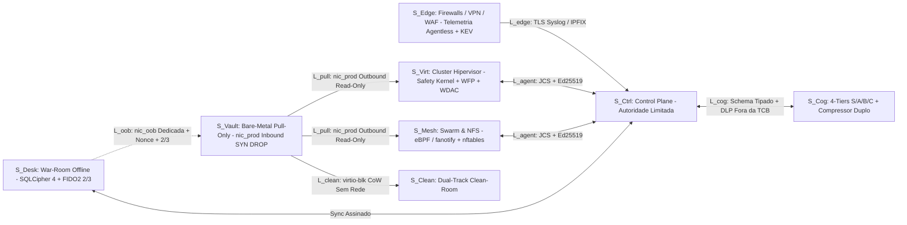

# Resiliência Cibernética Assimetricamente Limitada, Cofres Pull-Only Imutáveis e Verificação Automatizada de Recuperação: Contenção Formal de Sabotagem de Hipervisores e Criptografia Intermitente em Infraestruturas Críticas

**Identificador Técnico:** `VTI-RES-2026-04` — `v1.2 — Edição Auditada Metodologicamente` (Novembro de 2026)  
**Autor:** **Caio Gonçalves** — *Principal Investigator & Chief Systems Architect, VTI Research (VTI, Brazil)* (https://projectos-system.github.io/vti-research/)  
**Classificação Científica:** `cs.CR` (Cryptography and Security) • `cs.DC` (Distributed, Parallel, and Cluster Computing) • `cs.SE` (Software Engineering) | **DOI Oficial (CERN / Zenodo):** `10.5281/zenodo.24406146` (https://doi.org/10.5281/zenodo.24406146)  
**Desenho Metodológico:** Ciência do Design em Engenharia de Segurança (*Design Science Research*) estratificada em quatro níveis epistêmicos (`E1` Auditoria Estática Reproduzível de Código-Fonte C++; `E2` Estudo Forense Retrospectivo Anonimizado $\mathcal{I}_0$ com $N=1$ e Taxonomia Pública `2023–2026`; `E3` Especificação Algébrica Condicional de Invariantes Locais e Distribuídos; `E4` Protocolo Experimental Falsificável Pré-Registrado `B1`–`B13`) — Grafo Tipado $\mathcal{E} = (\mathcal{S}_{\mathrm{Edge}}, \mathcal{S}_{\mathrm{Virt}}, \mathcal{S}_{\mathrm{Mesh}}, \mathcal{S}_{\mathrm{Ctrl}}, \mathcal{S}_{\mathrm{Desk}}, \mathcal{S}_{\mathrm{Vault}}, \mathcal{S}_{\mathrm{Clean}}, \mathcal{S}_{\mathrm{Cog}}; \mathcal{L}, \mathcal{T})$  
**Cláusula de Confidencialidade Operacional e Anonimização de $\mathcal{I}_0$:** *Este manuscrito constitui publicação técnico-científica aberta (autoria institucional identificada). Para conciliar reprodutibilidade científica com sigilo operacional irrestrito sobre o incidente motivador $\mathcal{I}_0$, todos os identificadores privados da infraestrutura corporativa estudada (razão social da organização avaliada, sub-redes/IPs internos, domínios DNS privados, caminhos proprietários e prefixos de credenciais) foram suprimidos e modelados em $\mathcal{E}$. Em contrapartida, repositórios públicos de código aberto inspecionados estaticamente (`uroni/urbackup_backend`), protocolos normativos, utilitários catalogados em alertas governamentais públicos (`CISA`/`ENISA`) e macro-incidentes históricos divulgados publicamente (`2023–2026`) são referenciados nominalmente a partir de fontes primárias abertas.*

---

## Resumo

Operações modernas de *Ransomware-as-a-Service* (RaaS) e extorsão multifásica evoluíram da criptografia ingênua de endpoints para a exploração em massa de appliances de borda desprovidos de agentes, intrusões *malware-free* com credenciais colhidas por *infostealers*, neutralização de sensores via drivers assinados vulneráveis (*BYOVD*), abuso de ferramentas comerciais legítimas de acesso remoto (*Living-off-RMM*), exfiltração prévia de dados (*dupla extorsão*), sabotagem coordenada de planos de controle de virtualização, criptografia intermitente (*header-only* e *skip-step*) sobre volumes compartilhados e destruição acoplada de servidores tradicionais de backup. Simultaneamente, arquiteturas defensivas puramente *fail-closed* introduzem o risco crítico de auto-negação de serviço (*Self-DoS*), onde falsos positivos em fluxos intra-cluster, atualizações defeituosas em *ring-0* ou o comprometimento do próprio servidor central podem colapsar o quórum de produção. Este artigo modela treze classes acopladas de vulnerabilidade ($H_1$–$H_{13}$) cobrindo o ciclo de intrusão, exfiltração, sabotagem e recuperação. Pelo método de *Design Science Research* — separando estritamente evidências já verificadas por auditoria estática de código-fonte C++ (`uroni/urbackup_backend`) e reconstrução forense anonimizada ($\mathcal{I}_0, N=1$) das propriedades condicionais especificadas e das hipóteses empíricas prospectivas —, propomos o axioma de **Segurança Assimetricamente Limitada** (*fail-closed* para autoridade e integridade; *fail-bounded* para disponibilidade). Especificamos formalmente treze controles arquiteturais ($C_1$–$C_{13}$) e oito invariantes particionados em propriedades locais de host ($I_1^{\mathrm{loc}}, I_2, I_5, I_6, I_7$) e propriedades distribuídas de coordenação e sobrevivência ($I_1^{\mathrm{dist}}, I_3, I_4, I_8$), articulando *fencing* monotônico fim a fim (`epoch`), leases de isolamento por consenso linearizável, estação administrativa *War-Room Offline* ($\mathcal{S}_{\mathrm{Desk}}$ com `SQLCipher 4`), cofre físico *Pull-Only* imutável governado por journal idempotente em duas fases sobre `TPM 2.0` e quórum FIDO2 `2-de-3` de três custodiantes humanos distintos, certificação diária escopada em câmara limpa de dupla trilha e núcleo analítico fora da TCB dotado de compressão determinística em duplo estágio por sentinelas reversíveis e roteamento controlado por qualidade em quatro tiers (`S/A/B/C`), acompanhados de protocolo experimental falsificável pré-registrado (`B1`–`B13`) fundamentado em 32 referências primárias (`[R01]`–`[R32]`).

**Palavras-chave:** Ciber-Resiliência de Hipervisores; Criptografia Intermitente; *Safety Kernel Fail-Bounded*; *Epoch Fencing*; Backup Imutável *Pull-Only*; *Clean-Room Disaster Recovery*; `BYOVD`; `NIST SP 800-209`; `ISO/IEC 27031:2025`.

---

## 1. Introdução e Motivação Científica

A literatura recente em segurança de sistemas distribuídos e armazenamento (`[R01, R02, R12, R14, R15]`) evidencia uma transição profunda na anatomia de incidentes destrutivos contra infraestruturas híbridas. Em vez de acionar binários ruidosos em estações de usuário, operadores adversariais exploram três assimetrias arquiteturais recorrentes em datacenters corporativos:

1. **Assimetria Temporal e de Privilégio em Planos de Virtualização:** Uma vez obtida uma credencial administrativa válida (`MITRE T1078`), o adversário opera em janelas de madrugada (`00h00–06h00`), utiliza utilitários nativos do sistema operacional (`msiexec`, `sc`, edição direta de árvores `ControlSet\Services` no registro) para silenciar a coleta de eventos (`EventLog`) e o plano de gerência de máquinas virtuais (`vmms`) sem interromper imediatamente os processos de trabalho já em memória, eliminando a visibilidade do centro de operações no instante crítico (`[R01, R18]`).
2. **Assimetria Computacional da Criptografia Intermitente em Volumes de Bloco/Arquivo:** Conforme formalizado por Davies et al. (`[R13]`) e Ineza et al. (`[R14]`), cifrar apenas os primeiros megabytes (*First-N* / *Header-Only*) de imagens de disco virtual de centenas de gigabytes destrói instantaneamente metadados de alocação (`Header`, `Region Table`, `BAT`), mantendo a entropia global de Shannon praticamente inalterada e permitindo corromper dezenas de terabytes em pouco mais de uma hora.
3. **Acoplamento de Raio de Explosão entre Produção, Diretório e Backup:** Como destacado pelo `NIST SP 800-209` (`[R02]`) e pela segunda edição da norma `ISO/IEC 27031:2025` (`[R05]`), soluções convencionais de backup baseadas em agentes *push*, autenticadas no mesmo serviço de diretório e hospedadas sobre a mesma malha virtualizada, colapsam simultaneamente ao ambiente primário. Em contrapartida, respostas automatizadas mal delimitadas podem induzir *split-brain* em clusters de armazenamento compartilhado caso isolem portas intra-cluster de forma cega.

### 1.1. Motivação Empírica e Racional Hipotético-Dedutivo a partir de Macro-Incidentes Públicos (2023–2026)

A **Tabela 0** sintetiza dez classes de falhas estruturais documentadas em relatórios públicos de resposta a incidentes (`[R29, R30, R31, R32]`) entre 2023 e 2026. Metodologicamente, esta matriz atua estritamente como **motivação empírica de problema e racional hipotético-dedutivo de design (*Design Rationale*)**: cada linha fundamenta a relevância prática das hipóteses de ameaça $H_1$–$H_{13}$ e motiva a derivação arquitetural dos controles $C_1$–$C_{13}$ e invariantes $I_1$–$I_8$, sem reivindicar validação contrafactual retrospectiva sobre os ambientes de terceiros listados:

| Macro-Incidente Público Documentado | Classe Primária do Colapso Estrutural | Limitação da Arquitetura Convencional Exposta | Mapeamento Formal em `VTI-RES-2026-04` |
| :--- | :--- | :--- | :---: |
| **MGM Resorts (`Set/2023`)** | Engenharia social (*vishing*) com redefinição de MFA + criptografia em lote de hipervisores. | MFA suscetível a intervenção humana de suporte e ausência de guarda estrutural de hipervisor. | $H_2, H_3 \rightarrow C_2, C_3$ |
| **Change Healthcare (`Fev/2024`)** | Superfície remota sem MFA resistente a phishing + dupla extorsão (`6 TB` exfiltrados) + paralisia sistêmica. | Ausência de disjuntor de exfiltração (*egress*) e acoplamento de disponibilidade sem *Clean-Room*. | $H_2, H_6, H_9 \rightarrow C_2, C_6, C_9$ |
| **Campanha Gateways Ivanti / PAN-OS / FortiOS (`2024–2025`)** | Exploração zero-day em appliances de borda desprovidos de suporte a agentes internos de endpoint. | Dependência exclusiva de EDR *in-guest* sem coleta *agentless* de borda nem *virtual patching* KEV. | $H_7, H_{12} \rightarrow C_7, C_{12}$ |
| **Campanha Multi-Tenant Snowflake (`Mai–Jun/2024`)** | Intrusão *malware-free* via credenciais colhidas por *infostealers* em estações externas. | Inexistência de *honey-tokens* canário, vínculo criptográfico de dispositivo e limitação volumétrica. | $H_2, H_9, H_{12} \rightarrow C_2, C_9, C_{12}$ |
| **CDK Global & Synnovis (`Jun/2024`)** | Criptografia de provedor crítico seguida de tentativa de reinfecção durante o ciclo de restauração. | Restauração direta sem câmara limpa de dupla trilha (funcional + varredura forense de persistência). | $H_4, H_6 \rightarrow C_4, C_6$ |
| **Apagão Global CrowdStrike (`Jul/2024`)** | Atualização lógica defeituosa processada em *Ring 0* colapsando `~8,5M` de hosts simultaneamente. | Agente em kernel sem estágio `SHADOW → CANARY`, sem orçamento de raio de explosão nem rollback local. | $I_1, I_2, I_4, I_7$ |
| **Marks & Spencer / Varejo UK (`Abr–Mai/2025`)** | Comprometimento do serviço de diretório (`NTDS.dit` / `DCSync`) propagado aos virtualizadores. | Falta de isolamento de domínio entre diretório corporativo, hipervisores, backup e estação de crise. | $H_4, H_5, H_{13} \rightarrow C_4, C_5, C_{13}$ ($I_8$) |
| **Provedores de Infraestrutura Financeira B2B (`Jul/2025`)** | Abuso de credenciais internas privilegiadas e chaves críticas de integração sem custódia multipartida. | Autoridade destrutiva ou transacional concentrada em principal único sem quórum humano distinto. | $H_5, H_8 \rightarrow C_5, C_8$ ($I_1$) |
| **Jaguar Land Rover (`Set/2025`)** | Paralisação preventiva prolongada de plantas industriais inteiras para estancar movimento lateral. | Ausência de amputação seletiva orientada por par autenticado que preserve segmentos saudáveis ativos. | $H_2 \rightarrow C_2$ ($I_4$) |
| **Campanhas RaaS `BYOVD + RMM` (`2024–2026`)** | Drivers `.sys` assinados vulneráveis matando sensores + comando via RMM comercial (`AnyDesk`/`ScreenConnect`). | Confiança implícita em binários/drivers assinados sem política `WDAC` em anéis nem manifesto RMM. | $H_1, H_{10}, H_{11} \rightarrow C_1, C_{10}, C_{11}$ |

As quatro contribuições centrais deste estudo são: **(a)** a verificação estática reproduzível (`Nível E1`) de sete classes de vulnerabilidade em motores abertos de backup C++ (`uroni/urbackup_backend`) perante escalação de privilégio no cliente e adulteração temporal, combinada à análise forense retrospectiva anonimizada de $\mathcal{I}_0$ (`Nível E2`, $N=1$); **(b)** a especificação algébrica condicional (`Nível E3`) de uma arquitetura de defesa e recuperação regida por oito invariantes particionados em propriedades locais ($I_1^{\mathrm{loc}}, I_2, I_5, I_6, I_7$) e distribuídas ($I_1^{\mathrm{dist}}, I_3, I_4, I_8$), articulando *Safety Kernel* local com *epoch fencing* no recurso, consenso linearizável de leases, estação *War-Room Offline* ($\mathcal{S}_{\mathrm{Desk}}$), cofre físico *Pull-Only* com interfaces segregadas (`nic_prod` / `nic_oob`) e certificação diária escopada de dupla trilha; **(c)** a especificação formal de controles preventivos para exfiltração prévia, manifesto RMM, *BYOVD* via `WDAC`, borda *agentless* e pipeline cognitivo fora da TCB com compressão determinística em duplo estágio por sentinelas reversíveis e roteamento controlado por qualidade (`S/A/B/C`); e **(d)** um protocolo experimental falsificável pré-registrado (`Nível E4`, `B1`–`B13`) com denominadores estatísticos e critérios explícitos de refutação.

---

## 2. Modelo de Sistema Hipotético $\mathcal{E}$ e Modelo de Adversário

### 2.1. Desenho do Estudo, Estratificação Evidencial (`E1`–`E4`) e Demarcação Epistemológica

Adotamos o **Princípio de Proporcionalidade Epistêmica** ($\text{Escopo da Alegação} \le \text{Escopo da Evidência}$). Para eliminar ambiguidades entre especificação arquitetural e validação empírica de tempo de execução, todas as proposições desta edição (`v1.2`) são estratificadas em quatro níveis:
- **`Nível E1` (Evidência Estática Verificada):** Defeitos estruturais comprovados por inspeção direta de arquivos e linhas no repositório público `uroni/urbackup_backend` (Seção 3.4 e 3.5), integralmente reproduzíveis por terceiros;
- **`Nível E2` (Evidência Retrospectiva Motivadora, $N=1$):** Sequência anatômica observada na perícia anonimizada $\mathcal{I}_0$ e nos dez macro-incidentes públicos da Tabela 0, utilizada para geração de hipóteses (sujeita às limitações de generalização da Seção 6.3);
- **`Nível E3` (Especificação Formal Condicional):** Propriedades de segurança e contenção de dano derivadas dos invariantes $I_1$–$I_8$ **condicionadas explicitamente** às premissas de TCB, topologia física, criptografia e não-colusão declaradas na **Tabela 1** (cuja verificação exaustiva por *model checking* simbólico `TLA+` compõe `M-FUT-1`);
- **`Nível E4` (Protocolo Prospectivo Pré-Registrado):** Desempenho em tempo de execução, percentis de latência ($p_{99}$), taxas de falsos positivos/negativos e razões de compressão, tratados estritamente como **hipóteses testáveis e metas de gate** em `B1`–`B13` (Seção 4), sem reivindicar medições operacionais ainda não executadas.

| Camada Epistemológica | Escopo Condicional Especificado em `VTI-RES-2026-04` (`Nível E3`) | Limite Explícito do Modelo, Condição de Contorno & Escopo Não Reivindicado |
| :--- | :--- | :--- |
| **Invariantes Locais ($I_1^{\mathrm{loc}}, I_2, I_5, I_6, I_7$) & Distribuídos ($I_1^{\mathrm{dist}}, I_3, I_4, I_8$)** | Isolamento de conexões novas em `nic_prod` do *Pull-Vault*, assinaturas `Ed25519` sobre `RFC 8785 JCS` encadeadas por `SHA-256`, leases por consenso linearizável, quórum `2-de-3` de custodiantes distintos e *fencing* monotônico persistido por recurso. | Condicionados à segurança padrão de `SHA-256`/`Ed25519`, integridade física do hardware *Bare-Metal*, sincronia monotônica local e ausência de colusão simultânea de $\ge 2$ dos 3 custodiantes locais (sendo eventual colusão local mitigada apenas pela retenção externa independente S3 `COMPLIANCE`). |
| **Sensores User-Mode + Integridade de Código (`WDAC` — Fases 1–4)** | Monitoramento `ETW`/`eBPF`, filtros transacionais `WFP`/`nftables`, canários por `FileID`/`inode`, manifesto RMM e bloqueio por política `CI` de drivers vulneráveis catalogados via `WDAC`. | **Prevenção condicionada à integridade do kernel/subsistema `CI` do SO e ao catálogo vigente de drivers bloqueados**; perante um *exploit zero-day* inédito em *ring-0* (pré-Fase 5 HVCI/ELAM) ou saturação extrema com perda de eventos (`TELEMETRY_DROPPED`), **o host primário é assumido como comprometido**, recaindo a garantia residual exclusivamente sobre a sobrevivência de snapshots históricos anteriores em $\mathcal{S}_{\mathrm{Vault}}$. |
| **Estação Administrativa *War-Room Offline* ($\mathcal{S}_{\mathrm{Desk}}$)** | Persistência local cifrada com `SQLCipher 4` (`AES-256-CBC + HMAC-SHA512`, `256.000` iterações PBKDF2) + envelope `DPAPI` + vínculo FIDO2, `temp_store=MEMORY` e limpeza explícita de buffers (`zeroize`). | Protege confidencialidade e integridade de inventários/certificados em repouso contra extração offline; **não protege segredos abertos em sessão nem impede ordens maliciosas caso o próprio kernel/firmware de $\mathcal{S}_{\mathrm{Desk}}$ esteja comprometido** ou haja perda simultânea do link dedicado `nic_oob`. |
| **Certificação Escopada em Câmara Limpa (*Clean-Room DR*)** | Escada funcional `[MS-VHDX]` $\rightarrow$ FS $\rightarrow$ índices B-Tree $\rightarrow$ *boot* sintético + varredura estática `YARA` e diff de persistência contra baseline versionado. | Emite **atestado estritamente escopado à bateria de testes executada** (consistência estrutural e ausência de artefatos presentes no catálogo `YARA`/baseline vigente); não equivale à prova indecidível de ausência de *implants* inéditos ou corrupção semântica silenciosa de regras de negócio. |

### 2.2. Topologia Formal do Ecossistema Abstraído, Zonas de Confiança e Matriz de Canais

Definimos a infraestrutura protegida e seu plano de resiliência como a estrutura algébrica tipada:

$$\mathcal{E} = \big(\mathcal{S}_{\mathrm{Edge}},\, \mathcal{S}_{\mathrm{Virt}},\, \mathcal{S}_{\mathrm{Mesh}},\, \mathcal{S}_{\mathrm{Ctrl}},\, \mathcal{S}_{\mathrm{Desk}},\, \mathcal{S}_{\mathrm{Vault}},\, \mathcal{S}_{\mathrm{Clean}},\, \mathcal{S}_{\mathrm{Cog}};\; \mathcal{L},\, \mathcal{T}\big)$$

onde $\mathcal{T}$ particiona os subsistemas em seis zonas disjuntas de confiança:
- $\mathcal{S}_{\mathrm{Edge}} = \{g_1, \dots, g_r\}$ ($\mathcal{T} = \texttt{UNTRUSTED\_EDGE}$): appliances de perímetro (firewalls, concentradores VPN e proxies/WAF) desprovidos de suporte a agentes *in-guest*;
- $\mathcal{S}_{\mathrm{Virt}} = \{h_1, \dots, h_m\}$ e $\mathcal{S}_{\mathrm{Mesh}} = \{u_1, \dots, u_k\}$ ($\mathcal{T} = \texttt{MONITORED\_PROD}$): nós hipervisores compartilhando volumes de discos virtuais $\mathcal{V}$ e nós de contêineres/servidores NFS de SGBDs, cada qual executando processo local isolado de *Safety Kernel*;
- $\mathcal{S}_{\mathrm{Ctrl}}$ ($\mathcal{T} = \texttt{BOUNDED\_CTRL}$): Plano de Controle Central e Gateway mTLS, tratado pelo modelo de ameaça como **potencialmente comprometível ou indisponível** (autoridade limitada pelos invariantes $I_1, I_4, I_6$);
- $\mathcal{S}_{\mathrm{Desk}} = \{d_1, \dots, d_p\}$ ($\mathcal{T} = \texttt{OFFLINE\_CUSTODY}$): estações administrativas higienizadas (*War-Room Offline*) com `SQLCipher 4` e autenticadores físicos FIDO2;
- $\mathcal{S}_{\mathrm{Vault}}$ ($\mathcal{T} = \texttt{ISOLATED\_VAULT}$): appliance físico *Bare-Metal* de cofre imutável fora do diretório corporativo, dotado de duas interfaces físicas segregadas (`nic_prod` para coleta *pull* somente-leitura e `nic_oob` em VLAN física ponto-a-ponto exclusiva para $\mathcal{S}_{\mathrm{Desk}}$);
- $\mathcal{S}_{\mathrm{Clean}}$ ($\mathcal{T} = \texttt{EPHEMERAL\_CLEAN}$): microVMs efêmeras de validação em namespace de rede nulo (`veth` sem *bridge* externa, DNS ou credenciais produtivas);
- $\mathcal{S}_{\mathrm{Cog}}$ ($\mathcal{T} = \texttt{NON\_TCB\_COG}$): motores de correlação estatística e modelos generativos posicionados **estritamente fora da *Trusted Computing Base* (TCB)** ($\mathcal{K}_{\mathrm{TCB}} \cap \mathcal{K}(\mathcal{S}_{\mathrm{Cog}}) = \emptyset$).

A relação direcionada de canais $\mathcal{L}$ (**Tabela 1B**) resolve formalmente a compatibilidade entre o bloqueio total de entrada produtiva no cofre e a orquestração emergencial *out-of-band*:

| Canal em $\mathcal{L}$ | Iniciador (`SYN`) $\rightarrow$ Receptor | Interface / Transporte | Autenticação & Escopo de Autoridade Permitido |
| :--- | :--- | :--- | :--- |
| **`L_edge`** | $\mathcal{S}_{\mathrm{Edge}} \rightarrow \mathcal{S}_{\mathrm{Ctrl}}$ | WAN/DMZ • `TLS Syslog / IPFIX` | Certificados por appliance; ingestão em parser restrito sem privilégio de comando. |
| **`L_agent`** | $\mathcal{S}_{\mathrm{Virt}} \cup \mathcal{S}_{\mathrm{Mesh}} \leftrightarrow \mathcal{S}_{\mathrm{Ctrl}}$ | LAN Gerência • `mTLS 1.3` | Envelopes `RFC 8785 JCS + Ed25519`; comandos sujeitos a $I_1^{\mathrm{loc}}, I_1^{\mathrm{dist}}, I_2, I_4, I_5, I_6$. |
| **`L_pull`** | $\mathcal{S}_{\mathrm{Vault}} \rightarrow \mathcal{S}_{\mathrm{Virt}} \cup \mathcal{S}_{\mathrm{Mesh}}$ | `nic_prod` • `mTLS 1.3 Outbound` | **`nic_prod` aplica `DROP` a `100%` de `TCP SYN`/`UDP` novos de entrada**, aceitando apenas pacotes stateful `ESTABLISHED` de sessões de leitura iniciadas pelo coletor não-privilegiado do cofre. |
| **`L_oob`** | $\mathcal{S}_{\mathrm{Desk}} \rightarrow \mathcal{S}_{\mathrm{Vault}}$ | `nic_oob` (VLAN Física OOB Dedicada) | Fisicamente disjunta de `nic_prod`; exige `mTLS 1.3` de estação cadastrada + `challenge-response` fresco (`vault_nonce`) + envelope `JCS` assinado por quórum FIDO2 `2-de-3` restrito a `STAGING_RESTORE` e auditoria. |
| **`L_clean`** | $\mathcal{S}_{\mathrm{Vault}} \rightarrow \mathcal{S}_{\mathrm{Clean}}$ | Bus Virtual Local (`virtio-blk` CoW) | Exportação local de bloco sobre `zfs clone` descartável sem exposição do socket ZFS do host e sem interface de rede roteável. |
| **`L_cog`** | $\mathcal{S}_{\mathrm{Ctrl}} / \mathcal{S}_{\mathrm{Desk}} \rightarrow \mathcal{S}_{\mathrm{Cog}}$ | API Tipada / Runtime Local Offline | Payload pré-comprimido e pseudonimizado (DLP); resposta tratada como texto/JSON não-executável ($\mathrm{Exec}=0$). |

### 2.3. Modelo de Adversário, Risco de *Self-DoS* e Partição Formal dos Oito Invariantes ($I_1$–$I_8$)

Consideramos um adversário adaptativo $\mathcal{A}$ capaz de: *(1)* explorar appliances em $\mathcal{S}_{\mathrm{Edge}}$ ou adquirir credenciais administrativas válidas (`SYSTEM`/`root`/`Domain Admin`) em $\mathcal{S}_{\mathrm{Virt}} \cup \mathcal{S}_{\mathrm{Mesh}}$ via *infostealers* ou replicação de diretório (`DCSync`); *(2)* operar fora do expediente com binários nativos (*LotL*), RMMs comerciais assinados e drivers vulneráveis catalogados (*BYOVD*), tentando exfiltrar dados previamente; *(3)* adulterar servidores NTP internos e injetar bytes nulos (`\x00`), pseudo-sentinelas ou instruções adversariais em logs visando corromper compressores ou induzir *Prompt Injection* em $\mathcal{S}_{\mathrm{Cog}}$; e *(4)* comprometer ou derrubar $\mathcal{S}_{\mathrm{Ctrl}}$ tentando emitir ordens em massa de isolamento (*Self-DoS*) ou reenviar comandos obsoletos pós-partição. **Fora da TCB de contenção** situam-se $\mathcal{S}_{\mathrm{Ctrl}}$ (para ações destrutivas unilaterais) e integralmente $\mathcal{S}_{\mathrm{Cog}}$; **dentro da TCB local** de cada nó protegido situam-se o kernel do SO/subsistema `CI` (pré-condição declarada na Tabela 1) e o binário isolado do *Safety Kernel*.

Para distinguir rigorosamente propriedades impostas por um único nó de propriedades que requerem coordenação distribuída ou isolamento físico, particionamos os oito invariantes em dois grupos formais:

#### Grupo A — Invariantes Locais de Host/Executor (Impostos Autonomamente pelo *Safety Kernel* do Nó $h$)

Sejam $\mathcal{C}_{\mathrm{mut}}$ o conjunto de comandos mutáveis recebidos pelo nó $h$, $\mathcal{R}_h$ os recursos locais de contenção (subcamadas `WFP`/`nftables`, tabela de sessões e estado de agente) e $\Sigma_{\mathrm{FSM}} = \{\texttt{NORMAL}, \texttt{SUSPECT}, \texttt{QUARANTINED}, \texttt{RESTRICTED\_RECOVERY}\}$ o espaço de estados local com função de transição $\delta$:

$$
\begin{aligned}
I_1^{\mathrm{loc}} &\text{ (Fencing Monotônico Universal por Recurso): } \forall\, c \in \mathcal{C}_{\mathrm{mut}},\, \forall\, r \in \mathrm{Targets}(c) \cap \mathcal{R}_h:\; (c.\mathrm{scope} = r.\mathrm{domain}) \;\land\; (c.\mathrm{epoch} > \mathrm{lastAcceptedEpoch}_r) \\
I_2 &\text{ (Transição Conservadora e Retorno Conjungido): } \forall\, \mathrm{ev} \in \{\texttt{LeaseExpire}, \texttt{HostReboot}, \texttt{JournalCorrupt}, \texttt{PartialFilterFail}\}, \\
&\qquad \delta(\texttt{QUARANTINED}, \mathrm{ev}) = \texttt{RESTRICTED\_RECOVERY} \;\land\; \Big(\delta(\texttt{RESTRICTED\_RECOVERY}, \mathrm{ev}_{\mathrm{rel}}) = \texttt{NORMAL} \iff \mathrm{CleanAttest}(h) \land \mathrm{DistinctFIDO2}_{2/3}(c_{\mathrm{rel}}) = 1\Big) \\
I_5 &\text{ (Autonomia Offline Fail-Bounded sem Fail-Open): } \mathrm{Unreachable}(\mathcal{S}_{\mathrm{Ctrl}}) \implies \mathrm{KeepLocalDefensesActive}(h) \\
&\qquad \land\; \Big(\big(\Delta t_{\mathrm{off}} > \tau_{\mathrm{off\_max}} \lor \mathrm{Expired}(v_{\mathrm{pol}}, \mathrm{CRL\_epoch})\big) \implies \neg\mathrm{AcceptRemoteQuarantine}(h) \land \mathrm{EnforceLocalGuard}(h, \texttt{RESTRICTED\_RECOVERY})\Big) \\
I_6 &\text{ (Exclusão Criptográfica de } \mathcal{S}_{\mathrm{Cog}} \text{ e Parser Fechado): } \forall\, c,\; \mathrm{RejectUnknownFields}(c) = 1 \;\land\; \big(\mathrm{VerifySig}(c, \mathcal{K}_{\mathrm{TCB}}) = 0 \implies \mathrm{Exec}(c) = 0\big),\; \mathcal{K}_{\mathrm{TCB}} \cap \mathcal{K}(\mathcal{S}_{\mathrm{Cog}}) = \emptyset \\
I_7 &\text{ (Watchdog e Rollback Transacional Local): } \forall\, m \in \mathrm{FilterMutations}_h,\; \neg\mathrm{ProbeQuorumAndOOB}(h, \tau_{\mathrm{wd}}) \implies \mathrm{LocalRevert}(h, m_{\mathrm{prev}}) = 1
\end{aligned}
$$

onde $\mathrm{lastAcceptedEpoch}_r \in \mathbb{N}$ é gravado atomicamente em *write-ahead log* local (`fsync` + `HMAC-SHA256` ancorado a segredo protegido do host) sob *mutex* por recurso **antes** da mutação de filtro, rejeitando replays, reordenações e regressões através de reinicializações; $\Delta t_{\mathrm{off}} = t_{\mathrm{mono}} - t_{\mathrm{last\_sync}}$ é aferido exclusivamente por relógio monotônico (`CLOCK_BOOTTIME` / `QueryUnbiasedInterruptTime`), garantindo em $I_5$ que a expiração de época offline apenas bloqueia ordens remotas com contexto vencido **sem jamais desarmar proteções locais** (canários, `WDAC`, anti-sabotagem e retenção lateral em `RESTRICTED_RECOVERY`); e em $I_2$, a saída definitiva para `NORMAL` exige **conjunção** entre atestação limpa de sensores/persistência ($\mathrm{CleanAttest}(h)=1$) e quórum humano distinto.

#### Grupo B — Invariantes Distribuídos de Coordenação de Cluster, Cofre e Comando Offline

Sejam $D$ um domínio de falha com *membership* assinado $M(D, v_{\mathrm{cfg}})$ na época de configuração $v_{\mathrm{cfg}}$, quórum mínimo $Q_{\min}(D, v_{\mathrm{cfg}}) = \lfloor |M(D, v_{\mathrm{cfg}})| / 2 \rfloor + 1$ e máquina de estados de concessão replicada por consenso linearizável (`Raft` com reconfiguração *joint-consensus*):

$$
\begin{aligned}
I_1^{\mathrm{dist}} &\text{ (Orçamento Linearizável de Domínio e Quórum Humano): } \forall\, c \in \mathcal{C}_{\mathrm{quar}}(D),\; \mathrm{DistinctFIDO2}_{2/3}(c) = 0 \implies \\
&\qquad \big(\mathrm{ValidRaftLease}(c, D, v_{\mathrm{cfg}}, c.\mathrm{epoch}) = 1\big) \;\land\; \big(|\mathrm{IsolateSet}_{W_t}(D) \cup \mathrm{Targets}(c)| \le B_{\mathrm{dom}}(D) = 1\big) \\
I_3 &\text{ (Sobrevivência de Staging Restore e Precedência de Freeze em } \mathcal{S}_{\mathrm{Vault}}\text{): } \forall\, s \in \Sigma_{\mathrm{Vault}},\, \forall\, q \in \mathcal{Q}_{\mathrm{Vault}},\; s.\mathrm{clock} \in \{\texttt{CLOCK\_DEGRADED}, \texttt{TIME\_TAMPER\_FREEZE}\} \implies \\
&\qquad \Big(\mathrm{Allow}(q, s) = 1 \iff \mathrm{AuthOOB\_Nonce}(q, s) = 1 \land \mathrm{op}(q) \in \{\texttt{STAGING\_RESTORE}, \texttt{AUDIT\_READ}\}\Big) \\
I_4 &\text{ (Preservação Estrita de Quórum Versionado): } \big|\big(\mathrm{ReachableHealthy}(D, v_{\mathrm{cfg}}) \setminus \mathrm{Transitional}(D, v_{\mathrm{cfg}})\big) \setminus \big(\mathrm{IsolateSet}(D) \cup \mathrm{Targets}(c)\big)\big| \ge Q_{\min}(D, v_{\mathrm{cfg}}) \\
I_8 &\text{ (Continuidade Operacional War-Room Offline Condicionada): } \big(\mathrm{Intact}(\mathcal{S}_{\mathrm{Desk}}) \land \mathrm{LinkUp}(\texttt{nic\_oob}) \land \mathrm{ValidCustodians}_{\ge 2/3}\big) \implies \\
&\qquad \Big(\mathrm{Unreachable}(\mathcal{S}_{\mathrm{Ctrl}}) \implies \mathrm{CanExecute}\big(\mathcal{S}_{\mathrm{Desk}} \xrightarrow{\texttt{L\_oob}} \mathcal{S}_{\mathrm{Vault}},\, \texttt{STAGING\_RESTORE}\big) = 1\Big)
\end{aligned}
$$

onde $W_t = [t_{\mathrm{mono}} - \tau_{\mathrm{cool}}, t_{\mathrm{mono}}]$ é a janela de resfriamento mantida no log replicado do domínio $D$ (impedindo que dois nós distintos obtenham leases automáticos simultâneos); $\mathrm{Transitional}(D, v_{\mathrm{cfg}}) = \texttt{Joining} \cup \texttt{Leaving} \cup \texttt{Draining}$ é descontado preventivamente da margem saudável; nós situados em partição minoritária (incapazes de formar quórum `Raft` em $D$) limitam-se estritamente ao estado `SUSPECT`; $\mathrm{DistinctFIDO2}_{2/3}(c) = 1$ exige assinaturas sobre `RFC 8785 JCS` emitidas por `credential_id` pertencentes a **3 principais administrativos humanos distintos** (`UP=1`, `UV=1`, `CRL_epoch` válido); e em $I_3$, `STAGING_RESTORE` monta snapshots exclusivamente no ambiente confinado $\mathcal{S}_{\mathrm{Clean}}$ (sem auto-execução no cofre), mantendo bloqueados `SNAPSHOT_RELEASE`, `DATASET_DESTROY`, `RETENTION_SHRINK` e `PROMOTE_TO_PROD` automático.

### 2.4. Síntese das Treze Hipóteses Falsificáveis de Ameaça ($H_1$–$H_{13}$)

| ID | Classe de Vulnerabilidade / Referência Normativa | Formulação Falsificável da Hipótese de Ameaça |
| :-: | :--- | :--- |
| **$H_1$** | Sabotagem de Sensores e Logs (`MITRE T1562.001/.002`, `CWE-284`) | Um atacante administrativo local remove pacotes MSI de segurança e exclui chaves `Services\{EventLog, vmms}` sem reinicialização, silenciando alertas baseados apenas em encaminhamento passivo de `.evtx`. |
| **$H_2$** | Abuso Temporal de Credencial & Isolamento Cego (`NIST SP 800-207`, `T1078`) | Sessões administrativas legítimas fora de janela de mudança propagam-se via SMB/RDP; inversamente, bloqueios cegos da porta `:445` colapsam volumes compartilhados intra-cluster (CSV/SOFS). |
| **$H_3$** | Criptografia Intermitente & Ponto Cego Remoto (`T1486`, `[R13, R14]`) | Cifrar apenas os primeiros `64 KiB–2 MiB` de arquivos `.vhdx` evade detectores de entropia global, enquanto ataques via rede SMB/NFS mascaram o processo ofensor sob threads de kernel (`PID 4` / `[nfsd]`). |
| **$H_4$** | Auto-Expurgo Client-Driven e Rollover em Backup Push (`NIST SP 800-209`) | Em servidores de backup onde o cliente reporta retenção (`max_image_full`, `allow_overwrite`) ou dispara backups livremente, um host comprometido força o expurgo das imagens históricas íntegras. |
| **$H_5$** | Manipulação de Relógio (*Time-Jump*) e Conta Única (`CWE-367`, `RFC 8915`) | A adulteração de NTP/RTC para datas futuras invalida travas baseadas em `CLOCK_REALTIME`, e qualquer conta única com acesso a utilitários SUID destrói snapshots locais e remotos. |
| **$H_6$** | Corrupção Silenciosa e Persistência Dormente (`ISO/IEC 27031:2025`, `NIST SP 800-184`) | Backups reportados como concluídos podem falhar na restauração por corrupção interna de índices B-Tree/VHDX ou reintroduzir artefatos de persistência implantados dias antes da detonação. |
| **$H_7$** | Latência de Triagem de CVEs e Envenenamento de Feeds (`NIST CSF 2.0 ID.RA`) | Priorizar correções apenas por `CVSS` base dilui falhas ativamente exploradas (`KEV`), enquanto ingerir feeds externos sem *staging* e ponderação contextual pode banir infraestrutura própria. |
| **$H_8$** | Acoplamento de IA na TCB e *Prompt Injection* (`OWASP LLM01`) | Depender de inferência remota de LLMs para contenção primária falha sob corte de rede, e alimentar modelos com telemetria bruta permite manipulação adversarial do parecer. |
| **$H_9$** | Exfiltração Prévia de Dupla Extorsão (`T1567`, `T1048`, `[R29]`) | Mesmo diante de backups imutáveis íntegros, o adversário exfiltra múltiplos gigabytes de bancos e repositórios para nuvens externas via utilitários legítimos (`rclone`, `s5cmd`) antes da sabotagem. |
| **$H_{10}$** | Persistência via RMM Comercial Assinado e Túneis (`T1219`, `T1572`, `[R30]`) | Binários comerciais de suporte remoto legitimamente assinados e túneis reversos TLS evadem antivírus tradicionais baseados em assinatura de *malware*, concedendo controle interativo persistente. |
| **$H_{11}$** | Neutralização Kernel via Drivers Vulneráveis Assinados — `BYOVD` (`T1068`, `[R31]`) | Um atacante administrativo carrega drivers `.sys` legítimos porém vulneráveis para obter execução em *ring-0* e encerrar processos protegidos de segurança antes da existência de *minifilter* próprio. |
| **$H_{12}$** | Exploração *Agentless* de Borda e *Infostealers Malware-Free* (`T1190`, `[R29, R32]`) | Appliances VPN/Firewall sem suporte a agentes concentram o vetor inicial dominante de intrusão, seguido por uso silencioso de credenciais colhidas por *infostealers* sem gravação de binários maliciosos. |
| **$H_{13}$** | Comprometimento de Diretório/Cloud e Apagão do Painel Central (`T1003.006`, `T1562.008`) | Extração de `NTDS.dit` (`DCSync`), supressão de logs cloud ou desligamento emergencial do datacenter inutilizam consoles de segurança dependentes do próprio domínio ou do servidor central. |

---

## 3. Especificação dos Treze Controles *Fail-Bounded* ($C_1$–$C_{13}$) e Invariantes Formais

**Pré-Condições Explícitas da Plataforma de Referência:** A especificação abaixo assume sistemas operacionais Windows Server 2022+ (`NTFS`/`ReFS` com subsistemas `ETW`, `WFP`, `WDAC` e `SRV_OPEN_ECP_CONTEXT`) em $\mathcal{S}_{\mathrm{Virt}}$ e Linux kernel `>= 5.15 LTS` com `BTF` habilitado (`eBPF` `fentry`/`BPF_LSM`, `fanotify` `FAN_MARK_INODE`, `nftables` e `OpenZFS 2.2+`) em $\mathcal{S}_{\mathrm{Mesh}} \cup \mathcal{S}_{\mathrm{Vault}}$.

### 3.1. Controle $C_1$ (para $H_1$): Capability Criptográfica de Uso Único, Proteção de Serviços e Batimento Estruturado
1. **Capability Criptográfica de Desinstalação/Manutenção:** Qualquer desinstalação ou parada do agente exige um token assinado `Ed25519` vinculado à tupla `(AgentID, HostBootID, ActionEnum, Nonce, ExpireEpoch)` verificado contra chave pública fixada offline.
2. **Monitoramento Real-Time de Configuração Crítica:** Sensores `ETW` (`Kernel-Registry` e `Kernel-Process`) vigiam mutações em `Services\{EventLog, vmms, vmicvss}` e `Control\SafeBoot` com handles imunes a *reparse-points/symlinks* (`FILE_OPEN_NO_REPARSE_POINT` / `RESOLVE_NO_SYMLINKS`), combinados com proteção contra filtros hostis no motor local de filtragem (*anti-EDRSilencer*).
3. **Batimento Estruturado, Saturação de Telemetria e Resposta Graduada:** A cada intervalo $\Delta t = 5\text{ s}$, o agente emite um batimento assinado contendo `(bootId, monotonicSeq, policyHash, sensorHealthBitmap, eventsLostCounter, queueDepth)`. Se buffers de kernel reportarem descarte de eventos (`EventsLost > 0`), o bit `TELEMETRY_DROPPED` é ativado de forma persistente (acionando `LOG_GAP_ALERT` bloqueante para promoções automáticas). A ausência de batimento não provoca isolamento cego imediato: transita o host na escada graduada (`alerta de atraso` $\rightarrow$ `sondagem cruzada de rede` $\rightarrow$ `restrição de novas sessões privilegiadas`), distinguindo partição benigna de sabotagem confirmada.

> **Fundamentação na Literatura:** Estende as contramedidas ontológicas `D3-SDM` e `D3-EHB` do MITRE D3FEND e corrige a fragilidade de canais passivos de auditoria apontada em `NIST CSF 2.0 DE.CM` (`[R01]`).

### 3.2. Controle $C_2$ (para $H_2$): Governança Temporal *Break-Glass*, Consenso de Lease e Isolamento por Par Autenticado
1. **Verificação Temporal Fora de Janela:** Logons privilegiados (`RDP`, `SMB Admin Shares`, `WinRM`, `SSH`) ocorridos fora de janelas de mudança assinadas $\mathcal{W}_{\mathrm{chg}}$ disparam transição para `SUSPECT` e desafio *out-of-band* via *Passkeys* FIDO2 resistentes a *phishing* (TTL `90s`).
2. **Lease Linearizável (`Raft`), Quórum Versionado e *Epoch Fencing* ($I_1^{\mathrm{loc}}, I_1^{\mathrm{dist}}, I_4$):** Em caso de violação confirmada sem quórum humano, o coordenador solicita um `DomainIsolationLease` à máquina de estados replicada (`Raft`) do domínio $D$ na época de configuração $v_{\mathrm{cfg}}$ (descontando nós `joining`, `leaving` e `draining` e garantindo exclusão mútua linearizável $|\mathrm{IsolateSet}_{W_t}(D)| \le 1$). No host alvo, o *Safety Kernel* persiste atomicamente `lastAcceptedEpoch_r` em *write-ahead log* (`fsync` + HMAC local) antes de aplicar a transação `WFP` / `nftables` (`QUARANTINED`), preservando exclusivamente os pares autenticados `(PeerID, Interface, ClusterRole)` exigidos para $Q_{\min}(D, v_{\mathrm{cfg}})$ e encerrando sockets laterais externos (`NetSessionDel`, `MIB_TCP_STATE_DELETE_TCB`, `SOCK_DESTROY`). Partições sem maioria `Raft` limitam-se ao estado `SUSPECT`.
3. **Transição Conservadora e Retorno Conjungido ($I_2$):** Na expiração do lease $\tau_{\mathrm{lease}}$, reinicialização física durante contenção (mantida por filtros de boot), falha parcial de aplicação de filtro ou corrupção do journal local, o nó transita **exclusivamente** para `RESTRICTED_RECOVERY` ($\neq \texttt{NORMAL}$). O retorno a `NORMAL` exige **conjunção** de atestação limpa ($\mathrm{CleanAttest}(h)=1$) e aprovação FIDO2 `2-de-3` de custodiantes distintos (pois aprovação humana isolada não comprova ausência de artefatos residuais).

> **Fundamentação na Literatura:** Materializa o *Policy Enforcement Point* contextual da arquitetura Zero Trust `NIST SP 800-207` (`[R04]`) acoplado à análise causal de sessões de `R-CAID` (`[R22]`).

### 3.3. Controle $C_3$ (para $H_3$): Decepção Polimórfica, Identificação de Origem Remota e Guardião `[MS-VHDX]`
1. **Malha Polimórfica de Canários:** Distribuem-se arquivos-armadilha com nomes, extensões, tamanhos e posições heterogêneos (monitorados por `FileID`/`inode` via `FAN_MARK_INODE`), mitigando evasão por ordenação lexicográfica simples.
2. **Atribuição de Par Remoto (Resolução do Ponto Cego `PID 4` / `[nfsd]`):** Em acessos SMB autenticados no Windows, extrai-se o endereço e sessão do cliente de `SRV_OPEN_ECP_CONTEXT` (`GUID_ECP_SRV_OPEN`); em servidores Linux NFS, programas `eBPF` em `fentry/nfsd_write` e `nfsd_unlink` extraem `rqstp->rq_addr`, amputando a sessão do cliente infrator sem derrubar o volume compartilhado para os nós saudáveis.
3. **Guardião Estrutural de Cabeçalho Virtual (`offset < 1 MiB`) e Escopo de Cobertura:** Como sistemas hóspedes não sobrescrevem diretamente o primeiro `1 MiB` do contêiner `[MS-VHDX]` (`vhdxfile`, `Header 1/2`, `Region Table 1/2`), escritas nessa região exigem simultaneamente: *(a)* processo autenticado por caminho canônico, assinatura binária, proteção de token e ancestralidade válida (`vmwp.exe`/`vmms.exe`); e *(b)* conformidade estrutural de assinatura/`CRC-32C` (Castagnoli) e variação de entropia diferencial compatível com o perfil calibrado em `SHADOW`. Caso um adversário implemente criptografia *skip-step* que evite deliberadamente `offset < 1 MiB`, a detecção recai sobre os canários *in-guest*/compartilhados, a governança *Break-Glass* ($C_2$) e o disjuntor de churn na ingestão de $\mathcal{S}_{\mathrm{Vault}}$ ($C_4$).

> **Fundamentação na Literatura:** Unifica a abordagem de *honeyfiles* de `R-Locker` (`[R12]`), a análise diferencial de fragmentos iniciais de Davies et al. (`[R13]`), a modelagem contra criptografia intermitente de Ineza et al. (`[R14]`, *preprint*) e a proteção de blocos de `DeftPunk` (`[R16]`).

### 3.4. Controle $C_4$ (para $H_4$): Cofre *Pull-Only* com Interfaces Segregadas, Staging Não-Privilegiado e Disjuntor de Churn
1. **Inversão Unidirecional em `nic_prod` e Segregação de `nic_oob` (`Nível E1` $\rightarrow$ `Nível E3`):** A inspeção estática do código-fonte C++ do `uroni/urbackup_backend` comprovou que aceitar parâmetros client-side (`allow_overwrite=true` em `server_settings.cpp:387` e `max_image_full` editável em `settingslist.cpp:122-156`) permite auto-expurgo remoto, enquanto o rollover fixo (`server_cleanup.cpp:923-967`) e `do_remove_unknown()` (`server_cleanup.cpp:719-738`) induzem destruição física de cadeias `.vhdz`. Em $\mathcal{S}_{\mathrm{Vault}}$, a interface `nic_prod` descarta `100%` de pacotes `TCP SYN`/`UDP` novos de entrada vindos de $\mathcal{S}_{\mathrm{Virt}} \cup \mathcal{S}_{\mathrm{Mesh}} \cup \mathcal{S}_{\mathrm{Ctrl}}$, admitindo apenas tráfego `ESTABLISHED` de sessões mTLS *outbound* somente-leitura iniciadas pelo coletor interno; a orquestração emergencial ocorre exclusivamente pela interface física segregada `nic_oob` (Tabela 1B).
2. **Sandbox de Staging, Deduplicação Endereçada por Conteúdo e Quotas Independentes:** Os dados extraídos ingressam em área de *staging* não privilegiada com limites rígidos de volume, tempo e profundidade de parsing, deduplicação endereçada por conteúdo (`SHA-256`, inspirada em arquiteturas escaláveis de *tiering* `[R26]`) e reservas físicas independentes de *headroom*/metadados contra exaustão do pool.
3. **Selagem Imutável e Disjuntor Anti-Envenenamento:** Após validação preliminar, o dataset recebe `zfs snapshot` + `zfs hold` (sob conta delegada apenas com `create,receive,snapshot,hold`, sem `destroy` ou `release`, eliminando a falha de binários SUID como `urbackup_snapshot_helper` em `main.cpp:498-539`). Se a taxa de blocos alterados exceder $\theta_{\mathrm{churn}}$ com anomalia de entropia, o snapshot é retido em quarentena forense e a expiração histórica é suspensa.

> **Fundamentação na Literatura:** Implementa o isolamento do plano de gerência do `NIST SP 800-209` (`[R02]`), a proteção contra clientes comprometidos de `RockFS` (`[R25]`) e o *tiering* deduplicado de `InftyDedup` (`[R26]`).

### 3.5. Controle $C_5$ (para $H_5$): Journal Idempotente em `TPM 2.0`, `TIME_TAMPER_FREEZE` e Custódia Independente
1. **Protocolo Temporal Idempotente em Duas Fases sobre `TPM 2.0`:** Diferentemente de travas baseadas em `getTimeSeconds()` (`server_archive.cpp:54-101`), reconhecemos que `CLOCK_BOOTTIME` é estritamente intra-boot. A continuidade entre reinicializações opera em duas fases: **(Fase 1 — `PREPARE`)** persiste com `fsync` o registro autenticado `INTENT(boot_seq + 1, wall_now, prev_nv)`; **(Fase 2 — `COMMIT`)** executa `TPM2_NV_Increment` sobre índice `TPMA_NV_COUNTER` (com *rate-limiting* por época/boot compatível com a vida útil da NVRAM) e grava `COMMITTED(new_nv, nts_quorum_proof)` ancorado em $\ge 2$ autoridades `NTS (RFC 8915)` independentes (`[R27]`) e carimbos `RFC 3161` (`[R28]`). Na recuperação pós-queda abrupta de energia, se `INTENT` existir sem `COMMITTED`, o cofre lê `nv_now` do `TPM 2.0`: caso `nv_now == prev_nv + 1`, promove idempotentemente (*roll-forward*) para `COMMITTED` em modo `CLOCK_DEGRADED` até ressincronização `NTS`; caso `wall_now < persisted_wall_floor` ou haja regressão de contador, persiste `TIME_TAMPER_FREEZE`.
2. **Congelamento Seletivo e Isolamento de `STAGING_RESTORE` ($I_3$):** Sob `CLOCK_DEGRADED` ou `TIME_TAMPER_FREEZE`, operações destrutivas (`release`, `destroy`, redução de retenção) e promoções automáticas (`PROMOTE_TO_PROD`) permanecem negadas, enquanto `STAGING_RESTORE` autenticado com `vault_nonce` fresco em `nic_oob` hidrata snapshots exclusivamente na rede nula de $\mathcal{S}_{\mathrm{Clean}}$ sem auto-execução privilegiada no cofre.
3. **Tripla Custódia Humana Distinta (`2-de-3`), Retardo de `72h` e Domínio S3 Independente:** Purgas extraordinárias exigem assinaturas sobre `RFC 8785 JCS` (`tenant + domain_id + target_ids + action_enum + policy_epoch + window + vault_nonce`) emitidas por **`credential_id` FIDO2 de 3 principais administrativos humanos distintos** (`UP=1`, `UV=1`, `CRL_epoch` válido) + espera auditada de `72 horas`. Para mitigar até mesmo o cenário-limite de colusão simultânea de $\ge 2$ custodiantes locais, a réplica cifrada externa utiliza **S3 Object Lock em modo `COMPLIANCE`** (`[R02]`) hospedada sob conta cloud, raiz administrativa e jurisdição contratual **independentes** dos custodiantes de $\mathcal{S}_{\mathrm{Vault}}$, impedindo deleção antecipada inclusive pelo administrador *root* da conta.

> **Fundamentação na Literatura:** Neutraliza ataques de adulteração temporal e destruição administrativa previstos no `NIST SP 800-209` (`[R02]`) e aplica princípios de quórum distribuído de `DepSky` (`[R23]`).

### 3.6. Controle $C_6$ (para $H_6$): Certificação Automatizada Diária Escopada em Câmara Limpa de Dupla Trilha
1. **Isolamento Estrito de Execução:** Diariamente, $\mathcal{S}_{\mathrm{Clean}}$ instancia microVMs descartáveis sobre dispositivos de bloco CoW (`L_clean`) com limites rígidos de CPU, RAM, I/O e tempo em namespace de rede nulo (zero rota externa, zero DNS público e zero credencial de produção).
2. **Trilha A — Escada de Recuperabilidade Funcional (5 Níveis):** Valida sequencialmente: *(N1)* integridade criptográfica dos chunks; *(N2)* checksums `CRC-32C` dos cabeçalhos/tabelas `[MS-VHDX]` e replay transacional; *(N3)* montagem limpa de sistemas de arquivos (`NTFS`/`ext4`); *(N4)* recuperação de SGBDs seguida de verificação estrutural de páginas e índices B-Tree (`pg_amcheck --all --heapallindexed`, `PRAGMA integrity_check`); e *(N5)* inicialização UEFI e *health-check* sintético.
3. **Trilha B — Higiene Forense Escopada e Atestado Assinado:** Em paralelo, varre a imagem montada com conjunto versionado de regras `YARA-Forge` e compara árvores de inicialização/serviços/contas contra o último baseline homologado, emitindo atestado assinado `Ed25519` (`GOLD_VERIFIED` — formalmente escopado à integridade estrutural de `N1–N5` e à ausência de correspondências no manifesto `YARA`/baseline declarado — ou `RECOVERABLE_NEEDS_SANITIZATION`) registrando os tempos observados de **RTO** e **RPO** no ambiente de teste.

> **Fundamentação na Literatura:** Atende aos requisitos de verificação empírica periódica da `ISO/IEC 27031:2025` (`[R05]`) e de recuperação limpa do `NIST SP 800-184` (`[R03]`).

### 3.7. Controle $C_7$ (para $H_7$): Índice Ordinal de Priorização ($R_{\mathrm{VTI}}$) e Pipeline *Hostile-Safe* de Inteligência
1. **Função Determinística de Ordenação Operacional ($R_{\mathrm{VTI}}$):** Sobre inventários `CycloneDX` (SBOM) avaliados continuamente fora dos hipervisores, cada par vulnerabilidade-ativo $(v, a)$ no instante $t$ recebe escore ordinal de fila em $[0, 100]$:
   $$R_{\mathrm{VTI}}(v, a, t) = \mathrm{clamp}_{[0,100]}\!\Big(45 \cdot \mathbb{I}_{\mathrm{KEV}}(v, t) + 30 \cdot \widetilde{\mathrm{EPSS}}(v, t) + 15 \cdot \frac{\widetilde{\mathrm{CVSS}}_{\mathrm{base}}(v)}{10} + 10 \cdot E_{\mathrm{exp}}(a)\Big)$$
   onde $\mathbb{I}_{\mathrm{KEV}}(v,t) \in \{0,1\}$ indica exploração ativa catalogada, $E_{\mathrm{exp}}(a) \in \{0,0;\; 0,5;\; 1,0\}$ codifica a exposição topológica do ativo (`0,0` isolado/OOB; `0,5` segmento interno autenticado; `1,0` perímetro exposto $\mathcal{S}_{\mathrm{Edge}}$/DMZ), e $\widetilde{\mathrm{EPSS}} \in [0,1]$, $\widetilde{\mathrm{CVSS}}_{\mathrm{base}} \in [0,10]$ aplicam imputação conservadora *fail-safe* quando metadados públicos ainda estão ausentes em *zero-days* recém-divulgados ($\mathrm{CVSS}_{\mathrm{missing}} \leftarrow 10,0$; $\mathrm{EPSS}_{\mathrm{missing}} \leftarrow 0,50$). Formalmente, $R_{\mathrm{VTI}}$ define uma relação de pré-ordem total para escalonamento de SLA (assegurando que falhas exploradas na borda obtenham $\ge 55$ pontos), e não uma probabilidade calibrada.
2. **Ingestão Hostil-Safe de Regras e Indicadores:** Regras `Sigma`, `YARA`, `Suricata` e indicadores de `C2` passam por validação sintática, orçamento de CPU/memória, ponderação contextual (*Warninglists* como redutor de confiança automática e nunca lista cega de exclusão), estágio canário e TTL obrigatório.

> **Fundamentação na Literatura:** Operacionaliza as categorias `ID.RA` e `DE.CM` do `NIST CSF 2.0` (`[R01]`).

### 3.8. Controle $C_8$ (para $H_8$): Arquitetura Cognitiva Fora da TCB, Roteamento 4-Tiers (`S/A/B/C`) de Custo Zero/Offline e Compressão Determinística em Duplo Estágio
1. **Separação Física de Tempo e Autoridade ($I_6$):** A Camada 1 (*Medular*, meta pré-registrada $p_{99} < 50\text{ ms}$ em espaço nativo) executa exclusivamente políticas determinísticas assinadas em processo isolado com parser fechado (`deny_unknown_fields`) e zero dependência de rede externa ou inferência neural. As Camadas 2 (*Límbica*, correlação de grafos causais) e 3 (*Cortical*, triagem em lote, reconstrução forense e síntese executiva de relatórios de DR) operam em $\mathcal{S}_{\mathrm{Cog}}$ sem posse de chaves de contenção ($\mathcal{K}_{\mathrm{TCB}} \cap \mathcal{K}(\mathcal{S}_{\mathrm{Cog}}) = \emptyset$).
2. **Roteamento Multi-Provedor Controlado por Qualidade em 4 Tiers (`S/A/B/C`), Trava *Server-Side* `free_only` e *Fallback* Local Offline:** As tarefas analíticas de $\mathcal{S}_{\mathrm{Cog}}$ são governadas por matriz estrita de adequação cognitiva em quatro níveis mínimos: **`Tier S`** (deliberação forense severa e síntese executiva com guarda *zero-downgrade*), **`Tier A`** (extração estruturada JSON e grafos causais), **`Tier B`** (sumarização episódica e varredura DLP) e **`Tier C`** (triagem e classificação em lote em duas fases `dry_run -> bulk_apply`, sob invariante de precedência humana $\mathrm{classification\_source}(x) = \texttt{OPERATOR} \implies \neg\mathrm{BulkOverwrite}(x)$). Um *gateway* de saída impõe opcionalmente trava verificável *server-side* de custo marginal nulo (`free_only = true` aplicada uniformemente a chamadas primárias, *retries* e cascata multi-provedor, bloqueando rotas tarifadas) combinada a pseudonimização reversível DLP antes de qualquer trânsito externo e **fallback determinístico para runtime local *on-device* `100%` offline** em $\mathcal{S}_{\mathrm{Desk}}$ durante operação *War-Room* desconectada.
3. **Compressor Determinístico em Duplo Estágio com Sentinelas *Prefix-Free* Reversíveis:** Para reduzir latência e consumo de janela contextual sem degradar indicadores forenses, todo lote de telemetria e prosa técnica atravessa antes da inferência um pipeline determinístico auditável: **(Estágio 1 — Podador Estrutural de Telemetria)** deduplicação de eventos repetitivos `ETW`/`Syslog`/`eBPF` e *stack traces* (hipótese operacional projetada de `60%–90%` de redução em logs repetitivos, aferida em `B8`); e **(Estágio 2 — Compressor Semântico de Prosa `pt-BR/EN`)** poda léxica de conectivos redundantes (hipótese projetada de `35%–65%`). Para impedir tanto corrupção de artefatos quanto ataques adversariais de colisão de sentinela via logs hostis contendo bytes nulos ou pseudo-marcadores, aplica-se **codificação canônica reversível *prefix-free***: toda ocorrência literal de `\x00` na entrada bruta é previamente escapada de forma injetora (`\x00` $\mapsto$ `\x00\x01`) antes de extrair por expressões regulares estritas todos os indicadores críticos (`IPv4/IPv6`, hashes `SHA-256`, identificadores `CVE-YYYY-NNNN+`, carimbos RFC 3339, tabelas e blocos de código), substituindo-os por sentinelas parametrizadas por *nonce* CSPRNG de `128 bits` por requisição (`\x00\x02SEN_<nonce128>_<idx>\x00`) autenticadas por manifesto `SHA-256` da tabela de símbolos. Isso garante **bijeção léxica exata sobre os tokens protegidos**, mantendo a saída de $\mathcal{S}_{\mathrm{Cog}}$ sujeita a validação de schema tipado anti-*Prompt Injection* ($I_6$) e registrando decisões humanas e certificados em cadeia `RFC 8785 JCS + SHA-256 + Ed25519`.

> **Fundamentação na Literatura:** Combina grafos temporais de proveniência (`UNICORN` `[R17]`, `SHADEWATCHER` `[R18]`, `KAIROS` `[R19]`, `FLASH` `[R20]`, `NODLINK` `[R21]`) com isolamento criptográfico estrito da TCB.

### 3.9. Controles Preventivos de Fronteira 2025–2026 ($C_9$–$C_{13}$ e Invariante $I_8$)
1. **Controle $C_9$ (para $H_9$ — Disjuntor de Exfiltração / Anti-Dupla Extorsão):** Impõe *Egress Allowlisting* em servidores de bancos e hipervisores, bloqueando execução não autorizada de utilitários de sincronização massiva (`rclone`, `s5cmd`, `megacmd`) e interrompendo fluxos externos cuja razão `Bytes-Out / Bytes-In` supere o limiar calibrado em modo `SHADOW` (`[R29]`).
2. **Controle $C_{10}$ (para $H_{10}$ — Manifesto Assinado Zero-Trust de RMM e Túneis):** Permite exclusivamente ferramentas de suporte remoto e túneis reversos presentes no manifesto assinado da organização (verificado por certificado de código/hash e metadados passivos `TLS SNI/JA4`, sem interceptação TLS destrutiva em fluxos críticos), bloqueando `AnyDesk`, `ScreenConnect`, `RustDesk`, `ngrok` e `cloudflared` não homologados (`[R30]`).
3. **Controle $C_{11}$ (para $H_{11}$ — Blindagem Anti-`BYOVD` em 4 Anéis via `WDAC`):** Antes da introdução de driver próprio em kernel, aplica políticas nativas de integridade de código (`WDAC / CIPolicy`) alimentadas por catálogos verificados de drivers vulneráveis (`[R31]`), promovidas em 4 anéis (`Inventario` $\rightarrow$ `Audit` $\rightarrow$ `Canary` $\rightarrow$ `Enforce`) com pré-validação de drivers críticos de boot/storage.
4. **Controle $C_{12}$ (para $H_{12}$ — Coleta *Agentless* de Borda e Malha de *Honey-Tokens*):** Ingere telemetria `Syslog`/`IPFIX`/API de $\mathcal{S}_{\mathrm{Edge}}$ cruzando serviços expostos contra falhas ativas e distribui *Honey-Tokens* criptográficos sem privilégio real (contas canário em diretório/VPN e credenciais sintéticas) com filtro autenticado para scanners internos homologados (`[R29, R32]`).
5. **Controle $C_{13}$ (para $H_{13}$ — *ITDR* com Detecção de Lacunas e Estação *War-Room Offline* $I_8$):** Monitora ataques de replicação de diretório (`DCSync`) e planos de controle SaaS/DNS emitindo `LOG_GAP_ALERT` bloqueante caso trilhas de auditoria sejam suprimidas (com verificação cruzada de alcançabilidade para mitigar falso bloqueio de promoção por falha transitória de coletor). Em paralelo, $\mathcal{S}_{\mathrm{Desk}}$ mantém réplica local protegida por **`SQLCipher 4` (`AES-256-CBC + HMAC-SHA512`, `256.000` iterações PBKDF2)** + envelope `DPAPI` + vínculo FIDO2 (`temp_store=MEMORY` e `zeroize`), permitindo assinatura local `2-de-3` e orquestração direta via `nic_oob` com $\mathcal{S}_{\mathrm{Vault}}$ sob queda total de $\mathcal{S}_{\mathrm{Ctrl}}$.

---

## 4. Protocolo Experimental Falsificável Pré-Registrado (`B1`–`B13` — `Nível E4`)

Em observância à estratificação evidencial da Seção 2.1, a **Tabela 3** especifica os ensaios pré-registrados (`B1`–`B13`) e seus **Critérios Falsificáveis de Aceitação (*Target Exit Gates*)** que condicionam a promoção `OBSERVE` $\rightarrow$ `SHADOW` $\rightarrow$ `CANARY` $\rightarrow$ `BOUNDED_ENFORCE`. Como fluxos operacionais exibem autocorrelação temporal (não-i.i.d.), a ausência de falsos positivos (`FP = 0`) exigida na janela `SHADOW` é avaliada sobre $N_{\mathrm{blk}} \ge 300$ janelas independentes de manutenção, backup e migração ($> 10^4$ operações agregadas) via *block bootstrap*, estabelecendo limite superior unilateral `IC 95%` $p_{\mathrm{FP}} \le 3 / N_{\mathrm{eff}}$ (Regra de Três de Hanley & Lippman-Hand):

| Bateria / Controle | Cenário Experimental Instrumentado (*Chaos & Adversarial Suite*) | Métrica Primária & Critério Falsificável Pré-Registrado de Aprovação | Invariantes Alvo |
| :--- | :--- | :--- | :---: |
| **`B1` ($C_1$)** | $n=100$ tentativas automatizadas de remoção MSI, exclusão de `Services\{EventLog, vmms}`, *symlink/reparse-point*, filtro hostil e saturação `ETW`. | `0/100` paradas não autorizadas sem capability única; sinalização `TELEMETRY_DROPPED` sob perda induzida; `0` isolamentos em reboots planejados. | $I_5, I_6$ |
| **`B2` ($C_2$)** | Comprometimento simulado de $\mathcal{S}_{\mathrm{Ctrl}}$ emitindo 20 ordens concorrentes de isolamento sob partição assimétrica + replay de `epoch` obsoleto. | Exclusão mútua `Raft` limitando isolamento sem `2-de-3` a $\le 1$ nó por domínio $D$; rejeição de `100%` dos comandos com `epoch <= lastAcceptedEpoch_r`; perda de quórum $= 0$. | $I_1^{\mathrm{loc}}, I_1^{\mathrm{dist}}, I_4$ |
| **`B3` ($C_2$)** | Isolamento `QUARANTINED` durante *Live Migration*/CSV com um nó em `draining`, seguido de reboot abrupto, falha parcial de filtro e expiração de lease. | Preservação dos pares intra-cluster autenticados; transição para `RESTRICTED_RECOVERY` em todos os modos de saída e bloqueio de retorno a `NORMAL` sem `CleanAttest` $\land$ `2-de-3`. | $I_2, I_4$ |
| **`B4` ($C_3$)** | Ataques *First-1MiB* e *Skip-Step* locais e via SMB/NFS sobre `.vhdx` e canários + benchmark `fio`/`pgbench` em janela `SHADOW` ($N_{\mathrm{blk}} \ge 300$). | Identificação do cliente SMB/NFS (`GUID_ECP_SRV_OPEN` / `rq_addr`), contenção seletiva do par, `0` FPs observados em `SHADOW` ($p_{\mathrm{FP}} \le 3/N_{\mathrm{eff}}$) e degradação de IOPS $p_{99} \le 5\%$. | $I_4$ |
| **`B5` ($C_4$)** | Varredura `SYN` contra `nic_prod`, envio de `UPDATE SETTINGS` (`max_image_full=0`) e flood de 6 imagens cifradas consecutivas. | `0` conexões de entrada aceitas em `nic_prod`; `0` snapshots históricos removidos em $\mathcal{S}_{\mathrm{Vault}}$; disparo do disjuntor de churn/entropia. | $I_3$ |
| **`B6` ($C_5$)** | Salto NTP/RTC (`+10 anos`) + corte físico de energia exatamente entre `INTENT`, `TPM2_NV_Increment` e `COMMITTED` no cofre. | *Roll-forward* idempotente para `CLOCK_DEGRADED` na falha de energia e `TIME_TAMPER_FREEZE` no salto malicioso; `0` snapshots expurgados; `STAGING_RESTORE` funcional em $\mathcal{S}_{\mathrm{Clean}}$. | $I_3, I_7$ |
| **`B7` ($C_6$)** | Injeção sintética de *(a)* corrupção de 4 bytes em índice B-Tree PostgreSQL, *(b)* cabeçalho `[MS-VHDX]` inválido e *(c)* artefato catalogado de persistência. | Detecção na Trilha A para *(a,b)* via `CRC-32C`/`pg_amcheck` e emissão de `RECOVERABLE_NEEDS_SANITIZATION` na Trilha B para *(c)*. | $I_3$ |
| **`B8` ($C_8$)** | Corpus adversarial ($n=500$ amostras) com *Prompt Injection*, campos JSON desconhecidos, bytes `\x00` e pseudo-sentinelas em logs; teste `free_only`, `bulk_apply` e WAN desligada. | Rejeição `deny_unknown_fields` ($\mathrm{Exec}=0$); recuperação léxica exata (`0` colisões/perdas no manifesto `SHA-256` de `CVE/IP/SHA-256`), aferição das faixas de compressão e F1 semântico por tier, `0` sobrescritas de `OPERATOR`, `0` chamadas tarifadas e operação local offline íntegra. | $I_6, I_8$ |
| **`B9` ($C_9$)** | Exfiltração simulada de `50 GiB` via `rclone`/HTTPS para destino externo não autorizado concorrente a replicações legítimas em `SHADOW`. | Interrupção do fluxo externo não autorizado com `0` bloqueios de replicações internas catalogadas na janela `SHADOW`. | $I_4$ |
| **`B10` ($C_{10}$)** | Execução de binários assinados `AnyDesk`/`ScreenConnect` e abertura de túnel `cloudflared` ausentes do manifesto sob carga nominal de host. | Terminação de processo e bloqueio de fluxo `SNI/JA4` com meta de latência $p_{99} \le 1\text{ s}$ sem impacto sobre ferramentas homologadas. | $I_5$ |
| **`B11` ($C_{11}$)** | Tentativas de carga de conjunto de teste de drivers vulneráveis catalogados (`LOLDrivers`) + validação de boot em 4 anéis `WDAC`. | Recusa pelo subsistema `CI` para todos os drivers presentes na política ativa com `0` falhas de inicialização de drivers críticos homologados. | $I_7$ |
| **`B12` ($C_{12}$)** | Autenticação com *Honey-Token* a partir de origem externa concorrente a varredura rotineira pelo scanner interno autenticado. | Geração de alerta crítico para o uso ilícito com `0` isolamentos acidentais do scanner interno homologado. | $I_1^{\mathrm{dist}}, I_4$ |
| **`B13` ($C_{13}$)** | Desligamento total de $\mathcal{S}_{\mathrm{Ctrl}}$ e supressão de trilha de auditoria, seguido de assinatura FIDO2 `2-de-3` em $\mathcal{S}_{\mathrm{Desk}}$ e `STAGING_RESTORE` via `nic_oob`. | Disparo de `LOG_GAP_ALERT` bloqueante para promoção; validação de `vault_nonce` e hidratação completa em $\mathcal{S}_{\mathrm{Clean}}$ a partir de $\mathcal{S}_{\mathrm{Desk}}$ offline (`SQLCipher 4`). | $I_3, I_8$ |

**Hipótese Analítica de Complexidade no Caminho Crítico de I/O (`B4`):** Ao restringir `fanotify` aos `inodes` de canários e condicionar o parser `[MS-VHDX]` ao predicado `ByteOffset < 1 MiB`, substitui-se a varredura linear $O(|B|)$ de cálculo de entropia sobre blocos de dados (`offset >= 4 MiB`) por uma verificação de predicado de custo assintótico constante $O(1)$ por requisição de I/O. Como hooks de sistema ainda introduzem custo fixo não nulo de despacho por operação, seu impacto real sobre IOPS e latência $p_{99}$ é tratado como hipótese empírica sujeita ao limiar de aceitação de `B4`.

---

## 5. Validação Crítica Frente à Literatura Primária e Roteiro Estrutural (`M-FUT-1` a `M-FUT-6`)

### 5.1. Síntese por Nível Epistêmico: Garantias Condicionais Especificadas vs. Hipóteses Dependentes de Calibração
Respeitando a estratificação `E1`–`E4` (Seção 2.1): *(i)* no **`Nível E1`**, a auditoria estática de `uroni/urbackup_backend` comprova de modo reproduzível a vulnerabilidade de arquiteturas *push* com parâmetros de retenção controlados pelo cliente e relógio civil não autenticado; *(ii)* no **`Nível E3`**, sob as premissas explícitas da Tabela 1, a arquitetura especificada elimina a conectividade `SYN` de entrada em `nic_prod` de $\mathcal{S}_{\mathrm{Vault}}$, protege a monotonicidade entre reinicializações via journal idempotente `TPM 2.0` e conta externa S3 `COMPLIANCE` independente, impede isolamento múltiplo sem consenso `Raft` ou quórum FIDO2 `2-de-3` de custodiantes distintos com *epoch fencing* local, mantém comando offline autenticado via `nic_oob` ($\mathcal{S}_{\mathrm{Desk}}$) e exclui criptograficamente $\mathcal{S}_{\mathrm{Cog}}$ da TCB ($I_6$); e *(iii)* no **`Nível E4`**, detectores baseados em perfis estatísticos ($C_3$ entropia diferencial, $C_4$ churn, $C_9$ razão de *egress*) e taxas de compressão/fidelidade semântica do pipeline em duplo estágio ($C_8$) dependem estritamente da validação empírica pré-registrada em `B1`–`B13`.

### 5.2. Seis Fronteiras Residuais e Evoluções Estruturais (`M-FUT-1` a `M-FUT-6`)

| Código | Evolução Estrutural Planejada | Fronteira Residual Mitigada |
| :---: | :--- | :--- |
| **`M-FUT-1`** | Modelagem formal verificada por *model checking* em `TLA+` / `PlusCal` das transições de lease, `epoch fencing` e journal TPM | Condições de corrida distribuídas sutis sob partições assimétricas múltiplas e intercalações raras de falha. |
| **`M-FUT-2`** | Driver minimalista de filtro de sistema de arquivos compatível com HVCI e registro ELAM | Evasão por *exploit zero-day* inédito em *ring-0* (ainda ausente das políticas preventivas `WDAC` de $C_{11}$). |
| **`M-FUT-3`** | Atestação remota contínua ancorada em PCRs de hardware `TPM 2.0` nos nós monitorados | Falsificação de batimentos de saúde por host cujo núcleo do sistema operacional tenha sido subvertido antes da carga do agente. |
| **`M-FUT-4`** | Dispersão criptográfica *Cloud-of-Clouds* (`Erasure Coding` + `Secret Sharing` BFT) | Destruição física simultânea do site primário e indisponibilidade ou comprometimento de um único provedor S3 externo. |
| **`M-FUT-5`** | Hidratação automatizada de topologia de rede, DNS e identidade limpa em nuvem/site secundário | Latência operacional humana na reconstrução de serviços de infraestrutura base quando o hardware primário permanece sob perícia forense. |
| **`M-FUT-6`** | Plataforma contínua de *Chaos Security Engineering* com injeção controlada em canário | Deriva de configuração (*configuration drift*) e obsolescência de procedimentos *out-of-band* e re-enrollment FIDO2 entre exercícios trimestrais. |

### 5.3. Matriz de Rastreabilidade Científica (Alegação / Controle $\leftrightarrow$ Fontes `[R01]`–`[R32]`)

| Controle / Componente | Fontes Normativas e Científicas Primárias Vinculadas |
| :--- | :--- |
| **Governança de Risco, Zero Trust, Borda e Recuperação ($C_1, C_2, C_6, C_7, C_{12}, C_{13}$)** | `[R01]` NIST CSF 2.0; `[R03]` NIST SP 800-184; `[R04]` NIST SP 800-207; `[R05]` ISO/IEC 27031:2025; `[R06]` ISO/IEC 22301; `[R29]` CISA/FBI RaaS Advisory; `[R32]` ENISA Threat Landscape |
| **Detecção Precoce em Filesystem, Canários, Exfiltração e Criptografia Intermitente ($C_3, C_9$)** | `[R07]` UNVEIL; `[R08]` CryptoLock / CryptoDrop; `[R09]` ShieldFS; `[R10]` Redemption; `[R11]` PayBreak; `[R12]` R-Locker; `[R13]` Davies et al.; `[R14]` Ineza et al. (*arXiv preprint*); `[R15]` RDS3; `[R16]` DeftPunk |
| **Grafos de Proveniência, Pipeline Cognitivo Fora da TCB, `WDAC` e Manifesto RMM ($C_1, C_8, C_{10}, C_{11}$)** | `[R17]` UNICORN; `[R18]` SHADEWATCHER; `[R19]` KAIROS; `[R20]` FLASH; `[R21]` NODLINK; `[R22]` R-CAID; `[R30]` CISA JCDC RMM Plan; `[R31]` Microsoft WDAC & Vulnerable Driver Blocklist |
| **Armazenamento Imutável (`COMPLIANCE`), Tiering Deduplicado, Custódia Offline e Tempo Autenticado ($C_4, C_5, I_8$)** | `[R02]` NIST SP 800-209 (WORM / Isolamento de Gerência); `[R23]` DepSky; `[R24]` RSSD; `[R25]` RockFS; `[R26]` InftyDedup (Deduplicação / Cloud Tiering); `[R27]` RFC 8915 (NTS); `[R28]` RFC 3161 (TSP) |

---

## 6. Ameaças à Validade (*Threats to Validity*)

1. **Validade de Construto (*Construct Validity*):** *(a)* O atestado `GOLD_VERIFIED` ($C_6$) mede estritamente integridade estrutural (`N1–N5`) e ausência de assinaturas/persistências constantes no catálogo `YARA` e baseline vigentes, não constituindo prova indecidível de ausência de *implants* lógicos inéditos ou corrupção semântica de regras de negócio; *(b)* o escore $R_{\mathrm{VTI}}$ ($C_7$) constitui índice ordinal determinístico de priorização de fila, e não probabilidade frequentista calibrada; e *(c)* na compressão em duplo estágio ($C_8$), a preservação bijetora garantida pelas sentinelas *prefix-free* aplica-se aos tokens extraídos (`CVE`, `IP`, `SHA-256`, timestamps, código), enquanto a ausência de perda semântica sutil no texto livre comprimido exige avaliação empírica de F1 por tier em `B8`.
2. **Validade Interna (*Internal Validity*):** *(a)* Nas Fases 1 a 4, perante um *exploit zero-day* inédito em *ring-0* (ausente das listas `WDAC` de $C_{11}$) ou saturação extrema de eventos `ETW`/`eBPF` (`TELEMETRY_DROPPED`), o host primário não pode ser assumido como contido localmente, recaindo a garantia de sobrevivência exclusivamente sobre snapshots prévios em $\mathcal{S}_{\mathrm{Vault}}$ ($C_4$); *(b)* em $\mathcal{S}_{\mathrm{Desk}}$ ($I_8$), `SQLCipher 4` e `DPAPI` protegem dados em repouso, mas não neutralizam captura em sessão se o kernel da estação administrativa já estiver comprometido; e *(c)* eventual colusão simultânea de $\ge 2$ dos 3 custodiantes humanos distintos somada a `72h` sem reação de auditoria comprometeria retenções locais em $\mathcal{S}_{\mathrm{Vault}}$, sendo mitigada apenas pela réplica S3 Object Lock `COMPLIANCE` sob conta administrativa independente ($C_5$).
3. **Validade Externa (*External Validity*):** A perícia motivadora $\mathcal{I}_0$ ($N=1$, sujeita a viés de seleção retrospectivo) e a auditoria estática de `uroni/urbackup_backend` fornecem prova existencial das classes $H_1$–$H_5$, contextualizadas pelos 10 macro-incidentes da Tabela 0, mas não autorizam generalização estatística universal. Adicionalmente, as primitivas `[MS-VHDX]`, `WFP`/`WDAC` e `eBPF fentry/nfsd_write` assumem Windows Server 2022+ (Hyper-V) e Linux `>= 5.15` (Swarm/NFS/PostgreSQL/SQLite); ambientes VMware vSphere/VMFS, KVM/Ceph RBD ou Kubernetes multi-cluster requerem adaptadores específicos de formato de bloco e *membership*.
4. **Validade de Conclusão e Escopo Prospectivo (*Conclusion Validity & Prospective Scope*):** Como esta edição (`v1.2`) reporta a especificação formal (`Nível E3`) e o protocolo pré-registrado (`Nível E4`), nenhuma eficácia operacional em tempo de execução é dada como concluída antes da execução integral de `B1`–`B13`. Ademais, dada a dependência temporal de eventos de telemetria e I/O, inferências sobre taxa de falsos positivos exigem reamostragem por blocos independentes (*block bootstrap*, $p_{\mathrm{FP}} \le 3/N_{\mathrm{eff}}$) em vez de suposições ingênuas de independência evento a evento.

---

## 7. Conclusão

Este trabalho demonstrou, combinando auditoria estática reproduzível de código-fonte C++ (`Nível E1`), análise forense retrospectiva anonimizada (`Nível E2`) e especificação formal condicional (`Nível E3`), que mitigar campanhas contemporâneas de extorsão multifásica, sabotagem de hipervisores e criptografia intermitente exige superar simultaneamente a fragilidade estrutural de backups *push* e o risco de auto-negação de serviço (*Self-DoS*) em sistemas autônomos de defesa. Ao formalizar o axioma de **Segurança Assimetricamente Limitada** em treze controles ($C_1$–$C_{13}$) e oito invariantes particionados em propriedades locais ($I_1^{\mathrm{loc}}, I_2, I_5, I_6, I_7$) e distribuídas ($I_1^{\mathrm{dist}}, I_3, I_4, I_8$) — integrando *epoch fencing* persistido por recurso, leases de isolamento por consenso linearizável, estação *War-Room Offline* ($\mathcal{S}_{\mathrm{Desk}}$ com `SQLCipher 4`), cofre físico *Pull-Only* com interfaces segregadas (`nic_prod`/`nic_oob`), journal idempotente `TPM 2.0`, quórum FIDO2 `2-de-3` de custodiantes distintos, certificação diária escopada em câmara limpa e pipeline cognitivo fora da TCB com compressão determinística em duplo estágio e roteamento 4-tiers (`S/A/B/C`) — e vinculá-los ao protocolo experimental falsificável pré-registrado (`B1`–`B13`, `Nível E4`), estabelece-se um referencial metodologicamente rigoroso e auditável para engenharia de ciber-resiliência em infraestruturas críticas.

---

## Declaração de Engenharia Simbiótica Humano-IA, Verificação Determinística e Mapeamento CRediT Adaptado (Conformidade ACM / IEEE / COPE)

Em estrita observância às políticas internacionais de integridade editorial do **COPE** (*Committee on Publication Ethics*), da **ACM** (*Policy on Authorship*, 2023) e do **IEEE** (*Publication Services and Products Board Operations Manual*), ferramentas computacionais assistivas e modelos generativos de linguagem não satisfazem requisitos de autoria científica nem assumem responsabilidade ética, jurídica ou epistêmica pelo conteúdo publicado. Consequentemente, **Caio Gonçalves** figura como **único autor formal** deste manuscrito, assumindo responsabilidade integral e irrestrita por todas as formulações matemáticas, decisões arquiteturais, verificações estáticas e conclusões apresentadas.

Em prol da transparência metodológica máxima na pesquisa em Engenharia de Sistemas Simbiótica Humano-IA, declara-se o protocolo estruturado de coengenharia e verificação determinística adotado sob supervisão humana contínua (*Human-in-the-Loop*):

1. **Direção Científica e Autoria Humana Exclusiva — Caio Gonçalves** (*Principal Investigator & Chief Systems Architect, VTI Research*): **Conceituação (*Conceptualization*)**, **Metodologia (*Methodology*)**, **Arquitetura de Segurança e Supervisão Científica (*Supervision*)**, **Validação (*Validation*)**, **Administração do Projeto (*Project Administration*)** e **Redação e Revisão Final (*Writing — Review & Editing*)** — compreendendo a formulação original da plataforma do 5º Plano Arquitetural da VTI, o direcionamento da engenharia reversa sobre motores de backup, da perícia motivadora anonimizada sobre $\mathcal{E}$ e da matriz de macro-incidentes globais, e a aprovação soberana do desenho evolutivo e do manuscrito.
2. **Escrutínio Adversarial e Auditoria Metodológica Assistidos por Modelos Independentes (Suporte Computacional Não-Autoral):** Durante o refinamento formal, rascunhos das hipóteses $H_1$–$H_{13}$, dos controles $C_1$–$C_{13}$ e da estrutura epistêmica do manuscrito foram submetidos a **quatro rodadas arquiteturais e duas rodadas dedicadas de auditoria metodológica e matemática** no Conselho Flagship utilizando modelos independentes de raciocínio avançado. Esse escrutínio atuou exclusivamente como instrumento auxiliar de tensionamento formal — resultando na estratificação evidencial `E1`–`E4`, na partição explícita entre invariantes locais e distribuídos com consenso `Raft` e *epoch fencing* persistido por recurso, no *roll-forward* idempotente do journal `TPM 2.0` com domínio S3 `COMPLIANCE` independente, na separação de três custodiantes humanos FIDO2, na matriz de interfaces `nic_prod`/`nic_oob`, na codificação *prefix-free* reversível de sentinelas do compressor em duplo estágio em $C_8$ e na calibração estatística por blocos do protocolo pré-registrado `B1`–`B13` — sendo todas as correções auditadas e consolidadas deterministicamente pelo autor humano.
3. **Instrumentação Determinística e Curadoria Bibliográfica Supervisionada:** Agentes especializados de suporte à pesquisa auxiliaram na inspeção estática de código-fonte C++/Go de repositórios públicos de backup, diagramação topológica e triagem automatizada de anonimização estrita. Cada uma das 32 referências normativas e científicas (`[R01]`–`[R32]`) foi verificada contra suas publicações oficiais antes da consolidação desta edição.

---

## Referências Científicas e Normativas Verificadas (`[R01]`–`[R32]`)

1. **`[R01]` National Institute of Standards and Technology (2024).** *The NIST Cybersecurity Framework (CSF) 2.0*. NIST CSWP 29. DOI: `10.6028/NIST.CSWP.29`.
2. **`[R02]` Chandramouli, R., & Pinhas, D. (2020).** *Security Guidelines for Storage Infrastructure*. NIST Special Publication 800-209. DOI: `10.6028/NIST.SP.800-209`.
3. **`[R03]` Bartock, M., Cichonski, J., Souppaya, M., Smith, M., Witte, G., & Scarfone, K. (2016).** *Guide for Cybersecurity Event Recovery*. NIST Special Publication 800-184. DOI: `10.6028/NIST.SP.800-184`.
4. **`[R04]` Rose, S., Borchert, O., Mitchell, S., & Connelly, S. (2020).** *Zero Trust Architecture*. NIST Special Publication 800-207. DOI: `10.6028/NIST.SP.800-207`.
5. **`[R05]` International Organization for Standardization (2025).** *ISO/IEC 27031:2025 — Cybersecurity — Information and communication technology readiness for business continuity* (2nd ed.). Geneva: ISO.
6. **`[R06]` International Organization for Standardization (2019).** *ISO 22301:2019 — Security and resilience — Business continuity management systems — Requirements* (+ Amd 1:2024). Geneva: ISO.
7. **`[R07]` Kharraz, A., Arshad, S., Mulliner, C., Robertson, W., & Kirda, E. (2016).** *UNVEIL: A Large-Scale, Automated Approach to Detecting Ransomware*. In *25th USENIX Security Symposium (USENIX Security 16)*, pp. 757–772.
8. **`[R08]` Scaife, N., Carter, H., Traynor, P., & Butler, K. R. B. (2016).** *CryptoLock (and Drop It): Stopping Ransomware Attacks on User Data*. In *IEEE 36th International Conference on Distributed Computing Systems (ICDCS)*, pp. 303–312. DOI: `10.1109/ICDCS.2016.46`.
9. **`[R09]` Continella, A., Guagnelli, A., Zingaro, G., De Pasquale, G., Barenghi, A., Zanero, S., & Maggi, F. (2016).** *ShieldFS: A Self-healing, Ransomware-aware Filesystem*. In *32nd Annual Conference on Computer Security Applications (ACSAC '16)*, pp. 336–347. DOI: `10.1145/2991079.2991110`.
10. **`[R10]` Kharraz, A., & Kirda, E. (2017).** *Redemption: Real-Time Protection Against Ransomware at End-Hosts*. In *Research in Attacks, Intrusions, and Defenses (RAID 2017)*, LNCS vol. 10453, pp. 98–119. DOI: `10.1007/978-3-319-66332-6_5`.
11. **`[R11]` Kolodenker, E., Koch, W., Stringhini, G., & Egele, M. (2017).** *PayBreak: Defense Against Cryptographic Ransomware*. In *ACM Asia Conference on Computer and Communications Security (ASIA CCS '17)*, pp. 599–611. DOI: `10.1145/3052973.3053035`.
12. **`[R12]` Gómez-Hernández, J. A., Álvarez-González, L., & García-Teodoro, P. (2018).** *R-Locker: Thwarting ransomware action through a honeyfile-based approach*. *Computers & Security*, 73, 389–398. DOI: `10.1016/j.cose.2017.11.019`.
13. **`[R13]` Davies, S. R., Macfarlane, R., & Buchanan, W. J. (2022).** *Comparison of Entropy Calculation Methods for Ransomware Encrypted File Identification*. *Entropy*, 24(10), 1503. DOI: `10.3390/e24101503`.
14. **`[R14]` Ineza, Y., Jackson, G., Niyonkuru, P., Kevil, J., & Serwadda, A. (2025).** *Intermittent File Encryption in Ransomware: Measurement, Modeling, and Detection*. *arXiv preprint arXiv:2510.15133 [cs.CR]*.
15. **`[R15]` Subedi, K. P., Budhathoki, D. R., Chen, B., & Dasgupta, D. (2017).** *RDS3: Ransomware Defense Strategy by Using Stealthily Spare Space*. In *IEEE Symposium Series on Computational Intelligence (SSCI)*, pp. 1–8. DOI: `10.1109/SSCI.2017.8280955`.
16. **`[R16]` Wang, I. A., et al. (2024).** *Ransom Access Memories: Achieving Practical Ransomware Protection in Cloud Block Stores (DeftPunk)*. In *18th USENIX Symposium on Operating Systems Design and Implementation (OSDI 24)*.
17. **`[R17]` Han, X., Pasquier, T., Bates, A., Mickens, J., & Seltzer, M. (2020).** *UNICORN: Runtime Provenance-Based Detector for Advanced Persistent Threats*. In *Network and Distributed System Security Symposium (NDSS 2020)*. DOI: `10.14722/ndss.2020.24046`.
18. **`[R18]` Zeng, J., Wang, X., Liu, J., Chen, Y., Liang, Z., Chua, T.-S., & Chua, Z. L. (2022).** *SHADEWATCHER: Recommendation-guided Cyber Threat Analysis using System Audit Records*. In *IEEE Symposium on Security and Privacy (SP)*, pp. 489–506. DOI: `10.1109/SP46214.2022.9833669`.
19. **`[R19]` Cheng, Z., Lv, Q., Liang, J., Wang, Y., Sun, D., Pasquier, T., & Han, X. (2024).** *KAIROS: Practical Intrusion Detection and Investigation using Whole-system Provenance*. In *IEEE Symposium on Security and Privacy (SP)*. DOI: `10.1109/SP54263.2024.00005`.
20. **`[R20]` Rehman, M. U., Ahmadi, H., & Hassan, W. U. (2024).** *FLASH: A Comprehensive Approach to Intrusion Detection via Provenance Graph Representation Learning*. In *IEEE Symposium on Security and Privacy (SP)*.
21. **`[R21]` Li, S., Dong, F., Xiao, X., Wang, H., Shao, F., Chen, J., Guo, Y., Chen, X., & Li, D. (2024).** *NODLINK: An Online System for Fine-Grained APT Attack Detection and Investigation*. In *Network and Distributed System Security Symposium (NDSS 2024)*.
22. **`[R22]` Goyal, P., Wang, G., & Bates, A. (2024).** *R-CAID: Embedding Root Cause Analysis within Provenance-based Intrusion Detection*. In *IEEE Symposium on Security and Privacy (SP)*.
23. **`[R23]` Bessani, A., Correia, M., Quaresma, B., André, F., & Sousa, P. (2013).** *DepSky: Dependable and Secure Storage in a Cloud-of-Clouds*. *ACM Transactions on Storage (TOS)*, 9(4), Article 12. DOI: `10.1145/2535929`.
24. **`[R24]` Reidys, B., Liu, P., & Huang, J. (2022).** *RSSD: Defend Against Ransomware with Hardware-Isolated Network-Storage Codesign and Post-Attack Analysis*. In *27th ACM International Conference on Architectural Support for Programming Languages and Operating Systems (ASPLOS '22)*, pp. 726–739. DOI: `10.1145/3503222.3507773`.
25. **`[R25]` Matos, D. R., Pardal, M. L., Carle, G., & Correia, M. (2018).** *RockFS: Cloud-backed File System Resilience to Client-Side Attacks*. In *19th International Middleware Conference (Middleware '18)*, pp. 107–119. DOI: `10.1145/3274808.3274817`.
26. **`[R26]` Kotlarska, A., et al. (2023).** *InftyDedup: Scalable and Cost-Effective Cloud Tiering with Deduplication*. In *21st USENIX Conference on File and Storage Technologies (FAST 23)*, pp. 33–48.
27. **`[R27]` Franke, D., Sibold, D., Teichel, K., Dansarie, M., & Sundblad, R. (2020).** *Network Time Security for the Network Time Protocol*. IETF RFC 8915. DOI: `10.17487/RFC8915`.
28. **`[R28]` Adams, C., Cain, P., Pinkas, D., & Zuccherato, R. (2001).** *Internet X.509 Public Key Infrastructure Time-Stamp Protocol (TSP)*. IETF RFC 3161. DOI: `10.17487/RFC3161`.
29. **`[R29]` Cybersecurity and Infrastructure Security Agency (CISA), FBI, & MS-ISAC (2024).** *#StopRansomware Guide (Updated Joint Cybersecurity Advisory on Double Extortion, Edge Exploitation & KEV Prioritization)*. Washington, DC: CISA.
30. **`[R30]` CISA Joint Cyber Defense Collaborative (JCDC) (2023).** *Cyber Defense Plan for Remote Monitoring and Management (RMM) Cyber Ecosystem*. Washington, DC: CISA.
31. **`[R31]` Microsoft Corporation (2024).** *Windows Defender Application Control (WDAC) and Microsoft Vulnerable Driver Blocklist Specification (Mitigating BYOVD Kernel Attacks)*. Redmond: Microsoft Learn Security Engineering.
32. **`[R32]` European Union Agency for Cybersecurity (ENISA) (2025).** *ENISA Threat Landscape (ETL): Ransomware, Infostealers, Identity Compromise and Supply-Chain Availability*. Athens: ENISA.
