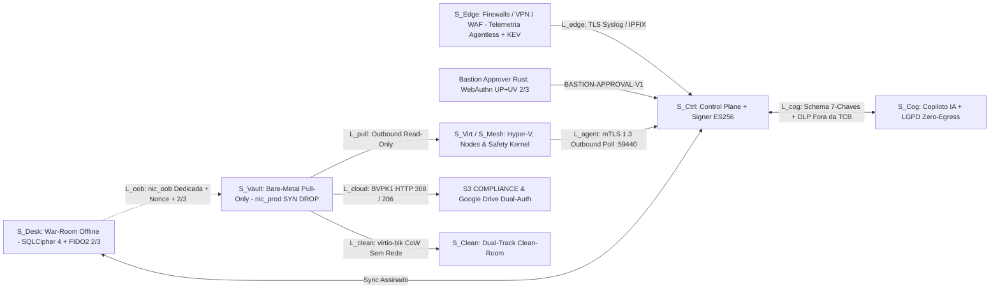

# Resiliência Cibernética Assimetricamente Limitada, Contenção Remota Zero-Inbound, Triagem Cognitiva Fora da TCB e Cofres Imutáveis Multi-Nuvem em Infraestruturas Críticas

**Identificador Técnico:** `VTI-RES-2026-04` — `v3.0 — Edição Consolidada com Evidência Executável v1.3.0` (Novembro de 2026)  
**Autor:** **Caio Gonçalves** — *Principal Investigator & Chief Systems Architect, VTI Research (VTI, Brazil)* (https://projectos-system.github.io/vti-research/)  
**Classificação Científica:** `cs.CR` (Cryptography and Security) • `cs.DC` (Distributed, Parallel, and Cluster Computing) • `cs.SE` (Software Engineering) • `cs.OS` (Operating Systems) | **DOI Oficial (`v3.0`):** [`10.5281/zenodo.24452820`](https://doi.org/10.5281/zenodo.24452820) *(Concept DOI: [`10.5281/zenodo.24406145`](https://doi.org/10.5281/zenodo.24406145) · Sucede `v1.0`: `10.5281/zenodo.24406146`)*  
**Desenho Metodológico:** Ciência do Design em Engenharia de Segurança (*Design Science Research*) estratificada em quatro níveis epistêmicos (`E1` Evidência Estática de `uroni/urbackup_backend`, Especificação Binária e Verificação Executável em Suítes Isoladas `Bastion OS v1.3.0`; `E2` Estudo Forense Retrospectivo Anonimizado $\mathcal{I}_0$ com $N=1$, Valores Generalizados Anti-Reidentificação e Taxonomia Pública `2023–2026`; `E3` Especificação Algébrica Condicional de Invariantes Locais/Distribuídos, `BASTION-FLEET-CMD-V3`, Pipeline Cognitivo `Onda 7-b` e Protocolo `BVLT1`/`BVPK1`/`GOOGLE_DRIVE`/`DiskHygieneEngine`; `E4` Baterias Executáveis `B1`–`B20` em Ambiente Controlado e Prospecção Longitudinal em Produção `60 min` / `SHADOW` $N_{\mathrm{blk}} \ge 300$) — Grafo Tipado $\mathcal{E} = (\mathcal{S}_{\mathrm{Edge}}, \mathcal{S}_{\mathrm{Virt}}, \mathcal{S}_{\mathrm{Mesh}}, \mathcal{S}_{\mathrm{Ctrl}}, \mathcal{S}_{\mathrm{Desk}}, \mathcal{S}_{\mathrm{Vault}}, \mathcal{S}_{\mathrm{Clean}}, \mathcal{S}_{\mathrm{Cog}}; \mathcal{L}, \mathcal{T})$  
**Cláusula de Confidencialidade Operacional, Prevenção de Quase-Identificadores e Anonimização de $\mathcal{I}_0$:** *Este manuscrito constitui publicação técnico-científica aberta (autoria institucional identificada). Para conciliar reprodutibilidade científica com sigilo operacional irrestrito sobre o incidente motivador $\mathcal{I}_0$ e mitigar riscos de reidentificação por combinação de quase-identificadores, todos os identificadores privados da infraestrutura estudada (razão social, nomes de servidores, sub-redes/IPs, domínios DNS, caminhos proprietários, prefixos de credenciais, datas granulares e contagens exatas raras) foram suprimidos ou reportados em ordens de grandeza/valores arredondados sobre $\mathcal{E}$. Em contrapartida, repositórios públicos inspecionados (`uroni/urbackup_backend`, `ProjectOS-system/BastionOS` tag `v1.3.0`), especificações abertas (`[MS-VHDX]`, `ext4`, `NTFS`, `RFC 7914`, `RFC 5869`, `RFC 8785`, `RFC 9110`, `W3C WebAuthn`) e macro-incidentes históricos públicos (`2023–2026`) são referenciados nominalmente a partir de fontes primárias verificadas.*

---

## Resumo

Operações modernas de *Ransomware-as-a-Service* (RaaS) e extorsão multifásica evoluíram da criptografia ingênua de endpoints para a exploração em massa de appliances de borda desprovidos de agentes, intrusões *malware-free* com credenciais colhidas por *infostealers*, neutralização de sensores via drivers assinados vulneráveis (*BYOVD*), abuso de ferramentas comerciais legítimas de acesso remoto (*Living-off-RMM*), exfiltração prévia de dados (*dupla extorsão*), sabotagem coordenada de planos de controle de virtualização, criptografia intermitente (*header-only* e *skip-step*) sobre volumes compartilhados e destruição acoplada de servidores tradicionais de backup. Simultaneamente, arquiteturas defensivas puramente *fail-closed* ou que acoplam LLMs diretamente à tomada de decisão introduzem os riscos críticos de auto-negação de serviço (*Self-DoS*) e *Indirect Prompt Injection*. Este artigo modela treze classes acopladas de vulnerabilidade ($H_1$–$H_{13}$) cobrindo intrusão, exfiltração, contenção remota, triagem cognitiva, transporte WAN multi-nuvem, higiene de armazenamento e recuperação. Pelo método de *Design Science Research* — separando rigorosamente evidência estática e suítes determinísticas executadas em `:memory:`/`os.tmpdir()` na release `Bastion OS v1.3.0` (`E1`: `58` arquivos / `61` suítes / `301` testes backend, `14` arquivos / `28` suítes / `254` testes E2E e baterias `B1`–`B20`) e observação forense existencial anonimizada ($\mathcal{I}_0, N=1$, `E2`) das especificações formais condicionais (`E3`) e da validação longitudinal contínua em produção (`E4`: janela contínua `60 min` `G-PERF` e modo `SHADOW` $N_{\mathrm{blk}} \ge 300$) —, consolidamos o axioma de **Segurança Assimetricamente Limitada** (*fail-closed* para autoridade e integridade; *fail-bounded* para disponibilidade). Sobre os treze controles ($C_1$–$C_{13}$) e oito invariantes ($I_1$–$I_8$), esta edição `v3.0` incorpora e verifica em código executável: *(i)* o protocolo Zero-Inbound de contenção remota governada **`BASTION-FLEET-CMD-V3`** (`F3`–`F7`) com `Bastion Approver` isolado (`UP=1+UV=1`, *hardware-bound*, quórum `2-de-3`), sequenciador linearizável `ES256` em TPM/CNG (proibição de `SOFTWARE_KEY` em produção), barreira `START_EXECUTION`, journals `PRAGMA synchronous = FULL`, driver IPv4/IPv6/QUIC com fallback `<= 90 s` para `RESTRICTED_RECOVERY`, reserva `B_dom` (`>= Q_min + 1`) com `fencingToken` anti-ABA e executor Hyper-V não-destrutivo; *(ii)* o Copiloto de Triagem IA Contínua (`Onda 7-b` `T4`–`T11`) estritamente fora da TCB ($I_6$), com cercas anti-envenenamento, schema JSON fechado, 5 ferramentas *read-only*, consenso dual fail-safe (`AI_CONSENSUS_UNAVAILABLE` e `BENIGN_LIKELY` não-autoritativo) e política **LGPD Zero-Egress** por padrão (`Ollama` local ou pseudonimização `HKDF+HMAC` em 6 campos); *(iii)* replicação WAN **`BVPK1`** com conector nativo **Google Drive Dual-Auth** (`Onda 11`, `HTTP 308`/`206` e CLI `pull-gdrive`), **Higiene Segura Anti-`ENOSPC` `O(1)`** (`Onda 9`, 6 travas invioláveis) e continuidade **DR Zero-Touch**; e *(iv)* interface sistêmica `O1`–`O4` de reconstrução `[MS-VHDX]`, remetendo integralmente a formulação algébrica `GF(2)`, solver `MCMF` com guarda de margem $\Delta$ e benchmarks multi-FS ao estudo companheiro **`VTI-RES-2026-05`**, sob **63 referências primárias verificadas (`[R01]`–`[R63]`)**.

**Palavras-chave:** Ciber-Resiliência de Hipervisores; Contenção Remota `BASTION-FLEET-CMD-V3`; *Safety Kernel Fail-Bounded*; Triagem IA Fora da TCB; LGPD Zero-Egress; Backup Imutável Multi-Nuvem `BVPK1`; Higiene Anti-`ENOSPC`; *Clean-Room Disaster Recovery*; `NIST SP 800-209`; `ISO/IEC 27031:2025`.

---

## 1. Introdução e Motivação Científica

A literatura recente em segurança de sistemas distribuídos e armazenamento (`[R01, R02, R12, R14, R15, R16]`) evidencia uma transição profunda na anatomia de incidentes destrutivos contra infraestruturas híbridas. Em vez de acionar binários ruidosos em estações de usuário, operadores adversariais exploram quatro assimetrias arquiteturais recorrentes em datacenters corporativos:

1. **Assimetria Temporal e de Privilégio em Planos de Virtualização:** Uma vez obtida uma credencial administrativa válida (`MITRE T1078`), o adversário opera em janelas de madrugada (`00h00–06h00`), utiliza utilitários nativos do sistema operacional (`msiexec`, `sc`, edição direta de árvores `ControlSet\Services` no registro) para silenciar a coleta de eventos (`EventLog`) e o plano de gerência de máquinas virtuais (`vmms`) sem interromper imediatamente os processos de trabalho já em memória, eliminando a visibilidade do centro de operações no instante crítico (`[R01, R18, R22]`).
2. **Assimetria Computacional da Criptografia Intermitente em Volumes de Bloco/Arquivo:** Conforme formalizado por Davies et al. (`[R13]`) e Ineza et al. (`[R14]`), cifrar apenas os primeiros megabytes (*First-N* / *Header-Only*) de imagens de disco virtual de centenas de gigabytes destrói instantaneamente metadados de alocação (`Header`, `Region Table`, `BAT`), mantendo a entropia global de Shannon praticamente inalterada e permitindo corromper dezenas de terabytes em pouco mais de uma hora.
3. **Acoplamento de Raio de Explosão entre Produção, Diretório, Plano de Controle e Backup:** Como destacado pelo `NIST SP 800-209` (`[R02]`) e pela segunda edição da norma `ISO/IEC 27031:2025` (`[R05]`), soluções convencionais de backup baseadas em agentes *push*, autenticadas no mesmo serviço de diretório e hospedadas sobre a mesma malha virtualizada, colapsam simultaneamente ao ambiente primário. Reciprocamente, comandos remotos de contenção emitidos por um servidor central comprometido — ou aplicados sem preservação de quórum e *epoch fencing* (`[R59, R60]`) — podem induzir *split-brain* em clusters de armazenamento compartilhado.
4. **Superfície Adversarial de Copilotos de Triagem LLM em SOCs:** A adoção recente de agentes baseados em LLMs para acelerar a triagem de incidentes (`[R54]`) introduz o risco de *Indirect Prompt Injection* (`[R55, R58]`) em logs brutos de processos e de exfiltração não autorizada de dados corporativos/pessoais para nuvens externas quando não há isolamento estrutural da *Trusted Computing Base* (TCB) (`[R57]`).

### 1.1. Motivação Empírica e Racional Hipotético-Dedutivo a partir de Macro-Incidentes Públicos (2023–2026)

A **Tabela 0** sintetiza dez classes de falhas estruturais documentadas em relatórios públicos de resposta a incidentes (`[R29, R30, R31, R32]`) entre 2023 e 2026. Metodologicamente, esta matriz atua estritamente como **motivação empírica de problema e racional hipotético-dedutivo de design (*Design Rationale*)**: cada linha fundamenta a relevância prática das hipóteses de ameaça $H_1$–$H_{13}$ e motiva a derivação arquitetural dos controles $C_1$–$C_{13}$ e invariantes $I_1$–$I_8$, sem reivindicar validação contrafactual retrospectiva sobre os ambientes de terceiros listados:

| Macro-Incidente Público Documentado | Classe Primária do Colapso Estrutural | Limitação da Arquitetura Convencional Exposta | Mapeamento Formal em `VTI-RES-2026-04` |
| :--- | :--- | :--- | :---: |
| **MGM Resorts (`Set/2023`)** | Engenharia social (*vishing*) com redefinição de MFA + criptografia em lote de hipervisores. | MFA suscetível a intervenção humana de suporte e ausência de guarda estrutural de hipervisor. | $H_2, H_3 \rightarrow C_2, C_3$ |
| **Change Healthcare (`Fev/2024`)** | Superfície remota sem MFA resistente a phishing + dupla extorsão (`6 TB` exfiltrados) + paralisia sistêmica. | Ausência de disjuntor de exfiltração (*egress*) e acoplamento de disponibilidade sem *Clean-Room*. | $H_2, H_6, H_9 \rightarrow C_2, C_6, C_9$ |
| **Campanha Gateways Ivanti / PAN-OS / FortiOS (`2024–2025`)** | Exploração zero-day em appliances de borda desprovidos de suporte a agentes internos de endpoint. | Dependência exclusiva de EDR *in-guest* sem coleta *agentless* de borda nem *virtual patching* KEV. | $H_7, H_{12} \rightarrow C_7, C_{12}$ |
| **Campanha Multi-Tenant Snowflake (`Mai–Jun/2024`)** | Intrusão *malware-free* via credenciais colhidas por *infostealers* em estações externas. | Inexistência de *honey-tokens* canário, vínculo criptográfico de dispositivo e limitação volumétrica. | $H_2, H_9, H_{12} \rightarrow C_2, C_9, C_{12}$ |
| **CDK Global & Synnovis (`Jun/2024`)** | Criptografia de provedor crítico seguida de tentativa de reinfecção durante o ciclo de restauração. | Restauração direta sem câmara limpa de dupla trilha (funcional + varredura forense de persistência). | $H_4, H_6 \rightarrow C_4, C_6$ |
| **Apagão Global CrowdStrike (`Jul/2024`)** | Atualização lógica defeituosa processada em *Ring 0* colapsando `~8,5M` de hosts simultaneamente. | Agente em kernel sem estágio `SHADOW -> CANARY`, sem orçamento de raio de explosão nem rollback local. | $I_1, I_2, I_4, I_7$ |
| **Marks & Spencer / Varejo UK (`Abr–Mai/2025`)** | Comprometimento do serviço de diretório (`NTDS.dit` / `DCSync`) propagado aos virtualizadores. | Falta de isolamento de domínio entre diretório corporativo, hipervisores, backup e estação de crise. | $H_4, H_5, H_{13} \rightarrow C_4, C_5, C_{13}$ ($I_8$) |
| **Provedores de Infraestrutura Financeira B2B (`Jul/2025`)** | Abuso de credenciais internas privilegiadas e chaves críticas de integração sem custódia multipartida. | Autoridade destrutiva ou transacional concentrada em principal único sem quórum humano distinto. | $H_5, H_8 \rightarrow C_5, C_8$ ($I_1$) |
| **Jaguar Land Rover (`Set/2025`)** | Paralisação preventiva prolongada de plantas industriais inteiras para estancar movimento lateral. | Ausência de amputação seletiva orientada por par autenticado que preserve segmentos saudáveis ativos. | $H_2 \rightarrow C_2$ ($I_4$) |
| **Campanhas RaaS `BYOVD + RMM` (`2024–2026`)** | Drivers `.sys` assinados vulneráveis matando sensores + comando via RMM comercial (`AnyDesk`/`ScreenConnect`). | Confiança implícita em binários/drivers assinados sem política `WDAC` em anéis nem manifesto RMM. | $H_1, H_{10}, H_{11} \rightarrow C_1, C_{10}, C_{11}$ |

As nove contribuições centrais desta edição consolidada (`v3.0`, alinhada ao código executável **`Bastion OS v1.3.0`** em `main` `56952d85`) são:
**(a)** verificação estática reproduzível (`Nível E1`) de sete classes de vulnerabilidade em `uroni/urbackup_backend`, combinada à análise forense retrospectiva anonimizada de $\mathcal{I}_0$ (`Nível E2`, $N=1$) e aos aprendizados operacionais das evoluções de campo até `v3.0.6`;
**(b)** especificação formal e implementação verificada (`Nível E3` + `E1`) de uma arquitetura regida por oito invariantes particionados em propriedades locais ($I_1^{\mathrm{loc}}, I_2, I_5, I_6, I_7$) e distribuídas ($I_1^{\mathrm{dist}}, I_3, I_4, I_8$), articulando *Safety Kernel*, consenso de leases, estação *War-Room Offline* ($\mathcal{S}_{\mathrm{Desk}}$) e cofre *Pull-Only* (`nic_prod` / `nic_oob`);
**(c)** interface sistêmica `O1`–`O4` para reconstrução estrutural `[MS-VHDX]` (`[R34, R39, R40, R63]`), explicitamente demarcada para remeter a formulação algébrica completa (`GF(2)`, contabilidade 4-vias, `MCMF` residual com guarda $\Delta$, multi-FS `NTFS`/`ReFS`/`Btrfs`/`LVM2`/`XFS`, cirurgia `regf` e baterias dedicadas) à monografia autônoma **`VTI-RES-2026-05`** (prevenindo *salami slicing*);
**(d)** protocolo criptográfico versionado `BVLT1`/`BVPK1` (`scrypt` `[R35]`, `HKDF-SHA256` `[R36]`, `AES-256-GCM` `[R37]`, `Keyed Gear FastCDC` `[R33]`), `HTTP 206` (`[R38]`), **DR Zero-Touch** pós-reboot e **Replicação Dual-Auth Google Drive** (`Onda 11`: `WORKSPACE_SERVICE_ACCOUNT` e `PERSONAL_OAUTH_PKCE`, upload resumível `HTTP 308`, teto deslizante `700 GiB/24h` e CLI `pull-gdrive`);
**(e)** separação formal entre integridade, autenticidade, imutabilidade e frescor anti-rollback (`TPM 2.0 NV` vs. testemunha monotônica externa), persistência `LOG_GAP_ALERT` resiliente a `ENOSPC`, malha viva anti-`TOCTOU` de iscas, `ZERO_INSTANCE_DATA_BEFORE_AUTH` e **Higiene Segura Anti-`ENOSPC` `O(1)` (`Onda 9`, `DiskHygieneEngine`)** com 6 travas invioláveis e proteção dinâmica `Tier 3`;
**(f)** barramento Zero-Inbound de contenção remota governada **`BASTION-FLEET-CMD-V3` (`Onda 5-b/c` `F3`–`F7`)** com `Bastion Approver` isolado (`UP=1+UV=1`, *hardware-bound*, quórum `2-de-3`), sequenciador linearizável `ES256` TPM/CNG, barreira `START_EXECUTION`, journals `PRAGMA synchronous = FULL`, driver IPv4/IPv6/QUIC com fallback `<= 90 s`, reserva `B_dom` anti-ABA e executor Hyper-V não-destrutivo;
**(g)** **Copiloto de Triagem IA Contínua (`Onda 7-b` `T4`–`T11`)** estritamente fora da TCB ($I_6$), com fila deduplicada sob backpressure, Context Builder anti-envenenamento pré-Ponytail, schema fechado de 7 chaves, 5 ferramentas *read-only* escopadas por tenant/host, consenso dual com abstenção fail-safe (`BENIGN_LIKELY` não-autoritativo) e governança **LGPD Zero-Egress** por padrão;
**(h)** observabilidade operacional unificada (`Onda 6` Bento/Sparklines/`GroupedTabs`, `PlanContingencyMapModal`, postura `Windows Hello`/`TPM 2.0`/`RDP NLA` `M5`, horários de SO `W3`, sonda `EvtSubscribe` + 14 regras Sigma `T1`–`T3` e e-mails forenses `multipart/alternative`); e
**(i)** certificação executável em laboratório (`E1`: **`58` arquivos / `61` suítes / `301` testes backend**, **`14` arquivos / `28` suítes / `254` testes E2E**, baterias **`B1`–`B20`**, `vite build` `0` warnings e `cargo check --offline` exit `0`), claramente demarcada da prospecção contínua em produção (`E4`), sob **63 referências primárias verificadas (`[R01]`–`[R63]`)**.

---

## 2. Modelo de Sistema $\mathcal{E}$, Estratificação Epistêmica e Modelo de Adversário

### 2.1. Desenho do Estudo, Estratificação Evidencial (`E1`–`E4`) e Demarcação Epistemológica

Adotamos o **Princípio de Proporcionalidade Epistêmica** ($\mathrm{Escopo}(\mathrm{Alegacao}) \le \mathrm{Escopo}(\mathrm{Evidencia})$). Nesta edição `v3.0`, todas as proposições são rigorosamente estratificadas em quatro níveis para impedir confusão entre execução determinística em ambiente isolado de testes e comportamento longitudinal em produção real:

- **`Nível E1` (Evidência Estática, Binária e Execução Determinística em Laboratório — `Bastion OS v1.3.0`):** Compreende *(i)* a auditoria estática de `uroni/urbackup_backend` (Seções 3.4 e 3.5); *(ii)* invariantes binários verificáveis (`BVLT1`/`BVPK1`/`BASTION-FLEET-CMD-V3`); e *(iii)* a execução real dos motores Node.js/Rust/Python/PowerShell em `:memory:` e diretórios temporários isolados (`os.tmpdir()`, preservando integralmente a Regra `R3` sobre dados vivos), totalizando **`58` arquivos / `61` suítes / `301` testes backend**, **`14` arquivos / `28` suítes / `254` testes E2E (Tiers 1–5 + `v1.1.0`–`v1.3.0`)** e as **`20` baterias `B1`–`B20`**, além do build `vite` (`0` warnings, `0` CDNs) e `cargo check --offline` (incluindo `bastion-approver`). *Escopo explícito:* testes de integração `v1.3.0` utilizam harnesses e mocks locais controlados para hardware TPM (`MockHardwareTpmProvider`), drivers WFP/nftables (`InMemoryFirewallHarness`), endpoints Google Drive (`startMockGoogleDriveServer`) e provedores LLM HTTP, e o benchmark `G-PERF` (`v060-sentinel-perf-benchmark.test.js`) opera em janela sintética curta de CI (`SYNTHETIC_SHORT_CI_BENCHMARK`, `1.500 ms` a `100 ev/s`).
- **`Nível E2` (Evidência Retrospectiva Existencial Anonimizada, $N=1$):** Sequência anatômica e observação existencial em $\mathcal{I}_0$ (reportada com valores arredondados e sem identificadores de host/cliente), aprendizados estruturais de campo anônimos que originaram o endurecimento multi-SO do módulo portátil até `v3.0.6` e os dez macro-incidentes públicos da Tabela 0, sem reivindicar taxa populacional universal (Seção 6.3).
- **`Nível E3` (Especificação Formal Condicional):** Propriedades de segurança, separação entre integridade/autenticidade/imutabilidade/frescor, contratos `BASTION-FLEET-CMD-V3`, garantias anti-envenenamento e LGPD Zero-Egress derivadas de $I_1$–$I_8$ **condicionadas explicitamente** às premissas de TCB, hardware e não-colusão da **Tabela 1** (cuja verificação exaustiva em `TLA+` permanece como `M-FUT-1`).
- **`Nível E4` (Prospecção Longitudinal em Produção Real):** Medição contínua em produção de `60 minutos` para homologação final de SLA de `G-PERF`, janelas reais `SHADOW` ($N_{\mathrm{blk}} \ge 300$) para confirmação de `FP = 0` sob cargas heterogêneas de datacenter, testes *end-to-end* contra `TPM 2.0` físico/CNG, APIs Google Drive em produção e inferência real de modelos de linguagem em produção sobre o corpus `T9`.

| Camada Epistemológica | Escopo Condicional Especificado em `VTI-RES-2026-04 v3.0` (`Nível E3` / `E1`) | Limite Explícito do Modelo, Condição de Contorno & Escopo Não Reivindicado |
| :--- | :--- | :--- |
| **Invariantes Locais ($I_1^{\mathrm{loc}}, I_2, I_5, I_6, I_7$) & Distribuídos ($I_1^{\mathrm{dist}}, I_3, I_4, I_8$)** | Isolamento `nic_prod` no *Pull-Vault*, envelopes `RFC 8785 JCS` (`[R41]`) + `Ed25519` (`[R42]`) / `ES256` em `TPM 2.0` (`[R45]`), `BASTION-FLEET-CMD-V3`, `Bastion Approver` (`W3C WebAuthn` `[R44]`), leases linearizáveis (`[R59, R60]`) e quórum `2-de-3` distinto. | Condicionados à segurança padrão de `SHA-256`/`Ed25519`/`ES256`, integridade física do hardware *Bare-Metal* / `TPM 2.0`, sincronia monotônica local e ausência de colusão simultânea de $\ge 2$ dos 3 custodiantes locais (mitigada externamente via S3 `COMPLIANCE`). |
| **Sensores User-Mode + Integridade de Código (`WDAC` — Fases 1–4)** | Monitoramento `ETW`/`eBPF`, sonda `EvtSubscribe` + 14 regras `Sigma`, `WFP`/`nftables` (`F4`), canários anti-`TOCTOU`, manifesto RMM e bloqueio `WDAC` de drivers catalogados (`[R31]`). | **Prevenção condicionada à integridade do kernel/subsistema `CI` do SO e ao catálogo vigente**; perante um *exploit zero-day* inédito em *ring-0* (pré-`M-FUT-2`) ou perda terminal de eventos (`LOG_GAP_ALERT`), **o host primário é assumido como comprometido**, recaindo a sobrevivência sobre snapshots históricos em $\mathcal{S}_{\mathrm{Vault}}$. |
| **Copiloto IA Contínua (`Onda 7-b`) & Estação *War-Room Offline* ($\mathcal{S}_{\mathrm{Desk}}$)** | $\mathcal{S}_{\mathrm{Cog}}$ 100% fora da TCB ($I_6$), LGPD Zero-Egress por padrão (`Ollama` local), consenso dual e `SQLCipher 4` (`256.000` iterações PBKDF2) + `DPAPI` + `FIDO2` em $\mathcal{S}_{\mathrm{Desk}}$. | `S_Cog` não substitui detecção determinística e não fecha incidentes (`BENIGN_LIKELY` não-autoritativo); `SQLCipher 4` protege dados em repouso offline, mas **não neutraliza captura em sessão caso o kernel da própria estação $\mathcal{S}_{\mathrm{Desk}}$ esteja comprometido**. |
| **Certificação em Câmara Limpa (*Clean-Room DR*) & Replicação Google Drive (`Onda 11`)** | Escada funcional `N1–N5` + varredura `YARA-Forge`; `BVPK1` `HTTP 308`/`206` em Shared Drive (`canDelete=false`) ou Drive Pessoal (`drive.file` + `contentRestrictions.readOnly`). | Atestado `GOLD_VERIFIED` é estritamente escopado ao catálogo `YARA`/baseline vigente; no Google Drive Pessoal (`Modo B`), a proteção contra deleção após 30 dias de lixeira depende de o usuário não revogar ou purgar manualmente pela interface web da conta Google (diferentemente de `S3 Object Lock COMPLIANCE`). |

### 2.2. Topologia Formal do Ecossistema Abstraído, Zonas de Confiança e Matriz de Canais

Definimos a infraestrutura protegida e seu plano de resiliência como a 8-tupla algébrica tipada:

$$\mathcal{E} = \big(\mathcal{S}_{\mathrm{Edge}},\, \mathcal{S}_{\mathrm{Virt}},\, \mathcal{S}_{\mathrm{Mesh}},\, \mathcal{S}_{\mathrm{Ctrl}},\, \mathcal{S}_{\mathrm{Desk}},\, \mathcal{S}_{\mathrm{Vault}},\, \mathcal{S}_{\mathrm{Clean}},\, \mathcal{S}_{\mathrm{Cog}};\; \mathcal{L},\, \mathcal{T}\big)$$

onde $\mathcal{T}$ particiona os subsistemas em seis zonas disjuntas de confiança:
- $\mathcal{S}_{\mathrm{Edge}} = \{g_1, \dots, g_r\}$ ($\mathcal{T} = \texttt{UNTRUSTED\_EDGE}$): appliances de perímetro (firewalls, concentradores VPN e proxies/WAF) desprovidos de agentes *in-guest*;
- $\mathcal{S}_{\mathrm{Virt}} = \{h_1, \dots, h_m\}$ e $\mathcal{S}_{\mathrm{Mesh}} = \{u_1, \dots, u_k\}$ ($\mathcal{T} = \texttt{MONITORED\_PROD}$): nós hipervisores Hyper-V compartilhando volumes $\mathcal{V}$ e nós de contêineres/servidores NFS/estações, executando processo isolado de *Safety Kernel* e executor local `nodeCommandExecutor`;
- $\mathcal{S}_{\mathrm{Ctrl}}$ ($\mathcal{T} = \texttt{BOUNDED\_CTRL}$): Plano de Controle Central (`:59436`), Gateway mTLS 1.3 Zero-Inbound (`:59440`) e sequenciador `ES256` (`fleetCommandSigner`), tratado pelo modelo de ameaça como **potencialmente comprometível ou indisponível** (autoridade limitada por $I_1, I_4, I_6$ e aprovação externa no binário isolado `bastion-approver` em `https://approver.bastion`);
- $\mathcal{S}_{\mathrm{Desk}} = \{d_1, \dots, d_p\}$ ($\mathcal{T} = \texttt{OFFLINE\_CUSTODY}$): estações administrativas *War-Room Offline* (`:59438` Dual-Loopback Tauri v2 + `SQLCipher 4`) com autenticadores físicos FIDO2 *hardware-bound*;
- $\mathcal{S}_{\mathrm{Vault}}$ ($\mathcal{T} = \texttt{ISOLATED\_VAULT}$): cofre imutável *Pull-Only* com interfaces `nic_prod`/`nic_oob` e réplicas offsite `S3 COMPLIANCE` / `GOOGLE_DRIVE`;
- $\mathcal{S}_{\mathrm{Clean}}$ ($\mathcal{T} = \texttt{EPHEMERAL\_CLEAN}$): microVMs efêmeras de validação em namespace de rede nulo;
- $\mathcal{S}_{\mathrm{Cog}}$ ($\mathcal{T} = \texttt{NON\_TCB\_COG}$): núcleo de triagem IA (`aiTriageEngine`, `aiTriageGovernance`, `aiTriageTools`, `ponytailCompressor`, `smartCascadeEngine`), posicionado **estritamente fora da TCB** ($\mathcal{K}_{\mathrm{TCB}} \cap \mathcal{K}(\mathcal{S}_{\mathrm{Cog}}) = \emptyset$).

| Canal em $\mathcal{L}$ | Iniciador (`SYN`) $\rightarrow$ Receptor | Interface / Transporte | Autenticação & Escopo de Autoridade Permitido |
| :--- | :--- | :--- | :--- |
| **`L_edge`** | $\mathcal{S}_{\mathrm{Edge}} \rightarrow \mathcal{S}_{\mathrm{Ctrl}}$ | WAN/DMZ • `TLS Syslog / IPFIX` | Certificados por appliance; ingestão em parser restrito sem privilégio de comando. |
| **`L_agent`** | $\mathcal{S}_{\mathrm{Virt}} \cup \mathcal{S}_{\mathrm{Mesh}} \rightarrow \mathcal{S}_{\mathrm{Ctrl}}$ | Gerência `:59440` • `mTLS 1.3` Zero-Inbound (`[R43]`) | Conexão **exclusivamente outbound** do nó para o gateway; comandos `BASTION-FLEET-CMD-V3` puxados via poll assinado `ES256`, validados com `BASTION-EXEC-GRANT-V1` + quórum `WebAuthn 2-de-3` e sujeitos a $I_1$–$I_7$. |
| **`L_pull`** | $\mathcal{S}_{\mathrm{Vault}} \rightarrow \mathcal{S}_{\mathrm{Virt}} \cup \mathcal{S}_{\mathrm{Mesh}}$ | `nic_prod` • `mTLS 1.3 Outbound` | **`nic_prod` aplica `DROP` a `100%` de `TCP SYN`/`UDP` novos de entrada**, aceitando apenas sessões *read-only* iniciadas pelo cofre. |
| **`L_cloud`** | $\mathcal{S}_{\mathrm{Vault}} / \mathcal{S}_{\mathrm{Desk}} \rightarrow \mathrm{S3 / GDrive}$ | WAN HTTPS • `TLS 1.3` | `AWS4-HMAC-SHA256` + `Object Lock COMPLIANCE` ou `JWT RS256` (`[R51]`) / `OAuth 2.0 PKCE S256` (`[R50]`) via upload resumível `HTTP 308` e restore seletivo `HTTP 206` (`[R38]`). |
| **`L_oob`** | $\mathcal{S}_{\mathrm{Desk}} \rightarrow \mathcal{S}_{\mathrm{Vault}}$ | `nic_oob` (VLAN Física OOB Dedicada) | `mTLS 1.3` + `vault_nonce` + `JCS` (`[R41]`) + quórum FIDO2 `2-de-3` restrito a `STAGING_RESTORE` e auditoria. |
| **`L_clean`** | $\mathcal{S}_{\mathrm{Vault}} \rightarrow \mathcal{S}_{\mathrm{Clean}}$ | Bus Virtual Local (`virtio-blk` CoW) | Exportação local sobre `zfs clone` descartável sem interface de rede roteável. |
| **`L_cog`** | $\mathcal{S}_{\mathrm{Ctrl}} / \mathcal{S}_{\mathrm{Desk}} \rightarrow \mathcal{S}_{\mathrm{Cog}}$ | `Ollama` Local (`Zero-Egress`) / Opt-In DPA | Payload pós-cerca `[BEGIN_UNTRUSTED_DATA]`, comprimido por Ponytail e pseudonimizado (`HKDF+HMAC` em 6 campos); resposta não-executável ($\mathrm{Exec}=0$). |

### 2.3. Modelo de Adversário, Risco de *Self-DoS* e Partição Formal dos Oito Invariantes ($I_1$–$I_8$)

Consideramos um adversário adaptativo $\mathcal{A}$ capaz de: *(1)* explorar appliances em $\mathcal{S}_{\mathrm{Edge}}$ ou adquirir credenciais administrativas válidas em $\mathcal{S}_{\mathrm{Virt}} \cup \mathcal{S}_{\mathrm{Mesh}}$; *(2)* operar fora do expediente com *LotL*, RMMs assinados e drivers vulneráveis (*BYOVD*), tentando exfiltrar dados previamente; *(3)* adulterar NTP e injetar bytes nulos (`\x00`), caracteres BiDi/Zero-Width ou instruções adversariais em logs visando corromper compressores ou induzir *Indirect Prompt Injection* em $\mathcal{S}_{\mathrm{Cog}}$ (`[R55, R58]`); *(4)* comprometer $\mathcal{S}_{\mathrm{Ctrl}}$ ou reenviar comandos `BASTION-FLEET-CMD-V3` obsoletos (*replay* / ataque ABA de `fencingToken` durante *Live Migration*); e *(5)* tentar saturar discos locais (`ENOSPC`) ou envenenar pastas de sincronização bidirecional em nuvem (`DriveFS`). **Fora da TCB de contenção** situam-se $\mathcal{S}_{\mathrm{Ctrl}}$ (para ações destrutivas/isolamento acima de $B_{\mathrm{dom}}$) e integralmente $\mathcal{S}_{\mathrm{Cog}}$; **dentro da TCB** situam-se o kernel/subsistema `CI` (pré-condição da Tabela 1), o `Safety Kernel`, o `nodeCommandExecutor` e o verificador isolado `Bastion Approver`.

#### Grupo A — Invariantes Locais de Host/Executor (Impostos Autonomamente pelo Nó $h$)

Sejam $\mathcal{C}_{\mathrm{mut}}$ os comandos mutáveis recebidos por $h$, $\mathcal{R}_h$ os recursos locais (`WFP`/`nftables`, tabela de sessões e executor Hyper-V) e $\Sigma_{\mathrm{FSM}} = \{\texttt{NORMAL}, \texttt{SUSPECT}, \texttt{QUARANTINED}, \texttt{RESTRICTED\_RECOVERY}\}$ com transição $\delta$:

- **$I_1^{\mathrm{loc}}$ (Fencing Monotônico Universal por Recurso):**
$$\forall\, c \in \mathcal{C}_{\mathrm{mut}},\, \forall\, r \in \mathrm{Targets}(c) \cap \mathcal{R}_h:\; (c.\mathrm{scope} = r.\mathrm{domain}) \;\land\; (c.\mathrm{epoch} > \mathrm{lastAcceptedEpoch}_r)$$

- **$I_2$ (Transição Conservadora e Retorno Conjungido):** $\forall\, \mathrm{ev} \in \{\texttt{LeaseExpire}, \texttt{HostReboot}, \texttt{JournalCorrupt}, \texttt{IngestConfirmTimeout90s}\}$,
$$\delta(\texttt{QUARANTINED}, \mathrm{ev}) = \texttt{RESTRICTED\_RECOVERY} \;\land\; \Big(\delta(\texttt{RESTRICTED\_RECOVERY}, \mathrm{ev}_{\mathrm{rel}}) = \texttt{NORMAL} \iff \mathrm{CleanAttest}(h) \land \mathrm{DistinctFIDO2}_{2/3}(c_{\mathrm{rel}}) = 1\Big)$$

- **$I_5$ (Autonomia Offline Fail-Bounded sem Fail-Open):**
$$\mathrm{Unreachable}(\mathcal{S}_{\mathrm{Ctrl}}) \implies \mathrm{KeepLocalDefensesActive}(h) \;\land\; \Big(\big(\Delta t_{\mathrm{off}} > \tau_{\mathrm{off\_max}} \lor \mathrm{Expired}(v_{\mathrm{pol}}, \mathrm{CRL\_epoch})\big) \implies \neg\mathrm{AcceptRemoteQuarantine}(h) \land \mathrm{EnforceLocalGuard}(h, \texttt{RESTRICTED\_RECOVERY})\Big)$$

- **$I_6$ (Exclusão Criptográfica de $\mathcal{S}_{\mathrm{Cog}}$ e Parser Fechado):**
$$\forall\, c,\; \mathrm{RejectUnknownFields}(c) = 1 \;\land\; \big(\mathrm{VerifySig}(c, \mathcal{K}_{\mathrm{TCB}}) = 0 \implies \mathrm{Exec}(c) = 0\big),\quad \mathcal{K}_{\mathrm{TCB}} \cap \mathcal{K}(\mathcal{S}_{\mathrm{Cog}}) = \emptyset$$

- **$I_7$ (Watchdog e Rollback Transacional Local):**
$$\forall\, m \in \mathrm{FilterMutations}_h,\; \neg\mathrm{ProbeQuorumAndOOB}(h, \tau_{\mathrm{wd}}) \implies \mathrm{LocalRevert}(h, m_{\mathrm{prev}}) = 1$$

onde na `v1.3.0` (`nodeCommandExecutor.js` e `nodeIsolationController.js`) toda execução é condicionada à barreira `START_EXECUTION` (`BASTION-EXEC-GRANT-V1`) com `cmd_journal` e `effect_journal` gravados sob `PRAGMA synchronous = FULL`, e qualquer falha de recebimento de `INGEST_CONFIRM` em até `<= 90 s` transita automaticamente o nó para `RESTRICTED_RECOVERY` ($I_2$).

#### Grupo B — Invariantes Distribuídos de Coordenação de Cluster, Cofre e Comando Offline

- **$I_1^{\mathrm{dist}}$ (Orçamento Linearizável de Domínio e Quórum Humano):** $\forall\, c \in \mathcal{C}_{\mathrm{quar}}(D),\; \mathrm{DistinctFIDO2}_{2/3}(c) = 0 \implies$
$$\big(\mathrm{ValidLease}(c, D, v_{\mathrm{cfg}}, c.\mathrm{issuanceEpoch}, c.\mathrm{sequencerIndex}) = 1\big) \;\land\; \big(|\mathrm{IsolateSet}_{W_t}(D) \cup \mathrm{Targets}(c)| \le B_{\mathrm{dom}}(D) = 1\big)$$

- **$I_3$ (Sobrevivência de Staging Restore e Precedência de Freeze em $\mathcal{S}_{\mathrm{Vault}}$):** $\forall\, s \in \Sigma_{\mathrm{Vault}},\, \forall\, q \in \mathcal{Q}_{\mathrm{Vault}},\; s.\mathrm{clock} \in \{\texttt{CLOCK\_DEGRADED}, \texttt{TIME\_TAMPER\_FREEZE}\} \implies$
$$\Big(\mathrm{Allow}(q, s) = 1 \iff \mathrm{AuthOOB\_Nonce}(q, s) = 1 \land \mathrm{op}(q) \in \{\texttt{STAGING\_RESTORE}, \texttt{AUDIT\_READ}\}\Big)$$

- **$I_4$ (Preservação Estrita de Quórum Versionado):**
$$\big|\big(\mathrm{ReachableHealthy}(D, v_{\mathrm{cfg}}) \setminus \mathrm{Transitional}(D, v_{\mathrm{cfg}})\big) \setminus \big(\mathrm{IsolateSet}(D) \cup \mathrm{Targets}(c)\big)\big| \ge Q_{\min}(D, v_{\mathrm{cfg}}) + \mathbb{I}_{\mathrm{safety\_margin}}$$

- **$I_8$ (Continuidade Operacional War-Room Offline Condicionada):** $\big(\mathrm{Intact}(\mathcal{S}_{\mathrm{Desk}}) \land \mathrm{LinkUp}(\texttt{nic\_oob}) \land \mathrm{ValidCustodians}_{\ge 2/3}\big) \implies$
$$\Big(\mathrm{Unreachable}(\mathcal{S}_{\mathrm{Ctrl}}) \implies \mathrm{CanExecute}\big(\mathcal{S}_{\mathrm{Desk}} \xrightarrow{\texttt{L\_oob}} \mathcal{S}_{\mathrm{Vault}},\, \texttt{STAGING\_RESTORE}\big) = 1\Big)$$

Na implementação `fleetClusterOrchestrator.js` (`v1.3.0`), a preservação de quórum para contenção automática impõe margem adicional rigorosa `availableEffective >= Q_min + 1` via reserva atômica `BEGIN IMMEDIATE` sobre $B_{\mathrm{dom}}$ e validação pré/pós-efeito de `fencingToken` contra corrida ABA em migrações de VM (`[R60]`).

### 2.4. Síntese das Treze Hipóteses Falsificáveis de Ameaça ($H_1$–$H_{13}$)

| ID | Classe de Vulnerabilidade / Referência Normativa | Formulação Falsificável da Hipótese de Ameaça |
| :-: | :--- | :--- |
| **$H_1$** | Sabotagem de Sensores, Logs e Exaustão `ENOSPC` (`MITRE T1562.001/.002`) | Um atacante local remove serviços/agentes, exclui `Services\{EventLog, vmms}` ou induz esgotamento de disco (`ENOSPC`) para cegar auditoria e impedir gravação de alertas críticos. |
| **$H_2$** | Abuso Temporal, Contenção Cega & Replay Pós-Partição (`NIST SP 800-207`, `T1078`) | Sessões fora de horário propagam-se lateralmente; inversamente, isolamento remoto sem fencing monotônico, sem janela `INGEST_CONFIRM` ou sem reserva $B_{\mathrm{dom}}$ gera *Self-DoS* ou *split-brain*. |
| **$H_3$** | Criptografia Intermitente & Ponto Cego Remoto (`T1486`, `[R13, R14]`) | Cifrar apenas os primeiros `64 KiB–2 MiB` de arquivos `.vhdx` evade detectores de entropia global, enquanto ataques via SMB/NFS mascaram o ofensor sob `PID 4` / `[nfsd]`. |
| **$H_4$** | Auto-Expurgo Client-Driven, Rollover & Poisoning em Nuvem (`NIST SP 800-209`) | Em servidores *push*, o cliente força expurgo histórico; na replicação cloud, pastas de sincronização bidirecional (`DriveFS`/`OneDrive`) ou falhas `HTTP 403`/`200` degradam sigilo e restauração. |
| **$H_5$** | Manipulação de Relógio (*Time-Jump*), Custódia Única & Rollback de `vTPM` (`RFC 8915`) | Adulteração NTP/RTC quebra travas baseadas em `CLOCK_REALTIME`, conta única destrói snapshots e reversão conjunta de disco + `vTPM` reintroduz estados obsoletos sem testemunha externa. |
| **$H_6$** | Corrupção Silenciosa e Persistência Dormente (`ISO/IEC 27031:2025`, `NIST SP 800-184`) | Backups reportados como concluídos falham na restauração por corrupção interna de B-Tree/VHDX ou reintroduzem artefatos implantados antes da detonação. |
| **$H_7$** | Latência de Triagem de CVEs e Envenenamento de Feeds (`NIST CSF 2.0 ID.RA`) | Priorizar apenas por `CVSS` base dilui falhas exploradas (`KEV`), e ingerir feeds externos sem *staging* e *Warninglists* gera falsos positivos sobre CDNs/infraestrutura própria. |
| **$H_8$** | Acoplamento de IA na TCB, *Prompt Injection* & Egress LGPD (`OWASP LLM01`, `[R55, R58]`) | Delegar contenção a LLMs falha offline e permite manipulação via logs hostis (`[R55]`), além de vazar PII corporativo (usuários, IPs, caminhos) para nuvens externas sem consentimento e pseudonimização. |
| **$H_9$** | Exfiltração Prévia de Dupla Extorsão (`T1567`, `T1048`, `[R29]`) | Mesmo diante de backups imutáveis íntegros, o adversário exfiltra dados críticos via utilitários legítimos (`rclone`, `s5cmd`, `megacmd`) antes da sabotagem. |
| **$H_{10}$** | Persistência via RMM Comercial Assinado e Túneis (`T1219`, `T1572`, `[R30]`) | Binários comerciais legítimos de suporte remoto e túneis TLS reversos evadem antivírus tradicionais, concedendo controle interativo persistente. |
| **$H_{11}$** | Neutralização Kernel via Drivers Vulneráveis Assinados — `BYOVD` (`T1068`, `[R31]`) | Um atacante administrativo carrega drivers `.sys` vulneráveis catalogados para obter execução em *ring-0* e encerrar processos protegidos de segurança. |
| **$H_{12}$** | Exploração *Agentless* de Borda e *Infostealers Malware-Free* (`T1190`, `[R29, R32]`) | Appliances de perímetro concentram o vetor inicial dominante, seguido pelo uso silencioso de credenciais colhidas em estações de trabalho. |
| **$H_{13}$** | Comprometimento de Diretório/Cloud e Apagão do Painel Central (`T1003.006`, `T1562.008`) | Extração `DCSync`, supressão de logs externos ou queda de $\mathcal{S}_{\mathrm{Ctrl}}$ inutilizam consoles dependentes do próprio domínio ou servidor central. |

---

## 3. Especificação dos Treze Controles *Fail-Bounded* ($C_1$–$C_{13}$) e Arquitetura `v1.3.0`

**Pré-Condições Explícitas da Plataforma de Referência:** Windows Server 2012–2025 / Windows 10–11 (`NTFS`/`ReFS`, `ETW`, `EvtSubscribe`, `WFP`, `WDAC`, `CNG TPM 2.0`, `SRV_OPEN_ECP_CONTEXT`) em $\mathcal{S}_{\mathrm{Virt}}$ e Linux kernel `>= 5.15 LTS` (`eBPF`, `fanotify`, `nftables`, `OpenZFS 2.2+`) em $\mathcal{S}_{\mathrm{Mesh}} \cup \mathcal{S}_{\mathrm{Vault}}$.

### 3.1. Controle $C_1$ (para $H_1$): Capability Única, Sonda `EvtSubscribe` + `Sigma` e Higiene Anti-`ENOSPC`
1. **Capability Criptográfica & Sensores Anti-TOCTOU:** Desinstalação exige capability `Ed25519` vinculada a `(AgentID, HostBootID, ActionEnum, Nonce, ExpireEpoch)`. Na `v1.3.0`, a sonda `BastionSentinelProbe.exe` (`T1`–`T3`) opera com `EvtSubscribe` + bookmark incremental, avaliando **14 regras `Sigma` assinadas `Ed25519`** em episódios correlacionados (`riskScore`) sem dependência neural. Sensores vigiam `Services\{EventLog, vmms, vmicvss}` e `SafeBoot` com handles imunes a *reparse-points/symlinks*, emitindo batimentos `5 s` com sinalização persistente `TELEMETRY_DROPPED`.
2. **Higiene Segura de Armazenamento Anti-`ENOSPC` (`Onda 9`, `diskHygieneEngine.js`):** Para impedir paralisia do sistema de arquivos e saturação de spools por arquivos temporários órfãos sem jamais destruir evidência forense ou snapshots, o motor opera em quatro camadas: **`Tier 0`** (*read-only* via `fs.statfsSync` em bytes/inodes + scanner Linux `DELETED_OPEN_FD >= 10 MiB` em `/proc/<pid>/fd`); **6 Travas Invioláveis** (*anti-symlink/reparse* `FILE_ATTRIBUTE_REPARSE_POINT`, *anti-hidratação nuvem* `0x00400000`/`0x00001000` OneDrive, bloqueio durante `PendingReboot`/backup ativo/`Single-Flight`, guarda CoW `Btrfs`/`ZFS >= 90%`, compatibilidade `Windows Server 2012 NT 6.2` sem `cleanmgr.exe` e retenção mínima `< 48h`); **`Tier 3` Imutável** protegendo dinamicamente `.bvlt`, `.bvpk`, `bastion.db*`, `sentinel_gap_slot.bin`, zonas de iscas, `.git`, `WinSxS` e `PG_VERSION`; **`Tier 1` Autônomo** (`>= 80%`) com manifesto `BASTION-DISK-HYGIENE-V1` assinado `Ed25519` (`[R42]`); e **`Tier 2` Quarentena Atômica `O(1)`** com rollback em 1 clique validado por `SHA-256` (`[R46, R47]`) e veto `HYGIENE_RETENTION_FROZEN` sob alerta ativo.

> **Fundamentação na Literatura:** Estende as contramedidas ontológicas `D3-SDM` e `D3-EHB` do MITRE D3FEND (`[R53]`), alinha-se a `NIST CSF 2.0 DE.CM` (`[R01]`) e aplica preservação/sanitização controlada de mídia conforme `NIST SP 800-88 Rev. 2` (`[R47]`).

### 3.2. Controle $C_2$ (para $H_2$): *Break-Glass*, Protocolo `BASTION-FLEET-CMD-V3` (`F3`–`F7`) e Isolamento Atômico
1. **Verificação Temporal Fora de Janela (`W1`–`W6`, `W3`):** Logons privilegiados (`RDP`, `SMB`, `WinRM`, `SSH`) e eventos de SO (`4624/4672/...`) são avaliados por janelas IANA/DST + baseline estatístico 14d/30d em modo *Zero-Block* com desafio *out-of-band* FIDO2 (`90 s`). Atalhos administrativos (`F1`) operam apenas sobre IP literal dentro de `managementCidrs`, acompanhados de inventário Hyper-V *read-only* (`F2`).
2. **Contenção Remota Governada Zero-Inbound `BASTION-FLEET-CMD-V3` (`F3`–`F7` — Ratificada em `ATA_CONSELHO_FLAGSHIP_PRE_F3.md`):**
   - **Segregação de Chaves `ES256` em Hardware & Sequenciador Linearizável (`fleetCommandSchema.js`, `tpmKeyProvider.js`, `fleetCommandSigner.js`):** Utiliza exclusivamente **`ES256` (`ECDSA P-256 SHA-256`)** com 5 propósitos criptograficamente isolados por `keyId`, ACL e prefixo de domínio (`cmd_sign`, `secstate_sign`, `ingest_sign`, `node_receipt`, `policy_gov`) via CNG `Microsoft Platform Crypto Provider` (`[R45]`), aplicando veto rígido `SOFTWARE_KEY_FORBIDDEN_IN_PROD` em produção. O incremento monotônico de `(issuanceEpoch, sequencerIndex)` e o append ao ledger `BASTION-SECSTATE-V1` executam na mesma transação SQLite durável (`runFullSyncTransaction` com `PRAGMA synchronous = FULL`), sob lease linearizável (`[R59, R61]`).
   - **Aprovação Externa Isolada `Bastion Approver` (`approverWebAuthnVerifier.js`, `approver_main.rs`):** Binário Rust isolado operando na origem dedicada `https://approver.bastion` (`rpId = 'approver.bastion'`), exigindo `UP=1` e `UV=1`, credenciais estritamente *hardware-bound* (`BE=0, BS=0`, rejeitando `SYNCABLE_PASSKEY_FORBIDDEN`, alinhado a `W3C WebAuthn` `[R44]` e `NIST SP 800-63B-4` AAL3 `[R49]`), validação de `signCount`, vínculo de `BASTION-APPROVAL-V1` + `coreDigest` + `approvalNonce` (`TTL 120 s`) + `approvalSessionId` (`15 min`) no `clientDataJSON`, recomputação *server-side* `RFC 8785 JCS` (`[R41]`) e independência estrita `issuerUserId != approvers` com índices `UNIQUE (cmd_id, custodian_id)` e `UNIQUE (cmd_id, credential_id_b64u)`.
   - **Barreira `START_EXECUTION` & Journals Atômicos (`nodeCommandExecutor.js`):** Os nós puxam comandos via poll `mTLS 1.3` (`:59440`, zero portas *inbound*), recebem grant efêmero `BASTION-EXEC-GRANT-V1` (`TTL 30 s`) atrelado a `{pollGeneration, nodeChallengeHex (32 B), executionAttemptId, fencingToken}` e gravam `EFFECT_INTENT` em `node_cmd_journal` / `node_effect_journal` (`PRAGMA synchronous = FULL`) antes de qualquer efeito externo; crashes durante a execução entram em `PENDING_RECONCILIATION` sem auto-liberação.
   - **Isolamento Atômico `F4` & Fail-Safe `<= 90 s` (`isolationProfileValidator.js`, `firewallIsolationDriver.js`, `nodeIsolationController.js`):** Matriz completa IPv4/IPv6 (TCP, UDP incluindo QUIC, ICMP por tipo/código, fragmentação, túneis, interfaces tardias e loopback) em `WFP` (`FWPM_FILTER_FLAG_BOOTTIME | PERSISTENT`) / `nftables` escopados (sem `ct state established,related accept` genérico), preservando `CONTROL` (`:59440`) e `OOB_RESCUE` ($I_3$), validando a nova geração antes de remover a anterior e transitando para `RESTRICTED_RECOVERY` caso `INGEST_CONFIRM` falhe em `<= 90 s` ($I_2$).
   - **Concorrência de Cluster `F5` (`fleetClusterOrchestrator.js`), Hyper-V Seguro `F6` (`hypervSafeExecutor.js`) & Custódia `F7` (`custodyTrustLifecycle.js`):** Reserva transacional `B_dom` (`BEGIN IMMEDIATE`), preservação `availableEffective >= Q_min + 1` ($I_4$), bloqueio `HYPERV_TELEMETRY_STALE` (`> 600 s`) e validação pré/pós-efeito de `fencingToken` anti-ABA (`[R60]`). Em `F6`, allowlist fechada não-destrutiva (`PAUSE_VM`, `SAVE_VM`, `EXPORT_EVIDENCE_SNAPSHOT`/`VM_CHECKPOINT`, `ISOLATE_VM_SWITCH`/`DISCONNECT_VM_NIC`, `VM_NIC_RECONNECT`, `VM_START`, `VM_STOP_GRACEFUL`, `VM_TURN_OFF` sob quórum `2-de-3`), veto em `SHIELDED_VM_UNSUPPORTED`/`DDA_NIC_UNSUPPORTED` e proibição absoluta estática/runtime `DESTRUCTIVE_HYPERV_ACTION_FORBIDDEN` contra `Remove-VM` e `Remove-VMSnapshot`. Em `F7`, cerimônia `GENESIS` (`2-de-3`), retardo de `72 h` na ativação de novo custódio em produção, revogação instantânea e `DR_RESEED`.

> **Fundamentação na Literatura:** Materializa o *Policy Enforcement Point* de `NIST SP 800-207` (`[R04]`), causalidade `R-CAID` (`[R22]`), consenso `Raft` (`[R59]`), `fencingToken` anti-ABA (`[R60]`), continuidade de estado `Ariadne` (`[R61]`) e `ROTE` (`[R62]`).

### 3.3. Controle $C_3$ (para $H_3$): Decepção Polimórfica, Origem Remota, Guardião `[MS-VHDX]` & Interface `O1`–`O4`
1. **Malha Polimórfica de Canários & Atribuição Remota SMB/NFS:** Arquivos-armadilha poliglotas (`XLSX`, `DOCX`, `PDF`, `CSV`, `TXT`) monitorados por `FileID`/`inode` (`FAN_MARK_INODE`), combinados à extração do cliente real por trás de `PID 4`/`[nfsd]` via `GUID_ECP_SRV_OPEN` (Windows) e `eBPF fentry/nfsd_write` -> `rqstp->rq_addr` (Linux).
2. **Guardião Estrutural `[MS-VHDX]` (`offset < 1 MiB`):** Valida linhagem `vmwp.exe`/`vmms.exe`, assinatura e `CRC-32C` Castagnoli; criptografia *skip-step* fora do primeiro `1 MiB` é interceptada pelos canários, governança $C_2$ e disjuntor de churn de $C_4$.

#### 3.3.4. Malha Viva Não-Bloqueante Anti-`TOCTOU` e Interface Sistêmica de Reconstrução `[MS-VHDX]` (`O1`–`O4`)
1. **Malha Viva Anti-`TOCTOU` (`livingDecoyMesh.js`):** Auto-proteção ancestral em até 64 níveis (bloqueando `.git`, `OneDrive`, `DriveFS`, `PG_VERSION`/`WiredTiger`, sistema e diretórios de backup), disparo não-bloqueante em $\ge 2$ mutações sobre objetos autenticados por `HMAC-SHA256` (congelando retenção local + snapshot protetivo em `0 ms` sem envenenar histórico abaixo de `15%` de disco) e limpeza por descritor aberto (`FILE_FLAG_OPEN_REPARSE_POINT` / `openat(O_NOFOLLOW)` + verificação `HMAC` + `rmdir` não-recursivo).
2. **Interface Sistêmica `O1`–`O4` & Remissão a `VTI-RES-2026-05` (Demarcação Anti-*Salami-Slicing*):** Quando um ataque prévio *First-N* destrói o cabeçalho/regiões/`BAT` de um contêiner dinâmico `[MS-VHDX]` (`[R34]`) preservando fragmentos físicos internos $\mathcal{P}_{\mathrm{surv}}$ em claro, o plano de recuperação do `Bastion OS` aciona a interface em quatro etapas lógicas: **`O1`** (ancoragem modular de superblocos esparsos e síntese condicional de `Group 0` `[R39]`), **`O2`** (âncora cruzada `.`/`..` $\leftrightarrow$ `Inode Table` + árvores `0xF30A` e ponteiros indiretos), **`O3`** (filtragem discriminativa por assinaturas/tamanhos `ELF64`, `SQLite 3`, `EVTX`, `regf`, `[R40]`) e **`O4`** (acoplamento estrutural sobre `bg_block_bitmap` com margem mínima de unicidade e limite negativo estrito de irrecuperabilidade para extensos sobrescritos).
   - **Demarcação Científica:** No presente trabalho (`VTI-RES-2026-04 v3.0`), `O1`–`O4` figuram exclusivamente como **interface sistêmica** com o pipeline de recuperação `v3.0.2..v3.0.6` (`BastionRescuePortable v3.0` + `Recuperar-VHDX-v3.0.6.ps1` `SHA-256: db547d1d...` + `bastion-rescue-universal.py v3.0.0`, que operam sob orçamento de projeto *Single-Pass I/O Streaming* `<= 480 MiB` para `<= 100 GiB` — explicitamente reconciliado em `VTI-RES-2026-05` (`B2`: `221,18 MiB` analítico vs. `260,32–269,34 MiB` *Working Set* CLR+PS5.1) —, Multi-FS `ext2/3/4+JBD2`, `NTFS` Gen1 `MBR/BIOS` & Gen2 `GPT/UEFI`, `ReFS`, `Btrfs`, `LVM2`, `FAT32 ESP`, `XFS` *read-only* e portas pré-FS `BitLocker`/`LUKS`/`NTDS.dit`). Toda a formulação algébrica fechada — desacoplamento linear `GF(2)` de `CRC-32C`, contabilidade 4-vias de extents *unwritten*, otimização bipartida `MCMF` residual com guarda de margem $\Delta$, cirurgia transacional `regf` e as baterias empíricas dedicadas (`B1`–`B6`) — constitui objeto autônomo do artigo companheiro **`VTI-RES-2026-05`**.

> **Fundamentação na Literatura:** `R-Locker` (`[R12]`), Davies et al. (`[R13]`), Ineza et al. (`[R14]`), `DeftPunk` (`[R16]`), `[MS-VHDX]` (`[R34]`), `ext4` (`[R39]`), `ELF-64`/`SQLite` (`[R40]`), `ISO/IEC 27037` (`[R48]`) e Carrier (`[R63]`).

### 3.4. Controle $C_4$ (para $H_4$): Cofre *Pull-Only*, `BVLT1`/`BVPK1`, `DR Zero-Touch` e `Google Drive Dual-Auth` (`Onda 11`)
1. **Inversão Unidirecional `nic_prod` (`Nível E1` $\rightarrow$ `E3`), Staging e `zfs hold`:** A auditoria estática de `uroni/urbackup_backend` (`server_settings.cpp:387`, `settingslist.cpp:122-156`, `server_cleanup.cpp:719-738,923-967`, `main.cpp:498-539`) comprova o risco de parâmetros *client-driven* e SUID helpers. Em $\mathcal{S}_{\mathrm{Vault}}$, `nic_prod` aplica `DROP` a `100%` de `TCP SYN`/`UDP` novos de entrada; retenções usam `zfs hold` sem privilégio `destroy`/`release`, distinguindo congelamento local (`retention_frozen = 1` respeitando pisos de disco) de imutabilidade remota (`S3 Object Lock COMPLIANCE`).
2. **Protocolo `BVLT1`/`BVPK1`, `Keyed Gear FastCDC` & `DR Zero-Touch` (`[R33, R35, R36, R37, R38]`):** `VMK` embrulhada sob $\mathrm{KEK} = \mathrm{scrypt}(P_{\mathrm{UTF8}}, \mathrm{salt}_{32\mathrm{B}}, 2^{14}, 8, 1)$ (`[R35]`); `HKDF-SHA256` (`[R36]`) deriva $K_{\mathrm{id}}$ (`chunkId = HMAC-SHA256(K_id, C_raw)` isolado por tenant) e $K_{\mathrm{obj}}$ (`AES-256-GCM` com `GHASH` em $\mathrm{GF}(2^{128})$ `[R37]`, framing `37 bytes + ciphertext`). A opção `FASTCDC_NC2` (`256 KiB / 1 MiB / 4 MiB`) deriva sua tabela Gear de `256x64-bit` via `HKDF`, preservando compatibilidade retroativa com `FIXED_4MIB` (`Gate G-CDC`). A replicação WAN agrupa chunks em `BVPK1` (`16 MiB` S3 / `64–256 MiB` Google Drive) sob commit ordenado `packs -> catalog -> manifest`, restauração seletiva estrita `HTTP 206` (`[R38]`, `0` fallback `200`) e assistência por cache local validado ante `HTTP 403`. Na `v1.2.0+` (`vssAndRecoveryEngine.js`), a tabela `backup_plan_schedule_keys` sela a chave de agendamento com `AES-256-GCM` / `DPAPI` viabilizando **`DR Zero-Touch`** pós-reboot (`OVERDUE_STARTUP_CATCHUP`).
3. **Conector Nativo `Google Drive Dual-Auth` (`Onda 11`, `googleDriveVaultClient.js`, `100%` `node:crypto` + `fetch`):**
   - **Modo A (`WORKSPACE_SERVICE_ACCOUNT`):** Autenticação `JWT RS256` (`[R51]`) em Shared Drive corporativo (`supportsAllDrives=true`), com auditoria automática exigindo `canDelete === false` para certificar `APPEND_ONLY_CONTRIBUTOR_VERIFIED` (recusando permissões excessivas como `EXCESSIVE_DRIVE_DELETE_PERMISSION`).
   - **Modo B (`PERSONAL_OAUTH_PKCE`):** Fluxo `OAuth 2.0 + PKCE S256` (`[R50]`) em navegador real com 2FA, `state` anti-CSRF de uso único em tempo constante (inclusive sobre IPC Desktop), escopo estrito `drive.file` isolado em `BastionOS_Vault_Imutavel`, marcação `contentRestrictions.readOnly`, proibição de `files.delete` permanente sob `RETENTION_FROZEN` (Lixeira 30d) e transição `invalid_grant -> NEEDS_REAUTH` sem *retry storm*.
   - **Transporte Resumível & Resgate Portátil:** Envio `BVPK1` por *Resumable Upload* `16 MiB` com retomada `HTTP 308 Resume Incomplete` (`redirect: 'manual'` anti-SSRF + `sha256Checksum`), guarda deslizante **`700 GiB / 24h`** (`QUOTA_WINDOW_PAUSED_AUTO_RESUME`), bloqueio *Anti-Sync Poisoning* (`SYNC_FOLDER_VAULT_FORBIDDEN` contra pastas `DriveFS`/`OneDrive`/`Dropbox`), `LEIA-ME-RESGATE-BASTION.txt` e CLI zero-dependência `bastion-rescue-universal.py pull-gdrive` (RSA `RS256` ASN.1 DER + `HTTP 206` em Python 3 stdlib).

> **Fundamentação na Literatura:** `NIST SP 800-209` (`[R02]`), `RockFS` (`[R25]`), `InftyDedup` (`[R26]`), `FastCDC` (`[R33]`), `RFC 7914`/`5869`/`9110`/`7636`/`9700`/`7519` (`[R35, R36, R38, R50, R51]`) e `NIST SP 800-38D` (`[R37]`).

### 3.5. Controle $C_5$ (para $H_5$): Journal `TPM 2.0`, Custódia `F7` e Testemunha Externa Anti-Rollback
1. **Journal Idempotente em Duas Fases (`TPM 2.0`) & Separação de Propriedades:** Diferencia integridade (`SHA-256`/`CRC-32C`), autenticidade (`Ed25519`/`AES-GCM`), imutabilidade (`S3 COMPLIANCE`) e **frescor anti-rollback**: `PREPARE(INTENT)` $\rightarrow$ `TPM2_NV_Increment` (`[R45]`) $\rightarrow$ `COMMIT(COMMITTED)` com quórum `>= 2` autoridades `NTS (RFC 8915)` (`[R27]`) + `RFC 3161` (`[R28]`), distinguindo `CLOCK_DEGRADED` de `TIME_TAMPER_FREEZE` enquanto preserva `STAGING_RESTORE` ($I_3$).
2. **Testemunha Monotônica Externa (`freshnessWitness.js`) & Custódia `2-de-3` (`F7`):** Em VMs sujeitas a rollback conjunto disco + `vTPM`, checkpoints assinados `(instanceId, bootId, ledgerHeadSeq, ledgerHeadHash, highestPolicyEpoch)` são confrontados com a testemunha em `:59440` / S3 `COMPLIANCE`, acionando `STATE_ROLLBACK_DETECTED` sob regressão ou `WITNESS_UNREACHABLE_DEGRADED` offline (`[R62]`). A custódia operacional (`F7`) exige `GENESIS` `2-de-3` com `3` operacionais + `2` offline, atraso `72 h` para novos custódios em produção e conta S3 independente para mitigação de colusão local (`[R23]`).

### 3.6. Controle $C_6$ (para $H_6$): Certificação Automatizada Diária em Câmara Limpa de Dupla Trilha
Execução agendada em namespace de rede nulo sobre cópia CoW (`L_clean`) validando **Trilha A (5 níveis)** — integridade de chunks $\rightarrow$ `CRC-32C` `[MS-VHDX]` $\rightarrow$ montagem FS $\rightarrow$ `pg_amcheck --all --heapallindexed` / `PRAGMA integrity_check` $\rightarrow$ boot UEFI sintético — e **Trilha B (Higiene Forense)** — varredura `YARA-Forge` + diff de persistência — emitindo certificado `Ed25519` (`GOLD_VERIFIED` ou `RECOVERABLE_NEEDS_SANITIZATION`) e reportando RTO/RPO no ambiente de teste (`[R03, R05]`).

### 3.7. Controle $C_7$ (para $H_7$): Índice Ordinal de Priorização ($R_{\mathrm{VTI}}$) e Ingestão *Hostile-Safe*
Sobre SBOMs `CycloneDX`, calcula o índice determinístico de fila:

$$R_{\mathrm{VTI}}(v, a, t) = \mathrm{clamp}_{[0,100]}\!\Big(45 \cdot \mathbb{I}_{\mathrm{KEV}}(v, t) + 30 \cdot \widetilde{\mathrm{EPSS}}(v, t) + 15 \cdot \frac{\widetilde{\mathrm{CVSS}}_{\mathrm{base}}(v)}{10} + 10 \cdot E_{\mathrm{exp}}(a)\Big)$$

com imputação conservadora para *zero-days* ($\mathrm{CVSS}_{\mathrm{missing}} \leftarrow 10,0$; $\mathrm{EPSS}_{\mathrm{missing}} \leftarrow 0,50$). Feeds (`CISA KEV`, `FIRST EPSS`, `Abuse.ch`, `MISP Warninglists`) passam por limite streaming `8 MiB`, guarda anti-SSRF/anti-rebinding/anti-redirect (`3xx`), sinalização `FEED_STALE` e classificação em três graus (`CONFIRMED_EXPOSURE`, `SURFACE_PRESENT_VERIFY_PATCH`, `NETWORK_IOC_ACTIVE`), atuando *Warninglists* como modificador auditável de confiança sem supressão silenciosa (`[R01]`).

### 3.8. Controle $C_8$ (para $H_8$): Arquitetura Cognitiva Fora da TCB ($I_6$), Copiloto IA `Onda 7-b` e LGPD Zero-Egress
1. **Exclusão da TCB & Roteamento 4-Tiers + Compressor Ponytail (`smartCascadeEngine.js`, `ponytailCompressor.js`):** A reação medular reside em processo nativo sem inferência neural (`I_6`). A camada analítica $\mathcal{S}_{\mathrm{Cog}}$ aplica roteamento em 4 Tiers (`S/A/B/C`, com trava *server-side* `free_only` = `R$ 0,00` e classificação em lote `dry_run -> bulk_apply` imutável frente a `OPERATOR`) precedida pelo compressor em duplo estágio (*Log Pruner* + *Prose Compressor*) com escape injetivo `\x00 -> \x00\x01`, neutralização de sentinelas parciais `\u0000MOS_PRESERVE_` e sentinelas parametrizadas por nonce de `128 bits`.
2. **Copiloto de Triagem IA Contínua (`Onda 7-b` `T4`–`T11` — `aiTriageEngine.js`, `aiTriageGovernance.js`, `aiTriageTools.js`):**
   - **Fila Limitada & Backpressure (`T4`):** Fila SQLite `ai_triage_queue` deduplicada por `episode_id` (`maxQueueDepth = 64`, `maxPerHostPerHour = 12`, `maxGlobalPerHour = 60`), priorizada por severidade + `riskScore`, pausando sob `STORAGE_BACKPRESSURE_DEGRADED`.
   - **Context Builder Anti-Envenenamento Pré-Ponytail (`T5`/`T10`):** Segrega proveniência entre `OBSERVED_SENSOR_FACT` (`[MANDATORY_SECURITY_FACTS]`) e `UNTRUSTED_PROCESS_LOG` delimitado em cercas `[BEGIN_UNTRUSTED_DATA ...]...[END_UNTRUSTED_DATA]` (`[R55, R56]`), colapsa *log flood* preservando eventos `HIGH`/`CRITICAL`, detecta contradições (`UNTRUSTED_LOG_CLAIMS_BENIGN_AGAINST_SENSOR_FACTS`, `COLLECTOR_INTEGRITY_CONTRADICTION`), remove caracteres BiDi/Zero-Width/controles C0-C1, normaliza `NFKC`, neutraliza cercas literais (`[FENCE_LITERAL_GUARD]`) e redige segredos antes de aplicar Ponytail (`hardBudgetTokens: 2800`).
   - **Prompts Versionados MITRE & 5 Ferramentas Read-Only (`T6`/`T7`):** Packs versionados (`triage-mitre-v1.0.0`, `triage-mitre-v1.1.0-canary`, `MITRE-ATTACK-ENTERPRISE-V16`, `[R52]`) em schema JSON fechado (`deny_unknown_fields`, exatamente 7 chaves obrigatórias com integridade referencial de `evidenceEventIds` e carimbo $I_6$ `source: 'S_Cog'`, `executableBySafetyKernel: false`). As 5 ferramentas mediadas pelo orquestrador determinístico (`getEventsWindow`, `getProcessTree`, `lookupHashLocal`, `getServiceChanges`, `getBackupStatus`) impõem isolamento estrito por `hostId`/`tenantId` (`CROSS_HOST_TOOL_ACCESS_FORBIDDEN`, `CROSS_TENANT_TOOL_ACCESS_FORBIDDEN`) e orçamento rígido (`maxCalls <= 5`, `maxTotalBytes <= 16.384`, `maxResponseBytes <= 4.096`, `[R57]`).
   - **Consenso Dual, `BENIGN_LIKELY` Não-Autoritativo & Corpus `T9` (`T8`/`T9`):** Episódios `HIGH`/`CRITICAL` exigem concordância entre 2 provedores/origens independentes (`[R58]`); na falha/divergência, emite abstenção fail-safe `AI_CONSENSUS_UNAVAILABLE` mantendo `status = 'OPEN'` e escalando a humano. O veredito `BENIGN_LIKELY` exibe texto neutro (*"sem evidência suficiente de malícia pela IA (hipótese não validada)"*) e **jamais** fecha incidente; feedback humano recalibra apenas o limiar dentro de `[50, 90]`. O corpus sintético `T9` (`20` casos em 3 splits disjuntos e 3 canários obrigatórios) bloqueia promoção se `maxFalseBenignOnMalicious > 0` ou `minCanaryMaliciousRecall < 1.0`.
   - **Governança LGPD Zero-Egress (`T11`):** `zeroEgressMode = true` por padrão (`Ollama` 100% local); envio a nuvem é bloqueado (`403 ZERO_EGRESS_CLOUD_BLOCKED`) até Step-Up MFA + opt-in com contrato LGPD (`legalBasis`, `purpose`, `dpaAccepted`, `dpaReference`, `declaredRegion`, `retentionPolicy`, `noTrainingConfirmed`), pseudonimização determinística por tenant via **HKDF-SHA256 + HMAC-SHA256** nos **6 campos** (`user`, `ip`, `hostname`, `domain`, `path`, `cmdline`), guarda `verifyNoRawSensitiveLeak` e auditoria `ai_triage_egress_audit`.

> **Fundamentação na Literatura:** Grafos de proveniência (`[R17]`–`[R22]`), triagem colaborativa `CORTEX` (`[R54]`), *Indirect Prompt Injection* (`[R55]`), *Instruction Hierarchy* (`[R56]`), isolamento `IsolateGPT`/`CaMeL`/`PoisonedRAG` (`[R57]`), debate multiagente, classificação seletiva com abstenção, `OWASP LLM 2025` e `NIST AI 600-1` (`[R58]`).

### 3.9. Controles Preventivos de Fronteira, Postura `Windows Hello` & Estação *War-Room* ($C_9$–$C_{13}$ e $I_8$)
1. **Controle $C_9$ (Disjuntor Anti-Dupla Extorsão):** *Egress Allowlisting* e bloqueio de sincronizadores não autorizados (`rclone`, `s5cmd`, `megacmd`) e razão anômala `Bytes-Out / Bytes-In` (`[R29]`).
2. **Controle $C_{10}$ (Manifesto Zero-Trust de RMM e Túneis):** Bloqueio por certificado/hash e `TLS SNI/JA4` passivo de `AnyDesk`, `ScreenConnect`, `RustDesk`, `ngrok` e `cloudflared` fora do manifesto (`[R30]`).
3. **Controle $C_{11}$ (Blindagem Anti-`BYOVD` em 4 Anéis `WDAC`):** Promoção progressiva `Inventário -> Audit -> Canary -> Enforce` via `WDAC / CIPolicy` (`[R31]`).
4. **Controle $C_{12}$ (Coleta *Agentless* de Borda & *Honey-Tokens*):** Correlação `Syslog`/`IPFIX`/API com `KEV` e credenciais canário com filtro para scanners autorizados (`[R29, R32]`).
5. **Controle $C_{13}$ (*ITDR*, `LOG_GAP_ALERT` Anti-`ENOSPC`, `ZERO_INSTANCE_DATA_BEFORE_AUTH`, Postura `M5` & *War-Room* $I_8$):** Detecção de `DCSync` e persistência *in-place* de `LOG_GAP_ALERT = 1` em `sentinel_gap_slot.bin` (`4.096 B`, slots alternados `A/B` `CRC-32C + HMAC-SHA256`). Rotas públicas (`/welcome`, `/manual`, `/login`) operam sob `ZERO_INSTANCE_DATA_BEFORE_AUTH` com `Cache-Control: no-store` nas APIs privadas e prevenção anti-open-redirect (`validateInternalNextPath`). Adicionalmente, audita localmente postura `TPM 2.0`/`Windows Hello` (`D6886603-...`)/`RDP NLA` sem *credential provider* C++ em kernel, consolida notificações forenses `multipart/alternative` com `STARTTLS`/`AUTH LOGIN`, e sustenta operação offline via $\mathcal{S}_{\mathrm{Desk}}$ (`SQLCipher 4` + `DPAPI` `BASTION-KEYSTORE-ESCROW-V1` + `FIDO2` `2-de-3` via `nic_oob`).

---

## 4. Evidência Empírica Executável (`v1.3.0`), Baterias `B1`–`B20` e Protocolo Prospectivo (`E4`)

### 4.1. Separação Epistêmica: Verificado em Código/Suítes (`E1`) vs. Prospecção Contínua em Produção (`E4`)

Seguindo o padrão de rigor editorial da coleção `VTI-RES`, a **Tabela 2** separa explicitamente as medições determinísticas executadas sobre `Bastion OS v1.3.0` (`E1` em `:memory:` / `os.tmpdir()`, `0` acesso a `bastion.db*` ou `bastion.keys.json`) dos critérios longitudinais prospectivos em produção (`E4`).

| Camada Epistêmica | Escopo & Artefato Verificado no Repositório | Evidência Medida (`Bastion OS v1.3.0`, `main` `56952d85`) | Limite Declarado (`Escopo <= Evidencia`) |
| :--- | :--- | :--- | :--- |
| **`E1` — Suíte Backend Completa** | `npm --prefix backend test` (`58` arquivos, `61` suítes) | **`301 / 301 PASS`** em `:memory:` e `os.tmpdir()` (cobrindo `v0.1.0` a `v1.3.0`, incl. `B1`–`B20`) | Usa mocks locais controlados para TPM, WFP/nftables, API Google Drive e HTTP LLM. |
| **`E1` — Suíte E2E Tiers 1–5 + Releases** | `node --test --test-concurrency=2 tests/e2e/*.test.js` (`14` arquivos, `28` suítes) | **`254 / 254 PASS`** (Tiers 1–4 `201`, Tier 5 Adversarial `20`, `v1.1.0` `23`, `v1.2.0` + `v1.3.0` `10`) | Simulação ponta-a-ponta contra servidores efêmeros `127.0.0.1:0` sem rede externa real. |
| **`E1` — Gates Específicos `v1.3.0` & Build** | `G-AI-TRIAGE` (`19+1`), `G-CMD` (`13+2`), `G-DISK-HYGIENE` (`7`), `G-GDRIVE-VAULT` (`6`), `G-REAL-SCENARIOS` (`4`), `G-NO-HEX`, `G-DOC-SYNC` (`5`), `G-HELP-SYNC` (`6`), `G-ZERO-LEAK`, `G-CDC`, `G-QW` (`6`), `vite build`, `cargo check --offline` | **`100% PASS`**; `vite build` com `0` warnings / `0` CDNs / chunks `< 500 kB`; `cargo check --offline --all-targets` exit `0` (incl. `bastion-approver`); `0` `#hex` em `.jsx` não-logo | `G-PERF` (`v060-sentinel-perf-benchmark.test.js`) mede `SYNTHETIC_SHORT_CI_BENCHMARK` (`1.500 ms` a `100 ev/s`, `CPU <= 0,8%`, `delta RSS <= 35 MiB`, `p99 WAL <= 40 ms`). |
| **`E4` — Prospecção Contínua em Produção** | SLA `G-PERF` `60 min`, janela `SHADOW` ($N_{\mathrm{blk}} \ge 300$), hardware TPM/CNG e LLM/Google Drive live | **Aberto para homologação longitudinal de campo** (*gate* operacional `SHADOW -> CANARY -> BOUNDED_ENFORCE`) | Não extrapolado a partir do CI sintético; exige *block bootstrap* com `FP_obs = 0` ($p_{\mathrm{FP}} \le 3 / N_{\mathrm{eff}}$) e Holm-Bonferroni. |

### 4.2. Matriz Completa das Vinte Baterias Executáveis (`B1`–`B20`) e Prospecção `SHADOW`

Todas as **`20` baterias (`B1`–`B20`)** já possuem implementação executável verde em `backend/tests/v100-batteries-b1-b15.test.js` (`15/15`), `backend/tests/v120-real-world-scenarios-calibration.test.js` (`4/4` — `B16`–`B19`), `backend/tests/v130-google-drive-replication.test.js` (`6/6` — `TC-B20`), `backend/tests/v130-disk-hygiene-onda9.test.js` (`7/7`), `backend/tests/v130-t4-t11-ai-triage.test.js` (`19/19`) e `backend/tests/v130-f3-f7-fleet-cmd.test.js` (`13/13`), complementadas pelas baterias forenses especializadas `B1`–`B6` de `VTI-RES-2026-05`:

| Bateria / Controle | Cenário Experimental Executado em `v1.3.0` (`E1`) e Critério `SHADOW` (`E4`) | Resultado Verificado (`E1`) & Gate Falsificável (`E4`) | Invariantes |
| :--- | :--- | :--- | :---: |
| **`B1` ($C_1$)** | Remoção sem capability única `Ed25519`, manipulação `Services\{EventLog, vmms}`, *symlink/reparse* e saturação `ETW`. | **`EXECUTADO PASS` (`v100`):** `100%` bloqueio sem capability; `TELEMETRY_DROPPED` ativo; `0` isolamentos em reboot planejado. | $I_5, I_6$ |
| **`B2` ($C_2, F3, F5$)** | Ordens concorrentes de $\mathcal{S}_{\mathrm{Ctrl}}$ sob partição + replay de `epoch` obsoleto + `BASTION-FLEET-CMD-V3` (`CMD-01..14`). | **`EXECUTADO PASS` (`v100` + `G-CMD` `13/13` + `2/2` E2E):** exclusão `B_dom <= 1` (`>= Q_min + 1`), rejeição `STALE_EPOCH_FENCED`, `0` perda de quórum, fallback `RESTRICTED_RECOVERY <= 90 s` sem `INGEST_CONFIRM`. | $I_1^{\mathrm{loc}}, I_1^{\mathrm{dist}}, I_2, I_4$ |
| **`B3` ($C_2, F4$)** | `QUARANTINED` durante *Live Migration*/CSV com nó `draining`, reboot e expiração de lease / `INGEST_CONFIRM`. | **`EXECUTADO PASS` (`v100` + `CMD-04/05`):** preservação `CONTROL`/`OOB_RESCUE`; retorno a `NORMAL` bloqueado sem `CleanAttest` $\land$ `2-de-3` hardware-bound. | $I_2, I_3, I_4$ |
| **`B4` ($C_3$)** | *First-1MiB* e *Skip-Step* SMB/NFS sobre `.vhdx`/canários + corrida `TOCTOU` na limpeza + `G-PERF` / `SHADOW`. | **`EXECUTADO PASS` (`v100` + `v070`):** atribuição cliente SMB/NFS; `0` dano externo em corrida *symlink*; `G-PERF` CI verde; **`E4`:** `0` FPs em `SHADOW` ($N_{\mathrm{blk}} \ge 300$, $p_{\mathrm{FP}} \le 3/N_{\mathrm{eff}}$). | $I_4, I_6$ |
| **`B5` ($C_4$)** | Varredura `SYN` em `nic_prod`, `max_image_full=0` *client-side* e flood de 6 imagens cifradas sob disco reduzido. | **`EXECUTADO PASS` (`v100`):** `0` conexões aceitas em `nic_prod`; `0` snapshots removidos; disjuntor de churn ativo respeitando piso de disco. | $I_3$ |
| **`B6` ($C_5$)** | Salto NTP (`+10 anos`) + queda entre `INTENT`/`TPM2_NV_Increment`/`COMMITTED` + rollback de `vTPM` contra S3. | **`EXECUTADO PASS` (`v100` + `v090`):** *roll-forward* `CLOCK_DEGRADED`, `TIME_TAMPER_FREEZE` no salto, `STATE_ROLLBACK_DETECTED` no rollback e `STAGING_RESTORE` livre. | $I_3, I_7$ |
| **`B7` ($C_6$)** | Corrupção de 4 bytes em índice B-Tree, `[MS-VHDX]` inválido e persistência dormente em *Clean-Room*. | **`EXECUTADO PASS` (`v100` + `v080`):** detecção Trilha A (`CRC-32C`/`pg_amcheck`) e `RECOVERABLE_NEEDS_SANITIZATION` na Trilha B (`YARA`). | $I_3$ |
| **`B8` ($C_8, T4..T11$)** | *Prompt Injection*, `\x00`/BiDi/NFKC, sentinelas parciais `\u0000MOS_PRESERVE_`, `free_only`, `5` ferramentas, consenso dual e LGPD Zero-Egress. | **`EXECUTADO PASS` (`v100` + `G-AI-TRIAGE` `19/19` + `1/1` E2E):** `deny_unknown_fields`, preservação `100%` de IoCs, `AI_CONSENSUS_UNAVAILABLE` fail-safe, `BENIGN_LIKELY` neutro, `0` vazamentos em 6 campos HKDF+HMAC e corpus `T9` (`20` casos, `0` falsos benignos em canários). | $I_6, I_8$ |
| **`B9` ($C_9$)** | Exfiltração simulada via `rclone`/HTTPS concorrente a replicações autorizadas. | **`EXECUTADO PASS` (`v100`):** corte do fluxo externo não catalogado sem bloquear replicações homologadas (`E4`: `FP=0` em `SHADOW`). | $I_4$ |
| **`B10` ($C_{10}$)** | Execução de RMM comercial (`AnyDesk`/`ScreenConnect`) e túnel `cloudflared` ausentes do manifesto. | **`EXECUTADO PASS` (`v100`):** bloqueio de execução e fluxo `SNI/JA4` sem impacto em ferramentas homologadas. | $I_5$ |
| **`B11` ($C_{11}$)** | Carga de driver vulnerável catalogado (`LOLDrivers`) e validação em 4 anéis `WDAC`. | **`EXECUTADO PASS` (`v100`):** recusa na política ativa com `0` falhas em drivers críticos homologados. | $I_7$ |
| **`B12` ($C_{12}$)** | Uso ilícito de *Honey-Token* + varredura autorizada + correspondência em *MISP Warninglists*. | **`EXECUTADO PASS` (`v100` + `v070`):** alerta crítico no toque ilícito, `0` isolamentos do scanner autorizado e `warninglistMatched` auditável. | $I_1^{\mathrm{dist}}, I_4$ |
| **`B13` ($C_{13}$)** | Queda de $\mathcal{S}_{\mathrm{Ctrl}}$, `ENOSPC` em `sentinel_gap_slot.bin`, reboot e `STAGING_RESTORE` via `S_Desk`. | **`EXECUTADO PASS` (`v100` + `v060`):** `LOG_GAP_ALERT = 1` preservado pós-reboot; `STAGING_RESTORE` funcional via `SQLCipher 4` + `Ollama` offline. | $I_3, I_8$ |
| **`B14` ($C_3, C_6$)** | Validação cega `[MS-VHDX]` (`BastionRescuePortable.exe --cli validate-vhdx`) vs. ruído aleatório/zerado + remissão a `VTI-RES-2026-05`. | **`EXECUTADO PASS` (`v100`):** `0` FPs em controles negativos e `VHDX_HEADER_VERIFIED_HEALTHY` em cabeçalho íntegro. *(Baterias multi-FS/GF(2)/MCMF/regf aprofundadas em `VTI-RES-2026-05` `B1`–`B6`.)* | $I_3$ |
| **`B15` ($C_4, C_5, C_{13}$)** | `BVLT1`/`BVPK1` (`FASTCDC_NC2`), *Local-Cache Assist* ante `403`, `HTTP 206` estrito (`0` `200`), `BASTION-RECOVERY-KIT-V1` e `ZERO_INSTANCE_DATA_BEFORE_AUTH`. | **`EXECUTADO PASS` (`v100` + `v080` + `v060`):** `0 B` egresso S3 no assist local; `0 B` gravados se S3 ignorar `206`; `version: 'redacted'` e `no-store, private` pré-login. | $I_3, I_6, I_8$ |
| **`B16` ($C_4, C_6, I_3, I_8$)** | Backup misto (`SQLite WAL` vivo + `.docx` + `FASTCDC_NC2` + `0 B`), reboot frio **`DR Zero-Touch`**, `BVPK1` e restore triplo (`API` + `.exe v3.0` + `.py v3.0.0`). | **`EXECUTADO PASS` (`v120-real-world-scenarios-calibration.test.js`):** `0` texto claro em `backup_plan_schedule_keys`, catch-up automático e `SHA-256` idêntico + `PRAGMA integrity_check = ok` nas 3 trilhas. | $I_3, I_8$ |
| **`B17` ($C_3, C_4, I_6$)** | Segurança das iscas (`LivingDecoyMesh` + `VaultBackupEngine`): zonas proibidas, exclusão do backup, `<= 1` toque vs `>= 2` mutações e limpeza. | **`EXECUTADO PASS` (`v120`):** `422 DECOY_ZONE_FORBIDDEN`, `0` iscas no `.bvlt`, `0` FP em `<= 1` toque, alerta `0 ms` + `RETENTION_FROZEN` em ataque e arquivos vizinhos intactos. | $I_4, I_6$ |
| **`B18` ($C_8, C_{13}$)** | Calibração de notificações (`/api/v1/notifications/calibration`): SMTP `534-5.7.9`, Senha App `4x4`, rajada `10x` em `5 min`, `quietHours` `HIGH` vs `CRITICAL`. | **`EXECUTADO PASS` (`v120`):** `AUTH_APP_PASSWORD_REQUIRED`, `10 -> 1` consolidação (`noiseSuppressionPct >= 70%`), `SKIPPED_PREFS` em `HIGH` noturno e entrega imediata em `CRITICAL`. | $I_6$ |
| **`B19` ($C_1, C_4, I_6, I_7$)** | Sandbox `DiskHygieneEngine` (`Onda 9`): `--analyze`, guarda `PendingReboot`/backup/`Btrfs >= 90%`, `Tier 1` `Ed25519` e quarentena `O(1)` `Tier 2` + rollback. | **`EXECUTADO PASS` (`v120` + `G-DISK-HYGIENE` `7/7`):** `0 B` mutados em `--analyze`, `100%` preservação de `< 48h`, junctions, placeholders `0x00400000` e `Tier 3`, e `SHA-256` exato pós-rollback. | $I_6, I_7$ |
| **`B20` / `TC-B20` ($C_4, C_6, I_3, I_8$)** | Simulação Google Drive Dual-Auth (`Onda 11`): `JWT RS256`, `PKCE S256` + MFA, `BVPK1` `HTTP 308`, `700 GB/24h`, *Anti-Sync Poisoning*, Restore `HTTP 206` e CLI `pull-gdrive`. | **`EXECUTADO PASS` (`G-GDRIVE-VAULT` `6/6`):** `APPEND_ONLY_CONTRIBUTOR_VERIFIED` vs `EXCESSIVE_DRIVE_DELETE_PERMISSION`, `0` `GET` completo, `0` `DELETE` permanente sob `RETENTION_FROZEN` e `SHA-256` idêntico na API e CLI Python. | $I_3, I_6, I_8$ |

---

## 5. Validação Crítica, Fronteiras Residuais (`M-FUT-1` a `M-FUT-6`) e Rastreabilidade

### 5.1. Síntese por Nível Epistêmico

Respeitando rigorosamente a estratificação da Seção 2.1:
- **`Nível E1`:** A inspeção estática de `uroni/urbackup_backend` comprova vulnerabilidades estruturais em arquiteturas *push* legadas, e a execução completa da release **`Bastion OS v1.3.0`** comprova `301/301` testes backend (`61` suítes), `254/254` testes E2E (`28` suítes), `B1`–`B20` e todos os gates de lançamento (`G-AI-TRIAGE`, `G-CMD`, `G-DISK-HYGIENE`, `G-GDRIVE-VAULT`, `G-REAL-SCENARIOS`, `G-NO-HEX`, `G-DOC-SYNC`, `G-HELP-SYNC`, `G-ZERO-LEAK`, `G-CDC`, `G-QW`, `G-PERF` CI sintético) com build `vite` e `cargo check --offline` verdes;
- **`Nível E2`:** A observação anonimizada $\mathcal{I}_0$ ($N=1$) e os casos de campo que informaram `v3.0.2..v3.0.6` demonstram viabilidade existencial de reconstrução estrutural sem generalização populacional;
- **`Nível E3`:** Sob as premissas da Tabela 1, a arquitetura isola `nic_prod` (`DROP` `SYN`), segrega chaves `ES256` em TPM/CNG, exige `Bastion Approver` hardware-bound `2-de-3`, garante continuidade de estado `BASTION-SECSTATE-V1` + journals `PRAGMA synchronous = FULL`, impõe fallback `<= 90 s` para `RESTRICTED_RECOVERY`, isola $\mathcal{S}_{\mathrm{Cog}}$ fora da TCB ($I_6$) sob LGPD Zero-Egress e protege discos locais e nuvens `S3`/`GOOGLE_DRIVE`;
- **`Nível E4`:** A validação contínua em produção (`G-PERF` `60 min`, janela `SHADOW` $N_{\mathrm{blk}} \ge 300$, provedores reais `TPM 2.0`/LLM/Google Workspace em larga escala) permanece como etapa de homologação longitudinal controlada.

### 5.2. Seis Fronteiras Residuais e Evoluções Estruturais (`M-FUT-1` a `M-FUT-6`)

| Código | Evolução Estrutural Planejada | Fronteira Residual Mitigada |
| :---: | :--- | :--- |
| **`M-FUT-1`** | Modelagem formal verificada por *model checking* em `TLA+` / `PlusCal` de `BASTION-FLEET-CMD-V3`, `B_dom` e journal `TPM` | Condições de corrida distribuídas sutis sob partições assimétricas múltiplas e intercalações raras de falha. |
| **`M-FUT-2`** | Driver minimalista de filtro de sistema de arquivos compatível com HVCI e registro ELAM | Evasão por *exploit zero-day* inédito diretamente em *ring-0* (ainda ausente das políticas preventivas `WDAC` de $C_{11}$). |
| **`M-FUT-3`** | Atestação remota contínua ancorada em PCRs de hardware `TPM 2.0` nos nós monitorados | Falsificação de estado de saúde por host cujo núcleo operacional tenha sido subvertido antes da carga do agente. |
| **`M-FUT-4`** | Dispersão criptográfica *Cloud-of-Clouds* (`Erasure Coding` + `Secret Sharing` BFT) | Destruição física simultânea do site primário e indisponibilidade ou comprometimento de um único provedor cloud externo. |
| **`M-FUT-5`** | Hidratação automatizada de topologia de rede, DNS e identidade limpa em nuvem/site secundário | Latência operacional humana na reconstrução de infraestrutura base quando o hardware primário permanece sob perícia. |
| **`M-FUT-6`** | Plataforma contínua de *Chaos Security Engineering* e ensaios periódicos sobre TPM físico / nuvem real | Deriva de configuração (*configuration drift*), obsolescência de runbooks OOB e dependência atual de mocks locais para TPM/WFP/LLM em CI. |

### 5.3. Matriz de Rastreabilidade Científica (Alegação / Controle $\leftrightarrow$ Fontes `[R01]`–`[R63]`)

| Controle / Construto | Fontes Normativas e Científicas Primárias Vinculadas | Evidência Determinística Local (`v1.3.0`) |
| :--- | :--- | :--- |
| **Governança de Risco, Zero Trust, Borda & Recuperação ($C_1, C_2, C_6, C_7, C_{12}, C_{13}$)** | `[R01]` NIST CSF 2.0; `[R03]` NIST SP 800-184; `[R04]` NIST SP 800-207; `[R05]` ISO/IEC 27031:2025; `[R06]` ISO 22301; `[R29]` CISA/FBI/NSA/MS-ISAC; `[R32]` ENISA; `[R48]` ISO/IEC 27037; `[R53]` MITRE D3FEND | `safetyKernel.js`, `sentinel/*.js`, `cleanRoomScheduler.js`, `activeVulnCorrelator.js`, `B1..B13` |
| **Contenção Remota `BASTION-FLEET-CMD-V3` ($C_2, F3$–$F7, I_1, I_2, I_4$)** | `[R22]` R-CAID; `[R41]` RFC 8785 JCS; `[R42]` RFC 8032 EdDSA; `[R43]` RFC 8446 TLS 1.3; `[R44]` W3C WebAuthn L2/L3; `[R45]` TCG TPM 2.0; `[R49]` NIST SP 800-63B-4; `[R59]` Raft; `[R60]` Kleppmann (`fencingToken`); `[R61]` Ariadne; `[R62]` ROTE / NIST SP 800-193 / Saltzer & Schroeder | `fleet/*.js`, `approver_main.rs`, `tpmKeyProvider.js`, `v130-f3-f7-fleet-cmd.test.js` (`13/13`), `v130-f3-f7-fleet-cmd-e2e.test.js` (`2/2`) |
| **Detecção Precoce, Malha Não-Bloqueante, `[MS-VHDX]` & Interface `O1`–`O4` ($C_3, C_9$)** | `[R07]` UNVEIL; `[R08]` CryptoLock; `[R09]` ShieldFS; `[R10]` Redemption; `[R11]` PayBreak; `[R12]` R-Locker; `[R13]` Davies et al.; `[R14]` Ineza et al.; `[R15]` RDS3; `[R16]` DeftPunk; `[R34]` `[MS-VHDX]`; `[R39]` `ext4`; `[R40]` `ELF-64`/`SQLite`; `[R63]` Carrier (`File System Forensic Analysis`) | `livingDecoyMesh.js`, `vhdxGuardian.js`, `Recuperar-VHDX-v3.0.6.ps1`, `B4`, `B14`, `B17` + teoria completa em `VTI-RES-2026-05` |
| **Cofres `BVLT1`/`BVPK1`, `Google Drive Dual-Auth` & Higiene Anti-`ENOSPC` ($C_4, C_5, I_3, I_8$)** | `[R02]` NIST SP 800-209; `[R23]` DepSky; `[R24]` RSSD; `[R25]` RockFS; `[R26]` InftyDedup; `[R27]` RFC 8915; `[R28]` RFC 3161; `[R33]` FastCDC; `[R35]` RFC 7914 (`scrypt`); `[R36]` RFC 5869 (`HKDF`); `[R37]` NIST SP 800-38D; `[R38]` RFC 9110 (`HTTP 206`); `[R46]` FIPS 180-4; `[R47]` NIST SP 800-88r1/r2; `[R50]` RFC 7636 PKCE / RFC 9700; `[R51]` RFC 7519 JWT & Drive API | `vaultBackupEngine.js`, `remoteVaultReplication.js`, `googleDriveVaultClient.js`, `vssAndRecoveryEngine.js`, `diskHygieneEngine.js`, `freshnessWitness.js`, `B5`, `B6`, `B15`, `B16`, `B19`, `B20` |
| **Triagem Cognitiva Fora da TCB (`Onda 7-b`), `Sigma`, `WDAC` & `RMM` ($C_1, C_8, C_{10}, C_{11}, I_6$)** | `[R17]` UNICORN; `[R18]` SHADEWATCHER; `[R19]` KAIROS; `[R20]` FLASH; `[R21]` NODLINK; `[R30]` CISA RMM; `[R31]` WDAC; `[R52]` MITRE ATT&CK; `[R54]` CORTEX; `[R55]` Greshake et al.; `[R56]` Wallace et al.; `[R57]` IsolateGPT / CaMeL / PoisonedRAG; `[R58]` Multiagent Debate / Selective Classification / OWASP LLM 2025 / NIST AI 600-1 | `aiTriageEngine.js`, `aiTriageGovernance.js`, `aiTriageTools.js`, `ponytailCompressor.js`, `smartCascadeEngine.js`, `v130-t4-t11-ai-triage.test.js` (`19/19`), `B8`, `B10`, `B11`, `B18` |

---

## 6. Ameaças à Validade (*Threats to Validity*)

1. **Validade de Construto (*Construct Validity*):** *(a)* Os ensaios `v1.3.0` (`G-AI-TRIAGE` e `G-CMD`) substituem hardware físico `TPM 2.0`, drivers kernel `WFP`/`nftables`, APIs live do Google Drive e provedores externos de LLM por implementações controladas (`MockHardwareTpmProvider`, `InMemoryFirewallHarness`, `startMockGoogleDriveServer` e mocks HTTP determinísticos), enquanto o corpus `T9` (`n = 20`) é sintético; *(b)* o gate `G-PERF` (`v060-sentinel-perf-benchmark.test.js`) mede um benchmark curto de CI (`1.500 ms` a `100 ev/s`, `SYNTHETIC_SHORT_CI_BENCHMARK`), não substituindo uma execução contínua de `60 minutos` em produção; *(c)* o atestado `GOLD_VERIFIED` ($C_6$) e o índice $R_{\mathrm{VTI}}$ ($C_7$) permanecem escopados ao catálogo `YARA`/baseline vigente e à pré-ordem determinística de fila, respectivamente.
2. **Validade Interna (*Internal Validity*):** *(a)* Perante *zero-day* inédito em *ring-0* (pré-`M-FUT-2`) ou perda terminal de eventos (`LOG_GAP_ALERT = 1`), o host primário é assumido comprometido; *(b)* a detecção de rollback em VMs (`vTPM`) depende da alcançabilidade periódica da testemunha externa (`WITNESS_UNREACHABLE_DEGRADED` offline); *(c)* em $\mathcal{S}_{\mathrm{Desk}}$, `SQLCipher 4` + `DPAPI` protegem dados em repouso, mas não neutralizam captura em memória caso o kernel da estação administrativa seja subvertido; e *(d)* no Google Drive Pessoal (`Modo B`), embora o app utilize `contentRestrictions.readOnly` e lixeira de 30d sem `files.delete` permanente, um invasor com posse direta da conta web Google pode esvaziar a lixeira fora do cliente Bastion (razão pela qual `S3 Object Lock COMPLIANCE` em conta administrativa independente permanece superior para retenção jurídica).
3. **Validade Externa e Prevenção de Reidentificação (*External Validity & Re-Identification Risk*):** A perícia motivadora $\mathcal{I}_0$ ($N=1$, suprimindo nomes de servidores e quase-identificadores) e a auditoria de `uroni/urbackup_backend` demonstram existência de risco e viabilidade técnica sem autorização para generalização estatística populacional. As primitivas executadas visam primariamente ambientes Windows Server 2012–2025 / Hyper-V / Windows 10–11 e Linux `>= 5.15 LTS`; ambientes VMware vSphere/VMFS ou KVM/Ceph RBD requerem adaptadores específicos de borda/storage.
4. **Validade de Conclusão e Escopo Estatístico (*Conclusion Validity & Prospective Scope*):** Os resultados `301/301` backend, `254/254` E2E e `B1`–`B20` demonstram conformidade funcional determinística em `E1` sob condições controladas de laboratório (`:memory:`/`os.tmpdir()`). Taxas operacionais de falso positivo em tráfego real heterogêneo permanecem condicionadas à etapa prospectiva `E4` (`SHADOW` $N_{\mathrm{blk}} \ge 300$ via *block bootstrap*, aplicando Regra de Três $p_{\mathrm{FP}} \le 3 / N_{\mathrm{eff}}$ exclusivamente quando `FP_obs = 0`, além de correção de Holm-Bonferroni).

---

## 7. Conclusão

Este trabalho demonstrou, integrando auditoria estática de software livre (`Nível E1`), estudo forense anonimizado ($\mathcal{I}_0, N=1$, `Nível E2`), especificação algébrica condicional (`Nível E3`) e execução determinística integral sobre o artefato **`Bastion OS v1.3.0`** (`58` arquivos / `61` suítes / `301` testes backend, `14` arquivos / `28` suítes / `254` testes E2E e baterias `B1`–`B20`), que infraestruturas híbridas críticas podem alcançar resiliência verificável sob o axioma de **Segurança Assimetricamente Limitada**. Ao combinar a contenção remota Zero-Inbound **`BASTION-FLEET-CMD-V3`** com `Bastion Approver` hardware-bound `2-de-3` e sequenciador `ES256` em `TPM 2.0`, o Copiloto de Triagem IA Contínua estritamente fora da TCB ($I_6$) sob **LGPD Zero-Egress**, os cofres *Pull-Only* `BVLT1`/`BVPK1` com **Google Drive Dual-Auth** (`HTTP 308`/`206`), a **Higiene Segura Anti-`ENOSPC` `O(1)`**, a estação *War-Room Offline* e a demarcação disciplinada da teoria forense `[MS-VHDX]` para o estudo companheiro `VTI-RES-2026-05`, consolida-se um referencial reprodutível, auditável e livre de hipérboles para engenharia de ciber-resiliência.

---

## Declaração de Engenharia Simbiótica Humano-IA, Verificação Determinística e Mapeamento CRediT Adaptado (Conformidade ACM / IEEE / COPE)

Em estrita observância às políticas internacionais de integridade editorial do **COPE** (*Committee on Publication Ethics*), da **ACM** (*Policy on Authorship*, 2023) e do **IEEE** (*Publication Services and Products Board Operations Manual*), ferramentas computacionais assistivas e modelos generativos de linguagem não satisfazem requisitos de autoria científica nem assumem responsabilidade ética, jurídica ou epistêmica pelo conteúdo publicado. Consequentemente, **Caio Gonçalves** figura como **único autor formal** deste manuscrito, assumindo responsabilidade integral por todas as formulações matemáticas, decisões arquiteturais, verificações empíricas e conclusões apresentadas.

Em prol da transparência metodológica na pesquisa em Engenharia de Sistemas Simbiótica Humano-IA, documenta-se o protocolo estruturado adotado sob supervisão humana contínua (*Human-in-the-Loop*):

1. **Direção Científica e Autoria Humana Exclusiva — Caio Gonçalves** (*Principal Investigator & Chief Systems Architect, VTI Research*): **Conceituação (*Conceptualization*)**, **Metodologia (*Methodology*)**, **Arquitetura e Supervisão Científica (*Supervision*)**, **Validação (*Validation*)**, **Administração do Projeto (*Project Administration*)** e **Redação e Revisão Final (*Writing — Review & Editing*)** — compreendendo a formulação do 5º Plano Arquitetural da VTI, a concepção de `BASTION-FLEET-CMD-V3`, do Copiloto IA LGPD Zero-Egress e do ecossistema `Bastion OS v1.3.0`, e a aprovação soberana deste manuscrito.
2. **Escrutínio Adversarial Assistido por Conselho Flagship Independente (Suporte Computacional Não-Autoral):** Além das rodadas prévias de consolidação da `v2.0`, os contratos finais de `BASTION-FLEET-CMD-V3` (`F3`–`F7`) e a demarcação epistemológica frente a `VTI-RES-2026-05` foram submetidos a deliberação adversarial no Conselho MemoryOS, com registro integral e transparente de *fallback* upstream em `docs/planning/ATA_CONSELHO_FLAGSHIP_PRE_F3.md` (`4` chamadas `A1/B1/A2/B2`, `timeoutMs = 135000`, `camada flagship solicitada -> modelo efetivo de fallback registrado integralmente na ata`, Opção B ratificada em `2026-11-22`) e `docs/research/ATA_CONSELHO_FLAGSHIP_VTI_RES_2026_05.md` (`R1`/`R2`/`R3`, `camada flagship solicitada -> modelo efetivo registrado` registrado por rodada). Todas as objeções foram filtradas e consolidadas deterministicamente pelo autor humano.
3. **Instrumentação Determinística e Curadoria Bibliográfica Supervisionada:** Agentes de suporte auxiliaram na auditoria de código em `ProjectOS-system/BastionOS` (`main` `56952d85`, tag `v1.3.0`), conferência dos logs de execução (`58` arquivos / `61` suítes / `301` testes backend, `14` arquivos / `28` suítes / `254` testes E2E, `B1`–`B20`, `vite build`, `cargo check --offline` e `v100-doc-sync-release.test.js` `5/5`) e verificação primária anti-alucinação de **100% das 63 referências (`[R01]`–`[R63]`)** em fontes oficiais (`DOI`, `arXiv`, `RFC`, `NIST`, `ISO/IEC`, `W3C`, `USENIX`/`IEEE`/`ACM`).

---

## Referências Científicas e Normativas Verificadas (`[R01]`–`[R63]`)

1. **`[R01]` National Institute of Standards and Technology (2024).** *The NIST Cybersecurity Framework (CSF) 2.0*. NIST CSWP 29. DOI: `10.6028/NIST.CSWP.29`.
2. **`[R02]` Chandramouli, R., & Pinhas, D. (2020).** *Security Guidelines for Storage Infrastructure*. NIST Special Publication 800-209. DOI: `10.6028/NIST.SP.800-209`.
3. **`[R03]` Bartock, M., Cichonski, J., Souppaya, M., Smith, M., Witte, G., & Scarfone, K. (2016).** *Guide for Cybersecurity Event Recovery*. NIST Special Publication 800-184. DOI: `10.6028/NIST.SP.800-184`.
4. **`[R04]` Rose, S., Borchert, O., Mitchell, S., & Connelly, S. (2020).** *Zero Trust Architecture*. NIST Special Publication 800-207. DOI: `10.6028/NIST.SP.800-207`.
5. **`[R05]` International Organization for Standardization (2025).** *ISO/IEC 27031:2025 — Cybersecurity — Information and communication technology readiness for business continuity* (2nd ed.). Geneva: ISO.
6. **`[R06]` International Organization for Standardization (2019).** *ISO 22301:2019 — Security and resilience — Business continuity management systems — Requirements* (+ Amd 1:2024). Geneva: ISO.
7. **`[R07]` Kharaz, A., Arshad, S., Mulliner, C., Robertson, W., & Kirda, E. (2016).** *UNVEIL: A Large-Scale, Automated Approach to Detecting Ransomware*. In *25th USENIX Security Symposium (USENIX Security 16)*, pp. 757–772. URL: `https://www.usenix.org/conference/usenixsecurity16/technical-sessions/presentation/kharaz`.
8. **`[R08]` Scaife, N., Carter, H., Traynor, P., & Butler, K. R. B. (2016).** *CryptoLock (and Drop It): Stopping Ransomware Attacks on User Data*. In *IEEE 36th International Conference on Distributed Computing Systems (ICDCS)*, pp. 303–312. DOI: `10.1109/ICDCS.2016.46`.
9. **`[R09]` Continella, A., Guagnelli, A., Zingaro, G., De Pasquale, G., Barenghi, A., Zanero, S., & Maggi, F. (2016).** *ShieldFS: A Self-healing, Ransomware-aware Filesystem*. In *32nd Annual Conference on Computer Security Applications (ACSAC '16)*, pp. 336–347. DOI: `10.1145/2991079.2991110`.
10. **`[R10]` Kharraz, A., & Kirda, E. (2017).** *Redemption: Real-Time Protection Against Ransomware at End-Hosts*. In *Research in Attacks, Intrusions, and Defenses (RAID 2017)*, LNCS vol. 10453, pp. 98–119. DOI: `10.1007/978-3-319-66332-6_5`.
11. **`[R11]` Kolodenker, E., Koch, W., Stringhini, G., & Egele, M. (2017).** *PayBreak: Defense Against Cryptographic Ransomware*. In *ACM Asia Conference on Computer and Communications Security (ASIA CCS '17)*, pp. 599–611. DOI: `10.1145/3052973.3053035`.
12. **`[R12]` Gómez-Hernández, J. A., Álvarez-González, L., & García-Teodoro, P. (2018).** *R-Locker: Thwarting ransomware action through a honeyfile-based approach*. *Computers & Security*, 73, 389–398. DOI: `10.1016/j.cose.2017.11.019`.
13. **`[R13]` Davies, S. R., Macfarlane, R., & Buchanan, W. J. (2022).** *Comparison of Entropy Calculation Methods for Ransomware Encrypted File Identification*. *Entropy*, 24(10), 1503. DOI: `10.3390/e24101503`.
14. **`[R14]` Ineza, Y., Jackson, G., Niyonkuru, P., Kevil, J., & Serwadda, A. (2025).** *Intermittent File Encryption in Ransomware: Measurement, Modeling, and Detection*. *arXiv:2510.15133 [cs.CR]*. URL: `https://arxiv.org/abs/2510.15133`.
15. **`[R15]` Subedi, K. P., Budhathoki, D. R., Chen, B., & Dasgupta, D. (2017).** *RDS3: Ransomware Defense Strategy by Using Stealthily Spare Space*. In *IEEE Symposium Series on Computational Intelligence (SSCI)*, pp. 1–8. DOI: `10.1109/SSCI.2017.8280955`.
16. **`[R16]` Wang, Z., Song, Y., Xu, E., Wu, H., Tong, G., Sun, S., Li, H., Liu, J., Ding, L., Liu, R., Zhu, J., & Wu, J. (2024).** *Ransom Access Memories: Achieving Practical Ransomware Protection in Cloud with DeftPunk*. In *18th USENIX Symposium on Operating Systems Design and Implementation (OSDI 24)*. URL: `https://www.usenix.org/conference/osdi24/presentation/wang-zhongyu`.
17. **`[R17]` Han, X., Pasquier, T., Bates, A., Mickens, J., & Seltzer, M. (2020).** *UNICORN: Runtime Provenance-Based Detector for Advanced Persistent Threats*. In *Network and Distributed System Security Symposium (NDSS 2020)*. DOI: `10.14722/ndss.2020.24046`.
18. **`[R18]` Zeng, J., Wang, X., Liu, J., Chen, Y., Liang, Z., Chua, T.-S., & Chua, Z. L. (2022).** *SHADEWATCHER: Recommendation-guided Cyber Threat Analysis using System Audit Records*. In *IEEE Symposium on Security and Privacy (SP)*, pp. 489–506. DOI: `10.1109/SP46214.2022.9833669`.
19. **`[R19]` Cheng, Z., Lv, Q., Liang, J., Wang, Y., Sun, D., Pasquier, T., & Han, X. (2024).** *KAIROS: Practical Intrusion Detection and Investigation using Whole-system Provenance*. In *IEEE Symposium on Security and Privacy (SP)*, pp. 3533–3551. DOI: `10.1109/SP54263.2024.00005`.
20. **`[R20]` Rehman, M. U., Ahmadi, H., & Hassan, W. U. (2024).** *FLASH: A Comprehensive Approach to Intrusion Detection via Provenance Graph Representation Learning*. In *IEEE Symposium on Security and Privacy (SP)*. DOI: `10.1109/SP54263.2024.00139`.
21. **`[R21]` Li, S., Dong, F., Xiao, X., Wang, H., Shao, F., Chen, J., Guo, Y., Chen, X., & Li, D. (2024).** *NODLINK: An Online System for Fine-Grained APT Attack Detection and Investigation*. In *Network and Distributed System Security Symposium (NDSS 2024)*. DOI: `10.14722/ndss.2024.23204`.
22. **`[R22]` Goyal, A., Wang, G., & Bates, A. (2024).** *R-CAID: Embedding Root Cause Analysis within Provenance-based Intrusion Detection*. In *IEEE Symposium on Security and Privacy (SP)*. DOI: `10.1109/SP54263.2024.00253`.
23. **`[R23]` Bessani, A., Correia, M., Quaresma, B., André, F., & Sousa, P. (2013).** *DepSky: Dependable and Secure Storage in a Cloud-of-Clouds*. *ACM Transactions on Storage (TOS)*, 9(4), Article 12. DOI: `10.1145/2535929`.
24. **`[R24]` Reidys, B., Liu, P., & Huang, J. (2022).** *RSSD: Defend Against Ransomware with Hardware-Isolated Network-Storage Codesign and Post-Attack Analysis*. In *27th ACM International Conference on Architectural Support for Programming Languages and Operating Systems (ASPLOS '22)*, pp. 726–739. DOI: `10.1145/3503222.3507773`.
25. **`[R25]` Matos, D. R., Pardal, M. L., Carle, G., & Correia, M. (2018).** *RockFS: Cloud-backed File System Resilience to Client-Side Attacks*. In *19th International Middleware Conference (Middleware '18)*, pp. 107–119. DOI: `10.1145/3274808.3274817`.
26. **`[R26]` Kotlarska, I., Jackowski, A., Lichota, K., Welnicki, M., Dubnicki, C., & Iwanicki, K. (2023).** *InftyDedup: Scalable and Cost-Effective Cloud Tiering with Deduplication*. In *21st USENIX Conference on File and Storage Technologies (FAST 23)*, pp. 33–48. URL: `https://www.usenix.org/conference/fast23/presentation/kotlarska`.
27. **`[R27]` Franke, D., Sibold, D., Teichel, K., Dansarie, M., & Sundblad, R. (2020).** *Network Time Security for the Network Time Protocol*. IETF RFC 8915. DOI: `10.17487/RFC8915`.
28. **`[R28]` Adams, C., Cain, P., Pinkas, D., & Zuccherato, R. (2001).** *Internet X.509 Public Key Infrastructure Time-Stamp Protocol (TSP)*. IETF RFC 3161. DOI: `10.17487/RFC3161`.
29. **`[R29]` Cybersecurity and Infrastructure Security Agency (CISA), FBI, NSA, & MS-ISAC (2023).** *#StopRansomware Guide (Version 3.0)*. Washington, DC: CISA. URL: `https://www.cisa.gov/stopransomware/ransomware-guide`.
30. **`[R30]` CISA Joint Cyber Defense Collaborative (JCDC) (2023).** *Cyber Defense Plan for Remote Monitoring and Management (RMM) Cyber Ecosystem*. Washington, DC: CISA. URL: `https://www.cisa.gov/sites/default/files/2023-08/JCDC_RMM_Cyber_Defense_Plan_TLP_CLEAR_508c_1.pdf`.
31. **`[R31]` Microsoft Corporation (2024).** *Microsoft Recommended Driver Block Rules (App Control for Business / WDAC)*. Redmond: Microsoft Learn. URL: `https://learn.microsoft.com/en-us/windows/security/application-security/application-control/app-control-for-business/design/microsoft-recommended-driver-block-rules`.
32. **`[R32]` European Union Agency for Cybersecurity (ENISA) (2025).** *ENISA Threat Landscape 2025*. Athens: ENISA. URL: `https://www.enisa.europa.eu`.
33. **`[R33]` Xia, W., Zhou, Y., Jiang, H., Feng, D., Hua, Y., Hu, Y., Liu, Q., & Zhang, Y. (2016).** *FastCDC: A Fast and Efficient Content-Defined Chunking Approach for Data Deduplication*. In *2016 USENIX Annual Technical Conference (USENIX ATC 16)*, pp. 101–114. URL: `https://www.usenix.org/conference/atc16/technical-sessions/presentation/xia`.
34. **`[R34]` Microsoft Corporation (2024).** *[MS-VHDX]: Virtual Hard Disk v2 (VHDX) File Format Open Specification*. Redmond: Microsoft Open Specifications. URL: `https://learn.microsoft.com/en-us/openspecs/windows_protocols/ms-vhdx/71168fbc-fcfe-498c-bc5d-d92209d8d64d`.
35. **`[R35]` Percival, C., & Josefsson, S. (2016).** *The scrypt Password-Based Key Derivation Function*. IETF RFC 7914. DOI: `10.17487/RFC7914`.
36. **`[R36]` Krawczyk, H., & Eronen, P. (2010).** *HMAC-based Extract-and-Expand Key Derivation Function (HKDF)*. IETF RFC 5869. DOI: `10.17487/RFC5869`.
37. **`[R37]` Dworkin, M. (2007).** *Recommendation for Block Cipher Modes of Operation: Galois/Counter Mode (GCM) and GMAC*. NIST Special Publication 800-38D. DOI: `10.6028/NIST.SP.800-38D`.
38. **`[R38]` Fielding, R., Nottingham, M., & Reschke, J. (2022).** *HTTP Semantics (Range Requests & 206 Partial Content)*. IETF STD 97 / RFC 9110. DOI: `10.17487/RFC9110`.
39. **`[R39]` Mathur, A., Cao, M., Bhattacharya, S., Dilger, A., Tomas, A., & Vivier, L. (2007) & The Linux Kernel Organization (2024).** *The New ext4 Filesystem: Current Status and Future Plans* (*Ottawa Linux Symposium*, Vol. 2, pp. 21–34) & *ext4 Data Structures and Algorithms*. URL: `https://www.kernel.org/doc/html/latest/filesystems/ext4/index.html`.
40. **`[R40]` Tool Interface Standard (TIS) Committee (1995) & Hipp, D. R. / SQLite Consortium (2024).** *Executable and Linking Format (ELF-64) Specification (v1.5)* & *SQLite Database File Format Official Specification*. URL: `https://www.sqlite.org/fileformat.html`.
41. **`[R41]` Rundgren, A., Jordan, B., & Erdtman, S. (2020).** *JSON Canonicalization Scheme (JCS)*. IETF RFC 8785. DOI: `10.17487/RFC8785`.
42. **`[R42]` Josefsson, S., & Liusvaara, I. (2017).** *Edwards-Curve Digital Signature Algorithm (EdDSA)*. IETF RFC 8032. DOI: `10.17487/RFC8032`.
43. **`[R43]` Rescorla, E. (2018).** *The Transport Layer Security (TLS) Protocol Version 1.3*. IETF RFC 8446. DOI: `10.17487/RFC8446`.
44. **`[R44]` Hodges, J., Jones, J. C., Jones, M. B., Kumar, A., & Lundberg, E. (Eds.) (2021) & Cappalli, T., et al. (Eds.) (2026).** *Web Authentication: An API for accessing Public Key Credentials Level 2 & Level 3*. W3C Recommendations (`https://www.w3.org/TR/webauthn-2/`, `https://www.w3.org/TR/webauthn-3/`).
45. **`[R45]` Trusted Computing Group (2026).** *TPM 2.0 Library Specification (Version 185 / Family "2.0")*. TCG. URL: `https://trustedcomputinggroup.org/work-groups/trusted-platform-module/`.
46. **`[R46]` National Institute of Standards and Technology (2015).** *Secure Hash Standard (SHS)*. NIST FIPS PUB 180-4. DOI: `10.6028/NIST.FIPS.180-4`.
47. **`[R47]` Kissel, R., Regenscheid, A., Scholl, M., & Stine, K. (2014) & Chandramouli, R., & Hibbard, E. (2025).** *Guidelines for Media Sanitization*. NIST SP 800-88 Rev. 1 (DOI: `10.6028/NIST.SP.800-88r1`) & Rev. 2 (DOI: `10.6028/NIST.SP.800-88r2`).
48. **`[R48]` International Organization for Standardization (2012).** *ISO/IEC 27037:2012 — Guidelines for identification, collection, acquisition and preservation of digital evidence*. Geneva: ISO/IEC.
49. **`[R49]` Temoshok, D., Choong, Y.-Y., Regenscheid, A., Galluzzo, R., Fenton, J. L., Richer, J., & Lefkovitz, N. (2025).** *Digital Identity Guidelines: Authentication and Authenticator Management*. NIST SP 800-63B-4. DOI: `10.6028/NIST.SP.800-63b-4`.
50. **`[R50]` Sakimura, N., Bradley, J., & Agarwal, N. (2015) & Lodderstedt, T., Bradley, J., Labunets, A., & Fett, D. (2025).** *PKCE for OAuth Public Clients* (IETF RFC 7636, DOI: `10.17487/RFC7636`) & *Best Current Practice for OAuth 2.0 Security* (IETF RFC 9700 / BCP 240, `https://www.rfc-editor.org/rfc/rfc9700`).
51. **`[R51]` Jones, M. B., Bradley, J., & Sakimura, N. (2015) & Google Developers (2025).** *JSON Web Token (JWT)* (IETF RFC 7519, DOI: `10.17487/RFC7519`) & *Google Drive API v3: Manage File Uploads (Resumable Uploads)* (`https://developers.google.com/drive/api/guides/manage-uploads`).
52. **`[R52]` Strom, B. E., Applebaum, A., Miller, D. P., Nickels, K. C., Pennington, A. G., & Thomas, C. B. (2018).** *MITRE ATT&CK: Design and Philosophy*. The MITRE Corporation. URL: `https://attack.mitre.org/`.
53. **`[R53]` Kaloroumakis, P. E., & Smith, M. J. (2021).** *Toward a Knowledge Graph of Cybersecurity Countermeasures (MITRE D3FEND)*. The MITRE Corporation Technical Report.
54. **`[R54]` Wei, B., Tay, Y.-S., Liu, H., Pan, J.-H., Luo, K., Zhu, Z.-W., & Jordan, C. T. (2025).** *CORTEX: Collaborative LLM Agents for High-Stakes Alert Triage*. *arXiv:2510.00311*. URL: `https://arxiv.org/abs/2510.00311`.
55. **`[R55]` Greshake, K., Abdelnabi, S., Mishra, S., Endres, C., Holz, T., & Fritz, M. (2023).** *Not What You've Signed Up For: Compromising Real-World LLM-Integrated Applications with Indirect Prompt Injection*. In *16th ACM Workshop on Artificial Intelligence and Security (AISec '23)*, pp. 79–90. DOI: `10.1145/3605764.3623985`.
56. **`[R56]` Wallace, E., Xiao, K., Leike, R., Weng, L., Heidecke, J., & Beutel, A. (2024).** *The Instruction Hierarchy: Training LLMs to Prioritize Privileged Instructions*. *arXiv:2404.13208*. URL: `https://arxiv.org/abs/2404.13208`.
57. **`[R57]` Wu, Y., et al. (2025); Debenedetti, E., et al. (2025); & Zou, W., et al. (2025).** *IsolateGPT* (`NDSS 2025`, `arXiv:2403.04960`); *CaMeL: Defeating Prompt Injections by Design* (`arXiv:2503.18813`); & *PoisonedRAG* (`USENIX Security 2025`, `arXiv:2402.07867`).
58. **`[R58]` Du, Y., et al. (2023); Geifman, Y., & El-Yaniv, R. (2017); OWASP Foundation (2025); & NIST (2024).** *Multiagent Debate* (`arXiv:2305.14325`); *Selective Classification for Deep Neural Networks* (`NeurIPS 2017`, `arXiv:1705.08500`); *OWASP Top 10 for LLM Applications (2025)* (`https://genai.owasp.org/`); & *NIST AI 600-1* (DOI: `10.6028/NIST.AI.600-1`).
59. **`[R59]` Ongaro, D., & Ousterhout, J. (2014).** *In Search of an Understandable Consensus Algorithm*. In *2014 USENIX Annual Technical Conference (USENIX ATC 14)*, pp. 305–319. URL: `https://www.usenix.org/conference/atc14/technical-sessions/presentation/ongaro`.
60. **`[R60]` Kleppmann, M. (2016; 2017).** *How to do distributed locking* (`https://martin.kleppmann.com/2016/02/08/how-to-do-distributed-locking.html`) & *Designing Data-Intensive Applications*. O'Reilly Media, ISBN: `978-1449373320`.
61. **`[R61]` Strackx, R., & Piessens, F. (2016).** *Ariadne: A Minimal Approach to State Continuity*. In *25th USENIX Security Symposium (USENIX Security 16)*, pp. 875–892. URL: `https://www.usenix.org/conference/usenixsecurity16/technical-sessions/presentation/strackx`.
62. **`[R62]` Matetić, S., et al. (2017); Regenscheid, A. (2018); & Saltzer, J. H., & Schroeder, M. D. (1975).** *ROTE: Rollback Protection for Trusted Execution* (`USENIX Security '17`); *NIST SP 800-193* (DOI: `10.6028/NIST.SP.800-193`); & *The Protection of Information in Computer Systems* (*Proc. IEEE*, 63(9), 1278–1308, DOI: `10.1109/PROC.1975.9939`).
63. **`[R63]` Carrier, B. (2005).** *File System Forensic Analysis*. Addison-Wesley Professional, ISBN: `978-0321268174`.
