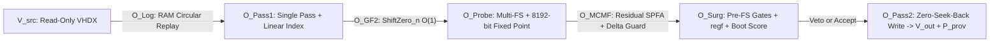

# Single-Pass Bounded-Memory Forensic Reconstruction of Multi-OS `[MS-VHDX]` Virtual Disks Under Intermittent Encryption

**Document Series:** VTI Research — Standalone Executive Brief (`VTI-RES-2026-05`)  
**Author:** **Caio Gonçalves** — *Principal Investigator & Chief Systems Architect, VTI Research (VTI, Brazil)* (https://projectos-system.github.io/vti-research/)  
**Official Study DOI:** [`10.5281/zenodo.24452824`](https://doi.org/10.5281/zenodo.24452824)  
**Publication Date:** November 2026 — Edition `v1.0`  
**Target Audience:** Boards of Directors, Executive Leadership (CEO / CTO / CIO), Security, Incident Response & Continuity Leaders (CISO / DFIR / BCM), Risk & Architecture Committees  
**Formal Ecosystem Scope:** Deterministic Machine $\mathcal{E}_{\mathrm{Rec}} = (\mathcal{V}_{\mathrm{src}}, B_{\mathrm{ram}}, \mathcal{F}, \mathcal{O}, \mathcal{G}_{\mathrm{veto}}, \mathcal{P}_{\mathrm{prov}}, \mathcal{V}_{\mathrm{out}})$  
**Note on Confidentiality, Epistemic Proportionality (`E1`–`E4`), and Scientific Honesty:** *This brief strictly preserves the epistemic boundaries of its companion scientific paper (`VTI-RES-2026-05 v1.0`). All empirical measurements (`B1`–`B6`) derive from synthetic `.vhdx` images generated in laboratory isolation (`os.tmpdir()`), leaving live production data and `rescue-portable/` binaries untouched. Where frozen prototype `v3.0.6` exhibited real gaps — specifically silent read-failure skipping on `eh_depth > 0` (`L10747`, `M-FUT-1`) and the `25/30` ($\kappa = 0.6667$) `HardVetoes` divergence between PS/C# and Python (`M-FUT-2`) — those limits are reported in full.*

---

## 1. The Strategic Dilemma of Post-Intermittent-Encryption Virtual Disk Recovery

When ransomware campaigns apply **intermittent encryption** (*First-N* / *skip-step*) against Hyper-V hypervisors, the first megabytes of `[MS-VHDX]` containers (`Header`, `Region Table`, `BAT`, and circular log) are destroyed in seconds, paralyzing entire virtual machines even when most internal `32 MiB` data blocks remain intact in plaintext. Conventional rescue workflows fail across three executive paradoxes:

1. **The Memory and Time Crisis Paradox:** Forensic utilities requiring multiple random passes or unbounded RAM indexing rapidly exhaust memory in emergency rescue environments (*WinPE* / *Linux Live*) while suffering quadratic $O(K \cdot M \cdot n)$ cost when validating tens of thousands of candidate-inode pairs against per-inode seeded `CRC-32C` checksums.
2. **The Silent Hallucination Paradox on Ambiguous Blocks and Unwritten Extents:** Entropy-only heuristics or blind magic-byte carving mistake magic strings inside JSON/log payloads for real binary headers, misclassify allocated but never-written `ext4` extents (`unwritten`) as physical losses, and make arbitrary guesses when two orphan blocks are indistinguishable — silently corrupting restored databases and filesystems.
3. **The Destructive Boot & Identity Repair Paradox:** Running blind automated repairs corrupts dirty `regf` registry hives (`seq1 != seq2`), destroys `DPAPI`/`BitLocker` key protectors, or triggers catastrophic *USN Rollback* by bringing reconstructed `Active Directory` domain controllers (`NTDS.dit`) back online without isolation.

### 1.1. Central Thesis and Demarcation From `VTI-RES-2026-04`
Whereas **`VTI-RES-2026-04` (`v3.0`)** addresses the systemic architecture of prevention, Zero-Inbound remote containment, non-TCB AI triage, and multi-cloud immutable vaults (presenting only the logical interface `O1`–`O4` in §3.3.4), **`VTI-RES-2026-05` (`v1.0`)** formalizes the complete algebraic, combinatorial, and transactional theory of the autonomous forensic reconstruction engine $\mathcal{E}_{\mathrm{Rec}}$ (`Recuperar-VHDX-v3.0.6.ps1` + `bastion-rescue-universal.py`), strictly separating validated blocks from ambiguous inferences (`BootReadinessScore <= 39`).

---

## 2. Seven-Operator Architecture ($\mathcal{O}$) and Six Formal Invariants ($I_{R1}$–$I_{R6}$)

1. **Evidence Immutability & Single-Pass Zero-Seek-Back ($I_{R1}, I_{R2}$ — $O_{\mathrm{Log}}, O_{\mathrm{Pass1}}, O_{\mathrm{Pass2}}$):** Source $\mathcal{V}_{\mathrm{src}}$ is never modified (`ISO/IEC 27037`); the `[MS-VHDX]` circular log replays in RAM (rejecting truncated logs), indexing scans sequentially in one pass, and clone $\mathcal{V}_{\mathrm{out}}$ writes sequentially without BAT seek-back (`260.32–269.34 MiB` CLR+PS5.1 Working Set in `B2`, reconciled against `221.18 MiB` analytical index + `96 MiB` cache at `100 GiB`).
2. **Exact Algebraic `GF(2)` `CRC-32C` Acceleration (`T1`, $I_{R4}$ — $O_{\mathrm{GF2}}$):** Exploits `Castagnoli` polynomial linearity (`4x256` words, `4 KiB`) with exact affine adjustments for `ext4` (`xorout=0`) and `iSCSI` (`init=xorout=0xFFFFFFFF`), achieving **`0/10,000` divergences** in both regimes and **`168.73x`** mean speedup (`95% CI [144.58x, 193.88x]`) in `B1`.
3. **4-Way Physical-Virtual Accounting & Multi-FS Support (`T2` scoped, $I_{R3}$ — $O_{\mathrm{Probe}}$):** Partitions mapped, encrypted, zeroed, and orphan blocks while preserving `ext4` `unwritten` extents (`rawLen > 32768`) with `0/200` accounting errors (`B3`), tagging `XFS` as `READONLY`, and rejecting JSON `FileHead` collisions (`TN = 40`: `25` JSON + `10` zeros + `5` random vs. `TN = 15` in baselines; `0/25` JSON FPs vs. `25/25` in `Ctrl-MagicCarver`, `F1 = 1.000`). *Explicit caveat:* in `v3.0.6`, a read error on an `ext4` index node `eh_depth > 0` (`L10747`) skips the subtree without emitting `INDETERMINATE` (`M-FUT-1`).
4. **Ambiguity-Vetoed Bipartite `MCMF` Bijection (`P3`, $I_{R5}$ — $O_{\mathrm{MCMF}}$):** Computes residual margin $\Delta_u$ via SPFA inside single components `n <= 8192` (capturing arbitrary alternating cycles while separating `> 8192` partitioning as local heuristic), blocking ties under `AMBIGUOUS_BAT_MAPPING` with **`0/60` false assignments** (`Wilson 95% CI [0.0000, 0.0602]`, `<= 6.02%`, `p_holm = 4.89e-13` in `B4`).
5. **Transactional `regf` Surgery & Pre-FS Gates (`P4`, $I_{R6}$ — $O_{\mathrm{Surg}}$):** Blocks `100%` of dirty `regf` hives (`seq1 != seq2`, `20/20`), verifies and preserves `seq1 == seq2` unchanged, keeps `cbData` invariant (noting auxiliary reallocation branches in `softwareHive` `L5851–5868`/`L5892–5898`), atomically recomputes the `508`-byte `XOR-32` checksum and saves a `DPAPI` backup on clean hives (`20/20`), and fires hard vetoes on `BitLocker` (`-FVE-FS-` with `0/20` ELF FPs), `LUKS`, and `AD DS NTDS.dit` (`30/30`, `p_holm = 4.35e-11` in `B5`). `BootReadinessScore` (`0..100`) is a **deterministic heuristic index** capped at `<= 39` under any `HardVeto`.

---

## 3. Executive Risk Matrix, `B1`–`B6` Empirical Results & Open Gap `B6` (`25/30`)

| Forensic Dimension | Conventional Tooling | Under $\mathcal{E}_{\mathrm{Rec}}$ (`VTI-RES-2026-05`) | Empirical Evidence (`B1`–`B6`) & Limit |
| :--- | :--- | :--- | :--- |
| **`CRC-32C` (`ext4`) Validation Cost** | Sequential $O(K \cdot M \cdot n)$ re-hashing per candidate | `GF(2)` `O(1)` decoupling (`ShiftZero_n`) | **`0/10,000`** errors (`ext4` + `iSCSI`), **`168.73x`** ratio of means (`95% CI [144.58x; 193.88x]`, `B1`). |
| **Memory & I/O on Large Images** | Multiple random passes or RAM exhaustion | Single-pass read/write with zero BAT seek-back | **`260.32–269.34 MiB`** CLR WS (`233.40–249.58 MiB` Private) vs. `221.18 MiB` analytical `100 GiB`; truncated log rejected (`B2`). |
| **False Positives & Unwritten Extents** | Blind carving / entropy mistakes JSON & unwritten zeros | 4-way accounting (`T2` scoped to readable `0xF30A`) + Multi-FS | **`0/200`** accounting errors, **`F1 = 1.000` (`TP=60, FP=0, FN=0, TN=40`)**, `0/40` vs. `25/40` (`Ctrl-EntropyOnly`, `p_holm=2.21e-10`) & `0/25` vs. `25/25` JSON (`Ctrl-MagicCarver`, `B3`). |
| **Silent Guessing in the `BAT`** | Greedy assignment with no separation margin | Residual SPFA `SSAP/MCMF` (`<= 8192`) vs. `HEURISTIC_WINDOWED` (`> 8192`) | **`0/60`** FAR (**`two-sided 95% Wilson [0.0000; 0.0602]`**, `<= 6.02%`), `0/100` `Ctrl-NegRandom` (`B4`). |
| **`regf` Surgery, `BitLocker` & `AD DS`** | Blind patching corrupts dirty hives & causes USN Rollback | `seq1==seq2` preserved, `cbData`, `508 B` `XOR-32`, `DPAPI` & Pre-FS Hard Vetoes | **`20/20`** clean, **`20/20`** dirty vetoed, **`30/30`** Pre-FS vetoed, `0/20` ELF `"-FVE-FS-"` FPs (`B5`). |
| **Cross-OS Parity (`PS/C#` $\leftrightarrow$ `Py`)** | Silent divergence between Windows and Linux scripts | Cross-audit `N=30` (`osFamily`, Pre-FS, `HardVetoes`) | **`30/30`** on `osFamily`/Pre-FS ($\kappa=1.000$); **`25/30`** (`CP 95% [0.6528; 0.9436]`, $\kappa=0.6667$) on `HardVetoes` (`M-FUT-2`). |

### 3.1. Epistemic Decision Pipeline & Promotion Control
Every reconstructed clone receives a per-block 7-state provenance map $\mathcal{P}_{\mathrm{prov}}$ and a heuristic `BootReadinessScore`; automatic boot promotion is locked (`score <= 39`) whenever any `INFERRED_AMBIGUOUS`, `HardVeto` (`BitLocker`, `LUKS`, `NTDS.dit`, `DIRTY_HVLE_WINPE_REQUIRED`), or `XFS` (`READONLY`) partition is present.

---

## 4. Evolutionary Maturity Roadmap (`M-FUT-1` to `M-FUT-6`)

| Code | Evolutionary Track (`v3.1+`) | Residual Risk Addressed | Expected Operational Benefit |
| :---: | :--- | :--- | :--- |
| **`M-FUT-1`** | **Tri-State (`INDETERMINATE`) Propagation at `L10747` (`eh_depth > 0`)** | Silent subtree skip on `0xF30A` index-node I/O failure. | Unconditional closure of Theorem 2 with zero structural false negatives. |
| **`M-FUT-2`** | **Normative Unification of `AMBIGUOUS_BAT_MAPPING` (`C#/PS` $\leftrightarrow$ `Py`)** | `5/30` divergence (`B6`, $\kappa=0.6667$) in Scenario 2 with global orphan duplicates. | `30/30` (`100%`) cross-platform decision convergence across Windows & Linux. |
| **`M-FUT-3`** | **External `e2fsprogs`/`RFC 3720` Test Vectors & Physical `100 GiB` Scale** | Internal-oracle reliance in `B1` and analytical projection in `B2`. | Independent `CRC-32C` cross-validation and direct `100 GiB` RAM measurement. |
| **`M-FUT-4`** | **Explicit Inter-Window Cut Signaling (`> 8192` Nodes)** | Loss of global alternating-cycle guarantee under heuristic windowing. | Auditable separation of `CERTIFIED_GLOBAL` vs. `HEURISTIC_WINDOWED` in reports. |
| **`M-FUT-5`** | **Crash-Consistency Fault Injection & Deep `ReFS`/`Btrfs` Suites** | Mid-write power loss between BAT and payload; narrower `ReFS`/`Btrfs` coverage. | Verified reconstruction robustness under power interruption and broader Multi-FS testing. |
| **`M-FUT-6`** | **Auxiliary Hybrid-Hibernation Detection (`hiberfil.sys` / Fast Startup)** | Dirty OS state residing outside `regf` hives. | Preventive warning prior to mounting or repairing hibernated Windows volumes. |

---

## 5. Practical Governance Directives for Boards, CISOs, and DFIR Teams

1. **Forbid Source Evidence Writes and Mandate 7-State Provenance Maps:** Every post-ransomware rescue must operate strictly read-only on compromised `.vhdx` files (`ISO/IEC 27037`), emitting a fresh clone plus `vhdx-provenance-map.v1.json`.
2. **Reject Repairs Lacking Ambiguity Guards (`AMBIGUOUS_BAT_MAPPING`):** Never auto-promote reconstructed disks when `BootReadinessScore <= 39` or ambiguous blocks exist; prioritize selective extraction of validated files.
3. **Enforce Hard Vetoes on `NTDS.dit`, Dirty `regf`, and Encrypted Volumes:** Active Directory domain controllers must trigger `ACTIVE_DIRECTORY_DC_DETECTED` to prevent forest-wide *USN Rollback*, and dirty `regf` hives (`seq1 != seq2`) must be repaired only in proper recovery environments after `DPAPI` preservation.
4. **Clearly Separate Mathematical Guarantees from Heuristics and Known Defects (`M-FUT-1`/`M-FUT-2`):** Until `v3.1` delivers `M-FUT-1` (`L10747`) and `M-FUT-2` (`B6` `25/30`), audit deep `ext4` trees (`eh_depth > 0`) manually and standardize decision pipelines on a single validated diagnostic engine.
5. **Adopt the Paired Standard `VTI-RES-2026-04` + `VTI-RES-2026-05` in Corporate Resilience Policy:** Pair Pull-Only immutable vaults and Zero-Inbound containment (`2026-04`) as primary survival with the deterministic single-pass forensic engine (`2026-05`) as an auditable last line of recovery.

> **Companion Scientific Paper:** For complete formal proofs (`T1`, scoped `T2`, `P3`, `P4`), `B1`–`B6` statistics (`Clopper-Pearson`, `Wilson`, `Holm-Bonferroni`, `bootstrap 2000`, Cohen's $\kappa$), negative bounds, *Threats to Validity*, and **28 verified primary references (`[R01]`–`[R28]`)** mapped `1:1` to `references.bib`, see **`VTI-RES-2026-05` (`v1.0`, DOI `10.5281/zenodo.24452824`)**.
