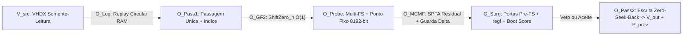

# Reconstrução Forense em Passagem Única e Memória Limitada de Discos Virtuais `[MS-VHDX]` Multi-Sistema sob Criptografia Intermitente

**Série Documental:** VTI Research — Dossiê Executivo Autônomo (`VTI-RES-2026-05`)  
**Autor:** **Caio Gonçalves** — *Principal Investigator & Chief Systems Architect, VTI Research (VTI, Brazil)* (https://projectos-system.github.io/vti-research/)  
**DOI Oficial do Estudo:** [`10.5281/zenodo.24452824`](https://doi.org/10.5281/zenodo.24452824)  
**Data de Publicação:** Novembro de 2026 — Edição `v1.0`  
**Público-Alvo:** Conselhos de Administração, Diretorias Executivas (CEO / CTO / CIO), Lideranças de Segurança, Resposta a Incidentes e Continuidade (CISO / DFIR / BCM), Comitês de Risco e Arquitetura  
**Escopo Formal do Ecossistema:** Máquina Determinística $\mathcal{E}_{\mathrm{Rec}} = (\mathcal{V}_{\mathrm{src}}, B_{\mathrm{ram}}, \mathcal{F}, \mathcal{O}, \mathcal{G}_{\mathrm{veto}}, \mathcal{P}_{\mathrm{prov}}, \mathcal{V}_{\mathrm{out}})$  
**Nota de Confidencialidade, Proporcionalidade Epistêmica (`E1`–`E4`) e Honestidade Científica:** *Este dossiê preserva estritamente os mesmos limites epistêmicos do artigo científico companheiro (`VTI-RES-2026-05 v1.0`). Todas as medições empíricas (`B1`–`B6`) provêm de imagens `.vhdx` sintéticas geradas em laboratório (`os.tmpdir()`), preservando intactos os dados vivos de produção e os binários de `rescue-portable/`. Onde o protótipo congelado `v3.0.6` apresentou lacunas reais — especificamente a falha silenciosa de leitura em `eh_depth > 0` (`L10747`, `M-FUT-1`) e a divergência `25/30` ($\kappa = 0,6667$) em `HardVetoes` entre PS/C# e Python (`M-FUT-2`) — tais limites são reportados integralmente.*

---

## 1. O Dilema Estratégico da Recuperação Pós-Criptografia Intermitente em Discos Virtuais

Quando campanhas de ransomware empregam **criptografia intermitente** (*First-N* / *skip-step*) contra hipervisores Hyper-V, os primeiros megabytes de contêineres `[MS-VHDX]` (`Header`, `Region Table`, `BAT` e log circular) são destruídos em segundos, paralisando máquinas virtuais inteiras mesmo quando a maior parte dos blocos de dados de `32 MiB` permanece intacta. O processo convencional de resgate falha diante de três paradoxos executivos:

1. **O Paradoxo da Memória e do Tempo em Crise:** Ferramentas forenses que exigem múltiplas passagens aleatórias ou indexação irrestrita em RAM esgotam rapidamente a memória disponível em ambientes emergenciais (*WinPE* / *Linux Live*), além de multiplicar o custo computacional ($O(K \cdot M \cdot n)$) ao testar dezenas de milhares de combinações candidato-inode contra checksums `CRC-32C` com semente individual.
2. **O Paradoxo da Alucinação em Blocos Ambíguos e *Extents* Não Escritos:** Utilitários heurísticos baseados apenas em entropia ou *file carving* cego confundem strings mágicas dentro de arquivos JSON/log com cabeçalhos binários reais, tratam *extents* `ext4` alocados mas nunca escritos (`unwritten`) como perdas físicas e assumem atribuições arbitrárias quando dois blocos órfãos são indistinguíveis — corrompendo silenciosamente bancos e sistemas de arquivos restaurados.
3. **O Paradoxo do Reparo Destrutivo de Boot e Identidade:** Executar reparos automáticos sem travas de segurança corrompe colmeias de registro `regf` em estado sujo (`seq1 != seq2`), destrói chaves `DPAPI`/`BitLocker` ou dispara *USN Rollback* catastrófico ao subir controladores de domínio `Active Directory` (`NTDS.dit`) sem isolamento.

### 1.1. Tese Central e Demarcação com `VTI-RES-2026-04`
Enquanto **`VTI-RES-2026-04` (`v3.0`)** trata da arquitetura sistêmica de prevenção, contenção remota Zero-Inbound, triagem IA fora da TCB e cofres imutáveis multi-nuvem (apresentando apenas a interface lógica `O1`–`O4` em §3.3.4), **`VTI-RES-2026-05` (`v1.0`)** formaliza a teoria algébrica, combinatória e transacional do motor autônomo de reconstrução forense $\mathcal{E}_{\mathrm{Rec}}$ (`Recuperar-VHDX-v3.0.6.ps1` + `bastion-rescue-universal.py`), separando rigorosamente blocos validados de inferências ambíguas (`BootReadinessScore <= 39`).

---

## 2. Arquitetura em Sete Operadores ($\mathcal{O}$) e Seis Invariantes ($I_{R1}$–$I_{R6}$)

1. **Imutabilidade e Passagem Única sem *Seek-Back* ($I_{R1}, I_{R2}$ — $O_{\mathrm{Log}}, O_{\mathrm{Pass1}}, O_{\mathrm{Pass2}}$):** A imagem original $\mathcal{V}_{\mathrm{src}}$ nunca é alterada (`ISO/IEC 27037`); o log circular `[MS-VHDX]` é reproduzido em RAM (rejeitando logs truncados), a indexação varre o disco em uma única leitura sequencial e o clone $\mathcal{V}_{\mathrm{out}}$ é gravado em passagem única alinhada sem retroceder na `BAT` (`260,32–269,34 MiB` *Working Set* CLR+PS5.1 medido em `B2`, reconciliado com `221,18 MiB` do modelo analítico de índice + cache `96 MiB` a `100 GiB`).
2. **Aceleração Algébrica Exata `CRC-32C` em `GF(2)` (`T1`, $I_{R4}$ — $O_{\mathrm{GF2}}$):** Explora a linearidade do polinômio `Castagnoli` (`4x256` palavras, `4 KiB`) com ajuste afim exato para `ext4` (`xorout=0`) e `iSCSI` (`init=xorout=0xFFFFFFFF`), atingindo **`0/10.000` divergências** em ambos os regimes e ganho de **`168,73x`** (`IC 95% [144,58x, 193,88x]`) em `B1`.
3. **Contabilidade Físico-Virtual 4-Vias & Suporte Multi-FS (`T2` escopado, $I_{R3}$ — $O_{\mathrm{Probe}}$):** Separa blocos mapeados, criptografados, zerados e órfãos, preservando *extents* `unwritten` (`rawLen > 32768`) em partições `ext2/3/4` sem erro contábil (`0/200` erros em `B3`), rotulando `XFS` como `READONLY` e evitando colisões `FileHead` em JSON e demais negativos (`TN = 40`: `25` JSON + `10` zeros + `5` aleatórios no Bastion vs. `TN = 15` nos *baselines*, `0/25` FPs JSON vs. `25/25` em `Ctrl-MagicCarver`, `F1 = 1,000`). *Ressalva explícita:* na `v3.0.6`, falha de leitura em nó de índice `ext4` `eh_depth > 0` (`L10747`) pula a subárvore sem estado `INDETERMINATE` (`M-FUT-1`).
4. **Bijeção Bipartida `MCMF` com Veto de Ambiguidade (`P3`, $I_{R5}$ — $O_{\mathrm{MCMF}}$):** Calcula a margem residual $\Delta_u$ via SPFA em componente única `n <= 8192` (capturando ciclos alternantes e separando o particionamento `> 8192` como heurística local), bloqueando empates sob `AMBIGUOUS_BAT_MAPPING` com **`0/60` falsa atribuição** (`Wilson IC 95% [0,0000, 0,0602]`, `<= 6,02%`, `p_holm = 4,89e-13` em `B4`).
5. **Cirurgia Transacional `regf` e Portas Pré-FS (`P4`, $I_{R6}$ — $O_{\mathrm{Surg}}$):** Bloqueia `100%` das colmeias `regf` sujas (`seq1 != seq2`, `20/20`), verifica e preserva `seq1 == seq2` iguais (sem incremento/recomputação), mantém `cbData` invariante (com ramos auxiliares de realocação em `softwareHive` `L5851–5868`/`L5892–5898` fora dessa premissa), recalcula atomicamente o checksum `XOR-32` sobre os `508` bytes iniciais e grava backup `DPAPI` em colmeias limpas (`20/20`), além de acionar vetos rígidos para `BitLocker` (`-FVE-FS-` sem falsos positivos em ELF), `LUKS` e `AD DS NTDS.dit` (`30/30`, `p_holm = 4,35e-11` em `B5`). O `BootReadinessScore` (`0..100`) atua como **índice heurístico determinístico** travado em `<= 39` sob qualquer `HardVeto`.

---

## 3. Matriz Executiva de Risco, Resultados `B1`–`B6` e Lacuna `B6` (`25/30`)

| Dimensão Forense | Ferramenta Convencional | Sob $\mathcal{E}_{\mathrm{Rec}}$ (`VTI-RES-2026-05`) | Evidência Empírica (`B1`–`B6`) & Limite |
| :--- | :--- | :--- | :--- |
| **Custo de Validação `CRC-32C` (`ext4`)** | Re-hash sequencial $O(K \cdot M \cdot n)$ por candidato | Desacoplamento `GF(2)` `O(1)` (`ShiftZero_n`) | **`0/10.000`** erros (`ext4` + `iSCSI`), **`168,73x`** razão de médias (`IC 95% [144,58x; 193,88x]`, `B1`). |
| **Memória & I/O em Imagens Grandes** | Múltiplas passagens aleatórias ou estouro de RAM | Leitura/escrita *single-pass* sem *seek-back* na `BAT` | **`260,32–269,34 MiB`** WS CLR (`233,40–249,58 MiB` Private Bytes) vs. `221,18 MiB` analítico `100 GiB`, log truncado rejeitado (`B2`). |
| **Falsos Positivos & *Extents Unwritten*** | *Carving* cego / entropia confunde JSON e zera mal | Contabilidade 4-vias (`T2` escopado a `0xF30A` legíveis) + Multi-FS | **`0/200`** erros contábeis, **`F1 = 1,000` (`TP=60, FP=0, FN=0, TN=40`)**, `0/40` vs. `25/40` (`Ctrl-EntropyOnly`, `p_holm=2,21e-10`) e `0/25` vs. `25/25` JSON (`Ctrl-MagicCarver`, `B3`). |
| **Chutes Silenciosos na `BAT`** | Atribuição gulosa sem margem de separação | `SSAP/MCMF` residual SPFA (`<= 8192`) vs. `HEURISTIC_WINDOWED` (`> 8192`) | **`0/60`** FAR (**`Wilson bilateral 95% [0,0000; 0,0602]`**, até `6,02%`), `0/100` `Ctrl-NegRandom` (`B4`). |
| **Cirurgia `regf`, `BitLocker` & `AD DS`** | Patch cego corrompe `regf` sujo e causa *USN Rollback* | `seq1==seq2` preservado, `cbData`, `XOR-32` `508 B`, `DPAPI` e Hard Vetos Pré-FS | **`20/20`** limpas, **`20/20`** sujas vetadas, **`30/30`** Pré-FS vetados, `0/20` FP `"-FVE-FS-"` em ELF (`B5`). |
| **Paridade Multiplataforma (`PS/C#` $\leftrightarrow$ `Py`)** | Divergências silenciosas entre scripts Windows e Linux | Auditoria cruzada `N=30` (`osFamily`, Pré-FS, `HardVetoes`) | **`30/30`** em `osFamily`/Pré-FS ($\kappa=1,000$); **`25/30`** (`CP bilateral 95% [0,6528; 0,9436]`, $\kappa=0,6667$) em `HardVetoes` (`M-FUT-2`). |

### 3.1. Esteira de Decisão Epistêmica e Controle de Promoção
Todo clone reconstruído recebe um mapa por bloco $\mathcal{P}_{\mathrm{prov}}$ (`7` estados) e um `BootReadinessScore` heurístico; a promoção automática para boot é bloqueada (`score <= 39`) sempre que houver qualquer `INFERRED_AMBIGUOUS`, `HardVeto` (`BitLocker`, `LUKS`, `NTDS.dit`, `DIRTY_HVLE_WINPE_REQUIRED`) ou partição `XFS` (`READONLY`).

---

## 4. Roteiro Evolutivo de Maturidade (`M-FUT-1` a `M-FUT-6`)

| Código | Frente Evolutiva (`v3.1+`) | Risco Residual Endereçado | Benefício Operacional Esperado |
| :---: | :--- | :--- | :--- |
| **`M-FUT-1`** | **Propagação Triestado (`INDETERMINATE`) em `L10747` (`eh_depth > 0`)** | Salto silencioso de subárvore `0xF30A` diante de falha de I/O em nó de índice. | Fechamento incondicional do Teorema 2 sem falsos negativos estruturais. |
| **`M-FUT-2`** | **Unificação Normativa `AMBIGUOUS_BAT_MAPPING` (`C#/PS` $\leftrightarrow$ `Py`)** | Divergência `5/30` (`B6`, $\kappa=0,6667$) no Cenário 2 com duplicatas órfãs globais. | Convergência decisória `30/30` (`100%`) entre Windows e Linux. |
| **`M-FUT-3`** | **Vetores Externos `e2fsprogs`/`RFC 3720` e Escala Física `100 GiB`** | Dependência de oráculo interno em `B1` e projeção analítica em `B2`. | Validação cruzada independente de `CRC-32C` e medição direta de RAM em `100 GiB`. |
| **`M-FUT-4`** | **Sinalização Explícita de Corte Inter-Janelas (`> 8192` Nós)** | Perda da garantia global de ciclo alternante no particionamento heurístico. | Separação auditável entre `CERTIFIED_GLOBAL` e `HEURISTIC_WINDOWED` no laudo. |
| **`M-FUT-5`** | **Injeção de Falhas (*Crash Consistency*) e Suítes `ReFS`/`Btrfs`** | Falha parcial de gravação entre `BAT` e payload e menor cobertura experimental em `ReFS`/`Btrfs`. | Robustez verificada de reconstrução sob interrupção elétrica e ampliação multi-FS. |
| **`M-FUT-6`** | **Detecção Auxiliar de Hibernação Híbrida (`hiberfil.sys` / *Fast Startup*)** | Estado sujo de SO residente fora das colmeias `regf`. | Alerta preventivo antes de montagem ou reparo de volumes Windows hibernados. |

---

## 5. Diretrizes Práticas de Governança para Conselhos, CISOs e Times de DFIR

1. **Proíba Escrita na Evidência Original e Exija Mapa de Proveniência em 7 Estados:** Todo resgate pós-ransomware deve operar em modo estritamente somente-leitura sobre o `.vhdx` comprometido (`ISO/IEC 27037`), gerando um clone novo acompanhado do manifesto `vhdx-provenance-map.v1.json`.
2. **Rejeite Reparos Sem Guarda de Ambiguidade (`AMBIGUOUS_BAT_MAPPING`):** Nunca permita promoção automática de disco reconstruído quando `BootReadinessScore <= 39` ou quando blocos ambíguos ocorrerem; priorize extração seletiva de arquivos validados.
3. **Imponha Vetos Automáticos para `NTDS.dit`, `regf` Sujo e Volumes Cifrados:** Controladores de domínio `Active Directory` detectados em reconstrução devem sofrer veto rígido (`ACTIVE_DIRECTORY_DC_DETECTED`) para evitar *USN Rollback* na floresta, e colmeias `regf` com `seq1 != seq2` devem ser reparadas apenas via ambiente adequado após preservação de `DPAPI`.
4. **Distinga Claramente Garantias Matemáticas de Heurísticas e Defeitos Conhecidos (`M-FUT-1`/`M-FUT-2`):** Enquanto `v3.0.6` não recebe as correções `M-FUT-1` (`L10747`) e `M-FUT-2` (`B6` `25/30`), trate falhas em árvores `ext4` profundas (`eh_depth > 0`) com auditoria manual adicional e utilize o mesmo motor de diagnóstico homologado para o pipeline de decisão.
5. **Adote o Par `VTI-RES-2026-04` + `VTI-RES-2026-05` na Política Corporativa de Resiliência:** Combine cofres *Pull-Only* imutáveis e contenção Zero-Inbound (`2026-04`) como linha primária de sobrevivência com o motor determinístico `single-pass` (`2026-05`) como última linha de recuperação forense auditável.

> **Documento Científico Companheiro:** Para as demonstrações matemáticas completas (`T1`, `T2` escopado, `P3`, `P4`), análise estatística `B1`–`B6` (`Clopper-Pearson`, `Wilson`, `Holm-Bonferroni`, `bootstrap 2000`, Cohen's $\kappa$), limites negativos detalhados, matriz *Threats to Validity* e **28 referências verificadas (`[R01]`–`[R28]`)** com mapeamento `1:1` para `VTI-RES-2026-05_references.bib`, consulte **`VTI-RES-2026-05_Paper_PT.md` (`v1.0`)**.
