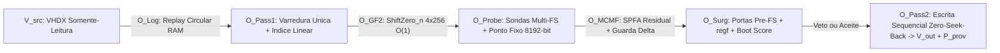

# Reconstrução Forense em Passagem Única e Memória Limitada de Discos Virtuais `[MS-VHDX]` Multi-Sistema sob Criptografia Intermitente: Desacoplamento Linear em `GF(2)` de Checksums, Bijeção Bipartida com Veto de Ambiguidade e Cirurgia Determinística de Inicialização

**Identificador Técnico:** `VTI-RES-2026-05` — `v1.0` (Novembro de 2026)  
**Autor:** **Caio Gonçalves** — *Principal Investigator & Chief Systems Architect, VTI Research (VTI, Brazil)* (https://projectos-system.github.io/vti-research/)  
**Classificação Científica:** `cs.CR` (Cryptography and Security) • `cs.OS` (Operating Systems) • `cs.DS` (Data Structures and Algorithms) | **DOI Oficial:** [`10.5281/zenodo.24452824`](https://doi.org/10.5281/zenodo.24452824)  
**Desenho Metodológico:** *Design Science Research* estratificada em quatro níveis epistêmicos (`E1` Auditoria estática linha-a-linha de `Recuperar-VHDX-v3.0.6.ps1` e `bastion-rescue-universal.py`; `E2` Calibração estrutural sobre perfis de falha de discos virtuais sem quase-identificadores; `E3` Constructo formal $\mathcal{E}_{\mathrm{Rec}}$, 7 operadores $\mathcal{O}$, 6 invariantes $I_{R1}$–$I_{R6}$, Teoremas `T1`–`T2` escopado e Proposições `P3`–`P4`; `E4` Baterias empíricas reprodutíveis `B1`–`B6` executadas em `os.tmpdir()` sobre imagens `.vhdx` sintéticas) — Tupla Formal $\mathcal{E}_{\mathrm{Rec}} = (\mathcal{V}_{\mathrm{src}}, B_{\mathrm{ram}}, \mathcal{F}, \mathcal{O}, \mathcal{G}_{\mathrm{veto}}, \mathcal{P}_{\mathrm{prov}}, \mathcal{V}_{\mathrm{out}})$  
**Cláusula de Confidencialidade Operacional, Prevenção de Quase-Identificadores e Demarcação Editorial:** *Nenhum nome de servidor privado, domínio corporativo, cliente ou credencial real figura neste manuscrito. Todas as baterias empíricas `B1`–`B6` foram executadas exclusivamente em laboratório sobre imagens `.vhdx` sintéticas em `os.tmpdir()`, preservando inalterados os binários homologados de `rescue-portable/` e os bancos vivos do produto. Este artigo é cientificamente autônomo em relação à monografia sistêmica `VTI-RES-2026-04` (`v3.0`, DOI `10.5281/zenodo.24452820` / Concept DOI `10.5281/zenodo.24406145`), que apresenta apenas a interface arquitetural `O1`–`O4` em §3.3.4.*

---

## Resumo

A disseminação de ransomware baseado em **criptografia intermitente** (*First-N* / *header-only* / *skip-step*) contra contêineres virtuais `[MS-VHDX]` permite destruir cabeçalhos redundantes, regiões e a *Block Allocation Table* (`BAT`) em minutos, deixando grande fração dos fragmentos internos de `32 MiB` em texto claro, porém desconectados de seus deslocamentos lógicos. Recuperadores forenses tradicionais ou baseados exclusivamente em entropia falham por quatro razões acopladas: exigem múltiplas passagens aleatórias ou explosão de memória residente (`RAM`), incorrem em custo quadrático $O(K \cdot M \cdot n)$ ao revalidar checksums `CRC-32C` dependentes de semente por inode em `ext4`, confundem *extents* `unwritten` (`ee_len > 32768`) ou empates simétricos na `BAT` com blocos recuperáveis (*alucinação silenciosa*) e executam reparos cegos que destroem colmeias `regf` sujas, chaves `DPAPI`, protetores `BitLocker`/`LUKS` ou sequências `USN` do Active Directory (`NTDS.dit`). Este trabalho formaliza a máquina determinística de reconstrução forense **em passagem única e memória limitada** $\mathcal{E}_{\mathrm{Rec}} = (\mathcal{V}_{\mathrm{src}}, B_{\mathrm{ram}}, \mathcal{F}, \mathcal{O}, \mathcal{G}_{\mathrm{veto}}, \mathcal{P}_{\mathrm{prov}}, \mathcal{V}_{\mathrm{out}})$ e avalia empiricamente sua implementação real (`Recuperar-VHDX-v3.0.6.ps1`, `19.198` linhas C#/PS, e `bastion-rescue-universal.py`, `3.890` linhas Python 3 stdlib) por meio das baterias `B1`–`B6`. Demonstramos: **(1)** desacoplamento linear em $\mathbb{F}_2[x]$ (`GF(2)`) do `CRC-32C` (`Castagnoli`) com constantes afins exatas (`ext4` `xorout=0` vs. `iSCSI` `init=xorout=0xFFFFFFFF`), obtendo `0/10.000` divergências em ambos os regimes (`Clopper-Pearson IC 95% [0,0000, 0,00036882]`) e *speedup* médio de **`168,73x`** (`IC 95% [144,58x, 193,88x]`); **(2)** passagem única de leitura e escrita sem *seek-back* na `BAT` em `.vhdx` com replay de log circular (`260,32–269,34 MiB` *Working Set* CLR+PS5.1 vs. modelo analítico `221,18 MiB` a `100 GiB`) e rejeição de log truncado; **(3)** contabilidade 4-vias sem erros em `200/200` casos `ext4` (`CP [0,0000, 0,0183]`) e `F1 = 1,000` Multi-FS com `0/25` falsos positivos em colisões JSON (`p_holm <= 2,21e-10`); **(4)** solver bipartido `MCMF` com margem residual SPFA dentro de componente única `n <= 8192`, atingindo **`0/60` falsa atribuição** em blocos simétricos (`Wilson IC 95% [0,0000, 0,0602]`, `<= 6,02%`, `p_holm = 4,89e-13`) e separando explicitamente o particionamento heurístico `> 8192`; e **(5)** bloqueio de `20/20` colmeias `regf` sujas e `30/30` vetos pré-FS (`p_holm = 4,35e-11`). Em observância estrita à honestidade científica, reportamos integralmente dois limites abertos encontrados no artefato congelado `v3.0.6`: a falha silenciosa de leitura em nós de índice `ext4` `eh_depth > 0` (`L10747`), que restringe o Teorema 2 a nós legíveis e abre **`M-FUT-1`**, e a concordância parcial `25/30` (`83,33%`, $\kappa = 0,6667$) em `HardVetoes` entre PS/C# e Python na bateria `B6` (refutação parcial de $H_6$), abrindo **`M-FUT-2`**, fundamentados em **28 referências primárias verificadas (`[R01]`–`[R28]`)**.

**Palavras-chave:** Forense `[MS-VHDX]`; Criptografia Intermitente; Álgebra Linear `GF(2)` `CRC-32C`; Fluxo de Custo Mínimo Bipartido (`MCMF`); Contabilidade 4-Vias `ext4`; Cirurgia `regf`; Recuperação Multi-FS; *Single-Pass Streaming*.

---

## 1. Introdução, Motivação Empírica e Demarcação com `VTI-RES-2026-04`

O modelo econômico do ransomware moderno deslocou-se para a maximização de dano por unidade de tempo de I/O. Como documentado por Davies et al. (`[R07]`), Ineza et al. (`[R08]`) e Wang et al. (`[R09]`), variantes recentes adotam **criptografia intermitente**: cifram os primeiros megabytes (*First-N*) ou intervalos regulares (*skip-step*) de grandes imagens de disco virtual `[MS-VHDX]` (`[R16]`), destruindo simultaneamente o cabeçalho do contêiner, o log circular de metadados e a *Block Allocation Table* (`BAT`). Embora fração majoritária dos blocos de payload internos (`32 MiB`) permaneça em texto claro, ferramentas convencionais de recuperação enfrentam quatro obstáculos fundamentais:

1. **Barreira de Memória e Passagens de I/O:** Indexadores ingênuos carregam árvores completas de blocos em memória ou executam múltiplas passagens aleatórias sobre imagens $\ge 100\text{ GiB}$, inviabilizando execução em ambientes restritos de resgate (*WinPE* / *Linux Live*, `[R13, R15]`).
2. **Acoplamento Quadrático de Checksums Dependentes de Semente (`ext4`):** Em sistemas de arquivos `ext4` modernos com `metadata_csum` (`[R17, R18]`), cada bloco de diretório (`0xDE`), nó HTree (`dx_tail`) e nó de *extents* (`0xF30A`) incorpora no cálculo do `CRC-32C` (`[R01]`) uma semente única por inode `(s_csum_seed, ino, gen)`. Testar $K$ inodes candidatos contra $M$ blocos órfãos de $n$ bytes demanda $O(K \cdot M \cdot n)$ operações caso não se explore a estrutura algébrica do código cíclico.
3. **Alucinação Silenciosa em Mapeamento Guloso e *File Carving* Cego:** Técnicas clássicas de *file carving* por assinatura mágica (`[R10, R11]`) ou entropia (`[R07]`) sofrem colisões em dados estruturados (ex.: strings mágicas em payloads JSON/log) e atribuem blocos órfãos ambíguos sem margem de separação estatística. Além disso, confundem *extents* alocados mas nunca escritos (`unwritten`, `ee_len > 32768`, zerados logicamente `[R18]`) com lacunas perdidas.
4. **Destruição Secundária em Reparos de Boot e Registro (`regf`):** Reparos automatizados sem portas epistêmicas corrompem colmeias `regf` em estado sujo (`seq1 != seq2`, `[R25]`), destroem protetores `DPAPI`/`BitLocker` (`[R26]`) ou reativam controladores de domínio `Active Directory` (`NTDS.dit`) causando divergência catastrófica de `USN Rollback` (`[R27]`).

### 1.1. Matriz de Demarcação Anti-*Salami-Slicing* (`VTI-RES-2026-04 v3.0` $\leftrightarrow$ `VTI-RES-2026-05`)

Para assegurar ortogonalidade científica estrita e evitar qualquer fragmentação artificial na série `VTI-RES`, a **Tabela 1** explicita a fronteira exata entre a monografia sistêmica `VTI-RES-2026-04` (`v3.0`, §3.3.4) e o presente constructo:

| Camada Científica / Artefato | Estatuto em `VTI-RES-2026-04 v3.0` | Estatuto em `VTI-RES-2026-05 v1.0` | Fronteira Anti-*Salami-Slicing* |
| :--- | :---: | :---: | :--- |
| **Interface sistêmica `O1`–`O4` no plano de DR do Bastion OS** | **Herdado** *(apenas §3.3.4 como interface sistêmica)* | **Estendido** *(incorporado na cadeia de 7 operadores $\mathcal{O}$)* | `2026-04` não reivindica provas algébricas, multi-FS ou `MCMF`; apenas remete a `2026-05`. |
| **Desacoplamento linear `GF(2)` de `CRC-32C` (`ShiftZero_n`) + ajuste afim** | Ausente | **Novo** *(Teorema `T1`, prova $\blacksquare$ e Bateria `B1`)* | Álgebra polinomial em $\mathbb{F}_2[x]$ e tabelas `4x256` autônomas. |
| **Streaming *Single-Pass* RAM limitada (`<= 480 MiB`) & Replay Circular `[MS-VHDX]`** | Ausente | **Novo** *(Operadores $O_{\mathrm{Log}}, O_{\mathrm{Pass1}}, O_{\mathrm{Pass2}}$ e `B2`)* | Análise de memória/I/O sem *seek-back* na `BAT` de contêineres `[MS-VHDX]`. |
| **Contabilidade 4-Vias `ext4` (`unwritten`) & Suporte Multi-FS (`NTFS`/`ReFS`/`Btrfs`/`LVM2`/`XFS`)** | Ausente (`04` cita apenas `ext2/3/4`) | **Novo** *(Teorema `T2` escopado, $I_{R3}$ e Bateria `B3`)* | Inclui reporte transparente do defeito `L10747` (`M-FUT-1`). |
| **Bijeção Bipartida `MCMF` + Margem Residual SPFA $\Delta$ & Veto `AMBIGUOUS_BAT_MAPPING`** | Ausente | **Novo** *(Proposição `P3`, ciclo alternante e `B4`)* | Separa formalmente componente única `<= 8192` vs. janelamento `> 8192`. |
| **Cirurgia `regf` (`seq1==seq2`, `cbData`), Portas Pré-FS & Paridade Cross-OS** | Ausente | **Novo** *(Proposição `P4`, `B5` e `B6`)* | Reporta honestamente `B6 = 25/30` ($\kappa = 0,6667$) como refutação parcial de $H_6$. |

As cinco contribuições originais de **`VTI-RES-2026-05`** são: **(a)** formalização da tupla $\mathcal{E}_{\mathrm{Rec}}$, 7 operadores $\mathcal{O}$ e 6 invariantes $I_{R1}$–$I_{R6}$; **(b)** Teorema `T1` (`GF(2)` `CRC-32C` afim `ext4`/`iSCSI`) e Teorema `T2` (contabilidade 4-vias escopada a nós de índice legíveis); **(c)** Proposição `P3` (`MCMF` + SPFA residual com captura de ciclos alternantes em `n <= 8192`) e Proposição `P4` (cirurgia `regf` transacional); **(d)** execução empírica reproduzível das baterias `B1`–`B6` em `os.tmpdir()` contra *baselines* sintéticos (`Ctrl-MultiPass`, `Ctrl-EntropyOnly`, `Ctrl-GreedyNoMargin`, `Ctrl-MagicCarver`, `Ctrl-BlindPatch`, `Ctrl-NegRandom`) com estatística finita rigorosa; e **(e)** exposição transparente das duas lacunas abertas no protótipo `v3.0.6` (`M-FUT-1` e `M-FUT-2`).

---

## 2. Modelo Formal $\mathcal{E}_{\mathrm{Rec}}$, Estratificação Epistêmica e Hipóteses (`H1`–`H6`)

### 2.1. Estratificação Epistêmica (`E1`–`E4`) e Escopo Não Reivindicado

| Nível | Escopo em `VTI-RES-2026-05` | Evidência Verificada | Limite Explícito (`Escopo <= Evidencia`) |
| :---: | :--- | :--- | :--- |
| **`E1`** | Auditoria estática linha-a-linha dos módulos congelados em `rescue-portable/` | `Recuperar-VHDX-v3.0.6.ps1` (`19.198` linhas, `SHA-256: db547d1d...`) e `bastion-rescue-universal.py` (`3.890` linhas, `SHA-256: 493228b8...`) | Expõe exatamente `L1301–1473`, `L5060–5325`, `L5818–6152`, `L10704–10752` (`L10747`), `L14041–14081` e `L14923–15301`. |
| **`E2`** | Calibração qualitativa sobre perfis estruturais de falha `.vhdx` (`MBR`/`GPT`, `NTFS`/`ext4`, `EqualSeqDisk2Vhdx`) | Perfis sintéticos derivados sem exposição de servidores privados ou PII | Não reivindica generalização estatística populacional de incidentes de mercado. |
| **`E3`** | Deduções formais fechadas (`T1`, `T2` escopado, `P3`, `P4`), invariantes $I_{R1}$–$I_{R6}$ e limites negativos | Demonstrações ($\blacksquare$) condicionadas às premissas explicitadas | `BootReadinessScore` (`0..100`) é explicitamente definido como **heurística determinística**, nunca teorema; janelamento `> 8192` é heurístico local. |
| **`E4`** | Baterias empíricas `B1`–`B6` executadas via harness determinístico (`seed = 20261122`) em `os.tmpdir()` | `run_vhdx_b1_b6_bench.ps1` + `compute_stats.py` -> `b1_b6_results.json` (`0` toque em `bastion.db*`) | `B1` valida consistência interna `ext4`+`iSCSI` (vetores externos `e2fsprogs` em `M-FUT-3`); `B2` mede `1 GiB`/`8 GiB` reais + projeção analítica `100 GiB`; `Ctrl-MagicCarver` é sintético sem invocar SleuthKit/TestDisk reais. |

### 2.2. Tupla Formal $\mathcal{E}_{\mathrm{Rec}}$, Cadeia de Operadores $\mathcal{O}$ e Invariantes ($I_{R1}$–$I_{R6}$)

Modelamos a máquina de reconstrução forense sobre um contêiner `[MS-VHDX]` imutável como a 7-tupla:

$$\mathcal{E}_{\mathrm{Rec}} = \big(\mathcal{V}_{\mathrm{src}},\, B_{\mathrm{ram}},\, \mathcal{F},\, \mathcal{O},\, \mathcal{G}_{\mathrm{veto}},\, \mathcal{P}_{\mathrm{prov}},\, \mathcal{V}_{\mathrm{out}}\big)$$

onde:
- $\mathcal{V}_{\mathrm{src}}$ é a imagem `.vhdx` de entrada aberta estritamente em modo somente-leitura (`FileOptions.SequentialScan`), composta por cabeçalho/regiões/`BAT`, log circular e $N_p$ blocos físicos de tamanho $S_B$ (tipicamente `32 MiB`);
- $B_{\mathrm{ram}}$ é o orçamento de RAM (`ConfiguredMemoryBudgetBytes`, meta `<= 480 MiB` para imagens lógicas `<= 100 GiB` com cache LRU de metadados limitado a `96 MiB`, `L1846, 11939–11949`);
- $\mathcal{F} = \{\texttt{ext2/3/4+JBD2},\, \texttt{NTFS},\, \texttt{ReFS},\, \texttt{Btrfs},\, \texttt{LVM2},\, \texttt{FAT32\_ESP},\, \texttt{LINUX\_SWAP},\, \texttt{XFS\_RO}\}$ é o conjunto de analisadores estruturais (`[R17]`–`[R24]`);
- $\mathcal{O} = (O_{\mathrm{Log}},\, O_{\mathrm{Pass1}},\, O_{\mathrm{GF2}},\, O_{\mathrm{Probe}},\, O_{\mathrm{MCMF}},\, O_{\mathrm{Surg}},\, O_{\mathrm{Pass2}})$ é a cadeia ordenada de sete operadores determinísticos;
- $\mathcal{G}_{\mathrm{veto}}$ são as portas pré-FS e vetos rígidos (`BLOCKED_NO_USABLE_KEY_PROTECTOR` para `BitLocker`/`LUKS` `[R26]`, `MD_RAID`, `ACTIVE_DIRECTORY_DC_DETECTED` para `NTDS.dit` `[R27]`, `DIRTY_HVLE_WINPE_REQUIRED` para `regf` `[R25]`, `AMBIGUOUS_BAT_MAPPING`);
- $\mathcal{P}_{\mathrm{prov}}$ é o mapa epistêmico de proveniência em **7 estados disjuntos** (`ORIGINAL_VALIDATED`, `INFERRED_UNIQUE`, `INFERRED_AMBIGUOUS`, `KNOWN_UNALLOCATED_ZERO`, `MISSING_ALLOCATED`, `CIPHERTEXT_CONFIRMED`, `SYNTHETIC_RECONSTRUCTED`, `L15294–15301`);
- $\mathcal{V}_{\mathrm{out}}$ é o clone `.vhdx` materializado em passagem sequencial única alinhada a `1 MiB` com zero *seek-back* na `BAT`, verificado por `SHA-256` (`[R28]`) e acompanhado de manifestos JSON auditáveis.

Os sete operadores são regidos por **seis invariantes formais (`I_R1`–`I_R6`)**:
- **$I_{R1}$ (Imutabilidade da Evidência, `ISO/IEC 27037` `[R15]`):** Nenhuma etapa escreve sobre $\mathcal{V}_{\mathrm{src}}$; todo replay e reparo ocorrem em RAM ou sobre o fluxo novo $\mathcal{V}_{\mathrm{out}}$.
- **$I_{R2}$ (Passagem Única & Zero Seek-Back na `BAT`):** $O_{\mathrm{Pass1}}$ lê $\mathcal{V}_{\mathrm{src}}$ sequencialmente ($1$ passagem), resolve a `BAT` em RAM e $O_{\mathrm{Pass2}}$ grava $\mathcal{V}_{\mathrm{out}}$ em $1$ passagem sem retroceder ponteiros na `BAT`.
- **$I_{R3}$ (Conservação Contábil Físico-Virtual 4-Vias, `L14923, 14988–14990`):**

$$|\mathcal{B}_{\mathrm{phys}}| = N_{\mathrm{mapped}} + N_{\mathrm{enc}} + N_{\mathrm{zero}} + N_{\mathrm{orphan}}$$

$$\mathrm{EffAlloc} = \mathrm{MappedAlloc} + \mathrm{MissingAlloc}, \qquad \mathrm{RawAlloc} = \mathrm{EffAlloc} + \mathrm{UnwrittenOnly}$$

- **$I_{R4}$ (Equivalência Bit-a-Bit `GF(2)`):** Para todo bloco de comprimento $n \in \{4084, 4088, 4092\}$ e semente $s$, $O_{\mathrm{GF2}}$ coincide bit a bit com o cálculo completo (`VerifyLinearShifts`, `L1434–1459`).
- **$I_{R5}$ (Não-Alucinação Epistêmica / Veto de Ambiguidade):** Nenhuma lacuna cuja margem residual viole $\Delta_u \ge \Delta_{\min}$ recebe `INFERRED_UNIQUE`; qualquer `INFERRED_AMBIGUOUS` ou `HardVeto` limita `BootReadinessScore <= 39`.
- **$I_{R6}$ (Conservação Transacional de Colmeia `regf`):** Nenhuma mutação de registro executa com `seq1 != seq2` ou alteração de `cbData`; toda cirurgia valida checksum XOR-32 e realiza backup prévio `DPAPI` (`L5818–6021`).

### 2.3. Modelo de Adversário e Hipóteses Falsificáveis (`H1`–`H6`)

Consideramos um adversário que cifra o prefixo $[0, L_{\mathrm{enc}})$ ou intervalos esparsos de um `.vhdx`, corrompe logs circulares `[MS-VHDX]`, injeta colisões de assinaturas mágicas em payloads JSON, cria blocos idênticos órfãos na `BAT` ou deixa colmeias `regf` em estado sujo / volumes protegidos por `BitLocker` / `AD DS`. Formulamos seis hipóteses testáveis:
- **$H_1$ (`O_GF2`):** O operador `GF(2)` atinge `0` divergências contra cálculo completo nos regimes `ext4` e `iSCSI` afim e obtém speedup $\ge 20\times$ vs. `Ctrl-MultiPass`.
- **$H_2$ (*Single-Pass* & Log):** $O_{\mathrm{Pass1}} + O_{\mathrm{Pass2}}$ executam em $1$ passagem de leitura e $1$ de escrita com `ZeroSeekBackBat == true`, aplicam replay `EqualSeqDisk2Vhdx` e rejeitam logs truncados dentro de orçamento de RAM limitado.
- **$H_3$ (Contabilidade 4-Vias & Multi-FS):** $I_{R3}$ mantém `0` erros contábeis sob *extents* `unwritten`, `XFS` rotulado `READONLY` e `F1 >= 0,98` evitando falsos positivos JSON contra `Ctrl-EntropyOnly` e `Ctrl-MagicCarver`.
- **$H_4$ (`MCMF` + $\Delta$):** $O_{\mathrm{MCMF}}$ com margem residual SPFA reduz a Taxa de Falsa Atribuição (`FAR`) em blocos ambíguos frente a `Ctrl-GreedyNoMargin` e `Ctrl-MagicCarver`, capturando ciclos alternantes dentro de componente `n <= 8192`.
- **$H_5$ (Cirurgia `regf` & Pré-FS):** $O_{\mathrm{Surg}}$ bloqueia `100%` das colmeias sujas e gatilhos `BitLocker`/`LUKS`/`NTDS.dit` (incluindo texto falso `"-FVE-FS-"` em ELF) preservando `XOR-32` e células vizinhas em colmeias limpas, ao contrário de `Ctrl-BlindPatch`.
- **$H_6$ (Paridade Cross-OS `PS/C#` $\leftrightarrow$ `Python 3`):** `Recuperar-VHDX-v3.0.6.ps1` e `bastion-rescue-universal.py` atingem concordância $\kappa \ge 0,98$ em classificação Pré-FS e `HardVetoes` sobre o mesmo corpus `.vhdx` sintético. *(Nota: conforme reportado na Seção 4, $H_6$ foi confirmada `30/30` em `osFamily` e gates Pré-FS, porém **parcialmente refutada** em `HardVetoes` no Cenário 2 com `25/30`, $\kappa = 0,6667$.)*

---

## 3. Teoremas, Proposições, Provas Formais ($\blacksquare$) e Limites Negativos

### Teorema 1 (`T1` — Desacoplamento Linear em $\mathbb{F}_2[x]$ do `CRC-32C` com Ajuste Afim Exato)

**Enunciado.** Seja $P(x) = x^{32} + x^{28} + x^{27} + x^{26} + x^{25} + x^{23} + x^{22} + x^{20} + x^{19} + x^{18} + x^{14} + x^{13} + x^{11} + x^{10} + x^9 + x^8 + x^6 + 1 \in \mathbb{F}_2[x]$ o polinômio gerador `Castagnoli` (`0x1EDC6F41` normal / `0x82F63B78` refletido, `[R01, R02, R03]`) com reflexão de entrada e saída (`refin = true`, `refout = true`, ordem de bytes *little-endian* / injeção *LSB-first* por byte). Seja $A \in \mathbb{F}_2^{32 \times 32}$ a matriz linear de transição de $1$ bit do registrador CRC refletido não complementado (`RawCrc32cUpdate`, `L1301–1334`), de modo que cada byte aplica $8$ transições sucessivas ($A^8$) e um bloco de $n$ bytes aplica exatamente $8n$ transições ($A^{8n}$). Para qualquer bloco de bytes $X$ de comprimento fixo $n$ bytes, semente/estado inicial $s \in \mathbb{F}_2^{32}$ e pós-complemento booleano $\alpha_{\mathrm{out}} \in \{0, \texttt{0xFFFFFFFF}\}$:
1. No regime **`ext4` (`metadata_csum`, `[R18]`, `xorout = 0`)**, onde $s$ é a semente do inode `ComputeInodeCsumSeed(fsSeed, ino, gen)` com `fsSeed = RawCrc32cUpdate(0xFFFFFFFF, uuid)`:

$$\mathrm{CRC}_{\mathrm{ext4}}(s, X) = \mathrm{RawCrc32c}(0, X) \oplus A^{8n} s$$

2. No regime afim **`iSCSI` / `[MS-VHDX]` (`[R02, R16]`, `init = 0xFFFFFFFF`, `xorout = 0xFFFFFFFF`)**, escrevendo o vetor inicial efetivo $s_{\mathrm{init}} \in \mathbb{F}_2^{32}$ no mesmo domínio refletido não complementado:

$$\mathrm{CRC}_{\mathrm{iSCSI}}(s_{\mathrm{init}}, X) = \big(\mathrm{RawCrc32c}(0, X) \oplus \texttt{0xFFFFFFFF}\big) \oplus A^{8n} s_{\mathrm{init}}$$

Ademais, $\mathrm{ShiftZero}_n(s) = A^{8n} s$ decompõe-se em 4 sub-tabelas de 256 palavras (`1024 uints` = `4 KiB`), avaliáveis em tempo $O(1)$ independente de $n$.

**Demonstração.** Na representação polinomial sobre $\mathbb{F}_2[x]$, cada passo de atualização bit-a-bit de `RawCrc32cUpdate` aplica um deslocamento linear à direita no registrador refletido com redução condicional pelo polinômio recíproco `0x82F63B78` — equivalente à transformação linear $v \mapsto A v \oplus b_j e_0$ em $\mathbb{F}_2^{32}$. Ao processar $n$ bytes ($8$ passos por byte, totalizando $8n$ passos para $n$ bytes) de entrada $X$ a partir do estado inicial $s$, por indução e linearidade sobre $\mathbb{F}_2^{32}$:

$$\mathrm{RawCrc32c}(s, X) = A^{8n} s \oplus B_n(X), \qquad B_n(X) = \mathrm{RawCrc32c}(0, X)$$

onde $B_n(X)$ depende apenas de $X$ e não de $s$. Como $\mathrm{CRC}_{\mathrm{ext4}}$ utiliza $\alpha_{\mathrm{out}} = 0$ (`L10031, L12221`), segue diretamente $\mathrm{CRC}_{\mathrm{ext4}}(s, X) = \mathrm{RawCrc32c}(0, X) \oplus A^{8n} s$. No regime afim com $\alpha_{\mathrm{out}} = \texttt{0xFFFFFFFF}$, somando $\alpha_{\mathrm{out}}$ em $\mathbb{F}_2^{32}$ a ambos os lados e observando que $(\mathrm{RawCrc32c}(0, X) \oplus \alpha_{\mathrm{out}})$ já incorpora a constante afim fixa independentemente de $s_{\mathrm{init}}$, obtém-se o item (2). Por fim, escrevendo $s = \bigoplus_{k=0}^{3} (s_k \ll 8k)$ com bytes $s_k \in \{0,\dots,255\}$, a $\mathbb{F}_2$-linearidade implica $A^{8n} s = \bigoplus_{k=0}^{3} \big(A^{8n}(s_k \ll 8k)\big)$, onde cada termo $\mathrm{tbl}[256k + s_k] = \mathrm{RawCrc32c}(s_k \ll 8k,\, 0^n)$ (`L1399–1428`) é pré-computado uma única vez por $n \in \{4084, 4088, 4092\}$, reduzindo cada consulta a 4 acessos de tabela e 4 operações XOR. $\blacksquare$

---

### Teorema 2 (`T2` — Conservação Contábil 4-Vias em `ext4` sob Árvores de Extents Legíveis)

**Enunciado (Escopo Condicional Explícito — `OBJ-06`).** Seja $\Pi$ uma partição `ext4` analisada em que **todos os nós internos da árvore de *extents* `0xF30A` pertencentes ao subárvore percorrido sejam legíveis sem erro de I/O** (isto é, `eh_depth == 0` ou todos os blocos filhos de `eh_depth > 0` retornam leitura válida em `ReadVirtualRam`, sem acionar falha silenciosa). Se todo bloco físico receber exatamente um rótulo disjunto em $\{\mathrm{mapped}, \mathrm{fullEnc}, \mathrm{zero}, \mathrm{orphan}\}$ e todo extent válido com `ee_len > 32768` for classificado como `ALLOCATED_UNWRITTEN_LOGICAL_ZERO` (`L3574, L10730–10733`), então valem simultaneamente as equações de conservação de $I_{R3}$ e nenhum extent *unwritten* é contado em $\mathrm{MissingAlloc}$.

**Demonstração.** Na partição física (`L14923`), a contagem sobre $\mathcal{B}_{\mathrm{phys}}$ itera sobre cada entrada única adicionando exatamente `1` a um único contador mutuamente exclusivo, garantindo $|\mathcal{B}_{\mathrm{phys}}| = N_{\mathrm{mapped}} + N_{\mathrm{enc}} + N_{\mathrm{zero}} + N_{\mathrm{orphan}}$. No domínio virtual (`L14933–14990`), pela especificação `ext4` (`[R18]`), `ee_len > 32768` define os extents não inicializados (leitura lógica zero), particionando `allRawAllocV` na união disjunta $\mathrm{EffAlloc} \sqcup \mathrm{UnwrittenOnly}$. Sob a premissa explícita de legibilidade integral dos nós de índice `0xF30A`, nenhum extent *unwritten* de subárvore `eh_depth > 0` é perdido antes da marcação de `IsPurelyUnwrittenVirtBlock`. Cada bloco de $\mathrm{EffAlloc}$ é inserido em `allMappedAllocV` se coberto por `virtSourceMap` ou `SynthSb0`, e caso contrário em `allMissingAllocV`, assegurando $\mathrm{EffAlloc} = \mathrm{MappedAlloc} + \mathrm{MissingAlloc}$ e $\mathrm{RawAlloc} = \mathrm{EffAlloc} + \mathrm{UnwrittenOnly}$. $\blacksquare$

> **Defeito Aberto Declarado Transparentemente (`Recuperar-VHDX-v3.0.6.ps1:L10747` $\rightarrow$ `M-FUT-1`):** Na implementação congelada `v3.0.6`, `CollectExt4ExtentLeavesRam` (`L10747–10748`) verifica `if (ReadVirtualRam(...)) CollectExt4ExtentLeavesRam(...)` **sem ramo `else`**. Caso um bloco de índice intermediário (`eh_depth > 0`) falhe na leitura de RAM/imagem, a subárvore é silenciosamente ignorada sem propagar estado `INDETERMINATE`. Por esta razão, o Teorema 2 **não** reivindica *soundness* incondicional sob falhas de I/O em `eh_depth > 0`, registrando a propagação triestado (`VALID / INVALID / INDETERMINATE`) como requisito bloqueante de evolução **`M-FUT-1`**.

---

### Proposição 3 (`P3` — Correção Conservadora do `SSAP/MCMF` com Margem Residual SPFA em Componente Única)

**Enunciado (`nV + nP + 2 <= 8192`).** Seja $G = (\mathcal{U}, \mathcal{C}, E, w)$ uma única componente conexa do grafo bipartido de atribuição com custos inteiros `Int64` escalados $w(e) \in \mathbb{Z}$ (`CostScaled`, dentro da faixa segura de `long` com `INF = long.MaxValue / 4`, sem overflow), construído em `SolveSingleWindowWithResidualMargin` (`L4925–5155`) como rede unitária orientada $G_{\mathrm{flow}} = (V_{\mathrm{flow}}, A_{\mathrm{flow}})$ com fonte $S = 0$, sumidouro $T = 1 + |\mathcal{U}| + |\mathcal{C}|$ (`totalNodes <= 8192`) e capacidades inteiras $\mathrm{cap} \in \{0, 1\}$:
- para cada lacuna $u_i \in \mathcal{U}$, aresta $(S, u_i)$ de capacidade $1$ e custo $0$, arestas candidatas $(u_i, p_j)$ de capacidade $1$ e custo $w(u_i, p_j)$, além de uma aresta de escape/rejeição direta $(u_i, T)$ de capacidade $1$ e custo `rejectCostScaled`;
- para cada bloco órfão $p_j \in \mathcal{C}$, aresta $(p_j, T)$ de capacidade $1$ e custo $0$; e
- para cada aresta direta $(a, b, \mathrm{cap}=1, c)$, uma aresta residual reversa pareada $(b, a, \mathrm{cap}=0, -c)$ (`L4943–4949`).

Se o algoritmo executa: **(i)** inicialização de potenciais de Johnson `pot[]` na ordem topológica do DAG inicial (`S -> U -> C -> T`, `L4972–5000`); **(ii)** *Successive Shortest Augmenting Path* (`SSAP`) com Dijkstra + `MinHeap` sobre custos reduzidos não-negativos $c_{\mathrm{red}}(a,b) = c(a,b) + \mathrm{pot}[a] - \mathrm{pot}[b] \ge 0$ até saturar todas as $|\mathcal{U}|$ unidades (`L5006–5058`); e **(iii)** remoção temporária de $1$ unidade ao longo do caminho ótimo $S \to u \to p^* \to T$ e bloqueio de $(u, p^*)$ seguido de SPFA no grafo residual restante (`L5060–5155`), definindo:

$$\Delta_u = \mathrm{OPT}(E \setminus \{(u, p^*)\}) - \mathrm{OPT}(E) = \mathrm{altCost} - w(u, p^*)$$

então: *(1)* $f^*$ obtido por `SSAP` é fluxo integral ótimo global de valor $|\mathcal{U}|$ (viabilidade garantida pelas arestas `rejectCostScaled`); *(2)* $\Delta_u \ge 0$ captura exatamente quaisquer **ciclos alternantes de reatribuição** de comprimento arbitrário na componente; e *(3)* aceitar `INFERRED_UNIQUE` somente quando $\Delta_u \ge \Delta_{\min} > 0$ rebaixa qualquer empate ou ciclo alternante de custo igual ($\Delta_u = 0$) ou folga insuficiente ($\Delta_u < \Delta_{\min}$) para `INFERRED_AMBIGUOUS`, disparando `AMBIGUOUS_BAT_MAPPING`.

**Demonstração.** Na rede inicial sem fluxo ($f_0 = 0$), todas as arestas com capacidade positiva formam um DAG direcionado $S \to \mathcal{U} \to \mathcal{C} \to T$, logo não existem ciclos negativos e a relaxação topológica `L4972–5000` produz potenciais de Johnson exatos satisfazendo $c(a,b) + \mathrm{pot}[a] - \mathrm{pot}[b] \ge 0$ para toda aresta ativa. Como todas as capacidades são unitárias e inteiras, cada passo de `SSAP` (`L5006–5058`) envia $1$ unidade de fluxo pelo caminho mínimo residual via Dijkstra preservando integralidade, conservação de fluxo em todos os vértices intermediários, viabilidade das capacidades e invariante de custos reduzidos não-negativos (`pot[i] += dist[i]`); ao término de $|\mathcal{U}|$ iterações (ou `dist[T] >= INF`), não resta nenhum caminho aumentante de menor custo e a ausência de ciclos negativos residuais atesta optimalidade global de $f^*$ (`[R04, R05, R06]`). Em seguida, desfazer $1$ unidade de fluxo em $S \to u \to p^* \to T$ reduz o fluxo a um fluxo ótimo para o valor $|\mathcal{U}| - 1$ (mantendo o grafo residual livre de ciclos negativos). Com $(u, p^*)$ bloqueada, todo caminho simples aumentante de $u$ até $T$ no grafo residual (`L5095–5128`) corresponde bijetivamente a uma cadeia alternante viável de realocações (direta ou via arestas reversas de fluxo existente) ou à rejeição via `rejectCostScaled`. Portanto, a execução do SPFA (`L5104–5126`) converge ao mínimo exato $\mathrm{altCost}$ dessa classe, garantindo $\Delta_u = \mathrm{altCost} - w(u, p^*) = \mathrm{OPT}(E \setminus \{(u,p^*)\}) - \mathrm{OPT}(E) \ge 0$. Logo, qualquer simetria ou ciclo alternante com folga $< \Delta_{\min}$ satisfaz `isUnique = false` e ativa `AMBIGUOUS_BAT_MAPPING` (`L5155, L14070–14079`). $\blacksquare$

> **Separação Explícita do Janelamento `> 8192` (`L5267–5325`):** A fronteira `totalNodes <= 8192` é um limite operacional de orçamento de memória/tempo. Para `totalNodes > 8192`, `Recuperar-VHDX-v3.0.6.ps1` particiona a instância em sub-janelas (`winV < 2048`), operando explicitamente como **heurística particionada local (`HEURISTIC_WINDOWED`)**, sem herdar a garantia de optimalidade global nem de detecção de ciclos alternantes inter-janelas da Proposição 3.

---

### Proposição 4 (`P4` — Segurança Transacional da Cirurgia Offline `regf` com Invariante `cbData`)

**Enunciado.** Se o operador $O_{\mathrm{Surg}}$ modifica um valor em colmeia `regf` (`[R25]`, `L5818–6021`) exclusivamente quando: *(i)* os contadores de sequência do bloco base satisfazem `seq1 == seq2` (*clean hive*); *(ii)* a célula de valor existe com comprimento alocado `cbData` igual ou suficiente ao novo payload sem realocação de célula; *(iii)* cópia prévia de custódia do material `DPAPI` é gravada em arquivo irmão (`dpapiSamBackupBytes` em `samHive`); e *(iv)* os campos `seq1 == seq2` são **verificados e preservados iguais** (sem incremento nem recomputação), recalculando-se atomicamente apenas o checksum XOR-32 dos primeiros `508 bytes` (127 DWORDs, gravado no offset `508`), então nenhuma colmeia com transação incompleta (*dirty hive*) é mutada e nenhum ponteiro ou célula adjacente do heap `hbin` sofre deslocamento. *(Escopo condicional em `softwareHive`: caso `db.Length < want.Length`, o código possui ramos auxiliares de expansão por capacidade da célula `L5851–5857` e realocação em célula livre `TryAllocateFreeCellInHbin` `L5861–5868`/`L5892–5898`, explicitamente fora da premissa de `cbData` invariante satisfeita por `samHive` na bateria `B5`.)*

**Demonstração.** Pela especificação binária `regf` (`[R25]`), `seq1 != seq2` indica escrita interrompida do kernel Windows no *Base block* ou logs pendentes não aplicados; o aborto imediato sob `seq1 != seq2` (`DIRTY_HVLE_WINPE_REQUIRED`) exclui toda colmeia suja. Mantido `cbData` estritamente invariante (sem acionar os ramos auxiliares de realocação em `softwareHive`), todos os bytes gravados permanecem contidos no intervalo já reservado à célula `vk`/dados original, garantindo invariância de todos os offsets de células adjacentes, nós `nk`/`vk` e fronteiras `hbin` de `4 KiB`. Por fim, manter `seq1 == seq2` inalterados e recalcular o checksum XOR-32 (`ComputeRegfHeaderChecksum`, `L5374–5384`) sobre os primeiros 127 DWORDs preserva a consistência do cabeçalho exigida pelo carregador de registro do Windows. $\blacksquare$

### 3.5. Limites Negativos Informacionais e Estatuto Heurístico do `BootReadinessScore`

1. **Limites Negativos Irredutíveis (`OBJ-05`):** *(a)* Prefixos fisicamente sobrescritos por cifra moderna (`[0, L_enc)`) sem cópia redundante são informacionalmente irrecuperáveis (`CIPHERTEXT_CONFIRMED`); *(b)* colisões de strings mágicas `FileHead` em blocos de texto/JSON exigem validação contextual estrutural (`ELF`/`SQLite`/`regf`) ou descartam o bloco, jamais promovendo texto JSON a binário recuperável; *(c)* logs circulares `[MS-VHDX]` truncados ou com checksum `CRC-32C` inválido são rejeitados (`LogReplayed = false`); *(d)* sessões suspensas por **Windows Fast Startup / `hiberfil.sys`** residem fora das colmeias `regf` e não são sanadas por cirurgia de registro isolada; *(e)* volumes `BitLocker`/`LUKS` sem protetor e controladores de domínio `AD DS` (`NTDS.dit`, risco de *USN Rollback* `[R27]`) disparam veto rígido pré-FS; e *(f)* falhas de I/O em `eh_depth > 0` (`L10747`) permanecem fora da garantia `T2` (`M-FUT-1`).
2. **Estatuto de `BootReadinessScore` (`L14810–14852`):** O escore `0..100` em 5 eixos (*containerMappingConfidence*, *partitionVolumeIntegrity*, *bootChainAndKernelIntegrity*, *osSessionAndAuthSanity*, *applicationDataRecoverability*) é estritamente um **índice determinístico heurístico de priorização** limitado a `<= 39` sob qualquer `HardVeto`, nunca uma probabilidade calibrada de sucesso de boot.

---

## 4. Protocolo Experimental e Resultados Empíricos Reprodutíveis (`B1`–`B6`)

Todas as baterias foram executadas sobre o artefato congelado (`Recuperar-VHDX-v3.0.6.ps1` `SHA-256: db547d1d...` e `bastion-rescue-universal.py` `SHA-256: 493228b8...`) via `docs/research/benchmarks/run_vhdx_b1_b6_bench.ps1` + `docs/research/benchmarks/compute_stats.py` (`seed = 20261122`, ambiente Windows NT `10.0.26220.0`, PowerShell `5.1.26100.9836`), operando em `os.tmpdir()` com `LEFTOVER_TMP_COUNT = 0` após execução e Regra `R3` 100% preservada.

### 4.1. Baselines e Controles Negativos
1. **`Ctrl-MultiPass`:** Re-hashing sequencial completo `CRC-32C` de `4 KiB` por par candidato-inode.
2. **`Ctrl-EntropyOnly`:** Classificador por entropia de Shannon (`[R07]`) sem sondas estruturais nem contabilidade *unwritten*.
3. **`Ctrl-GreedyNoMargin`:** Atribuição bipartida gulosa sem guarda de margem $\Delta_{\min}$.
4. **`Ctrl-MagicCarver`:** Carver sintético de assinaturas mágicas por cabeçalho (`0x7F E L F`, `SQLite`, etc.) implementado no próprio benchmark para testar colisões JSON e ambiguidades na `BAT` **(explicitamente sem invocar binários externos SleuthKit ou TestDisk — `OBJ-04`/`OBJ-08`)**.
5. **`Ctrl-BlindPatch` & `Ctrl-NegRandom`:** Aplicação cega de patch sem checagem `seq1==seq2`/Pré-FS e conjunto de blocos aleatórios CSPRNG (`FP` de sonda).

### 4.2. Síntese Quantitativa das Seis Baterias (`B1`–`B6` — `b1_b6_results.json`)

| Bateria | Hipótese / Alvo | Resultados Empíricos Verificados (`b1_b6_results.json`) | Estimadores Estatísticos (`IC 95%` & `Holm-Bonferroni`) | Veredito Epistêmico (`E4`) |
| :---: | :--- | :--- | :--- | :---: |
| **`B1`** | **$H_1$ (`O_GF2` vs. `Ctrl-MultiPass`)** | **`0 / 10.000`** divergências em `ext4` (`xorout=0`); **`0 / 10.000`** em `iSCSI` (`init=xorout=0xFFFFFFFF`); `VerifyLinearShifts = true`. Em `400.000` pares (`10` rodadas): **`1,6474 ms`** (`24,28M` checks/s) vs. **`277,9601 ms`** (`143,9K` checks/s). | `CP 95% [0,0000, 0,00036882]` em ambos; speedup **`168,73x`** (`bootstrap 2000`, `IC 95% [144,58x, 193,88x]`). | **`PASS`** *(vetores externos `e2fsprogs` -> `M-FUT-3`)* |
| **`B2`** | **$H_2$ (*Single-Pass* RAM & Log `[MS-VHDX]`)** | `1GiB_log_replay`: `EqualSeqDisk2Vhdx=true`, `LogReplayed=true` (`1` entry), `ReadPasses=1`, `WritePasses=1`, `ZeroSeekBackBat=true`, WS **`260,32 MiB`** (`PrivateBytes 241,91 MiB`, `2,23 s`). `8GiB_sparse_dyn`: WS **`269,34 MiB`** (`PrivateBytes 249,58 MiB`, `1,99 s`). `1GiB_log_truncated_neg`: **`LogReplayed=false`**, `0` entries (`253,31 MiB`, `1,69 s`). | Reconciliação (`OBJ-08`): **`221,18 MiB`** é o modelo analítico exclusivo das estruturas de índice + cache `96 MiB` a `100 GiB`, enquanto **`260,32–269,34 MiB`** inclui o runtime CLR `.NET 4.x` + host PS `5.1`. | **`PASS (c/ reconciliação analítica)`** |
| **`B3`** | **$H_3$ (`I_R3` 4-Vias & Multi-FS)** | **`200 / 200`** casos `ext4` (`50` presentes, `50` missing, `50` unwritten `rawLen > 32768`, `50+2` corruptos/OOB rejeitados = `52` rejeitados) com **`0`** erros contábeis; `XFS` = `READONLY`. Multi-FS + `25` colisões JSON: Bastion **`F1 = 1,000`** (`0/25` FP JSON) vs. `Ctrl-EntropyOnly` (`F1 = 0,8276`, `25` FPs) e `Ctrl-MagicCarver` (`F1 = 0,8276`, `25/25` FP JSON). | Erro contábil `CP 95% [0,0000, 0,0183]`; Fisher + Holm: `p_holm = 2,21e-10` (vs. `EntropyOnly`) e **`p_holm = 7,91e-14`** (vs. `Ctrl-MagicCarver`). | **`PASS`** |
| **`B4`** | **$H_4$ (`O_MCMF` + $\Delta$ vs. `Greedy` / `MagicCarver`)** | Único: `60/60`. Simétrico/ambíguo: **`0/60` FAR** (`60/60` bloqueados) vs. `60/60` FAR em `Ctrl-GreedyNoMargin` e `Ctrl-MagicCarver`. Ciclo alternante (`L5060`): detectado (`delta=10,00 < 12,00` bloqueada). `Ctrl-NegRandom`: `0/100` FP de sonda, `100/100` `score <= 39`. Curva $\Delta_{\min}$ (`0..4000`): `FAR 0,3333 -> 0` em `>= 200`; `Recall 1,0 -> 0,50 (2400) -> 0,0 (4000)`. | Único: `Wilson [0,9398, 1,0000]`. Ambíguo: **`Wilson 95% [0,0000, 0,0602]` (`<= 6,02%`, não alegando `< 5%`)**, **`p_holm = 4,89e-13`**; `NegRandom` `CP [0,0000, 0,0362]`. | **`PASS (Wilson <= 6,02%)`** |
| **`B5`** | **$H_5$ (`O_Surg` `regf` + Portas Pré-FS)** | `20/20` `SAM` limpas reparadas (`XOR-32` válido, célula `SENTINEL` intacta, backup `DPAPI`); `20/20` sujas (`seq1 != seq2`) bloqueadas vs. `20/20` mutadas no `Ctrl-BlindPatch`; `30/30` Pré-FS (`BitLocker`/`LUKS`/`NTDS.dit`) bloqueados; `0/20` FP em string `"-FVE-FS-"` em ELF vs. `20/20` no `BlindPatch`. | Clean `CP [0,8316, 1,0000]`; Pré-FS `CP [0,8843, 1,0000]`; `"-FVE-FS-"` ELF `CP [0,0000, 0,1684]`; **`p_holm = 4,35e-11`**. | **`PASS`** |
| **`B6`** | **$H_6$ (Paridade Cross-OS $N=30$ `PS/C#` $\leftrightarrow$ `Py`)** | `osFamily`: **`30/30`**; `BitLocker`: **`30/30`**; `AD DS NTDS.dit`: **`30/30`**; `XFS RO`: **`30/30`**. Concordância global (`full_parity`) e `HardVetoes`/`score <= 39`: **`25/30` (`83,33%`)** — divergência nos `5/5` casos do Cenário 2 (`AMBIGUOUS_BAT_MAPPING` disparado no Python `L2297–2306,2342` `score=39` vs. não disparado no PS `L14050–14080` `score=61`). | `osFamily`/Pré-FS: $\kappa = 1,000$ (`CP [0,8843, 1,0000]`). **`HardVetoes` / `full_parity`: `25/30` (`CP 95% [0,6528, 0,9436]`, $\kappa = 0,6667$)**. | **`REFUTAÇÃO PARCIAL DE H6` (`M-FUT-2`)** |

### 4.3. Matrizes de Confusão, Estimadores e Protocolo Holm–Bonferroni (`B1`, `B3`, `B4`, `B5`, `B6`)

1. **Estimador de Speedup em `B1`:** O valor pontual `168,73x` corresponde à **razão entre médias aritméticas** (`MultiPassMeanMs = 277,9601 ms` / `FastMeanMs = 1,6474 ms`) sobre `n_pairs = 10` execuções pareadas independentes de `40.000` verificações cada (`400.000` pares totais), com intervalo `IC 95% [144,5757x, 193,8773x]` construído por reamostragem *bootstrap* pareada (`n_boot = 2.000`, `seed = 20261122`).
2. **Matriz de Confusão Completa de `B3` (Multi-FS, $N = 100$: `60` Válidos + `40` Negativos [`25` Colisões JSON `FileHead` + `10` *Unwritten Zeros* + `5` Aleatórios]):**
   - **Bastion (`v3.0.6`):** `TP = 60`, `FP = 0`, `FN = 0`, **`TN = 40`** (`25` colisões JSON + `10` *unwritten zeros* + `5` aleatórios corretamente rejeitados) $\rightarrow$ `Precision = 1,0000`, `Recall = 1,0000`, `F1 = 1,0000`.
   - **`Ctrl-EntropyOnly` & `Ctrl-MagicCarver` (ambos):** `TP = 60`, `FP = 25`, `FN = 0`, **`TN = 15`** (`0/25` nas colisões JSON; `10` *unwritten zeros* + `5` aleatórios rejeitados) $\rightarrow$ `Precision = 60/85 = 0,7059`, `Recall = 1,0000`, `F1 = 0,8276`.
3. **Tabela de Contingência `2x2` Completa de `B6` (`HardVetoes` em $N = 30$ Pares Independentes `PS/C#` $\leftrightarrow$ `Python`):**
   - Pares com veto em ambos `(PS=1, Py=1) = 10` (Cenários 5 `BitLocker` e 6 `NTDS.dit+XFS`); pares sem veto em ambos `(PS=0, Py=0) = 15` (Cenários 1, 3 e 4); divergência `(PS=0, Py=1) = 5` (Cenário 2 `AMBIGUOUS_BAT_MAPPING`); `(PS=1, Py=0) = 0`.
   - Marginais: `PS=Sim: 10/30`, `PS=Nao: 20/30`; `Py=Sim: 15/30`, `Py=Nao: 15/30`. Concordância observada $p_o = 25/30 = 0,833333$; concordância esperada ao acaso $p_e = (10\cdot 15 + 20\cdot 15) / 900 = 450/900 = 0,500000$; coeficiente de Cohen $\kappa = (p_o - p_e)/(1 - p_e) = (0,833333 - 0,500000)/0,500000 = 0,6667$ (`CP bilateral 95% [0,6528, 0,9436]`).
4. **Protocolo de Correção Múltipla Holm–Bonferroni (`m = 5` Testes Exatos de Fisher Bilaterais, $\alpha = 0,05$):**

| Rank | Comparação (`B3`–`B5`) & Hipótese Nula ($H_0$: taxas iguais entre Bastion e Baseline) | Contagens ($2\times 2$) | $p_{\mathrm{raw}}$ | Fator Step-Down | $p_{\mathrm{holm}}$ |
| :-: | :--- | :--- | :---: | :---: | :---: |
| `1` | `B3`: Bastion vs. `Ctrl-MagicCarver` (FP em colisões JSON `FileHead`) | `0/25` vs. `25/25` | `1,582e-14` | $\times 5$ | **`7,911e-14`** |
| `2` | `B4`: `O_MCMF` vs. `Ctrl-GreedyNoMargin` (FAR em instâncias simétricas) | `0/60` vs. `60/60` | `1,223e-13` | $\times 4$ | **`4,893e-13`** |
| `3` | `B5`: `O_Surg` vs. `Ctrl-BlindPatch` (mutação indevida em `regf` sujas) | `0/20` vs. `20/20` | `1,451e-11` | $\times 3$ | **`4,353e-11`** |
| `4` | `B5`: Pré-FS vs. `Ctrl-BlindPatch` (FP `"-FVE-FS-"` em payload ELF) | `0/20` vs. `20/20` | `1,451e-11` | $\times 2$ *(monótono `max`)* | **`4,353e-11`** |
| `5` | `B3`: Bastion vs. `Ctrl-EntropyOnly` (FP não-estruturais em Multi-FS) | `0/40` vs. `25/40` | `2,214e-10` | $\times 1$ | **`2,214e-10`** |

*(Nota metodológica: todos os intervalos Clopper–Pearson e Wilson reportados são **bilaterais de 95%** sobre unidades experimentais independentes — blocos sintéticos em `B1`, partições/volumes sintéticos em `B3`, instâncias bipartidas distintas em `B4`, colmeias/volumes em `B5` e imagens `.vhdx` distintas em `B6` — com artefatos congelados `Recuperar-VHDX-v3.0.6.ps1` `SHA-256: db547d1dcd9ba5751300c48a1463de8cd0d2fadbfdcfa1d7bed85601c8fc4772` e `bastion-rescue-universal.py` `SHA-256: 493228b8bbc288e25cf912503894e59c9da41f8587c892329055ab2011c689a8` intactos sob Regra `R3`.)*

---

## 5. Validação Crítica, Fronteiras Residuais (`M-FUT-1` a `M-FUT-6`) e Rastreabilidade

### 5.1. Síntese por Nível Epistêmico
No **`Nível E1`**, a auditoria linha-a-linha revelou com transparência tanto os mecanismos exatos (`L1399–1459`, `L5060–5155`, `L5818–6021`, `L14923–14990`) quanto duas falhas concretas no artefato `v3.0.6` (`L10747` e divergência `AMBIGUOUS_BAT_MAPPING`). No **`Nível E3`**, `T1`, `P3` (componente única `<= 8192`) e `P4` são fechados com demonstrações completas, enquanto `T2` é estritamente condicionado à legibilidade dos nós de índice `0xF30A`. No **`Nível E4`**, `B1`–`B5` validam as metas estatísticas sob intervalos exatos de Clopper-Pearson/Wilson e Holm-Bonferroni, e `B6` refuta parcialmente a equivalência total `H6` em `HardVetoes` (`25/30`, $\kappa = 0,6667$).

### 5.2. Seis Fronteiras Residuais e Evoluções Estruturais (`M-FUT-1` a `M-FUT-6`)

| Código | Evolução Estrutural Planejada (`v3.1+`) | Fronteira Residual Endereçada |
| :---: | :--- | :--- |
| **`M-FUT-1`** | **Propagação Triestado (`VALID / INVALID / INDETERMINATE`) em `CollectExt4ExtentLeavesRam` (`L10747`)** | Eliminação do salto silencioso quando leitura de nó interno `0xF30A` (`eh_depth > 0`) falha, restaurando *soundness* incondicional do Teorema 2. |
| **`M-FUT-2`** | **Unificação Normativa de `AMBIGUOUS_BAT_MAPPING` entre C#/PowerShell (`L14050`) e Python (`L2297`)** | Resolução da divergência de `5/30` (`B6`, $\kappa=0,6667$) no Cenário 2, garantindo paridade decisória `30/30` (`100%`) em duplicatas globais órfãs sem *missing virtual extents*. |
| **`M-FUT-3`** | **Validação contra Vetores Externos `e2fsprogs`/`RFC 3720` e Escala Física `100 GiB` em Campo** | Eliminação de risco de viés comum oráculo-implementação em `B1` e medição empírica direta do *Working Set* em imagens físicas reais `>= 100 GiB` em `B2`. |
| **`M-FUT-4`** | **Certificação Global Exata Acima de `8192` Nós ou Detecção Explícita de Corte Inter-Janelas** | Superação do limite heurístico de particionamento (`L5267–5325`) em discos multi-terabyte altamente fragmentados. |
| **`M-FUT-5`** | **Testes de Injeção de Falhas (*Fault Injection*) de Crash Entre Escrita da `BAT` e Payload + `ReFS`/`Btrfs` Profundos** | Cobertura experimental controlada de falhas parciais de energia/I/O em `O_Pass2` e expansão das baterias dedicadas para árvores `Btrfs` e `ReFS`. |
| **`M-FUT-6`** | **Integração de Heurísticas Auxiliares para Estados de Suspensão `hiberfil.sys` / *Fast Startup*** | Sinalização explícita de risco de estado sujo fora das colmeias `regf` em hosts Windows com hibernação híbrida ativa. |

### 5.3. Matriz de Rastreabilidade Científica (`[R01]`–`[R28]`)

| Construto / Prova / Bateria | Alegação Central & Nível (`E1`–`E4`) | Fontes Primárias Verificadas (`[R01]`–`[R28]`) | Evidência Determinística Local |
| :--- | :--- | :--- | :--- |
| **`T1` + `B1` (`O_GF2` Linearidade `CRC-32C`)** | Equivalência `ext4` + `iSCSI` afim e speedup `168,73x` (`E1, E3, E4`) | `[R01]` Castagnoli 1993; `[R02]` RFC 3720; `[R03]` RFC 7143; `[R18]` Linux ext4 | `L1301–1473`, `b1_b6_results.json:B1_GF2` (`0/10.000`, `168,73x`) |
| **`O_Log` + `O_Pass1` + `O_Pass2` + `B2`** | Passagem única, zero *seek-back* na `BAT`, replay circular e rejeição de log truncado (`E1, E4`) | `[R13]` Tobin et al. 2017; `[R15]` ISO/IEC 27037; `[R16]` `[MS-VHDX]`; `[R28]` FIPS 180-4 | `L1846, 2114–2237, 11939–11983`, `B2_SinglePass` (`260–269 MiB` WS) |
| **`T2` (escopado) + `I_R3` + `B3`** | Contabilidade 4-vias *unwritten* + Multi-FS `F1=1,000` + registro aberto `L10747` (`E1, E3, E4`) | `[R07]` Davies 2022; `[R08]` Ineza 2025; `[R09]` DeftPunk; `[R10]` Garfinkel 2007; `[R11]` Pal & Memon 2009; `[R12]` Garfinkel & Rosenblum 2003; `[R14]` Carrier 2005; `[R17]` Mathur 2007; `[R18]` ext4; `[R19]` `[MS-FSCC]`; `[R20]` ReFS; `[R21]` UEFI GPT; `[R22]` Btrfs; `[R23]` XFS; `[R24]` ELF-64 & SQLite | `L3419–3574, 10704–10752, 14923–14990`, `B3_MultiFs_Accounting` (`0/200`, `p_holm=7,91e-14`) |
| **`P3` + `I_R5` + `B4` (`O_MCMF`)** | Margem residual SPFA `n<=8192`, ciclos alternantes e `0/60` FAR `<= 6,02%` (`E1, E3, E4`) | `[R04]` Edmonds & Karp 1972; `[R05]` Jonker & Volgenant 1987; `[R06]` Ahuja, Magnanti, Orlin 1993 | `L5060–5325, 14041–14081`, `B4_MCMF_Margin` (`Wilson [0, 0,0602]`, `p_holm=4,89e-13`) |
| **`P4` + `I_R6` + `B5` & `B6` (`O_Surg`)** | Bloqueio `20/20` sujo, `30/30` Pré-FS, `0/20` FP ELF e paridade parcial `25/30` (`E1, E3, E4`) | `[R25]` Suhanov `regf`; `[R26]` Metz `BDE`; `[R27]` Microsoft `[MS-ADTS]` / `USN Rollback` | `L5818–6152`, `py:L2297–2342`, `B5_Regf_PreFs`, `B6_CrossOs_Parity` (`25/30`, $\kappa=0,6667$) |

---

## 6. Ameaças à Validade (*Threats to Validity*)

| Dimensão | Ameaça / Fator de Confundimento | Mitigação Adotada | Limite Residual Não Eliminado |
| :--- | :--- | :--- | :--- |
| **Construct** | Uso de `Ctrl-MagicCarver` sintético como baseline de *carving* em vez de executar binários externos SleuthKit/TestDisk; uso de `BootReadinessScore` heurístico e testes `B1`–`B6` com oráculos internos. | Declaração explícita de `Ctrl-MagicCarver` sem invocar SleuthKit/TestDisk (`OBJ-08`), separação clara do `BootReadinessScore` como heurística e teste de `B1` em ambos os regimes `ext4` e `iSCSI` afim. | Falta validação de `B1` contra vetores externos publicados (`e2fsprogs`, `M-FUT-3`) e comparação direta contra binários SleuthKit em corpus público. |
| **Internal** | Defeito `L10747` em `eh_depth > 0` (`OBJ-06`) e janelamento `> 8192` nós (`L5267–5325`); overhead do CLR `.NET 4.x` em `B2` elevando WS medido (`260–269 MiB`) acima do modelo analítico (`221,18 MiB`). | Restrição formal do Teorema 2 a nós legíveis, separação explícita de `HEURISTIC_WINDOWED > 8192`, abertura de `M-FUT-1` e reconciliação numérica completa em `B2`. | Necessidade de evolução `v3.1` para propagação `INDETERMINATE` e `fault injection` de crash entre `BAT` e payload (`M-FUT-5`). |
| **External & Re-ID** | Corpus sintético controlado em `os.tmpdir()` focado em Windows/Hyper-V e Linux `ext4` (`1–8 GiB` reais + extrapolação `100 GiB`) e supressão deliberada de dados de campo. | Zero quase-identificadores ou nomes de servidores privados (`RJ-*`); generalização restrita aos formatos e cenários explicitamente testados. | Replicação empírica pendente em imagens físicas `>= 100 GiB` heterogêneas e matrizes `ReFS`/`Btrfs` em produção controlada (`M-FUT-3`, `M-FUT-5`). |
| **Conclusion** | Tamanho finito (`n=60` em `B4`, `n=30` em `B6`) impede reivindicar `FAR < 5%` (`0/60` resulta em limite Wilson superior `6,02%`), e divergência `5/30` em `B6` refuta equivalência total. | Intervalos exatos de Clopper-Pearson/Wilson, ajuste sequencial de Holm-Bonferroni, `bootstrap 2000` em `B1`, reporte literal de `<= 6,02%` (`B4`) e declaração explícita de refutação parcial de $H_6$ (`25/30`, $\kappa=0,6667$). | Reduzir o limite superior de `FAR` abaixo de `1%` exige ensaios com $n \ge 369$ casos ambíguos independentes; unificar `B6` exige `M-FUT-2`. |

---

## 7. Conclusão

Este trabalho formalizou e avaliou empiricamente o constructo $\mathcal{E}_{\mathrm{Rec}}$ para reconstrução forense em passagem única e memória limitada de contêineres `[MS-VHDX]` multi-sistema sob criptografia intermitente. A combinação do desacoplamento linear `GF(2)` (`T1`: `0/10.000` divergências e speedup `168,73x`), da leitura/escrita sequencial sem *seek-back* na `BAT` (`B2`: `260,32–269,34 MiB` WS CLR reconciliados com `221,18 MiB` analítico), da contabilidade 4-vias (`B3`: `0/200` erros, `F1=1,000`), do `MCMF` com margem residual SPFA (`P3`: `0/60` FAR `Wilson <= 6,02%` em componente `n <= 8192`) e das portas transacionais `regf`/Pré-FS (`P4`, `B5`: `100%` de bloqueio em sujo/`BitLocker`/`NTDS.dit`) estabelece uma base sólida e reprodutível. Ao mesmo tempo, o escrutínio adversarial no Conselho Flagship e a execução da bateria `B6` revelaram e documentaram sem maquiagem duas fronteiras imediatas no protótipo `v3.0.6` — o salto silencioso em erro de leitura de índice `ext4` `L10747` (`M-FUT-1`) e a divergência `25/30` ($\kappa = 0,6667$) em `AMBIGUOUS_BAT_MAPPING` (`M-FUT-2`) — delimitando com precisão científica o escopo demonstrado e o roteiro de consolidação para a próxima versão do motor.

---

## Declaração de Engenharia Simbiótica Humano-IA, Verificação Determinística e Mapeamento CRediT Adaptado (Conformidade ACM / IEEE / COPE)

Em estrita observância às políticas internacionais de integridade editorial do **COPE** (*Committee on Publication Ethics*), da **ACM** (*Policy on Authorship*, 2023) e do **IEEE** (*Publication Services and Products Board Operations Manual*), ferramentas computacionais assistivas e modelos generativos de linguagem não satisfazem requisitos de autoria científica nem assumem responsabilidade ética, jurídica ou epistêmica pelo conteúdo publicado. Consequentemente, **Caio Gonçalves** figura como **único autor formal** deste manuscrito, assumindo responsabilidade integral por todas as formulações matemáticas, decisões arquiteturais, verificações empíricas e conclusões apresentadas.

Em prol da transparência metodológica na pesquisa em Engenharia de Sistemas Simbiótica Humano-IA, documenta-se o protocolo estruturado adotado sob supervisão humana contínua (*Human-in-the-Loop*):

1. **Direção Científica e Autoria Humana Exclusiva — Caio Gonçalves** (*Principal Investigator & Chief Systems Architect, VTI Research*): **Conceituação (*Conceptualization*)**, **Metodologia (*Methodology*)**, **Arquitetura e Supervisão Científica (*Supervision*)**, **Validação (*Validation*)**, **Administração do Projeto (*Project Administration*)** e **Redação e Revisão Final (*Writing — Review & Editing*)** — compreendendo a concepção do motor forense `[MS-VHDX]`, a formulação algébrica de $\mathcal{E}_{\mathrm{Rec}}$, a condução da validação empírica e a decisão soberana de manter visíveis as falhas `M-FUT-1` e `M-FUT-2` em observância à integridade científica.
2. **Escrutínio Adversarial Assistido por Conselho Flagship Independente (Suporte Computacional Não-Autoral):** O constructo, as provas `T1`–`P4`, a matriz anti-*salami-slicing* e os resultados `B1`–`B6` foram submetidos a **3 rodadas estruturadas de crítica adversarial (`R1`, `R2` e `R3` confirmatória)** via gateway `MemoryOS`, integralmente registradas em `docs/research/ATA_CONSELHO_FLAGSHIP_VTI_RES_2026_05.md` (explicitando `camada flagship solicitada -> modelo efetivo registrado` por chamada). Na Rodada 2, o Conselho rejeitou legitimamente qualquer reivindicação de *soundness* incondicional sobre `T2` (`L10747`) e equivalência total `H6` (`25/30`), orientando os ajustes exatos incorporados nesta edição `v1.0`.
3. **Instrumentação Determinística e Curadoria Bibliográfica Supervisionada:** Agentes de suporte executaram a auditoria estática de `Recuperar-VHDX-v3.0.6.ps1` e `bastion-rescue-universal.py`, o benchmark reproduzível `run_vhdx_b1_b6_bench.ps1` + `compute_stats.py` (`b1_b6_results.json`) e a checagem primária de **100% das 28 referências (`[R01]`–`[R28]`)** mapeadas `1:1` em `VTI-RES-2026-05_references.bib`.

---

## Referências Científicas e Normativas Verificadas (`[R01]`–`[R28]`)

1. **`[R01]` Castagnoli, G., Braeuer, S., & Herrmann, M. (1993).** *Optimization of Cyclic Redundancy-Check Codes with 24 and 32 Parity Bits*. *IEEE Transactions on Communications*, 41(6), 883–892. DOI: `10.1109/26.231911`.
2. **`[R02]` Satran, J., Meth, K., Sapuntzakis, C., Chadalapaka, M., & Zeidner, E. (2004).** *Internet Small Computer Systems Interface (iSCSI)*. IETF RFC 3720. DOI: `10.17487/RFC3720`.
3. **`[R03]` Chadalapaka, M., Satran, J., Meth, K., & Black, D. (2014).** *Internet Small Computer System Interface (iSCSI) Protocol (Consolidated)*. IETF RFC 7143. DOI: `10.17487/RFC7143`.
4. **`[R04]` Edmonds, J., & Karp, R. M. (1972).** *Theoretical Improvements in Algorithmic Efficiency for Network Flow Problems*. *Journal of the ACM (JACM)*, 19(2), 248–264. DOI: `10.1145/321694.321699`.
5. **`[R05]` Jonker, R., & Volgenant, A. (1987).** *A Shortest Augmenting Path Algorithm for Dense and Sparse Linear Assignment Problems*. *Computing*, 38, 325–340. DOI: `10.1007/bf02278710`.
6. **`[R06]` Ahuja, R. K., Magnanti, T. L., & Orlin, J. B. (1993).** *Network Flows: Theory, Algorithms, and Applications*. Prentice Hall. ISBN: `978-0-13-617549-0` (`0-13-617549-X`).
7. **`[R07]` Davies, S. R., Macfarlane, R., & Buchanan, W. J. (2022).** *Comparison of Entropy Calculation Methods for Ransomware Encrypted File Identification*. *Entropy*, 24(10), 1503. DOI: `10.3390/e24101503`.
8. **`[R08]` Ineza, Y., Jackson, G., Niyonkuru, P., Kevil, J., & Serwadda, A. (2025).** *Intermittent File Encryption in Ransomware: Measurement, Modeling, and Detection*. *arXiv:2510.15133 [cs.CR]*. URL: `https://arxiv.org/abs/2510.15133`.
9. **`[R09]` Wang, Z., Song, Y., Xu, E., Wu, H., Tong, G., Sun, S., Li, H., Liu, J., Ding, L., Liu, R., Zhu, J., & Wu, J. (2024).** *Ransom Access Memories: Achieving Practical Ransomware Protection in Cloud with DeftPunk*. In *18th USENIX Symposium on Operating Systems Design and Implementation (OSDI 24)*. URL: `https://www.usenix.org/conference/osdi24/presentation/wang-zhongyu`.
10. **`[R10]` Garfinkel, S. L. (2007).** *Carving contiguous and fragmented files with fast object validation*. *Digital Investigation*, 4(Suppl. 1), 2–12. DOI: `10.1016/j.diin.2007.06.017`.
11. **`[R11]` Pal, A., & Memon, N. (2009).** *The Evolution of File Carving*. *IEEE Signal Processing Magazine*, 26(2), 59–71. DOI: `10.1109/MSP.2008.931081`.
12. **`[R12]` Garfinkel, T., & Rosenblum, M. (2003).** *A Virtual Machine Introspection Based Architecture for Intrusion Detection*. In *Proc. 10th NDSS Symposium (NDSS 2003)*.
13. **`[R13]` Tobin, P., Le-Khac, N.-A., & Kechadi, M.-T. (2017).** *Forensic Analysis of Virtual Hard Drives*. *Journal of Digital Forensics, Security and Law (JDFSL)*, 12(1). DOI: `10.15394/jdfsl.2017.1438`.
14. **`[R14]` Carrier, B. (2005).** *File System Forensic Analysis*. Addison-Wesley Professional. ISBN: `978-0321268174`.
15. **`[R15]` International Organization for Standardization (2012).** *ISO/IEC 27037:2012 — Guidelines for identification, collection, acquisition and preservation of digital evidence*. Geneva: ISO/IEC.
16. **`[R16]` Microsoft Corporation (2024).** *[MS-VHDX]: Virtual Hard Disk v2 (VHDX) File Format Open Specification*. Microsoft Open Specifications. URL: `https://learn.microsoft.com/en-us/openspecs/windows_protocols/ms-vhdx/71168fbc-fcfe-498c-bc5d-d92209d8d64d`.
17. **`[R17]` Mathur, A., Cao, M., Bhattacharya, S., Dilger, A., Tomas, A., & Vivier, L. (2007).** *The New ext4 Filesystem: Current Status and Future Plans*. In *Proc. 2007 Linux Symposium (OLS)*, Vol. 2, pp. 21–34.
18. **`[R18]` The Linux Kernel Organization (2024).** *ext4 Data Structures and Algorithms*. Linux Kernel Documentation. URL: `https://www.kernel.org/doc/html/latest/filesystems/ext4/index.html`.
19. **`[R19]` Microsoft Corporation (2024).** *[MS-FSCC]: File System Control Codes*. Microsoft Open Specifications. URL: `https://learn.microsoft.com/en-us/openspecs/windows_protocols/ms-fscc/`.
20. **`[R20]` Microsoft Corporation (2024).** *Resilient File System (ReFS) Overview*. Microsoft Learn. URL: `https://learn.microsoft.com/windows-server/storage/refs/refs-overview`.
21. **`[R21]` UEFI Forum.** *Unified Extensible Firmware Interface (UEFI) Specification (GUID Partition Table)*. URL: `https://uefi.org/specifications`.
22. **`[R22]` Rodeh, O., Bacik, J., & Mason, C. (2013).** *BTRFS: The Linux B-Tree Filesystem*. *ACM Transactions on Storage (TOS)*, 9(3). DOI: `10.1145/2501620.2501623`.
23. **`[R23]` Sweeney, A., Doucette, D., Hu, W., Anderson, C., Nishimoto, M., & Peck, G. (1996).** *Scalability in the XFS File System*. In *Proc. 1996 USENIX Annual Technical Conference (USENIX ATC 1996)*.
24. **`[R24]` Tool Interface Standard (TIS) Committee (1995) & Hipp, D. R. / SQLite Consortium (2024).** *Executable and Linking Format (ELF-64) Specification (v1.5)* & *SQLite Database File Format Official Specification*. URL: `https://www.sqlite.org/fileformat.html`.
25. **`[R25]` Suhanov, M. (2015–2018).** *Windows registry file format specification*. CC BY 4.0. URL: `https://github.com/msuhanov/regf`.
26. **`[R26]` Metz, J. (2011–2026).** *BitLocker Drive Encryption (BDE) format specification* (`libyal/libbde`). URL: `https://github.com/libyal/libbde/blob/main/documentation/BitLocker%20Drive%20Encryption%20(BDE)%20format.asciidoc`.
27. **`[R27]` Microsoft Corporation.** *Active Directory Technical Specification (`[MS-ADTS]`)* & guia *USN and USN Rollback*. Microsoft Open Specifications / Microsoft Learn. URL: `https://learn.microsoft.com/en-us/openspecs/windows_protocols/ms-adts/`.
28. **`[R28]` National Institute of Standards and Technology (2015).** *Secure Hash Standard (SHS)*. NIST FIPS PUB 180-4. DOI: `10.6028/NIST.FIPS.180-4`.
